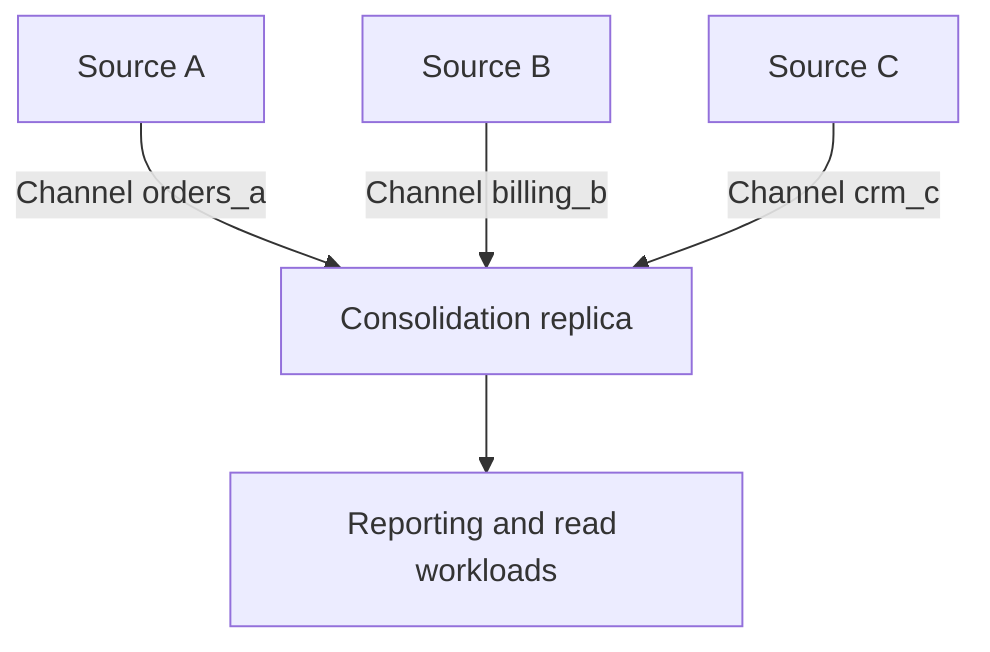

# Replication channel, multi-source và giới hạn khi kết hợp dữ liệu

## Mục tiêu

MySQL hỗ trợ một replica nhận thay đổi từ nhiều source thông qua nhiều replication channel. Mỗi channel đại diện cho một kết nối replication riêng, có cấu hình source, receiver, relay log metadata và trạng thái applier riêng. Mô hình này thường được gọi là **multi-source replication** hoặc replication fan-in.

Multi-source hữu ích khi cần tập hợp dữ liệu từ nhiều hệ thống vào một máy chủ phục vụ báo cáo, tìm kiếm hoặc phân tích. Tuy nhiên, nhiều channel không tự biến các luồng dữ liệu thành một cơ sở dữ liệu hợp nhất có khả năng giải quyết xung đột. Người thiết kế phải xác định quyền sở hữu dữ liệu, khóa định danh, quan hệ giữa bảng, quy tắc DDL và cách xử lý khi các nguồn cùng thay đổi một đối tượng.

Bài học thuộc module **DATABASE_MYSQL**, tập trung vào thiết kế bảng, kiểu dữ liệu, khóa, truy vấn SQL, index, transaction, kiểm soát đồng thời, tối ưu truy vấn và vận hành cơ sở dữ liệu quan hệ. Sau bài học, bạn có thể:

- Giải thích channel và cách một replica nhận dữ liệu từ nhiều source.
- Cấu hình, khởi động, dừng và quan sát từng channel độc lập.
- Dùng GTID auto-position trong topology multi-source và nhận diện yêu cầu về định danh máy chủ.
- Thiết kế namespace, khóa và quyền sở hữu dữ liệu để tránh xung đột khi hợp nhất.
- Đánh giá giới hạn về thứ tự transaction, DDL, replication filter, hiệu năng và failover.

## 1. Channel là gì?

Trong replication một nguồn, replica có một luồng nhận dữ liệu từ source. Trong multi-source, replica có thể có nhiều channel; mỗi channel kết nối tới một source và vận chuyển transaction từ source đó về cùng replica.



Mỗi channel có tên riêng và cấu hình kết nối riêng. Ví dụ, `orders_a` nhận dữ liệu từ Source A, còn `billing_b` nhận dữ liệu từ Source B. Channel mặc định có tên rỗng; khi quản lý nhiều luồng, nên đặt tên tường minh để dễ vận hành và tránh nhầm lẫn.

Channel có các thành phần độc lập theo luồng:

| Thành phần | Phạm vi channel | Vai trò |
|---|---|---|
| Connection configuration | Riêng từng channel | Host, port, account, TLS, retry và lựa chọn auto-position |
| Receiver thread | Riêng từng channel | Kết nối source và nhận binlog event |
| Relay log metadata | Riêng từng channel | Theo dõi event đã nhận và hàng đợi cần áp dụng |
| Applier/coordinator | Riêng từng channel | Thực thi transaction nhận từ source đó |
| Applier workers | Theo cấu hình channel và phiên bản | Áp dụng transaction song song khi được bật |

Các channel dùng chung CPU, RAM, network và storage của replica. Chúng cũng cùng cập nhật một bộ dữ liệu đích, vì vậy cần thiết kế để các luồng không ghi đè hoặc làm sai lệch dữ liệu của nhau.

## 2. Những mô hình multi-source thường gặp

**Tập hợp các schema độc lập:** mỗi source sở hữu một schema riêng trên replica. Ví dụ Source A ghi `orders_a`, Source B ghi `orders_b`. Đây thường là mô hình dễ kiểm soát nhất vì namespace dữ liệu được tách rõ.

**Tập hợp các bảng độc lập:** nhiều nguồn đưa các nhóm bảng khác nhau vào cùng schema đích. Ví dụ nguồn A sở hữu `customer_profile`, nguồn B sở hữu `product_catalog`. Cần quản lý rõ chủ sở hữu của từng bảng và quy trình thay đổi schema.

**Tập hợp theo tenant hoặc vùng:** mỗi source quản lý một tập tenant, khu vực hoặc phân vùng dữ liệu riêng. Có thể cùng dùng một cấu trúc bảng, nhưng khóa chính và quy tắc phân vùng phải đảm bảo bản ghi từ các nguồn không va chạm.

**Nhiều nguồn cùng ghi một bảng:** đây là trường hợp rủi ro cao. Hai nguồn có thể tạo cùng khóa chính, cập nhật cùng một hàng hoặc phát DDL không tương thích. Replication channel không cung cấp cơ chế tự động phân xử xung đột; chỉ dùng khi ứng dụng đã có quy tắc phân chia quyền ghi và khóa định danh rõ ràng.

## 3. Cấu hình channel riêng

Ví dụ dưới đây dùng MySQL 8.0.23 trở lên với cú pháp `CHANGE REPLICATION SOURCE TO`. Trên source A, tạo account dành cho replica và giới hạn host nguồn kết nối:

```sql
CREATE USER 'repl_a'@'10.20.30.50'
  IDENTIFIED BY '<source-a-replication-secret>'
  REQUIRE SSL;

GRANT REPLICATION SLAVE
  ON *.*
  TO 'repl_a'@'10.20.30.50';
```

Thực hiện tương tự trên source B với account và secret phù hợp. Quyền `REPLICATION SLAVE` là tên quyền replication được dùng trong nhiều phiên bản MySQL; hãy xác minh cú pháp và quyền theo phiên bản cụ thể. Không dùng account quản trị cho receiver.

Trên replica, cấu hình channel `orders_a`:

```sql
CHANGE REPLICATION SOURCE TO
  SOURCE_HOST = 'source-a.example.net',
  SOURCE_PORT = 3306,
  SOURCE_USER = 'repl_a',
  SOURCE_PASSWORD = '<source-a-replication-secret>',
  SOURCE_AUTO_POSITION = 1
FOR CHANNEL 'orders_a';

START REPLICA FOR CHANNEL 'orders_a';
```

Tiếp tục cấu hình channel `billing_b` với thông tin kết nối tới source B:

```sql
CHANGE REPLICATION SOURCE TO
  SOURCE_HOST = 'source-b.example.net',
  SOURCE_PORT = 3306,
  SOURCE_USER = 'repl_b',
  SOURCE_PASSWORD = '<source-b-replication-secret>',
  SOURCE_AUTO_POSITION = 1
FOR CHANNEL 'billing_b';

START REPLICA FOR CHANNEL 'billing_b';
```

Trong môi trường thật, không lưu mật khẩu trực tiếp trong script, shell history hoặc hệ thống quản lý mã nguồn. Dùng cơ chế cấp secret an toàn và giới hạn quyền đọc. Ví dụ giả định các source và replica đã bật GTID, có dữ liệu khởi tạo tương thích và đáp ứng điều kiện auto-position.

Với MySQL trước 8.0.23, có thể phải dùng `CHANGE MASTER TO` cùng các tùy chọn `MASTER_*`; các lệnh điều khiển tương ứng cũng có tên cũ như `START SLAVE`. Hãy đối chiếu tài liệu của phiên bản đang chạy trước khi áp dụng.

## 4. Điều khiển và quan sát từng channel

Bạn có thể dừng hoặc chạy lại một channel mà không cần dừng các channel còn lại:

```sql
STOP REPLICA FOR CHANNEL 'orders_a';
START REPLICA FOR CHANNEL 'orders_a';

SHOW REPLICA STATUS FOR CHANNEL 'orders_a'\G
SHOW REPLICA STATUS FOR CHANNEL 'billing_b'\G
```

`STOP REPLICA` trên một channel dừng receiver và applier của channel đó. Các channel khác tiếp tục hoạt động. Nếu cần dừng toàn bộ luồng, dùng lệnh không chỉ định channel theo quy trình vận hành.

Để xem cấu hình các kết nối:

```sql
SELECT CHANNEL_NAME, HOST, PORT, USER, AUTO_POSITION
FROM performance_schema.replication_connection_configuration;
```

Để quan sát receiver và applier:

```sql
SELECT CHANNEL_NAME, SERVICE_STATE, RECEIVED_TRANSACTION_SET,
       LAST_ERROR_NUMBER, LAST_ERROR_MESSAGE
FROM performance_schema.replication_connection_status;

SELECT CHANNEL_NAME, SERVICE_STATE, LAST_ERROR_NUMBER, LAST_ERROR_MESSAGE
FROM performance_schema.replication_applier_status_by_coordinator;

SELECT CHANNEL_NAME, WORKER_ID, SERVICE_STATE,
       LAST_ERROR_NUMBER, LAST_ERROR_MESSAGE
FROM performance_schema.replication_applier_status_by_worker;
```

Performance Schema có thể khác nhau giữa các phiên bản MySQL; nếu một bảng hoặc cột không tồn tại, hãy kiểm tra cấu trúc của phiên bản đang dùng. Trong `SHOW REPLICA STATUS`, chú ý `Channel_Name`, trạng thái receiver/applier, lỗi gần nhất, GTID đã nhận và đã thực thi.

Đặt tên channel theo nguồn dữ liệu hoặc mục đích, ví dụ `orders_eu`, `orders_apac`, `billing_legacy`. Tránh đặt tên mơ hồ như `channel1` vì khó xác định nguồn trong lúc xử lý sự cố.

## 5. GTID trong topology multi-source

GTID giúp replica xác định transaction nào đã được thực thi và yêu cầu source gửi phần còn thiếu. Trong multi-source, mỗi source cần có định danh GTID riêng biệt. GTID thường có dạng `source_uuid:transaction_number`, trong đó `source_uuid` bắt nguồn từ `server_uuid` của máy chủ tạo transaction.

Vì vậy, các source phải có `server_uuid` khác nhau và `server_id` duy nhất trong topology. Nếu hai source được clone từ cùng một data directory và giữ nguyên `server_uuid`, GTID có thể bị trùng hoặc bị hiểu nhầm là cùng một lịch sử transaction. Hãy tạo danh tính máy chủ duy nhất theo quy trình MySQL được hỗ trợ trước khi kết nối các nguồn vào cùng replica.

Trên mỗi source và replica, các thiết lập GTID thường bao gồm:

```ini
[mysqld]
server_id = 201
log_bin = mysql-bin
gtid_mode = ON
enforce_gtid_consistency = ON
```

Giá trị `server_id` trong ví dụ phải được thay bằng giá trị duy nhất trên từng instance. Nếu replica còn đóng vai trò source cho tầng downstream, đánh giá thêm `log_replica_updates=ON` theo kiến trúc.

Khi mỗi channel dùng `SOURCE_AUTO_POSITION=1`, receiver gửi tập GTID đã thực thi trên replica để source xác định transaction cần gửi. Trên replica multi-source, tập GTID thực thi là trạng thái của instance; do đó việc định danh nguồn phải duy nhất và trạng thái GTID phải được kiểm tra trên toàn topology.

Các lệnh hữu ích:

```sql
SELECT @@GLOBAL.gtid_mode,
       @@GLOBAL.server_id,
       @@GLOBAL.server_uuid,
       @@GLOBAL.gtid_executed,
       @@GLOBAL.gtid_purged;
```

GTID auto-position không thay thế bước khởi tạo dữ liệu. Mỗi channel phải được kết nối với một replica đã có dữ liệu tương ứng và trạng thái GTID phù hợp. Nếu source đã purge các transaction replica còn thiếu, auto-position không thể tái tạo chúng từ hư không; cần một bản sao hoặc nguồn binlog còn giữ transaction.

## 6. Quyền sở hữu dữ liệu và namespace

Trước khi hợp nhất nhiều nguồn, hãy lập bảng quyền sở hữu. Một nhóm dữ liệu chỉ nên có một nguồn có thẩm quyền ghi tại một thời điểm, trừ khi ứng dụng có cơ chế đồng bộ và giải quyết xung đột riêng.

| Nguồn | Channel | Dữ liệu sở hữu | Quy tắc đích |
|---|---|---|---|
| Source A | `orders_a` | Đơn hàng khu vực A | Schema `orders_a`, chỉ Source A ghi |
| Source B | `orders_b` | Đơn hàng khu vực B | Schema `orders_b`, chỉ Source B ghi |
| Source C | `crm_c` | Hồ sơ khách hàng | Schema `crm_c`, chỉ Source C ghi |

Namespace có thể được tách bằng schema, tên bảng, tenant key hoặc khóa định danh có nguồn gốc. Ví dụ, nếu các nguồn cùng ghi vào bảng `orders`, hãy cân nhắc khóa tổng hợp `(source_id, order_id)` thay vì giả định `order_id` là duy nhất toàn hệ thống. `source_id` phải được quản lý ổn định và không tái sử dụng cho nguồn khác.

Nếu các source ghi cùng bảng với cột `AUTO_INCREMENT`, có thể cấu hình `auto_increment_increment` và `auto_increment_offset` khác nhau trên từng source để phân chia dãy ID. Ví dụ với hai nguồn:

```ini
# Source A
auto_increment_increment = 2
auto_increment_offset = 1

# Source B
auto_increment_increment = 2
auto_increment_offset = 2
```

Thiết lập này chỉ tránh va chạm cho giá trị được sinh tự động trong điều kiện các writer phối hợp đúng. Nó không giải quyết xung đột khi ứng dụng tự chỉ định ID, khi có nguồn thứ ba, khi thay đổi cấu hình không đồng bộ hoặc khi hai nguồn cập nhật cùng một hàng. UUID hoặc khóa có namespace thường dễ mở rộng hơn, nhưng cũng cần quy tắc duy nhất và kiểm tra ở tầng ứng dụng.

## 7. Giới hạn khi nhiều nguồn cùng thay đổi dữ liệu

Replication channel độc lập không tạo ra một thứ tự commit toàn cục giữa các source. Thứ tự transaction được duy trì trong từng luồng theo quy tắc replication của MySQL, nhưng transaction từ hai channel khác nhau có thể được áp dụng theo thứ tự khác nhau trên replica.

Điều này tạo ra một số giới hạn quan trọng:

- **Không có transaction nguyên tử xuyên channel:** một transaction trên Source A và một transaction liên quan trên Source B không được commit như một đơn vị phân tán duy nhất trên replica.
- **Không có cơ chế tự giải quyết xung đột:** hai source cùng insert một primary key có thể khiến applier gặp duplicate key; hai source cùng cập nhật một hàng có thể tạo ra kết quả phụ thuộc thứ tự áp dụng.
- **Ràng buộc khóa ngoại có thể vượt ranh giới nguồn:** nếu một channel tạo bản ghi cha và channel khác tạo bản ghi con tham chiếu đến nó, thứ tự áp dụng độc lập có thể làm transaction con thất bại.
- **DDL có thể xung đột:** hai nguồn cùng tạo hoặc thay đổi một bảng đích có thể phát sinh lỗi hoặc làm schema không còn tương thích với event dữ liệu.
- **Filter có thể làm dữ liệu thiếu quan hệ:** chỉ sao chép một phần bảng hoặc database có thể bỏ mất bản ghi cha, bảng tra cứu hoặc transaction cần thiết.
- **Tải được cộng dồn:** nhiều receiver có thể nhận nhanh hơn khả năng CPU, I/O hoặc applier của replica xử lý; relay log sẽ tăng và replica lag.

Vì vậy, hãy ưu tiên thiết kế mỗi source sở hữu một miền dữ liệu không chồng lấn. Nếu nghiệp vụ bắt buộc nhiều writer cùng sửa một thực thể, cần có tầng phân xử, đồng bộ hoặc mô hình dữ liệu chuyên biệt trước khi đưa dữ liệu qua replication.

## 8. Replication filter và rủi ro lọc dữ liệu

Replication filter cho phép channel chỉ áp dụng một số database hoặc table, hoặc ánh xạ database nguồn sang database đích. Filter có thể hữu ích khi gom nhiều schema vào một replica báo cáo, nhưng filter không phải công cụ hợp nhất có hiểu biết về quan hệ dữ liệu.

Ví dụ, lọc các bảng cần nhận trên một channel:

```sql
CHANGE REPLICATION FILTER
  REPLICATE_WILD_DO_TABLE = ('orders_a.%')
FOR CHANNEL 'orders_a';
```

Cú pháp và các loại filter hỗ trợ phụ thuộc phiên bản. Dùng `FOR CHANNEL` để giới hạn cấu hình cho channel tương ứng khi phiên bản hỗ trợ. Trước khi bật filter, kiểm tra tác động với `binlog_format`, database/table mapping, DDL, trigger và foreign key. Một filter sai có thể khiến replica thiếu dữ liệu mà không phải lúc nào cũng gây lỗi ngay.

Không dựa vào `replicate_do_db` hoặc `replicate_ignore_db` mà chưa hiểu quy tắc đánh giá database trong statement-based và row-based replication. Hãy thử các câu lệnh có thay đổi database mặc định, truy vấn ghi nhiều bảng và transaction liên schema trên môi trường kiểm thử.

Giữ một tài liệu mapping thể hiện nguồn, channel, database/table được nhận, database/table bị bỏ qua và lý do nghiệp vụ. Khi thay đổi filter, kiểm tra lại dữ liệu đích vì thay đổi cấu hình filter không tự động nạp bù các hàng đã bị bỏ qua trước đó.

## 9. Vận hành, lỗi và failover

Kiểm tra từng channel riêng khi có sự cố:

1. Xác định channel nào bị ảnh hưởng bằng `SHOW REPLICA STATUS` hoặc `performance_schema.replication_connection_status`.
2. Nếu receiver dừng, kiểm tra host, port, DNS, firewall, TLS, account, quyền và binlog còn được giữ trên source.
3. Nếu applier dừng, đọc lỗi coordinator/worker, xác định transaction gây lỗi và kiểm tra schema cùng dữ liệu đích.
4. Nếu relay log tăng, so sánh tốc độ nhận với tốc độ áp dụng, dung lượng ổ đĩa, CPU, I/O và lock wait.
5. Sau khi sửa nguyên nhân, chạy lại đúng channel và xác minh GTID cùng dữ liệu đã bắt kịp.

Không reset toàn bộ replica chỉ để xử lý một channel. Các lệnh như `RESET REPLICA ALL FOR CHANNEL 'orders_a'` có thể xóa metadata kết nối của channel; chỉ thực hiện khi đã lưu lại cấu hình và hiểu rõ trạng thái cần dựng lại. Không xóa relay log thủ công hoặc bỏ qua transaction lỗi để làm trạng thái hiển thị xanh.

Khi một source hỏng, chỉ channel của source đó bị mất khả năng nhận transaction mới; các channel khác có thể tiếp tục. Tuy nhiên, báo cáo tổng hợp có thể thiếu dữ liệu từ nguồn lỗi. Nếu chuyển channel sang source thay thế, xác nhận source mới có cùng lịch sử GTID cần thiết, cùng dữ liệu và schema tương thích. Auto-position chỉ hoạt động khi lịch sử GTID có thể đáp ứng yêu cầu của replica.

Với multi-source dùng cho báo cáo, hiển thị trạng thái freshness theo từng nguồn. Một chỉ số lag tổng hợp có thể che khuất việc một channel đã dừng trong khi các channel còn lại vẫn bắt kịp.

## 10. Bài tập thực hành

Trên ba MySQL instance thử nghiệm, dựng một replica nhận dữ liệu từ hai source:

1. Cấu hình `server_id` và `server_uuid` duy nhất, bật binlog và GTID theo quy trình của phiên bản.
2. Tạo hai account replication riêng, giới hạn host và yêu cầu TLS nếu môi trường hỗ trợ.
3. Seed dữ liệu ban đầu cho replica từ backup nhất quán của từng source.
4. Tạo hai channel `orders_a` và `billing_b` bằng `CHANGE REPLICATION SOURCE TO ... FOR CHANNEL`, sau đó khởi động từng channel.
5. Ghi transaction trên từng source và xác nhận dữ liệu đến đúng schema đích.
6. Dừng riêng channel `orders_a`, tiếp tục ghi dữ liệu trên Source A và Source B; quan sát Source B vẫn được áp dụng.
7. Khởi động lại `orders_a`, kiểm tra receiver, applier, GTID và trạng thái bắt kịp.
8. Thử một tình huống trùng khóa trong môi trường cô lập để quan sát lỗi applier; khôi phục dữ liệu bằng quy trình có kiểm soát.
9. Lập bảng quyền sở hữu dữ liệu và ghi lại giới hạn của thiết kế nếu hai nguồn cùng ghi một bảng.

**Tiêu chí hoàn thành:** bạn có thể cấu hình và quản lý từng channel độc lập, đọc được trạng thái receiver/applier theo channel, giải thích yêu cầu GTID/server identity và chỉ ra vì sao multi-source không tự xử lý xung đột dữ liệu.

## Kết luận

Replication channel cho phép một replica nhận nhiều luồng dữ liệu độc lập từ nhiều source. Mỗi channel có cấu hình và trạng thái riêng, nhưng tất cả cùng dùng tài nguyên và dữ liệu đích của replica. GTID auto-position hỗ trợ nối tiếp lịch sử transaction khi định danh nguồn là duy nhất. Để multi-source an toàn, hãy phân chia quyền sở hữu dữ liệu, tránh ghi chồng lấn, kiểm soát schema/filter và theo dõi lag cùng lỗi riêng cho từng channel.
