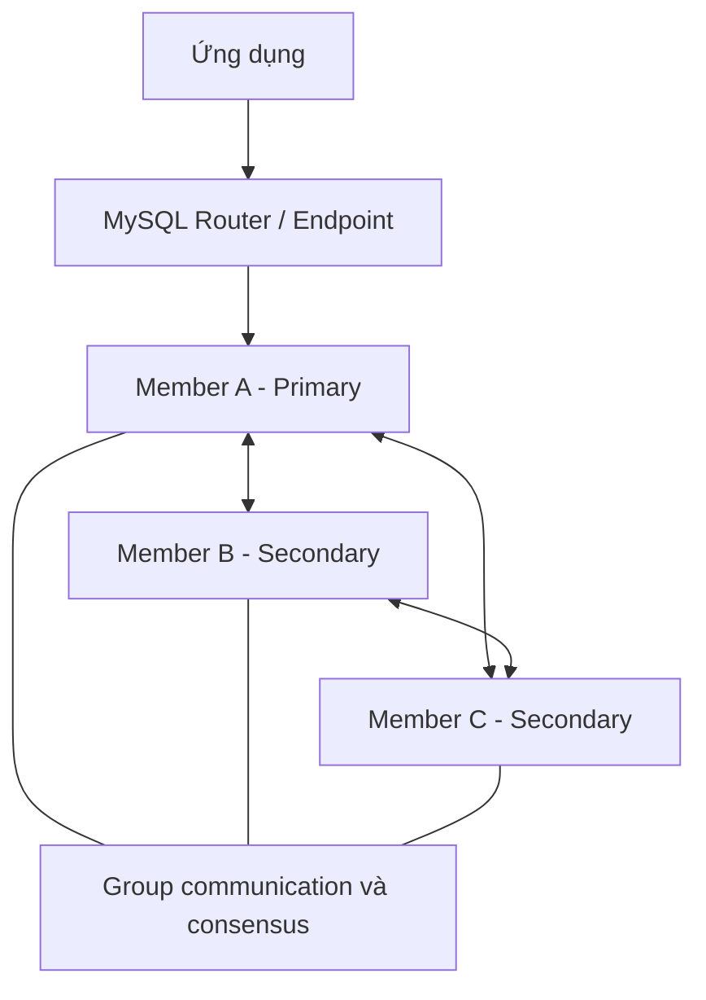
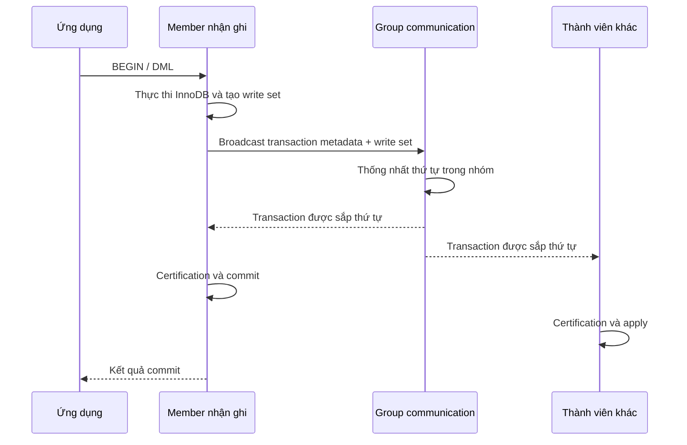

# Group Replication, nhóm thành viên và cơ chế đồng thuận

## Mục tiêu

Sau bài học này, bạn có thể:

- Giải thích kiến trúc và luồng xử lý transaction của MySQL Group Replication.
- Mô tả cách nhóm thành viên thiết lập membership view, sắp thứ tự transaction và dùng quorum để duy trì tính nhất quán.
- Phân biệt single-primary và multi-primary, hiểu cơ chế bầu chọn primary và certification conflict.
- Theo dõi trạng thái thành viên, phát hiện mất quorum và xử lý node tham gia lại nhóm.
- Nhận diện các điều kiện triển khai như GTID, định danh duy nhất, row-based logging, InnoDB và kết nối nội bộ.
- Thiết kế topology có khả năng chịu lỗi, kiểm thử failover và đánh giá các giới hạn vận hành.

## 1. Group Replication giải quyết bài toán gì?

MySQL Group Replication (GR) là cơ chế tạo một nhóm máy chủ MySQL phối hợp với nhau để duy trì cùng một lịch sử transaction đã được chấp nhận. Nhóm có thể tiếp tục hoạt động khi một số thành viên gặp sự cố, miễn là số thành viên còn giao tiếp được vẫn đạt quorum (đa số).

GR kết hợp hai cơ chế chính:

- **Group communication:** các thành viên trao đổi thông điệp, quản lý membership và thống nhất thứ tự sự kiện trong nhóm.
- **Transaction certification:** kiểm tra các transaction có xung đột ghi hay không trước khi chấp nhận commit theo thứ tự đã thống nhất.

Một thành viên có thể nhận transaction từ ứng dụng, phát write set vào nhóm, tham gia quá trình certification và áp dụng transaction từ các thành viên khác. Nhờ vậy, nhóm duy trì một thứ tự transaction chung và hạn chế việc hai máy chủ chấp nhận những thay đổi xung đột mà không biết về nhau.

Group Replication thường là nền tảng của MySQL InnoDB Cluster. InnoDB Cluster bổ sung công cụ quản trị và cấu hình, còn MySQL Router hỗ trợ định tuyến kết nối ứng dụng đến primary hoặc các endpoint đọc. Bản thân Group Replication không tự thay thế bộ định tuyến kết nối, cơ chế retry của ứng dụng hay chiến lược backup.

## 2. Các thành phần của nhóm

Một topology cơ bản có ba thành viên:



Mỗi thành viên chạy một instance MySQL riêng và tham gia cùng một group. Các thành phần quan trọng gồm:

| Thành phần | Vai trò |
|---|---|
| Group member | Một instance MySQL tham gia nhóm và lưu bản sao dữ liệu của nhóm |
| Group name | UUID nhận diện nhóm; tất cả thành viên của cùng nhóm phải dùng cùng giá trị |
| `server_id` | Định danh replication riêng của từng máy chủ |
| `server_uuid` | Định danh nguồn GTID của từng máy chủ, phải duy nhất và ổn định |
| Group communication system (GCS) | Trao đổi thông điệp, quản lý membership view và thứ tự sự kiện |
| XCom | Communication stack mặc định của Group Replication, sử dụng cơ chế đồng thuận dựa trên Paxos để sắp thứ tự thông điệp và thay đổi membership |
| Certification | Kiểm tra write set của transaction với các transaction đã được sắp thứ tự trong nhóm |
| Distributed recovery | Đồng bộ dữ liệu và lịch sử transaction cho thành viên mới hoặc thành viên quay lại |

Các máy chủ cần kết nối được với nhau qua địa chỉ và cổng giao tiếp nội bộ được cấu hình. Cổng SQL của ứng dụng và cổng group communication có thể khác nhau; firewall phải cho phép đúng lưu lượng giữa các thành viên.

## 3. Group communication và cơ chế đồng thuận

### 3.1. Membership view

Membership view là danh sách thành viên mà nhóm hiện xem là đang tham gia cùng một cấu hình. Khi một node tham gia, rời nhóm hoặc bị xác định là không còn liên lạc được, GCS điều phối thay đổi membership và tạo view mới.

Mọi thành viên còn hoạt động cần thống nhất cùng một thứ tự thay đổi view. Nếu một thành viên không thể theo kịp nhóm, nó có thể bị loại khỏi view hiện tại hoặc chuyển sang trạng thái không hoạt động. Khi kết nối trở lại, node phải đồng bộ theo membership view mới trước khi được xem là thành viên hoạt động.

Việc thay đổi view không chỉ là cập nhật danh sách địa chỉ. Nó ảnh hưởng đến quorum, primary, thứ tự transaction và khả năng nhóm tiếp tục commit. Đây là lý do Group Replication cần cơ chế đồng thuận trong group communication.

### 3.2. Quorum và majority

Quorum là số thành viên tối thiểu cần thiết để nhóm có thể thống nhất và tiếp tục tiến triển. Với nhóm có (N) thành viên, majority được tính:

\[
Q = \left\lfloor \frac{N}{2} \right\rfloor + 1
\]

Ví dụ:

| Số thành viên | Quorum | Số node có thể mất mà nhóm vẫn còn majority |
|---:|---:|---:|
| 1 | 1 | 0 |
| 2 | 2 | 0 |
| 3 | 2 | 1 |
| 4 | 3 | 1 |
| 5 | 3 | 2 |
| 6 | 4 | 2 |

Đây là lý do topology thường chọn số thành viên lẻ như 3 hoặc 5. Thêm thành viên thứ tư vào nhóm ba node không tăng số node có thể mất mà vẫn giữ majority; nó làm tăng tài nguyên và lưu lượng cần đồng bộ.

Nếu nhóm ba node bị chia mạng thành hai phía, phía có hai thành viên có thể giữ quorum và tiếp tục hoạt động; node đơn lẻ không thể tự coi mình là một nhóm hợp lệ để tiếp tục commit. Cơ chế này giúp tránh hai phía cùng chấp nhận các transaction độc lập và tạo split-brain.

Quorum không bảo đảm dịch vụ luôn sẵn sàng. Nhóm vẫn có thể dừng tiến triển khi mạng chập chờn, thành viên quá tải, nhiều node lỗi cùng lúc hoặc không thể đạt majority. Vì vậy, phải thiết kế mạng, nguồn điện, rack và vùng triển khai để giảm khả năng nhiều thành viên cùng mất liên lạc.

### 3.3. Vai trò của XCom và Paxos

XCom là communication stack mặc định của Group Replication. Nó dùng cơ chế đồng thuận dựa trên Paxos để thống nhất thứ tự thông điệp và thay đổi membership. Nhờ thứ tự chung, các thành viên xử lý transaction theo cùng một lịch sử logic.

Không nên hiểu Paxos ở đây là mọi byte dữ liệu trong InnoDB đều được ghi đồng bộ lên tất cả đĩa trước khi ứng dụng nhận phản hồi. Group Replication điều phối thứ tự và certification của transaction; việc áp dụng transaction trên từng member và mức chờ nhất quán còn phụ thuộc cấu hình, trạng thái thành viên và consistency level.

Khi nhóm mất majority, các thành viên không thể tự ý tiếp tục ghi như những primary độc lập. Cần khôi phục quorum hoặc thực hiện quy trình phục hồi nhóm theo đúng trạng thái thực tế.

## 4. Luồng transaction và certification

Một transaction được ứng dụng gửi đến member thường trải qua các bước khái quát sau:

1. **Thực thi cục bộ:** transaction chạy trên member nhận kết nối, đọc và sửa dữ liệu InnoDB.
2. **Tạo write set:** MySQL trích xuất thông tin về các hàng/khóa bị thay đổi để phục vụ certification.
3. **Phát vào nhóm:** write set cùng metadata transaction được gửi qua group communication.
4. **Sắp thứ tự:** GCS thống nhất thứ tự sự kiện để các thành viên xử lý cùng một lịch sử.
5. **Certification:** thành viên kiểm tra write set của transaction với các transaction đã được chấp nhận trong thứ tự chung. Nếu có xung đột ghi, transaction có thể bị từ chối.
6. **Commit và áp dụng:** transaction được commit ở member khởi tạo khi vượt qua quy trình certification; các member còn lại nhận và áp dụng transaction theo thứ tự nhóm.

Sơ đồ khái quát:



Đây là sơ đồ khái niệm để minh họa các giai đoạn. Chi tiết nội bộ, thời điểm xác nhận và việc chờ áp dụng phụ thuộc phiên bản, consistency level và tình trạng thành viên.

### 4.1. Write set và xung đột

Write set biểu diễn các khóa/hàng bị transaction sửa. Certification dùng thông tin này để phát hiện hai transaction có khả năng ghi xung đột. Nếu hai transaction từ các member khác nhau sửa cùng một khóa trong thứ tự gần nhau, một transaction có thể không vượt qua certification.

Ví dụ, hai thành viên cùng nhận lệnh cập nhật số lượng của một sản phẩm:

```sql
-- Transaction chạy trên Member A
UPDATE inventory
SET quantity = quantity - 1
WHERE product_id = 9001;

-- Cùng thời điểm, transaction khác chạy trên Member B
UPDATE inventory
SET quantity = quantity - 2
WHERE product_id = 9001;
```

Trong multi-primary, cả hai transaction có thể thực thi cục bộ, nhưng write set cùng chạm vào khóa của sản phẩm `9001`. Khi được sắp thứ tự, certification phát hiện xung đột và từ chối một transaction theo quy tắc của nhóm. Ứng dụng phải xử lý lỗi và có thể cần retry toàn bộ transaction từ đầu.

### 4.2. Certification không thay thế kiểm tra nghiệp vụ

Certification tập trung vào xung đột ghi dựa trên write set, không chứng minh mọi quy tắc nghiệp vụ đều đúng. Ví dụ, hai transaction sửa hai hàng khác nhau nhưng cùng làm vi phạm một quy tắc tổng thể có thể không tạo ra write-set conflict. Ứng dụng vẫn cần constraint, transaction isolation và logic nghiệp vụ phù hợp.

## 5. Single-primary mode

Single-primary là chế độ mặc định phổ biến. Tại một thời điểm, một member được chọn làm primary nhận ghi; các member còn lại là secondary và thường phục vụ đọc.

Đặc điểm:

- Ghi tập trung vào một primary, giảm khả năng nhiều node cùng sửa một hàng.
- Secondary áp dụng transaction đã được primary phát ra theo thứ tự nhóm.
- Khi primary lỗi hoặc rời nhóm, các thành viên còn lại thống nhất membership view mới và bầu một primary mới nếu còn quorum.
- Primary mới cần bắt kịp các transaction đã được chấp nhận trước khi phục vụ ghi theo consistency level và trạng thái phục hồi.

Ưu điểm của single-primary là mô hình ghi dễ hiểu, phù hợp phần lớn ứng dụng OLTP và giảm xung đột do nhiều writer. Nhược điểm là tải ghi tập trung vào một node; hiệu năng ghi phụ thuộc primary và các transaction vẫn cần được truyền, certification và áp dụng trong nhóm.

Ứng dụng nên kết nối ghi qua endpoint định tuyến đến primary thay vì hard-code địa chỉ của một máy chủ. Khi failover, Router hoặc lớp quản lý kết nối cần cập nhật đích, còn connection pool phải có khả năng bỏ connection cũ và kết nối lại.

## 6. Multi-primary mode

Trong multi-primary, nhiều member có thể nhận transaction ghi. Group Replication vẫn sắp thứ tự transaction và certification write set trên toàn nhóm.

Ưu điểm:

- Có thể phân phối kết nối ghi đến nhiều member.
- Một member có thể tiếp tục nhận ghi khi member khác rời nhóm, nếu quorum còn tồn tại và routing được cập nhật.
- Có thể hữu ích cho workload được phân vùng dữ liệu tốt, ít ghi trùng cùng khóa.

Chi phí và rủi ro:

- Nhiều writer có thể cập nhật cùng dữ liệu, dẫn đến certification conflict và transaction bị hủy.
- Ứng dụng phải xử lý lỗi transaction và retry đúng cách.
- Các thao tác DDL đồng thời trên nhiều primary cần được điều phối; không nên triển khai schema migration độc lập cùng lúc trên nhiều node.
- Thứ tự transaction chung và truyền write set vẫn tạo độ trễ, nên multi-primary không đồng nghĩa với việc mỗi node ghi hoàn toàn độc lập.

### 6.1. Giảm xung đột trong multi-primary

- Phân vùng dữ liệu theo tenant, khu vực hoặc nhóm khóa để một loại dữ liệu thường chỉ được ghi ở một member.
- Đảm bảo transaction ngắn, cập nhật ít hàng và tránh giữ transaction mở lâu.
- Dùng khóa chính rõ ràng, ổn định và duy nhất cho từng hàng.
- Điều phối migration, batch job và thao tác quản trị schema qua một quy trình duy nhất.
- Theo dõi số transaction bị rollback do certification conflict và điều chỉnh chiến lược phân phối ghi.

Ví dụ, nếu mỗi tenant được gán một member ghi chính, các transaction của cùng tenant ít cạnh tranh cùng khóa hơn. Cách này chỉ hiệu quả khi routing nhất quán và hệ thống có kế hoạch cho tenant chuyển member.

## 7. Primary election và thay đổi membership

Trong single-primary mode, primary được chọn dựa trên trạng thái nhóm và các quy tắc ưu tiên/election của cấu hình. Khi primary rời nhóm, các thành viên còn lại tạo view mới và bầu primary mới. Ứng dụng cần chấp nhận rằng kết nối đến primary cũ có thể bị ngắt trong quá trình chuyển đổi.

Một số điểm vận hành:

- Không giả định primary mới luôn là node có phần cứng mạnh nhất nếu chưa cấu hình ưu tiên phù hợp.
- Đảm bảo các node secondary có GTID history gần nhất và không có transaction cục bộ ngoài dự kiến.
- Chờ thành viên được chọn phục hồi và đạt trạng thái sẵn sàng trước khi chuyển lưu lượng ghi.
- Tránh để hai quy trình quản trị đồng thời bootstrap hoặc promote các nhóm độc lập.
- Có runbook xử lý khi primary cũ quay lại sau failover; nó phải gia nhập và đồng bộ với nhóm hiện tại trước khi phục vụ.

Trong multi-primary, không có một primary ghi duy nhất. Membership view vẫn thay đổi khi thành viên gia nhập hoặc rời nhóm, và mọi transaction phải được xử lý theo thứ tự chung.

## 8. Quản lý trạng thái thành viên

Group Replication cung cấp trạng thái member qua Performance Schema. Truy vấn cơ bản:

```sql
SELECT
  MEMBER_ID,
  MEMBER_HOST,
  MEMBER_PORT,
  MEMBER_STATE,
  MEMBER_ROLE,
  MEMBER_VERSION
FROM performance_schema.replication_group_members;
```

Các trạng thái thường gặp:

| Trạng thái | Ý nghĩa vận hành |
|---|---|
| `ONLINE` | Member đang hoạt động và tham gia nhóm |
| `RECOVERING` | Member đang đồng bộ dữ liệu hoặc transaction còn thiếu |
| `OFFLINE` | Plugin hoặc member chưa tham gia nhóm |
| `ERROR` | Member gặp lỗi và không thể tiếp tục hoạt động bình thường |
| `UNREACHABLE` | Member không thể được liên lạc từ góc nhìn của các thành viên còn lại trong view |

`UNREACHABLE` không tự động chứng minh máy chủ đã tắt. Có thể node còn chạy nhưng bị phân vùng mạng, firewall hoặc quá tải. Cần kiểm tra cả log MySQL, log hệ điều hành và đường truyền giữa các thành viên.

Để kiểm tra vai trò primary trong single-primary mode, có thể truy vấn:

```sql
SELECT
  MEMBER_HOST,
  MEMBER_ROLE,
  MEMBER_STATE
FROM performance_schema.replication_group_members
ORDER BY MEMBER_ROLE, MEMBER_HOST;
```

Để theo dõi số liệu certification và transaction:

```sql
SELECT *
FROM performance_schema.replication_group_member_stats;
```

Các cột thống kê có thể thay đổi theo phiên bản. Khi xây dashboard, chọn những metric cần thiết từ tài liệu phiên bản đang triển khai, chẳng hạn transaction được nhận, transaction được áp dụng, transaction bị từ chối khi certification và hàng đợi applier.

## 9. Thành viên mới và distributed recovery

Khi một member mới tham gia, nó không thể lập tức phục vụ như một member đã đồng bộ. Group Replication thực hiện distributed recovery để đưa dữ liệu và GTID history của member về trạng thái phù hợp với nhóm.

Quá trình khái quát:

1. Member mới kết nối đến seed/member trong nhóm và được chấp nhận vào membership view.
2. Member ở trạng thái `RECOVERING` trong khi đồng bộ.
3. MySQL chọn donor phù hợp để cung cấp các transaction còn thiếu.
4. Incremental recovery truyền các transaction qua replication recovery channel nếu donor còn giữ binlog cần thiết.
5. Nếu cần đồng bộ lượng dữ liệu lớn hoặc thiếu log, cơ chế clone có thể được sử dụng khi được cấu hình và hỗ trợ.
6. Khi hoàn tất recovery và đạt điều kiện tham gia, member chuyển sang `ONLINE`.

Kiểm tra trạng thái recovery channel:

```sql
SELECT
  CHANNEL_NAME,
  SERVICE_STATE,
  LAST_ERROR_NUMBER,
  LAST_ERROR_MESSAGE
FROM performance_schema.replication_connection_status
WHERE CHANNEL_NAME = 'group_replication_recovery';
```

Với incremental recovery, donor cần giữ đủ binary log để phục vụ GTID mà joiner còn thiếu. Nếu log đã bị purge, việc gia nhập có thể thất bại hoặc cần full state transfer/clone. Vì vậy, retention binlog phải tính đến thời gian node có thể ngừng hoạt động và thời gian cần để dựng lại.

Không đưa member đang `RECOVERING` vào endpoint phục vụ đọc/ghi như thể nó đã đồng bộ hoàn toàn. Theo dõi tiến độ, lỗi recovery, dung lượng relay log và trạng thái cuối cùng trước khi mở lưu lượng.

## 10. Các điều kiện kỹ thuật quan trọng

Group Replication có các yêu cầu cấu hình và dữ liệu cần được đáp ứng trên các thành viên:

- **GTID:** bật `gtid_mode=ON` và `enforce_gtid_consistency=ON` để quản lý lịch sử transaction nhất quán.
- **Binary log:** bật `log_bin=ON`; các thành viên cần ghi và phát log theo kiến trúc replication.
- **Ghi lại transaction từ thành viên khác:** bật `log_replica_updates=ON` để các transaction được áp dụng từ nhóm cũng được ghi vào binary log cục bộ, hỗ trợ các luồng phục hồi và vai trò donor theo kiến trúc.
- **Row-based logging:** Group Replication yêu cầu row-based binary logging. Với các bản MySQL hiện đại, `ROW` là mặc định; `binlog_format` đã deprecated từ MySQL 8.0.34, vì vậy kiểm tra hướng dẫn phiên bản thay vì dựa vào một thiết lập cũ.
- **Định danh duy nhất:** mỗi member có `server_id` và `server_uuid` riêng, ổn định qua restart.
- **Storage engine:** dữ liệu ứng dụng tham gia replication phải dùng InnoDB; không thiết kế transaction nhóm dựa trên thay đổi bảng nontransactional.
- **Primary key:** các bảng cần có primary key hoặc khóa unique phù hợp, không null, để nhận diện hàng và phát hiện xung đột chính xác.
- **Mạng nội bộ:** các thành viên phải giao tiếp được qua địa chỉ/cổng Group Replication đã cấu hình; cấu hình TLS nếu yêu cầu bảo vệ luồng nội bộ.
- **Phiên bản:** dùng phiên bản được hỗ trợ trong topology và tuân thủ quy trình nâng cấp/rolling upgrade của MySQL.

Kiểm tra các biến quan trọng:

```sql
SELECT
  @@hostname AS hostname,
  @@server_id AS server_id,
  @@server_uuid AS server_uuid,
  @@gtid_mode AS gtid_mode,
  @@enforce_gtid_consistency AS enforce_gtid_consistency,
  @@log_bin AS log_bin,
  @@binlog_format AS binlog_format;
```

Không phải mọi biến đều có thể thay đổi động. Một số yêu cầu phải được cấu hình trước khi khởi động plugin hoặc cần restart. Hãy đối chiếu tài liệu đúng phiên bản và xác minh trên từng thành viên.

## 11. Cấu hình nhóm và bootstrap

Ví dụ cấu hình nền trên một member trong file cấu hình MySQL:

```ini
[mysqld]
server_id=101
log_bin=mysql-bin
log_replica_updates=ON
gtid_mode=ON
enforce_gtid_consistency=ON
binlog_format=ROW

plugin_load_add=group_replication.so
group_replication_group_name="aaaaaaaa-bbbb-4ccc-8ddd-eeeeeeeeeeee"
group_replication_start_on_boot=OFF
group_replication_local_address="mysql-a.internal:33061"
group_replication_group_seeds="mysql-a.internal:33061,mysql-b.internal:33061,mysql-c.internal:33061"
group_replication_single_primary_mode=ON
```

Đây là mẫu định hướng, không phải cấu hình production hoàn chỉnh. Tên plugin, đường dẫn, cổng, TLS, recovery credentials, các thiết lập parallel applier và chính sách firewall phải được cấu hình theo hệ điều hành, phiên bản và môi trường thực tế. Mỗi member cần `server_id`, `server_uuid` và `group_replication_local_address` phù hợp, không được sao chép nguyên identity từ node khác.

### 11.1. Bootstrap nhóm lần đầu

Khi tạo một nhóm hoàn toàn mới, đúng một member phải bootstrap nhóm. Ví dụ:

```sql
SET GLOBAL group_replication_bootstrap_group = ON;
START GROUP_REPLICATION;
SET GLOBAL group_replication_bootstrap_group = OFF;
```

Sau khi member đầu tiên hoạt động, các member khác tham gia bằng `START GROUP_REPLICATION` theo cấu hình và recovery credentials đã chuẩn bị.

**Không bật bootstrap đồng thời trên nhiều member.** Nếu nhiều máy cùng bootstrap, chúng có thể hình thành các nhóm độc lập có cùng group name, gây phân nhánh lịch sử và rủi ro split-brain. Chỉ bootstrap khi chắc chắn đang tạo nhóm mới hoặc đã thực hiện quy trình phục hồi nhóm được MySQL hỗ trợ; không dùng nó để chữa một nhóm đang mất quorum một cách tùy tiện.

## 12. Single-primary hay multi-primary?

| Tiêu chí | Single-primary | Multi-primary |
|---|---|---|
| Nơi nhận ghi | Một primary tại một thời điểm | Nhiều member có thể nhận ghi |
| Xung đột ghi | Thường thấp hơn vì ghi tập trung | Có thể cao nếu nhiều node sửa cùng khóa |
| Routing ứng dụng | Endpoint ghi phải đến primary | Có thể định tuyến đến nhiều writer theo chính sách |
| Vận hành | Dễ hiểu, dễ điều tra hơn | Cần quản lý phân vùng dữ liệu và retry chặt chẽ |
| Workload phù hợp | OLTP có nhiều giao dịch cùng dữ liệu | Workload phân vùng tốt, ít ghi đè lẫn nhau |

Đối với phần lớn ứng dụng MySQL, single-primary là điểm bắt đầu phù hợp. Chỉ chọn multi-primary khi có mô hình phân phối ghi rõ ràng, đo được xung đột và ứng dụng có thể retry transaction bị certification failure.

## 13. Consistency level và độ trễ đọc

Group Replication có biến `group_replication_consistency` để điều chỉnh mức chờ nhất quán cho transaction. Giá trị thường gặp:

| Mức | Ý nghĩa khái quát |
|---|---|
| `EVENTUAL` | Không chờ thêm để bảo đảm các transaction trước đã được áp dụng trên member hiện tại; có thể quan sát dữ liệu trễ trên secondary |
| `BEFORE_ON_PRIMARY_FAILOVER` | Sau khi primary mới được bầu, chờ backlog transaction cần thiết được áp dụng trước khi cho phép transaction mới theo điều kiện của chế độ này |
| `BEFORE` | Chờ các transaction trước đó được áp dụng trước khi transaction mới bắt đầu thực thi |
| `AFTER` | Chờ transaction hiện tại được áp dụng trên các member liên quan trước khi trả kết quả commit |
| `BEFORE_AND_AFTER` | Kết hợp chờ trước và sau transaction |

Mức chờ cao hơn có thể giảm nguy cơ đọc dữ liệu cũ hoặc quan sát thứ tự chưa mong muốn, nhưng làm tăng độ trễ và khiến transaction phụ thuộc vào trạng thái các member khác. Cần chọn theo yêu cầu nghiệp vụ, thử nghiệm khi member chậm hoặc mất liên lạc và đọc chi tiết semantics của phiên bản đang chạy.

Ví dụ kiểm tra cấu hình:

```sql
SHOW GLOBAL VARIABLES LIKE 'group_replication_consistency';
```

Đừng đặt consistency level cao nhất cho mọi workload một cách mặc định. Hãy xác định thao tác nào cần read-after-write hoặc đồng bộ mạnh hơn, rồi đánh giá tác động lên latency và khả năng chịu lỗi.

## 14. Giám sát và xử lý tình huống lỗi

Các chỉ số nên theo dõi:

- Số member `ONLINE`, `RECOVERING`, `ERROR` và `UNREACHABLE`.
- Primary hiện tại và thời điểm membership view thay đổi.
- Số transaction bị từ chối do certification conflict.
- Queue transaction nhận được nhưng chưa áp dụng, cùng độ trễ applier.
- Lỗi group communication, timeout, packet loss và độ trễ mạng giữa các thành viên.
- Binlog/relay log tăng trưởng, dung lượng đĩa và khả năng phục hồi của donor.
- Số lần ứng dụng mất kết nối, retry transaction và lỗi commit khi failover.

### 14.1. Một member chuyển sang `UNREACHABLE`

1. Xác định member đó còn chạy mysqld hay đã dừng.
2. Kiểm tra cổng group communication, DNS, firewall, TLS và packet loss hai chiều.
3. Kiểm tra tải CPU, I/O, pause dài hoặc tình trạng quá tải có thể khiến member không phản hồi kịp.
4. Xác nhận các member còn lại có quorum và đang ở cùng membership view.
5. Sau khi mạng ổn định, theo dõi member gia nhập lại và distributed recovery; không ép nó thành `ONLINE` bằng thao tác thủ công.

### 14.2. Nhóm mất quorum

Khi không còn majority, nhóm không thể tiếp tục thống nhất transaction mới. Cần xác định phân vùng mạng, node nào còn dữ liệu đầy đủ và trạng thái GTID của từng node. Khôi phục liên lạc giữa các thành viên hoặc làm theo quy trình phục hồi nhóm của MySQL.

Không tùy tiện dùng `group_replication_force_members` để ép một tập node thành nhóm mới. Thao tác này có thể tạo hai nhóm cùng hoạt động nếu các thành viên bị cô lập vẫn tiếp tục chạy, gây split-brain và phân nhánh dữ liệu. Chỉ dùng trong quy trình khẩn cấp đã xác minh mọi member ngoài danh sách bị cô lập hoàn toàn và có quyết định rõ ràng về lịch sử dữ liệu.

### 14.3. Transaction bị certification failure

- Xác định lỗi MySQL trả về và transaction nào bị rollback.
- Kiểm tra các member có cùng workload ghi vào khóa hoặc hàng nào.
- Retry toàn bộ transaction từ đầu nếu lỗi có thể retry; không chỉ chạy lại câu lệnh cuối trong transaction đã rollback.
- Nếu conflict thường xuyên, chuyển sang single-primary hoặc phân vùng dữ liệu để giảm cạnh tranh.
- Theo dõi tỷ lệ conflict sau thay đổi để xác nhận hiệu quả.

## 15. Kiểm thử failover và khả năng phục hồi

Một topology chỉ được xem là sẵn sàng cao khi đã kiểm tra được cả node failure, network partition, recovery và ứng dụng kết nối lại.

Kịch bản kiểm thử nên gồm:

1. **Dừng primary có kiểm soát:** xác nhận member khác được bầu làm primary, ứng dụng định tuyến lại và giao dịch retry đúng.
2. **Mất một secondary:** xác nhận nhóm ba node còn quorum và tiếp tục xử lý ghi.
3. **Network partition:** chia nhóm thành phía majority và minority trong môi trường thử nghiệm; xác nhận chỉ phía còn quorum tiếp tục tiến triển.
4. **Member quay lại:** khởi động node đã mất kết nối, quan sát `RECOVERING`, donor, thời gian catch-up và chuyển sang `ONLINE`.
5. **Certification conflict:** gửi đồng thời transaction cập nhật cùng khóa trên hai member trong multi-primary và kiểm tra ứng dụng xử lý rollback.
6. **Mất quorum:** kiểm tra cảnh báo, quy trình quyết định phục hồi và quyền truy cập runbook; không thao tác force-members trên production chỉ để thử nghiệm.
7. **Khôi phục từ backup:** xác nhận Group Replication không thay thế backup độc lập và có thể dựng lại một member hoặc cả nhóm từ bản sao hợp lệ.

Tiêu chí nghiệm thu cần đo:

- Thời gian phát hiện lỗi và thời gian bầu primary mới.
- Thời gian ứng dụng kết nối lại và tỷ lệ transaction thành công sau retry.
- RPO thực tế theo GTID đã commit và dữ liệu có thể phục hồi.
- Thời gian member mới trở lại `ONLINE`.
- Tính nhất quán dữ liệu sau failover và sau recovery.
- Không có hai primary độc lập cùng nhận ghi trong single-primary mode.
- Nhóm không tiếp tục commit khi mất quorum.

## 16. Tình huống thực hành

Một cửa hàng trực tuyến triển khai Group Replication ba node trong một vùng mạng. Nhóm dùng single-primary mode. Primary lưu đơn hàng và tồn kho; hai secondary phục vụ đọc. Một sự cố mạng làm primary không thể liên lạc với hai secondary trong vài giây. Sau đó, các secondary tạo view mới và bầu primary mới.

Hãy phân tích và thực hành trong môi trường lab:

1. Trước khi gây lỗi, ghi lại `server_id`, `server_uuid`, `MEMBER_STATE`, `MEMBER_ROLE`, GTID set và primary hiện tại.
2. Tạo tải ghi có transaction ID để có thể đối soát dữ liệu sau failover.
3. Ngắt kết nối nội bộ của primary trong môi trường thử nghiệm, quan sát membership view và primary mới.
4. Kiểm tra ứng dụng có nhận lỗi kết nối, bỏ connection cũ và định tuyến lại đúng không.
5. Khôi phục mạng, theo dõi node cũ gia nhập lại, trạng thái `RECOVERING` và kết quả đồng bộ.
6. So sánh GTID set, số lượng đơn hàng và tổng tồn kho trước/sau sự cố.
7. Lặp lại thử nghiệm bằng cách dừng một secondary để xác nhận nhóm vẫn có quorum.

Thảo luận: điều gì xảy ra nếu nhóm chỉ có hai node và mất liên lạc với một node? Vì sao cấu hình ba node thường chịu lỗi tốt hơn? Nếu cả ba node bị chia thành ba phân vùng riêng, vì sao không node nào được phép tự tiếp tục ghi?

**Câu hỏi tự kiểm tra:**

1. Group communication và transaction certification giải quyết hai nhiệm vụ nào?
2. Vì sao nhóm ba member cần quorum là hai?
3. Membership view có ý nghĩa gì khi một member rời nhóm?
4. Write set giúp phát hiện xung đột transaction như thế nào?
5. Single-primary khác multi-primary ở luồng ghi và cách xử lý conflict ra sao?
6. Vì sao `RECOVERING` không nên được xem là member đã sẵn sàng phục vụ?
7. Khi nhóm mất majority, vì sao không được tự bootstrap từng node thành nhóm mới?
8. Group Replication có thay thế backup và routing ứng dụng không? Giải thích.

## Kết luận

Group Replication kết hợp group communication, membership view, quorum và transaction certification để các thành viên duy trì cùng một thứ tự transaction. Single-primary tập trung ghi vào một node và phù hợp với phần lớn workload; multi-primary cho phép nhiều writer nhưng đòi hỏi ứng dụng kiểm soát xung đột và retry. Để triển khai an toàn, cần định danh duy nhất, GTID, InnoDB, row-based logging, mạng nội bộ ổn định, theo dõi trạng thái thành viên và diễn tập failover cùng distributed recovery.

## Tài liệu tham khảo

- [MySQL 8.4 Reference Manual — Group Replication](https://dev.mysql.com/doc/refman/8.4/en/group-replication.html)
- [MySQL 8.4 Reference Manual — Group Replication Group Membership](https://dev.mysql.com/doc/refman/8.4/en/group-replication-group-membership.html)
- [MySQL 8.4 Reference Manual — Group Replication Fault Tolerance](https://dev.mysql.com/doc/refman/8.4/en/group-replication-fault-tolerance.html)
- [MySQL 8.4 Reference Manual — Group Replication Transaction Processing](https://dev.mysql.com/doc/refman/8.4/en/group-replication-transaction-processing.html)
- [MySQL 8.4 Reference Manual — Group Replication Consistency Guarantees](https://dev.mysql.com/doc/refman/8.4/en/group-replication-consistency-guarantees.html)
- [MySQL 8.4 Reference Manual — Distributed Recovery](https://dev.mysql.com/doc/refman/8.4/en/group-replication-distributed-recovery.html)
