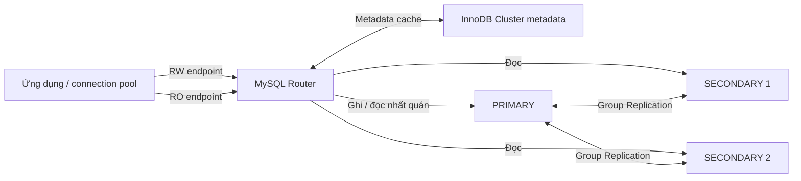

# MySQL Router, cổng dịch vụ và định tuyến vai trò

Trong một cụm MySQL có tính sẵn sàng cao, ứng dụng cần biết kết nối đến đâu khi primary thay đổi sau sự cố. Nếu cấu hình ứng dụng trỏ thẳng vào một máy chủ cụ thể, mỗi lần failover có thể buộc đội vận hành đổi cấu hình hoặc khởi động lại dịch vụ. **MySQL Router** cung cấp một điểm kết nối ổn định phía trước cụm: ứng dụng kết nối đến Router, Router theo dõi metadata của cụm và chuyển các kết nối mới đến máy chủ phù hợp với vai trò được yêu cầu.

Router thường được triển khai cùng InnoDB Cluster và Group Replication. Trong cấu hình single-primary, một node giữ vai trò `PRIMARY` để nhận ghi; các node còn lại là `SECONDARY`, thường phục vụ đọc. Router có thể công bố endpoint riêng cho ghi và đọc, nhờ đó ứng dụng chọn đúng cổng theo mục đích truy cập. Việc chọn cổng là một phần của thiết kế ứng dụng và chính sách nhất quán dữ liệu.

## 1. MySQL Router đứng ở đâu trong kiến trúc?

Luồng kết nối điển hình:



MySQL Router là lớp định tuyến kết nối TCP/protocol giữa client và MySQL Server. Với InnoDB Cluster, plugin metadata cache của Router đọc metadata cụm, theo dõi thành viên và vai trò hiện tại, rồi cập nhật tập đích có thể nhận kết nối. Router không lưu dữ liệu nghiệp vụ, không thay thế Group Replication và không tự bầu primary. Việc chọn primary và đồng bộ trạng thái thành viên thuộc cơ chế của Group Replication; Router sử dụng thông tin đó để định tuyến.

Các trách nhiệm nên phân biệt:

| Thành phần | Trách nhiệm |
|---|---|
| Group Replication | Duy trì nhóm thành viên, đồng thuận về membership và replication transaction theo cấu hình cụm. |
| InnoDB Cluster / AdminAPI | Quản lý topology, metadata, cấu hình và vận hành cụm. |
| MySQL Router | Theo dõi metadata, mở endpoint cho client và định tuyến kết nối đến node theo role. |
| Ứng dụng | Chọn endpoint phù hợp, quản lý connection pool, retry và tính đúng đắn của transaction. |

Router giúp ứng dụng không cần biết node nào hiện đang là primary. Tuy nhiên, nó không biến một kết nối đang mở thành một kết nối mới đến node khác giữa chừng. Khi backend bị ngắt do failover, session đang dùng có thể mất; ứng dụng cần tạo kết nối mới và xử lý lại thao tác theo quy tắc an toàn.

## 2. Cổng dịch vụ và endpoint phổ biến

Khi bootstrap Router cho InnoDB Cluster, cấu hình mặc định thường tạo các cổng classic protocol như sau:

| Endpoint | Cổng mặc định thường gặp | Vai trò đích | Mục đích |
|---|---:|---|---|
| Classic read/write | `6446` | `PRIMARY` | Ứng dụng gửi lệnh đọc/ghi và transaction cần primary. |
| Classic read-only | `6447` | `SECONDARY` | Ứng dụng gửi truy vấn đọc có thể chấp nhận dữ liệu trễ theo replication. |
| X Protocol read/write | `6448` | `PRIMARY` | Client dùng X Protocol kết nối đến primary. |
| X Protocol read-only | `6449` | `SECONDARY` | Client dùng X Protocol kết nối đến secondary. |

Đây là các giá trị mặc định phổ biến do cấu hình bootstrap tạo ra; cổng thực tế có thể khác nếu cấu hình được chỉnh sửa hoặc có dịch vụ khác sử dụng cổng đó. Luôn đọc `bind_port` trong `mysqlrouter.conf` và thông tin bootstrap của chính môi trường.

Không nhầm cổng Router với cổng MySQL Server:

- Client kết nối vào `router-host:6446` hoặc `router-host:6447` theo endpoint được cấp.
- Router mở kết nối backend đến MySQL Server, thường là classic protocol trên cổng `3306` hoặc X Protocol trên `33060` nếu được bật.
- Router có thể chạy trên máy riêng hoặc cùng máy ứng dụng; firewall phải cho phép client đến cổng Router và Router đến các node MySQL.

Một endpoint có thể được đặt sau DNS hoặc load balancer nội bộ, nhưng khi thêm nhiều Router instance, cần bảo đảm health check loại bỏ instance lỗi và cấu hình của các instance nhất quán. Không nên cho client truy cập trực tiếp node MySQL nếu mục tiêu vận hành là tập trung định tuyến qua Router, trừ các đường quản trị đã được kiểm soát riêng.

## 3. Bootstrap Router với InnoDB Cluster

Trước khi bootstrap, cần có một InnoDB Cluster đã được tạo và ở trạng thái hoạt động. Kiểm tra trạng thái cluster bằng MySQL Shell AdminAPI, ví dụ:

```javascript
var cluster = dba.getCluster();
cluster.status();
```

Lệnh trên chạy trong MySQL Shell ở chế độ JavaScript sau khi kết nối đến một instance thuộc cluster. Kiểm tra cluster có primary hợp lệ, các node cần thiết đang online và metadata đã được tạo đúng.

Trên máy cài MySQL Router, bootstrap từ một tài khoản quản trị cluster có quyền cần thiết:

```bash
mysqlrouter --bootstrap clusteradmin@db1.example.net:3306 \
  --directory=/opt/mysqlrouter
```

Router sẽ yêu cầu thông tin xác thực nếu cần, đọc metadata cluster và tạo cấu hình ban đầu trong thư mục được chỉ định. Tài khoản bootstrap phải có quyền đọc metadata và tạo/quản lý tài khoản Router theo quy trình của phiên bản đang dùng. Trong production, dùng tài khoản riêng cho Router và quản lý mật khẩu bằng cơ chế secret phù hợp; không ghi mật khẩu rõ trong script, lịch sử shell hoặc tài liệu vận hành.

Sau bootstrap, kiểm tra:

1. `mysqlrouter.conf` có các section metadata cache và routing mong đợi.
2. Các `bind_address` và `bind_port` không xung đột với dịch vụ khác.
3. Router có thể kết nối đến các node MySQL và đọc metadata.
4. Tài khoản Router có quyền cần thiết, mật khẩu được lưu theo cơ chế bảo vệ của bản cài đặt.
5. Service Router khởi động được và log không có lỗi xác thực, TLS hoặc metadata.

Ví dụ khởi chạy thủ công để kiểm tra trong môi trường thử nghiệm:

```bash
mysqlrouter --config=/opt/mysqlrouter/mysqlrouter.conf
```

Trong production, nên cài Router thành service do hệ điều hành quản lý, cấu hình restart policy, giới hạn quyền filesystem và giám sát tiến trình. Đường dẫn cấu hình và cách tạo service tùy hệ điều hành/package; dùng hướng dẫn tương ứng với bản Router đang cài.

## 4. Đọc cấu hình định tuyến theo role

Router dùng các section cấu hình để xác định listener, danh sách backend và chiến lược chọn đích. Một cấu hình minh họa cho classic protocol:

```ini
[metadata_cache:mycluster]
cluster_type=gr
router_id=7
user=mysql_router_user
metadata_cluster=mycluster
ttl=0.5

[routing:mycluster_rw]
bind_address=0.0.0.0
bind_port=6446
destinations=metadata-cache://mycluster/default?role=PRIMARY
routing_strategy=first-available
protocol=classic

[routing:mycluster_ro]
bind_address=0.0.0.0
bind_port=6447
destinations=metadata-cache://mycluster/default?role=SECONDARY
routing_strategy=round-robin-with-fallback
protocol=classic
```

Đây là cấu hình minh họa để hiểu các thành phần, không phải file hoàn chỉnh cho mọi phiên bản. Bootstrap của Router tạo các section và giá trị phù hợp với cluster; khi chỉnh sửa, hãy giữ các thuộc tính bắt buộc do phiên bản sinh ra và kiểm tra bằng đúng binary Router.

Các trường quan trọng:

- `bind_address`: địa chỉ mạng mà Router lắng nghe. Dùng `127.0.0.1` nếu chỉ cho client cục bộ; dùng địa chỉ private phù hợp nếu client từ máy khác cần kết nối. Tránh mở listener ra mọi interface khi không cần.
- `bind_port`: cổng client kết nối vào Router.
- `destinations`: danh sách đích. Với metadata cache, `role=PRIMARY` chọn node primary; `role=SECONDARY` chọn node secondary theo metadata cụm.
- `routing_strategy`: quy tắc chọn một đích trong tập node phù hợp, ví dụ `first-available` hoặc `round-robin-with-fallback`.
- `protocol`: loại giao thức client, thường là `classic` hoặc `x`.
- `ttl`: khoảng thời gian metadata cache có thể được dùng trước khi làm mới, theo đơn vị và quy tắc của phiên bản Router.

Trong cấu hình read/write, endpoint ghi chỉ nhắm đến primary. Endpoint đọc nhắm đến secondary; chiến lược fallback có thể cho phép Router dùng primary khi không còn secondary phù hợp. Hành vi fallback cần được quyết định theo tải, yêu cầu sẵn sàng và chính sách đọc của ứng dụng. Nếu không muốn truy vấn đọc dồn lên primary khi secondary lỗi, chọn chiến lược không fallback và để ứng dụng xử lý lỗi endpoint đọc.

## 5. Chọn routing strategy phù hợp

Chiến lược định tuyến ảnh hưởng cách Router chọn node khi có nhiều đích cùng role:

| Chiến lược | Hành vi tổng quát | Khi phù hợp |
|---|---|---|
| `first-available` | Chọn đích khả dụng đầu tiên theo danh sách. | Endpoint ghi chỉ có một primary hợp lệ hoặc cần thứ tự ưu tiên rõ ràng. |
| `round-robin` | Phân phối các kết nối mới lần lượt qua các đích khả dụng. | Chia tải kết nối đọc giữa nhiều secondary có năng lực tương đương. |
| `round-robin-with-fallback` | Phân phối qua nhóm đích phù hợp và có thể dùng primary khi không còn secondary theo cấu hình. | Dịch vụ đọc cần tiếp tục phục vụ khi secondary không sẵn sàng và primary còn năng lực. |
| `next-available` | Thử các đích theo thứ tự khi đích trước không sẵn sàng. | Cấu hình ưu tiên một số backend và dự phòng sang backend tiếp theo. |

Chiến lược tác động đến việc chọn backend cho kết nối mới; nó không chia đều từng câu SQL trong một kết nối đang mở. Một connection pool có thể giữ nhiều kết nối lâu dài đến cùng một node, vì vậy phân phối thực tế còn phụ thuộc số lượng kết nối, thời gian sống session và cách ứng dụng tái sử dụng connection.

Đừng chọn round-robin chỉ dựa trên số lượng node. Secondary có thể khác cấu hình phần cứng, tải truy vấn hoặc độ trễ replication. Theo dõi CPU, I/O, connection count, query latency và heartbeat lag trên từng node để xác nhận việc phân phối thực sự có lợi.

## 6. Phân tách endpoint đọc và ghi trong ứng dụng

Một ứng dụng có thể khai báo hai pool kết nối:

```text
MYSQL_WRITE_HOST=router.internal
MYSQL_WRITE_PORT=6446

MYSQL_READ_HOST=router.internal
MYSQL_READ_PORT=6447
```

Các giá trị trên là ví dụ theo cổng mặc định thường gặp. Cần thay bằng DNS, cổng và thông tin xác thực của môi trường. Ứng dụng nên dùng tài khoản có quyền ghi cần thiết ở pool ghi và tài khoản chỉ có quyền đọc ở pool đọc. Phân quyền ở database giúp hạn chế hậu quả khi code vô tình gửi câu lệnh ghi qua endpoint đọc.

Một quy tắc đơn giản để chọn pool:

| Loại thao tác | Endpoint nên dùng | Lý do |
|---|---|---|
| `INSERT`, `UPDATE`, `DELETE`, DDL | Write | Thay đổi dữ liệu hoặc cấu trúc phải đi đến primary. |
| Transaction có cả đọc và ghi | Write từ đầu đến cuối | Tránh đổi backend giữa transaction và giữ tính nhất quán của session. |
| Đọc ngay sau khi vừa ghi cùng nghiệp vụ | Write hoặc cơ chế read-after-write có kiểm chứng | Secondary có thể chưa áp dụng transaction mới. |
| Báo cáo/chức năng chấp nhận dữ liệu trễ | Read | Có thể phân phối truy vấn sang secondary. |
| Đọc metadata hoặc trạng thái cần tính nhất quán mạnh | Write hoặc endpoint được thiết kế rõ | Tránh quyết định dựa trên dữ liệu replica chưa bắt kịp. |

Không chuyển từng câu lệnh của một transaction qua lại giữa hai pool. Session có transaction state, temporary table, user variable, prepared statement và trạng thái session khác; các trạng thái này gắn với một kết nối backend cụ thể. Hãy giữ toàn bộ transaction trên cùng kết nối và endpoint.

MySQL Router có khả năng read/write splitting trong các phiên bản hỗ trợ và với cấu hình phù hợp. Tuy nhiên, không nên mặc định mọi câu `SELECT` đều an toàn để chạy trên secondary: một câu đọc có thể phụ thuộc vào transaction vừa ghi, session state hoặc tính nhất quán tức thời. Với hệ thống cần hành vi dễ dự đoán, phân tách pool đọc/ghi ở tầng ứng dụng là một lựa chọn rõ ràng; nếu dùng tính năng tự phân loại của Router, hãy kiểm tra tài liệu phiên bản, quy tắc transaction/session và thử các trường hợp truy vấn thực tế.

## 7. Đọc trên secondary và vấn đề dữ liệu trễ

Secondary thường áp dụng transaction sau primary một khoảng thời gian. Vì vậy, truy vấn qua read endpoint có thể trả về dữ liệu cũ hơn primary. Ví dụ:

1. Người dùng cập nhật trạng thái đơn hàng qua write endpoint.
2. Transaction commit trên primary.
3. Ứng dụng lập tức đọc lại đơn hàng qua read endpoint.
4. Secondary chưa áp dụng transaction nên kết quả vẫn là trạng thái cũ.

Đây là replication lag, không nhất thiết là lỗi định tuyến. Các cách xử lý phổ biến:

- Đọc lại qua write endpoint trong một khoảng thời gian sau khi ghi.
- Gắn một phiên đọc sau ghi vào cùng pool/connection primary trong suốt nghiệp vụ.
- Nếu dùng GTID, chờ secondary áp dụng ít nhất GTID cần thiết trước khi đọc, với timeout và fallback rõ ràng.
- Chỉ route sang secondary cho báo cáo hoặc truy vấn chấp nhận eventual consistency.

Đừng giả định Router tự bảo đảm read-after-write chỉ vì endpoint được gọi là read/write split. Độ nhất quán cần được thiết kế ở tầng ứng dụng và kiểm tra bằng workload thật.

## 8. Router xử lý failover như thế nào?

Trong InnoDB Cluster single-primary, khi primary hiện tại gặp sự cố, Group Replication có thể bầu/chọn primary mới theo trạng thái nhóm và chính sách failover. Metadata cluster được cập nhật; Router nhận thông tin topology mới qua metadata cache và định tuyến **các kết nối mới** đến primary mới.

Quá trình thực tế có thể gồm:

1. Node primary lỗi hoặc bị loại khỏi nhóm.
2. Group Replication xác định thành viên còn lại và chuyển vai trò primary theo cơ chế của cluster.
3. Metadata phản ánh primary mới.
4. Router cập nhật tập đích và ngừng chọn node không còn phù hợp.
5. Client mở kết nối mới đến cùng Router endpoint và được chuyển đến node đang giữ role cần thiết.

Có một khoảng thời gian phát hiện lỗi, cập nhật membership/metadata và làm mới cache. Trong khoảng này, một số kết nối mới có thể thất bại. Kết nối đang mở tới node cũ có thể bị đóng hoặc trở nên không sử dụng được; transaction đang chạy có thể rollback hoặc kết quả commit không xác định đối với client nếu kết nối đứt đúng thời điểm commit. Router không thể chuyển nguyên session đang mở sang node mới và tiếp tục transaction thay client.

Ứng dụng cần có:

- Retry kết nối với backoff và giới hạn thời gian.
- Xử lý lỗi kết nối trong connection pool, loại bỏ connection hỏng.
- Retry thao tác chỉ khi có thể xác định an toàn rằng transaction chưa commit hoặc thao tác có tính idempotent.
- Khóa idempotency key hoặc cơ chế đối soát cho thao tác tạo đơn/thanh toán để tránh thực hiện hai lần khi kết quả commit không rõ.
- Timeout phù hợp với thời gian failover và khả năng phục hồi của cluster.

Kiểm tra `router` bằng cách chủ động thử failover trong môi trường staging, đo thời gian endpoint ghi hoạt động trở lại và xác nhận ứng dụng phục hồi connection pool đúng cách. Không chỉ kiểm tra rằng Router process vẫn chạy.

## 9. Bảo mật listener và đường kết nối backend

Router mở thêm một điểm truy cập vào database, vì vậy phải bảo vệ cả client-to-router và router-to-server:

1. **Giới hạn listener.** Dùng `bind_address` trên interface private hoặc loopback phù hợp; firewall chỉ cho phép subnet ứng dụng cần thiết truy cập cổng Router.
2. **Bật TLS.** Cấu hình TLS cho client kết nối đến Router và cho Router kết nối backend theo yêu cầu bảo mật. Xác minh certificate, CA và hostname; không chỉ bật mã hóa mà bỏ qua kiểm tra danh tính server.
3. **Tài khoản tối thiểu.** Tài khoản Router dùng để đọc metadata và tài khoản ứng dụng dùng để truy cập schema nên có mục đích, quyền và vòng đời riêng.
4. **Phân quyền theo endpoint.** Pool đọc dùng tài khoản chỉ có quyền đọc; pool ghi dùng tài khoản với quyền nghiệp vụ cần thiết. Router định tuyến theo role không thay thế MySQL privilege.
5. **Bảo vệ cấu hình và secret.** Giới hạn quyền đọc file cấu hình, keyring và log; không commit mật khẩu vào repository hoặc đưa vào command history.
6. **Quản lý cổng.** Chỉ mở các cổng client cần dùng; cổng backend MySQL không cần public nếu Router là đường truy cập ứng dụng.

Router có thể lắng nghe trên `0.0.0.0` để nhận kết nối từ nhiều interface, nhưng chỉ dùng khi firewall và network policy đã giới hạn đúng nguồn. Trong môi trường production, ưu tiên private network, TLS và danh sách nguồn được phép thay vì mở cổng Router ra Internet.

## 10. Quan sát Router và chẩn đoán định tuyến

Khi client không kết nối được hoặc bị route sai, kiểm tra từ ngoài vào trong:

| Lớp | Kiểm tra | Dấu hiệu |
|---|---|---|
| Client | DNS, host/port, TLS, timeout, connection pool | Client không mở được TCP connection hoặc TLS handshake thất bại. |
| Listener Router | Service process, `bind_address`, `bind_port`, firewall | Cổng không lắng nghe hoặc chỉ bind vào loopback. |
| Routing section | `destinations`, `role`, `routing_strategy`, `protocol` | Không có backend phù hợp hoặc listener trỏ sai role. |
| Metadata cache | Kết nối metadata, cluster membership, TTL, log Router | Router chưa thấy primary mới hoặc metadata không khả dụng. |
| Backend MySQL | Port, TLS, user, grants, server availability | Router không kết nối được node hoặc backend từ chối xác thực. |
| Ứng dụng | Read/write pool, retry, idempotency, query consistency | Ứng dụng đọc stale data hoặc retry làm lặp thao tác. |

Các kiểm tra vận hành cơ bản:

```bash
mysqlrouter --version
mysqlrouter --help
```

Đọc log của Router theo service manager và đường dẫn cấu hình. Tìm thông báo metadata refresh, backend unavailable, TLS, authentication và routing. Nếu bật REST API/status plugin, giới hạn truy cập vào interface quản trị và xác thực phù hợp; không mở endpoint giám sát ra mạng công cộng. Tên endpoint, cổng REST và cấu trúc output phụ thuộc phiên bản và cấu hình plugin.

Trên backend, kiểm tra vai trò cluster bằng MySQL Shell `cluster.status()` và trạng thái replication/Group Replication. Nếu Router chưa route đến primary mới, so sánh metadata cluster, log Router và trạng thái cache; đừng tự sửa danh sách node trong file cấu hình bootstrap nếu section metadata cache đang quản lý danh sách đích động.

## 11. Những lỗi triển khai thường gặp

| Lỗi | Hậu quả | Cách khắc phục |
|---|---|---|
| Ứng dụng vẫn kết nối trực tiếp đến node cũ | Failover xong nhưng ứng dụng tiếp tục gọi primary cũ hoặc địa chỉ đã lỗi. | Dùng Router endpoint trong cấu hình ứng dụng và kiểm soát đường truy cập trực tiếp. |
| Nhầm cổng Router với cổng backend | Client kết nối sai protocol hoặc không mở được socket. | Phân biệt listener Router với port classic/X Protocol của MySQL Server. |
| Dùng read endpoint cho thao tác cần read-after-write | Trả dữ liệu cũ từ secondary. | Route qua primary hoặc chờ GTID/heartbeat theo chính sách nhất quán. |
| Không có fallback khi secondary lỗi nhưng ứng dụng kỳ vọng vẫn đọc được | Read endpoint từ chối kết nối khi không còn node phù hợp. | Chọn fallback có chủ đích hoặc để ứng dụng xử lý degraded mode. |
| Fallback đọc sang primary mà không dự trù tải | Primary bị tăng tải khi secondary cùng lỗi. | Đánh giá năng lực primary và thiết lập ngưỡng tải/ứng xử khi degraded. |
| Chỉ kiểm tra process Router | Process sống nhưng metadata cache hoặc backend không hoạt động. | Health check cả listener, metadata, backend và truy vấn thử qua endpoint. |
| Không xử lý connection đứt trong failover | Connection pool giữ socket lỗi; request thất bại kéo dài. | Loại bỏ connection lỗi, reconnect với backoff và timeout phù hợp. |
| Retry giao dịch không idempotent | Tạo dữ liệu hoặc thanh toán trùng khi kết quả commit không rõ. | Dùng idempotency key, kiểm tra trạng thái và retry có điều kiện. |
| Mở listener công khai hoặc thiếu TLS | Tăng bề mặt tấn công và nguy cơ lộ thông tin đăng nhập. | Bind private interface, firewall, TLS và quyền tối thiểu. |
| Nhiều Router instance cấu hình khác nhau | Cùng endpoint nhưng hành vi route không nhất quán. | Quản lý cấu hình đồng nhất, triển khai có version và kiểm thử từng instance. |

## 12. Quy trình kiểm thử trước production

Một lần kiểm thử Router nên xác nhận cả định tuyến bình thường và hành vi khi cluster thay đổi:

1. Bootstrap Router từ cluster staging và lưu lại cấu hình được sinh.
2. Kết nối qua RW endpoint; xác nhận session đến primary bằng cách kiểm tra trạng thái read-only/role trên backend.
3. Kết nối qua RO endpoint; xác nhận session đến secondary theo cấu hình, và tài khoản ứng dụng không có quyền ghi ngoài dự kiến.
4. Ghi một bản ghi qua RW endpoint; kiểm tra dữ liệu replicate và đánh giá độ trễ khi đọc qua RO endpoint.
5. Thực hiện failover có kiểm soát; đo thời gian phát hiện, cập nhật metadata và thời gian client kết nối thành công trở lại.
6. Xác nhận connection pool loại bỏ socket cũ, retry an toàn và không tạo transaction trùng.
7. Tắt hoặc cô lập một secondary; kiểm tra round-robin, fallback và tải trên primary theo đúng chính sách đã chọn.
8. Kiểm tra TLS, firewall, secret rotation, log và giám sát cho từng Router instance.

Không chỉ kiểm tra câu `SELECT 1`. Hãy dùng truy vấn và transaction đại diện cho ứng dụng, gồm thao tác ghi, đọc sau ghi, prepared statement, transaction dài và connection pool. Một endpoint chỉ được coi là sẵn sàng khi cả định tuyến, bảo mật, tính nhất quán và khả năng phục hồi kết nối đều được kiểm chứng.

## 13. Checklist vận hành

- [ ] Ứng dụng dùng DNS/host và cổng Router đã được phê duyệt.
- [ ] RW endpoint định tuyến đến `PRIMARY`; RO endpoint định tuyến đến `SECONDARY` theo thiết kế.
- [ ] Cổng listener được xác nhận từ `mysqlrouter.conf`, không giả định mọi môi trường dùng mặc định.
- [ ] Router đọc được metadata và cập nhật topology sau khi cluster thay đổi.
- [ ] Chính sách routing strategy và fallback phù hợp năng lực primary/secondary.
- [ ] Ứng dụng giữ transaction trên cùng kết nối và xử lý read-after-write rõ ràng.
- [ ] Connection pool có retry/backoff và xử lý socket bị đóng trong failover.
- [ ] Tài khoản database có quyền tối thiểu; read endpoint dùng quyền đọc khi phù hợp.
- [ ] TLS, firewall, secret và quyền truy cập cấu hình đã được kiểm tra.
- [ ] Đã diễn tập failover, secondary unavailable và phục hồi Router instance.

MySQL Router cung cấp endpoint ổn định và định tuyến kết nối dựa trên vai trò node trong cụm. Endpoint ghi đưa kết nối đến primary; endpoint đọc có thể phân phối đến secondary và chịu ảnh hưởng của replication lag. Router giúp ứng dụng theo kịp thay đổi topology, còn ứng dụng vẫn phải quản lý session, transaction, retry và yêu cầu nhất quán. Khi cổng dịch vụ, routing strategy, bảo mật và kiểm thử failover được thiết kế đồng bộ, Router trở thành một lớp truy cập tin cậy cho MySQL InnoDB Cluster.
