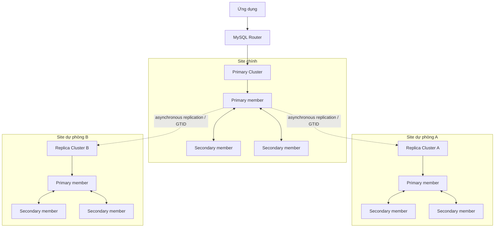

# InnoDB ClusterSet, cụm dự phòng và điều kiện phiên bản hỗ trợ

InnoDB ClusterSet mở rộng MySQL InnoDB Cluster từ phạm vi một trung tâm dữ liệu sang nhiều địa điểm. Một ClusterSet có một **primary cluster** nhận ghi và một hoặc nhiều **replica cluster** đặt tại các site dự phòng. Mỗi cluster bên trong vẫn dùng Group Replication để duy trì tính sẵn sàng của các node tại site đó; dữ liệu từ primary cluster được truyền sang replica cluster bằng replication bất đồng bộ.

Kiến trúc này giúp chuẩn bị cho thảm họa ở cấp site, chẳng hạn mất điện diện rộng, lỗi mạng hoặc không thể truy cập trung tâm dữ liệu chính. Nó cũng tạo ra lựa chọn chuyển vai trò có kiểm soát khi bảo trì. Tuy nhiên, vì replication giữa các cluster là bất đồng bộ, một lần failover cưỡng bức có thể mất các giao dịch đã commit trên primary nhưng chưa kịp truyền tới site dự phòng.

Trong module `DATABASE_MYSQL`, bài học này kết nối InnoDB Cluster, Group Replication, GTID, MySQL Router và quy trình khôi phục thảm họa. Sau bài học, bạn có thể:

- Mô tả kiến trúc primary cluster và replica cluster của InnoDB ClusterSet.
- Kiểm tra điều kiện phiên bản và cấu hình trước khi triển khai.
- Tạo ClusterSet bằng MySQL Shell AdminAPI ở mức cơ bản.
- Phân biệt planned switchover với forced failover.
- Đánh giá độ trễ replication liên site, RPO và nguy cơ mất dữ liệu.
- Kiểm tra trạng thái cụm, định tuyến Router và khả năng diễn tập DR.

## 1. Phân biệt HA trong một site và DR giữa nhiều site

High availability (HA) giúp dịch vụ tiếp tục hoạt động khi một hoặc một số thành phần trong site gặp lỗi. Disaster recovery (DR) chuẩn bị khả năng phục hồi khi cả site hoặc một vùng hạ tầng không còn sử dụng được.

InnoDB Cluster cung cấp HA trong một cluster bằng Group Replication. Các thành viên trao đổi thông tin giao dịch và duy trì trạng thái nhóm; trong chế độ single-primary, chỉ một thành viên là primary nhận ghi tại một thời điểm. Nếu primary member gặp sự cố, nhóm có thể bầu primary member mới theo cơ chế Group Replication.

InnoDB ClusterSet kết nối nhiều InnoDB Cluster. Một cluster được chọn làm primary cluster; các cluster còn lại là replica cluster. Replication giữa các cluster dùng kênh bất đồng bộ dựa trên GTID. Vì vậy:

- Group Replication xử lý tính sẵn sàng và đồng thuận trong phạm vi từng cluster.
- Replication bất đồng bộ truyền thay đổi từ primary cluster tới replica cluster.
- ClusterSet quản lý vai trò primary/replica, metadata và các thao tác chuyển vai trò.
- MySQL Router có thể sử dụng metadata ClusterSet để định tuyến kết nối tới cluster đang giữ vai trò phù hợp.



Sơ đồ thể hiện luồng khái niệm. Mỗi site có thể có số node và cách bố trí mạng khác nhau, nhưng cần đủ thành viên và miền lỗi để đáp ứng mục tiêu quorum, bảo trì và chịu lỗi của Group Replication.

## 2. Vai trò và cách dữ liệu di chuyển

### 2.1. Primary cluster

Primary cluster là cluster duy nhất được phép nhận ghi theo mô hình ClusterSet thông thường. Các giao dịch được commit trong cluster này và phân phối tới các thành viên Group Replication của cluster. Sau đó, thay đổi được truyền bất đồng bộ sang các replica cluster.

### 2.2. Replica cluster

Replica cluster là một InnoDB Cluster riêng, thường đặt ở site hoặc vùng khác. Nó nhận thay đổi từ primary cluster qua replication channel liên cluster, rồi Group Replication phân phối thay đổi trong nội bộ cluster. Replica cluster được quản lý ở chế độ chỉ đọc đối với ứng dụng trong khi vẫn giữ vai trò dự phòng.

Không ghi trực tiếp vào replica cluster để cập nhật dữ liệu ứng dụng. Những giao dịch ghi độc lập trên replica có thể tạo ra dữ liệu lệch hoặc GTID không có trong primary cluster, làm phức tạp việc chuyển vai trò và tái gia nhập topology.

### 2.3. Hai tầng replication có đặc tính khác nhau

| Phạm vi | Cơ chế | Mục tiêu |
|---|---|---|
| Trong một InnoDB Cluster | Group Replication | Duy trì thành viên và tính sẵn sàng trong site |
| Giữa các cluster trong ClusterSet | Asynchronous replication dùng GTID | Duy trì bản sao dữ liệu tại site DR |

Không nên diễn giải ClusterSet là replication đồng bộ xuyên site. Replica cluster có thể trễ so với primary cluster do độ trễ mạng, tải ghi, giao dịch lớn hoặc worker applier chưa theo kịp.

## 3. Điều kiện phiên bản và tương thích

InnoDB ClusterSet được giới thiệu trong dòng MySQL 8.0.27. Mốc hỗ trợ cơ bản cần có:

| Thành phần | Điều kiện nền tảng |
|---|---|
| MySQL Server | MySQL 8.0.27 trở lên cho hỗ trợ InnoDB ClusterSet |
| MySQL Shell | MySQL Shell 8.0.27 trở lên để sử dụng AdminAPI ClusterSet |
| MySQL Router | MySQL Router 8.0.27 trở lên để nhận biết và định tuyến theo metadata ClusterSet |

Đây là mức phiên bản tối thiểu cho tính năng ClusterSet, không phải khuyến nghị giữ production ở bản phát hành cũ. Hãy chọn bản vá còn được hỗ trợ, kiểm tra release notes và ma trận tương thích của Server, Shell và Router. Trong môi trường sản xuất, nên dùng các phiên bản tương thích trong cùng lộ trình phát hành và thực hiện nâng cấp theo quy trình rolling upgrade được hỗ trợ.

Không ghép tùy ý Server, Shell và Router khác thế hệ rồi giả định AdminAPI hoặc metadata routing sẽ hoạt động giống nhau. Một Router quá cũ có thể không hiểu đầy đủ metadata ClusterSet hoặc không thực hiện định tuyến theo vai trò mới sau switchover.

### 3.1. Điều kiện cấu hình MySQL

Trước khi tạo cluster, kiểm tra các điều kiện Group Replication và InnoDB Cluster, bao gồm:

- `gtid_mode=ON`.
- `enforce_gtid_consistency=ON`.
- `binlog_format=ROW`.
- `log_replica_updates=ON` theo yêu cầu topology.
- `group_replication_single_primary_mode=ON`; InnoDB ClusterSet sử dụng single-primary mode cho các cluster, không triển khai cluster multi-primary trong topology này.
- `server_id` duy nhất trên từng instance.
- `server_uuid` duy nhất; không nhân bản data directory theo cách làm trùng định danh máy chủ.
- Các bảng ứng dụng sử dụng InnoDB và có primary key phù hợp với yêu cầu Group Replication.
- Các instance trong cùng cluster có cấu hình tương thích, đặc biệt các thiết lập ảnh hưởng tới metadata và replication.
- Mạng giữa các thành viên cho phép các cổng MySQL và cổng Group Replication cần thiết kết nối hai chiều.

AdminAPI có thể kiểm tra và cấu hình một số thiết lập tự động. Dù vậy, hãy chạy kiểm tra trước triển khai và xử lý mọi cảnh báo hoặc cấu hình không tương thích thay vì bỏ qua kết quả kiểm tra.

### 3.2. Điều kiện mạng và hạ tầng

- Mỗi site cần đủ node để duy trì quorum khi có lỗi hoặc bảo trì. Ba thành viên trong các miền lỗi độc lập là bố trí thường gặp cho một cluster nhỏ; số lượng thực tế cần dựa trên mục tiêu chịu lỗi.
- Độ trễ, băng thông và độ ổn định giữa các site phải phù hợp với lượng thay đổi cần truyền.
- DNS, địa chỉ IP và chứng thư TLS phải ổn định; mọi node cần phân giải và xác thực đúng endpoint.
- Tài khoản quản trị và replication phải có quyền tối thiểu cần thiết, được lưu trong secret manager.
- Backup, giám sát, đồng bộ thời gian và quyền truy cập vận hành phải sẵn sàng ở cả site chính lẫn site DR.

Không đặt toàn bộ node của một cluster trong cùng một miền lỗi vật lý nếu mục tiêu HA là chịu được sự cố rack, switch hoặc nguồn điện. Đồng thời, không giả định khoảng cách địa lý tự động bảo đảm DR: site dự phòng cần được kiểm thử độc lập và có đủ tài nguyên để phục vụ tải thực tế.

## 4. Chuẩn bị trước khi tạo ClusterSet

Hãy lập bảng kiểm kê trước khi triển khai:

| Hạng mục | Cần ghi nhận |
|---|---|
| Phiên bản | Server, Shell, Router và hệ điều hành của từng node |
| Thành viên | Hostname, port, `server_id`, `server_uuid`, site và vai trò dự kiến |
| GTID | `gtid_mode`, `enforce_gtid_consistency`, GTID set hiện tại và nguồn gốc dữ liệu |
| Group Replication | Group name, communication stack, cổng, trạng thái quorum |
| Mạng | Độ trễ liên site, firewall, DNS, TLS và kết nối hai chiều |
| Dữ liệu | Engine, primary key, dung lượng, tốc độ ghi và các bảng quan trọng |
| DR | RTO, RPO, người quyết định failover, quy trình fencing và runbook |
| Router | Phiên bản, vị trí triển khai, tài khoản metadata và endpoint ứng dụng |

Các instance dùng làm replica cluster phải được chuẩn bị theo quy trình ClusterSet. Không đưa một máy chủ có dữ liệu độc lập hoặc GTID không rõ nguồn gốc vào topology rồi kỳ vọng AdminAPI tự hợp nhất an toàn. Hãy xác định rõ instance seed, cách đồng bộ dữ liệu ban đầu và trạng thái GTID trước khi thêm node.

## 5. Tạo InnoDB ClusterSet bằng MySQL Shell

Các ví dụ sau dùng JavaScript mode của MySQL Shell và tài khoản quản trị đã được chuẩn bị. Tên host, mật khẩu và cluster name chỉ là giá trị minh họa. Trước khi chạy, xác nhận các node chưa thuộc một topology khác và đã qua bước kiểm tra cấu hình.

### 5.1. Cấu hình các instance

Kết nối từng instance bằng MySQL Shell và chạy kiểm tra/cấu hình phù hợp:

```javascript
dba.configureInstance('ic_admin@primary-1.example:3306');
dba.configureInstance('ic_admin@primary-2.example:3306');
dba.configureInstance('ic_admin@primary-3.example:3306');
```

Lặp lại cho các node dự kiến làm replica cluster. Lệnh có thể yêu cầu xác thực và có thể đề xuất thay đổi cấu hình cần restart. Hãy xem xét kết quả trước khi áp dụng trên máy chủ đang phục vụ ứng dụng.

### 5.2. Tạo primary InnoDB Cluster

Kết nối tới node seed của site chính, sau đó tạo cluster và thêm các thành viên:

```javascript
var primaryCluster = dba.createCluster('primaryCluster');

primaryCluster.addInstance('ic_admin@primary-2.example:3306');
primaryCluster.addInstance('ic_admin@primary-3.example:3306');

primaryCluster.status({extended: 1});
```

Xác nhận các thành viên đã ONLINE, cluster có primary member và không có lỗi Group Replication trước khi tiếp tục. Không tạo ClusterSet khi primary cluster còn trạng thái không ổn định.

### 5.3. Tạo ClusterSet và thêm replica cluster

Từ đối tượng primary cluster, tạo ClusterSet:

```javascript
var clusterSet = primaryCluster.createClusterSet('productionClusterSet');
```

Thêm replica cluster bằng một instance seed ở site dự phòng:

```javascript
var drCluster = clusterSet.createReplicaCluster(
  'ic_admin@dr-1.example:3306',
  'drCluster'
);

drCluster.addInstance('ic_admin@dr-2.example:3306');
drCluster.addInstance('ic_admin@dr-3.example:3306');

clusterSet.status({extended: 1});
```

AdminAPI thực hiện quy trình thiết lập replica cluster và replication liên cluster theo trạng thái topology. Tùy dung lượng dữ liệu và phương thức provisioning, việc thêm replica có thể mất thời gian và tiêu tốn mạng/đĩa. Theo dõi tiến trình và không cho ứng dụng ghi vào replica cluster.

Nếu cần thêm site DR thứ hai, thực hiện quy trình tạo replica cluster riêng sau khi site hiện tại đã ổn định. Mỗi cluster cần tên duy nhất và thông tin thành viên rõ ràng.

## 6. Kiểm tra trạng thái và replication

MySQL Shell AdminAPI cung cấp trạng thái ở cấp ClusterSet và từng cluster:

```javascript
clusterSet.status({extended: 1});
primaryCluster.status({extended: 1});
drCluster.status({extended: 1});
```

Khi đọc kết quả, xác nhận:

- ClusterSet có đúng primary cluster.
- Replica cluster đang ở trạng thái hợp lệ và được nhận diện trong metadata.
- Các thành viên trong mỗi cluster có trạng thái ONLINE và quorum.
- Replication liên cluster đang hoạt động, không có lỗi I/O hoặc SQL.
- GTID của replica cluster đang tiến gần trạng thái primary theo độ trễ mong đợi.
- Không có giao dịch ghi độc lập hoặc errant transaction trên replica cluster.

Ở cấp MySQL, có thể kiểm tra thêm:

```sql
SHOW REPLICA STATUS\G

SELECT
    @@GLOBAL.gtid_executed AS executed_gtid_set,
    @@GLOBAL.gtid_purged AS purged_gtid_set,
    @@GLOBAL.read_only AS read_only,
    @@GLOBAL.super_read_only AS super_read_only;
```

Tên lệnh `SHOW REPLICA STATUS` áp dụng cho các bản MySQL mới; bản cũ có thể dùng `SHOW SLAVE STATUS`. ClusterSet có thể quản lý channel và trạng thái thông qua AdminAPI, vì vậy không tự ý sửa replication channel bằng câu lệnh `CHANGE REPLICATION SOURCE TO` nếu chưa hiểu tác động tới metadata ClusterSet.

Đừng chỉ dựa vào một chỉ số lag. Kết hợp trạng thái channel, GTID set, lỗi applier, độ trễ liên site và các phép đo từ ứng dụng. Một replica có thể nhận log nhưng chưa áp dụng xong.

## 7. MySQL Router và định tuyến ứng dụng

MySQL Router nhận metadata từ topology để biết cluster nào hiện là primary và định tuyến kết nối theo loại endpoint. Khi dùng ClusterSet, hãy triển khai Router phiên bản có hỗ trợ ClusterSet và bootstrap nó từ một instance thuộc topology đã cấu hình.

Ví dụ lệnh bootstrap ở mức minh họa:

```bash
mysqlrouter \
  --bootstrap router_admin@primary-1.example:3306 \
  --directory /opt/mysqlrouter-clusterset
```

Tùy phiên bản và cách cài đặt, có thể cần tùy chọn bổ sung, tài khoản Router và quyền truy cập thư mục. Kiểm tra file cấu hình được tạo và các port frontend trước khi cho ứng dụng kết nối.

Các điểm cần kiểm tra:

- Endpoint read-write phải định tuyến tới primary cluster hiện tại.
- Sau switchover/failover, Router phải cập nhật metadata và chuyển kết nối mới tới primary cluster mới.
- Kết nối đang mở có thể bị ngắt khi topology đổi vai trò; ứng dụng cần retry có giới hạn và xử lý transaction outcome chưa rõ ràng.
- Không giả định endpoint read-only tự động đọc từ mọi replica cluster theo ý muốn. Phạm vi routing phụ thuộc cấu hình Router, metadata và chính sách triển khai.
- Ứng dụng nên kết nối qua Router hoặc một lớp định tuyến đã được kiểm chứng thay vì ghim cứng hostname của primary member.

Sau khi thay đổi vai trò, kiểm tra bằng kết nối mới và truy vấn xác định server/cluster đích. Đồng thời thử trường hợp Router mất kết nối metadata hoặc một node bị loại khỏi cluster.

## 8. Planned switchover: chuyển primary có kế hoạch

Switchover phù hợp khi site chính vẫn hoạt động và nhóm vận hành chủ động chuyển vai trò, ví dụ bảo trì trung tâm dữ liệu hoặc diễn tập DR. Mục tiêu là chuyển primary cluster mà không mất giao dịch đã được xác nhận.

Trước khi chuyển:

1. Xác nhận primary cluster và replica cluster đều khỏe.
2. Kiểm tra replication liên cluster không có lỗi và replica cluster đã theo kịp primary.
3. Xác định GTID set cần có và xác minh replica đã thực thi đầy đủ các giao dịch cần bảo toàn.
4. Kiểm soát hoặc tạm dừng các luồng ghi theo runbook để tránh thay đổi mới trong cửa sổ chuyển vai trò.
5. Xác nhận Router và ứng dụng có thể xử lý kết nối bị ngắt, reconnect và retry.

AdminAPI cung cấp thao tác chuyển primary cluster có kế hoạch:

```javascript
clusterSet.setPrimaryCluster('drCluster');
clusterSet.status({extended: 1});
```

Sau khi lệnh hoàn tất, xác nhận metadata cho biết `drCluster` là primary cluster, các cluster khác có vai trò replica, và Router định tuyến kết nối mới đúng nơi. Thực hiện smoke test đọc/ghi bằng dữ liệu kiểm thử trước khi mở lại toàn bộ lưu lượng.

Trong planned switchover, không được bỏ qua bước kiểm tra replica đã theo kịp. Chuyển primary khi replica còn thiếu giao dịch có thể tạo khoảng mất dữ liệu so với trạng thái source trước đó.

## 9. Forced failover: chuyển primary khi site chính gặp sự cố

Forced failover dùng khi primary cluster không thể truy cập hoặc không thể khôi phục trong thời gian cho phép. Do replication liên cluster bất đồng bộ, replica cluster có thể chưa nhận tất cả giao dịch đã commit trên primary trước sự cố. Đây là quyết định DR có thể ảnh hưởng RPO.

Quy trình ở mức khái quát:

1. Xác nhận primary cluster thực sự không khả dụng và đánh giá phạm vi sự cố.
2. **Fence** site cũ: bảo đảm primary cũ không thể tiếp tục nhận ghi hoặc quay lại hoạt động độc lập khi site dự phòng đã được nâng cấp.
3. Đánh giá các replica cluster còn khả dụng và chọn cluster có tập GTID tiến xa nhất, phù hợp với chính sách dữ liệu.
4. Ghi nhận GTID set của ứng viên và ước lượng các giao dịch có thể chưa được truyền.
5. Có quyết định của người chịu trách nhiệm DR về RPO và khả năng chấp nhận mất dữ liệu.
6. Thực hiện forced failover bằng AdminAPI:

```javascript
clusterSet.forcePrimaryCluster('drCluster');
clusterSet.status({extended: 1});
```

7. Xác nhận cluster mới là primary, Router định tuyến tới đúng cluster và ứng dụng có thể hoạt động.
8. Khi site cũ được phục hồi, không đưa nó trở lại nhận ghi ngay. Phải đánh giá GTID, xử lý errant transaction và dùng quy trình rejoin/rebuild được ClusterSet hỗ trợ.

`forcePrimaryCluster()` là thao tác khẩn cấp. Nó không thể tái tạo các giao dịch chưa từng được replica nhận. Nếu primary cũ vẫn có thể nhận ghi trong lúc cluster mới đã hoạt động, hệ thống có nguy cơ split-brain và phát sinh hai nhánh dữ liệu độc lập. Fencing phải được xác nhận trước khi mở ghi trên site mới.

## 10. RPO, RTO và nguy cơ mất dữ liệu

RPO là lượng dữ liệu tối đa có thể mất được tổ chức chấp nhận, thường được diễn đạt bằng thời gian. RTO là thời gian tối đa để khôi phục dịch vụ. ClusterSet giúp tổ chức DR nhưng không tự bảo đảm một con số RPO/RTO cố định.

Vì replication giữa các cluster là bất đồng bộ:

- Primary có thể commit giao dịch trước khi replica cluster nhận hoặc áp dụng giao dịch đó.
- Nếu primary site mất đột ngột, các giao dịch cuối có thể chưa xuất hiện ở replica.
- Chọn replica có GTID set mới hơn giúp giảm khoảng thiếu dữ liệu nhưng không chứng minh mọi giao dịch ứng dụng đã được bảo toàn nếu nguồn tham chiếu không đầy đủ.
- Độ trễ phụ thuộc mạng, dung lượng giao dịch, tốc độ apply và tải trên site DR.

Đo RPO thực tế bằng cách ghi nhận GTID/transaction marker tại source và kiểm tra thời điểm marker xuất hiện ở replica. Đo RTO từ thời điểm xác nhận sự cố tới lúc ứng dụng phục vụ lại thành công qua Router, bao gồm fencing, chuyển vai trò, reconnect và smoke test.

Không dùng ClusterSet thay cho backup. Backup độc lập vẫn cần thiết để phục hồi khi dữ liệu bị xóa nhầm, hỏng logic, ransomware hoặc lỗi được replication sang tất cả replica cluster.

## 11. Rejoin và tái xây dựng site cũ

Sau failover, site cũ có thể chứa các giao dịch mà primary mới không có hoặc thiếu giao dịch đã được commit ở primary mới. Không tự ý đổi `read_only=OFF` rồi cho ứng dụng ghi vào site cũ.

Quy trình phục hồi cần:

- Fence site cũ cho đến khi đã xác định được trạng thái dữ liệu.
- Kiểm tra ClusterSet metadata, GTID executed/purged và các giao dịch errant.
- Xác định liệu node/cluster cũ có thể rejoin bằng cơ chế AdminAPI được hỗ trợ hay cần provisioning lại từ primary mới.
- Chỉ cho phép ClusterSet quản lý lại cluster sau khi trạng thái GTID và dữ liệu đã đáp ứng điều kiện.
- Xác nhận cluster cũ trở thành replica cluster và bắt đầu theo dõi primary mới.
- Kiểm tra Router, giám sát, backup và runbook đã phản ánh topology mới.

Nếu có GTID không thể tự động hòa giải hoặc dữ liệu phân nhánh, hãy dựng lại replica cluster theo quy trình được hỗ trợ thay vì cố ép hai nhánh dữ liệu nhập lại với nhau.

## 12. Giám sát và cảnh báo

Một hệ thống ClusterSet cần giám sát cả từng cluster lẫn replication liên site.

| Nhóm chỉ số | Nội dung theo dõi | Ý nghĩa |
|---|---|---|
| Thành viên cluster | ONLINE/OFFLINE, quorum, primary member | Phát hiện lỗi node hoặc mất quorum |
| Replication liên cluster | Channel status, lỗi I/O/SQL, GTID received/executed | Phát hiện replica ngừng theo kịp |
| Độ trễ | Thời gian và khoảng GTID chưa áp dụng | Ước lượng RPO hiện tại |
| Mạng | Latency, packet loss, băng thông và kết nối | Tìm nguyên nhân replication lag |
| Router | Metadata refresh, kết nối frontend/backend, lỗi định tuyến | Xác nhận ứng dụng có thể theo primary mới |
| Ứng dụng | Tỷ lệ lỗi, reconnect, transaction retry và thời gian phản hồi | Đánh giá ảnh hưởng người dùng |
| Backup | Tuổi backup gần nhất, kết quả restore test và trạng thái lưu trữ | Đảm bảo có phương án phục hồi độc lập |

Thiết lập cảnh báo theo ngưỡng RPO/RTO đã thống nhất. Một cảnh báo “replica lag 10 giây” chỉ có ý nghĩa khi tổ chức đã xác định 10 giây có vượt ngân sách RPO hay không. Cũng cần cảnh báo replication channel dừng, applier error, mất quorum, Router không cập nhật metadata và backup không kiểm tra được.

## 13. Sự cố thường gặp

| Triệu chứng | Nguyên nhân có thể | Hướng xử lý |
|---|---|---|
| Không tạo được ClusterSet | Phiên bản không hỗ trợ, cluster chưa khỏe hoặc cấu hình GTID chưa đạt yêu cầu | Kiểm tra phiên bản Server/Shell, `cluster.status()` và kết quả precheck |
| Không thêm được replica cluster | Instance seed có dữ liệu/GTID không phù hợp, mạng hoặc quyền không đủ | Xác minh nguồn gốc dữ liệu, GTID, tài khoản, TLS và kết nối liên site |
| Replica cluster lag tăng | Mạng chậm, giao dịch lớn, tải apply cao hoặc channel lỗi | Kiểm tra trạng thái channel, worker applier, tài nguyên và băng thông |
| Router vẫn gửi tới primary cũ | Router quá cũ, metadata chưa refresh hoặc kết nối cũ chưa được tạo lại | Kiểm tra phiên bản Router, metadata cache và mở kết nối mới |
| Switchover không hoàn tất | Replica chưa bắt kịp hoặc topology có lỗi | Xử lý lag/lỗi, xác minh GTID rồi thử lại theo quy trình planned switchover |
| Forced failover có nguy cơ mất giao dịch | Replica chưa nhận đủ giao dịch từ primary | So sánh GTID set, xác định RPO và ghi nhận quyết định DR |
| Không rejoin được site cũ | Errant GTID hoặc dữ liệu đã phân nhánh | Fence site cũ, đánh giá trạng thái và rebuild/reprovision theo AdminAPI |
| Hai site cùng nhận ghi | Fencing thất bại hoặc thao tác thủ công phá vỡ vai trò ClusterSet | Ngắt đường ghi ở site cũ, cô lập topology và xử lý split-brain trước khi mở dịch vụ |

Khi điều tra, lưu kết quả `clusterSet.status({extended: 1})`, trạng thái từng cluster, GTID set, replication status, Router log và mốc thời gian sự cố. Không xóa metadata hoặc reset replication channel để thử sửa nhanh nếu chưa có kế hoạch phục hồi rõ ràng.

## 14. Runbook diễn tập DR

Diễn tập cần chứng minh cả dữ liệu lẫn đường truy cập ứng dụng:

1. Xác nhận phiên bản, cấu hình, backup và trạng thái ClusterSet trước diễn tập.
2. Ghi một tập giao dịch kiểm thử có mã định danh duy nhất trên primary cluster.
3. Đo thời gian các giao dịch xuất hiện ở replica cluster và ghi lại GTID marker.
4. Thực hiện planned switchover, xác minh Router chuyển endpoint và ứng dụng đọc/ghi được.
5. Chuyển vai trò về theo quy trình có kế hoạch sau khi xác minh topology.
6. Trong một buổi diễn tập riêng, mô phỏng mất site chính theo kịch bản đã được phê duyệt và có fencing thực tế.
7. Chọn replica cluster, ghi nhận GTID set và quyết định RPO trước khi forced failover.
8. Xác nhận Router, ứng dụng, tài khoản và các tác vụ nền hoạt động ở site mới.
9. Phục hồi site cũ và thực hiện rejoin hoặc rebuild theo quy trình được hỗ trợ.
10. Đo RTO/RPO, ghi các bước thủ công, lỗi, sai lệch dữ liệu và cập nhật runbook.

Không thử forced failover bằng cách tắt mạng hoặc dừng node production ngoài cửa sổ diễn tập đã được phê duyệt. Dùng môi trường lab có topology tương tự để luyện tập các bước fencing, chọn replica và khôi phục site cũ.

## 15. Tình huống thực hành

Một hệ thống thương mại điện tử có site chính tại khu vực A và site DR tại khu vực B. Mỗi site có một InnoDB Cluster ba node. Ứng dụng kết nối qua MySQL Router. Yêu cầu là duy trì HA trong từng site và có thể chuyển site khi khu vực A gặp thảm họa.

Thực hiện trong môi trường lab:

1. Kiểm tra MySQL Server, Shell và Router đều ở phiên bản hỗ trợ ClusterSet.
2. Xác minh GTID, `enforce_gtid_consistency`, `binlog_format`, `server_id`, `server_uuid`, mạng và TLS.
3. Tạo InnoDB Cluster tại site A, thêm các node còn lại và xác nhận quorum.
4. Tạo ClusterSet, thêm InnoDB Cluster tại site B làm replica cluster.
5. Dùng `clusterSet.status({extended: 1})` để kiểm tra vai trò và replication.
6. Bootstrap Router và xác nhận endpoint read-write tới primary cluster.
7. Ghi các giao dịch có mã marker, đo độ trễ tới site B và ghi GTID set.
8. Thực hiện planned switchover sang site B; xác nhận Router và ứng dụng tiếp tục hoạt động.
9. Trong topology lab được cô lập, mô phỏng site A không thể truy cập, thực hiện fencing và forced failover.
10. Khôi phục site A, kiểm tra GTID và thực hiện rejoin hoặc rebuild; ghi nhận RTO/RPO thực tế.

**Câu hỏi tự đánh giá:**

- InnoDB Cluster và InnoDB ClusterSet giải quyết hai phạm vi sẵn sàng khác nhau như thế nào?
- Vì sao replication giữa các cluster là bất đồng bộ và điều đó ảnh hưởng RPO ra sao?
- Các phiên bản tối thiểu của MySQL Server, Shell và Router để dùng ClusterSet là gì?
- Vì sao không nên ghi trực tiếp vào replica cluster?
- Planned switchover khác forced failover ở điều kiện và rủi ro dữ liệu nào?
- Vì sao phải fence primary cũ trước khi mở ghi trên cluster dự phòng?
- `Retrieved_Gtid_Set` và `Executed_Gtid_Set` giúp đánh giá điều gì?
- Vì sao ClusterSet không thay thế backup độc lập?

## Kết luận

InnoDB ClusterSet kết hợp HA trong từng InnoDB Cluster với DR giữa các site thông qua replication bất đồng bộ. Triển khai đúng cần phiên bản Server, Shell và Router tương thích, cấu hình GTID và Group Replication phù hợp, mạng liên site ổn định, cùng quy trình chuyển vai trò đã diễn tập. Planned switchover có thể bảo toàn giao dịch khi replica đã theo kịp; forced failover cần fencing và quyết định RPO rõ ràng vì có thể mất các giao dịch chưa được truyền. Hãy kiểm chứng cả dữ liệu, Router và ứng dụng trong mỗi lần diễn tập DR.
