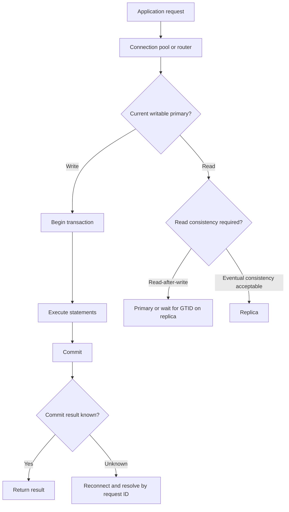

# Kiểm thử mất kết nối, đọc dữ liệu cũ và retry giao dịch từ ứng dụng

## Mục tiêu

Một hệ thống MySQL có replication hoặc cơ chế failover vẫn có thể khiến ứng dụng gặp lỗi ở những thời điểm khó đoán: kết nối bị ngắt giữa giao dịch, primary đổi máy, replica chưa áp dụng transaction mới nhất hoặc client không biết lệnh `COMMIT` đã thành công hay chưa. Tính sẵn sàng cao chỉ có ý nghĩa khi ứng dụng xử lý được những tình huống này mà không làm mất hoặc nhân đôi nghiệp vụ.

Bài học thuộc module **DATABASE_MYSQL**, tập trung vào thiết kế bảng, kiểu dữ liệu, khóa, truy vấn SQL, index, transaction, kiểm soát đồng thời, tối ưu truy vấn và vận hành cơ sở dữ liệu quan hệ. Nội dung này giúp bạn thiết kế kiểm thử lỗi từ góc nhìn ứng dụng, phân loại kết quả giao dịch, xử lý dữ liệu đọc cũ và xây dựng retry có giới hạn.

Sau bài học, bạn có thể:

- Mô tả các dạng gián đoạn kết nối và trạng thái giao dịch mà ứng dụng có thể quan sát.
- Phân biệt lỗi có thể retry ngay với kết quả `COMMIT` chưa xác định.
- Thiết kế thao tác idempotent để retry không tạo tác dụng phụ lặp lại.
- Chọn primary hoặc replica phù hợp với yêu cầu read-after-write.
- Kiểm thử failover, stale read, timeout, retry và phục hồi kết nối trong môi trường có kiểm soát.

## 1. Vì sao phải kiểm thử từ ứng dụng?

Replication và failover bảo vệ dịch vụ ở tầng cơ sở dữ liệu, nhưng ứng dụng vẫn phải đối mặt với timeout, connection reset, DNS cache, connection pool cũ, replica lag và transaction có kết quả chưa rõ. Một máy chủ mới có thể đã nhận vai trò primary trong khi connection pool vẫn giữ kết nối tới primary cũ. Một truy vấn đọc có thể chạy thành công trên replica nhưng trả về dữ liệu trước lần ghi vừa hoàn tất.

Vì vậy, kiểm thử HA cần quan sát toàn bộ đường đi của một yêu cầu:



Kiểm thử nên xác minh cả kết quả dữ liệu và phản hồi của ứng dụng. Một endpoint trả HTTP 200 không đủ chứng minh transaction được thực thi đúng một lần; ngược lại, client nhận timeout cũng không chứng minh server đã rollback.

## 2. Những dạng lỗi kết nối thường gặp

| Tình huống | Điều ứng dụng có thể thấy | Hệ quả cần xử lý |
|---|---|---|
| Mất mạng trước khi gửi câu lệnh | Connect timeout hoặc connection refused | Chưa có câu lệnh nào được gửi; có thể kết nối lại và thử theo chính sách retry |
| Mất kết nối khi đang chạy câu lệnh | Read timeout hoặc connection lost | Không biết server đã thực hiện đến đâu; phải xác định transaction và kết quả trước khi lặp lại |
| Mất kết nối khi `COMMIT` đang được gửi/xử lý | Client timeout hoặc lỗi mất kết nối | Kết quả commit có thể chưa xác định đối với client |
| Primary khởi động lại hoặc failover | Connection reset, server gone away | Connection pool phải loại bỏ socket lỗi và tìm primary hiện tại |
| DNS hoặc endpoint đổi | Kết nối tới địa chỉ cũ hoặc không phân giải được | Resolver, proxy và pool cần cập nhật endpoint theo kiến trúc |
| Replica chậm | Truy vấn thành công nhưng thấy dữ liệu cũ | Chọn đường đọc đáp ứng mức nhất quán của nghiệp vụ |
| Replica bị dừng applier | Receiver có thể vẫn nhận event nhưng dữ liệu không tiến triển | Theo dõi trạng thái áp dụng và chuyển truy vấn nhạy cảm sang primary nếu cần |

Một số mã lỗi MySQL thường gặp:

- `2006` (`MySQL server has gone away`) và `2013` (`Lost connection to MySQL server during query`): kết nối đã mất; cần xem câu lệnh đang chạy và ranh giới transaction.
- `1205` (`Lock wait timeout exceeded`): chờ khóa quá thời gian; ứng dụng nên rollback transaction theo chính sách rồi cân nhắc retry toàn bộ giao dịch.
- `1213` (`Deadlock found`): InnoDB chọn transaction làm nạn nhân và rollback transaction đó; có thể retry toàn bộ giao dịch với giới hạn.
- `1062` (`Duplicate entry`): vi phạm unique constraint; thường là xung đột dữ liệu hoặc dấu hiệu request đã được xử lý, không phải lỗi transient để retry mù quáng.

Không phân loại chỉ dựa vào thông điệp lỗi. Dùng mã lỗi, SQLSTATE, giai đoạn giao dịch và thông tin từ driver để quyết định hành động.

## 3. Phân biệt lỗi trước, trong và sau COMMIT

Ranh giới quan trọng nhất khi retry là thời điểm kết nối bị mất so với `COMMIT`.

**Trước khi bắt đầu transaction:** nếu kết nối thất bại trước khi gửi câu lệnh, request chưa tạo thay đổi trong MySQL. Ứng dụng có thể lấy connection mới và thử lại theo deadline.

**Trong transaction, trước COMMIT:** nếu connection bị đóng, transaction chưa commit thường sẽ được rollback khi server phát hiện session kết thúc. Tuy nhiên, client không nên tái sử dụng connection hỏng hoặc giả định mọi lỗi đều đã rollback ngay lập tức. Hãy loại bỏ connection, kết nối lại và chỉ retry theo thiết kế idempotent.

**Khi COMMIT đang diễn ra:** client có thể gửi `COMMIT`, server có thể commit thành công, nhưng phản hồi bị mất trên đường về. Client chỉ thấy timeout hoặc connection lost. Đây là *ambiguous commit*: server có thể đã commit hoặc chưa commit. Gửi lại toàn bộ nghiệp vụ bằng một request mới có thể nhân đôi tác dụng.

**Sau khi nhận xác nhận COMMIT:** ứng dụng có thể trả kết quả thành công. Nếu response tới người dùng bị mất sau đó, người dùng hoặc gateway có thể gửi lại request. Đây cũng là lý do cần idempotency ở tầng nghiệp vụ.

Không thể suy ra kết quả commit chỉ từ việc client nhận exception. Khi kết quả chưa xác định, cần truy vấn trạng thái nghiệp vụ bằng một định danh request ổn định hoặc dùng một thao tác idempotent để thử lại an toàn.

## 4. Retry đúng ranh giới transaction

Với lỗi deadlock `1213`, InnoDB rollback transaction nạn nhân. Ứng dụng nên chạy lại toàn bộ transaction từ đầu, bao gồm các lần đọc mà quyết định nghiệp vụ phụ thuộc vào đó. Không chỉ chạy lại câu lệnh cuối cùng vì các dữ kiện đọc trước đó có thể đã thay đổi.

Với lock wait timeout `1205`, hành vi rollback phụ thuộc cấu hình `innodb_rollback_on_timeout`; mặc định thường chỉ rollback statement bị timeout. Để tránh tiếp tục một transaction ở trạng thái ứng dụng không mong đợi, cách an toàn phổ biến là chủ động `ROLLBACK` toàn bộ transaction rồi mới retry từ đầu nếu lỗi được xem là tạm thời.

Ví dụ cấu trúc giao dịch:

```sql
START TRANSACTION;

SELECT balance
FROM accounts
WHERE account_id = 1001
FOR UPDATE;

UPDATE accounts
SET balance = balance - 50000
WHERE account_id = 1001;

UPDATE accounts
SET balance = balance + 50000
WHERE account_id = 2002;

COMMIT;
```

Nếu transaction gặp deadlock, ứng dụng cần chạy lại toàn bộ logic chuyển tiền sau khi xác định lỗi có thể retry. Khi retry, phải đọc lại số dư và kiểm tra điều kiện nghiệp vụ trong transaction mới. Ví dụ trên chỉ minh họa ranh giới giao dịch; hệ thống thực tế cần xác thực số dư, số tiền dương, tài khoản hợp lệ và ghi nhận mã giao dịch.

Quy tắc thực hành:

1. Giới hạn số lần retry và tổng thời gian retry bằng deadline của request.
2. Dùng exponential backoff kèm jitter để nhiều client không đồng loạt retry.
3. Retry toàn bộ transaction sau deadlock; với lock timeout, rollback transaction trước khi bắt đầu lại.
4. Không retry lỗi cú pháp, lỗi quyền, dữ liệu không hợp lệ hoặc duplicate key như thể đó là lỗi mạng.
5. Nếu kết quả commit chưa rõ, dùng cùng idempotency key để xác định hoặc bảo đảm kết quả.
6. Ghi log mã lỗi, số lần retry, thời gian chờ và định danh request; tránh ghi secret hoặc dữ liệu nhạy cảm.

## 5. Idempotency: nền tảng của retry an toàn

Một thao tác idempotent có thể được gửi nhiều lần với cùng định danh mà vẫn tạo ra một kết quả nghiệp vụ tương đương với việc thực hiện một lần. Điều này đặc biệt quan trọng khi client không biết lần gửi trước đã commit hay chưa.

Ví dụ, một yêu cầu thanh toán nên có `request_id` duy nhất do ứng dụng tạo và giữ nguyên qua mọi lần retry. Cơ sở dữ liệu dùng unique key để bảo đảm cùng request không tạo hai lần thay đổi số dư.

```sql
CREATE TABLE processed_requests (
  request_id BINARY(16) NOT NULL PRIMARY KEY,
  result_code VARCHAR(32) NOT NULL,
  created_at TIMESTAMP NOT NULL DEFAULT CURRENT_TIMESTAMP
) ENGINE = InnoDB;
```

Trong cùng một transaction, ứng dụng ghi nhận request và thực hiện thay đổi nghiệp vụ:

```sql
START TRANSACTION;

INSERT INTO processed_requests (request_id, result_code)
VALUES (UUID_TO_BIN(?), 'PROCESSING');

UPDATE accounts
SET balance = balance - ?
WHERE account_id = ?;

UPDATE processed_requests
SET result_code = 'SUCCESS'
WHERE request_id = UUID_TO_BIN(?);

COMMIT;
```

Đây là mẫu minh họa. Ứng dụng phải kiểm tra số hàng bị ảnh hưởng và điều kiện nghiệp vụ trước khi đánh dấu thành công. Nếu `INSERT` nhận lỗi duplicate key vì request ID đã tồn tại, hãy rollback transaction thử lại rồi đọc kết quả đã lưu trên primary bằng một transaction mới. Nếu request đầu vẫn đang xử lý, thao tác insert trùng sẽ chờ khóa unique được giải phóng; sau đó nó sẽ thành công nếu transaction đầu rollback hoặc báo duplicate nếu transaction đầu commit. Ứng dụng trả lại kết quả đã lưu thay vì thực hiện lại tác dụng phụ. Nếu transaction trước rollback, bản ghi idempotency cũng rollback, nên lần retry có thể xử lý request đó.

Khi `COMMIT` bị mất phản hồi, kết nối lại tới primary có thẩm quyền sau khi failover đã ổn định, rồi tra cứu `request_id`. Nếu request đã được commit, trả lại kết quả đã lưu. Nếu chưa có bản ghi, có thể thử lại cùng request ID. Trong thiết kế chịu lỗi cao, thao tác ghi idempotency và thay đổi nghiệp vụ phải nằm trong cùng transaction InnoDB.

Không tạo request ID mới mỗi lần retry. Nếu mỗi lần thử dùng một ID khác nhau, unique constraint không còn bảo vệ được nghiệp vụ khỏi việc thực thi lặp.

## 6. Đọc dữ liệu cũ và read-after-write

Replication bất đồng bộ cho phép source commit trước khi replica áp dụng transaction tương ứng. Vì vậy, ngay sau khi ứng dụng ghi thành công lên primary, một truy vấn đọc được định tuyến sang replica có thể trả về dữ liệu cũ.

Ví dụ:

1. Ứng dụng cập nhật trạng thái đơn hàng trên primary và nhận xác nhận commit.
2. Router gửi truy vấn `SELECT` tiếp theo sang replica.
3. Applier của replica chưa thực thi transaction cập nhật đơn hàng.
4. Ứng dụng thấy trạng thái trước đó dù lần ghi đã thành công trên primary.

Đây không nhất thiết là mất dữ liệu; đó có thể là độ trễ replication. Chọn chiến lược đọc theo yêu cầu nghiệp vụ:

| Yêu cầu | Chiến lược phù hợp |
|---|---|
| Cần thấy ngay dữ liệu vừa ghi | Đọc tiếp từ primary trong cùng luồng nghiệp vụ |
| Có thể chờ replica bắt kịp | Chờ GTID của transaction được áp dụng rồi đọc replica |
| Báo cáo hoặc danh sách chấp nhận dữ liệu trễ | Đọc replica và hiển thị thời điểm cập nhật/freshness |
| Cần nhất quán mạnh trên nhiều thao tác liên quan | Duy trì cùng primary hoặc dùng thiết kế đồng bộ phù hợp với topology |

### Chờ replica áp dụng GTID

MySQL có hàm `WAIT_FOR_EXECUTED_GTID_SET(gtid_set, timeout)` để đợi một instance thực thi toàn bộ GTID trong tập được chỉ định. Hàm trả `0` khi đã thực thi xong trong thời hạn, `1` khi hết thời gian chờ và `NULL` khi có lỗi.

```sql
SELECT WAIT_FOR_EXECUTED_GTID_SET('<transaction-gtid>', 5);
```

Ứng dụng cần lấy GTID của transaction vừa commit trên primary. Có thể dùng session tracking với `session_track_gtids=OWN_GTID` nếu MySQL client library hỗ trợ đọc trạng thái session trả về sau commit. Sau đó chuyển GTID đó cho truy vấn chờ trên replica. Không nên lấy một snapshot tùy ý của `@@GLOBAL.gtid_executed` rồi coi toàn bộ tập đó là GTID riêng của request, vì có thể bao gồm transaction của session khác.

Nếu hàm trả `1` do timeout, replica chưa đáp ứng yêu cầu read-after-write trong deadline. Ứng dụng có thể đọc từ primary hoặc báo trạng thái chờ theo nghiệp vụ. Nếu trả `NULL`, ghi nhận lỗi và xử lý theo nguyên nhân. Chỉ đọc từ replica sau khi điều kiện GTID đã được đáp ứng.

GTID wait chỉ xác nhận transaction trong tập GTID đã được thực thi trên instance đó; nó không thay thế kiểm tra topology, không sửa replica bị lỗi và không bảo đảm một replica đang là nguồn đọc phù hợp sau failover.

## 7. Connection pool và định tuyến sau failover

Connection pool giúp tái sử dụng kết nối, nhưng socket đang mở tới primary cũ có thể không còn hợp lệ sau restart hoặc failover. Ứng dụng cần có cơ chế:

- Loại bỏ connection sau lỗi mạng hoặc lỗi server; không đưa socket hỏng trở lại pool.
- Kết nối lại qua endpoint/proxy/router có khả năng tìm primary hiện tại.
- Xác minh node đích cho phép ghi theo vai trò hiện tại; không suy luận vai trò chỉ từ hostname cũ.
- Áp dụng timeout kết nối, timeout đọc và deadline nghiệp vụ phù hợp.
- Giới hạn số lần kết nối lại để tránh tạo bão kết nối khi database đang phục hồi.
- Theo dõi thời gian DNS cache, health check và thời gian cập nhật topology của proxy.

Ở phía MySQL, `read_only` và `super_read_only` có thể giúp ngăn ghi ngoài ý muốn trên replica. Tuy nhiên, failover cần cơ chế điều phối và fencing để bảo đảm primary cũ không tiếp tục nhận ghi sau khi primary mới đã được chọn. Nếu hai node cùng nhận ghi, dữ liệu có thể phân kỳ; retry của ứng dụng không thể tự sửa split-brain.

Khi chuyển primary, cần hiểu RPO của hệ thống. Với replication bất đồng bộ, một transaction đã commit trên primary cũ có thể chưa được chuyển sang replica được thăng cấp. Semi-synchronous replication có thể giảm cửa sổ mất dữ liệu nhưng không tự bảo đảm không mất dữ liệu trong mọi lỗi. Ứng dụng cần xử lý kết quả giao dịch và quy tắc đối soát theo chính sách RPO thực tế.

## 8. Ma trận kiểm thử HA từ ứng dụng

Thực hiện các bài kiểm thử trong môi trường staging có dữ liệu thử nghiệm và quy trình khôi phục rõ ràng:

| Kịch bản | Cách tạo lỗi có kiểm soát | Kết quả cần xác minh |
|---|---|---|
| Mất kết nối trước transaction | Tạm chặn kết nối hoặc dừng endpoint trước khi gửi SQL | Client kết nối lại; không phát sinh thay đổi dữ liệu |
| Mất kết nối giữa transaction | Ngắt session sau một số câu lệnh nhưng trước commit | Transaction không được coi là thành công; retry thực hiện từ đầu |
| Mất phản hồi COMMIT | Dùng proxy thử nghiệm làm rơi phản hồi sau khi chuyển tiếp COMMIT | Ứng dụng tra cứu cùng request ID và không nhân đôi tác dụng phụ |
| Deadlock | Tạo hai transaction khóa tài nguyên theo thứ tự ngược trong môi trường thử nghiệm | Một transaction nhận lỗi deadlock; retry toàn bộ giao dịch thành công hoặc trả lỗi có kiểm soát |
| Lock wait timeout | Giữ row lock ở session khác rồi chạy câu lệnh chờ | Ứng dụng rollback, áp dụng retry có giới hạn và không để transaction dở dang |
| Replica lag | Tạm dừng applier hoặc tạo tải áp dụng có kiểm soát | Đọc replica có thể cũ; read-after-write dùng primary hoặc GTID wait |
| Primary failover | Dừng primary thử nghiệm và kích hoạt quy trình promote | Pool bỏ connection cũ, router chuyển sang primary mới, ghi không chạy trên node sai vai trò |
| Retry trùng request | Gửi đồng thời nhiều request cùng idempotency key | Chỉ một tác dụng phụ được commit; các request còn lại nhận kết quả đã lưu |

Ghi nhận timestamp, request ID, connection endpoint, node/role, GTID nếu có, mã lỗi, số lần retry và kết quả dữ liệu. So sánh kết quả với tiêu chí RTO/RPO và mức nhất quán mà ứng dụng cam kết.

## 9. Thiết kế retry có giới hạn

Retry quá nhiều có thể làm tình trạng quá tải nặng hơn. Một chính sách tốt cần có:

1. **Danh sách lỗi được retry:** ví dụ deadlock, một số lock timeout và lỗi kết nối tạm thời; phân loại riêng trường hợp kết quả commit chưa rõ.
2. **Giới hạn attempts và deadline:** tổng thời gian retry không vượt quá thời gian mà request hoặc người dùng có thể chờ.
3. **Exponential backoff và jitter:** tăng dần thời gian chờ và thêm độ ngẫu nhiên để giảm retry đồng loạt.
4. **Circuit breaker hoặc admission control:** tạm hạn chế request mới khi database chưa phục hồi để bảo vệ cả ứng dụng lẫn MySQL.
5. **Idempotency key ổn định:** giữ nguyên ID qua mọi lần gửi lại và lưu kết quả cùng transaction nghiệp vụ.
6. **Quan sát được:** đo tỷ lệ lỗi, retry, commit chưa xác định, replica lag, pool exhaustion và thời gian failover.

Không retry vô hạn và không tự động retry mọi exception. Lỗi quyền, sai SQL, vi phạm constraint do dữ liệu không hợp lệ hoặc lỗi nghiệp vụ cần được xử lý theo hướng khác.

## 10. Bài tập thực hành

Trên môi trường MySQL staging có một primary và ít nhất một replica:

- Tạo bảng nghiệp vụ có khóa chính và bảng `processed_requests` với `request_id` unique.
- Viết một API hoặc chương trình thử nghiệm có transaction nhiều câu lệnh và connection pool.
- Gửi một request, ngắt kết nối trước khi commit và xác nhận không có thay đổi một phần.
- Gửi một request khác rồi làm mất phản hồi `COMMIT`; kết nối lại và dùng cùng `request_id` để xác định kết quả.
- Tạm dừng applier, ghi dữ liệu trên primary rồi đọc replica để quan sát dữ liệu cũ.
- Thử `WAIT_FOR_EXECUTED_GTID_SET()` bằng GTID của transaction vừa commit nếu client hỗ trợ session tracking; xác nhận chỉ đọc replica khi hàm trả `0`.
- Tạo deadlock và lock wait timeout có kiểm soát, kiểm tra ứng dụng rollback và retry đúng toàn bộ transaction.
- Thực hiện failover staging, xác minh pool loại connection cũ và chỉ ghi vào primary mới sau khi node cũ được fencing.

**Tiêu chí hoàn thành:** không có tác dụng phụ bị nhân đôi khi retry cùng request ID; ứng dụng nhận biết được kết quả commit chưa rõ; truy vấn read-after-write không trả dữ liệu cũ ngoài chính sách; và sau failover, ứng dụng kết nối tới đúng primary trong giới hạn thời gian đã đặt.

## Kết luận

Kiểm thử HA phải bắt đầu từ hành vi ứng dụng khi kết nối và transaction bị gián đoạn. Hãy phân biệt lỗi trước commit với kết quả commit chưa xác định, dùng idempotency key để retry an toàn, chọn primary hoặc chờ GTID khi cần read-after-write, và buộc connection pool cập nhật endpoint sau failover. Kiểm thử định kỳ các kịch bản mất kết nối, stale read, deadlock và chuyển primary sẽ cho bạn bằng chứng thực tế về mức sẵn sàng của hệ thống.
