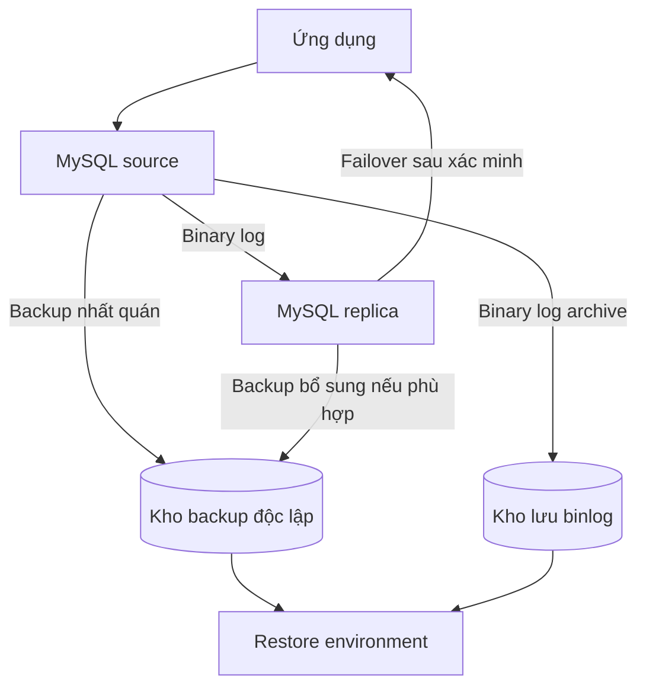

# Đối chiếu backup, replication và diễn tập khôi phục trong cùng kế hoạch

Trong module `DATABASE_MYSQL`, người học làm chủ MySQL từ thiết kế bảng, kiểu dữ liệu, khóa và truy vấn SQL đến index, transaction, kiểm soát đồng thời, đọc kế hoạch thực thi, tối ưu truy vấn, phân quyền, sao lưu và xử lý các vấn đề vận hành cơ sở dữ liệu quan hệ. Bài học này kết nối ba năng lực thường được triển khai riêng lẻ: sao lưu (backup), replication và diễn tập khôi phục. Mục tiêu là xây dựng một kế hoạch sẵn sàng cao và phục hồi sau thảm họa có thể kiểm chứng bằng dữ liệu, thời gian và quy trình thực tế.

Backup, replication và failover giải quyết các loại sự cố khác nhau. Replication giúp duy trì một bản dữ liệu trên máy chủ khác để có thể chuyển dịch vụ khi source gặp lỗi. Backup giữ lại các điểm dữ liệu độc lập để khôi phục sau xóa nhầm, lỗi logic, hỏng dữ liệu hoặc mất toàn bộ môi trường. Diễn tập khôi phục xác minh rằng các bản backup, binary log, cấu hình, thông tin xác thực và runbook thực sự đủ để đưa ứng dụng hoạt động lại. Một kế hoạch tốt cần phối hợp cả ba.

## 1. Vai trò của backup, replication và failover

| Năng lực | Mục đích chính | Tình huống phù hợp | Giới hạn cần hiểu |
|---|---|---|---|
| Backup | Lưu các điểm dữ liệu có thể phục hồi độc lập theo thời gian. | Xóa nhầm, cập nhật sai, lỗi logic, hỏng dữ liệu, mất máy chủ hoặc vùng lưu trữ. | Cần thời gian restore; backup chưa được kiểm thử có thể không dùng được. |
| Replication | Duy trì bản sao dữ liệu trên một hoặc nhiều máy chủ khác. | Source hoặc máy chủ hiện tại gặp sự cố; cần chuyển tải đọc/ghi sang máy khác. | Thay đổi sai cũng được truyền sang replica; replica có thể trễ hoặc thiếu transaction. |
| Failover | Chuyển vai trò phục vụ sang một máy chủ khác khi máy hiện tại không còn đáp ứng. | Hỏng máy chủ, hệ điều hành, vùng mạng hoặc cần bảo trì có kế hoạch. | Cần chọn đúng candidate, fencing source cũ, định tuyến lại ứng dụng và xác minh dữ liệu. |
| Restore drill | Thực hiện khôi phục có kiểm soát và đo kết quả. | Xác minh khả năng khôi phục, thời gian thực tế và tính đầy đủ của quy trình. | Tốn tài nguyên và thời gian; cần môi trường thử nghiệm đủ gần production. |

Replication không phải backup. Nếu ứng dụng chạy câu lệnh `DELETE` nhầm trên source, transaction đó có thể được replica áp dụng gần như ngay lập tức. Nếu một lỗi logic ghi dữ liệu sai, các replica có thể sao chép chính lỗi đó. Ngược lại, backup độc lập được lưu từ trước sự cố có thể giúp phục hồi về thời điểm trước khi dữ liệu bị phá hủy.

Backup cũng không thay thế replication. Khi máy chủ production hỏng, restore một cơ sở dữ liệu lớn từ backup có thể mất nhiều thời gian. Một replica khỏe và đã bắt kịp có thể giúp rút ngắn thời gian chuyển dịch vụ. Tuy nhiên, replica chỉ là candidate phục hồi sau khi đã kiểm tra độ đầy đủ của transaction và loại trừ nguy cơ split-brain.

## 2. Đặt mục tiêu phục hồi chung cho cả hệ thống

Trước khi chọn công cụ, hãy xác định mục tiêu ở cấp dịch vụ và dữ liệu.

### RTO và RPO

- **RTO (Recovery Time Objective):** khoảng gián đoạn tối đa mà tổ chức chấp nhận. Khi diễn tập, đo từ mốc sự cố đã quy ước đến khi ứng dụng hoạt động và các kiểm tra thiết yếu thành công.
- **RPO (Recovery Point Objective):** khoảng thời gian dữ liệu tối đa mà tổ chức chấp nhận mất. Khi diễn tập, xác định transaction đã commit mới nhất có mặt và được xác minh trong môi trường phục hồi.

Ví dụ, một hệ thống bán hàng có RTO 30 phút và RPO 5 phút. Một replica ở cùng vùng có thể hỗ trợ failover nhanh, nhưng nếu replica đang chậm 8 phút thì chưa đáp ứng RPO. Một backup đầy đủ mỗi đêm có thể giúp phục hồi sau lỗi logic, nhưng nếu không có binary log liên tục thì điểm phục hồi có thể cách sự cố nhiều giờ. Mục tiêu phải được kiểm tra với cả luồng replication lẫn chuỗi backup/binlog.

Không đặt một RTO/RPO chung cho mọi schema hoặc dịch vụ nếu mức độ quan trọng khác nhau. Ví dụ, bảng đơn hàng và thanh toán có thể cần RPO thấp hơn bảng báo cáo có thể tái tạo. Hãy phân loại dữ liệu theo tác động nghiệp vụ, phụ thuộc và khả năng tái tạo.

### Xác định phạm vi phục hồi

Kế hoạch cần ghi rõ:

1. Ứng dụng nào sử dụng database, schema và bảng nào là trọng yếu.
2. Những đối tượng nào cần khôi phục cùng dữ liệu: view, trigger, routine, event, user, role, grants và cấu hình liên quan.
3. Dịch vụ phụ thuộc như DNS, proxy, secret manager, chứng chỉ, queue, object storage và job scheduler.
4. Vùng lỗi cần xử lý: lỗi process, máy chủ, rack, vùng cloud, tài khoản cloud, mạng hoặc sự cố logic.
5. Ai có quyền tuyên bố sự cố, chọn điểm phục hồi, phê duyệt failover và xác nhận dữ liệu nghiệp vụ.

Phạm vi này giúp tránh tình trạng database đã chạy nhưng ứng dụng vẫn không hoạt động vì thiếu tài khoản, chứng chỉ, cấu hình hoặc một dịch vụ phụ thuộc.

## 3. Thiết kế kiến trúc backup kết hợp replication

Một kiến trúc cơ bản có thể có source, replica tại vùng khác và kho backup độc lập:



Các thành phần nên được thiết kế như sau:

- **Source:** nhận ghi từ ứng dụng, bật binary logging và có cấu hình durability phù hợp với yêu cầu dữ liệu.
- **Replica:** đặt trên hạ tầng độc lập đủ để chịu được lỗi của source; theo dõi receiver, applier, GTID và độ trễ. Replica chỉ đọc cần bật `read_only` và `super_read_only` khi phù hợp.
- **Kho backup:** tách quyền quản trị và miền lỗi khỏi source. Dùng mã hóa, kiểm tra checksum, kiểm soát truy cập và cơ chế chống sửa/xóa ngoài ý muốn.
- **Kho binary log archive:** lưu log ngoài máy chủ nguồn để PITR vẫn khả thi khi source mất. Bảo đảm file liên tục từ mốc backup đến điểm phục hồi cần thiết.
- **Môi trường restore:** có thể dựng độc lập, tương thích phiên bản MySQL và đủ tài nguyên để chạy kiểm tra dữ liệu/ứng dụng.

Nếu dùng replica làm nguồn tạo backup, cần kiểm tra cách công cụ backup xử lý trạng thái replication, consistency và vị trí binlog/GTID. Backup từ replica không tự động an toàn chỉ vì replica đang chạy. Phải xác minh snapshot nhất quán, tiến độ applier và metadata cần thiết để phục hồi.

## 4. Đồng bộ mốc backup với trạng thái replication

Một bản backup hữu ích cho PITR cần có mốc nhất quán và thông tin để nối tiếp các transaction sau đó. Tùy phương pháp, metadata có thể gồm:

- Thời điểm bắt đầu và hoàn tất backup.
- Phiên bản MySQL, phiên bản công cụ và cấu hình storage engine.
- Danh sách schema/bảng được bao gồm và những đối tượng bị loại trừ.
- Binary log file/position hoặc GTID set tại snapshot.
- Danh sách file backup, chuỗi incremental nếu có, checksum và trạng thái mã hóa.
- Thời hạn lưu giữ và vị trí bản sao ở miền lỗi khác.

Với logical backup InnoDB, `mysqldump --single-transaction` có thể tạo snapshot nhất quán mà không khóa đọc toàn bộ thời gian dump. Tuy nhiên, tùy chọn này không tạo snapshot nhất quán cho bảng không dùng transactional engine và không bảo vệ khỏi thay đổi DDL đồng thời. Với physical backup, phải tuân thủ quy trình prepare/apply log của công cụ và lưu metadata tương ứng.

Nếu sử dụng binary log cho PITR, kiểm tra:

```sql
SHOW VARIABLES LIKE 'log_bin';
SHOW VARIABLES LIKE 'binlog_format';
SHOW BINARY LOGS;
SELECT @@GLOBAL.gtid_executed, @@GLOBAL.gtid_purged;
```

Replica sử dụng GTID có thể được kiểm tra bằng:

```sql
SHOW REPLICA STATUS\G
```

Đối chiếu `Retrieved_Gtid_Set` và `Executed_Gtid_Set` để biết transaction đã nhận và transaction đã áp dụng. Một replica nhận đủ log nhưng applier chưa xử lý xong vẫn có thể trả kết quả đọc cũ. `Seconds_Behind_Source` là chỉ số ước lượng, không nên dùng làm bằng chứng duy nhất rằng replica đã bắt kịp.

## 5. Xác định phương án theo từng kịch bản sự cố

Một kế hoạch tốt không dùng cùng một hành động cho mọi sự cố. Hãy phân biệt lỗi máy chủ, lỗi dữ liệu và lỗi toàn bộ miền lưu trữ.

| Kịch bản | Phương án ưu tiên | Vai trò của backup và replication |
|---|---|---|
| MySQL process hoặc máy chủ source hỏng | Khôi phục dịch vụ trên máy chủ đã sửa hoặc failover sang replica phù hợp. | Replication giúp giảm thời gian chuyển dịch vụ; backup là phương án khi replica không đủ dữ liệu hoặc source không thể phục hồi. |
| Xóa nhầm bảng hoặc cập nhật sai | Restore backup sang môi trường cô lập, phát lại binlog đến trước giao dịch lỗi, rồi xác minh và hợp nhất dữ liệu cần thiết. | Backup cung cấp điểm dữ liệu trước lỗi; replication không loại bỏ thay đổi sai. |
| Source bị hỏng dữ liệu logic | Dừng hoặc cô lập ghi theo runbook; xác định thời điểm lỗi; phục hồi từ backup/PITR. | Không promote replica một cách tự động nếu lỗi đã được truyền sang replica. |
| Mất cả vùng hạ tầng | Dựng môi trường ở vùng khác từ replica còn khả dụng hoặc backup/binlog đã sao chép độc lập. | Cần bản sao dữ liệu, backup, log, khóa và cấu hình ở miền lỗi khác. |
| Replica bị tụt log do retention quá ngắn | Dựng lại replica từ backup/clone nhất quán rồi nối lại replication. | Backup và GTID state giúp tạo lại replica khi source không còn giữ binlog cần thiết. |
| Hỏng hoặc mất kho backup | Dùng bản sao backup độc lập khác; đánh giá khả năng phục hồi từ replica trong lúc khôi phục kho backup. | Cần nhiều bản sao ở miền lỗi và quyền truy cập độc lập. |

### Sự cố máy chủ: failover sang replica

Khi source hỏng và replica là candidate, quy trình cần:

1. Xác định source thực sự không còn nhận ghi hoặc có thể fencing an toàn.
2. Kiểm tra receiver/applier, lỗi replication và GTID của từng candidate.
3. Xác định transaction cuối cùng đã được xác nhận với ứng dụng và so sánh với GTID đã nhận/đã thực thi.
4. Để candidate áp dụng hết các transaction cần giữ lại; xác minh dữ liệu nghiệp vụ.
5. Fencing source cũ để ngăn hai máy chủ cùng nhận ghi.
6. Promote candidate theo runbook, cập nhật định tuyến/proxy/DNS và cho ứng dụng kết nối.
7. Kiểm tra transaction ghi mới, quyền, giám sát và trạng thái các replica còn lại.

Semi-synchronous replication có thể giảm rủi ro mất transaction đã được ACK, nhưng ACK chỉ xác nhận replica đã nhận và ghi transaction vào relay log theo cơ chế plugin. Nó không tự chứng minh transaction đã được applier thực thi. GTID, trạng thái relay log và quy trình failover vẫn cần được kiểm tra.

### Sự cố dữ liệu: restore và point-in-time recovery

Khi dữ liệu bị xóa hoặc sửa sai, không nên lập tức promote replica vì lỗi có thể đã được sao chép. Hãy giữ hiện trạng để điều tra, restore backup sang môi trường riêng và phát lại binary log đến thời điểm ngay trước giao dịch gây lỗi. Sau khi xác minh dữ liệu, quyết định cách đưa phần dữ liệu hợp lệ trở lại production: phục hồi toàn bộ database, phục hồi một schema/bảng qua quy trình có kiểm soát hoặc trích xuất các bản ghi cần thiết.

Không ghi đè production chỉ vì restore thử nghiệm thành công. Cần đánh giá các giao dịch hợp lệ phát sinh sau điểm phục hồi, quan hệ khóa ngoại, dữ liệu liên quan và tác động của việc hợp nhất. Với hệ thống có ghi liên tục, quá trình hòa giải dữ liệu cần chủ sở hữu nghiệp vụ phê duyệt.

## 6. Lập chuỗi phục hồi từ backup và binary log

Quy trình PITR điển hình có các bước:

1. Chọn backup nhất quán được tạo trước thời điểm cần phục hồi.
2. Kiểm tra checksum, khóa giải mã, phiên bản MySQL và metadata.
3. Khôi phục backup trên máy chủ cô lập.
4. Chuẩn bị chuỗi binary log liên tục từ vị trí/GTID của backup đến thời điểm đích.
5. Phân tích log để xác định giao dịch cần dừng trước hoặc điểm phục hồi được phê duyệt.
6. Phát lại log đến điểm đích bằng `mysqlbinlog` hoặc công cụ phù hợp.
7. Kiểm tra dữ liệu, đối tượng schema, tài khoản/quyền và các chỉ tiêu nghiệp vụ.
8. Chạy smoke test ứng dụng và ghi lại điểm commit mới nhất được xác minh.

Ví dụ minh họa phát lại binlog theo mốc thời gian:

```bash
mysqlbinlog \
  --start-position=4567 \
  --stop-datetime="2026-11-19 10:30:00" \
  /backup/binlog/mysql-bin.000123 \
  /backup/binlog/mysql-bin.000124 \
  | mysql --login-path=restore
```

Các giá trị file, vị trí và thời điểm chỉ là ví dụ. Mốc bắt đầu phải khớp metadata của backup; file log phải liên tục và đúng thứ tự. Thời gian dừng phải dùng múi giờ đã thống nhất, thường là UTC. Nếu cần dừng chính xác trước một transaction, phân tích ranh giới sự kiện/transaction và xác minh trên bản sao trước khi thực hiện.

Backup và binlog phải được giữ độc lập với source. Nếu chỉ lưu binlog trên source, sự cố mất đĩa hoặc mất vùng có thể làm mất cả dữ liệu nguồn lẫn chuỗi log cần cho PITR. Chính sách retention cần đủ cho replica offline, thời gian dựng lại, delayed replica, công cụ CDC và thời hạn PITR.

## 7. Đối chiếu tính nhất quán dữ liệu sau khôi phục

Không dùng trạng thái “MySQL đã khởi động” làm tiêu chí duy nhất. Xác minh ở ba lớp.

### Lớp replication và GTID

- Receiver và applier chạy ổn định, không có lỗi IO/SQL chưa xử lý.
- GTID đã thực thi phù hợp với điểm phục hồi hoặc source mới.
- Không có errant transaction ngoài dự kiến.
- Binary log cần thiết vẫn còn và các replica phía sau có thể tiếp tục bắt kịp.
- Replica được giữ ở chế độ chỉ đọc khi phù hợp, bằng `read_only` và `super_read_only`.

### Lớp dữ liệu

Chọn các kiểm tra có ý nghĩa nghiệp vụ: số đơn hàng, tổng thanh toán, số dư, tồn kho, số bản ghi theo ngày hoặc checksum theo khóa chính. Đối chiếu với nguồn tham chiếu ở đúng mốc thời gian. Nếu phục hồi trước một giao dịch sai, xác nhận giao dịch sai không còn và các giao dịch hợp lệ trước đó vẫn có mặt.

### Lớp ứng dụng

Kiểm tra ứng dụng kết nối bằng tài khoản thực tế, đọc được dữ liệu đại diện và thực hiện được thao tác ghi thử trong môi trường kiểm thử. Xác minh user, role, grants, TLS, secret, job, event, scheduler và tích hợp ngoài. Nếu các job có thể gửi email, thu tiền hoặc gọi hệ thống thật, hãy giữ chúng ở trạng thái cô lập cho đến khi có phê duyệt.

## 8. Ghi nhận RTO, RPO và kết quả đối chiếu

Một cuộc diễn tập tích hợp cần ghi thời gian và điểm dữ liệu ở cả luồng failover lẫn restore.

| Thông tin | Bằng chứng cần lưu |
|---|---|
| Kịch bản và phạm vi | Mã diễn tập, hệ thống, vùng lỗi mô phỏng, schema và người chịu trách nhiệm. |
| Mục tiêu | RTO/RPO được phê duyệt và tiêu chí ứng dụng được xem là hoạt động. |
| Backup | ID, loại backup, thời điểm, phiên bản, checksum, nơi lưu và trạng thái giải mã. |
| Replication | Source/candidate, trạng thái receiver/applier, GTID retrieved/executed, lỗi và độ trễ. |
| Binary log | File/position hoặc GTID tại backup, chuỗi file đã phát lại, điểm dừng và retention. |
| Mốc thời gian | `T0`, thời điểm dựng máy, restore, replay, kiểm tra dữ liệu, smoke test và dịch vụ sẵn sàng. |
| Điểm dữ liệu | Transaction/marker mới nhất được xác minh, thời điểm sự cố và lượng dữ liệu có thể mất. |
| Kết quả | RTO/RPO thực tế, đạt/không đạt, lỗi phát sinh và bằng chứng. |
| Hành động khắc phục | Vấn đề, mức ưu tiên, người phụ trách, hạn xử lý và ngày diễn tập lại. |

Ví dụ một cuộc diễn tập có RTO mục tiêu 30 phút và RPO mục tiêu 5 phút:

| Kịch bản | Phương án | RTO thực tế | RPO thực tế | Kết quả |
|---|---|---:|---:|---|
| Mất source, replica bắt kịp | Failover sang replica sau khi xác minh GTID và fencing | 12 phút | 0 phút trong phạm vi transaction đã xác minh | Đạt |
| Xóa nhầm dữ liệu | Restore backup và PITR trước transaction lỗi | 48 phút | 2 phút so với thời điểm sự cố | Không đạt RTO |
| Mất vùng chính | Dựng từ backup và binlog ở vùng dự phòng | 95 phút | 4 phút | Không đạt RTO |

Các con số trên là ví dụ minh họa, không phải cam kết mặc định của MySQL. Khi báo cáo, cần phân biệt RPO theo thời điểm sự cố với độ trễ replica; cần xác định rõ điểm dữ liệu cuối cùng có thể phục hồi và bằng chứng xác minh. RTO nên kết thúc khi ứng dụng hoạt động, không phải khi câu lệnh restore kết thúc.

## 9. Diễn tập kết hợp theo các kịch bản

Không nên chỉ diễn tập riêng lệnh backup hoặc riêng thao tác promote. Hãy kiểm tra các bước nối giữa các thành phần.

### Kịch bản A: Source hỏng đột ngột

1. Mô phỏng source ngừng phục vụ trong môi trường thử nghiệm.
2. Ghi `T0`, kiểm tra các replica và chọn candidate có GTID phù hợp nhất.
3. Fencing source cũ, để candidate áp dụng transaction cần giữ và promote theo runbook.
4. Cập nhật kết nối ứng dụng, chạy smoke test và đo RTO/RPO.
5. Dựng lại replica còn lại từ source mới, kiểm tra GTID và replication.

### Kịch bản B: Xóa nhầm hoặc ghi dữ liệu sai

1. Tạo một giao dịch sai có kiểm soát trên môi trường thử nghiệm và ghi lại GTID/thời điểm.
2. Xác nhận thay đổi đã truyền sang replica để thấy rõ replication không bảo vệ khỏi lỗi logic.
3. Chọn backup trước giao dịch sai, restore sang máy chủ cô lập và phát lại binlog đến ngay trước transaction đó.
4. Kiểm tra dữ liệu và lập kế hoạch hợp nhất các giao dịch hợp lệ phát sinh sau điểm phục hồi.
5. Ghi RTO/RPO, thời gian phân tích và bằng chứng dữ liệu.

### Kịch bản C: Replica offline vượt cửa sổ retention

1. Dừng receiver trong môi trường thử nghiệm và tiếp tục tạo transaction trên source.
2. Mô phỏng việc các binlog cần thiết đã bị purge theo chính sách retention.
3. Xác minh replica không thể bắt kịp chỉ bằng cách kết nối lại.
4. Restore/clone replica từ backup mới, xác minh GTID state và kết nối bằng auto-position.
5. Ghi thời gian dựng lại, lượng dữ liệu cần truyền và điểm cần cải thiện trong retention/cảnh báo.

### Kịch bản D: Mất toàn bộ vùng chính

1. Xác minh bản backup, binary log archive, khóa giải mã và cấu hình có mặt ở vùng dự phòng.
2. Dựng MySQL trong vùng dự phòng với phiên bản và cấu hình tương thích.
3. Khôi phục backup, phát lại binlog hoặc sử dụng replica ở vùng dự phòng sau khi xác minh GTID.
4. Khôi phục user/grants, chứng chỉ, secret, DNS/proxy và các dịch vụ phụ thuộc.
5. Chạy kiểm tra ứng dụng, đo RTO/RPO và ghi lại các bước cần tự động hóa.

Mọi kịch bản phá hoại, ngắt mạng, purge log hoặc promote replica phải được thực hiện trên môi trường thử nghiệm cô lập. Không thực hiện thao tác mô phỏng gây gián đoạn trên production nếu chưa có kế hoạch thay đổi được phê duyệt.

## 10. Runbook và trách nhiệm vận hành

Runbook cần ngắn gọn đủ để người trực sự cố thực hiện dưới áp lực, nhưng phải ghi rõ quyết định và bằng chứng. Tối thiểu cần có:

- Sơ đồ topology, endpoint, vùng triển khai và danh sách người liên hệ.
- Vị trí backup, binlog archive, metadata, checksum và cách lấy khóa qua hệ thống quản lý bí mật.
- Câu lệnh kiểm tra replication, GTID, read-only và trạng thái backup.
- Điều kiện chọn candidate, quy trình fencing và thứ tự promote.
- Các bước restore/PITR theo công cụ và phiên bản cụ thể.
- Truy vấn kiểm tra dữ liệu và smoke test ứng dụng.
- Cách cập nhật proxy/DNS, secret và cấu hình ứng dụng.
- Tiêu chí dừng, quay lui, xin phê duyệt và tuyên bố dịch vụ đã phục hồi.
- Mẫu biên bản RTO/RPO và quy trình theo dõi hành động sau diễn tập.

Phân công rõ người điều phối sự cố, DBA, chủ ứng dụng, hạ tầng, bảo mật và người phê duyệt nghiệp vụ. DBA có thể xác nhận MySQL hoạt động và GTID hợp lệ; chủ ứng dụng cần xác nhận luồng nghiệp vụ; người chịu trách nhiệm dữ liệu quyết định điểm phục hồi có thể chấp nhận.

## 11. Bài tập thực hành

Một dịch vụ bán hàng MySQL có một source, một replica ở vùng khác, backup đầy đủ mỗi đêm và binary log được chuyển sang kho lưu trữ độc lập. Mục tiêu là RTO 30 phút và RPO 5 phút. Hãy lập kế hoạch và diễn tập trên môi trường cô lập:

1. Vẽ topology, liệt kê các thành phần ứng dụng và phụ thuộc cần phục hồi.
2. Xác định retention binlog dựa trên thời gian replica có thể offline, thời gian dựng lại và yêu cầu PITR; ghi rõ dung lượng dự kiến.
3. Tạo marker giao dịch sau một bản backup, ghi lại thời điểm commit và GTID để làm bằng chứng điểm dữ liệu.
4. Diễn tập mất source: kiểm tra replica, GTID retrieved/executed, fencing, promote và kết nối lại ứng dụng.
5. Diễn tập xóa nhầm: restore backup sang môi trường riêng, phát lại binlog đến trước transaction sai và kiểm tra dữ liệu.
6. Diễn tập replica offline vượt retention: dựng lại replica từ backup/clone và xác minh bắt kịp bằng GTID auto-position.
7. Diễn tập mất vùng chính: xác minh backup, binlog, khóa và cấu hình ở vùng dự phòng, sau đó đo thời gian dựng lại.
8. Hoàn thiện biên bản cho từng kịch bản, so sánh RTO/RPO với mục tiêu và giao hành động khắc phục có người phụ trách.

Sau bài tập, người học cần giải thích được khi nào nên failover sang replica, khi nào phải restore backup và PITR, vì sao replication không thay thế backup, vì sao binary log phải được lưu độc lập, và cách dùng GTID cùng kiểm tra nghiệp vụ để xác minh điểm phục hồi. Một kế hoạch chỉ được xem là đáng tin cậy khi cả backup, replication, hạ tầng phụ thuộc và con người đều đã được thử trong cùng một quy trình có đo lường.
