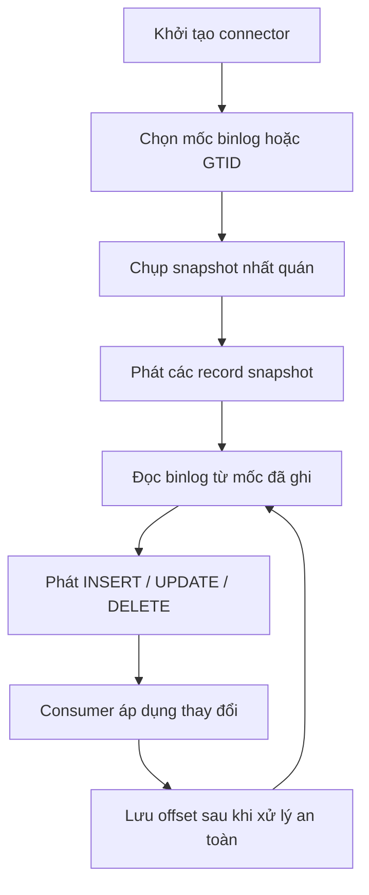
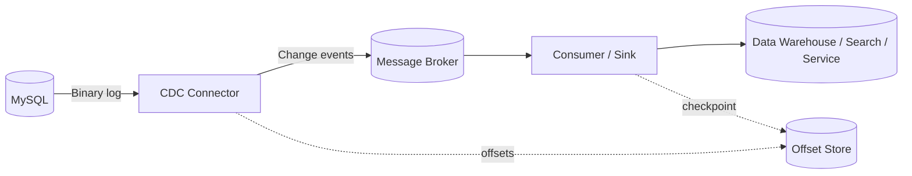

# Đồng bộ dữ liệu tăng thêm bằng replication hoặc CDC

Đồng bộ dữ liệu tăng thêm (*incremental data synchronization*) là quá trình chuyển các thay đổi mới phát sinh từ một hệ thống MySQL sang một hệ thống đích mà không phải sao chép lại toàn bộ dữ liệu sau mỗi lần chạy. Thay đổi có thể là thêm hàng, sửa hàng hoặc xóa hàng. Hai cách thường gặp là MySQL native replication và Change Data Capture (CDC) đọc binary log.

Native replication duy trì một hoặc nhiều replica MySQL bằng cách truyền và áp dụng sự kiện từ source. CDC đọc các sự kiện thay đổi để đưa chúng vào message broker, data warehouse, search index hoặc dịch vụ khác. Cả hai có thể dùng binary log làm nguồn thay đổi, nhưng mục tiêu và cách xử lý khác nhau.

Trong module `DATABASE_MYSQL`, bài học này kết nối binary log, GTID, replication, transaction và thiết kế pipeline dữ liệu. Sau bài học, bạn có thể:

- Phân biệt native replication với CDC và chọn cách phù hợp cho đích đồng bộ.
- Chuẩn bị MySQL để ghi nhận thay đổi bằng binary log.
- Hiểu snapshot ban đầu, vị trí tiếp tục và cách tránh khoảng trống dữ liệu.
- Thiết kế consumer chịu được sự kiện gửi lặp và xử lý lại sau lỗi.
- Quản lý delete, schema change, thứ tự sự kiện và retention của binlog.
- Theo dõi độ trễ, phát hiện mất đồng bộ và xây dựng quy trình đối soát.

## 1. Đồng bộ toàn bộ và đồng bộ tăng thêm

Một lần đồng bộ toàn bộ (*full load*) đọc toàn bộ bảng hoặc tập dữ liệu tại một thời điểm rồi nạp sang đích. Cách này đơn giản để khởi tạo nhưng tốn tài nguyên khi dữ liệu lớn và không phù hợp để lặp lại thường xuyên.

Đồng bộ tăng thêm chỉ chuyển phần thay đổi kể từ mốc đã xử lý. Có thể thực hiện bằng cách:

- Đọc các hàng có `updated_at` lớn hơn mốc lần trước.
- Đọc nhật ký thay đổi do ứng dụng tự ghi.
- Dùng native replication để duy trì replica MySQL.
- Đọc binary log bằng CDC để phát sự kiện thay đổi tới hệ thống khác.

Đồng bộ dựa trên `updated_at` dễ triển khai nhưng có thể bỏ sót thay đổi nếu timestamp không được cập nhật đúng, độ chính xác thời gian không đủ, đồng hồ lệch hoặc hàng bị xóa vật lý. CDC dựa trên binlog có thể ghi nhận cả `INSERT`, `UPDATE` và `DELETE` mà không yêu cầu ứng dụng thêm cột thời gian cho mọi bảng.

## 2. Native replication và CDC khác nhau thế nào?

| Tiêu chí | MySQL native replication | CDC đọc binary log |
|---|---|---|
| Đích thường gặp | Một MySQL replica hoặc topology MySQL | Kafka, message broker, lakehouse, warehouse, search index hoặc dịch vụ khác |
| Đơn vị truyền | Sự kiện replication được replica áp dụng vào MySQL | Sự kiện thay đổi được connector chuyển thành record/event |
| Phạm vi | Thường tái tạo dữ liệu và một phần trạng thái cần cho replica theo cấu hình | Có thể lọc database/table, đổi cấu trúc và phân phối cho nhiều consumer |
| Quản lý vị trí | Replica theo dõi relay log, source log position và/hoặc GTID | Connector lưu offset/GTID để tiếp tục đọc sau restart |
| Xử lý tại đích | MySQL replication applier | Consumer hoặc sink connector chịu trách nhiệm ghi dữ liệu |
| Biến đổi dữ liệu | Hạn chế, theo cơ chế replication | Có thể lọc, chuẩn hóa, chuyển đổi hoặc làm giàu sự kiện |
| Mục tiêu chính | HA, read scaling, bản sao MySQL | Tích hợp dữ liệu và truyền thay đổi tới nhiều hệ thống |

Không nên dùng CDC như một bản backup. CDC phản ánh thay đổi theo thời gian, nhưng không tự bảo đảm có bản sao đầy đủ, độc lập và có thể khôi phục mọi dữ liệu lịch sử. Hãy kết hợp snapshot, backup và kiểm thử restore theo yêu cầu bảo vệ dữ liệu.

## 3. Binary log là nguồn dữ liệu thay đổi

MySQL binary log ghi lại các thay đổi cần thiết để replication và các công cụ downstream tái tạo trạng thái dữ liệu. Với row-based logging, binary log chứa sự kiện thay đổi theo hàng. Đây là định dạng thường được khuyến nghị cho CDC vì nó mô tả kết quả thay đổi hàng đã xảy ra, thay vì buộc connector phải phân tích lại câu SQL gốc.

Một số loại sự kiện thường gặp:

- `WRITE_ROWS`: thêm hàng.
- `UPDATE_ROWS`: thay đổi hàng.
- `DELETE_ROWS`: xóa hàng.
- `TABLE_MAP`: ánh xạ sự kiện với bảng và metadata liên quan.
- Sự kiện GTID và dấu kết thúc transaction như `Xid`.

Với row-based logging, sự kiện thay đổi được ghi ở dạng mã hóa trong binlog. Có thể dùng `mysqlbinlog` để xem nội dung đã giải mã:

```bash
mysqlbinlog \
  --base64-output=DECODE-ROWS \
  -vv \
  /var/lib/mysql/binlog.000123
```

Đường dẫn và tên file chỉ là ví dụ. Trên hệ thống thực tế, xác định file qua `SHOW BINARY LOGS` hoặc `SHOW MASTER STATUS` ở các bản cũ; phiên bản mới có thể cung cấp tên lệnh/metadata khác theo thay đổi thuật ngữ.

### 3.1. Cấu hình MySQL cho replication và CDC

Một cấu hình mẫu cho source:

```ini
[mysqld]
server_id=101
log_bin=mysql-bin
binlog_format=ROW
binlog_row_image=FULL
gtid_mode=ON
enforce_gtid_consistency=ON
binlog_expire_logs_seconds=604800
```

Ý nghĩa:

- `server_id` phải duy nhất trong topology replication.
- `log_bin` bật binary log và xác định tên/tiền tố file log.
- `binlog_format=ROW` ghi thay đổi theo hàng.
- `binlog_row_image=FULL` ghi đầy đủ ảnh hàng trước/sau theo định dạng hỗ trợ; điều này hữu ích khi CDC cần dữ liệu trước và sau cập nhật hoặc khi đích cần tái tạo hàng độc lập.
- `gtid_mode=ON` và `enforce_gtid_consistency=ON` hỗ trợ định danh giao dịch và khôi phục vị trí theo GTID.
- `binlog_expire_logs_seconds` đặt thời gian giữ binlog tự động theo giây; giá trị thực tế phải lớn hơn khoảng gián đoạn tối đa dự kiến cộng thời gian phục hồi.

Các biến, giá trị mặc định và yêu cầu thay đổi cấu hình phụ thuộc phiên bản MySQL. Một số thay đổi cần restart hoặc có quy trình chuyển đổi riêng. Kiểm tra tài liệu đúng phiên bản trước khi áp dụng trên production.

### 3.2. Quyền truy cập

Tài khoản replication hoặc CDC cần quyền đọc metadata và binary log phù hợp với connector/version. Một connector có thể cần thêm quyền `SELECT` để chụp snapshot, quyền khóa bảng hoặc quyền đọc metadata tùy chế độ snapshot. Hãy dùng danh sách quyền tối thiểu trong tài liệu của phiên bản connector đang triển khai.

Không dùng tài khoản `root` cho connector. Tách tài khoản CDC khỏi tài khoản ứng dụng, giới hạn host được phép kết nối, dùng TLS và lưu mật khẩu trong secret manager. Quyền snapshot và quyền đọc binlog có thể khác nhau; chỉ cấp quyền snapshot khi thực sự cần chụp dữ liệu ban đầu.

## 4. Khởi tạo dữ liệu ban đầu và tiếp tục từ binlog

CDC thường phải giải quyết hai việc:

1. Lấy ảnh chụp ban đầu (*initial snapshot*) để đích có trạng thái dữ liệu đầy đủ.
2. Tiếp tục đọc các thay đổi trong binlog từ vị trí tương ứng để đích không bỏ sót hoặc xử lý sai thứ tự.

Nếu chỉ bắt đầu đọc binlog từ thời điểm connector được bật, đích sẽ thiếu các hàng đã tồn tại trước đó. Nếu chụp snapshot xong rồi mới bắt đầu đọc binlog mà không phối hợp mốc thời gian, các thay đổi phát sinh trong lúc snapshot có thể bị bỏ sót.

Một quy trình CDC đúng phải thiết lập được mốc nhất quán giữa snapshot và stream. Connector thường ghi nhận binlog position hoặc GTID tại thời điểm tạo snapshot nhất quán, đọc dữ liệu snapshot, sau đó tiếp tục stream từ mốc đó. Những thay đổi xảy ra sau mốc snapshot được phát lại từ binlog; sự kiện có thể xuất hiện trùng với trạng thái hàng snapshot tùy connector và chế độ snapshot, nên consumer phải tuân thủ hợp đồng sự kiện của connector.



Tên chế độ snapshot và cách ghi offset khác nhau giữa các connector. Không tự giả định snapshot luôn khóa toàn bộ bảng hoặc luôn không khóa bảng. Đọc tài liệu connector để biết snapshot dùng transaction isolation nào, có khóa metadata hay không và cách xử lý DDL trong lúc snapshot.

## 5. Native replication: cấu hình replica MySQL

Native replication phù hợp khi đích là một MySQL server cần duy trì bản sao dữ liệu từ source. Trước khi cấu hình, đảm bảo replica có dữ liệu ban đầu tương thích với source và GTID hoặc file/position được thiết lập chính xác.

Ví dụ dùng GTID auto-position trên các bản MySQL mới:

```sql
CHANGE REPLICATION SOURCE TO
    SOURCE_HOST = 'mysql-source.example',
    SOURCE_PORT = 3306,
    SOURCE_USER = 'repl_user',
    SOURCE_PASSWORD = 'secret-from-secret-manager',
    SOURCE_AUTO_POSITION = 1;

START REPLICA;
```

Ví dụ chỉ minh họa cú pháp. Tạo tài khoản replication riêng, cấu hình TLS theo chính sách và không đặt mật khẩu thật trong script hoặc repository. Với bản MySQL cũ, cú pháp có thể là `CHANGE MASTER TO` và `START SLAVE`.

Kiểm tra trạng thái:

```sql
SHOW REPLICA STATUS\G
```

Theo dõi các trường như `Replica_IO_Running`, `Replica_SQL_Running`, `Retrieved_Gtid_Set`, `Executed_Gtid_Set`, `Last_IO_Error` và `Last_SQL_Error`. Tên trường có thể khác theo phiên bản. Replica phải nhận và áp dụng sự kiện liên tục; chỉ thấy luồng I/O đang chạy chưa đủ chứng minh dữ liệu đã được apply.

Native replication có thể lọc database hoặc table theo cấu hình, nhưng filter có thể làm phức tạp tính nhất quán và failover. Chỉ dùng filter khi đã đánh giá đầy đủ các phụ thuộc, statement và topology. Nếu cần đồng bộ một tập dữ liệu có biến đổi đáng kể, CDC thường linh hoạt hơn.

## 6. CDC pipeline: từ binlog tới hệ thống đích

Một pipeline CDC điển hình có các thành phần:

1. **MySQL source:** ghi binary log và giữ log đủ lâu.
2. **CDC connector:** đọc binlog, giải mã row events và gắn metadata như database, table, transaction, GTID hoặc vị trí log.
3. **Message broker:** lưu và phân phối sự kiện, ví dụ Kafka hoặc một hệ thống tương đương.
4. **Consumer/sink:** đọc sự kiện, chuyển đổi và áp dụng vào đích.
5. **Offset/checkpoint store:** lưu vị trí connector đã đọc và/hoặc trạng thái consumer đã xử lý.
6. **Monitoring và reconciliation:** đo lag, lỗi và đối chiếu dữ liệu giữa nguồn với đích.



Một connector phổ biến là Debezium MySQL Connector. Connector có thể chụp snapshot ban đầu rồi tiếp tục đọc binlog, phát các sự kiện thay đổi lên Kafka. Tên topic, cấu hình và schema event phụ thuộc phiên bản Debezium và Kafka Connect. Hãy dùng tài liệu đúng phiên bản thay vì sao chép nguyên cấu hình từ một bản khác.

### 6.1. Ví dụ cấu hình connector ở mức minh họa

Một cấu hình CDC thường cần các nhóm thuộc tính sau:

```json
{
  "name": "shop-mysql-cdc",
  "config": {
    "connector.class": "io.debezium.connector.mysql.MySqlConnector",
    "database.hostname": "mysql-source.example",
    "database.port": "3306",
    "database.user": "cdc_user",
    "database.password": "${secrets:cdc/mysql-password}",
    "topic.prefix": "shop-prod",
    "database.include.list": "shop",
    "table.include.list": "shop.orders,shop.order_items,shop.payments",
    "snapshot.mode": "initial"
  }
}
```

Đây là cấu hình minh họa để giải thích các nhóm thông tin, không phải file triển khai hoàn chỉnh cho mọi phiên bản. Cú pháp secret provider, tên thuộc tính snapshot, schema history và yêu cầu Kafka Connect thay đổi theo phiên bản. Trước khi dùng, xác nhận connector class, cấu hình bảo mật, topic replication factor, schema history và offset storage theo tài liệu triển khai.

Không commit password hoặc token thật vào JSON. Dùng secret provider hoặc cơ chế quản lý bí mật được nền tảng hỗ trợ. Tách cấu hình thử nghiệm và production để tránh connector lab đọc nhầm dữ liệu thật.

## 7. Cấu trúc một sự kiện CDC

Một sự kiện CDC thường chứa phần dữ liệu thay đổi và metadata mô tả nguồn gốc sự kiện. Ví dụ minh họa cho một lần cập nhật đơn hàng:

```json
{
  "before": {
    "order_id": 501,
    "status": "CREATED",
    "total_amount": "250000.00"
  },
  "after": {
    "order_id": 501,
    "status": "PAID",
    "total_amount": "250000.00"
  },
  "source": {
    "db": "shop",
    "table": "orders",
    "gtid": "aaaaaaaa-bbbb-cccc-dddd-eeeeeeeeeeee:105",
    "file": "mysql-bin.000123",
    "pos": 456789
  },
  "op": "u"
}
```

Trường cụ thể phụ thuộc connector và converter. Trong ví dụ:

- `before` mô tả ảnh hàng trước thay đổi, nếu connector có và cấu hình hỗ trợ.
- `after` mô tả ảnh hàng sau thay đổi.
- `source` ghi nguồn, vị trí binlog hoặc GTID.
- `op` biểu thị loại thao tác; cách ký hiệu phụ thuộc connector.

Consumer nên giữ metadata nguồn trong log hoặc bảng audit để có thể truy nguyên một bản ghi đích về sự kiện MySQL đã tạo ra nó.

## 8. Xử lý INSERT, UPDATE và DELETE ở consumer

Consumer cần áp dụng thay đổi theo đúng khóa định danh và hiểu rõ ý nghĩa của từng loại sự kiện.

### 8.1. INSERT

Với `INSERT`, tạo hàng ở đích bằng primary key của nguồn. Nếu record được gửi lại, lệnh insert có thể gặp duplicate key. Consumer nên dùng thao tác upsert hoặc cơ chế idempotency phù hợp với database đích.

### 8.2. UPDATE

Với `UPDATE`, cập nhật hàng theo primary key. Nếu sự kiện chứa ảnh `after` đầy đủ, consumer có thể thay thế trạng thái hàng theo ảnh đó. Nếu chỉ chứa một phần cột thay đổi, consumer phải áp dụng patch mà không xóa nhầm các cột chưa xuất hiện trong event.

### 8.3. DELETE

Với `DELETE`, xóa hàng đích theo primary key hoặc ghi tombstone nếu hệ thống đích cần giữ lịch sử. Không bỏ qua delete chỉ vì đích là search index hoặc warehouse; nếu bỏ qua, dữ liệu cũ sẽ tồn tại vô thời hạn.

### 8.4. Upsert có điều kiện

Ví dụ với MySQL làm đích, một consumer có thể dùng:

```sql
INSERT INTO reporting.orders (
    order_id, status, total_amount, source_version
)
VALUES (?, ?, ?, ?) AS incoming
ON DUPLICATE KEY UPDATE
    status = IF(incoming.source_version >= source_version,
                incoming.status, status),
    total_amount = IF(incoming.source_version >= source_version,
                      incoming.total_amount, total_amount),
    source_version = GREATEST(source_version, incoming.source_version);
```

Đây là ví dụ khái niệm: `source_version` phải là một phiên bản có thứ tự đáng tin cậy do pipeline định nghĩa, không nên dùng timestamp của máy consumer làm thứ tự. Cú pháp row alias trong `INSERT ... VALUES (...) AS incoming` được hỗ trợ ở các bản MySQL mới; hãy xác nhận cú pháp theo phiên bản đích. Nếu đích không phải MySQL, dùng cơ chế upsert tương ứng.

## 9. Idempotency, retry và giao nhận ít nhất một lần

CDC pipeline thường phải chịu được việc một sự kiện được phát hoặc xử lý lại. Ví dụ consumer đã ghi dữ liệu vào đích nhưng bị dừng trước khi lưu checkpoint; khi chạy lại, broker gửi lại sự kiện đó. Nếu consumer không idempotent, hàng có thể bị nhân đôi hoặc số dư bị cộng hai lần.

Một thao tác idempotent có thể thực hiện nhiều lần mà kết quả cuối vẫn tương đương một lần. Các chiến lược thường dùng:

- Dùng primary key nguồn làm khóa duy nhất ở đích.
- Upsert trạng thái hàng thay vì cộng dồn mù quáng.
- Lưu event ID hoặc GTID/binlog coordinate đã xử lý để loại sự kiện trùng.
- Cập nhật dữ liệu và checkpoint trong cùng transaction ở đích khi hệ thống hỗ trợ.
- Dùng version hoặc sequence để bỏ qua sự kiện cũ đến muộn.
- Với thao tác cộng dồn, ghi ledger theo event ID rồi tính tổng từ các event duy nhất.

Không giả định pipeline có exactly-once end-to-end chỉ vì broker hỗ trợ transaction hoặc connector có offset. Guarantee phụ thuộc connector, broker, sink và cách commit offset. Hãy thiết kế consumer theo hướng chịu được at-least-once delivery, trừ khi đã chứng minh được cơ chế exactly-once cho toàn chuỗi.

## 10. Thứ tự sự kiện và transaction nhiều bảng

Một transaction MySQL có thể cập nhật nhiều bảng. Nếu consumer xử lý từng topic hoặc partition độc lập, thứ tự giữa các bảng có thể không còn được bảo toàn ở đích. Ví dụ, sự kiện `order_items` tới trước `orders` có thể gây lỗi foreign key nếu consumer áp dụng ngay.

Các nguyên tắc cần xác định:

- Thứ tự nào được bảo đảm bởi connector và broker: trong một partition, trong một table hay trong một transaction.
- Message key có được đặt theo primary key để các thay đổi cùng hàng vào cùng partition hay không.
- Đích có cần giữ ranh giới transaction nguồn hay chỉ cần trạng thái cuối cùng của từng hàng.
- Có cần buffer sự kiện cho tới khi đủ dữ liệu cha/con hoặc dùng cơ chế retry có kiểm soát hay không.
- Có metadata transaction hoặc transaction ID để consumer nhóm sự kiện cùng transaction hay không.

Nếu nghiệp vụ yêu cầu tính nguyên tử giữa nhiều bảng, consumer không nên ghi từng event riêng rẽ rồi coi như transaction nguồn đã được áp dụng. Cần dùng metadata transaction và commit thay đổi liên quan trong một transaction đích, hoặc thiết kế mô hình đích chấp nhận cập nhật cuối cùng theo từng hàng và có bước kiểm tra nhất quán.

## 11. Schema evolution và thay đổi DDL

Schema của MySQL có thể thay đổi trong khi CDC đang chạy. Ví dụ thêm cột, đổi kiểu dữ liệu, đổi tên cột, tạo bảng hoặc xóa cột. Connector cần biết schema tại thời điểm event phát sinh để giải mã row event đúng.

Trước khi triển khai DDL:

1. Xác định connector có hỗ trợ theo dõi schema history và loại DDL dự kiến hay không.
2. Kiểm tra thay đổi có tương thích với consumer và schema đích không.
3. Triển khai thay đổi theo quy trình backward-compatible khi có thể: thêm cột nullable hoặc có default, cập nhật consumer, sau đó mới loại bỏ cột cũ.
4. Theo dõi schema history topic/store và cảnh báo connector nếu không giải mã được event.
5. Kiểm thử snapshot và stream sau DDL trên môi trường tương thích.

Không xóa hoặc sửa schema history/offset store để chữa lỗi connector một cách tùy tiện. Việc này có thể khiến connector mất khả năng giải mã binlog hiện tại hoặc đọc lại snapshot ngoài ý muốn.

## 12. Binlog retention và khả năng khôi phục connector

MySQL chỉ giữ binary log theo chính sách retention. Nếu connector dừng lâu hơn thời gian giữ log, file hoặc GTID cần để tiếp tục có thể đã bị purge. Khi đó connector không thể tự đọc tiếp từ vị trí cũ.

Thiết kế retention dựa trên:

- Thời gian gián đoạn tối đa dự kiến của connector.
- Thời gian phát hiện và xử lý sự cố.
- Thời gian cần để tăng tốc và bắt kịp binlog mới.
- Dung lượng binlog phát sinh mỗi giờ/ngày.
- Chính sách lưu trữ và giới hạn dung lượng đĩa.

Giám sát dung lượng binlog và thời điểm file cũ nhất còn tồn tại. Retention quá ngắn làm connector không thể tiếp tục sau outage; retention quá dài có thể làm đầy đĩa. Không xóa file binlog thủ công trong khi replica hoặc CDC connector còn cần chúng.

Nếu connector bị mất offset hoặc binlog đã bị purge, phương án khôi phục thường là tạo snapshot mới và bắt đầu stream từ mốc mới. Điều này có thể cần rebuild hoặc merge dữ liệu đích; hãy có quy trình rõ ràng để tránh trộn snapshot mới với dữ liệu cũ không nhất quán.

## 13. Giám sát pipeline và phát hiện mất đồng bộ

Một pipeline CDC cần giám sát cả phía MySQL, connector, broker và sink.

| Thành phần | Chỉ số nên theo dõi | Dấu hiệu bất thường |
|---|---|---|
| MySQL | Tốc độ tạo binlog, dung lượng, retention, kết nối và lỗi | Binlog tăng bất thường hoặc gần đầy đĩa |
| Connector | Binlog source lag, thời điểm event mới nhất, offset, snapshot progress, lỗi giải mã | Connector đứng yên hoặc không theo kịp source |
| Broker | Số message, partition lag, throughput, lỗi publish và retention | Consumer lag tăng hoặc message không được lưu |
| Consumer | Thời gian xử lý, retry, dead-letter, checkpoint và lỗi sink | Sự kiện bị retry liên tục hoặc không được commit |
| Đích | Số hàng, watermark, dữ liệu trùng và sai lệch nghiệp vụ | Đích thiếu, thừa hoặc có trạng thái cũ |

Đo lag bằng cả thời gian và vị trí nguồn. Một consumer có thể đang xử lý message cũ dù broker vẫn nhận message mới. Lưu watermark theo GTID/binlog coordinate để có thể xác định pipeline đang đứng ở đâu.

### 13.1. Đối soát định kỳ

Đối soát giúp phát hiện sai lệch mà chỉ số lag không phát hiện được. Một số cách:

- So sánh số lượng hàng theo bảng hoặc theo khoảng khóa.
- So sánh checksum theo từng chunk khóa chính.
- So sánh tổng hợp nghiệp vụ như số đơn, tổng thanh toán hoặc số lượng tồn.
- Lấy mẫu hàng theo primary key và so sánh giá trị cột.
- Kiểm tra hàng bị xóa ở nguồn có còn ở đích hay không.

Khi đối soát, cần chụp hoặc xác định cùng một mốc dữ liệu ở source và đích. Nếu pipeline vẫn đang chạy, chênh lệch tạm thời có thể do lag. Dùng watermark đã xử lý để chờ hai phía đạt cùng mốc trước khi kết luận dữ liệu sai.

## 14. Bảo mật và vận hành

- Chỉ mở quyền binlog cho các host connector hoặc replica đã được cho phép.
- Dùng TLS cho kết nối MySQL và mã hóa đường truyền tới broker.
- Giới hạn quyền đọc schema/table theo phạm vi dữ liệu cần đồng bộ.
- Bảo vệ offset store, schema history và message broker vì chúng chứa metadata vận hành quan trọng.
- Không đưa dữ liệu cá nhân hoặc bí mật vào topic không có phân quyền và retention phù hợp.
- Kiểm soát quyền truy cập log, vì payload CDC có thể chứa dữ liệu trước và sau cập nhật.
- Tách tài khoản, secret và cấu hình giữa dev, staging và production.
- Ghi nhận thay đổi DDL, cấu hình retention, filter và connector version.

CDC có thể sao chép dữ liệu nhạy cảm sang nhiều hệ thống hơn MySQL. Trước khi thêm consumer hoặc mở topic mới, xác định mục đích, quyền truy cập, thời hạn lưu và quy trình xóa dữ liệu tương ứng.

## 15. Sự cố thường gặp và cách xử lý

| Triệu chứng | Nguyên nhân có thể | Hướng điều tra |
|---|---|---|
| Connector không khởi động được | Binlog tắt, format không phù hợp, thiếu quyền hoặc sai cấu hình | Kiểm tra biến MySQL, log connector, quyền và phiên bản |
| Connector báo binlog đã bị purge | Connector dừng quá lâu hoặc retention quá ngắn | Xác định vị trí cuối, kiểm tra backup/snapshot và lập kế hoạch snapshot mới |
| Đích thiếu các hàng cũ | Chưa chạy initial snapshot hoặc filter loại bảng | Kiểm tra snapshot mode, table include list và watermark |
| Hàng bị nhân đôi | Consumer không idempotent hoặc offset commit sai thứ tự | Kiểm tra event ID, primary key, transaction đích và checkpoint |
| Hàng đã xóa vẫn còn ở đích | Consumer bỏ qua delete hoặc không xử lý tombstone | Kiểm tra loại event và chính sách delete của sink |
| Dữ liệu sai sau DDL | Schema history không đồng bộ hoặc consumer không tương thích | Đối chiếu thời điểm DDL, schema event và phiên bản connector |
| Bản ghi con tới trước bản ghi cha | Thứ tự giữa partition/topic không được bảo đảm | Dùng retry, buffer, transaction metadata hoặc thiết kế sink phù hợp |
| Connector lag tăng liên tục | Tốc độ đọc/publish thấp hơn tốc độ tạo binlog | Kiểm tra CPU, mạng, broker throughput, batch và consumer lag |
| MySQL đầy đĩa | Binlog giữ quá lâu hoặc purge không hoạt động | Kiểm tra retention, dung lượng và các replica/connector còn cần log |

Không reset offset, xóa topic hoặc purge binlog để thử sửa nhanh. Trước khi thay đổi, lưu trạng thái connector, offset, schema history, binlog file/GTID và số liệu đối soát. Một thay đổi sai có thể làm mất khả năng tiếp tục từ đúng mốc.

## 16. Quy trình triển khai đồng bộ tăng thêm

Một quy trình triển khai có thể thực hiện theo các bước:

1. **Xác định mục tiêu:** chọn native replication nếu đích là MySQL replica; chọn CDC nếu cần phát thay đổi tới hệ thống khác hoặc cần lọc/biến đổi dữ liệu.
2. **Thiết kế dữ liệu đích:** xác định primary key, kiểu dữ liệu, delete semantics, schema evolution và yêu cầu transaction.
3. **Chuẩn bị source:** bật binlog, row-based logging, GTID khi phù hợp, retention và quyền truy cập tối thiểu.
4. **Khởi tạo dữ liệu:** tạo replica từ backup/clone hoặc chạy snapshot CDC nhất quán.
5. **Thiết lập vị trí tiếp tục:** xác minh GTID/binlog coordinate được ghi nhận và không có khoảng trống giữa snapshot với stream.
6. **Triển khai consumer:** áp dụng insert/update/delete idempotent và quản lý checkpoint đúng thứ tự.
7. **Kiểm thử lỗi:** dừng connector, dừng broker, làm chậm sink, restart consumer và xác nhận xử lý lại không tạo dữ liệu trùng.
8. **Đối soát:** so sánh số hàng, checksum và các chỉ số nghiệp vụ ở cùng watermark.
9. **Giám sát:** đặt cảnh báo cho lag, lỗi, retention, dung lượng đĩa và dead-letter.
10. **Vận hành:** ghi runbook snapshot lại, rebuild, xử lý schema change, đổi secret và nâng cấp connector.

## 17. Tình huống thực hành

Một hệ thống bán hàng lưu dữ liệu trong MySQL schema `shop`. Nhóm phân tích cần đồng bộ liên tục các bảng `orders`, `order_items` và `payments` sang một hệ thống báo cáo. Hệ thống báo cáo cần cập nhật hàng thay đổi, xóa đơn bị hủy theo chính sách và có thể khôi phục pipeline sau khi connector ngừng vài giờ.

Thực hiện trong môi trường lab:

1. Bật binary log, `binlog_format=ROW`, chọn `binlog_row_image` phù hợp và bật GTID nếu topology hỗ trợ.
2. Tạo tài khoản CDC có quyền tối thiểu và kết nối bảo mật.
3. Cấu hình connector để chụp snapshot ban đầu cho ba bảng.
4. Ghi nhận watermark snapshot và xác minh connector tiếp tục stream từ đúng vị trí.
5. Thực hiện `INSERT`, `UPDATE`, `DELETE` trên source; kiểm tra event ở broker và dữ liệu đích.
6. Dừng consumer sau khi đã nhận message nhưng trước khi checkpoint; khởi động lại và xác nhận event được xử lý lại mà không nhân đôi dữ liệu.
7. Dừng connector trong thời gian ngắn, sau đó restart và xác nhận offset tiếp tục đúng.
8. Thử giữ binlog đủ lâu cho thời gian gián đoạn đã định; kiểm tra cảnh báo khi retention sắp không còn đủ.
9. Thêm một cột nullable trong lab, cập nhật consumer và xác minh schema history xử lý DDL.
10. Đối soát số lượng hàng, checksum theo chunk và tổng thanh toán giữa source với đích tại cùng watermark.

**Câu hỏi tự đánh giá:**

- Native replication và CDC khác nhau về mục tiêu và cách áp dụng thay đổi như thế nào?
- Vì sao snapshot ban đầu phải gắn với một binlog position hoặc GTID nhất quán?
- `binlog_format=ROW` và `binlog_row_image=FULL` giúp ích gì cho CDC?
- Vì sao consumer phải idempotent dù broker có lưu message bền vững?
- Vì sao thứ tự message giữa nhiều partition có thể làm sai quan hệ giữa bảng cha và bảng con?
- Điều gì xảy ra nếu connector dừng lâu hơn thời gian MySQL giữ binlog?
- Vì sao cần đối soát ở cùng watermark thay vì so sánh source và đích tại hai thời điểm bất kỳ?
- CDC có thể thay thế backup và quy trình restore không? Giải thích.

## Kết luận

Đồng bộ tăng thêm dựa trên binary log giúp chuyển thay đổi MySQL liên tục và giảm nhu cầu tải lại toàn bộ dữ liệu. Native replication phù hợp để duy trì MySQL replica; CDC phù hợp để phân phối và biến đổi thay đổi tới nhiều hệ thống đích. Một pipeline đáng tin cậy cần snapshot nhất quán, watermark có thể tiếp tục, consumer idempotent, xử lý delete và schema change, retention đủ dài, cùng giám sát và đối soát định kỳ.
