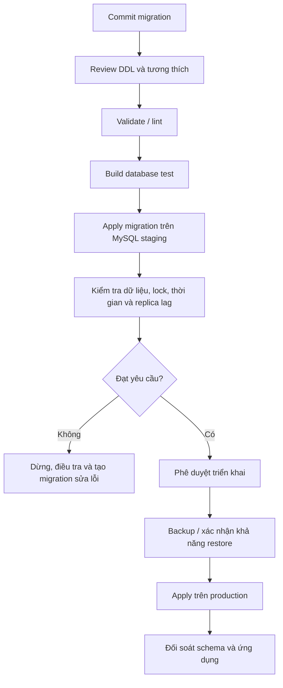

# Flyway/Liquibase với MySQL và lịch sử migration

Khi ứng dụng phát triển, schema MySQL cũng phải thay đổi: thêm cột, tạo index, đổi kiểu dữ liệu, tách bảng hoặc bổ sung ràng buộc. Nếu mỗi môi trường được sửa thủ công, source code và database dễ lệch nhau: staging có cột mới nhưng production chưa có, hoặc một DBA đã chạy script ngoài quy trình khiến lần triển khai tiếp theo thất bại.

Flyway và Liquibase giải quyết vấn đề này bằng cách quản lý thay đổi schema như một phần có phiên bản của ứng dụng. Mỗi lần triển khai, công cụ đọc các migration đã khai báo, so sánh với lịch sử được lưu trong database rồi chỉ áp dụng những thay đổi còn thiếu. Lịch sử này giúp đội ngũ biết migration nào đã chạy, chạy bằng script nào, vào thời điểm nào và có hợp lệ với artifact hiện tại hay không.

Tuy vậy, migration framework không biến mọi DDL của MySQL thành transaction có thể rollback. Nhiều câu lệnh DDL gây implicit commit. Một migration lỗi giữa chừng có thể để lại một phần schema đã thay đổi dù công cụ báo thất bại. Vì vậy, cần thiết kế migration nhỏ, bất biến, có cách khôi phục rõ ràng và được thử trên phiên bản MySQL tương ứng trước khi phát hành.

## 1. Migration là gì và vì sao cần lịch sử?

Migration là một thay đổi schema được đóng gói thành đơn vị có định danh và thứ tự. Ví dụ:

- Migration đầu tiên tạo bảng `customers`.
- Migration tiếp theo thêm cột `status`.
- Migration sau nữa tạo index phục vụ truy vấn theo `status` và `created_at`.

Khi một migration đã chạy trên môi trường dùng chung, nội dung của nó cần được xem là bất biến. Nếu muốn thay đổi schema thêm, hãy tạo migration mới. Sửa lại migration cũ có thể làm checksum thay đổi và khiến môi trường đã chạy script đó khác với môi trường mới dựng từ đầu.

Một hệ thống migration tốt trả lời được các câu hỏi:

1. Những migration nào đã được áp dụng trên database này?
2. Migration nào đang chờ chạy và thứ tự của chúng là gì?
3. Script đã chạy có còn khớp với file trong repository không?
4. Ai hoặc tài khoản nào đã chạy, khi nào, mất bao lâu và có thành công không?
5. Nếu migration thất bại giữa chừng, schema thực tế đang ở trạng thái nào và cần khôi phục ra sao?

Migration history là metadata kiểm soát tiến trình. Nó không phải bản sao lưu schema hoặc dữ liệu, và không tự chứng minh rằng database không bị chỉnh sửa thủ công sau khi migration chạy.

## 2. Flyway: versioned migration và schema history

Flyway thường tổ chức migration SQL theo phiên bản. Tên file mặc định có dạng:

```text
V<version>__<description>.sql
```

Ví dụ:

```text
db/migration/
  V1__create_customers.sql
  V2__add_customer_status.sql
  V3__add_customer_status_index.sql
  R__refresh_customer_summary.sql
```

`V` là versioned migration; hai dấu gạch dưới phân tách version và description. Version có thể có nhiều thành phần như `V1_1__...` hoặc `V2.3__...`; quy tắc so sánh phiên bản của Flyway quyết định thứ tự. Không dựa vào thứ tự tên file trong Explorer hoặc thời điểm file được commit.

Ví dụ `V1__create_customers.sql`:

```sql
CREATE TABLE customers (
    customer_id BIGINT UNSIGNED NOT NULL AUTO_INCREMENT,
    email VARCHAR(254) NOT NULL,
    full_name VARCHAR(200) NOT NULL,
    created_at TIMESTAMP NOT NULL DEFAULT CURRENT_TIMESTAMP,
    PRIMARY KEY (customer_id),
    UNIQUE KEY uq_customers_email (email)
) ENGINE = InnoDB
  DEFAULT CHARACTER SET = utf8mb4
  COLLATE = utf8mb4_0900_ai_ci;
```

Ví dụ `V2__add_customer_status.sql`:

```sql
ALTER TABLE customers
    ADD COLUMN status VARCHAR(20) NOT NULL DEFAULT 'ACTIVE';
```

Ví dụ `V3__add_customer_status_index.sql`:

```sql
CREATE INDEX ix_customers_status_created
    ON customers (status, created_at);
```

Sau khi chạy, Flyway ghi thông tin vào bảng lịch sử, mặc định thường là `flyway_schema_history`. Bảng này có các trường như version, description, type, script, checksum, thời gian cài đặt, người cài, thời gian thực thi và trạng thái thành công. Tên bảng có thể được cấu hình.

Các lệnh thường dùng:

```bash
flyway info
flyway validate
flyway migrate
```

- `info` hiển thị migration đã áp dụng, đang chờ và trạng thái.
- `validate` kiểm tra tính nhất quán giữa migration đã ghi trong history với migration hiện có, bao gồm checksum và metadata liên quan.
- `migrate` áp dụng migration chưa chạy theo thứ tự hợp lệ.

Flyway có thể dùng cấu hình file, biến môi trường hoặc tham số dòng lệnh. Ví dụ cấu hình khái quát:

```toml
[flyway]
url = "jdbc:mysql://mysql.internal:3306/appdb"
user = "migration_user"
locations = ["filesystem:db/migration"]
defaultSchema = "appdb"
table = "flyway_schema_history"
validateMigrationNaming = true
```

Không lưu mật khẩu production trong file cấu hình được commit vào repository. Cấp credential lúc chạy từ secret manager hoặc biến môi trường của pipeline. Tên thuộc tính và định dạng file cấu hình phụ thuộc phiên bản Flyway; kiểm tra `flyway help` và tài liệu của phiên bản đang cài.

### Repeatable migration

Repeatable migration dùng tiền tố `R__`, không có version. Flyway chạy lại loại migration này khi checksum thay đổi, sau các versioned migration pending. Chúng thường phù hợp với object được tái tạo từ định nghĩa hiện tại như view, procedure hoặc function:

```sql
-- R__create_active_customer_view.sql
CREATE OR REPLACE VIEW active_customers AS
SELECT customer_id, email, full_name
FROM customers
WHERE status = 'ACTIVE';
```

Không dùng repeatable migration để chứa thao tác dữ liệu cộng dồn như `UPDATE balance = balance + 10`, vì chạy lại có thể lặp tác động. Nội dung repeatable cũng cần được thiết kế để chạy lại an toàn và tương thích phiên bản MySQL mục tiêu.

### Baseline và out-of-order

Nếu database đã tồn tại trước khi đưa Flyway vào quản lý, `baseline` có thể ghi nhận một version nền để các migration mới hơn được áp dụng. Baseline không tự kiểm tra hoặc tái tạo toàn bộ schema cũ; cần đối chiếu schema hiện tại với trạng thái mà baseline đại diện trước khi bắt đầu.

Out-of-order cho phép áp dụng một version cũ hơn sau khi version mới hơn đã chạy. Tính năng này có thể hữu ích trong một số luồng phát triển, nhưng làm lịch sử khó suy luận và có thể gây khác biệt giữa môi trường. Chỉ bật khi quy trình phát hành đã xác định rõ cách xử lý phụ thuộc và migration cũ đó thực sự an toàn với schema hiện tại.

## 3. Liquibase: changelog, changeset và bảng lịch sử

Liquibase mô tả thay đổi trong changelog. Changelog có thể viết bằng YAML, XML, JSON hoặc SQL formatted changelog. Mỗi changeset có định danh kết hợp từ `id`, `author` và vị trí changelog (`filepath`); đây là khóa nhận diện một đơn vị thay đổi trong lịch sử.

Ví dụ `db.changelog-master.yaml`:

```yaml
databaseChangeLog:
  - changeSet:
      id: 001-create-customers
      author: database-team
      changes:
        - createTable:
            tableName: customers
            columns:
              - column:
                  name: customer_id
                  type: BIGINT UNSIGNED
                  autoIncrement: true
                  constraints:
                    primaryKey: true
                    nullable: false
              - column:
                  name: email
                  type: VARCHAR(254)
                  constraints:
                    nullable: false
                    unique: true
              - column:
                  name: full_name
                  type: VARCHAR(200)
                  constraints:
                    nullable: false
              - column:
                  name: created_at
                  type: TIMESTAMP
                  defaultValueComputed: CURRENT_TIMESTAMP
                  constraints:
                    nullable: false
  - changeSet:
      id: 002-add-customer-status
      author: database-team
      changes:
        - addColumn:
            tableName: customers
            columns:
              - column:
                  name: status
                  type: VARCHAR(20)
                  defaultValue: ACTIVE
                  constraints:
                    nullable: false
```

Ví dụ trên minh họa cấu trúc changelog; kiểu dữ liệu và cách Liquibase sinh DDL có thể phụ thuộc phiên bản extension/database. Nếu cần chỉ định chính xác `ENGINE`, character set hoặc collation của MySQL, hãy đặt default ở database hoặc dùng một changeset SQL riêng có `dbms: mysql`. Chạy `updateSQL` trên đúng phiên bản Liquibase và MySQL để review câu SQL thực tế trước khi thực thi.

Liquibase thường tạo hai bảng quản lý:

- `DATABASECHANGELOG`: ghi changeset đã thực thi, gồm id, author, filepath, checksum, thời gian, execution type, tag và thông tin liên quan.
- `DATABASECHANGELOGLOCK`: dùng một bản ghi khóa để tránh nhiều tiến trình Liquibase cùng thực thi update trên một database tại một thời điểm.

Các lệnh phổ biến:

```bash
liquibase validate
liquibase status --verbose
liquibase update-sql
liquibase update
```

- `validate` kiểm tra cấu trúc changelog và các điều kiện xác thực liên quan.
- `status` liệt kê changeset chưa áp dụng.
- `update-sql` sinh SQL dự kiến để review mà chưa thực thi thay đổi.
- `update` áp dụng changeset pending và ghi lịch sử.

Liquibase cũng hỗ trợ contexts, labels và preconditions để chọn changeset theo môi trường hoặc chỉ chạy khi điều kiện thỏa mãn. Không nên dùng context để khiến production vô tình bỏ qua thay đổi bắt buộc; hãy review danh sách changeset sẽ chạy trong từng pipeline.

## 4. So sánh Flyway và Liquibase

| Khía cạnh | Flyway | Liquibase |
|---|---|---|
| Cách mô tả thay đổi | Thường dùng SQL migration theo version; có repeatable migration. | Changelog khai báo changeset bằng YAML/XML/JSON/SQL. |
| Định danh | Version và tên migration; repeatable dùng tên/checksum. | Tổ hợp `id`, `author`, `filepath`. |
| Lịch sử mặc định | `flyway_schema_history`. | `DATABASECHANGELOG`. |
| Cơ chế khóa | Có cơ chế ngăn các migration chạy đồng thời; hành vi cụ thể phụ thuộc database và phiên bản. | `DATABASECHANGELOGLOCK` ghi nhận lock khi update. |
| Kiểm tra thay đổi | `validate` so sánh checksum và lịch sử migration. | `validate` kiểm tra changelog/checksum và metadata changeset. |
| SQL tùy chỉnh | SQL là cách tự nhiên và trực tiếp. | Có thể dùng change type trừu tượng hoặc SQL tùy chỉnh. |
| Rollback | Cần kế hoạch migration sửa lỗi; khả năng undo tùy phiên bản/edition và loại migration. | Một số change type có rollback tự sinh; SQL/custom change thường cần khai báo rollback rõ. |
| Phù hợp khi | Đội ngũ muốn kiểm soát DDL bằng SQL rõ ràng và quy trình gọn. | Đội ngũ cần changelog có cấu trúc, precondition, context/label và rollback metadata. |

Không có công cụ nào tự bảo đảm schema production luôn an toàn. Chất lượng migration phụ thuộc vào thiết kế DDL, review, quyền database, kiểm thử trên dữ liệu gần thực tế và kế hoạch xử lý khi lỗi.

## 5. Lịch sử migration và checksum có ý nghĩa gì?

Checksum giúp phát hiện file migration đã bị thay đổi sau khi chạy. Với Flyway, checksum của versioned migration được ghi vào schema history. Với Liquibase, checksum của changeset được lưu trong `DATABASECHANGELOG`.

Ví dụ tình huống:

1. Version `V4__add_phone.sql` được triển khai lên staging và production.
2. Sau đó, một developer sửa file cũ để thêm `NOT NULL`.
3. Database đã chạy vẫn giữ checksum của nội dung cũ; repository hiện tại có checksum khác.
4. `validate` có thể báo lỗi vì migration đã thay đổi.

Cách xử lý đúng là giữ file `V4` như cũ và tạo `V5__make_phone_not_null.sql` sau khi đã xử lý dữ liệu hiện hữu. Không cập nhật checksum hoặc sửa history chỉ để làm pipeline xanh trở lại.

Trong Liquibase, `runOnChange: true` cho phép changeset chạy lại khi checksum thay đổi; thường dùng cho view hoặc procedure cần đồng bộ định nghĩa. `runAlways: true` yêu cầu changeset chạy mỗi lần update. Hai thuộc tính này cần dùng có chủ đích. Một changeset dữ liệu cộng dồn đặt `runAlways` có thể cập nhật dữ liệu lặp lại ở mọi lần triển khai.

### `repair`, `clearCheckSums` và các lệnh đồng bộ history

Một số lệnh có thể sửa metadata lịch sử, nhưng không tự sửa schema:

- `flyway repair` điều chỉnh thông tin trong schema history theo các migration có sẵn và hành vi của phiên bản, chẳng hạn xử lý một số bản ghi thất bại hoặc đồng bộ checksum. Nó không xóa cột/bảng được tạo dở và không đưa dữ liệu về trạng thái trước migration.
- `liquibase clear-checksums` xóa checksum đã lưu để Liquibase tính lại ở lần chạy tiếp theo. Nó không làm cho thay đổi changeset cũ trở nên an toàn.
- `liquibase changelog-sync` đánh dấu các changeset được chọn là đã thực thi mà không chạy nội dung của chúng. Chỉ dùng khi đã xác minh schema thực tế đã có đúng kết quả tương ứng, chẳng hạn khi tiếp nhận một database được tạo từ quy trình khác.

Trước khi chạy các lệnh này, hãy sao lưu database và bảng history, kiểm tra trạng thái schema thật, ghi nhận lý do và review tác động. Không chạy repair/sync theo thói quen sau mỗi lỗi pipeline.

## 6. MySQL DDL và giới hạn rollback transaction

MySQL có nhiều câu DDL gây implicit commit. Ví dụ thường gặp gồm `CREATE TABLE`, `ALTER TABLE`, `DROP TABLE`, `CREATE INDEX` và nhiều thao tác thay đổi schema khác. Một số DDL trong InnoDB có atomic DDL ở cấp server, nghĩa là thao tác được bảo vệ tốt hơn trước crash; điều đó không có nghĩa DDL trở thành một phần của transaction người dùng có thể `ROLLBACK` sau khi câu lệnh thành công.

Ví dụ:

```sql
START TRANSACTION;

UPDATE customers
SET status = 'INACTIVE'
WHERE customer_id = 42;

ALTER TABLE customers
    ADD COLUMN archived_at DATETIME NULL;

ROLLBACK;
```

Không nên kỳ vọng `ROLLBACK` sẽ hoàn tác `ALTER TABLE` hoặc khôi phục toàn bộ trạng thái trước transaction. DDL có thể commit transaction đang mở trước khi chạy và tự hoàn tất theo quy tắc của nó. Kiểm tra hành vi chính xác theo câu lệnh, storage engine và phiên bản MySQL.

Vì vậy:

1. Chia migration có nhiều bước thành đơn vị nhỏ để biết chính xác bước nào đã hoàn tất.
2. Không gom nhiều DDL không liên quan vào một changeset/script dài nếu không có quy trình phục hồi từng bước.
3. Nếu migration vừa có DDL vừa có DML, xác định ranh giới commit và trạng thái có thể còn lại khi một bước thất bại.
4. Không dựa vào `runInTransaction` của Liquibase hoặc transaction wrapper của Flyway để bảo đảm rollback DDL trên MySQL.
5. Chuẩn bị migration sửa lỗi hoặc restore từ backup/PITR khi thay đổi không thể đảo ngược an toàn.

`ALTER TABLE` có thể rebuild bảng, giữ metadata lock hoặc tạo tải I/O đáng kể. Một số thao tác hỗ trợ `ALGORITHM=INSTANT`, `INPLACE` hoặc `COPY` tùy loại thay đổi và phiên bản. Cần kiểm tra thuật toán thực tế, thời gian khóa, dung lượng tạm và ảnh hưởng replica trước khi chạy production.

## 7. Thiết kế migration tương thích với ứng dụng đang chạy

Trong hệ thống có nhiều instance ứng dụng, schema mới và code mới không được triển khai đồng thời tức thì. Một migration có thể chạy trong khi phiên bản code cũ vẫn đang xử lý request. Vì vậy, nên dùng chiến lược **expand–migrate–contract**:

### Expand: thêm cấu trúc tương thích ngược

Ví dụ cần đổi tên `customers.full_name` thành `display_name`. Không xóa cột cũ ngay. Trước hết thêm cột mới có thể tồn tại song song:

```sql
ALTER TABLE customers
    ADD COLUMN display_name VARCHAR(200) NULL;
```

Ứng dụng cũ tiếp tục dùng `full_name`; phiên bản mới có thể bắt đầu ghi cả hai cột hoặc ghi cột mới theo kế hoạch.

### Migrate: chuyển dữ liệu và ứng dụng

Backfill theo batch có giới hạn để tránh transaction quá lớn:

```sql
UPDATE customers
SET display_name = full_name
WHERE customer_id > 0
  AND display_name IS NULL
ORDER BY customer_id
LIMIT 1000;
```

Chạy lặp lại có kiểm soát cho đến khi không còn hàng cần backfill. Với bảng lớn, lưu checkpoint theo khóa chính, đo tải replica và điều chỉnh batch size. Kiểm tra dữ liệu null, độ dài, ký tự và tính duy nhất trước khi thêm ràng buộc.

Sau đó triển khai code đọc `display_name`, xác minh không còn instance cũ ghi riêng `full_name`, rồi chuyển dần luồng ghi sang cột mới. Nếu cần đồng bộ hai cột trong thời gian chuyển tiếp, chọn một nơi làm nguồn chân lý và tránh hai chiều cập nhật không có quy tắc giải quyết xung đột.

### Contract: loại bỏ cấu trúc cũ

Chỉ sau khi xác nhận không còn code cũ, job, báo cáo hoặc truy vấn ngoài ứng dụng sử dụng `full_name`, mới lên lịch migration bỏ cột cũ:

```sql
ALTER TABLE customers
    DROP COLUMN full_name;
```

Đây là bước có rủi ro cao vì khôi phục dữ liệu cũ có thể cần backup hoặc bản sao dữ liệu. Thường nên tách thành một đợt phát hành riêng sau thời gian quan sát.

## 8. Preconditions, idempotency và kiểm tra trước khi chạy

Migration cần xác nhận giả định về schema trước khi thay đổi. Ví dụ, migration thêm index chỉ nên chạy khi bảng tồn tại và index chưa có. Tuy nhiên, cách kiểm tra và xử lý object đã tồn tại phải thống nhất với migration history; không biến mọi migration thành script tự sửa tùy trạng thái vì có thể che giấu drift.

Liquibase có preconditions để kiểm tra điều kiện trước khi chạy changeset. Ví dụ:

```yaml
- changeSet:
    id: 003-add-status-index
    author: database-team
    preConditions:
      - onFail: HALT
      - tableExists:
          tableName: customers
    changes:
      - createIndex:
          tableName: customers
          indexName: ix_customers_status_created
          columns:
            - column:
                name: status
            - column:
                name: created_at
```

Precondition này chỉ xác nhận bảng tồn tại; không tự chứng minh dữ liệu hay index khác đang đúng. Có thể thêm kiểm tra phù hợp với tình huống, nhưng tránh `MARK_RAN` nếu không có bằng chứng schema đã ở trạng thái mong muốn.

Đối với SQL migration, có thể truy vấn metadata trước khi chạy:

```sql
SELECT
    INDEX_NAME,
    COLUMN_NAME,
    SEQ_IN_INDEX
FROM INFORMATION_SCHEMA.STATISTICS
WHERE TABLE_SCHEMA = DATABASE()
  AND TABLE_NAME = 'customers'
ORDER BY INDEX_NAME, SEQ_IN_INDEX;
```

Kiểm tra metadata chỉ là một phần của preflight. Cần xem DDL đầy đủ, kiểu dữ liệu, collation, index hiện hữu, dữ liệu vi phạm constraint và quyền của migration user.

## 9. Quyền database dành cho migration

Không nên dùng tài khoản ứng dụng runtime để chạy migration. Tách hai loại tài khoản:

- **Migration user**: có quyền DDL cần thiết như `CREATE`, `ALTER`, `DROP`, `INDEX` và quyền DML tối thiểu cho backfill. Chỉ pipeline triển khai hoặc nhóm được ủy quyền mới sử dụng.
- **Runtime user**: chỉ có quyền đọc/ghi dữ liệu mà ứng dụng cần; không có quyền thay đổi schema.

Ví dụ minh họa:

```sql
CREATE USER 'app_migrator'@'10.%' IDENTIFIED BY 'managed-secret';
GRANT SELECT, INSERT, UPDATE, DELETE,
      CREATE, ALTER, DROP, INDEX, REFERENCES
ON appdb.* TO 'app_migrator'@'10.%';

CREATE USER 'app_runtime'@'10.%' IDENTIFIED BY 'managed-secret';
GRANT SELECT, INSERT, UPDATE, DELETE
ON appdb.* TO 'app_runtime'@'10.%';
```

Đây là ví dụ quyền khởi đầu, cần thu hẹp theo loại migration thực tế. Nếu migration tạo view, trigger, procedure hoặc event, có thể cần thêm quyền tương ứng và xem xét `DEFINER`/`SQL SECURITY`. Không cấp `ALL PRIVILEGES` hoặc quyền toàn cục chỉ để tránh lỗi permission. Secret phải được cấp qua hệ thống quản lý bí mật, thay bằng giá trị thật khi triển khai và luân chuyển theo chính sách.

Migration history table cũng chứa thông tin vận hành quan trọng. Giới hạn quyền sửa/xóa bảng history cho đúng tài khoản công cụ; không cho ứng dụng runtime tùy ý ghi vào các bảng này.

## 10. Pipeline triển khai migration

Một pipeline có thể tổ chức thành các bước:



Ví dụ pipeline Flyway:

```bash
flyway validate
flyway info
flyway migrate
flyway info
```

Ví dụ pipeline Liquibase:

```bash
liquibase validate
liquibase status --verbose
liquibase update-sql
liquibase update
liquibase status --verbose
```

Các lệnh phải chạy bằng cùng cấu hình, changelog/location và phiên bản công cụ đã được khóa trong pipeline. `update-sql` hoặc `info` là bước review; không thay thế kiểm thử trên database gần production. Với thay đổi lớn, tách phê duyệt và thực thi production thành hai bước riêng.

Chỉ cho phép một pipeline migration chạy trên một database/schema tại một thời điểm. Dù công cụ có cơ chế khóa, pipeline vẫn cần serialization ở cấp môi trường để tránh hai release tranh chấp, chạy DDL đồng thời hoặc triển khai code theo thứ tự không tương thích.

## 11. Xử lý migration thất bại trên MySQL

Khi migration báo lỗi, trước hết dừng triển khai tiếp theo. Không vội chạy lại lệnh `migrate` hoặc `update`, cũng không xóa bảng history để bắt đầu lại. Thực hiện theo thứ tự:

1. Lưu log đầy đủ của công cụ, SQL đã chạy và thời điểm xảy ra lỗi.
2. Kiểm tra bảng history để biết migration được ghi là success, failed hay chưa được ghi.
3. Kiểm tra schema thực tế bằng `SHOW CREATE TABLE`, `INFORMATION_SCHEMA` và các object liên quan.
4. Kiểm tra dữ liệu đã bị backfill hoặc thay đổi một phần hay chưa.
5. Đánh giá transaction/implicit commit của câu lệnh lỗi và xác định phần nào có thể đã hoàn tất.
6. Chọn cách phục hồi: migration sửa lỗi tiến về trạng thái mong muốn, khôi phục từ backup/PITR, hoặc quy trình thủ công có kiểm soát và ghi nhận lại history sau khi xác minh.

Ví dụ: một script có ba câu lệnh `ALTER TABLE`, trong đó câu đầu và câu thứ hai thành công nhưng câu thứ ba thất bại do duplicate key. Trên MySQL, không nên giả định hai DDL đầu sẽ được rollback cùng script. Hãy kiểm tra cả hai cột/index đã tạo, xử lý dữ liệu xung đột, rồi viết migration sửa lỗi phù hợp với trạng thái thật.

Không sửa migration cũ đã triển khai để nó chạy lại theo ý muốn. Tạo migration mới với version/id mới, nêu rõ điều kiện và cách xử lý schema đang có. Nếu cần đánh dấu history thủ công hoặc dùng lệnh repair/sync, phải có bằng chứng rằng schema thực tế tương ứng chính xác với trạng thái được ghi nhận.

## 12. Rollback và forward fix

Rollback schema không giống rollback code. Code có thể được đưa về bản build trước, nhưng database đã thay đổi có thể chứa dữ liệu mới hoặc cấu trúc mà code cũ không hiểu. Một số thao tác có thể đảo ngược đơn giản, ví dụ thêm index có thể bỏ index; thao tác xóa cột hoặc ghi đè dữ liệu có thể mất thông tin không thể tái tạo.

Ưu tiên **forward fix** khi schema đã thay đổi trên môi trường dùng chung: tạo migration mới để đưa database về trạng thái đúng. Chỉ rollback khi đã xác minh thao tác ngược an toàn và không làm mất dữ liệu phát sinh sau migration.

Ví dụ một migration thêm index có thể có câu lệnh ngược:

```sql
DROP INDEX ix_customers_status_created ON customers;
```

Nhưng rollback của migration thêm cột có thể không an toàn nếu ứng dụng đã ghi dữ liệu vào cột đó. Trước khi drop, cần xác định dữ liệu có được chuyển sang nơi khác hoặc có thể khôi phục từ backup hay không.

Với Liquibase, có thể khai báo rollback rõ ràng cho changeset khi thao tác ngược được xác định. Với Flyway, cách quản lý undo phụ thuộc phiên bản/edition và chính sách dự án; luôn có migration sửa lỗi hoặc backup/PITR làm phương án phục hồi. Không coi một lệnh rollback chung là thay thế cho kế hoạch phục hồi dữ liệu.

## 13. Drift: schema thực tế khác lịch sử migration

Schema drift xảy ra khi database bị chỉnh sửa ngoài migration pipeline hoặc migration history không phản ánh đúng schema thực tế. Ví dụ DBA thêm index thủ công, một hotfix thay đổi kiểu cột hoặc một người xóa bảng history.

History chỉ cho biết công cụ đã ghi nhận điều gì; nó không phải bản chụp đầy đủ trạng thái hiện tại. Để phát hiện drift:

- So sánh `SHOW CREATE TABLE`/`SHOW CREATE VIEW` trên các môi trường.
- Kiểm kê cột, index, constraint và routine bằng `INFORMATION_SCHEMA`.
- Dùng schema diff hoặc công cụ so sánh phù hợp, rồi review kết quả thủ công.
- Đối chiếu mọi thay đổi ngoài pipeline với ticket, log DBA và migration tương ứng.
- Sau hotfix khẩn cấp, tạo migration mô tả trạng thái mong muốn và kiểm chứng các môi trường đã nhận hotfix.

Không tự động đồng bộ history bằng cách đánh dấu tất cả migration là đã chạy. Trước hết phải chứng minh schema hiện tại tương đương với kết quả của các migration được đánh dấu.

## 14. Checklist review một migration MySQL

- [ ] Migration có version/id duy nhất, mô tả rõ và nằm trong đúng location/changelog.
- [ ] Migration đã được triển khai thì không bị sửa nội dung; thay đổi mới dùng migration mới.
- [ ] DDL tương thích phiên bản MySQL, storage engine, charset và collation mục tiêu.
- [ ] Đã đánh giá implicit commit, atomic DDL, algorithm, metadata lock và thời gian chạy.
- [ ] Đã kiểm tra dữ liệu hiện hữu trước khi thêm `NOT NULL`, unique key, foreign key hoặc đổi kiểu.
- [ ] Backfill dùng batch có giới hạn, checkpoint và có theo dõi replica lag.
- [ ] Thay đổi tương thích với phiên bản ứng dụng cũ/mới trong thời gian triển khai.
- [ ] Rollback hoặc forward fix đã được mô tả; dữ liệu không thể tái tạo có phương án backup/PITR.
- [ ] Migration user có quyền tối thiểu cần thiết; runtime user không có quyền DDL.
- [ ] Pipeline khóa chạy đồng thời và dùng đúng phiên bản/configuration của công cụ.
- [ ] `validate`, SQL preview và kiểm thử staging đã thành công.
- [ ] History sau triển khai khớp với schema thực tế và kết quả đã được đối soát.

Flyway và Liquibase tạo một lịch sử thay đổi schema có thể kiểm tra, tái hiện và triển khai có thứ tự. Flyway phù hợp với quy trình dựa trên SQL versioned rõ ràng; Liquibase cung cấp changelog có cấu trúc và các điều kiện triển khai linh hoạt. Với MySQL, yếu tố quyết định vẫn là hiểu implicit commit của DDL, giữ migration đã phát hành bất biến, thiết kế expand–migrate–contract, kiểm tra history cùng schema thật và chuẩn bị forward fix/backup trước khi thay đổi production.
