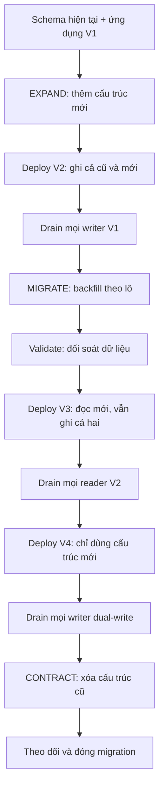

# Expand/contract để schema tương thích nhiều phiên bản ứng dụng

## Mục tiêu

Sau bài học này, bạn có thể:

- Giải thích vì sao thay đổi schema phải tương thích với nhiều phiên bản ứng dụng đang chạy đồng thời.
- Chia một thay đổi phá vỡ tương thích thành các bước expand, migrate, switch và contract.
- Thiết kế migration thêm cột, đổi tên cột, thay kiểu dữ liệu hoặc chuyển sang cấu trúc bảng mới.
- Backfill dữ liệu theo lô, có thể chạy lại và không làm mất cập nhật đồng thời.
- Kiểm tra khả năng tương thích của ứng dụng cũ/mới, replica, job nền và công cụ downstream.
- Quản lý metadata lock, online DDL, rollout, rollback và tiêu chí kết thúc migration.

## 1. Vì sao cần expand/contract?

Trong một ứng dụng đang hoạt động, thay đổi schema MySQL và phát hành ứng dụng thường không diễn ra cùng một thời điểm. Các instance có thể được cập nhật lần lượt; một số worker, cron job hoặc consumer vẫn chạy phiên bản cũ trong khi instance khác đã dùng phiên bản mới. Nếu đổi schema trực tiếp theo cách mà phiên bản cũ không hiểu, quá trình triển khai có thể làm ứng dụng lỗi ngay cả khi lệnh `ALTER TABLE` thành công.

**Expand/contract** là phương pháp chia thay đổi schema thành nhiều bước nhỏ để schema và ứng dụng cũ/mới cùng hoạt động được trong giai đoạn chuyển tiếp.

- **Expand:** mở rộng schema theo hướng bổ sung, giữ nguyên các cột và đối tượng cũ để ứng dụng hiện tại tiếp tục chạy.
- **Migrate:** triển khai phiên bản ứng dụng tương thích, đồng bộ hoặc backfill dữ liệu sang cấu trúc mới.
- **Switch:** chuyển dần thao tác đọc sang cấu trúc mới sau khi dữ liệu đã được kiểm chứng.
- **Contract:** chỉ xóa cột, bảng hoặc constraint cũ sau khi không còn phiên bản ứng dụng hay consumer nào phụ thuộc.

Ví dụ, ứng dụng đang dùng `orders.status` và cần chuyển sang `orders.order_status`. Nếu đổi tên cột ngay bằng `RENAME COLUMN`, phiên bản ứng dụng cũ vẫn truy vấn `status` sẽ nhận lỗi `Unknown column`. Với expand/contract, cột mới được thêm trước, ứng dụng được phát hành theo nhiều bước, dữ liệu được chuyển và kiểm tra, rồi cột cũ mới bị loại bỏ.

Phương pháp này đặc biệt hữu ích cho hệ thống MySQL có rolling deployment, nhiều instance, worker chạy nền, replication, CDC hoặc yêu cầu duy trì dịch vụ liên tục. Nó giảm phạm vi rủi ro của mỗi lần triển khai và tạo thời gian quan sát trước khi thực hiện thay đổi không dễ đảo ngược.

## 2. Nguyên tắc tương thích giữa ứng dụng và schema

Một migration an toàn cần xem xét cả hai chiều:

- Ứng dụng cũ phải tiếp tục hoạt động trên schema đã expand.
- Ứng dụng mới phải hoạt động trên schema trong giai đoạn chuyển tiếp và trên schema cuối cùng.

Không chỉ kiểm tra binary của ứng dụng web. Hãy tính cả worker, cron job, migration script, báo cáo BI, dịch vụ tích hợp, stored routine, trigger, view, công cụ ETL/CDC và các câu SQL được lưu trong dashboard.

### 2.1. Ma trận tương thích

Ví dụ khi chuyển từ cột `status` sang `order_status`:

| Phiên bản ứng dụng | Schema cũ | Schema đã expand | Schema đã contract |
|---|---|---|---|
| V1: chỉ đọc/ghi `status` | Có | Có, vì cột cũ vẫn tồn tại | Không |
| V2: đọc `status`, ghi cả hai cột | Không | Có | Không |
| V3: đọc `order_status`, vẫn ghi cả hai | Không | Có | Không, vì vẫn ghi cột cũ |
| V4: chỉ đọc/ghi `order_status` | Không | Có | Có |

Ma trận là mục tiêu thiết kế cho ví dụ này. Trong thực tế, cần xác minh câu SQL, prepared statement, ORM mapping và mọi tác vụ nền của từng phiên bản. Một ứng dụng có thể không tham chiếu cột cũ trong luồng chính nhưng vẫn dùng nó trong export, báo cáo hoặc job định kỳ.

### 2.2. Quy tắc thiết kế

1. Ưu tiên thay đổi bổ sung trước: thêm cột nullable, bảng mới, index hoặc đối tượng mới.
2. Giữ cột và hành vi cũ trong toàn bộ thời gian còn phiên bản cũ hoạt động.
3. Làm cho backfill có thể chạy nhiều lần mà không tạo dữ liệu sai hoặc trùng lặp.
4. Tách migration schema khỏi việc chuyển luồng đọc/ghi của ứng dụng.
5. Kiểm tra dữ liệu trước khi chuyển đọc sang cấu trúc mới.
6. Xóa cấu trúc cũ sau khi xác minh mọi consumer đã chuyển đổi.
7. Ghi lại điểm có thể rollback và điểm mà rollback cần phục hồi dữ liệu hoặc triển khai sửa tiếp.

Expand/contract không tự động làm mọi DDL trở thành không khóa. Nó quản lý khả năng tương thích giữa các phiên bản; vẫn phải đánh giá thuật toán ALTER, metadata lock, dung lượng và tải của MySQL.

## 3. Các giai đoạn của một migration



Các giai đoạn phải được triển khai tuần tự theo dependency. Có thể tách mỗi giai đoạn thành một release hoặc migration job riêng. Không gộp tất cả vào một lần deploy vì sẽ mất khả năng quan sát và dừng lại khi phát hiện lỗi.

## 4. Ví dụ: đổi tên cột `status` thành `order_status`

Giả sử bảng ban đầu:

```sql
CREATE TABLE orders (
  id BIGINT UNSIGNED NOT NULL PRIMARY KEY,
  customer_id BIGINT UNSIGNED NOT NULL,
  status VARCHAR(24) NOT NULL,
  created_at DATETIME NOT NULL
) ENGINE=InnoDB;
```

Ứng dụng V1 đọc và ghi cột `status`. Yêu cầu mới muốn đổi tên cột thành `order_status` để tên rõ nghĩa hơn.

### 4.1. Expand: thêm cột mới

Thêm cột mới nhưng giữ nguyên cột cũ:

```sql
ALTER TABLE orders
  ADD COLUMN order_status VARCHAR(24) NULL,
  ALGORITHM=INSTANT;
```

`ALGORITHM=INSTANT` yêu cầu MySQL thực hiện thay đổi metadata theo cơ chế instant nếu thao tác, engine và phiên bản hỗ trợ. Nếu không hỗ trợ, lệnh sẽ báo lỗi thay vì tự chuyển sang thuật toán khác. Với phiên bản hoặc cấu trúc không hỗ trợ instant, hãy chọn phương án DDL đã kiểm thử, có thể là `INPLACE`, `COPY` hoặc công cụ thay đổi schema online.

Không giả định thêm cột luôn instant trên mọi phiên bản MySQL. Khả năng instant phụ thuộc phiên bản, storage engine, vị trí cột, row format và giới hạn nội bộ. Ngay cả instant DDL vẫn cần metadata lock trong những thời điểm nhất định.

Sau bước này:

- `status` vẫn tồn tại nên V1 tiếp tục chạy.
- `order_status` có giá trị `NULL` với các hàng cũ.
- Schema đã sẵn sàng cho phiên bản ứng dụng biết ghi cột mới.

### 4.2. Deploy V2: dual-write

V2 tiếp tục đọc `status` để giữ hành vi giống V1, nhưng mỗi thao tác ghi phải cập nhật cả hai cột trong cùng transaction.

Ví dụ:

```sql
UPDATE orders
SET status = 'SHIPPED',
    order_status = 'SHIPPED'
WHERE id = 90001;
```

Khi tạo đơn mới:

```sql
INSERT INTO orders (
  id, customer_id, status, order_status, created_at
)
VALUES (
  90002, 501, 'PENDING', 'PENDING', NOW()
);
```

Hai giá trị phải được cập nhật nguyên tử trong cùng câu lệnh hoặc cùng transaction. Tránh thực hiện hai thao tác ghi độc lập mà không có transaction, vì ứng dụng có thể bị dừng giữa hai lần ghi và để dữ liệu lệch nhau.

Trong lúc rolling deployment, V1 có thể vẫn ghi riêng `status`. Vì vậy, chưa được backfill và chuyển đọc sang cột mới cho đến khi tất cả writer V1 đã được drain, trừ khi có một cơ chế đồng bộ ở database như trigger đã được thiết kế và kiểm thử để xử lý cả các lần ghi từ V1.

Hãy kiểm tra mọi nguồn ghi: API, worker, cron, script quản trị, dịch vụ tích hợp và batch import. Chỉ xác nhận V1 đã hết khi không còn tiến trình cũ nào có thể ghi dữ liệu.

### 4.3. Drain phiên bản cũ trước backfill

Khi tất cả instance V1 đã được thay bằng V2:

- Không còn writer nào chỉ cập nhật `status`.
- Mọi cập nhật mới đều ghi đồng thời `status` và `order_status`.
- Các hàng hiện hữu chưa được backfill vẫn có `order_status IS NULL`.

Lúc này có thể bắt đầu backfill. Nếu không thể drain writer cũ vì có consumer bên ngoài, phải thiết kế một cơ chế đồng bộ rõ ràng (ví dụ trigger tương thích tạm thời hoặc thay đổi consumer) trước khi tiếp tục.

### 4.4. Backfill theo lô

Không nên cập nhật toàn bộ bảng hàng triệu dòng trong một transaction dài nếu có thể chia nhỏ. Batch nhỏ giúp giới hạn thời gian giữ row lock, lượng undo/redo, áp lực replication và khả năng rollback.

Ví dụ bảng có khóa chính `id` tăng dần. Mỗi lần xử lý một khoảng ID:

```sql
UPDATE orders
SET order_status = status
WHERE id > 0
  AND id <= 10000
  AND order_status IS NULL;
```

Tiếp theo xử lý khoảng `10000` đến `20000`, rồi tiếp tục cho đến khi hết dữ liệu. Trong job thực tế, lưu checkpoint của `last_id` đã xử lý và commit từng batch.

Một vòng lặp batch nên có các đặc điểm:

- Dùng keyset/range theo khóa chính thay vì `LIMIT ... OFFSET` trên bảng lớn.
- Có checkpoint để tiếp tục sau khi job bị dừng.
- Chỉ cập nhật các hàng còn thiếu, để chạy lại không ghi đè dữ liệu mới đã đồng bộ.
- Giới hạn số hàng mỗi batch và nghỉ ngắn giữa các batch nếu replication lag hoặc tải tăng.
- Ghi nhận số hàng đã xử lý, thời gian, lỗi và vị trí checkpoint.
- Có thể dừng job mà không để lại transaction khổng lồ.

Điều kiện `order_status IS NULL` đặc biệt quan trọng trong ví dụ này: sau khi V2 dual-write, các cập nhật mới đã có giá trị ở cột mới. Backfill chỉ lấp các hàng cũ chưa có giá trị, không ghi đè giá trị mới.

Nếu cột mới cần chuyển đổi dữ liệu phức tạp, hãy định nghĩa quy tắc chuyển đổi rõ ràng, kiểm tra các trường hợp NULL, giá trị không hợp lệ, timezone, rounding và collation trước khi chạy hàng loạt.

### 4.5. Theo dõi backfill

Có thể theo dõi số hàng còn thiếu và số hàng khác nhau:

```sql
SELECT COUNT(*) AS rows_missing_new_status
FROM orders
WHERE order_status IS NULL;

SELECT COUNT(*) AS rows_with_mismatch
FROM orders
WHERE NOT (order_status <=> status);
```

Toán tử `<=>` là so sánh null-safe của MySQL. Truy vấn thứ hai phù hợp khi hai cột phải giống hệt nhau theo quy tắc so sánh SQL đang dùng. Nếu yêu cầu so sánh byte chính xác cho chuỗi, cần dùng phép so sánh nhị phân phù hợp và kiểm tra charset/collation.

Với bảng lớn, `COUNT(*)` hoặc phép so sánh toàn bảng có thể tạo tải đáng kể. Hãy chạy theo khoảng khóa chính, dùng chỉ số phù hợp và theo dõi execution plan. Có thể lưu kết quả kiểm tra theo từng batch để không phải quét lại toàn bộ bảng liên tục.

### 4.6. Validate trước khi chuyển đọc

Chỉ chuyển luồng đọc sang `order_status` khi:

- Không còn hàng có `order_status IS NULL` nếu nghiệp vụ yêu cầu giá trị bắt buộc.
- Không còn mismatch theo quy tắc chuyển đổi đã định nghĩa.
- Các hàng mới và các hàng được cập nhật trong thời gian backfill đều được đồng bộ.
- Aggregate nghiệp vụ, báo cáo và trạng thái đơn hàng khớp với nguồn.
- Job backfill đã hoàn tất và checkpoint được ghi nhận.

Nếu phát hiện mismatch, dừng bước switch và phân loại nguyên nhân: lỗi mapping, V1 writer còn hoạt động, V2 dual-write thiếu đường code, dữ liệu cũ không hợp lệ hoặc job backfill bị lỗi. Sửa nguyên nhân rồi chạy lại batch có thể tái thực thi.

### 4.7. Deploy V3: đọc cột mới, vẫn ghi cả hai

Sau khi validation đạt, phát hành V3:

- Đọc `order_status`.
- Tiếp tục ghi cả `status` và `order_status`.
- Có metric hoặc log để phát hiện giá trị NULL/mismatch.
- Giữ khả năng quay lại đọc cột cũ trong thời gian quan sát nếu cần.

V2 và V3 có thể cùng tồn tại trong quá trình rolling deployment vì cả hai đều ghi hai cột. V2 đọc cột cũ; V3 đọc cột mới. Vì dữ liệu đã được backfill và hai cột vẫn được đồng bộ, hai phiên bản có thể hoạt động song song.

Chờ tất cả instance V2, worker và consumer chỉ đọc `status` được thay thế. Kiểm tra query log, metric, source code deployment inventory hoặc tracing để xác nhận không còn truy vấn cũ.

### 4.8. Deploy V4: chỉ dùng cột mới

Khi mọi reader đã chuyển sang `order_status`, phát hành V4 chỉ đọc và ghi cột mới. Trong giai đoạn V3/V4 cùng chạy, V3 vẫn dual-write và V4 ghi cột mới. Vì cả hai đều đọc cột mới, việc `status` bắt đầu không còn được cập nhật không ảnh hưởng luồng ứng dụng hiện tại.

Chờ mọi instance V3 và mọi writer dual-write được drain. Sau đó xác nhận:

- Không có truy vấn đọc/ghi `status` trong ứng dụng hoặc job.
- Không có view, trigger, routine, event, report, CDC consumer hoặc integration phụ thuộc cột cũ.
- Backup gần nhất có thể phục hồi và phương án rollback đã được đánh giá.
- Metric ứng dụng trên cột mới ổn định qua thời gian quan sát phù hợp.

### 4.9. Contract: xóa cột cũ

Khi mọi phụ thuộc đã được loại bỏ, mới thực hiện:

```sql
ALTER TABLE orders
  DROP COLUMN status;
```

Việc drop column có thể dùng instant DDL trong một số phiên bản/điều kiện InnoDB, nhưng không được giả định. Hãy kiểm tra khả năng hỗ trợ, thời gian metadata lock, tác động dung lượng và phương án thực hiện trên đúng phiên bản. Nếu không thể thực hiện online trong giới hạn cho phép, cân nhắc công cụ online schema change hoặc cửa sổ bảo trì.

Sau contract, xóa code dual-write, metric tạm thời và job backfill không còn cần thiết; cập nhật tài liệu schema và runbook.

## 5. Thiết kế backfill an toàn và có thể chạy lại

Backfill thường là phần tốn thời gian và có nhiều tương tác với workload production nhất. Hãy coi nó là một job vận hành có checkpoint, giới hạn tải và quan sát được.

### 5.1. Chọn batch size

Không có một batch size đúng cho mọi database. Bắt đầu với lô nhỏ, đo thời gian, số row lock, undo/redo, CPU, I/O và replication lag. Tăng hoặc giảm kích thước dựa trên số liệu thực tế.

| Dấu hiệu | Điều chỉnh có thể áp dụng |
|---|---|
| Batch mất quá lâu hoặc giữ lock lâu | Giảm số hàng mỗi batch |
| Replica lag tăng | Giảm batch, tăng khoảng nghỉ hoặc tạm dừng job |
| CPU/I/O còn dư và batch rất ngắn | Có thể tăng batch từng bước nhỏ |
| Deadlock hoặc lock wait timeout tăng | Giảm batch, rút ngắn transaction và xem lại thứ tự cập nhật |
| Undo tablespace tăng nhanh | Giảm transaction size và kiểm tra purge/long transaction |

Không chạy nhiều worker backfill cùng cập nhật một dải khóa nếu không có cơ chế phân vùng công việc rõ ràng. Nếu cần song song, chia dải khóa không chồng lấn và theo dõi tải tổng.

### 5.2. Idempotency và checkpoint

Job idempotent có thể chạy lại mà không làm sai dữ liệu. Ví dụ điều kiện `WHERE order_status IS NULL` khiến batch chỉ lấp phần còn thiếu. Nếu phép chuyển đổi có thể tạo ra cùng một giá trị từ dữ liệu nguồn, hãy thiết kế câu `UPDATE` và điều kiện lọc để chạy lại an toàn.

Checkpoint nên lưu:

- Tên migration và phiên bản logic chuyển đổi.
- `last_id` hoặc khóa cuối cùng đã xử lý.
- Thời điểm batch gần nhất.
- Số hàng đọc, số hàng cập nhật và số lỗi.
- Trạng thái `RUNNING`, `PAUSED`, `COMPLETED` hoặc `FAILED`.

Không chỉ lưu một biến trong bộ nhớ tiến trình; nếu job restart, nó cần đọc lại checkpoint đã commit. Cập nhật checkpoint sau khi transaction batch hoàn tất để tránh đánh dấu đã xử lý một batch chưa commit.

### 5.3. Tránh ghi đè cập nhật mới

Giả sử backfill đang xử lý hàng `id=90001` trong khi ứng dụng cập nhật trạng thái. Nếu job dùng câu lệnh không có điều kiện và luôn ghi `order_status=status`, nó có thể ghi đè giá trị mới hoặc tạo race condition khó điều tra.

Trong ví dụ đổi tên cột, các writer V2 luôn cập nhật hai cột trong cùng transaction, còn backfill chỉ cập nhật khi `order_status IS NULL`. Điều kiện này giúp tránh ghi đè hàng đã được dual-write. Nếu có trigger hoặc logic chuyển đổi phức tạp, phải phân tích thứ tự khóa và semantics cập nhật cụ thể.

## 6. Các kiểu thay đổi schema thường dùng expand/contract

### 6.1. Thêm cột bắt buộc

Không nhất thiết thêm cột `NOT NULL` với default lớn ngay trong lúc ứng dụng cũ còn chạy. Một chiến lược phổ biến:

1. Thêm cột nullable.
2. Deploy ứng dụng ghi giá trị mới.
3. Backfill các hàng cũ.
4. Xác minh không còn NULL.
5. Thêm constraint `NOT NULL` trong một migration riêng sau khi kiểm tra thuật toán DDL và khóa.

Ví dụ:

```sql
ALTER TABLE customers
  ADD COLUMN preferred_language VARCHAR(10) NULL;

-- Sau khi ứng dụng đã ghi và backfill hoàn tất:
SELECT COUNT(*)
FROM customers
WHERE preferred_language IS NULL;
```

Nếu NULL có ý nghĩa nghiệp vụ hợp lệ, không ép `NOT NULL` chỉ để làm schema đẹp hơn. Hãy chọn default hoặc constraint theo quy tắc dữ liệu.

### 6.2. Thay đổi kiểu dữ liệu

Ví dụ chuyển `amount` từ `INT` sang `BIGINT` để hỗ trợ giá trị lớn hơn. Việc đổi trực tiếp có thể cần rebuild bảng hoặc gây khóa tùy phiên bản và điều kiện. Với hệ thống cần rollout nhiều phiên bản, có thể thêm `amount_v2 BIGINT`, dual-write, backfill, validate phạm vi và chuyển đọc trước khi bỏ cột cũ.

Nếu chuyển kiểu từ chuỗi sang số, cần kiểm tra dữ liệu không hợp lệ trước:

```sql
SELECT id, amount_text
FROM invoices
WHERE amount_text IS NOT NULL
  AND amount_text NOT REGEXP '^-?[0-9]+$'
LIMIT 100;
```

Không chạy chuyển đổi hàng loạt trước khi định nghĩa cách xử lý chuỗi rỗng, dấu phân cách, overflow, giá trị âm và NULL.

### 6.3. Thêm index

Thêm index thường là thay đổi bổ sung, nhưng vẫn có thể tiêu tốn I/O, CPU, dung lượng và metadata lock. Với InnoDB, tạo secondary index thường có thể dùng online DDL ở các phiên bản hỗ trợ:

```sql
ALTER TABLE orders
  ADD INDEX idx_orders_customer_created (customer_id, created_at),
  ALGORITHM=INPLACE,
  LOCK=NONE;
```

Nếu tổ hợp thuật toán/lock không được hỗ trợ, câu lệnh có thể thất bại. Hãy kiểm tra phiên bản, kích thước bảng và workload, theo dõi metadata lock cũng như tác động replication. Index mới chỉ nên được dùng bởi code sau khi đã tồn tại và được kiểm tra execution plan.

### 6.4. Chuyển sang bảng mới

Khi cần thay đổi cấu trúc lớn, có thể tạo bảng mới thay vì sửa trực tiếp bảng cũ:

1. Tạo bảng mới với schema đích.
2. Phát hành ứng dụng ghi đồng thời bảng cũ và bảng mới hoặc dùng một cơ chế CDC/replication nội bộ đã được kiểm thử.
3. Backfill dữ liệu cũ sang bảng mới theo khóa chính.
4. Đối soát dữ liệu và quan hệ.
5. Chuyển đọc sang bảng mới.
6. Dừng ghi bảng cũ sau khi mọi consumer đã chuyển.
7. Giữ bảng cũ trong khoảng thời gian quan sát, sau đó drop.

Đồng bộ hai bảng phức tạp hơn dual-write hai cột vì cần xử lý khóa chính, thứ tự transaction, delete, update và tính duy nhất. Hãy chọn một nguồn sự thật trong từng giai đoạn và xác định rõ cách giải quyết xung đột.

## 7. Online DDL và metadata lock trong MySQL

Expand/contract giảm rủi ro tương thích ứng dụng, nhưng `ALTER TABLE` vẫn có thể ảnh hưởng đến workload.

### 7.1. Các thuật toán DDL

MySQL InnoDB có các thuật toán chính:

| Thuật toán | Đặc điểm |
|---|---|
| `INSTANT` | Thay đổi metadata mà không rebuild toàn bộ bảng trong các thao tác được hỗ trợ |
| `INPLACE` | Thực hiện thay đổi bằng cơ chế storage engine; có thể vẫn rebuild hoặc scan tùy loại thao tác |
| `COPY` | Tạo bản sao bảng, chuyển dữ liệu và thay thế bảng; thường tốn thời gian, I/O và có hạn chế ghi hơn |

Tên `INPLACE` không có nghĩa là không sao chép dữ liệu trong mọi trường hợp. Khả năng dùng `INSTANT`, `INPLACE` hoặc `COPY` phụ thuộc thao tác, phiên bản, engine và cấu trúc bảng.

Khi cần tránh fallback ngoài dự kiến, có thể chỉ định thuật toán rõ ràng. Ví dụ `ALGORITHM=INSTANT` sẽ làm lệnh thất bại nếu thao tác không thể chạy instant trên server đó. Cách này giúp phát hiện trước rằng DDL cần kế hoạch khác.

### 7.2. `LOCK=NONE` không có nghĩa hoàn toàn không khóa

Online DDL có thể cho phép DML chạy trong phần lớn thời gian, nhưng vẫn cần metadata lock (MDL) ở đầu và cuối thao tác. Một transaction dài đang truy cập bảng có thể giữ metadata lock và khiến ALTER chờ. Khi DDL đang chờ MDL, các truy vấn mới cũng có thể xếp hàng phía sau, tạo ra hiện tượng nghẽn kết nối.

Kiểm tra metadata lock:

```sql
SELECT
  OBJECT_SCHEMA,
  OBJECT_NAME,
  LOCK_TYPE,
  LOCK_DURATION,
  LOCK_STATUS,
  OWNER_THREAD_ID
FROM performance_schema.metadata_locks
WHERE OBJECT_SCHEMA = 'sales_app'
  AND OBJECT_NAME = 'orders';
```

Kiểm tra transaction dài và session đang hoạt động bằng `SHOW PROCESSLIST` hoặc các bảng Performance Schema phù hợp. Trước khi chạy DDL production, xác định cách xử lý session giữ lock lâu và giới hạn thời gian chờ của migration session.

Có thể đặt `lock_wait_timeout` ở session migration để DDL dừng sớm nếu không lấy được metadata lock:

```sql
SET SESSION lock_wait_timeout = 10;
```

`lock_wait_timeout` liên quan đến metadata lock; nó khác `innodb_lock_wait_timeout`, vốn liên quan đến row lock của InnoDB. Đặt timeout ngắn giúp tránh DDL chờ quá lâu, nhưng cũng có nghĩa migration có thể thất bại và cần được chạy lại trong cửa sổ phù hợp.

### 7.3. Kế hoạch trước khi ALTER

- Xác định kích thước bảng và tốc độ tăng trưởng.
- Kiểm tra phiên bản MySQL, engine, row format và thuật toán DDL được hỗ trợ.
- Chạy thử trên bản sao dữ liệu có kích thước gần production.
- Đo thời gian, I/O, CPU, dung lượng tạm và replication lag.
- Kiểm tra transaction dài, metadata lock và giờ cao điểm.
- Xác định timeout, ngưỡng dừng và người chịu trách nhiệm.
- Có backup và phương án phục hồi phù hợp trước thay đổi không dễ đảo ngược.

Với bảng lớn hoặc yêu cầu gần như không khóa, có thể đánh giá công cụ online schema change như `gh-ost` hoặc `pt-online-schema-change`. Những công cụ này có cơ chế copy/trigger/binlog riêng, yêu cầu quyền và có rủi ro riêng; phải thử với foreign key, trigger, replication topology và workload cụ thể trước khi dùng.

## 8. Migration trong môi trường nhiều instance và nhiều consumer

Schema chỉ an toàn khi tất cả thành phần truy cập database đều tương thích. Danh sách kiểm tra cần bao gồm:

- Web/API instance và phiên bản đang chạy.
- Worker, queue consumer, cron job và scheduled task.
- Script quản trị, migration tool và tác vụ ETL.
- View, trigger, stored procedure, function và event.
- BI dashboard, báo cáo, data warehouse và CDC connector.
- Replica, read pool, delayed replica và hệ thống backup/restore.
- Prepared statement, ORM mapping, cache schema và connection pool.

Một replica có thể áp dụng DDL từ source nhưng ứng dụng đọc trên replica vẫn chạy code cũ. Tương tự, một CDC consumer có thể phụ thuộc tên cột hoặc schema version cũ dù ứng dụng chính đã chuyển xong. Vì vậy, giai đoạn contract cần chờ cả consumer ngoài ứng dụng.

### 8.1. Rolling deployment

Trong rolling deployment, V1 và V2 cùng tồn tại trong một khoảng thời gian. Trước khi expand, xác định V1 có chịu được cột mới, index mới hoặc bảng mới không. Sau khi expand, phát hành V2 và chờ mọi V1 được drain trước các bước yêu cầu V2 trở lên.

Đừng dùng việc một deployment pipeline báo thành công làm bằng chứng mọi process cũ đã dừng. Kiểm tra instance inventory, heartbeat phiên bản, worker registry, job scheduler và connection/session còn tồn tại.

### 8.2. Feature flag và chuyển luồng đọc

Feature flag có thể điều khiển việc đọc từ cột/bảng cũ hay mới. Một chiến lược an toàn:

1. Deploy code hỗ trợ cả hai cấu trúc nhưng vẫn đọc cũ.
2. Backfill và validate.
3. Bật đọc mới cho một tỷ lệ nhỏ traffic hoặc một nhóm tenant.
4. Theo dõi lỗi, mismatch, latency và kết quả nghiệp vụ.
5. Tăng dần traffic sang cấu trúc mới.
6. Giữ khả năng quay lại đọc cũ trong giai đoạn quan sát, khi dual-write vẫn bảo đảm dữ liệu cũ còn mới.
7. Khi đã quyết định contract, bỏ flag và code cũ sau khi tất cả consumer đã chuyển.

Không giữ feature flag vô thời hạn. Mỗi flag migration cần chủ sở hữu, ngày xem xét và điều kiện xóa.

## 9. Rollback và điểm không thể quay lại đơn giản

Không phải mọi bước expand/contract có cùng khả năng rollback.

| Giai đoạn | Khả năng quay lại |
|---|---|
| Sau expand, chưa có dữ liệu mới | Thường dễ: ứng dụng cũ tiếp tục dùng cột cũ; có thể bỏ cột mới nếu chưa được sử dụng |
| Trong dual-write và backfill | Có thể dừng job hoặc quay lại đọc cũ nếu cột cũ vẫn được cập nhật đúng |
| Sau switch đọc sang cột mới nhưng vẫn dual-write | Có thể chuyển lại đọc cũ nếu dữ liệu cũ còn đồng bộ và code hỗ trợ |
| Sau khi chỉ ghi cột mới | Cột cũ có thể đã stale; quay lại ứng dụng cũ cần đồng bộ dữ liệu ngược trước |
| Sau contract/drop cột cũ | Không thể chỉ rollback ứng dụng; cần khôi phục schema và dữ liệu từ backup hoặc triển khai một thay đổi forward phù hợp |

Điểm quan trọng là phải xác định trước thời điểm dừng dual-write. Trước khi ngừng cập nhật cấu trúc cũ, hãy có một khoảng quan sát đủ dài và tiêu chí rõ ràng. Sau khi cột cũ đã stale, không triển khai code cũ chỉ bằng cách đổi image ứng dụng.

Với DDL MySQL, nhiều câu lệnh `ALTER TABLE` gây implicit commit. Không thể dựa vào `ROLLBACK` của transaction SQL để hoàn tác một migration schema đã chạy. Hãy dùng migration có version, lưu log và chuẩn bị phương án phục hồi riêng.

### 9.1. Forward fix

Trong một số trường hợp, triển khai một migration mới để sửa schema hoặc dữ liệu an toàn hơn rollback. Ví dụ nếu cột mới có sai mapping, có thể sửa logic chuyển đổi và backfill lại theo checkpoint, miễn là nguồn dữ liệu gốc vẫn được giữ và không có cập nhật bị mất.

Trước khi chọn forward fix, xác định:

- Dữ liệu nguồn nào còn nguyên vẹn.
- Các transaction mới đã ghi vào cấu trúc nào.
- Có thể chạy chuyển đổi lần hai mà không ghi đè cập nhật hợp lệ không.
- Có cần dừng ghi hoặc chụp snapshot trước khi sửa không.

## 10. Migration tooling và quản lý version

Các migration schema nên được quản lý như code:

- Có version hoặc ID duy nhất.
- Có mô tả mục đích và dependency.
- Được review và chạy thử trên môi trường tương tự production.
- Có log thời gian, trạng thái, người chạy và kết quả.
- Tách thay đổi schema, backfill dữ liệu và chuyển traffic thành các bước riêng.
- Có kiểm tra trước/sau và tiêu chí hoàn tất.

Các công cụ như Flyway hoặc Liquibase có thể quản lý thứ tự migration và trạng thái đã áp dụng. Công cụ không tự bảo đảm DDL online hoặc tính tương thích giữa ứng dụng cũ/mới; thiết kế expand/contract vẫn thuộc trách nhiệm của nhóm phát triển và vận hành.

Một migration dài nên tách thành:

1. **Schema migration:** thêm cột, bảng hoặc index tương thích ngược.
2. **Data migration:** backfill theo batch, có checkpoint và khả năng chạy lại.
3. **Application rollout:** chuyển ghi/đọc theo phiên bản.
4. **Contract migration:** loại bỏ cấu trúc cũ sau khi xác nhận không còn phụ thuộc.

Không chạy backfill hàng triệu hàng như một migration startup đồng bộ của ứng dụng. Một job riêng giúp kiểm soát tốc độ, dừng/tiếp tục và quan sát tác động dễ hơn.

## 11. Checklist vận hành expand/contract

### Trước khi bắt đầu

- [ ] Xác định thay đổi schema và tất cả consumer phụ thuộc.
- [ ] Lập ma trận tương thích giữa các phiên bản ứng dụng và schema.
- [ ] Kiểm tra phiên bản MySQL, storage engine, DDL algorithm và metadata lock.
- [ ] Thử migration với dữ liệu gần kích thước production.
- [ ] Xác định cách dual-write, backfill, validation và xử lý lỗi.
- [ ] Xác định rollback point và điều kiện phải dùng forward fix.

### Trong giai đoạn expand/migrate

- [ ] Chỉ thêm cấu trúc mới, giữ nguyên cấu trúc cũ.
- [ ] Triển khai code tương thích trước khi chuyển dữ liệu.
- [ ] Drain toàn bộ writer cũ trước backfill, hoặc có cơ chế đồng bộ thay thế đã kiểm thử.
- [ ] Backfill theo batch, checkpoint và giới hạn tải.
- [ ] Theo dõi lock, CPU, I/O, undo/redo, dung lượng và replication lag.
- [ ] Đối soát dữ liệu trước khi chuyển đọc.

### Trước contract

- [ ] Mọi reader/writer đã chuyển sang cấu trúc mới.
- [ ] Không còn worker, cron, report, CDC hoặc stored object tham chiếu cấu trúc cũ.
- [ ] Không còn connection hoặc process cũ có thể thực thi SQL cũ.
- [ ] Dual-write đã dừng theo đúng thứ tự và dữ liệu mới vẫn hợp lệ.
- [ ] Backup/restore và phương án phục hồi đã được xác nhận.
- [ ] DDL drop đã được thử và có cửa sổ/giới hạn lock phù hợp.

### Sau contract

- [ ] Ứng dụng và job chạy ổn định trên schema mới.
- [ ] Không còn lỗi `Unknown column`, lỗi constraint hoặc query timeout.
- [ ] Metric tạm, feature flag và code tương thích cũ được dọn theo kế hoạch.
- [ ] Tài liệu schema, sơ đồ dữ liệu và runbook được cập nhật.
- [ ] Migration được đánh dấu hoàn tất và có bằng chứng đối soát.

## 12. Tình huống thực hành

Một hệ thống thương mại điện tử có 20 API instance, 8 worker và 3 cron job. Bảng `orders` có 80 triệu hàng. Nhóm muốn thay `status VARCHAR(24)` bằng `order_status VARCHAR(32)` và chuyển sang quy ước trạng thái mới. Ứng dụng V1 chỉ biết cột cũ; V2 có thể ghi hai cột; V3 đọc cột mới nhưng vẫn dual-write; V4 chỉ dùng cột mới.

Hãy lập kế hoạch:

1. Kiểm kê toàn bộ API, worker, cron, báo cáo và CDC consumer có đọc/ghi `orders.status`.
2. Thêm `order_status` nullable và kiểm tra DDL algorithm, metadata lock cùng tác động lên replica.
3. Deploy V2 theo rolling deployment. Xác nhận mọi writer V1 đã được drain trước khi backfill.
4. Backfill theo dải khóa chính, dùng checkpoint và điều chỉnh batch theo replication lag.
5. Đối soát NULL, mismatch, trạng thái không nằm trong mapping và aggregate đơn hàng theo ngày.
6. Deploy V3 đọc cột mới nhưng vẫn dual-write; chuyển traffic dần bằng feature flag.
7. Drain mọi reader V2, sau đó deploy V4 chỉ dùng cột mới.
8. Chờ mọi V3 dual-write được drain, xác nhận không còn consumer cũ và kiểm tra backup.
9. Drop cột `status` trong một migration contract riêng; theo dõi metadata lock và lỗi ứng dụng.
10. Gỡ code dual-write, feature flag, job backfill và cập nhật tài liệu.

Thảo luận thêm: nếu V1 vẫn còn một cron job ghi `status` sau khi backfill hoàn tất, dữ liệu `order_status` có thể sai như thế nào? Nếu đã dừng dual-write và cột cũ không còn được cập nhật, vì sao không thể rollback bằng cách đưa V1 trở lại?

**Câu hỏi tự kiểm tra:**

1. Vì sao đổi tên cột trực tiếp có thể làm rolling deployment thất bại?
2. Expand khác contract ở mục tiêu và mức độ rủi ro như thế nào?
3. Vì sao cần drain writer cũ trước backfill trong ví dụ dual-write?
4. Điều kiện `WHERE order_status IS NULL` giúp job backfill chạy lại an toàn ra sao?
5. Vì sao nên chuyển đọc sang cột mới trong khi vẫn dual-write cả hai cột?
6. Khi nào có thể dừng dual-write và drop cột cũ?
7. `LOCK=NONE` có bảo đảm ALTER TABLE không bao giờ chờ khóa không?
8. Vì sao `ROLLBACK` không thể hoàn tác mọi lệnh ALTER TABLE?
9. Ngoài ứng dụng API, những consumer nào cần được kiểm tra trước contract?
10. Khi nào nên dùng online schema change tool thay vì ALTER TABLE trực tiếp?

## Kết luận

Expand/contract giúp thay đổi schema MySQL mà vẫn duy trì khả năng tương thích giữa các phiên bản ứng dụng trong quá trình rollout. Hãy bổ sung cấu trúc mới, triển khai code dual-write, drain writer cũ, backfill theo batch, validate dữ liệu, chuyển đọc, dừng phụ thuộc cũ rồi mới contract. Online DDL và công cụ migration hỗ trợ quá trình này nhưng vẫn cần kiểm soát metadata lock, replication, dữ liệu và rollback. Một migration chỉ hoàn tất khi mọi ứng dụng và consumer đã chuyển sang schema mới, dữ liệu đã được xác minh và cấu trúc cũ được loại bỏ có kiểm soát.

## Tài liệu tham khảo

- [MySQL 8.4 Reference Manual — ALTER TABLE](https://dev.mysql.com/doc/refman/8.4/en/alter-table.html)
- [MySQL 8.4 Reference Manual — InnoDB Online DDL](https://dev.mysql.com/doc/refman/8.4/en/innodb-online-ddl.html)
- [MySQL 8.4 Reference Manual — InnoDB Online DDL Operations](https://dev.mysql.com/doc/refman/8.4/en/innodb-online-ddl-operations.html)
- [MySQL 8.4 Reference Manual — Metadata Locking](https://dev.mysql.com/doc/refman/8.4/en/metadata-locking.html)
- [MySQL 8.4 Reference Manual — Atomic Data Definition Statement Support](https://dev.mysql.com/doc/refman/8.4/en/atomic-ddl.html)
