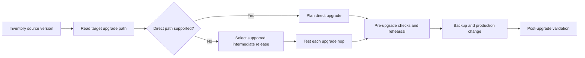

# Đường nâng cấp được hỗ trợ và điều kiện chuyển nhánh phát hành

## Mục tiêu

Nâng cấp MySQL là thay đổi cả phần mềm máy chủ, data dictionary, định dạng metadata, cấu hình và đôi khi cả hành vi SQL. Chọn sai đường nâng cấp có thể khiến máy chủ không khởi động, replication không tiếp tục, ứng dụng lỗi xác thực hoặc dữ liệu không tương thích với phiên bản mới. Vì vậy, trước khi nâng cấp cần xác định chính xác phiên bản nguồn, phiên bản đích, nhánh phát hành và đường chuyển đổi được nhà cung cấp hỗ trợ.

Bài học thuộc module **DATABASE_MYSQL**, bao quát thiết kế bảng, kiểu dữ liệu, khóa, SQL, index, transaction, kiểm soát đồng thời, đọc kế hoạch thực thi, tối ưu truy vấn và vận hành cơ sở dữ liệu quan hệ. Bài này tập trung vào cách chọn đường nâng cấp, kiểm tra điều kiện tương thích, chuyển giữa các nhánh phát hành và lập kế hoạch triển khai có thể xác minh hoặc khôi phục.

Sau bài học, bạn có thể:

- Phân biệt patch upgrade, minor/maintenance upgrade, major upgrade và chuyển nhánh phát hành.
- Xác định đường nâng cấp trực tiếp hoặc đường cần qua phiên bản trung gian.
- Kiểm tra điều kiện về hệ điều hành, kiến trúc, plugin, cấu hình, dữ liệu và replication.
- So sánh nâng cấp tại chỗ với logical migration và nâng cấp theo cụm.
- Lập kế hoạch kiểm thử, cutover, xác minh sau nâng cấp và phương án quay lui.

## 1. Phân biệt phiên bản và loại nâng cấp

Mỗi phiên bản MySQL cần được ghi đầy đủ, ví dụ `8.0.x` hoặc `8.4.x`, cùng edition, hệ điều hành, kiến trúc và cách cài đặt. Chỉ ghi “MySQL 8” là chưa đủ để xác định khả năng nâng cấp.

Các loại thay đổi thường gặp:

| Loại | Phạm vi thay đổi | Cách tiếp cận |
|---|---|---|
| Patch release | Sửa lỗi, bảo mật và ổn định trong cùng series | Thường là thay binary trong cùng nhánh sau khi kiểm tra release notes và tương thích |
| Maintenance/minor release | Cập nhật trong một series phát hành | Kiểm tra thay đổi hành vi, cấu hình và yêu cầu restart |
| Major/series upgrade | Chuyển sang series mới, có thể thay đổi data dictionary hoặc tính năng | Kiểm tra đường nâng cấp chính thức, chạy upgrade checker và diễn tập đầy đủ |
| Branch transition | Chuyển giữa LTS và Innovation hoặc chọn nhánh phát hành khác | Đánh giá chu kỳ hỗ trợ, tốc độ cập nhật và đường chuyển đổi được hỗ trợ |

Đừng suy ra rằng hai phiên bản có số gần nhau luôn có thể nâng cấp trực tiếp. Điều kiện hỗ trợ phụ thuộc phiên bản nguồn chính xác, phiên bản đích, hệ điều hành, edition và một số trạng thái cấu hình.

## 2. Hiểu nhánh LTS và Innovation

MySQL áp dụng mô hình phát hành có nhánh **LTS (Long Term Support)** và **Innovation** từ mô hình phát hành mới bắt đầu sau MySQL 8.0. LTS hướng tới môi trường cần độ ổn định và chu kỳ thay đổi có thể dự đoán. Innovation đưa tính năng mới ra sớm hơn và có nhịp phát hành nhanh hơn, vì vậy tổ chức cần sẵn sàng kiểm thử và nâng cấp thường xuyên.

MySQL 8.4 là một nhánh LTS. Khi chọn nhánh cho production, hãy cân nhắc:

- **LTS:** phù hợp khi ưu tiên ổn định, tương thích dài hạn và giảm số lần thay đổi lớn.
- **Innovation:** phù hợp khi cần thử nghiệm hoặc sử dụng tính năng mới sớm, đồng thời có năng lực kiểm thử hồi quy và theo dõi lịch phát hành.
- **Ứng dụng và connector:** xác minh driver, ORM, proxy, backup tool, monitoring agent và plugin hỗ trợ nhánh đích.
- **Chính sách hỗ trợ:** kiểm tra thời gian hỗ trợ, lịch kết thúc vòng đời và chính sách bảo mật của đúng phiên bản.

Không chọn nhánh chỉ vì số phiên bản lớn hơn. Chọn mục tiêu theo yêu cầu hỗ trợ, tính năng, tương thích ứng dụng và khả năng vận hành. Với hệ thống production ưu tiên ổn định, một nhánh LTS đang được hỗ trợ thường là lựa chọn mặc định hợp lý.

## 3. Xác định đường nâng cấp được hỗ trợ

Trước khi thay binary, tra cứu tài liệu nâng cấp và release notes của **phiên bản đích**. Tài liệu đích xác định phiên bản nguồn nào được chấp nhận, các bước trung gian bắt buộc, nền tảng được hỗ trợ và các giới hạn riêng.

Quy trình quyết định:

1. Ghi nhận phiên bản nguồn đầy đủ bằng `SELECT VERSION();` và xác nhận edition/build.
2. Xác định phiên bản đích cụ thể, không chỉ ghi tên nhánh.
3. Tra cứu danh sách source version được hỗ trợ bởi target release.
4. Kiểm tra nền tảng, kiến trúc, package format, plugin và cách cài đặt có nằm trong ma trận hỗ trợ.
5. Nếu đường trực tiếp không được hỗ trợ, xác định từng phiên bản trung gian bắt buộc.
6. Lập kế hoạch backup, kiểm thử và chuyển đổi cho từng bước; không bỏ qua phiên bản trung gian để tiết kiệm thời gian.

Ví dụ minh họa thường gặp là nâng cấp hệ thống MySQL 5.7 lên MySQL 8.4 thông qua một bước nâng cấp sang MySQL 8.0 trước, sau đó mới sang 8.4. Đây là ví dụ về đường nhiều chặng; phiên bản patch cụ thể của nguồn và đích vẫn phải được đối chiếu với tài liệu chính thức của release đang triển khai. Không dùng ví dụ này để suy ra rằng mọi phiên bản cũ đều có cùng tuyến nâng cấp.

Đường nâng cấp phải được xem như một đồ thị có hướng: mỗi cạnh là một cặp source-target được hỗ trợ. Nếu không có cạnh trực tiếp giữa hai phiên bản, cần đi qua node trung gian được tài liệu chỉ định hoặc chọn phương pháp logical migration được hỗ trợ.



## 4. Kiểm tra điều kiện tương thích trước nâng cấp

Đường nâng cấp được hỗ trợ chỉ là điều kiện cần. Instance thực tế còn phải vượt qua các kiểm tra về dữ liệu, cấu hình và hệ sinh thái.

| Nhóm | Nội dung cần kiểm tra | Rủi ro nếu bỏ qua |
|---|---|---|
| Hệ điều hành | Phiên bản OS, kiến trúc CPU, thư viện hệ thống, package repository | Binary không chạy hoặc nền tảng đã hết hỗ trợ |
| Data directory | Phiên bản tạo data directory, quyền file, filesystem và dung lượng | Server không đọc được dữ liệu hoặc thiếu không gian nâng cấp |
| Cấu hình | Biến đã bị loại bỏ/đổi tên, giá trị mặc định mới, option file được include | Server không khởi động hoặc hành vi thay đổi |
| SQL và schema | Từ khóa mới, kiểu dữ liệu, check constraint, partition, generated column | DDL hoặc truy vấn cũ lỗi |
| Dữ liệu | Giá trị ngày không hợp lệ, dữ liệu vượt miền, metadata không nhất quán | Upgrade checker báo lỗi hoặc quá trình nâng cấp thất bại |
| Plugin/component | Plugin xác thực, keyring, audit, storage engine và component bên thứ ba | Thiếu chức năng hoặc không mở được dữ liệu mã hóa |
| Ứng dụng | Connector, driver, ORM, proxy, client library và authentication | Client không kết nối hoặc truy vấn hoạt động khác |
| Replication/HA | Source/replica version pair, GTID, binlog, backup và failover tool | Replica dừng hoặc không thể chuyển vai trò |

Kiểm tra cả workload thật: câu SQL quan trọng, stored routine, event scheduler, trigger, job và công cụ quản trị. Một server có thể khởi động thành công nhưng ứng dụng vẫn lỗi vì thay đổi SQL mode, authentication plugin, collation hoặc hành vi optimizer.

## 5. Dùng Upgrade Checker và công cụ kiểm tra

MySQL Shell cung cấp tiện ích Upgrade Checker để phát hiện nhiều vấn đề có thể cản trở nâng cấp hoặc làm thay đổi hành vi. Có thể gọi qua API `util.checkForServerUpgrade()` hoặc command-line utility `check-for-server-upgrade`, tùy phiên bản MySQL Shell.

Ví dụ gọi từ MySQL Shell JavaScript API:

```javascript
util.checkForServerUpgrade(
  'dba@127.0.0.1:3306',
  { targetVersion: '8.4.0' }
);
```

Thay tài khoản, endpoint và target version bằng thông tin môi trường. Chạy checker bằng tài khoản có đủ quyền đọc metadata cần thiết; bảo vệ thông tin đăng nhập và đầu ra vì báo cáo có thể tiết lộ cấu trúc hệ thống.

Upgrade Checker có thể cảnh báo về:

- Các biến hệ thống hoặc tùy chọn cấu hình đã bị loại bỏ.
- Từ khóa mới có thể xung đột với tên database, bảng hoặc cột.
- Kiểu dữ liệu, giá trị ngày giờ và cấu trúc không còn được hỗ trợ.
- Cách dùng partition, plugin hoặc tính năng đã thay đổi.
- Những vấn đề tương thích được checker của phiên bản đó nhận diện.

Checker không chứng minh ứng dụng tương thích hoàn toàn. Nó không thay thế kiểm thử truy vấn, kiểm thử hiệu năng, xác minh plugin của bên thứ ba hoặc diễn tập backup/restore. Hãy xử lý mọi lỗi và đánh giá từng cảnh báo trước khi production upgrade.

Trong các phiên bản MySQL hiện đại, quy trình nâng cấp hệ thống được server thực hiện tự động khi khởi động phiên bản mới theo hướng dẫn. `mysql_upgrade` không còn là bước thủ công cần chạy như các phiên bản cũ; tiện ích này đã bị loại bỏ trong MySQL 8.4. Luôn theo tài liệu của đúng phiên bản thay vì thêm lệnh cũ vào runbook.

## 6. Chọn phương pháp nâng cấp

### Nâng cấp tại chỗ (in-place)

Nâng cấp tại chỗ thay binary MySQL trên máy hiện có và để phiên bản mới thực hiện các bước chuyển đổi data directory được hỗ trợ. Phương pháp này thường giảm công sức di chuyển dữ liệu và có thể rút ngắn quy trình cho instance phù hợp.

Chỉ dùng khi cặp source-target được hỗ trợ, hệ điều hành tương thích và data directory vượt qua pre-check. Cần có backup có thể phục hồi về đúng phiên bản nguồn. Không khởi động binary cũ trên data directory đã được phiên bản mới nâng cấp nếu downgrade path không được hỗ trợ.

### Logical dump và restore

Logical migration xuất schema và dữ liệu thành câu lệnh hoặc định dạng trung gian rồi nạp vào instance mới. Cách này hữu ích khi đổi nền tảng, đổi kiến trúc, làm sạch schema hoặc khi in-place upgrade không phù hợp.

Nhược điểm là thời gian export/import, tải CPU và I/O, cần xử lý routine/trigger/event/definer, và có thể cần chuyển đổi dữ liệu. Phải xác minh charset, collation, SQL mode, khóa và quyền sau khi nạp.

### Replica hoặc migration song song

Với hệ thống cần downtime ngắn, có thể dựng instance đích, nạp snapshot ban đầu rồi đồng bộ thay đổi bằng replication hoặc CDC nếu cặp phiên bản và công cụ hỗ trợ. Khi lag về 0 và checkpoint đã xác minh, chuyển writer sang hệ thống mới.

Phương pháp này đòi hỏi quản lý GTID/binlog, tương thích source-replica, quyền sở hữu ghi, fencing và kế hoạch rollback. Không coi replication là bảo đảm không mất dữ liệu nếu chưa xác định RPO và cơ chế đồng bộ.

| Tiêu chí | In-place | Logical migration | Replica/CDC song song |
|---|---|---|---|
| Downtime | Thường cần dừng instance | Phụ thuộc kích thước dữ liệu và cửa sổ nạp | Có thể ngắn hơn nếu đồng bộ delta tốt |
| Chuyển đổi schema | Ít thay đổi hơn nếu tương thích | Linh hoạt để tái thiết kế | Linh hoạt nhưng cần mapping và CDC |
| Rollback | Cần backup trước nâng cấp | Giữ hệ thống nguồn và quy trình đồng bộ ngược | Cần xử lý dữ liệu ghi sau cutover |
| Độ phức tạp | Tập trung vào tính tương thích phiên bản | Tập trung vào dữ liệu và ngữ nghĩa | Cao hơn do vận hành hai hệ thống đồng thời |

## 7. Chuẩn bị trước khi nâng cấp production

Trước cửa sổ thay đổi, hoàn thành các bước sau:

1. Ghi nhận phiên bản MySQL, cấu hình, plugin/component, topology và workload quan trọng.
2. Xác nhận đường nâng cấp được hỗ trợ và lưu lại release notes, hướng dẫn của target release.
3. Chạy Upgrade Checker và xử lý các lỗi/cảnh báo đã đánh giá.
4. Dựng môi trường thử nghiệm từ bản backup gần production; diễn tập toàn bộ quy trình.
5. Chạy kiểm thử hồi quy ứng dụng, connector, authentication, truy vấn, transaction và stored routine.
6. Đo thời gian dừng, thời gian startup, thời gian chuyển đổi metadata và hiệu năng sau nâng cấp.
7. Tạo full backup nhất quán, xác minh backup có thể restore và lưu binlog/checkpoint cần cho PITR.
8. Kiểm tra dung lượng đĩa, inode, quyền file, tài nguyên và khả năng quay về phiên bản nguồn.
9. Chốt runbook, người thực hiện, người phê duyệt, tiêu chí go/no-go và kế hoạch thông báo.

Backup phải nằm ngoài data directory đang nâng cấp và được bảo vệ khỏi cùng một sự cố. Với hệ thống mã hóa, bảo đảm keyring/KMS/HSM và thông tin truy cập khóa có thể phục hồi trước khi bắt đầu.

## 8. Thực hiện nâng cấp tại chỗ

Trình tự tổng quát; luôn ưu tiên quy trình cụ thể trong tài liệu target release:

1. Đưa ứng dụng vào maintenance hoặc dừng writer theo kế hoạch; xác nhận không còn transaction nghiệp vụ đang chạy.
2. Dừng MySQL sạch bằng cơ chế service phù hợp và xác nhận tiến trình đã thoát.
3. Lưu bản sao cấu hình, log, trạng thái replication và thông tin phiên bản nguồn.
4. Tạo hoặc xác minh full backup và checkpoint khôi phục.
5. Cài binary/package phiên bản đích theo quy trình của hệ điều hành.
6. Kiểm tra lại option file, plugin/component, đường dẫn data/log và quyền truy cập.
7. Khởi động phiên bản mới; theo dõi error log trong toàn bộ quá trình upgrade.
8. Xác nhận data dictionary và các component đã khởi tạo thành công; xử lý cảnh báo theo hướng dẫn.
9. Chạy kiểm tra SQL, account, replication, backup và ứng dụng trước khi mở traffic.

Không sao chép một data directory đang chạy để thay thế backup nhất quán. Không trộn binary từ nhiều bản phân phối hoặc bỏ qua bước shutdown sạch nếu tài liệu yêu cầu.

## 9. Nâng cấp topology replication và HA

Trong topology source/replica, nâng cấp phải giữ được khả năng truyền binlog trong giai đoạn chuyển tiếp. Tương thích giữa phiên bản source và replica là một ma trận riêng; không giả định mọi cặp phiên bản đều hoạt động hai chiều.

Một quy trình rolling upgrade thường được xem xét như sau, nếu cặp phiên bản được hỗ trợ:

1. Xác minh replica có đủ dữ liệu, GTID và trạng thái khỏe mạnh; kiểm tra source còn giữ binlog cần thiết.
2. Nâng cấp một replica trước, theo dõi receiver/applier và kiểm tra dữ liệu.
3. Kiểm tra ứng dụng đọc từ replica, backup tool và monitoring trên phiên bản mới.
4. Lần lượt nâng cấp các replica còn lại và duy trì ít nhất một đường phục vụ phù hợp.
5. Lập kế hoạch chuyển primary hoặc nâng cấp primary theo trình tự được tài liệu hỗ trợ.
6. Sau chuyển đổi, xác minh GTID, binlog, quyền ghi, fencing và khả năng failover.

Không nâng cấp source trước nếu điều đó khiến replica cũ không còn tương thích. Không thăng cấp một replica chỉ vì nó đã chạy phiên bản mới; phải xác minh transaction đã nhận và áp dụng, trạng thái GTID, dữ liệu và khả năng chịu tải.

Với Group Replication hoặc InnoDB Cluster, kiểm tra riêng ma trận phiên bản của Group Replication, AdminAPI, Router và các thành viên. Quy trình nâng cấp rolling có thể có điều kiện riêng về thứ tự thành viên, quorum, compatibility mode và phiên bản tối thiểu. Không áp dụng runbook replication bất đồng bộ cho InnoDB Cluster.

## 10. Chuyển giữa nhánh LTS và Innovation

Chuyển nhánh phát hành cần quyết định rõ mục tiêu vận hành. Trước khi rời một nhánh, xác minh:

- Nhánh đích có đường nâng cấp trực tiếp từ phiên bản hiện tại hay cần một bước trung gian.
- Nhánh đích có hỗ trợ plugin, connector, backup và hệ điều hành đang dùng không.
- Tính năng hoặc biến đã dùng ở nhánh nguồn có bị đổi, loại bỏ hoặc có hành vi khác không.
- Chính sách hỗ trợ và lịch cập nhật có phù hợp năng lực vận hành không.
- Có thể chạy thử workload đại diện và khôi phục backup trước khi production cutover không.

Ví dụ, tổ chức đang dùng một nhánh cũ có thể chọn chuyển sang MySQL 8.4 LTS để ưu tiên chu kỳ ổn định. Nếu cần tính năng mới hơn từ nhánh Innovation, cần đánh giá lợi ích với tần suất nâng cấp và yêu cầu kiểm thử thường xuyên. Quyết định này nên được ghi thành tiêu chuẩn nền tảng, không chọn lại tùy hứng cho từng máy chủ.

Không dùng “đổi repository package” như toàn bộ kế hoạch chuyển nhánh. Việc thay package source chỉ cung cấp binary; nó không tự xác nhận data directory, cấu hình, plugin và đường nâng cấp tương thích.

## 11. Xác minh sau nâng cấp

Sau khi server khởi động, kiểm tra nhiều lớp:

```sql
SELECT VERSION() AS server_version,
       @@version_comment AS distribution;

SHOW GLOBAL STATUS LIKE 'Uptime';
SHOW PLUGINS;
SHOW VARIABLES LIKE 'sql_mode';
SHOW VARIABLES LIKE 'character_set_server';
SHOW VARIABLES LIKE 'collation_server';
```

Với MySQL 8.0, có thể xem component đã đăng ký qua `mysql.component` nếu bảng này có trong phiên bản đang dùng:

```sql
SELECT component_urn FROM mysql.component;
```

Tiếp tục xác minh:

- Error log không có lỗi nâng cấp, data dictionary, InnoDB hoặc plugin/component.
- Các database, bảng, partition, index, trigger, view, routine và event có đủ.
- Account, authentication plugin, role, grants và TLS hoạt động.
- Replication receiver/applier hoặc Group Replication có trạng thái khỏe mạnh.
- Backup mới được tạo và có thể kiểm tra/restore theo quy trình.
- Các truy vấn nghiệp vụ trả kết quả đúng; execution plan và latency không suy giảm bất thường.
- Ứng dụng, driver, ORM, proxy, monitoring và job batch hoạt động với phiên bản mới.

Chạy kiểm thử hiệu năng bằng workload đại diện. Optimizer có thể chọn execution plan khác sau nâng cấp do thay đổi thống kê, optimizer, collation hoặc cấu hình. So sánh latency p95/p99, throughput, CPU, I/O, lock wait và số lượng truy vấn chậm với baseline trước nâng cấp.

## 12. Downgrade và rollback

Rollback không đồng nghĩa với việc cài lại binary cũ. Sau khi phiên bản mới đã chuyển đổi data dictionary hoặc định dạng dữ liệu, phiên bản cũ có thể không đọc được data directory.

Trước khi nâng cấp, xác định rõ target release có hỗ trợ downgrade về source release hay không và giới hạn của quy trình đó. Nếu không có downgrade được hỗ trợ, phương án quay lui thường là phục hồi full backup đã tạo trước nâng cấp vào môi trường chạy phiên bản cũ, sau đó áp dụng binlog theo checkpoint nếu cần.

Không khởi động phiên bản MySQL cũ trên data directory đã được phiên bản mới nâng cấp nếu tài liệu không xác nhận đường downgrade đó. Không xóa backup cũ cho đến khi hết thời gian xác nhận và chính sách lưu giữ cho phép.

Nếu ứng dụng đã ghi dữ liệu mới sau cutover, backup trước nâng cấp sẽ không chứa các giao dịch đó. Muốn quay lui mà không mất dữ liệu cần reverse replication/CDC, export delta hoặc quy trình đối soát đã được diễn tập. Nếu không có đường đồng bộ ngược, phải quyết định cách bảo toàn dữ liệu mới trước khi đổi lại hệ thống cũ.

## 13. Lỗi nâng cấp thường gặp

- **Bỏ qua phiên bản trung gian:** đường nâng cấp không được hỗ trợ. Xây dựng lộ trình theo tài liệu target release.
- **Chỉ kiểm tra số phiên bản chính:** bỏ sót patch, OS, kiến trúc hoặc edition. Ghi nhận đầy đủ build và nền tảng.
- **Không chạy Upgrade Checker:** các cấu hình hoặc schema không tương thích chỉ lộ ra khi khởi động. Chạy checker và diễn tập trên bản sao.
- **Plugin không có bản tương thích:** server không nạp plugin hoặc mất chức năng xác thực/mã hóa. Kiểm tra vendor và phiên bản trước.
- **Thay đổi SQL mode hoặc collation:** truy vấn trả kết quả khác hoặc bị từ chối. Chạy hồi quy trên workload thật.
- **Dùng runbook cũ:** gọi `mysql_upgrade` hoặc thao tác đã bị loại bỏ. Cập nhật quy trình theo tài liệu phiên bản đích.
- **Không giữ binlog/checkpoint:** không thể khôi phục đến thời điểm mong muốn. Ghi nhận checkpoint và kiểm tra PITR.
- **Nâng cấp topology sai thứ tự:** replica không tương thích với source hoặc không thể failover. Xác minh ma trận source/replica trước khi rolling upgrade.
- **Giả định downgrade chỉ cần thay binary:** data directory có thể không tương thích. Dùng phương án restore hoặc downgrade được hỗ trợ.
- **Không kiểm thử hiệu năng:** truy vấn chậm dù server đã khởi động. So sánh execution plan và metrics với baseline.

## 14. Bài tập thực hành

Trên môi trường thử nghiệm, lập kế hoạch nâng cấp một instance MySQL từ phiên bản hiện tại sang một phiên bản LTS mục tiêu:

1. Ghi lại `SELECT VERSION()`, hệ điều hành, kiến trúc, plugin/component, cấu hình và topology.
2. Tra cứu tài liệu target release để xác định source version được hỗ trợ và đường nâng cấp trực tiếp/trung gian.
3. Chạy MySQL Shell Upgrade Checker với target version chính xác; phân loại lỗi và cảnh báo.
4. Tạo bản backup và phục hồi vào môi trường staging; kiểm tra backup trước khi thay binary.
5. Diễn tập nâng cấp theo đúng thứ tự, theo dõi error log và ghi thời gian từng bước.
6. Kiểm tra account, TLS, plugin, schema, routine, replication, backup và các truy vấn nghiệp vụ.
7. So sánh latency, throughput, CPU, I/O và execution plan trước/sau.
8. Diễn tập phương án rollback bằng restore backup; xác định cách giữ dữ liệu nếu đã phát sinh ghi sau cutover.
9. Viết runbook production với tiêu chí go/no-go, RTO, RPO và người chịu trách nhiệm.

**Tiêu chí hoàn thành:** có đường nâng cấp được tài liệu hỗ trợ; các lỗi tương thích đã được xử lý; backup có thể restore; ứng dụng và topology hoạt động sau nâng cấp; và nhóm vận hành có thể giải thích rõ phương án quay lui.

## Kết luận

Đường nâng cấp MySQL phải được xác định từ phiên bản nguồn và target release cụ thể. Hãy chọn nhánh LTS hoặc Innovation theo nhu cầu vận hành, xác minh mọi bước trung gian, chạy Upgrade Checker, diễn tập trên bản sao và kiểm tra cả ứng dụng lẫn topology. Chỉ hoàn tất nâng cấp khi dữ liệu, replication, backup, hiệu năng và phương án phục hồi đều đạt tiêu chí đã đặt.
