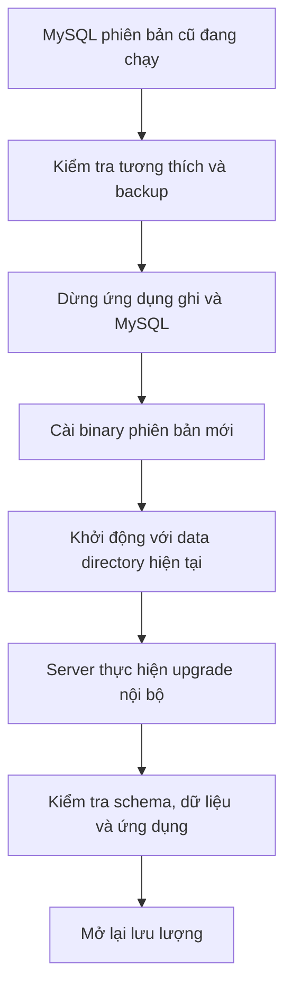
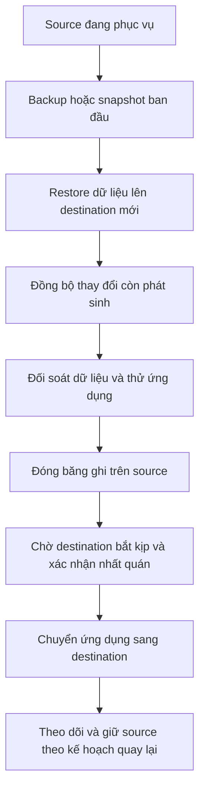

# Nâng cấp tại chỗ so với dựng mới rồi di chuyển dữ liệu

Khi cần đưa MySQL lên phiên bản mới, đội vận hành thường phải chọn giữa hai hướng: **nâng cấp tại chỗ (in-place upgrade)** trên chính data directory hiện tại, hoặc **dựng một máy chủ mới rồi di chuyển dữ liệu (side-by-side migration)**. Cả hai đều có thể đưa ứng dụng sang phiên bản mới, nhưng khác nhau về thời gian dừng dịch vụ, mức cô lập rủi ro, tài nguyên cần dùng, khả năng quay lại và độ phức tạp khi chuyển lưu lượng.

In-place thường đơn giản hơn về topology vì giữ nguyên máy chủ và data directory, nhưng trong thời gian nâng cấp database không phục vụ như bình thường và việc quay lại phiên bản cũ thường cần restore backup. Side-by-side cần thêm hạ tầng và một quy trình đồng bộ/cutover, đổi lại có thể thử nghiệm destination độc lập, chuyển tải có kiểm soát và giữ source làm phương án quay lại trong một khoảng thời gian. Không có lựa chọn tốt nhất cho mọi hệ thống; quyết định phải dựa trên phiên bản nguồn/đích được hỗ trợ, kích thước dữ liệu, RPO/RTO, yêu cầu downtime và khả năng kiểm chứng.

## 1. Hai cách nâng cấp khác nhau ở đâu?

### Nâng cấp tại chỗ

In-place upgrade thay binary MySQL hiện tại bằng binary của phiên bản mới và khởi động server trên data directory hiện có theo đường nâng cấp được hỗ trợ. Server thực hiện các bước chuyển đổi nội bộ cần thiết, chẳng hạn nâng cấp data dictionary hoặc system tables theo phiên bản.

Luồng tổng quát:



Ưu điểm chính là ít bước di chuyển dữ liệu, không cần duy trì đồng bộ hai server trong suốt quá trình. Hạn chế là thời gian dừng thường dài hơn cách chuyển tải bằng replication, việc thử nghiệm phải dùng bản sao data directory, và sau khi data directory đã được nâng cấp thì không thể đơn giản chạy binary cũ để quay lại.

### Dựng mới rồi di chuyển dữ liệu

Side-by-side migration tạo một MySQL instance mới trên hạ tầng riêng, cài phiên bản đích, cấu hình và kiểm thử trước. Dữ liệu được chuyển bằng logical dump/load, công cụ backup/restore có hỗ trợ đường phiên bản đó, hoặc replication từ source sang destination nếu cặp phiên bản và cấu hình được hỗ trợ.

Luồng tổng quát:



Ưu điểm là source và destination tồn tại song song, có thể kiểm tra trước cutover và chuyển ứng dụng qua endpoint/DNS/Router. Hạn chế là cần thêm tài nguyên, phải xử lý đồng bộ dữ liệu, user/grants, cấu hình, secrets, jobs và các thành phần phụ trợ. Nếu dùng replication để giảm downtime, cần kiểm tra tương thích phiên bản và có runbook cutover rõ ràng.

## 2. So sánh theo tiêu chí vận hành

| Tiêu chí | In-place upgrade | Side-by-side migration |
|---|---|---|
| Hạ tầng | Thường dùng lại máy và storage hiện tại. | Cần destination và thường cần dung lượng chạy song song. |
| Thời gian dừng | Thường gồm dừng server, upgrade nội bộ, kiểm tra và mở lại. | Có thể giảm downtime nếu seed dữ liệu trước rồi đồng bộ liên tục; vẫn cần một cửa sổ cutover. |
| Độ phức tạp | Ít thành phần hơn, nhưng phụ thuộc chặt vào đường nâng cấp được hỗ trợ. | Nhiều bước hơn: seed, replication hoặc delta load, đối soát, cutover và dọn source. |
| Cô lập rủi ro | Chủ yếu thử trên bản sao data directory trước khi thay đổi production. | Destination độc lập, dễ chạy kiểm thử và workload canary trước cutover. |
| Quay lại | Thường phải restore backup/snapshot trước upgrade; không nên downgrade trực tiếp data directory. | Có thể chuyển ứng dụng về source trong thời gian source vẫn được giữ đồng bộ và chưa nhận ghi độc lập. |
| Thay đổi phần cứng/hệ điều hành | Có thể kết hợp nhưng làm tăng phạm vi rủi ro. | Thuận tiện để đổi máy, storage, hệ điều hành hoặc topology cùng lúc. |
| Kiểm tra hiệu năng | Chủ yếu sau khi nâng cấp trên cùng máy hoặc trên bản sao. | Có thể chạy benchmark và so sánh destination trước cutover. |
| Phụ thuộc dữ liệu | Cần tương thích trực tiếp giữa data directory cũ và binary mới. | Có thể chuyển logic qua dump/load hoặc replication được hỗ trợ, không nhất thiết dùng lại data directory. |
| Phù hợp khi | Hệ thống đơn giản, downtime chấp nhận được, đường nâng cấp rõ và đã thử restore. | Hệ thống cần downtime thấp, đổi hạ tầng, cần kiểm chứng độc lập hoặc muốn có cửa sổ chuyển đổi linh hoạt. |

Một điểm cần nhớ: side-by-side không tự động có rollback dễ dàng. Sau khi destination bắt đầu nhận ghi, source sẽ cũ dần. Muốn quay lại source phải có chiến lược đồng bộ ngược được hỗ trợ hoặc chấp nhận mất các giao dịch mới; không thể chỉ đổi DNS về source và giả định dữ liệu giống nhau.

## 3. Xác nhận đường nâng cấp được hỗ trợ

Trước khi chọn phương án, ghi lại phiên bản chính xác của source và destination:

```sql
SELECT
    VERSION() AS mysql_version,
    @@version_comment AS distribution,
    @@version_compile_os AS compile_os,
    @@version_compile_machine AS compile_machine;

SHOW VARIABLES LIKE 'datadir';
SHOW VARIABLES LIKE 'server_id';
SHOW VARIABLES LIKE 'server_uuid';
SHOW VARIABLES LIKE 'gtid_mode';
SHOW VARIABLES LIKE 'log_bin';
```

Đối chiếu đường nâng cấp được hỗ trợ trong tài liệu của đúng phiên bản MySQL đích. Không suy luận rằng mọi bản 5.7, 8.0 hoặc 8.4 đều có thể nâng cấp trực tiếp với nhau. Yêu cầu có thể phụ thuộc phiên bản minor tối thiểu, edition, platform, plugin, cấu hình và trạng thái của database. Nếu đường nâng cấp yêu cầu đi qua phiên bản trung gian, lập kế hoạch cho từng chặng và kiểm thử toàn bộ chuỗi.

Không trộn nhiều thay đổi lớn trong một lần nếu không cần thiết. Ví dụ, đồng thời nâng major version, đổi hệ điều hành, chuyển storage, thay charset và thay topology sẽ khiến việc xác định nguyên nhân lỗi khó hơn. Nếu có thể, tách các thay đổi thành từng giai đoạn có điểm kiểm chứng riêng.

## 4. Kiểm tra tương thích trước khi nâng cấp

### Dùng MySQL Shell Upgrade Checker

MySQL Shell có utility `util.checkForServerUpgrade()` để kiểm tra nhiều vấn đề tương thích với phiên bản đích. Ví dụ trong MySQL Shell JavaScript mode, sau khi kết nối đến source:

```javascript
util.checkForServerUpgrade("upgrade_check@source.internal:3306", {
  targetVersion: "8.4.0",
  outputFormat: "TEXT"
});
```

Ví dụ truyền `connectionData` tường minh; MySQL Shell sẽ dùng thông tin kết nối đó để kiểm tra source. Cấp thông tin xác thực qua prompt hoặc cơ chế secret, không đưa password vào chuỗi kết nối trong script. Thay `targetVersion` bằng phiên bản đích thực tế. Đọc toàn bộ báo cáo, xử lý lỗi và cảnh báo theo mức độ ảnh hưởng; không coi việc utility chạy xong là bằng chứng rằng mọi ứng dụng và workload đều tương thích.

### Kiểm kê cấu hình và object

Thu thập ít nhất:

- Phiên bản MySQL, operating system, architecture và cấu hình khởi động.
- Storage engine, schema, table, partition, index, constraint và kích thước dữ liệu.
- Character set/collation ở server, schema, table và column.
- `sql_mode`, timezone, isolation level và các biến cấu hình quan trọng.
- User, host pattern, grants, roles, authentication plugin và tài khoản replication.
- View, procedure, function, trigger, event, plugin, component và UDF.
- Binary log, GTID, replication topology, backup, keyring và TLS certificate.

Một số truy vấn kiểm kê:

```sql
SELECT
    TABLE_SCHEMA,
    ENGINE,
    COUNT(*) AS table_count,
    SUM(DATA_LENGTH + INDEX_LENGTH) AS total_bytes
FROM INFORMATION_SCHEMA.TABLES
WHERE TABLE_TYPE = 'BASE TABLE'
  AND TABLE_SCHEMA NOT IN ('mysql', 'sys', 'performance_schema', 'information_schema')
GROUP BY TABLE_SCHEMA, ENGINE
ORDER BY TABLE_SCHEMA, ENGINE;

SELECT
    TABLE_SCHEMA,
    TABLE_NAME,
    TABLE_COLLATION
FROM INFORMATION_SCHEMA.TABLES
WHERE TABLE_TYPE = 'BASE TABLE'
  AND TABLE_SCHEMA NOT IN ('mysql', 'sys', 'performance_schema', 'information_schema')
ORDER BY TABLE_SCHEMA, TABLE_NAME;

SELECT
    @@GLOBAL.sql_mode AS global_sql_mode,
    @@GLOBAL.time_zone AS global_time_zone,
    @@GLOBAL.gtid_mode AS gtid_mode,
    @@GLOBAL.enforce_gtid_consistency AS enforce_gtid_consistency;

SHOW VARIABLES LIKE 'transaction_isolation';
SHOW VARIABLES LIKE 'tx_isolation';
```

Kiểm tra cả plugin và authentication. Phiên bản mới có thể thay đổi plugin mặc định hoặc loại bỏ plugin cũ; ví dụ `mysql_native_password` đã deprecated trong các bản MySQL 8.0 mới và bị tắt mặc định trong MySQL 8.4. Kiểm tra client/connector có hỗ trợ plugin xác thực destination hay không trước khi cutover.

### Kiểm tra ứng dụng

Đọc changelog và tài liệu phiên bản MySQL đích để tìm cú pháp bị deprecated/removed, từ khóa mới trở thành reserved word, thay đổi default SQL mode, collation, authentication, TLS và optimizer. Chạy integration test với connector/driver đúng phiên bản. Đặc biệt kiểm tra:

- Truy vấn có `GROUP BY`, implicit conversion, zero date, JSON, spatial hoặc generated column.
- Stored routine và event có phụ thuộc SQL mode tại thời điểm tạo.
- Client dùng authentication plugin, TLS cipher hoặc protocol đã cũ.
- Ứng dụng dựa vào thứ tự `ORDER BY` hoặc so sánh chuỗi theo collation mặc định.
- Truy vấn quan trọng có execution plan thay đổi sau nâng cấp.

## 5. Lập kế hoạch backup và khả năng quay lại

Trước cả in-place lẫn side-by-side, phải có backup phù hợp và chứng minh restore được. Backup nên bao gồm dữ liệu, metadata GTID/binlog cần thiết, cấu hình, tài khoản và các phụ thuộc ngoài database như keyring, encryption key, certificate, plugin binary và file cấu hình.

Với InnoDB, một logical backup minh họa:

```bash
mysqldump \
  --single-transaction \
  --routines \
  --events \
  --triggers \
  --hex-blob \
  --databases appdb \
  > appdb-before-upgrade.sql
```

`--single-transaction` tạo consistent snapshot cho InnoDB; tránh DDL làm thay đổi cấu trúc trong lúc dump. Bảng không transactional cần chiến lược riêng. Với database lớn, cân nhắc physical backup tool hoặc MySQL Shell dump utilities theo nhu cầu và khả năng tương thích. Không giả định có thể lấy nguyên data directory của một phiên bản rồi mở bằng binary phiên bản khác như một bản backup portable.

Trước khi nâng cấp production:

1. Tạo backup và lưu ở nơi độc lập với máy đang nâng cấp.
2. Xác minh checksum và khả năng đọc của backup.
3. Restore lên môi trường cô lập bằng phiên bản tương thích.
4. Chạy kiểm tra dữ liệu, object, ứng dụng và thời gian restore.
5. Ghi rõ thời điểm backup, GTID/binlog position, RPO và RTO thực tế.

Đối với in-place, phương án quay lại thường là khôi phục snapshot/data directory trước upgrade hoặc dựng lại server từ backup. Không chạy binary phiên bản cũ trên data directory đã được phiên bản mới chuyển đổi nếu đường downgrade đó không được hỗ trợ rõ ràng. Đối với side-by-side, giữ source chỉ tạo ra khả năng quay lại khi source chưa nhận ghi độc lập và mọi thay đổi mới trên destination có thể được xử lý theo kế hoạch.

## 6. Quy trình in-place upgrade

### Trước cửa sổ bảo trì

1. Xác nhận đường nâng cấp và platform được hỗ trợ.
2. Chạy Upgrade Checker, sửa lỗi/cảnh báo quan trọng và chạy lại.
3. Kiểm thử trên bản sao data directory với binary đích.
4. Xác nhận backup restore thành công, dung lượng disk đủ và có snapshot/backup cấu hình.
5. Thông báo downtime, dừng job ghi và xác định tiêu chí abort.
6. Chuẩn bị binary/package, cấu hình, plugin tương thích và quy trình khởi động lại.

### Thực hiện

Quy trình tổng quát trên Linux (lệnh cụ thể tùy package/service manager):

```bash
sudo systemctl stop mysqld

# Cài gói MySQL phiên bản đích theo quy trình của hệ điều hành.

sudo systemctl start mysqld
```

Không dùng nguyên đoạn này như runbook hoàn chỉnh cho mọi hệ thống. Trước khi cài package, phải xác nhận service đã dừng, backup hoàn tất, package repository trỏ đúng phiên bản và cấu hình/data directory được giữ đúng. Trên Windows hoặc môi trường container, quy trình dừng/cài/khởi động sẽ khác.

Khi server mới khởi động, theo dõi error log để xác nhận upgrade nội bộ hoàn tất. Một số phiên bản thực hiện upgrade system tables/data dictionary tự động khi khởi động. `mysql_upgrade` đã deprecated từ MySQL 8.0.16 và được loại bỏ ở MySQL 8.4; với phiên bản mới, không chạy hướng dẫn cũ yêu cầu utility này nếu công cụ không còn tồn tại. Luôn theo tài liệu của phiên bản đích.

### Sau khi khởi động

- Xác nhận `SELECT VERSION()` trả đúng phiên bản đích.
- Đọc error log để tìm lỗi upgrade, plugin, redo/undo, tablespace và system tables.
- Kiểm tra schema, bảng, view, routine, trigger, event và user/grants.
- Xác nhận binary log, GTID và replication hoạt động theo thiết kế.
- Chạy smoke test, integration test và truy vấn quan trọng.
- Đo CPU, memory, disk I/O, connection count, query latency và execution plan.
- Chỉ mở lại ghi production sau khi các tiêu chí nghiệm thu đạt.

Nếu server không khởi động hoặc upgrade nội bộ thất bại, dừng các lần thử ngẫu nhiên. Thu thập error log, giữ nguyên data directory lỗi để điều tra, và dùng phương án restore đã diễn tập. Không chép system tables từ máy khác hoặc xóa file dữ liệu để ép server khởi động.

## 7. Quy trình side-by-side bằng logical dump/load

Logical migration phù hợp khi cần chuyển sang máy mới hoặc khi muốn tách độc lập destination. Dữ liệu được đọc thành câu lệnh SQL/định dạng dump rồi nạp vào schema mới; vì vậy có thể chuyển giữa một số phiên bản khác nhau nếu DDL, data type, collation và cú pháp tương thích.

### Seed dữ liệu ban đầu

Ví dụ dump một schema InnoDB:

```bash
mysqldump \
  --single-transaction \
  --routines \
  --events \
  --triggers \
  --hex-blob \
  --databases appdb \
  > appdb.sql
```

Import vào destination:

```bash
mysql \
  --default-character-set=utf8mb4 \
  --host=mysql-new.internal \
  --user=restore_user \
  -p < appdb.sql
```

Ví dụ trên giả định dump và destination đã được kiểm tra về charset, collation, timezone, SQL mode và DDL. Với dữ liệu lớn, dump/load có thể kéo dài và tạo tải đáng kể; sử dụng MySQL Shell dump/load utilities hoặc công cụ chuyên dụng nếu phù hợp. Nếu dump có GTID metadata, quyết định `GTID_PURGED` theo trạng thái GTID của destination; không import mù quáng lên server đã có lịch sử giao dịch khác.

### Chuyển tiếp thay đổi phát sinh

Nếu ứng dụng vẫn ghi vào source trong lúc dump, các transaction sau snapshot cần được chuyển tiếp. Có thể dùng binary log/GTID replication nếu source và destination version pair được hỗ trợ, cấu hình replication tương thích và mọi thay đổi schema/feature nằm trong phạm vi được hỗ trợ.

Với GTID, cấu hình replica có thể dùng:

```sql
CHANGE REPLICATION SOURCE TO
    SOURCE_HOST = 'mysql-old.internal',
    SOURCE_PORT = 3306,
    SOURCE_USER = 'replication_user',
    SOURCE_PASSWORD = 'managed-secret',
    SOURCE_AUTO_POSITION = 1;

START REPLICA;
```

Đây là ví dụ cho topology GTID được hỗ trợ; tên lệnh trên các bản cũ có thể là `CHANGE MASTER TO`. Không ghi mật khẩu thật vào script hoặc shell history. Nếu không thể dùng replication, phải có cách delta-load hoặc maintenance window để ngừng ghi trong lúc tạo và nạp bản dump cuối cùng.

Theo dõi:

```sql
SHOW REPLICA STATUS\G

SELECT
    @@GLOBAL.gtid_executed AS executed_gtid_set,
    @@GLOBAL.gtid_purged AS purged_gtid_set;
```

Đối chiếu `Retrieved_Gtid_Set`, `Executed_Gtid_Set`, lỗi I/O/SQL và replication lag. GTID set cho biết tiến độ transaction, nhưng không chứng minh hai database có nội dung giống nhau; vẫn cần checksum/đối soát dữ liệu.

### Cutover

Khi destination đã gần bắt kịp:

1. Thông báo cửa sổ cutover và dừng hoặc khóa mọi luồng ghi vào source, bao gồm worker, cron, ETL và tác vụ quản trị.
2. Chờ source không còn transaction ghi đang mở; ghi lại GTID/binlog watermark cuối cùng.
3. Chờ destination áp dụng đến watermark đó; xác nhận receiver/applier không có lỗi và backlog đã về mức chấp nhận được.
4. Chạy kiểm tra số hàng, checksum hoặc đối soát nghiệp vụ cho các bảng trọng yếu.
5. Chặn ghi vào source để tránh split-brain, rồi chuyển endpoint/DNS/Router/secret của ứng dụng sang destination.
6. Khởi động ứng dụng và xác nhận kết nối, transaction, background jobs và giám sát.
7. Giữ source ở chế độ chỉ đọc hoặc cô lập theo kế hoạch trong thời gian quan sát; ghi rõ điều kiện kết thúc cửa sổ rollback.

Không cho cả source và destination cùng nhận ghi độc lập trong cutover. Điều đó tạo hai lịch sử dữ liệu và làm việc hợp nhất trở nên phức tạp. Nếu cần rollback sau khi destination đã nhận ghi, phải có chiến lược đồng bộ ngược được hỗ trợ hoặc một quy trình đối soát/khôi phục dữ liệu mới phát sinh; không chỉ đổi DNS trở lại.

## 8. Chuyển đổi bằng replication: các điều kiện phải xác minh

Replication có thể giảm downtime vì destination nhận transaction mới trong khi source tiếp tục phục vụ. Tuy nhiên, không phải mọi cặp phiên bản đều hỗ trợ replication theo cả hai chiều hoặc mọi feature đều tương thích.

Trước khi chọn cách này, xác minh:

- Phiên bản source/replica được hỗ trợ theo tài liệu replication của phiên bản đích.
- Source cũ hơn replica trong đường nâng cấp được hỗ trợ; không tự ý đảo chiều sau cutover.
- GTID mode, `server_id`, `server_uuid`, binary log format và retention phù hợp.
- Các binary log cần thiết còn đủ để replica bắt đầu từ snapshot.
- DDL chạy trong lúc replication có thể áp dụng trên phiên bản mới.
- Authentication plugin, TLS và quyền replication hoạt động trên cả hai phía.
- Không có filter hoặc thao tác ghi cục bộ trên replica làm dữ liệu lệch.

Nếu destination đã nâng cấp major version và nhận ghi, không mặc định có thể cấu hình nó làm source cho phiên bản cũ để quay lại. Đường replication ngược có thể không được hỗ trợ do khác biệt định dạng, tính năng hoặc metadata. Hãy coi rollback là một quyết định kiến trúc được xác minh trước cutover, không phải một lệnh có thể chạy tùy ý sau sự cố.

## 9. Đối soát dữ liệu và hiệu năng

Kiểm tra số hàng là cần thiết nhưng chưa đủ. Hai database có thể có cùng row count nhưng khác giá trị, thiếu bảng, thiếu routine hoặc khác collation/index. Nên đối soát theo nhiều lớp:

| Lớp | Nội dung kiểm tra |
|---|---|
| Schema | Table, column, type, nullability, default, index, constraint, partition và table options. |
| Dữ liệu | Row count, min/max khóa, checksum/chunk checksum, tổng tiền và số lượng theo trạng thái nghiệp vụ. |
| Object | View, procedure, function, trigger, event và quyền thực thi. |
| Security | User, host, roles, grants, authentication plugin, TLS và secret. |
| Replication | GTID watermark, lỗi, backlog, binary log retention và trạng thái channel. |
| Application | Smoke test, transaction, read-after-write, batch job và truy vấn quan trọng. |

Ví dụ đối chiếu số hàng theo schema:

```sql
SELECT
    TABLE_SCHEMA,
    TABLE_NAME,
    TABLE_ROWS
FROM INFORMATION_SCHEMA.TABLES
WHERE TABLE_SCHEMA = 'appdb'
  AND TABLE_TYPE = 'BASE TABLE'
ORDER BY TABLE_NAME;
```

Với InnoDB, `TABLE_ROWS` trong `INFORMATION_SCHEMA.TABLES` thường là ước lượng, không phải count chính xác. Dùng `COUNT(*)` hoặc công cụ checksum theo chunk cho các bảng quan trọng, có cân nhắc tải production. Khi so sánh checksum, chuẩn hóa cách biểu diễn NULL, charset, collation, decimal, timestamp và thứ tự hàng để kết quả có ý nghĩa.

Sau nâng cấp, optimizer có thể chọn execution plan khác do phiên bản, statistics, histogram hoặc default thay đổi. Lưu baseline cho truy vấn trọng yếu, chạy `EXPLAIN`/`EXPLAIN ANALYZE` trong môi trường kiểm thử và so sánh latency, rows examined, lock wait, temp table và I/O. `EXPLAIN ANALYZE` thực sự thực thi truy vấn được phân tích; chỉ chạy truy vấn đại diện trên môi trường kiểm thử hoặc khi đã đánh giá tải của nó trên production.

## 10. Những thành phần thường bị quên khi chuyển máy

Database không chỉ gồm bảng dữ liệu. Trước cutover, kiểm tra các thành phần sau:

- **Tài khoản và quyền**: user/host, roles, grants, default roles, authentication plugin và password policy.
- **Stored objects**: views, routines, triggers, events, SQL mode lưu tại thời điểm tạo và `DEFINER`.
- **Plugin/component/UDF**: phiên bản binary tương thích với server mới, thư viện hệ điều hành và cấu hình tải plugin.
- **Encryption**: keyring, master key, tablespace encryption và quy trình phục hồi khóa.
- **TLS**: certificate, private key, CA chain, hostname verification và client trust store.
- **Replication**: server ID/UUID, GTID, channel, filter, account và retention binary log.
- **Backup**: job schedule, destination, retention, encryption, alert và restore test.
- **Observability**: exporter, Performance Schema consumers, log rotation, alert, dashboard và tracing.
- **Vận hành**: cron, ETL, CDC, BI reader, batch job, connection pool, DNS, firewall và secrets.

Nếu dùng InnoDB Cluster/MySQL Router, cần kiểm tra metadata, membership, Router bootstrap/config, endpoint và quy trình failover sau khi chuyển. Nếu dùng công cụ CDC hoặc backup ngoài, xác nhận connector/agent tương thích phiên bản mới.

## 11. Chọn phương án theo tình huống

| Tình huống | Phương án thường phù hợp | Điều kiện quyết định |
|---|---|---|
| Database nhỏ, downtime chấp nhận được, đường nâng cấp được hỗ trợ rõ | In-place | Backup restore được, đã thử trên bản sao và có cửa sổ bảo trì. |
| Database lớn, downtime cần thấp | Side-by-side với replication | Version pair và feature tương thích, có thể bắt kịp GTID/binlog trước cutover. |
| Cần đổi máy, storage hoặc hệ điều hành | Side-by-side | Có đủ tài nguyên chạy song song và kế hoạch chuyển endpoint. |
| Source có nhiều plugin/UDF hoặc cấu hình đặc thù | Đánh giá kỹ cả hai; thường thử side-by-side trước | Plugin có binary tương thích và có cách di chuyển cấu hình/secret. |
| Đường in-place không được hỗ trợ | Side-by-side hoặc nâng cấp qua phiên bản trung gian | Có phương thức chuyển dữ liệu được hỗ trợ và kiểm thử đầy đủ. |
| Không thể giữ source và destination cùng chạy | In-place có backup/snapshot kiểm chứng | RTO cho restore đủ đáp ứng và downtime được chấp nhận. |

Nếu chưa rõ lựa chọn, hãy ước lượng thời gian dump/restore, tốc độ ghi mới, tốc độ replica apply, kích thước backup, thời gian kiểm thử và thời gian rollback. Side-by-side chỉ đạt downtime thấp khi destination có thể bắt kịp tải ghi thực tế; nếu tốc độ apply thấp hơn tốc độ phát sinh transaction, backlog sẽ tăng và cutover không thể hoàn tất đúng hạn.

## 12. Runbook nghiệm thu sau cutover

Sau khi ứng dụng đã kết nối destination, thực hiện kiểm tra theo thứ tự:

1. Xác nhận mọi ứng dụng, worker, ETL và job dùng endpoint mới.
2. Xác nhận source không còn nhận ghi và không có client nào bypass endpoint mới.
3. Kiểm tra phiên bản, error log, uptime, cấu hình, timezone, SQL mode và charset.
4. Kiểm tra quyền và đăng nhập bằng các tài khoản ứng dụng thực tế.
5. Chạy smoke test đọc/ghi, transaction rollback, deadlock handling và read-after-write.
6. Đối chiếu dữ liệu nghiệp vụ trọng yếu và xác nhận không còn replication error/backlog nếu replication tiếp tục được dùng.
7. So sánh latency và execution plan của truy vấn quan trọng với baseline trước nâng cấp.
8. Kiểm tra backup mới trên destination và xác nhận job backup tiếp tục chạy.
9. Theo dõi error rate, connection count, CPU, memory, disk latency, lock wait và replication lag trong thời gian quan sát.
10. Chỉ kết thúc cửa sổ rollback khi các chủ sở hữu dịch vụ xác nhận tiêu chí ổn định đã đạt.

## 13. Checklist quyết định và triển khai

- [ ] Đã xác nhận đường nâng cấp source-to-target được nhà cung cấp hỗ trợ.
- [ ] Đã ghi phiên bản, platform, data size, plugin, charset, SQL mode và topology hiện tại.
- [ ] Đã chạy Upgrade Checker và xử lý các lỗi/cảnh báo quan trọng.
- [ ] Đã thử nâng cấp/di chuyển trên môi trường staging có dữ liệu đại diện.
- [ ] Backup, checksum và restore test đã hoàn tất; RPO/RTO thực tế được ghi lại.
- [ ] Đã quyết định in-place hay side-by-side dựa trên downtime, tài nguyên và rollback.
- [ ] Nếu side-by-side, đã xác minh phương thức seed, replication compatibility và GTID/binlog retention.
- [ ] Đã có runbook cutover, write freeze, watermark cuối và tiêu chí bắt kịp.
- [ ] Đã kiểm kê user/grants, routines, triggers, events, plugins, keyring, TLS và backup jobs.
- [ ] Đã chuẩn bị endpoint, DNS/Router, firewall, secret và connection pool.
- [ ] Đã có kế hoạch rollback/forward recovery phù hợp với các giao dịch phát sinh sau cutover.
- [ ] Đã kiểm thử schema, dữ liệu, ứng dụng, performance và monitoring sau nâng cấp.

In-place upgrade thường giảm số thành phần phải di chuyển nhưng tập trung rủi ro vào một cửa sổ bảo trì và data directory đang dùng. Side-by-side migration cần nhiều công việc chuẩn bị hơn, nhưng tạo được destination độc lập để kiểm thử và chuyển lưu lượng có kiểm soát. Hãy quyết định dựa trên đường phiên bản được hỗ trợ, khả năng restore, RPO/RTO, tải ghi và kế hoạch cutover/rollback; sau đó kiểm chứng dữ liệu và workload thực tế trước khi coi việc nâng cấp là hoàn tất.
