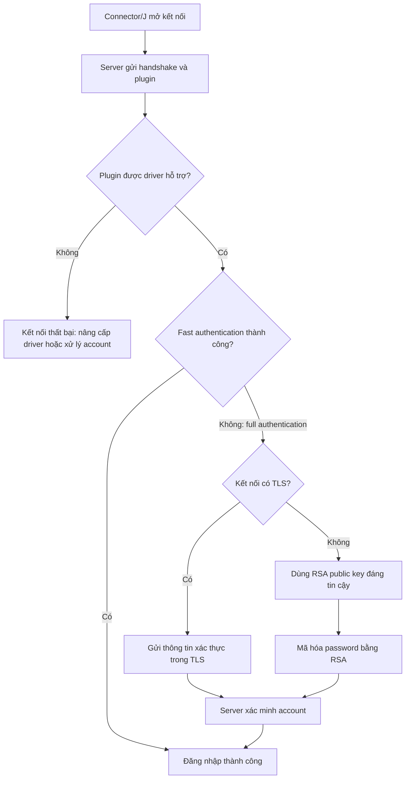

# Authentication plugin, RSA key và quản lý thông tin đăng nhập

Khi ứng dụng Java kết nối MySQL bằng Connector/J, quá trình đăng nhập phụ thuộc vào authentication plugin của tài khoản MySQL, khả năng hỗ trợ của phiên bản JDBC driver, cách truyền mật khẩu và cấu hình bảo mật kết nối. Nếu server dùng plugin mới nhưng ứng dụng còn driver cũ, kết nối có thể thất bại dù username và password chính xác. Nếu dùng xác thực RSA mà không kiểm tra tính xác thực của public key, thông tin đăng nhập có thể gặp rủi ro bị giả mạo trong quá trình trao đổi.

Bài học này giải thích cách Connector/J làm việc với authentication plugin, khi nào cần RSA public key, cách cấu hình TLS và cách lưu trữ, cấp phát, luân chuyển thông tin đăng nhập an toàn. Trong module `DATABASE_MYSQL`, chủ đề kết nối bảo mật với phân quyền, vận hành MySQL và quản lý ứng dụng Java.

Sau bài học, bạn có thể:

- Nhận biết các authentication plugin thường gặp và chọn plugin phù hợp.
- Kiểm tra tương thích giữa MySQL Server và Connector/J.
- Phân biệt TLS với RSA key exchange trong xác thực.
- Cấu hình Connector/J để xác minh chứng thư máy chủ.
- Sử dụng RSA public key được quản lý đáng tin cậy khi không dùng TLS.
- Cấp quyền tối thiểu cho tài khoản ứng dụng.
- Quản lý secret, pool kết nối và quy trình xoay vòng mật khẩu.
- Điều tra các lỗi authentication, RSA và TLS thường gặp.

## 1. Authentication plugin hoạt động ở đâu?

MySQL xác thực tài khoản bằng plugin được gắn với từng account, ví dụ `'shop_app'@'10.20.%'`. Plugin xác định cách server kiểm tra thông tin xác thực và cách client tham gia quá trình đăng nhập. Connector/J cần hỗ trợ plugin mà account đang sử dụng.

Authentication plugin khác với quyền SQL. Đăng nhập thành công chỉ xác nhận danh tính account; account vẫn cần được cấp quyền phù hợp để đọc hoặc thay đổi schema. Tương tự, mã hóa kết nối TLS bảo vệ dữ liệu truyền qua mạng nhưng không tự cấp quyền truy vấn.

Các thành phần liên quan:

| Thành phần | Vai trò |
|---|---|
| MySQL account | Kết hợp username và host pattern để xác định danh tính đăng nhập |
| Authentication plugin | Thực hiện giao thức xác thực cho account |
| MySQL Server | Gửi handshake, xác minh phản hồi và áp dụng chính sách account |
| Connector/J | Thương lượng plugin, gửi thông tin xác thực và thiết lập JDBC connection |
| TLS | Mã hóa kênh truyền và có thể xác minh danh tính máy chủ bằng chứng thư |
| RSA public key | Cho phép mã hóa mật khẩu trong một số luồng xác thực không dùng TLS |
| Secret manager | Lưu và phân phối mật khẩu hoặc thông tin xác thực cho ứng dụng |

Một kết nối an toàn cần cả xác thực đúng, quyền SQL tối thiểu và bảo vệ đường truyền. Không nên xem một trong các lớp này là thay thế cho những lớp còn lại.

## 2. Các authentication plugin thường gặp

### 2.1. `caching_sha2_password`

`caching_sha2_password` là plugin mặc định được MySQL sử dụng cho account mới trong MySQL 8.0. Plugin dùng SHA-256 và cơ chế cache để tối ưu việc xác thực lặp lại. Khi thông tin xác thực đã có trong cache, quá trình đăng nhập có thể hoàn tất bằng fast authentication. Nếu cần full authentication, client và server phải dùng một kênh an toàn hoặc cơ chế RSA phù hợp để bảo vệ việc trao đổi mật khẩu.

Đây là lựa chọn nên ưu tiên cho triển khai MySQL hiện đại. Connector/J cần đủ mới để hỗ trợ plugin này; Connector/J 8.0.9 trở lên hỗ trợ `caching_sha2_password`. Với hệ thống mới, hãy dùng bản Connector/J còn được hỗ trợ và tương thích với Java runtime cũng như phiên bản MySQL đang triển khai.

### 2.2. `sha256_password`

`sha256_password` cũng dựa trên SHA-256 và có thể dùng TLS hoặc RSA để bảo vệ quá trình gửi mật khẩu. Đây là plugin cũ hơn `caching_sha2_password`; chỉ duy trì khi có yêu cầu tương thích cụ thể và đã đánh giá kế hoạch chuyển đổi.

### 2.3. `mysql_native_password`

`mysql_native_password` là plugin cũ, từng được dùng rộng rãi để tương thích với client đời trước. Plugin này đã bị deprecated từ MySQL 8.0.34, bị vô hiệu hóa mặc định trong MySQL 8.4 và bị loại bỏ trong MySQL 9.0. Không nên chọn plugin này cho ứng dụng mới chỉ để tránh nâng cấp JDBC driver.

Nếu ứng dụng không kết nối được vì plugin cũ hoặc driver không hỗ trợ plugin mới, hãy nâng cấp Connector/J và kiểm thử trước. Hạ mức bảo mật của account trên production có thể tạo ra một vấn đề lớn hơn lỗi kết nối ban đầu.

### 2.4. Kiểm tra plugin của account

Quản trị viên có thể xem account và plugin qua metadata quản trị. Không đưa authentication hash hoặc nội dung nhạy cảm từ `SHOW CREATE USER` vào log/ticket. Ví dụ kiểm tra plugin qua `mysql.user` trên các phiên bản hỗ trợ metadata tương ứng:

```sql
SELECT user, host, plugin, account_locked
FROM mysql.user
WHERE user = 'shop_app';
```

Schema hệ thống và quyền đọc bảng `mysql.user` phụ thuộc phiên bản, vì vậy chỉ dùng truy vấn này với tài khoản quản trị phù hợp. Với công việc thông thường, kiểm tra account bằng các lệnh quản trị được hỗ trợ và giới hạn người được phép xem thông tin xác thực.

## 3. Luồng xác thực và khi nào cần RSA

Trong quá trình kết nối, server thông báo plugin cần dùng trong handshake. Connector/J chọn cơ chế tương ứng và có thể chuyển plugin theo yêu cầu server.

Với `caching_sha2_password`, có hai trường hợp khái quát:

1. **Fast authentication:** nếu server có thông tin xác thực đã cache, client có thể hoàn tất xác thực nhanh mà không cần gửi password theo luồng full authentication.
2. **Full authentication:** server cần xác minh password đầy đủ. Nếu kết nối đã được bảo vệ bằng TLS, password được trao đổi bên trong kênh TLS. Nếu không có TLS, client cần dùng RSA để mã hóa password bằng public key của server trước khi gửi.

RSA ở đây bảo vệ bước trao đổi mật khẩu. Nó không mã hóa toàn bộ câu SQL, kết quả truy vấn hoặc dữ liệu ứng dụng trên connection. Muốn bảo vệ toàn bộ lưu lượng, hãy dùng TLS.



Nếu có thể, hãy dùng TLS với xác minh chứng thư máy chủ. RSA public key là phương án bảo vệ mật khẩu cho luồng xác thực không TLS; không nên xem nó là cấu hình thay thế tương đương TLS.

## 4. RSA key của MySQL

### 4.1. Public key và private key

RSA dùng một cặp khóa:

- **Private key:** giữ bí mật trên máy chủ MySQL; dùng trong quá trình giải mã/xử lý dữ liệu xác thực.
- **Public key:** có thể phân phối cho client để client mã hóa password gửi tới server.

Client chỉ cần public key. Không sao chép private key của MySQL sang máy ứng dụng, repository, image container hoặc secret dùng chung.

MySQL có thể tự tạo RSA key pair cho các plugin hỗ trợ khi cấu hình tự động tạo khóa được bật. Quản trị viên cũng có thể chỉ định đường dẫn khóa riêng trong cấu hình server. Ví dụ minh họa:

```ini
[mysqld]
caching_sha2_password_auto_generate_rsa_keys=ON
# Có thể chỉ định đường dẫn riêng nếu quy trình quản trị yêu cầu:
# caching_sha2_password_private_key_path=/etc/mysql/private/caching_sha2_private.pem
# caching_sha2_password_public_key_path=/etc/mysql/public/caching_sha2_public.pem
```

Đường dẫn là ví dụ Linux. Tên biến và hành vi phụ thuộc phiên bản MySQL. Nếu dùng file riêng, giới hạn quyền đọc private key cho tài khoản dịch vụ MySQL và quản trị viên được ủy quyền; public key có thể được phân phối tới client theo quy trình kiểm soát tính toàn vẹn.

### 4.2. Cấu hình Connector/J với public key file

Khi không sử dụng TLS, Connector/J có thể đọc public key từ file được chỉ định bằng thuộc tính `serverRSAPublicKeyFile`. File phải chứa đúng RSA public key mà MySQL server dùng cho plugin tương ứng.

Ví dụ JDBC URL:

```text
jdbc:mysql://mysql.example.internal:3306/shop?sslMode=DISABLED&serverRSAPublicKeyFile=/etc/shop-app/mysql/server-rsa-public.pem
```

Ví dụ trên chỉ minh họa cách chỉ định file trong môi trường lab hoặc mạng đã được bảo vệ theo chính sách. `sslMode=DISABLED` tắt TLS, do đó không nên dùng cho kết nối production qua mạng không tin cậy. Hãy bảo vệ file public key khỏi bị thay thế trái phép; nếu attacker thay public key, client có thể mã hóa mật khẩu cho bên giả mạo.

`serverRSAPublicKeyFile` không phải file chứng thư TLS. Chứng thư TLS xác thực server trong quá trình bắt tay TLS; RSA public key ở đây phục vụ cơ chế xác thực password của MySQL. Hai loại khóa có mục đích và định dạng triển khai khác nhau.

### 4.3. `allowPublicKeyRetrieval`

Connector/J có thuộc tính `allowPublicKeyRetrieval`. Khi bật, client có thể yêu cầu server gửi public key nếu chưa có public key file được cấu hình. Thuộc tính này hữu ích cho lab hoặc một số môi trường kiểm soát chặt, nhưng việc nhận key qua một kết nối không được xác thực có thể tạo rủi ro man-in-the-middle.

Trong production:

- Ưu tiên TLS với `sslMode=VERIFY_IDENTITY`.
- Nếu bắt buộc dùng RSA không TLS, phân phối public key qua kênh tin cậy và chỉ định `serverRSAPublicKeyFile`.
- Giữ `allowPublicKeyRetrieval=false` trừ khi có đánh giá bảo mật và lý do cụ thể.
- Không bật thuộc tính này như cách sửa nhanh lỗi `Public Key Retrieval is not allowed` mà chưa xác định TLS hoặc RSA key đang được sử dụng thế nào.

## 5. Ưu tiên TLS và xác minh danh tính máy chủ

TLS bảo vệ toàn bộ dữ liệu truyền giữa Connector/J và MySQL: password, câu lệnh SQL và kết quả truy vấn. Để tránh kết nối tới một máy chủ giả mạo, client cần xác minh chứng thư và tên máy chủ.

Connector/J hiện đại dùng thuộc tính `sslMode`:

| Giá trị | Hành vi |
|---|---|
| `DISABLED` | Không dùng TLS |
| `PREFERRED` | Ưu tiên TLS nhưng có thể fallback sang kết nối không TLS |
| `REQUIRED` | Yêu cầu TLS nhưng không xác minh đầy đủ danh tính server |
| `VERIFY_CA` | Yêu cầu TLS và xác minh chuỗi chứng thư theo CA tin cậy |
| `VERIFY_IDENTITY` | Yêu cầu TLS, xác minh CA và hostname của server |

Với production, thường nên dùng `VERIFY_IDENTITY` và cấp truststore/CA phù hợp. `REQUIRED` chỉ bảo đảm có mã hóa đường truyền; nó không tương đương việc xác minh server đúng hostname.

Ví dụ JDBC URL:

```text
jdbc:mysql://mysql.example.internal:3306/shop?sslMode=VERIFY_IDENTITY
```

Nếu dùng truststore riêng:

```text
jdbc:mysql://mysql.example.internal:3306/shop?sslMode=VERIFY_IDENTITY&trustCertificateKeyStoreUrl=file:/etc/shop-app/mysql/truststore.p12&trustCertificateKeyStoreType=PKCS12
```

Mật khẩu truststore nên được truyền qua secret manager hoặc cấu hình bảo vệ riêng, không nối trực tiếp vào URL lưu trong repository. Chứng thư server cần có SAN phù hợp với hostname mà ứng dụng sử dụng. Nếu ứng dụng kết nối bằng IP nhưng chứng thư chỉ có DNS name, `VERIFY_IDENTITY` có thể từ chối kết nối; hãy dùng hostname khớp chứng thư hoặc cấp chứng thư có SAN phù hợp.

## 6. Cấu hình Connector/J trong ứng dụng Java

### 6.1. Dùng driver tương thích

Với các phiên bản Connector/J hiện đại, Maven dependency có dạng:

```xml
<dependency>
    <groupId>com.mysql</groupId>
    <artifactId>mysql-connector-j</artifactId>
    <version>${mysql.connector.version}</version>
</dependency>
```

Chọn một phiên bản cụ thể còn được hỗ trợ và tương thích với Java runtime cùng MySQL Server. Không dùng placeholder `${mysql.connector.version}` như version literal trong dự án nếu chưa khai báo property tương ứng.

Driver class hiện đại là `com.mysql.cj.jdbc.Driver`. JDBC driver thường được tự phát hiện qua Service Provider Interface, nhưng có thể khai báo tường minh nếu framework yêu cầu.

### 6.2. Cấu hình TLS và thông tin đăng nhập bằng Properties

Ví dụ dùng `DriverManager`:

```java
String url = "jdbc:mysql://mysql.example.internal:3306/shop?sslMode=VERIFY_IDENTITY";

Properties properties = new Properties();
properties.setProperty("user", secretProvider.get("shop-db-username"));
properties.setProperty("password", secretProvider.get("shop-db-password"));
properties.setProperty("allowPublicKeyRetrieval", "false");

try (Connection connection = DriverManager.getConnection(url, properties)) {
    // Thực hiện truy vấn bằng PreparedStatement.
}
```

`secretProvider` là thành phần minh họa đại diện cho secret manager của ứng dụng; hãy thay bằng API thực tế của nền tảng. Không lưu password trong source code, file cấu hình được commit hoặc JDBC URL xuất hiện trong log. Nếu dùng truststore riêng, truyền đường dẫn và thông tin cần thiết qua cấu hình bảo vệ theo Connector/J.

Khi dùng TLS đã xác minh danh tính, thường không cần cấu hình RSA public key cho password exchange. Giữ `allowPublicKeyRetrieval=false` giúp tránh vô tình chấp nhận public key không được kiểm chứng nếu kết nối chuyển sang luồng không TLS.

### 6.3. Cấu hình qua DataSource hoặc connection pool

Ứng dụng production thường dùng `DataSource` hoặc connection pool như HikariCP. Các thuộc tính authentication và TLS vẫn là thuộc tính của Connector/J, được truyền qua cấu hình datasource.

Ví dụ khái niệm với HikariCP:

```java
HikariConfig config = new HikariConfig();
config.setJdbcUrl(
    "jdbc:mysql://mysql.example.internal:3306/shop?sslMode=VERIFY_IDENTITY"
);
config.setUsername(secretProvider.get("shop-db-username"));
config.setPassword(secretProvider.get("shop-db-password"));
config.addDataSourceProperty("allowPublicKeyRetrieval", "false");
config.setMaximumPoolSize(20);

HikariDataSource dataSource = new HikariDataSource(config);
```

Đây là đoạn cấu hình minh họa; cần import và khởi tạo `HikariConfig`, `HikariDataSource` cùng secret provider phù hợp trong dự án. Số connection phải được chọn theo tổng số instance ứng dụng, giới hạn connection của MySQL và tải thực tế.

Không tạo một pool mới cho mỗi request. Pool cần được quản lý trong vòng đời ứng dụng và có quy trình refresh khi secret hoặc chứng thư thay đổi.

## 7. Tạo account MySQL với quyền tối thiểu

Account ứng dụng nên tách biệt theo service và môi trường. Ví dụ tạo account chỉ truy cập từ dải mạng của ứng dụng:

```sql
CREATE USER 'shop_app'@'10.20.%'
    IDENTIFIED WITH caching_sha2_password BY '<secret-from-secure-provisioning>'
    REQUIRE SSL;

GRANT SELECT, INSERT, UPDATE, DELETE
ON shop.* TO 'shop_app'@'10.20.%';
```

Chuỗi `<secret-from-secure-provisioning>` là chỗ giữ chỗ, không phải password để dùng nguyên văn. Trong môi trường thật, cấp password bằng công cụ provisioning bảo mật, không đưa secret vào file SQL được commit hoặc command history.

Chỉ cấp quyền ứng dụng cần. Một service đọc báo cáo có thể chỉ cần `SELECT`; service ghi đơn hàng có thể cần thêm `INSERT`, `UPDATE` và một số quyền cụ thể khác. Không cấp `ALL PRIVILEGES`, `GRANT OPTION`, `FILE`, quyền quản trị server hoặc quyền thay đổi user cho account chạy ứng dụng nếu không có yêu cầu được đánh giá.

Kiểm tra quyền:

```sql
SHOW GRANTS FOR 'shop_app'@'10.20.%';
```

`REQUIRE SSL` yêu cầu account dùng kết nối mã hóa. Kết hợp với `sslMode=VERIFY_IDENTITY` ở client để xác minh danh tính server. Nếu cần xác thực client certificate ở mức account, có thể xem xét `REQUIRE X509` hoặc các điều kiện issuer/subject theo chính sách PKI của tổ chức.

Host pattern của account cần được giới hạn theo mạng thực tế và quy tắc phân giải tên của MySQL. Tránh dùng `'%'` nếu có thể xác định dải host hoặc danh tính kết nối cụ thể hơn.

## 8. Quản lý password và secret

Thông tin đăng nhập thường được dùng ở nhiều lớp: deployment system, secret manager, ứng dụng, connection pool và quy trình vận hành. Cần quản lý xuyên suốt để tránh rò rỉ hoặc làm gián đoạn kết nối khi thay đổi.

### 8.1. Nơi lưu secret

Ưu tiên secret manager hoặc hệ thống quản lý danh tính của nền tảng. Nếu chưa có, dùng cơ chế secret injection được bảo vệ trong runtime và giới hạn quyền đọc. Tránh:

- Hardcode password trong Java source hoặc test fixture được commit.
- Đặt password trực tiếp trong JDBC URL.
- Ghi password, access token hoặc truststore password vào log.
- Đưa secret vào Docker image, Git, file cấu hình chia sẻ hoặc artifact build.
- Truyền secret qua tham số dòng lệnh có thể xuất hiện trong process list hoặc shell history.
- Dùng chung một account/password cho dev, staging và production.

Biến môi trường có thể hữu ích trong một số nền tảng, nhưng cũng cần kiểm soát quyền đọc, dump process và khả năng hiển thị trong công cụ quản trị. Secret manager có khả năng cấp phát ngắn hạn hoặc tự động xoay vòng thường giúp giảm thời gian tồn tại của credential tĩnh.

### 8.2. Luân chuyển password

Một lần đổi password có thể khiến các connection mới trong pool không đăng nhập được nếu pool vẫn giữ credential cũ. Các connection đã xác thực và đang mở có thể tiếp tục hoạt động cho đến khi bị đóng, nhưng connection mới sẽ dùng thông tin xác thực được pool cấu hình.

Quy trình xoay vòng nên gồm:

1. Tạo hoặc chuẩn bị credential mới theo chính sách.
2. Cập nhật secret trong secret manager.
3. Cập nhật/reload cấu hình datasource và tạo connection mới bằng credential mới.
4. Kiểm tra truy vấn health check và luồng nghiệp vụ quan trọng.
5. Đóng dần connection cũ hoặc recycle pool theo cơ chế của framework.
6. Thu hồi credential cũ sau khi xác nhận không còn client dùng nó.
7. Kiểm tra log authentication và audit để phát hiện client còn sử dụng secret cũ.

MySQL hỗ trợ cơ chế dual password cho một số phiên bản và plugin, cho phép giữ password cũ trong thời gian chuyển đổi. Ví dụ cú pháp trên các phiên bản hỗ trợ:

```sql
ALTER USER 'shop_app'@'10.20.%'
    IDENTIFIED BY '<new-secret>' RETAIN CURRENT PASSWORD;
```

Sau khi ứng dụng đã chuyển sang password mới và pool cũ đã được thay thế, có thể loại bỏ password cũ:

```sql
ALTER USER 'shop_app'@'10.20.%'
    DISCARD OLD PASSWORD;
```

Tính năng dual password và cú pháp phụ thuộc phiên bản MySQL và plugin. Kiểm tra tài liệu của phiên bản đang chạy trước khi dùng. Không xem dual password là lý do để giữ credential cũ vô thời hạn.

### 8.3. Xoay vòng account khi không dùng dual password

Một lựa chọn khác là tạo account mới có quyền tương đương, chuyển ứng dụng sang account mới, sau đó khóa hoặc xóa account cũ sau khi xác nhận. Cách này hữu ích khi cần phân biệt rõ credential theo phiên bản triển khai hoặc muốn luân chuyển không gián đoạn.

Khi tạo account mới, so sánh `SHOW GRANTS` của hai account và xác nhận host pattern, plugin, yêu cầu TLS và role đều phù hợp. Không sao chép quyền rộng hơn chỉ để tránh thiếu quyền trong lúc chuyển đổi.

## 9. Quản lý RSA public key và vòng đời khóa

RSA key cần có quy trình quản lý tương tự các thành phần bảo mật khác:

- Lưu private key trên server với quyền hệ điều hành hạn chế.
- Phân phối public key qua kênh được xác thực, có kiểm tra fingerprint hoặc checksum theo quy trình.
- Ghi nhận server/instance và phiên bản khóa mà client đang tin cậy.
- Có lịch thay khóa và quy trình cập nhật public key trên client.
- Khi thay khóa, phối hợp server và ứng dụng để tránh client dùng public key cũ trong lúc server đã chuyển sang private key mới.
- Thu hồi file public key cũ sau khi xác nhận không còn client phụ thuộc.

Không gửi private key qua email, chat, ticket hoặc kho mã nguồn. Public key không phải bí mật nhưng tính toàn vẹn của nó rất quan trọng: public key giả có thể khiến client mã hóa password cho kẻ tấn công.

Nếu dùng TLS `VERIFY_IDENTITY`, việc bảo vệ xác thực server chủ yếu dựa trên hệ thống CA và chứng thư TLS. RSA key của authentication plugin vẫn có thể được cấu hình cho các luồng xác thực không TLS, nhưng không nên làm phức tạp hệ thống bằng nhiều cơ chế nếu không có yêu cầu rõ ràng.

## 10. Kiểm tra kết nối và xác nhận trạng thái bảo mật

Sau khi cấu hình, hãy kiểm tra bằng đúng Connector/J version và account ứng dụng.

Truy vấn xác định danh tính và server:

```sql
SELECT
    VERSION() AS server_version,
    USER() AS presented_identity,
    CURRENT_USER() AS authenticated_account,
    @@hostname AS server_host;
```

`USER()` cho biết username và host client trình bày; `CURRENT_USER()` cho biết account MySQL thực tế được dùng để kiểm tra quyền. Điều này giúp phát hiện trường hợp host pattern khiến server chọn một account khác dự kiến.

Kiểm tra trạng thái TLS trong session:

```sql
SHOW SESSION STATUS LIKE 'Ssl_cipher';
SHOW SESSION STATUS LIKE 'Ssl_version';
```

Nếu kết nối dùng TLS, `Ssl_cipher` thường có giá trị khác rỗng. Tuy nhiên, kiểm tra cipher không chứng minh client đã xác minh hostname; điều đó phải được cấu hình qua `sslMode=VERIFY_IDENTITY` và truststore/CA phù hợp.

Các bước kiểm tra thực tế:

1. Kết nối bằng đúng driver version của ứng dụng.
2. Dùng hostname khớp SAN trong chứng thư server.
3. Xác nhận TLS được thiết lập và certificate validation thành công.
4. Xác nhận `CURRENT_USER()` là account mong đợi.
5. Thử một truy vấn được phép và một thao tác bị cấm để kiểm tra least privilege.
6. Thử tạo connection mới sau khi xoay password.
7. Kiểm tra log ứng dụng không ghi password, JDBC URL nhạy cảm hoặc secret.

## 11. Lỗi thường gặp và cách xử lý

| Lỗi/triệu chứng | Nguyên nhân có thể | Hướng xử lý |
|---|---|---|
| `Public Key Retrieval is not allowed` | Full authentication cần RSA nhưng client không có key file và không được phép lấy key tự động | Ưu tiên bật TLS; nếu không thể, phân phối public key đáng tin cậy và cấu hình `serverRSAPublicKeyFile` |
| `Authentication plugin 'caching_sha2_password' cannot be loaded` | Connector/J hoặc client library quá cũ/không hỗ trợ plugin | Nâng cấp Connector/J tương thích; kiểm tra driver thực sự được runtime nạp |
| `Access denied for user` | Password sai, host account không khớp, account bị khóa, plugin không tương thích hoặc yêu cầu TLS không đạt | Kiểm tra account/host/plugin, secret, `SHOW GRANTS` và trạng thái TLS |
| `SSLHandshakeException` hoặc lỗi PKIX | Client không tin CA, chứng thư hết hạn hoặc chuỗi chứng thư thiếu | Cập nhật truststore/CA và kiểm tra thời hạn, chuỗi chứng thư |
| Hostname verification failed | Hostname trong JDBC URL không khớp SAN của certificate | Dùng DNS name đúng hoặc cấp chứng thư có SAN phù hợp |
| RSA public key error | File sai định dạng, không khớp server key hoặc key đã xoay | Phân phối lại public key từ nguồn tin cậy và xác minh fingerprint |
| Kết nối mới lỗi sau khi đổi password | Connection pool vẫn dùng credential cũ | Reload secret, recycle pool và kiểm tra connection mới |
| Một số pod kết nối được, pod khác không | Secret/configuration hoặc truststore giữa các instance không đồng nhất | So sánh version secret, file truststore, hostname và driver trên từng pod |
| Quá nhiều connection sau khi triển khai | Nhiều pool được tạo lại đồng thời hoặc pool size vượt ngân sách | Giới hạn tổng connection, triển khai rolling và quản lý pool lifecycle |

Khi điều tra, ghi lại Connector/J version, MySQL version, plugin account, `sslMode`, loại kết nối và mã lỗi. Không ghi password, RSA private key, truststore password hoặc token vào log. Với lỗi authentication, cần phân biệt lỗi handshake, lỗi chứng thư, lỗi plugin, lỗi account và lỗi quyền SQL.

## 12. Quy trình triển khai an toàn

Một quy trình cấu hình authentication và secret có thể thực hiện như sau:

1. **Kiểm kê:** ghi phiên bản MySQL Server, Connector/J, Java runtime, authentication plugin và account ứng dụng.
2. **Chọn plugin:** ưu tiên `caching_sha2_password` trên các phiên bản MySQL hiện đại; lập kế hoạch loại bỏ plugin cũ.
3. **Nâng cấp driver:** chọn Connector/J còn được hỗ trợ và kiểm thử trên Java runtime thực tế.
4. **Chọn kênh bảo vệ:** ưu tiên TLS `VERIFY_IDENTITY`; chỉ dùng RSA key exchange khi có lý do và quy trình phân phối key đáng tin cậy.
5. **Cấu hình server:** quản lý chứng thư TLS, RSA key pair nếu cần, quyền file và account plugin.
6. **Cấu hình client:** thiết lập `sslMode`, truststore, `allowPublicKeyRetrieval` và `serverRSAPublicKeyFile` khi phù hợp.
7. **Cấp quyền:** tạo account riêng theo service/environment, host giới hạn và quyền SQL tối thiểu.
8. **Quản lý secret:** lấy credential từ secret manager, tránh hardcode và log.
9. **Kiểm thử:** xác minh TLS, account thực tế, quyền truy vấn và hành vi connection pool.
10. **Xoay vòng:** thử quy trình đổi secret, tạo connection mới, recycle pool và thu hồi credential cũ.
11. **Giám sát:** theo dõi lỗi authentication, certificate expiry, connection count và các account không còn sử dụng.

## 13. Tình huống thực hành

Một ứng dụng Java dùng Connector/J để kết nối MySQL 8.x. Sau khi nâng cấp server, account ứng dụng dùng `caching_sha2_password`, nhưng một số instance Java cũ không đăng nhập được. Nhóm vận hành cần chuẩn hóa driver, TLS và quy trình xoay password.

Thực hiện trong môi trường lab:

1. Ghi lại MySQL Server version và Connector/J version đang dùng.
2. Kiểm tra plugin của account thử nghiệm và xác nhận driver hỗ trợ `caching_sha2_password`.
3. Cấu hình TLS cho MySQL, cấp certificate có SAN phù hợp hostname và cài CA vào truststore client.
4. Cấu hình JDBC URL với `sslMode=VERIFY_IDENTITY`; giữ `allowPublicKeyRetrieval=false`.
5. Kết nối và kiểm tra `CURRENT_USER()`, `Ssl_cipher` và quyền SQL.
6. Tạo một account thử nghiệm dùng `caching_sha2_password` với quyền tối thiểu.
7. Trong lab riêng, tắt TLS và thử cấu hình RSA bằng public key file; xác nhận không cần bật `allowPublicKeyRetrieval` khi file key đúng.
8. Thay public key thử nghiệm bằng file không khớp và quan sát lỗi; khôi phục file đúng từ nguồn tin cậy.
9. Xoay password bằng dual password nếu phiên bản hỗ trợ hoặc tạo account mới; cập nhật secret và recycle connection pool.
10. Xác nhận credential cũ đã được thu hồi và không còn connection mới dùng credential đó.

**Câu hỏi tự đánh giá:**

- Authentication plugin khác quyền SQL ở điểm nào?
- Vì sao `caching_sha2_password` cần TLS hoặc RSA trong full authentication?
- RSA public key bảo vệ phần nào của kết nối và không bảo vệ phần nào?
- Vì sao `allowPublicKeyRetrieval=true` có thể tạo rủi ro nếu không có TLS?
- `sslMode=REQUIRED` khác `sslMode=VERIFY_IDENTITY` như thế nào?
- Vì sao public key của authentication plugin không phải TLS certificate?
- Tại sao đổi password trên server chưa đủ để hoàn tất xoay vòng trong ứng dụng dùng connection pool?
- Vì sao nên nâng cấp Connector/J thay vì quay lại `mysql_native_password`?

## Kết luận

Kết nối Connector/J an toàn cần plugin tương thích, driver được hỗ trợ, account có quyền tối thiểu và kênh truyền được bảo vệ. Ưu tiên `caching_sha2_password` cùng TLS `VERIFY_IDENTITY`; chỉ dùng RSA public key cho full authentication không TLS khi có quy trình phân phối và xác minh khóa đáng tin cậy. Lưu credential trong secret manager, kiểm soát connection pool và diễn tập xoay vòng password để thay đổi bảo mật không làm gián đoạn ứng dụng.
