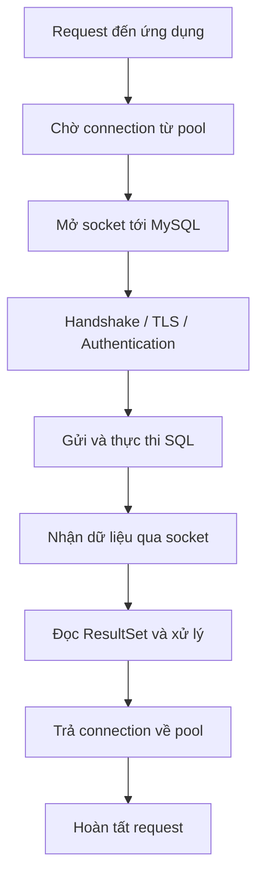
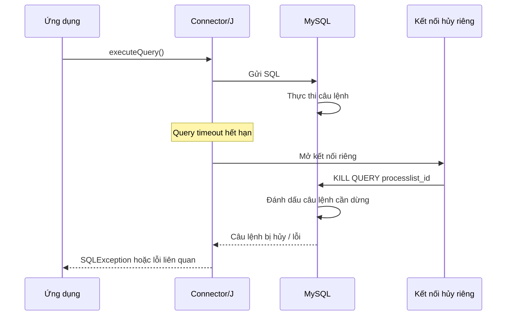

# connectTimeout, socketTimeout, query timeout và hủy câu lệnh

Ứng dụng Java có thể gặp nhiều kiểu chờ khác nhau khi làm việc với MySQL: chờ lấy connection từ pool, chờ mở kết nối TCP, chờ dữ liệu qua socket, chờ server thực thi SQL hoặc chờ tải hết kết quả. Các timeout trong Connector/J kiểm soát những giai đoạn khác nhau. Cấu hình nhầm một timeout cho một giai đoạn khác có thể khiến request bị treo, kết nối bị đóng ngoài dự kiến hoặc câu lệnh trên server vẫn tiếp tục chạy sau khi ứng dụng đã báo lỗi.

Bài học này giải thích `connectTimeout`, `socketTimeout`, `Statement.setQueryTimeout()`, `Statement.cancel()` và cách phối hợp với timeout phía MySQL. Trong module `DATABASE_MYSQL`, chủ đề kết nối các kỹ năng JDBC, connection pool, transaction và xử lý sự cố vận hành.

Sau bài học, bạn có thể:

- Phân biệt thời gian chờ lấy connection, kết nối mạng, đọc/ghi socket và thực thi câu SQL.
- Cấu hình timeout của Connector/J đúng đơn vị và phạm vi.
- Dùng `Statement.setQueryTimeout()` và `Statement.cancel()` để dừng câu lệnh.
- Hiểu cách Connector/J gửi `KILL QUERY` qua một kết nối riêng.
- Phối hợp timeout phía client với giới hạn thực thi SELECT ở MySQL.
- Xử lý transaction và connection pool sau timeout hoặc cancellation.
- Thiết kế deadline cho request, kiểm thử và theo dõi các loại timeout.

## 1. Một request có nhiều giai đoạn chờ

Một request truy vấn database thường đi qua các bước sau:

1. Ứng dụng yêu cầu một connection từ connection pool.
2. Nếu pool chưa có connection rảnh, ứng dụng phải chờ hoặc pool tạo connection mới.
3. Connector/J phân giải địa chỉ và mở socket tới MySQL.
4. Client và server thực hiện handshake, TLS và authentication.
5. Ứng dụng gửi câu SQL và chờ server thực thi.
6. Driver nhận metadata và dữ liệu trả về qua socket.
7. Ứng dụng đọc `ResultSet`, xử lý kết quả và hoàn tất request.



Các timeout tương ứng không thay thế nhau:

| Timeout | Phạm vi | Đơn vị | Điều nó kiểm soát |
|---|---|---|---|
| HikariCP `connectionTimeout` | Chờ connection từ pool | Millisecond | Thời gian tối đa chờ pool cấp connection |
| Connector/J `connectTimeout` | Mở socket tới server | Millisecond | Thời gian chờ thao tác socket connect |
| Connector/J `socketTimeout` | Thao tác mạng trên socket | Millisecond | Thời gian chờ thao tác socket trước khi timeout |
| JDBC `Statement.setQueryTimeout()` | Thực thi câu lệnh | Second | Thời gian driver chờ câu lệnh trước khi thử hủy nó |
| MySQL `max_execution_time` | Thực thi một số SELECT | Millisecond | Giới hạn phía server cho SELECT chỉ đọc |
| Deadline của ứng dụng | Toàn bộ request | Theo framework | Tổng thời gian request được phép tồn tại |

Không nên cấu hình tất cả timeout bằng cùng một con số. Mỗi lớp cần một giới hạn phù hợp với công việc của nó và phải nằm trong deadline tổng thể của request.

## 2. `connectTimeout`: giới hạn thời gian mở kết nối

`connectTimeout` là thuộc tính mạng của Connector/J, tính bằng millisecond. Nó giới hạn thời gian cho thao tác mở socket kết nối tới MySQL. Giá trị mặc định là `0`, nghĩa là không đặt timeout ở thuộc tính này.

Ví dụ JDBC URL:

```text
jdbc:mysql://mysql.example.internal:3306/shop?connectTimeout=3000
```

Ví dụ dùng `Properties`:

```java
Properties properties = new Properties();
properties.setProperty("user", dbUser);
properties.setProperty("password", dbPassword);
properties.setProperty("connectTimeout", "3000");

Connection connection = DriverManager.getConnection(
    "jdbc:mysql://mysql.example.internal:3306/shop",
    properties
);
```

Với cấu hình trên, Connector/J dùng giới hạn 3.000 millisecond cho thao tác socket connect. Nếu không thể thiết lập kết nối trong thời gian đó, ứng dụng nhận lỗi kết nối thay vì chờ vô hạn.

### 2.1. Những việc `connectTimeout` không làm

- Không giới hạn thời gian chờ lấy connection từ HikariCP hoặc pool khác.
- Không giới hạn thời gian SQL chạy sau khi kết nối đã được thiết lập.
- Không giới hạn thời gian ứng dụng xử lý dữ liệu sau khi nhận kết quả.
- Không phải deadline tổng của toàn bộ quá trình failover nhiều host.

Trong cấu hình nhiều host hoặc có cơ chế retry/failover, tổng thời gian kết nối có thể gồm nhiều lần thử. Hãy kiểm tra chính sách failover và deadline bên ngoài thay vì giả định một giá trị `connectTimeout` sẽ luôn giới hạn toàn bộ quá trình ở đúng số millisecond đó.

## 3. `socketTimeout`: giới hạn thời gian thao tác mạng

`socketTimeout` cũng tính bằng millisecond. Thuộc tính này đặt giới hạn cho các thao tác trên network socket. Giá trị mặc định là `0`, nghĩa là không đặt timeout ở thuộc tính này.

Ví dụ:

```text
jdbc:mysql://mysql.example.internal:3306/shop?connectTimeout=3000&socketTimeout=20000
```

Trong ví dụ, thao tác kết nối socket có giới hạn 3 giây; các thao tác mạng trên socket có giới hạn 20 giây. Khi thao tác socket vượt giới hạn, Connector/J có thể báo lỗi giao tiếp và connection thường không còn an toàn để tiếp tục sử dụng.

### 3.1. `socketTimeout` không phải query timeout

Giả sử một truy vấn tổng hợp cần 25 giây để chạy. Nếu `socketTimeout=10000`, client có thể gặp timeout khi chờ dữ liệu từ server sau 10 giây. Điều đó không tương đương với việc server đã nhận lệnh hủy câu SQL theo cơ chế `Statement.cancel()`.

`socketTimeout` bảo vệ thao tác mạng ở phía client. Nó không phải một lệnh SQL yêu cầu MySQL dừng truy vấn tại một ranh giới thực thi cụ thể. Khi kết nối mạng bị timeout, server có thể cần thời gian để nhận biết kết nối đã mất và dọn dẹp công việc. Không dựa vào `socketTimeout` để bảo đảm một truy vấn dài đã được hủy ngay lập tức.

Hãy xem connection gặp lỗi socket như connection không còn đáng tin cậy. Không trả nó về pool để tái sử dụng nếu pool hoặc driver không xác nhận connection còn hợp lệ.

### 3.2. Cẩn thận với truy vấn trả kết quả lớn

Với truy vấn trả về nhiều hàng hoặc dùng streaming/cursor fetch, việc đọc kết quả có thể kéo dài sau khi server đã hoàn tất phần lớn công việc. Nếu khoảng thời gian giữa các lần nhận dữ liệu vượt `socketTimeout`, client có thể gặp lỗi dù câu SQL không còn tốn nhiều CPU trên server.

Chọn `socketTimeout` dựa trên đặc tính mạng, kích thước kết quả và cách ứng dụng đọc dữ liệu. Nếu ứng dụng xử lý từng hàng quá chậm, hãy cải thiện tốc độ tiêu thụ hoặc phân trang kết quả thay vì chỉ tăng timeout vô hạn.

## 4. Timeout lấy connection từ pool

Nếu dùng HikariCP, thuộc tính `connectionTimeout` của HikariCP là thời gian tối đa ứng dụng chờ một connection được cấp từ pool. Nó không phải thuộc tính `connectTimeout` của Connector/J.

Ví dụ:

```java
HikariConfig config = new HikariConfig();
config.setJdbcUrl("jdbc:mysql://mysql.example.internal:3306/shop");
config.setUsername(dbUser);
config.setPassword(dbPassword);

// Thời gian chờ HikariCP cấp connection từ pool.
config.setConnectionTimeout(5000);

// Thuộc tính mạng của Connector/J.
config.addDataSourceProperty("connectTimeout", "3000");
config.addDataSourceProperty("socketTimeout", "20000");

HikariDataSource dataSource = new HikariDataSource(config);
```

Các giá trị chỉ để minh họa. Pool có thể trả connection sẵn có mà không cần mở socket mới. Nếu pool phải tạo connection mới, thời gian tạo socket và handshake cũng tiêu tốn một phần thời gian request. Đặt timeout pool và timeout mạng sao cho chúng phù hợp với deadline tổng thể.

Khi pool hết connection, tăng `connectionTimeout` không tự giải quyết nguyên nhân. Hãy kiểm tra connection bị giữ quá lâu, transaction chưa kết thúc, truy vấn chậm, pool size và giới hạn `max_connections` của MySQL.

## 5. `Statement.setQueryTimeout()`: giới hạn thời gian thực thi câu lệnh

JDBC định nghĩa `Statement.setQueryTimeout(int seconds)`. Giá trị tính bằng giây:

- `0`: không đặt query timeout.
- Số nguyên dương: số giây driver chờ câu lệnh trước khi thử hủy.

Phương thức áp dụng cho `Statement`, `PreparedStatement` và `CallableStatement` vì các interface này kế thừa `Statement`.

Ví dụ:

```java
String sql = "SELECT order_id, total_amount "
           + "FROM orders WHERE customer_id = ?";

try (Connection connection = dataSource.getConnection();
     PreparedStatement statement = connection.prepareStatement(sql)) {

    statement.setLong(1, customerId);
    statement.setQueryTimeout(3); // 3 giây

    try (ResultSet resultSet = statement.executeQuery()) {
        while (resultSet.next()) {
            long orderId = resultSet.getLong("order_id");
            BigDecimal total = resultSet.getBigDecimal("total_amount");
            // Xử lý kết quả.
        }
    }
}
```

Khi thời hạn hết, JDBC yêu cầu driver hủy câu lệnh đang chạy. Nếu driver xác định timeout đã xảy ra, ứng dụng thường nhận `SQLTimeoutException`. Cách hủy cụ thể phụ thuộc driver; Connector/J triển khai việc này bằng cách gửi `KILL QUERY` qua một kết nối riêng.

### 5.1. Timeout tính theo giây

`setQueryTimeout()` dùng số giây nguyên. Nếu cần giới hạn chính xác ở mức millisecond cho một số SELECT, có thể cân nhắc giới hạn phía server bằng `MAX_EXECUTION_TIME` hoặc `max_execution_time` khi phù hợp. Không truyền số millisecond vào `setQueryTimeout()` vì driver sẽ hiểu đó là số giây.

### 5.2. Không phải deadline toàn bộ request

Query timeout không bao gồm toàn bộ thời gian request. Nó không thay thế thời gian chờ lấy connection từ pool, mở kết nối, xử lý nghiệp vụ trước/sau truy vấn hoặc thời gian ứng dụng xử lý kết quả. Với ResultSet lớn, hãy kiểm tra riêng thời gian fetch và xử lý dữ liệu.

## 6. Connector/J hủy câu lệnh như thế nào?

Connector/J hỗ trợ cả `Statement.cancel()` và `Statement.setQueryTimeout()`. Theo cách triển khai của driver, cả hai cần một kết nối riêng để gửi câu lệnh `KILL QUERY` tới MySQL. Với `setQueryTimeout()`, driver tạo thêm luồng xử lý timeout.

Luồng khái quát:



Kết nối hủy riêng phải tới đúng server và có thể xác thực. Nếu MySQL không nhận thêm connection, mạng bị lỗi hoặc thao tác hủy thất bại, query timeout có thể không dừng câu lệnh như mong đợi. Tài liệu Connector/J cũng lưu ý rằng lỗi trong quá trình hủy bằng `setQueryTimeout()` có thể xuất hiện dưới dạng `RuntimeException` trong một số trường hợp thay vì chỉ là lỗi SQL thông thường.

Vì vậy, hãy kiểm thử timeout trên đúng phiên bản Connector/J và topology triển khai. Không giả định mọi timeout đều trả về cùng một exception hoặc luôn kết thúc server-side query ngay tại thời điểm deadline.

## 7. `Statement.cancel()`: hủy theo yêu cầu ứng dụng

`Statement.cancel()` cho phép một luồng khác yêu cầu hủy câu lệnh đang chạy. Cách này hữu ích khi người dùng bấm nút dừng, request bị hủy hoặc một bộ điều phối phát hiện công việc không còn cần thiết.

Ví dụ khái niệm:

```java
Statement statement = connection.createStatement();

Future<?> runningQuery = executor.submit(() -> {
    try {
        statement.executeQuery("SELECT SLEEP(30)");
    } catch (SQLException exception) {
        // Ghi nhận câu lệnh bị hủy hoặc lỗi truy vấn.
    }
});

// Được gọi từ luồng xử lý tín hiệu hủy của ứng dụng.
statement.cancel();
```

Ví dụ trên minh họa cách gọi giữa các luồng. Trong ứng dụng thực tế, cần đồng bộ vòng đời `Statement`: chỉ hủy statement đang chạy, không dùng lại statement cho truy vấn khác trước khi kết quả hủy được xử lý, và đóng statement/connection đúng cách.

`cancel()` là yêu cầu hủy, không phải cam kết rằng server đã dừng ngay lập tức. Có thể xảy ra race condition: truy vấn đã hoàn tất trước khi lệnh `KILL QUERY` tới server. Ứng dụng cần xử lý cả trường hợp query hoàn tất lẫn trường hợp bị hủy.

## 8. `KILL QUERY` khác `KILL CONNECTION`

MySQL cung cấp hai thao tác quản trị:

```sql
KILL QUERY processlist_id;
KILL CONNECTION processlist_id;
```

- `KILL QUERY` dừng câu lệnh đang chạy nhưng giữ connection.
- `KILL CONNECTION` kết thúc connection và câu lệnh đang chạy trên connection đó.

Connector/J dùng `KILL QUERY` cho cơ chế `Statement.cancel()` và `setQueryTimeout()` thông thường. Thuộc tính `queryTimeoutKillsConnection` cho phép thay đổi hành vi khi query timeout hết hạn: nếu đặt `true`, driver hủy connection thay vì cố hủy riêng câu lệnh. Giá trị mặc định là `false`.

Ví dụ cấu hình:

```text
jdbc:mysql://mysql.example.internal:3306/shop?queryTimeoutKillsConnection=false
```

Khi `queryTimeoutKillsConnection=true`, connection bị abort phải được loại khỏi pool. Không tiếp tục dùng connection đó cho truy vấn kế tiếp. Cách này có thể hữu ích trong một số tình huống cần chấm dứt toàn bộ session, nhưng làm mất connection và trạng thái transaction.

### 8.1. Quyền thực hiện KILL

MySQL cho phép một account hủy thread/câu lệnh của chính account đó. Để hủy thread thuộc account khác, cần quyền `CONNECTION_ADMIN` hoặc quyền `SUPER` đã deprecated trong các phiên bản mới. Quyền `PROCESS` liên quan đến khả năng xem thread của các account khác.

Connector/J thường dùng cùng thông tin xác thực của ứng dụng cho kết nối hủy riêng. Không cấp `CONNECTION_ADMIN` cho mọi account ứng dụng chỉ để hỗ trợ hủy câu lệnh của chính nó.

## 9. Timeout phía server cho SELECT

MySQL có cơ chế `max_execution_time` và optimizer hint `MAX_EXECUTION_TIME(N)`. Đây là giới hạn phía server, tính bằng millisecond, áp dụng cho SELECT chỉ đọc trong phạm vi được hỗ trợ.

Ví dụ giới hạn riêng một truy vấn ở 1.500 millisecond:

```sql
SELECT /*+ MAX_EXECUTION_TIME(1500) */
       order_id, total_amount
FROM orders
WHERE customer_id = 42;
```

Có thể cấu hình giá trị session:

```sql
SET SESSION max_execution_time = 1500;
```

`max_execution_time` mặc định bằng `0`, nghĩa là không bật giới hạn. Cơ chế này chỉ áp dụng cho SELECT chỉ đọc; SELECT gọi stored function có tác dụng phụ ghi dữ liệu không được xem là read-only. Giới hạn này cũng bị bỏ qua với SELECT trong stored program.

Giới hạn phía server hữu ích để bảo vệ database khỏi một số truy vấn đọc vượt thời gian. Nó không thay thế timeout phía client vì không bao phủ kết nối mạng, thời gian lấy connection từ pool hoặc xử lý kết quả ở ứng dụng.

## 10. Đừng nhầm query timeout với lock wait timeout

MySQL có các timeout khác phục vụ một loại chờ cụ thể:

| Cơ chế | Phạm vi |
|---|---|
| `innodb_lock_wait_timeout` | Thời gian chờ khóa hàng InnoDB |
| `lock_wait_timeout` | Thời gian chờ metadata lock |
| `wait_timeout` | Thời gian connection không tương tác ở trạng thái idle |
| `net_read_timeout` / `net_write_timeout` | Một số thao tác đọc/ghi mạng ở phía server |
| `max_execution_time` | Thực thi SELECT chỉ đọc |
| `Statement.setQueryTimeout()` | Timeout câu lệnh ở JDBC/driver |
| `socketTimeout` | Thao tác mạng trên socket ở client |

Ví dụ, một UPDATE có thể chờ khóa hàng 40 giây. `innodb_lock_wait_timeout` có thể làm thao tác thất bại khi thời gian chờ khóa vượt giới hạn, dù query timeout của JDBC được đặt dài hơn. Ngược lại, một truy vấn không bị khóa nhưng chạy CPU lâu có thể vượt `setQueryTimeout()` mà không liên quan đến lock wait timeout.

Hãy xác định đúng nguyên nhân chờ trước khi thay đổi timeout. Tăng `innodb_lock_wait_timeout` không sửa được truy vấn thiếu index; tăng `socketTimeout` không sửa được lock contention; tăng `connectTimeout` không giải quyết được pool hết connection.

## 11. Thiết kế các timeout theo deadline tổng thể

Giả sử API có deadline 4 giây. Có thể phân bổ ngân sách minh họa như sau:

| Giai đoạn | Ngân sách ví dụ |
|---|---:|
| Chờ pool cấp connection | 500 ms |
| Tạo kết nối mới nếu cần | 800 ms |
| Thực thi SQL | 2 giây |
| Fetch và xử lý kết quả | 500 ms |
| Phần dự phòng | 200 ms |

Các giá trị phải được điều chỉnh theo p95/p99 thực tế, tải và yêu cầu sản phẩm. Ngân sách cần có khoảng dự phòng để ứng dụng có thể đóng tài nguyên và trả phản hồi trước khi deadline bên ngoài hết hạn.

Một số nguyên tắc:

- Timeout ở lớp trong nên nhỏ hơn deadline của lớp ngoài để ứng dụng còn thời gian xử lý lỗi.
- `connectTimeout` không nên bị hiểu là thời gian chờ pool.
- `socketTimeout` phải đủ lớn cho các khoảng chờ mạng hợp lệ và cách fetch dữ liệu.
- `setQueryTimeout()` nên phản ánh ngân sách thực thi SQL, không phải toàn bộ request.
- Nếu dùng `max_execution_time`, đặt nó theo chính sách phía server và chỉ cho loại SELECT phù hợp.
- Retry phải có giới hạn, backoff và chỉ thực hiện khi biết thao tác có thể lặp an toàn.

Không đặt timeout quá thấp chỉ để làm dashboard hiển thị lỗi nhanh. Timeout quá thấp có thể tạo vòng lặp retry, làm tăng tải source và khiến hệ thống kém ổn định hơn.

## 12. Transaction và connection pool sau khi câu lệnh bị hủy

Hủy một câu lệnh không đồng nghĩa toàn bộ transaction đã được rollback. `KILL QUERY` dừng statement và giữ connection; transaction đang mở có thể vẫn cần được ứng dụng xử lý. Sau timeout/cancellation trong transaction, hãy đánh giá trạng thái và thường cần gọi `Connection.rollback()` trước khi trả connection về pool.

Ví dụ:

```java
try (Connection connection = dataSource.getConnection()) {
    connection.setAutoCommit(false);

    try (PreparedStatement statement = connection.prepareStatement(
            "UPDATE inventory SET quantity = quantity - ? WHERE product_id = ?")) {

        statement.setInt(1, quantity);
        statement.setLong(2, productId);
        statement.setQueryTimeout(3);
        statement.executeUpdate();

        connection.commit();
    } catch (SQLException exception) {
        try {
            connection.rollback();
        } catch (SQLException rollbackException) {
            exception.addSuppressed(rollbackException);
        }
        throw exception;
    }
}
```

Đây là mẫu minh họa cho transaction. Nếu connection đã mất do socket timeout hoặc `queryTimeoutKillsConnection=true`, rollback trên connection đó có thể thất bại. Đóng connection và để pool loại bỏ connection hỏng theo cấu hình của pool.

### 12.1. Kết quả ghi có thể chưa rõ ràng

Nếu timeout hoặc mất kết nối xảy ra trong lúc gửi DML hoặc chờ phản hồi `COMMIT`, ứng dụng có thể không biết server đã commit hay chưa. Server có thể đã hoàn tất giao dịch nhưng phản hồi không tới được client.

Không tự động retry một thao tác ghi không idempotent chỉ vì client nhận timeout. Ví dụ, gửi lại lệnh trừ tồn kho hoặc tạo thanh toán có thể thực hiện nghiệp vụ hai lần nếu lần đầu đã commit. Hãy dùng request ID/idempotency key duy nhất, unique constraint hoặc bước đối soát trạng thái trước khi retry.

### 12.2. Không trả connection có trạng thái không rõ về pool

Trước khi connection được tái sử dụng, cần bảo đảm:

- Không còn statement đang chạy.
- ResultSet và Statement đã được đóng.
- Transaction đã commit hoặc rollback.
- Connection không gặp lỗi socket hoặc bị abort.
- Session state được reset theo cơ chế của pool.

Nếu không thể xác nhận trạng thái, đóng connection để pool loại bỏ thay vì tái sử dụng một session có transaction hoặc trạng thái không rõ ràng.

## 13. `enableQueryTimeouts` và `queryTimeoutKillsConnection`

Connector/J có hai thuộc tính cần hiểu khi dùng JDBC query timeout:

| Thuộc tính | Mặc định | Ý nghĩa |
|---|---|---|
| `enableQueryTimeouts` | `true` | Bật cơ chế lập lịch cho timeout được đặt bằng `Statement.setQueryTimeout()` |
| `queryTimeoutKillsConnection` | `false` | Khi timeout hết hạn, chọn abort connection thay vì cố abort riêng query |

`enableQueryTimeouts` sử dụng một `java.util.Timer` dùng chung để lập lịch. Tài liệu Connector/J lưu ý rằng TimerTask có thể tiếp tục chiếm bộ nhớ cho tới thời điểm timeout ban đầu dù truy vấn đã hoàn tất trước đó. Với hệ thống tải rất cao, hãy đo mức sử dụng và đánh giá thuộc tính này trước khi thay đổi; tắt nó có nghĩa là không nên kỳ vọng `setQueryTimeout()` tiếp tục hoạt động như trước.

`queryTimeoutKillsConnection=true` thay đổi cách xử lý timeout và làm connection bị abort. Nếu bật, cần chắc chắn pool loại bỏ connection đã bị abort. Đừng bật chỉ để làm mất lỗi timeout khỏi log; hãy xác định mục tiêu là hủy statement hay hủy cả session.

Các thuộc tính này có thể thay đổi theo phiên bản Connector/J. Kiểm tra tài liệu đúng phiên bản driver đang dùng.

## 14. Cấu hình kết hợp trong ứng dụng Java

Ví dụ với `DriverManager`:

```java
String url = "jdbc:mysql://mysql.example.internal:3306/shop"
           + "?connectTimeout=3000"
           + "&socketTimeout=20000"
           + "&enableQueryTimeouts=true"
           + "&queryTimeoutKillsConnection=false";

Properties properties = new Properties();
properties.setProperty("user", secretProvider.get("shop-db-user"));
properties.setProperty("password", secretProvider.get("shop-db-password"));

try (Connection connection = DriverManager.getConnection(url, properties);
     PreparedStatement statement = connection.prepareStatement(
         "SELECT order_id, total_amount FROM orders WHERE customer_id = ?")) {

    statement.setLong(1, customerId);
    statement.setQueryTimeout(2);

    try (ResultSet resultSet = statement.executeQuery()) {
        while (resultSet.next()) {
            // Xử lý hàng kết quả.
        }
    }
}
```

`secretProvider` là thành phần minh họa. Lấy credential từ secret manager hoặc cơ chế bảo vệ của nền tảng; không hardcode mật khẩu hoặc ghi JDBC URL có secret vào log.

Ví dụ với HikariCP:

```java
HikariConfig config = new HikariConfig();
config.setJdbcUrl("jdbc:mysql://mysql.example.internal:3306/shop");
config.setUsername(secretProvider.get("shop-db-user"));
config.setPassword(secretProvider.get("shop-db-password"));

config.setConnectionTimeout(5000); // Chờ connection từ pool, ms
config.addDataSourceProperty("connectTimeout", "3000"); // Socket connect, ms
config.addDataSourceProperty("socketTimeout", "20000"); // Socket operations, ms
config.addDataSourceProperty("enableQueryTimeouts", "true");

HikariDataSource dataSource = new HikariDataSource(config);
```

`Statement.setQueryTimeout()` vẫn được đặt trên từng statement hoặc qua lớp truy cập dữ liệu của ứng dụng. Không có một thuộc tính JDBC URL chung tên `queryTimeout` thay thế trực tiếp cho phương thức JDBC này.

## 15. Theo dõi và điều tra timeout

Khi có timeout, cần xác định nó xảy ra ở lớp nào. Ghi lại các thông tin không nhạy cảm:

- Request/trace ID và thời điểm bắt đầu.
- Thời gian chờ pool cấp connection.
- Thời gian mở kết nối mới nếu có.
- Host MySQL và trạng thái pool.
- Query fingerprint hoặc tên thao tác, không nhất thiết log toàn bộ dữ liệu tham số.
- Timeout nào đã kích hoạt: pool, connect, socket, query hay deadline ứng dụng.
- SQLState, vendor error code, exception class và cause.
- Transaction có đang mở hay không và kết quả commit/rollback.
- Query có còn chạy trên server sau khi client báo lỗi hay không.

Kiểm tra truy vấn đang chạy bằng:

```sql
SHOW FULL PROCESSLIST;
```

Hoặc xem các thread qua Performance Schema nếu tài khoản có quyền:

```sql
SELECT
    PROCESSLIST_ID,
    PROCESSLIST_USER,
    PROCESSLIST_HOST,
    PROCESSLIST_DB,
    PROCESSLIST_COMMAND,
    PROCESSLIST_TIME,
    PROCESSLIST_STATE,
    PROCESSLIST_INFO
FROM performance_schema.threads
WHERE TYPE = 'FOREGROUND'
  AND PROCESSLIST_ID IS NOT NULL;
```

Nếu cần hủy thủ công, xác minh đúng `processlist_id` trước khi dùng `KILL QUERY`. Không nhầm `KILL QUERY` với `KILL CONNECTION`, và không hủy thread chỉ dựa trên thời gian chạy mà chưa xác nhận chủ sở hữu và tác động.

### 15.1. Các chỉ số nên theo dõi

- Số lần timeout theo loại và theo endpoint.
- p50, p95, p99 thời gian lấy connection, kết nối, thực thi và fetch.
- Tỷ lệ `Statement.cancel()` thành công/thất bại.
- Số connection bị abort và số connection pool phải tạo lại.
- Active/idle/pending connection, pool acquisition timeout và connection leak.
- Số truy vấn chạy lâu, lock wait và transaction mở lâu.
- Tỷ lệ retry, lỗi trùng idempotency key và kết quả commit chưa xác định.

Nếu chỉ theo dõi tổng số `SQLTimeoutException`, có thể bỏ sót lỗi socket hoặc pool timeout. Hãy phân loại lỗi theo giai đoạn để tìm đúng nguyên nhân.

## 16. Lỗi thường gặp và cách xử lý

| Triệu chứng | Nguyên nhân có thể | Hướng xử lý |
|---|---|---|
| Kết nối chờ lâu khi MySQL không truy cập được | `connectTimeout=0` hoặc quá lớn | Đặt giới hạn socket connect và kiểm tra DNS/network riêng |
| Pool báo không lấy được connection | Pool cạn, connection bị giữ lâu hoặc pool acquisition timeout quá ngắn | Kiểm tra active/pending connection, leak và truy vấn chậm |
| `CommunicationsException` hoặc `SocketTimeoutException` | Thao tác socket vượt `socketTimeout`, mạng gián đoạn hoặc server không gửi dữ liệu kịp | Kiểm tra mạng, server load, fetch size và giá trị timeout |
| Query timeout nhưng server vẫn có hoạt động | Hủy query thất bại, lệnh KILL chưa tới server hoặc query đã hoàn tất trong lúc race | Kiểm tra processlist, log driver và khả năng mở kết nối hủy riêng |
| Timeout khiến connection không dùng lại được | `queryTimeoutKillsConnection=true` hoặc lỗi socket | Loại connection khỏi pool và tạo connection mới |
| Hủy query nhưng transaction vẫn mở | `KILL QUERY` chỉ dừng statement, không nhất thiết đóng session/transaction | Rollback transaction trước khi trả connection về pool |
| Ứng dụng retry tạo dữ liệu trùng | Kết quả commit chưa rõ nhưng thao tác ghi được gửi lại | Dùng idempotency key và kiểm tra trạng thái trước khi retry |
| Query timeout không kích hoạt | `setQueryTimeout(0)`, `enableQueryTimeouts=false` hoặc framework không truyền timeout | Kiểm tra cấu hình driver và statement thực tế |
| Timeout khác nhau giữa môi trường | Connector/J version, pool, proxy hoặc network khác nhau | So sánh phiên bản, URL properties, pool config và topology |

Không tăng tất cả timeout cùng lúc để làm lỗi biến mất. Thay đổi một lớp, đo lại và xác định liệu thời gian chờ đang xảy ra ở đúng lớp đó hay không.

## 17. Kiểm thử timeout và cancellation

Thực hiện trong môi trường lab có thể kiểm soát:

1. **Kiểm thử connect timeout:** trỏ ứng dụng tới host/port không có MySQL lắng nghe và xác nhận lỗi xảy ra gần giới hạn `connectTimeout` đã đặt.
2. **Kiểm thử socket timeout:** tạo một tình huống mạng hoặc truy vấn có khoảng chờ dữ liệu dài hơn `socketTimeout`; xác nhận client nhận lỗi mạng và connection được loại bỏ nếu không còn hợp lệ.
3. **Kiểm thử query timeout:** chạy `SELECT SLEEP(10)` với `setQueryTimeout(2)` và quan sát exception cùng trạng thái server.
4. **Kiểm thử cancel thủ công:** chạy một câu lệnh dài trong worker thread, gọi `Statement.cancel()` từ luồng điều khiển khác và kiểm tra query dừng.
5. **Kiểm thử quyền:** xác nhận account có thể hủy câu lệnh của chính nó; không cấp quyền quản trị rộng chỉ để hủy thread của account khác.
6. **Kiểm thử transaction:** chạy DML trong transaction, kích hoạt timeout, xác minh rollback và trạng thái connection trước khi trả về pool.
7. **Kiểm thử queryTimeoutKillsConnection:** thử cả `false` và `true` trong lab, xác nhận pool xử lý connection tương ứng.
8. **Kiểm thử tải:** chạy nhiều query timeout đồng thời, theo dõi thread/timer, connection hủy riêng và tài nguyên server.
9. **Kiểm thử deadline:** mô phỏng request bị hủy khi đang chờ pool, mở socket, chạy SQL và đọc ResultSet.
10. **Kiểm thử retry:** mô phỏng timeout ngay quanh thời điểm commit và xác nhận idempotency key ngăn thao tác ghi bị thực hiện hai lần.

Sau mỗi bài thử, xác nhận không còn query thử nghiệm chạy nền, transaction đã được xử lý và connection pool không giữ connection lỗi.

**Câu hỏi tự đánh giá:**

- `connectTimeout` và HikariCP `connectionTimeout` khác nhau ở giai đoạn nào?
- Vì sao `socketTimeout` không thay thế `Statement.setQueryTimeout()`?
- `setQueryTimeout()` dùng đơn vị gì và giá trị `0` có nghĩa gì?
- Vì sao Connector/J cần một kết nối riêng để gửi `KILL QUERY`?
- `KILL QUERY` khác `KILL CONNECTION` như thế nào?
- Khi nào `queryTimeoutKillsConnection=true` làm connection phải bị loại khỏi pool?
- `max_execution_time` áp dụng cho loại SELECT nào và không áp dụng cho trường hợp nào?
- Vì sao timeout trong lúc `COMMIT` có thể khiến kết quả ghi không rõ ràng?
- Sau khi statement bị hủy trong transaction, ứng dụng cần làm gì trước khi tái sử dụng connection?
- Làm thế nào phân biệt lỗi pool timeout, connect timeout, socket timeout và query timeout trong log?

## Kết luận

`connectTimeout`, `socketTimeout`, JDBC query timeout và timeout của connection pool giải quyết các giai đoạn chờ khác nhau. Connector/J dùng `KILL QUERY` qua kết nối riêng để hỗ trợ `Statement.cancel()` và `setQueryTimeout()`, trong khi `socketTimeout` chỉ giới hạn thao tác mạng. Hãy phối hợp các giới hạn với deadline tổng thể, rollback transaction sau khi hủy, loại connection hỏng khỏi pool và dùng idempotency để xử lý kết quả ghi chưa rõ ràng.

## Tài liệu tham khảo

- [MySQL Connector/J — Networking properties](https://dev.mysql.com/doc/connector-j/en/connector-j-connp-props-networking.html)
- [MySQL Connector/J — Statement properties](https://dev.mysql.com/doc/connector-j/en/connector-j-connp-props-statements.html)
- [MySQL Connector/J — JDBC API implementation notes](https://dev.mysql.com/doc/connector-j/en/connector-j-reference-implementation-notes.html)
- [MySQL 8.4 — KILL statement](https://dev.mysql.com/doc/refman/8.4/en/kill.html)
- [MySQL 8.4 — Statement execution time optimizer hint](https://dev.mysql.com/doc/refman/8.4/en/optimizer-hints.html)
