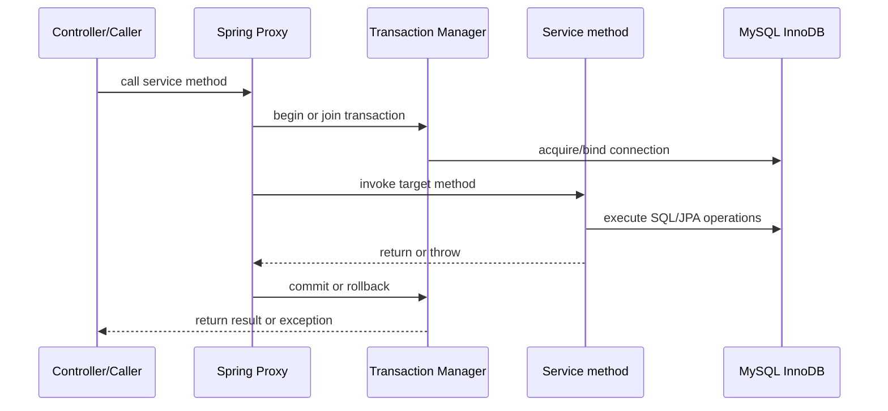

# @Transactional, propagation và ranh giới giao dịch qua proxy

## Mục tiêu

Trong ứng dụng Spring Boot dùng MySQL, `@Transactional` xác định ranh giới giao dịch mà Spring quản lý thông qua transaction manager. Annotation này không tự biến mọi lời gọi Java thành transaction: trong chế độ proxy mặc định, lời gọi phải đi qua Spring proxy thì advice giao dịch mới được áp dụng. Đồng thời, propagation quyết định một phương thức tham gia transaction đang tồn tại, tạo transaction mới hay chạy ngoài transaction.

Hiểu đúng proxy và propagation giúp tránh những lỗi khó nhận ra như self-invocation làm annotation không có hiệu lực, transaction bị rollback dù exception đã được bắt, `REQUIRES_NEW` làm cạn connection pool hoặc code JDBC không tham gia cùng transaction JPA.

Bài học thuộc module **DATABASE_MYSQL**, tập trung vào thiết kế bảng, kiểu dữ liệu, khóa, SQL, index, transaction, kiểm soát đồng thời, tối ưu truy vấn và vận hành cơ sở dữ liệu quan hệ. Sau bài học, bạn có thể:

- Giải thích cách Spring áp dụng `@Transactional` qua proxy và transaction manager.
- Phân biệt bảy propagation mode và chọn đúng cho từng nghiệp vụ.
- Hiểu rollback mặc định, `rollbackFor`, `noRollbackFor` và trạng thái rollback-only.
- Nhận diện self-invocation, giới hạn thread và khác biệt giữa transaction lồng nhau với transaction độc lập.
- Thiết kế transaction boundary phù hợp với InnoDB, JPA, JDBC và connection pool.

## 1. Transaction trong Spring và MySQL

Transaction gom một nhóm thao tác database thành một đơn vị commit hoặc rollback. Với MySQL, cần dùng storage engine có hỗ trợ transaction, thông thường là InnoDB. Một transaction InnoDB có thể bảo đảm các thay đổi thuộc transaction được commit cùng nhau hoặc rollback khi thất bại, đồng thời tuân theo isolation level và cơ chế khóa.

Spring cung cấp abstraction `PlatformTransactionManager` để quản lý transaction theo cách thống nhất. Với ứng dụng Spring Data JPA, Spring Boot thường cấu hình `JpaTransactionManager` khi có một `EntityManagerFactory`. Với JDBC thuần, có thể dùng `DataSourceTransactionManager` hoặc `JdbcTransactionManager` tùy phiên bản Spring.

`@Transactional` là metadata cho Spring biết phương thức hoặc lớp cần chạy trong transaction. Proxy nhận lời gọi, mở hoặc tham gia transaction qua transaction manager, gọi phương thức đích rồi commit hoặc rollback theo kết quả và rollback rules.



Transaction boundary nên đặt ở tầng service, bao quanh một đơn vị nghiệp vụ hoàn chỉnh. Repository thường chỉ thực hiện thao tác dữ liệu; transaction ở service giúp nhiều repository cùng tham gia một transaction.

## 2. `@Transactional` được áp dụng qua proxy như thế nào?

Trong chế độ proxy mặc định, Spring tạo proxy cho bean có phương thức được đánh dấu `@Transactional`. Khi một bean khác gọi phương thức qua proxy, Spring kiểm tra metadata, chọn transaction manager, áp dụng propagation và bắt đầu transaction nếu cần.

Ví dụ:

```java
@Service
public class OrderService {
    private final OrderRepository orders;
    private final InventoryRepository inventory;

    public OrderService(OrderRepository orders, InventoryRepository inventory) {
        this.orders = orders;
        this.inventory = inventory;
    }

    @Transactional
    public void placeOrder(long productId, int quantity) {
        inventory.decreaseAvailable(productId, quantity);
        orders.save(new Order(productId, quantity));
    }
}
```

Khi controller hoặc bean khác gọi `orderService.placeOrder(...)` qua Spring bean reference, proxy mở transaction trước khi chạy phương thức. Các thao tác JPA trên cùng transaction manager sẽ tham gia transaction đó. Nếu phương thức kết thúc bình thường, transaction được commit; nếu exception thỏa rollback rules thoát khỏi phương thức, transaction được rollback.

### Self-invocation không đi qua proxy

Một lỗi phổ biến là gọi phương thức `@Transactional` khác trong cùng một object bằng `this`:

```java
@Service
public class ImportService {
    public void importFile(List<Row> rows) {
        this.saveBatch(rows);
    }

    @Transactional
    public void saveBatch(List<Row> rows) {
        // Ghi dữ liệu
    }
}
```

Lời gọi `this.saveBatch(...)` là lời gọi nội bộ trên target object, không đi qua proxy. Trong proxy mode mặc định, transaction annotation trên `saveBatch` vì thế không được áp dụng cho lời gọi này. Nếu caller bên ngoài không có transaction, phương thức có thể chạy mà không có transaction như mong đợi.

Cách rõ ràng nhất là tách đơn vị cần transaction thành một Spring bean khác:

```java
@Service
public class ImportBatchWriter {
    @Transactional
    public void saveBatch(List<Row> rows) {
        // Ghi một batch trong transaction
    }
}

@Service
public class ImportService {
    private final ImportBatchWriter writer;

    public ImportService(ImportBatchWriter writer) {
        this.writer = writer;
    }

    public void importFile(List<Row> rows) {
        writer.saveBatch(rows); // Đi qua proxy của ImportBatchWriter
    }
}
```

Không nên dùng `new ImportBatchWriter(...)` để tự tạo bean cần advice. Cũng không nên inject chính bean vào chính nó để gọi lại qua proxy nếu có thể thiết kế tách service rõ ràng hơn.

### Giới hạn theo kiểu proxy

Spring có thể dùng JDK dynamic proxy hoặc class-based proxy. Với JDK proxy, lời gọi phải thông qua interface mà proxy cung cấp. Với class-based proxy, phương thức `private` không thể được override để intercept; class hoặc method `final` cũng không thể được subclass proxy override. Dùng public service method được gọi từ bean khác là cách dễ hiểu và ổn định nhất. Nếu cần interception cả self-invocation, Spring có chế độ AspectJ weaving, nhưng cần cấu hình và build/runtime weaving riêng.

## 3. Vị trí đặt `@Transactional` và thứ tự ưu tiên

Có thể đặt annotation ở class hoặc method:

```java
@Service
@Transactional(readOnly = true)
public class CustomerQueryService {
    public Customer findById(long id) {
        // Mặc định read-only theo cấu hình class
        return repository.findById(id).orElseThrow();
    }

    @Transactional
    public void updateEmail(long id, String email) {
        // Annotation method ghi đè metadata class
    }
}
```

Annotation ở method cụ thể thường ghi đè metadata tương ứng ở class. Đặt `readOnly = true` ở class phù hợp với service chủ yếu đọc; các method ghi có thể khai báo riêng. Đây là gợi ý cho transaction manager/provider và không phải cơ chế phân quyền bảo mật thay cho account MySQL.

Nếu ứng dụng có nhiều transaction manager, chỉ định rõ bean cần dùng:

```java
@Transactional(transactionManager = "ordersTransactionManager")
public void createOrder() {
    // Thao tác trên database orders
}
```

Không giả định một transaction manager bao trùm nguyên tử nhiều database. Transaction manager JPA/JDBC thường quản lý một resource phù hợp; giao dịch phân tán qua nhiều resource cần giải pháp khác và có trade-off riêng.

## 4. Propagation là gì?

Propagation xác định cách một phương thức transactional tương tác với transaction hiện có tại thời điểm proxy nhận lời gọi. Thuộc tính mặc định của `@Transactional` là `Propagation.REQUIRED`.

| Propagation | Có transaction khi gọi? | Hành vi |
|---|---|---|
| `REQUIRED` | Có nếu caller đã có; nếu không thì tạo mới | Tham gia transaction hiện tại hoặc mở transaction mới |
| `REQUIRES_NEW` | Luôn có transaction riêng | Tạm treo transaction hiện tại và mở transaction mới |
| `NESTED` | Có transaction thì dùng savepoint nếu được hỗ trợ; nếu không thì tạo transaction mới | Cho phép rollback về savepoint; không phải transaction độc lập |
| `SUPPORTS` | Có thì tham gia; không thì chạy không transaction | Thường dùng cho logic có thể chạy trong hoặc ngoài transaction |
| `NOT_SUPPORTED` | Không | Tạm treo transaction hiện tại và chạy ngoài transaction |
| `MANDATORY` | Bắt buộc phải có | Tham gia transaction hiện tại; ném lỗi nếu không có |
| `NEVER` | Bắt buộc không có | Chạy ngoài transaction; ném lỗi nếu caller đang có transaction |

Propagation không tự quyết định isolation level hay timeout. Những thuộc tính đó được áp dụng khi transaction mới được tạo; khi tham gia transaction hiện tại, các thuộc tính của transaction đang tồn tại thường tiếp tục chi phối.

## 5. `REQUIRED`: mặc định và thường dùng nhất

`REQUIRED` tham gia transaction hiện tại nếu có; nếu không, nó tạo transaction mới. Đây thường là lựa chọn phù hợp cho các thao tác cùng tạo thành một nghiệp vụ.

```java
@Service
public class CheckoutService {
    private final PaymentRepository payments;
    private final OrderWriter orderWriter;

    public CheckoutService(PaymentRepository payments, OrderWriter orderWriter) {
        this.payments = payments;
        this.orderWriter = orderWriter;
    }

    @Transactional
    public void checkout(Order order) {
        payments.recordAuthorization(order.payment());
        orderWriter.save(order);
    }
}

@Service
public class OrderWriter {
    private final OrderRepository repository;

    public OrderWriter(OrderRepository repository) {
        this.repository = repository;
    }

    @Transactional(propagation = Propagation.REQUIRED)
    public void save(Order order) {
        repository.save(order);
    }
}
```

Nếu `checkout()` đã mở transaction, `save()` tham gia transaction đó. Nếu lưu order thất bại và exception làm transaction rollback, cả thao tác ghi payment record trong cùng database transaction và order đều rollback. Điều này chỉ áp dụng cho thao tác nằm trong cùng resource/transaction manager; lời gọi tới hệ thống thanh toán bên ngoài không tự rollback theo MySQL.

### `UnexpectedRollbackException`

Nếu một phương thức tham gia transaction bằng `REQUIRED` đánh dấu transaction rollback-only, caller bên ngoài không thể buộc commit transaction đó bằng cách bắt exception. Ví dụ inner method ném runtime exception, Spring đánh dấu transaction rollback-only rồi exception bị outer method bắt. Khi outer method kết thúc bình thường, Spring vẫn rollback và có thể ném `UnexpectedRollbackException` để báo caller rằng commit mong đợi không xảy ra.

```java
@Service
public class RowWriter {
    private final RowRepository repository;

    public RowWriter(RowRepository repository) {
        this.repository = repository;
    }

    @Transactional(propagation = Propagation.REQUIRED)
    public void write(List<Row> rows) {
        repository.saveAll(rows);
    }
}

@Service
public class ImportService {
    private final RowWriter writer;

    public ImportService(RowWriter writer) {
        this.writer = writer;
    }

    @Transactional
    public void importOneBatch(List<Row> rows) {
        try {
            writer.write(rows); // REQUIRED tham gia transaction này
        } catch (DataIntegrityViolationException ex) {
            // Bắt exception không xóa cờ rollback-only
            recordRejectedBatch(ex);
        }
    }
}
```

Nếu cần lưu thông tin lỗi độc lập với transaction nghiệp vụ, hãy thiết kế rõ việc ghi log/audit ở transaction riêng hoặc sau khi transaction hoàn tất. Đừng nuốt exception rồi giả định transaction vẫn commit.

## 6. `REQUIRES_NEW`: transaction độc lập

`REQUIRES_NEW` luôn tạo transaction vật lý mới. Nếu caller đã có transaction, Spring tạm treo transaction ngoài, mở transaction mới, commit/rollback transaction mới rồi khôi phục transaction ngoài.

Ví dụ ghi audit cần tồn tại ngay cả khi nghiệp vụ bên ngoài rollback:

```java
@Service
public class AuditWriter {
    private final AuditRepository repository;

    public AuditWriter(AuditRepository repository) {
        this.repository = repository;
    }

    @Transactional(propagation = Propagation.REQUIRES_NEW)
    public void recordFailure(String requestId, String reason) {
        repository.save(new AuditEntry(requestId, reason));
    }
}
```

Phương thức này phải được gọi qua Spring proxy, ví dụ từ một bean khác. Khi transaction ngoài đang giữ connection, transaction mới thường cần thêm connection riêng. Nếu nhiều request đồng thời giữ transaction ngoài rồi chờ `REQUIRES_NEW`, pool có thể thiếu connection hoặc tạo tình trạng chờ kéo dài. Hãy tính pool size theo concurrency và độ sâu lồng nhau, đồng thời giữ transaction ngắn.

`REQUIRES_NEW` phù hợp cho audit hoặc trạng thái cần commit độc lập khi đã xác định rõ semantics. Nó không phù hợp nếu dữ liệu mới phải rollback cùng nghiệp vụ chính. Ví dụ, ghi một dòng “đơn hàng đã tạo” trong `REQUIRES_NEW` trước khi transaction tạo đơn commit có thể để lại audit gây hiểu nhầm.

## 7. `NESTED`: savepoint, không phải transaction độc lập

`NESTED` biểu diễn một transaction lồng nhau bằng savepoint trong transaction vật lý hiện tại khi transaction manager hỗ trợ. Nếu phần nested thất bại, manager có thể rollback về savepoint, còn phần transaction ngoài trước savepoint vẫn có thể tiếp tục.

```java
@Service
public class NestedRowWriter {
    private final RowRepository repository;

    public NestedRowWriter(RowRepository repository) {
        this.repository = repository;
    }

    @Transactional(propagation = Propagation.NESTED)
    public void saveOne(Row row) {
        repository.save(map(row));
    }
}

@Service
public class BatchImportService {
    private final NestedRowWriter rowWriter;

    public BatchImportService(NestedRowWriter rowWriter) {
        this.rowWriter = rowWriter;
    }

    @Transactional
    public void importBatch(List<Row> rows) {
        saveHeader();
        for (Row row : rows) {
            try {
                rowWriter.saveOne(row); // Lời gọi qua proxy
            } catch (DataAccessException ex) {
                // Xử lý dòng lỗi theo quy tắc nghiệp vụ
            }
        }
    }
}
```

Đoạn code chỉ minh họa ý tưởng; `NESTED` cần được gọi qua proxy và transaction manager phải hỗ trợ savepoint. `DataSourceTransactionManager` có thể hỗ trợ nested transaction bằng JDBC savepoints. `JpaTransactionManager` mặc định không bật nested transaction; ngay cả khi bật savepoint cho JDBC connection, trạng thái persistence context JPA không tự được rollback đồng bộ theo savepoint. Vì vậy, không dùng `NESTED` với JPA như thể mỗi lần gọi có một persistence context độc lập. Kiểm tra transaction manager cụ thể trước khi chọn.

Khác biệt quan trọng: `NESTED` không commit độc lập. Nếu transaction ngoài rollback, các thay đổi nested đã được giữ sau savepoint cũng rollback.

## 8. Các propagation mode còn lại

- **`SUPPORTS`:** tham gia transaction nếu caller có một transaction; nếu không, chạy không transaction. Có thể hữu ích cho truy vấn hoặc logic không bắt buộc tự mở transaction. Hành vi đồng bộ resource vẫn phụ thuộc transaction manager.
- **`NOT_SUPPORTED`:** tạm treo transaction hiện tại và thực thi phần thân phương thức ngoài transaction. Dùng thận trọng cho tác vụ dài hoặc đọc không cần giữ transaction, vì các thao tác database bên trong có thể chạy với auto-commit riêng.
- **`MANDATORY`:** yêu cầu caller đã mở transaction. Phù hợp cho helper nghiệp vụ không được phép chạy độc lập; nếu gọi ngoài transaction, Spring ném `IllegalTransactionStateException`.
- **`NEVER`:** yêu cầu không có transaction. Nếu caller đang có transaction, Spring ném `IllegalTransactionStateException`. Dùng khi tác vụ bắt buộc chạy ngoài transaction.

Không chọn propagation chỉ để làm annotation khác nhau. Hãy mô tả rõ nghiệp vụ cần cùng commit, commit độc lập, rollback một phần hay không cần transaction trước khi chọn mode.

## 9. Rollback rules: exception nào làm rollback?

Mặc định, Spring rollback transaction khi runtime exception (`RuntimeException`) hoặc `Error` thoát khỏi phương thức transactional. Checked exception không tự động làm rollback theo mặc định phổ biến này; transaction có thể commit nếu checked exception được ném ra mà không có rollback rule phù hợp.

Để rollback cả checked exception, khai báo `rollbackFor`:

```java
@Transactional(rollbackFor = Exception.class)
public void processPayment() throws PaymentException {
    debitAccount();
    callRiskCheck();
    creditSettlement();
}
```

Để không rollback với một loại exception cụ thể, có thể dùng `noRollbackFor`:

```java
@Transactional(noRollbackFor = BusinessWarningException.class)
public void processRequest() {
    // Cần xác định rõ cảnh báo này không làm hủy transaction
}
```

Không cấu hình `noRollbackFor` chỉ để tránh lỗi hiển thị. Nếu transaction đã ở trạng thái rollback-only do một thao tác trước đó, việc bắt exception hoặc thay đổi rule ở caller không tự khôi phục transaction.

### Exception bị bắt bên trong method

Nếu phương thức transactional tự bắt exception và không ném lại, Spring interceptor có thể chỉ thấy phương thức kết thúc bình thường. Nếu không có thành phần nào đánh dấu rollback-only, transaction có thể commit các thao tác trước exception. Vì vậy, khi phát hiện lỗi cần rollback, hãy ném exception phù hợp hoặc gọi `TransactionAspectSupport.currentTransactionStatus().setRollbackOnly()` trong trường hợp có chủ đích và hiểu rõ hệ quả.

## 10. Ranh giới transaction với JPA và JDBC

Khi dùng `JpaTransactionManager`, Spring quản lý `EntityManager` và transaction JPA. Các repository Spring Data JPA thường tham gia transaction hiện có. Nếu cùng một `DataSource` được dùng cho JPA và JDBC, `JdbcTemplate` có thể tham gia transaction do Spring quản lý.

Ví dụ dùng `JdbcTemplate` trong cùng service:

```java
@Service
public class AccountService {
    private final AccountRepository repository;
    private final JdbcTemplate jdbcTemplate;

    public AccountService(AccountRepository repository, JdbcTemplate jdbcTemplate) {
        this.repository = repository;
        this.jdbcTemplate = jdbcTemplate;
    }

    @Transactional
    public void updateAccount(long id, String status) {
        Account account = repository.findById(id).orElseThrow();
        account.setStatus(status);

        jdbcTemplate.update(
            "INSERT INTO account_events(account_id, event_type) VALUES (?, ?)",
            id, status
        );
    }
}
```

Vì `JdbcTemplate` lấy connection theo cơ chế đồng bộ tài nguyên của Spring, thao tác JDBC có thể cùng transaction với JPA khi cả hai dùng cùng DataSource và transaction manager phù hợp. Nếu gọi trực tiếp `dataSource.getConnection()` rồi tự quản lý connection, code có thể lấy connection khác và không tham gia transaction hiện tại. Dùng `JdbcTemplate` hoặc `DataSourceUtils.getConnection(dataSource)` khi cần truy cập JDBC trong transaction Spring.

Với JPA, thay đổi entity được đồng bộ xuống database tại flush/commit; gọi `save()` không nhất thiết phát SQL ngay tại dòng code đó. Nếu cần bắt lỗi constraint sớm, có thể dùng `saveAndFlush()` hoặc `EntityManager.flush()`, nhưng flush không đồng nghĩa commit.

## 11. Transaction trong MySQL InnoDB

`@Transactional` quản lý transaction ở tầng Spring; MySQL thực hiện transaction ở tầng storage engine. Để rollback có hiệu lực cho dữ liệu bảng, các bảng liên quan phải dùng engine hỗ trợ transaction như InnoDB.

Kiểm tra engine:

```sql
SELECT TABLE_NAME, ENGINE
FROM information_schema.TABLES
WHERE TABLE_SCHEMA = DATABASE();
```

Một số lưu ý khi làm việc với MySQL:

- InnoDB hỗ trợ commit/rollback và locking theo hàng; transaction dài có thể giữ row lock, undo history và làm tăng contention.
- DDL như `CREATE TABLE`, `ALTER TABLE` hoặc `DROP TABLE` có thể gây implicit commit. Không giả định DDL rollback cùng DML trong một `@Transactional` method.
- `readOnly = true` là hint cho transaction manager/provider và có thể tối ưu một số đường thực thi; không thay thế quyền `SELECT` của account và không phải hàng rào bảo mật.
- Isolation level như `READ_COMMITTED` hoặc `REPEATABLE_READ` ảnh hưởng snapshot và locking. Khi cần thay đổi, kiểm tra cấu hình MySQL, transaction manager và hành vi thực tế.
- Không gọi HTTP, gửi email hoặc chờ người dùng trong lúc giữ transaction database lâu. Các tác dụng phụ bên ngoài không tự rollback cùng transaction MySQL.

Ví dụ đặt isolation và timeout:

```java
@Transactional(
    isolation = Isolation.READ_COMMITTED,
    timeout = 10
)
public void updateInventory() {
    // Transaction mới được tạo với các thuộc tính này
}
```

Isolation/timeout thường chỉ được áp dụng khi transaction mới được tạo. Nếu phương thức tham gia transaction sẵn có bằng `REQUIRED`, transaction ngoài có thể quyết định các thuộc tính thực tế.

## 12. Transaction không tự truyền qua thread

Trong ứng dụng imperative JDBC/JPA, transaction Spring thông thường gắn với thread hiện tại thông qua transaction synchronization và resource binding. Khi code chuyển sang thread khác bằng `@Async`, `CompletableFuture`, executor hoặc tự tạo thread, transaction của thread gọi không tự truyền sang thread mới.

Ví dụ không nên kỳ vọng hai thao tác sau cùng một transaction chỉ vì được gọi từ một method `@Transactional`:

```java
@Transactional
public void process() {
    repository.save(first);
    CompletableFuture.runAsync(() -> repository.save(second));
}
```

Callback async chạy trên thread khác và có thể mở transaction riêng hoặc không có transaction tùy cấu hình. Nếu cần một đơn vị công việc độc lập, đặt `@Transactional` trên một bean được gọi trong thread async đó. Nếu cần đảm bảo phát sự kiện sau commit, cân nhắc `@TransactionalEventListener(phase = AFTER_COMMIT)` hoặc transactional outbox thay vì gửi sự kiện bên ngoài trước khi transaction hoàn tất.

Reactive transaction dùng Reactor context và cơ chế reactive transaction manager; không áp dụng máy móc giả định thread-bound của JDBC/JPA imperative.

## 13. Kiểm thử transaction và propagation

Test nên xác minh trạng thái dữ liệu sau commit/rollback, không chỉ kiểm tra method được gọi. Một số nguyên tắc:

- Dùng MySQL thật hoặc Testcontainers khi cần xác minh InnoDB, constraint, isolation và locking.
- Kiểm tra lỗi xảy ra trước commit và xác nhận dữ liệu rollback.
- Kiểm tra checked exception với và không có `rollbackFor`.
- Kiểm tra self-invocation bằng cách quan sát transaction thực tế, không chỉ đọc annotation.
- Kiểm tra `REQUIRES_NEW`: transaction audit có thể commit dù transaction ngoài rollback.
- Kiểm tra `NESTED` trên transaction manager thực tế và xác nhận savepoint support.
- Với test có `@Transactional`, nhớ rằng Spring Test thường rollback transaction test khi kết thúc; nếu cần kiểm tra commit thật, dùng `TestTransaction.flagForCommit()`/`end()` hoặc thiết kế test ngoài transaction test.

Để kiểm tra trạng thái transaction trong runtime, có thể dùng `TransactionSynchronizationManager.isActualTransactionActive()` trong code chẩn đoán hoặc log correlation ID cùng transaction boundary. Không dùng log thay cho assertion về dữ liệu.

## 14. Lỗi thường gặp và cách xử lý

- **Self-invocation:** method nội bộ gọi `this.someTransactionalMethod()`. Tách method sang bean khác để lời gọi đi qua proxy.
- **Checked exception nhưng dữ liệu vẫn commit:** mặc định checked exception không kích hoạt rollback. Khai báo `rollbackFor` phù hợp.
- **Bắt exception rồi mong rollback:** Spring có thể thấy method kết thúc bình thường hoặc transaction đã bị đánh dấu rollback-only. Ném lại exception hoặc đánh dấu rollback-only có chủ đích.
- **`UnexpectedRollbackException`:** một participant đã đánh dấu transaction chung rollback-only. Tìm exception gốc và không nuốt lỗi ở tầng trong.
- **`REQUIRES_NEW` làm pool cạn:** transaction ngoài giữ connection trong khi transaction mới cần thêm connection. Giảm nesting/concurrency, giữ transaction ngắn và tính lại pool.
- **`NESTED` không hoạt động với JPA như mong đợi:** transaction manager không hỗ trợ savepoint hoặc persistence context không đồng bộ rollback. Kiểm tra manager và cân nhắc tách transaction.
- **JDBC không rollback cùng JPA:** code tự lấy connection ngoài Spring hoặc dùng DataSource/transaction manager khác. Dùng cùng DataSource và cơ chế resource-aware.
- **DDL không rollback:** MySQL implicit commit cho một số DDL. Tách migration schema khỏi transaction nghiệp vụ.
- **Transaction kéo dài:** network call hoặc xử lý nặng diễn ra khi đang giữ connection/lock. Thu hẹp transaction boundary.
- **Async không tham gia transaction caller:** thread mới có transaction context riêng. Đặt boundary rõ ràng trong bean chạy async hoặc phát event sau commit.

## 15. Bài tập thực hành

Trong ứng dụng Spring Boot dùng Spring Data JPA và MySQL InnoDB:

1. Tạo `OrderService` có `@Transactional` gọi hai repository; cố ý gây lỗi ở thao tác thứ hai và xác nhận thao tác thứ nhất rollback.
2. Tách một writer sang bean khác, gọi qua proxy và so sánh với self-invocation trong cùng bean.
3. Tạo checked exception; chạy thử không có `rollbackFor` rồi thêm `rollbackFor = Exception.class` và so sánh dữ liệu.
4. Tạo một inner method `REQUIRED`, ném runtime exception, bắt ở outer method và quan sát `UnexpectedRollbackException` khi outer hoàn tất.
5. Tạo audit writer `REQUIRES_NEW`; làm transaction ngoài rollback và xác nhận audit vẫn commit.
6. Nếu transaction manager hỗ trợ, thử `NESTED` với savepoint và so sánh với `REQUIRES_NEW`.
7. Thử `@Async` để xác nhận transaction không tự truyền sang thread khác.
8. Dùng JDBC `JdbcTemplate` và JPA repository trên cùng DataSource trong một transaction; xác nhận cả hai cùng rollback.

**Tiêu chí hoàn thành:** bạn có thể giải thích khi nào proxy áp dụng annotation, phân biệt propagation mode, dự đoán rollback theo loại exception và chứng minh bằng dữ liệu MySQL rằng các transaction tham gia hoặc tách biệt đúng như thiết kế.

## Kết luận

`@Transactional` hoạt động qua proxy và transaction manager; propagation quyết định cách phương thức tham gia hoặc tạo transaction. `REQUIRED` phù hợp cho phần lớn nghiệp vụ cần cùng commit, `REQUIRES_NEW` tạo transaction độc lập, còn `NESTED` dựa trên savepoint nếu manager hỗ trợ. Hãy đặt boundary ở service, gọi qua proxy, cấu hình rollback rules rõ ràng, dùng InnoDB và cùng resource manager cho JPA/JDBC, đồng thời kiểm thử self-invocation, async và tình huống rollback-only trên MySQL thật.
