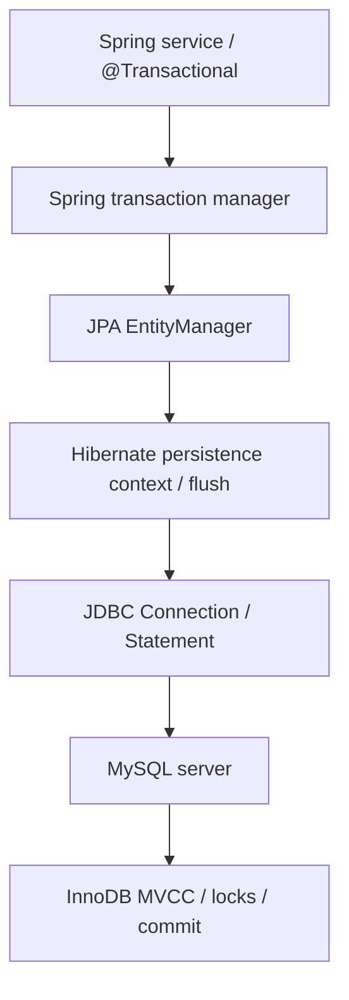

# Read-only, isolation, flush và hành vi thực tế của InnoDB

Trong ứng dụng Spring Boot dùng Spring Data JPA và Hibernate, các annotation như `@Transactional(readOnly = true)`, `@Transactional(isolation = ...)` hoặc thao tác `flush()` ảnh hưởng tới cách ứng dụng làm việc với transaction và persistence context. Tuy nhiên, những tùy chọn này không đồng nghĩa với việc MySQL tự động áp dụng đúng hành vi mà tên annotation gợi ý. Muốn dự đoán kết quả, cần hiểu cả ba lớp: Spring transaction management, JPA/Hibernate và storage engine InnoDB.

Bài học này giải thích cách Spring mở transaction, cách Hibernate đồng bộ persistence context xuống JDBC, và cách InnoDB dùng MVCC cùng khóa để thực hiện truy vấn. Trong module `DATABASE_MYSQL`, nội dung kết nối thiết kế bảng, transaction, kiểm soát đồng thời và vận hành truy vấn trong ứng dụng Java.

Sau bài học, bạn có thể:

- Hiểu `@Transactional(readOnly = true)` là gợi ý tối ưu và phạm vi bảo vệ của nó.
- Phân biệt transaction isolation của Spring với isolation thực tế trên MySQL.
- Giải thích `AUTO`, `COMMIT` và `MANUAL` flush mode.
- Phân biệt `flush()` với `commit()` và thời điểm SQL thực sự được gửi.
- Dự đoán consistent read, locking read, snapshot và gap lock của InnoDB.
- Chọn optimistic hoặc pessimistic locking trong JPA.
- Kiểm thử hành vi đồng thời bằng nhiều transaction và xác minh bằng SQL/log.

## 1. Ba lớp cùng quyết định hành vi

Khi một service gọi repository, lệnh Java không đi thẳng tới InnoDB. Spring quản lý transaction, Hibernate quản lý persistence context và sinh SQL, JDBC truyền SQL tới MySQL, rồi InnoDB thực thi truy vấn và kiểm soát đồng thời.



Mỗi lớp có trách nhiệm riêng:

| Lớp | Trách nhiệm | Ví dụ cấu hình/hành vi |
|---|---|---|
| Spring | Xác định ranh giới transaction và truyền thuộc tính | `@Transactional`, propagation, isolation, readOnly, timeout |
| JPA/Hibernate | Theo dõi entity và quyết định khi đồng bộ thay đổi | Persistence context, dirty checking, flush mode, `EntityManager.flush()` |
| JDBC/Connector/J | Quản lý connection và truyền lệnh | `setAutoCommit`, `setTransactionIsolation`, `Connection.setReadOnly` |
| MySQL/InnoDB | Thực thi transaction, snapshot và khóa | MVCC, consistent read, locking read, row/gap lock, commit/rollback |

Một thuộc tính có thể được truyền từ Spring xuống JDBC hoặc Hibernate, nhưng hiệu quả cuối cùng phụ thuộc transaction manager, provider, driver và cấu hình server. Khi điều tra, hãy kiểm tra trạng thái ở từng lớp thay vì chỉ đọc annotation trong mã nguồn.

## 2. `@Transactional(readOnly = true)` thực sự có nghĩa gì?

Trong Spring, `readOnly = true` đánh dấu transaction chỉ đọc và cho phép transaction manager/provider tối ưu cách xử lý. Đây là một gợi ý quan trọng cho hạ tầng, nhưng không phải cơ chế phân quyền database thay thế cho `GRANT` hoặc một transaction read-only được server cưỡng chế.

Ví dụ:

```java
@Service
public class OrderQueryService {
    private final OrderRepository orderRepository;

    public OrderQueryService(OrderRepository orderRepository) {
        this.orderRepository = orderRepository;
    }

    @Transactional(readOnly = true)
    public OrderSummary findOrder(long orderId) {
        Order order = orderRepository.findById(orderId)
            .orElseThrow(() -> new OrderNotFoundException(orderId));

        return OrderSummary.from(order);
    }
}
```

Với cấu hình Spring và Hibernate thông dụng, read-only transaction có thể khiến Hibernate chuyển flush mode sang `MANUAL`, nhờ đó giảm flush tự động và công việc dirty checking cho entity được load trong transaction. Spring cũng có thể truyền trạng thái read-only xuống JDBC connection bằng `Connection.setReadOnly(true)` tùy transaction manager và cấu hình.

Điều cần nhớ:

- `readOnly = true` không tự biến account MySQL thành account chỉ có quyền `SELECT`.
- Nó không bảo đảm mọi câu `INSERT`, `UPDATE` hoặc `DELETE` đều bị server từ chối.
- Tùy provider, thao tác thay đổi entity trong read-only transaction có thể không được flush tự động như mong đợi.
- SQL native hoặc JDBC trực tiếp có thể có hành vi khác với dirty checking của Hibernate.
- Nếu cần cưỡng chế không ghi, phải dùng quyền SQL phù hợp hoặc cơ chế transaction read-only ở database.

Vì vậy, dùng `readOnly = true` cho luồng đọc để diễn đạt ý định và hỗ trợ tối ưu. Để bảo vệ dữ liệu, cấp cho tài khoản đọc một tập quyền chỉ đọc ở MySQL hoặc thiết kế transaction read-only ở server theo yêu cầu triển khai.

### 2.1. Read-only ở JDBC và MySQL

JDBC có `Connection.setReadOnly(true)`. Theo JDBC, đây là một gợi ý cho driver để tối ưu truy cập. Connector/J có thể truyền trạng thái read-only xuống server theo thuộc tính và phiên bản driver, nhưng ứng dụng không nên giả định rằng mọi cấu hình đều tạo ra `START TRANSACTION READ ONLY` hoặc cưỡng chế ghi ở server.

MySQL/InnoDB có thể thực hiện transaction read-only bằng cú pháp server, ví dụ:

```sql
START TRANSACTION READ ONLY;

SELECT order_id, order_status
FROM shop.orders
WHERE order_id = 501;

COMMIT;
```

Transaction read-only ở server có các giới hạn và tối ưu riêng. Tuy nhiên, việc Spring/JPA phát sinh đúng cú pháp này hay không phụ thuộc cách tích hợp và cấu hình. Nếu cần bảo đảm, kiểm tra SQL thực tế và hành vi của server trong đúng phiên bản triển khai.

### 2.2. Quyền MySQL vẫn là lớp bảo vệ chính

Account chỉ đọc nên được cấp quyền tối thiểu, ví dụ:

```sql
CREATE USER 'shop_reader'@'10.20.%'
    IDENTIFIED BY '<secret-from-secure-provisioning>';

GRANT SELECT
ON shop.* TO 'shop_reader'@'10.20.%';
```

Giá trị password là chỗ giữ chỗ, không dùng nguyên văn. Ứng dụng ghi dữ liệu nên dùng account riêng có quyền `INSERT`, `UPDATE` hoặc `DELETE` cần thiết. Tách account giúp database từ chối thao tác ghi ngay cả khi code vô tình gọi repository thay đổi dữ liệu bên trong một luồng được đánh dấu read-only.

## 3. `@Transactional` và ranh giới transaction

Spring thường mở transaction khi đi qua proxy của bean có phương thức được đánh dấu `@Transactional`. Khi phương thức kết thúc bình thường, transaction được commit; khi có exception phù hợp quy tắc rollback, transaction được rollback.

Ví dụ:

```java
@Service
public class PaymentService {
    private final OrderRepository orders;
    private final PaymentRepository payments;

    @Transactional
    public void markPaid(long orderId, String paymentReference) {
        Order order = orders.findById(orderId)
            .orElseThrow(() -> new OrderNotFoundException(orderId));

        payments.save(Payment.settled(orderId, paymentReference));
        order.markPaid();
    }
}
```

Hai thay đổi thuộc cùng transaction nếu repository dùng cùng transaction manager và cùng transaction context. Khi transaction commit, Hibernate đồng bộ thay đổi cần thiết rồi MySQL commit transaction. Nếu một thao tác thất bại và quy tắc rollback được kích hoạt, cả hai thay đổi InnoDB trong transaction được rollback.

### 3.1. Quy tắc rollback

Theo mặc định của Spring, `RuntimeException` và `Error` làm rollback; checked exception không tự động làm rollback trừ khi cấu hình `rollbackFor` hoặc quy tắc tương ứng. Ví dụ:

```java
@Transactional(rollbackFor = PaymentRejectedException.class)
public void processPayment(long orderId) throws PaymentRejectedException {
    // Các thao tác JPA thuộc cùng transaction.
}
```

Hãy khai báo rollback rule rõ ràng nếu nghiệp vụ dùng checked exception để báo lỗi. Không bắt exception rồi bỏ qua nếu transaction cần rollback; nếu exception đã bị bắt, Spring có thể thấy phương thức kết thúc bình thường trừ khi transaction đã được đánh dấu rollback-only.

### 3.2. Proxy và self-invocation

Trong chế độ proxy thông thường, lời gọi từ một phương thức sang phương thức khác trong cùng object (`this.someTransactionalMethod()`) không đi qua proxy. Vì vậy, annotation trên phương thức được gọi nội bộ có thể không được áp dụng như mong đợi.

```java
@Service
public class ReportService {
    public void generate() {
        loadReportRows(); // self-invocation: không đi qua Spring proxy
    }

    @Transactional(readOnly = true)
    public void loadReportRows() {
        // Đừng giả định transaction được mở bởi lời gọi nội bộ ở trên.
    }
}
```

Đặt ranh giới transaction ở phương thức được gọi qua Spring bean/proxy hoặc cấu trúc service rõ ràng. Transaction gắn với execution context của Spring và thread; không mặc định truyền sang thread mới, `@Async` hoặc tác vụ nền.

## 4. Isolation level của Spring và MySQL

Spring cung cấp enum `Isolation` để chọn isolation cho transaction. `Isolation.DEFAULT` dùng isolation mặc định của datasource/database. Với InnoDB, mức mặc định phổ biến của MySQL là `REPEATABLE READ`.

Ví dụ:

```java
@Transactional(isolation = Isolation.READ_COMMITTED)
public OrderSummary readCurrentOrder(long orderId) {
    // Truy vấn trong transaction READ COMMITTED.
}
```

Spring transaction manager sẽ áp dụng isolation thông qua JDBC connection khi bắt đầu transaction mới, nếu transaction manager và driver hỗ trợ. Nếu phương thức tham gia một transaction đã tồn tại theo propagation `REQUIRED`, thuộc tính isolation khai báo ở phương thức bên trong thường không thay đổi isolation của transaction bên ngoài. Muốn phát hiện cấu hình không tương thích, có thể cấu hình transaction manager kiểm tra existing transaction theo khả năng của Spring.

### 4.1. Các mức isolation

| Isolation | Đọc dữ liệu chưa commit | Non-repeatable read | Phantom read | Đặc điểm tổng quát |
|---|---|---|---|---|
| `READ_UNCOMMITTED` | Có thể | Có thể | Có thể | Mức yếu; dirty read được phép |
| `READ_COMMITTED` | Không | Có thể | Có thể | Mỗi consistent read có snapshot mới |
| `REPEATABLE_READ` | Không | Không với consistent read trong cùng transaction | InnoDB dùng next-key/gap locking cho nhiều locking/range operation | Snapshot consistent read được giữ trong transaction |
| `SERIALIZABLE` | Không | Không | Không theo mô hình isolation | Tăng khóa và giảm concurrency; hành vi phụ thuộc cách truy cập |

Bảng trên mô tả hiện tượng ở mức khái niệm. InnoDB có MVCC và locking nên chi tiết có thể khác so với mô hình SQL trừu tượng, nhất là khi trộn consistent read với locking read.

### 4.2. InnoDB `REPEATABLE READ`

Trong `REPEATABLE READ`, consistent read đầu tiên trong transaction thường xác lập read view. Các consistent read tiếp theo trong cùng transaction sử dụng cùng snapshot đó. Vì vậy, transaction có thể tiếp tục nhìn thấy dữ liệu cũ dù transaction khác đã commit thay đổi mới.

Ví dụ hai session:

```sql
-- Session A
SET SESSION TRANSACTION ISOLATION LEVEL REPEATABLE READ;
START TRANSACTION;
SELECT balance FROM accounts WHERE account_id = 7;
-- Giả sử kết quả là 100.
```

```sql
-- Session B
UPDATE accounts
SET balance = 150
WHERE account_id = 7;
COMMIT;
```

```sql
-- Session A vẫn đang trong transaction
SELECT balance FROM accounts WHERE account_id = 7;
-- Consistent read vẫn có thể trả về 100 theo snapshot ban đầu.
COMMIT;
```

Sau khi Session A commit và bắt đầu transaction mới, truy vấn sẽ nhìn thấy giá trị mới nếu không có thay đổi khác.

### 4.3. InnoDB `READ COMMITTED`

Ở `READ COMMITTED`, mỗi consistent read tạo snapshot mới tại thời điểm bắt đầu câu SELECT. Nếu Session B commit thay đổi giữa hai lần SELECT của Session A, lần đọc thứ hai của A có thể nhìn thấy giá trị mới.

Điều này giảm một số dạng chờ và gap locking so với `REPEATABLE READ`, nhưng cùng một transaction có thể đọc hai trạng thái khác nhau. Hãy chọn isolation theo quy tắc nghiệp vụ, không chỉ theo mong muốn giảm lock.

## 5. Consistent read và locking read trong InnoDB

InnoDB có hai nhóm đọc cần phân biệt:

- **Consistent nonlocking read:** `SELECT` thông thường, đọc phiên bản phù hợp với read view bằng MVCC và thường không khóa hàng để ngăn transaction khác ghi.
- **Locking read:** `SELECT ... FOR UPDATE` hoặc `SELECT ... FOR SHARE`, đọc phiên bản hiện hành và đặt khóa phù hợp để bảo vệ dữ liệu khỏi thay đổi xung đột.

Ví dụ consistent read:

```sql
SELECT balance
FROM accounts
WHERE account_id = 7;
```

Ví dụ locking read:

```sql
START TRANSACTION;

SELECT balance
FROM accounts
WHERE account_id = 7
FOR UPDATE;

UPDATE accounts
SET balance = balance - 10
WHERE account_id = 7;

COMMIT;
```

`FOR UPDATE` phù hợp khi ứng dụng cần đọc giá trị hiện tại rồi quyết định cập nhật trong cùng transaction. Khóa được giữ tới commit hoặc rollback. Trên InnoDB, locking read cần chạy trong transaction; với autocommit bật và không có transaction tường minh, hiệu lực khóa có thể kết thúc ngay khi statement hoàn tất.

`FOR SHARE` đặt shared lock, cho phép các transaction khác đọc tương thích nhưng chặn một số thao tác ghi xung đột cho tới khi transaction kết thúc. Cú pháp `LOCK IN SHARE MODE` là cú pháp cũ hơn; ưu tiên cú pháp phù hợp phiên bản MySQL đang dùng.

### 5.1. Record lock, gap lock và next-key lock

InnoDB khóa index record, không đơn giản khóa một “hàng vật lý” trừu tượng. Với range scan và `REPEATABLE READ`, InnoDB có thể dùng next-key lock: kết hợp record lock với gap lock để ngăn transaction khác chèn giá trị vào khoảng index liên quan.

Điều này giúp ngăn một số phantom trong locking read, nhưng có thể làm insert bị chờ dù hàng có khóa chưa tồn tại. Phạm vi khóa phụ thuộc index được dùng, điều kiện truy vấn và execution plan. Truy vấn thiếu index phù hợp có thể quét và khóa phạm vi lớn hơn mong muốn.

Ở `READ COMMITTED`, InnoDB thường tắt gap locking cho locking read và thao tác tìm kiếm, ngoại trừ một số trường hợp như kiểm tra foreign key và duplicate key. Vì vậy, thay đổi isolation có thể thay đổi khả năng insert đồng thời và loại deadlock gặp phải.

## 6. Flush trong JPA/Hibernate

JPA persistence context theo dõi các entity được quản lý. Khi ứng dụng thay đổi một entity, Hibernate thường chỉ đánh dấu trạng thái trong bộ nhớ. SQL có thể chưa được gửi ngay tới MySQL.

Ví dụ:

```java
@Transactional
public void renameCustomer(long customerId, String newName) {
    Customer customer = entityManager.find(Customer.class, customerId);
    customer.setName(newName);

    // Tại đây entity đã thay đổi trong persistence context.
    // SQL UPDATE có thể chưa được gửi tới MySQL.
}
```

Khi flush, Hibernate so sánh trạng thái entity được quản lý với snapshot, thực hiện dirty checking và phát các câu SQL cần thiết. Flush đồng bộ thay đổi của persistence context với database trong transaction hiện tại.

### 6.1. Flush không phải commit

`EntityManager.flush()` gửi SQL xuống database nhưng không kết thúc transaction. Các thay đổi vẫn có thể được rollback trước khi commit.

```java
@Transactional
public void updateCustomer(long customerId) {
    Customer customer = entityManager.find(Customer.class, customerId);
    customer.setName("Lan Nguyen");

    entityManager.flush(); // SQL UPDATE được gửi tới MySQL

    // Transaction vẫn mở. Một lỗi tiếp theo vẫn có thể khiến rollback.
}
```

Phân biệt:

| Thao tác | Ý nghĩa |
|---|---|
| Thay đổi entity | Thay đổi trạng thái trong persistence context |
| `flush()` | Gửi các thay đổi cần thiết xuống database trong transaction hiện tại |
| `commit()` | Yêu cầu database commit transaction; các thay đổi chưa flush phải được đồng bộ theo flush mode/provider |
| `rollback()` | Hủy các thay đổi chưa commit trong transaction database |
| `clear()` | Detach tất cả entity khỏi persistence context; không tự rollback SQL đã flush |

Flush sớm có thể làm constraint violation hoặc deadlock xuất hiện sớm hơn trong luồng Java. Nó không làm dữ liệu trở nên bền vững trước khi transaction commit.

### 6.2. Khi nào Hibernate flush?

Thời điểm flush phụ thuộc flush mode:

| Flush mode | Hành vi khái quát |
|---|---|
| JPA `AUTO` | Provider phải bảo đảm thay đổi có ảnh hưởng được phản ánh trong truy vấn; Hibernate có thể flush trước query liên quan và trước commit |
| JPA `COMMIT` | Flush trước commit; ảnh hưởng của thay đổi chưa flush tới kết quả query trước commit không được bảo đảm giống `AUTO` |
| Hibernate `MANUAL` | Chỉ flush khi ứng dụng gọi rõ ràng; thường dùng cho tối ưu read-only trong tích hợp Spring/Hibernate |

Flush mode `AUTO` không có nghĩa mọi lệnh Java `save()` lập tức phát SQL. Hibernate có thể trì hoãn tới lúc cần đồng bộ, chẳng hạn trước query có thể bị ảnh hưởng hoặc trước commit.

Spring Data JPA có thể đặt transaction read-only sang Hibernate `MANUAL` thông qua tích hợp Hibernate. Vì vậy, không nên sửa entity trong một phương thức `@Transactional(readOnly = true)` rồi kỳ vọng thay đổi tự được ghi khi phương thức kết thúc.

### 6.3. Gọi `flush()` tường minh

Gọi flush khi cần phát hiện lỗi database trước khi tiếp tục, ví dụ kiểm tra unique constraint trước khi gọi một dịch vụ khác hoặc cần bảo đảm SQL đã được gửi trước một truy vấn native.

```java
@Transactional
public void createCustomer(String email) {
    Customer customer = new Customer(email);
    entityManager.persist(customer);

    entityManager.flush();

    // Sau flush, lỗi unique/constraint có thể đã được phát hiện.
    // Transaction vẫn chưa commit.
}
```

Không gọi flush sau mỗi entity trong vòng lặp lớn nếu không cần. Việc đó có thể làm tăng round trip và giảm khả năng batching của Hibernate.

## 7. `save()`, `saveAndFlush()` và bulk update

Spring Data JPA `save()` không cam kết SQL được gửi ngay tại dòng gọi. Với entity mới, repository thường dùng `persist`; với entity được xem là đã tồn tại, thường dùng `merge`. SQL được phát khi flush theo flush mode hoặc khi transaction commit.

`saveAndFlush()` lưu entity qua repository rồi gọi flush. Nó vẫn không commit transaction bên ngoài.

```java
@Transactional
public void register(Customer customer) {
    customerRepository.save(customer);
    // SQL có thể còn nằm trong persistence context.

    customerRepository.flush();
    // Đồng bộ SQL, nhưng transaction vẫn mở.
}
```

Bulk JPQL update/delete có hành vi khác dirty checking:

```java
@Modifying(flushAutomatically = true, clearAutomatically = true)
@Query("update Customer c set c.active = false where c.lastSeenAt < :cutoff")
int deactivateInactiveCustomers(Instant cutoff);
```

Bulk DML được thực thi trực tiếp ở database và không cập nhật từng entity đang được quản lý trong persistence context. Những entity đã load trước đó có thể trở nên stale. `flushAutomatically` yêu cầu flush trước bulk query; `clearAutomatically` clear persistence context sau khi thực thi để tránh tiếp tục dùng trạng thái cũ. Cân nhắc tác động của clear vì các entity chưa flush có thể bị detach.

## 8. Isolation được cấu hình từ Spring có tác động thế nào?

Spring cho phép đặt isolation tại ranh giới service:

```java
@Transactional(isolation = Isolation.READ_COMMITTED)
public void processOrder(long orderId) {
    // Các truy vấn trong transaction dùng isolation được áp dụng.
}
```

Khi transaction manager mở transaction mới, nó có thể gọi `Connection.setTransactionIsolation(...)` trước khi thực thi SQL. MySQL nhận isolation tương ứng cho transaction. Kiểm tra bằng:

```sql
SELECT @@transaction_isolation;
```

Trên một số phiên bản MySQL cũ, tên biến có thể là `tx_isolation`. Để kiểm tra session cụ thể:

```sql
SELECT @@SESSION.transaction_isolation;
```

Isolation chỉ có ý nghĩa trong transaction. Nếu autocommit đang bật và mỗi câu SQL là một transaction riêng, đặt isolation ở một đoạn code không có transaction thực sự có thể không tạo ra phạm vi nhất quán mà bạn mong muốn.

### 8.1. Isolation của transaction ngoài cùng chi phối

Ví dụ service A mở transaction `REPEATABLE_READ` rồi gọi service B có `@Transactional(isolation = READ_COMMITTED)` với propagation mặc định `REQUIRED`. Service B tham gia transaction hiện có; nó không tự tạo transaction mới và thường không thay đổi isolation của transaction A.

Nếu cần transaction độc lập, `REQUIRES_NEW` có thể tạo transaction mới, nhưng điều đó thay đổi tính nguyên tử và có thể dùng connection thứ hai. Không dùng `REQUIRES_NEW` chỉ để “ép” isolation mà chưa đánh giá tác động tới dữ liệu và pool.

### 8.2. Timeout transaction không phải query timeout

Thuộc tính `timeout` của `@Transactional` là timeout transaction do transaction manager hỗ trợ. Nó không nhất thiết tương đương `Statement.setQueryTimeout()` cho từng câu SQL. Nếu cần giới hạn truy vấn cụ thể, cấu hình query timeout ở JDBC/provider hoặc giới hạn phía MySQL phù hợp.

## 9. Pessimistic locking từ JPA

JPA hỗ trợ pessimistic lock để bảo vệ dữ liệu khi đọc và cập nhật trong cùng transaction. Spring Data JPA có thể khai báo lock trên repository:

```java
public interface AccountRepository extends JpaRepository<Account, Long> {
    @Lock(LockModeType.PESSIMISTIC_WRITE)
    @Query("select a from Account a where a.id = :id")
    Optional<Account> findForUpdate(@Param("id") long id);
}
```

Service sử dụng trong transaction:

```java
@Transactional
public void debit(long accountId, BigDecimal amount) {
    Account account = accountRepository.findForUpdate(accountId)
        .orElseThrow(() -> new AccountNotFoundException(accountId));

    if (account.getBalance().compareTo(amount) < 0) {
        throw new InsufficientFundsException();
    }

    account.debit(amount);
}
```

Với Hibernate và MySQL, `PESSIMISTIC_WRITE` thường được ánh xạ thành locking read như `SELECT ... FOR UPDATE`. SQL cụ thể phụ thuộc dialect và phiên bản. Lock giữ tới khi transaction commit hoặc rollback.

### 9.1. Chú ý phạm vi khóa

InnoDB khóa theo index record và có thể khóa khoảng index. Nếu truy vấn không có index phù hợp, phạm vi scan/lock có thể rộng hơn dự kiến. Hãy kiểm tra execution plan và index của điều kiện khóa.

Không giữ pessimistic lock trong khi gọi HTTP hoặc xử lý tác vụ chậm. Giữ transaction mở lâu làm tăng contention, deadlock và thời gian chờ của các transaction khác.

## 10. Optimistic locking với `@Version`

Nếu xung đột ghi không thường xuyên, optimistic locking có thể phù hợp hơn việc giữ khóa database trong suốt thời gian người dùng chỉnh sửa.

```java
@Entity
public class Product {
    @Id
    private Long id;

    private String name;

    private BigDecimal price;

    @Version
    private long version;
}
```

Hibernate dùng cột version trong câu UPDATE, về khái niệm:

```sql
UPDATE product
SET price = ?, version = version + 1
WHERE id = ? AND version = ?;
```

Nếu transaction khác đã cập nhật cùng hàng và version thay đổi, câu UPDATE không cập nhật hàng nào. Hibernate phát hiện optimistic lock conflict và báo lỗi như `OptimisticLockException` hoặc exception được Spring dịch tương ứng.

`@Version` không đổi isolation level của InnoDB. Nó là cơ chế phát hiện xung đột ở cấp entity. Ứng dụng cần quyết định retry, báo người dùng hoặc hợp nhất thay đổi khi có conflict.

## 11. Chọn isolation, flush và locking theo nghiệp vụ

| Nhu cầu | Cách tiếp cận gợi ý | Điều cần xác minh |
|---|---|---|
| Trang đọc hoặc báo cáo | `@Transactional(readOnly = true)` | Query không ghi, flush behavior và account chỉ đọc |
| Đọc nhiều lần cùng snapshot | InnoDB `REPEATABLE READ` | Transaction giữ cùng read view cho consistent reads |
| Đọc thấy commit mới giữa các SELECT | `READ COMMITTED` | Mỗi consistent read có snapshot mới |
| Đọc rồi cập nhật số dư trong một transaction | `PESSIMISTIC_WRITE` hoặc câu lệnh cập nhật nguyên tử | Lock scope, index, deadlock và transaction ngắn |
| Nhiều người cùng chỉnh sửa một entity | `@Version` optimistic locking | Xử lý conflict ở service/UI |
| Cần phát hiện constraint trước khi commit | Gọi `flush()` tường minh | Flush không commit; lỗi vẫn có thể rollback transaction |
| Chạy bulk update/delete lớn | Bulk DML theo batch và clear persistence context | Entity stale, lock, undo/redo và replica lag |

Không có isolation level tốt nhất cho mọi service. Chọn mức thấp nhất vẫn đáp ứng đúng quy tắc nghiệp vụ và kiểm thử các race condition có thể xảy ra.

## 12. Kiểm thử read-only, flush và isolation

Nên kiểm thử trên MySQL/InnoDB thật hoặc môi trường tương đương, vì H2 và database giả lập có thể có semantics transaction, locking và SQL khác MySQL.

### 12.1. Kiểm tra read-only có thực sự ngăn ghi không

Tạo một phương thức thử nghiệm:

```java
@Transactional(readOnly = true)
public void tryChangeOrder(long orderId) {
    Order order = orderRepository.findById(orderId).orElseThrow();
    order.setStatus("CANCELLED");
    entityManager.flush();
}
```

Chạy trong lab với account có quyền ghi và sau đó account chỉ có quyền `SELECT`. So sánh hành vi thực tế. Kết quả có thể khác theo Hibernate flush mode, JDBC driver và quyền server. Mục tiêu là chứng minh read-only hint không thay thế quyền database.

### 12.2. Quan sát flush trước và sau query

Trong transaction `AUTO`, thay đổi một entity rồi chạy query có thể bị ảnh hưởng bởi thay đổi đó. Hibernate có thể flush trước query để kết quả nhất quán.

```java
@Transactional
public List<Customer> updateThenQuery(long id) {
    Customer customer = entityManager.find(Customer.class, id);
    customer.setActive(false);

    // Query có thể kích hoạt flush trước khi chạy.
    return entityManager.createQuery(
        "select c from Customer c where c.active = false", Customer.class
    ).getResultList();
}
```

Bật SQL logging trong môi trường thử nghiệm để quan sát thứ tự `UPDATE` và `SELECT`. Không bật log bind parameter có dữ liệu nhạy cảm trên production.

### 12.3. Kiểm thử snapshot ở InnoDB

Mở hai session MySQL và làm theo kịch bản `REPEATABLE READ` ở phần trên. Sau đó lặp lại với `READ COMMITTED` để quan sát kết quả SELECT thứ hai của Session A. Ghi lại isolation thực tế của từng session bằng `@@SESSION.transaction_isolation`.

### 12.4. Kiểm thử locking read

Session A:

```sql
START TRANSACTION;
SELECT balance
FROM accounts
WHERE account_id = 7
FOR UPDATE;
```

Session B:

```sql
UPDATE accounts
SET balance = balance + 5
WHERE account_id = 7;
```

Quan sát Session B phải chờ cho tới khi Session A commit/rollback. Thử lại với consistent read thông thường để thấy khác biệt. Sau kiểm thử, luôn kết thúc transaction để giải phóng lock.

## 13. Lỗi thường gặp và cách điều tra

| Triệu chứng | Nguyên nhân có thể | Hướng kiểm tra |
|---|---|---|
| Thay đổi entity không được lưu | Read-only transaction đặt Hibernate `MANUAL`, entity detached hoặc transaction không được proxy áp dụng | Kiểm tra annotation, proxy, persistence context và SQL log |
| `save()` chưa thấy SQL ngay | Hibernate trì hoãn tới flush | Gọi flush có chủ đích hoặc quan sát trước commit |
| `flush()` xong nhưng dữ liệu chưa bền vững | Transaction chưa commit | Kiểm tra transaction boundary và rollback |
| Query thứ hai đọc giá trị cũ | `REPEATABLE READ` giữ read view cũ | Kiểm tra session isolation và thời điểm snapshot |
| `@Transactional(isolation=...)` không có tác dụng | Phương thức tham gia transaction ngoài đã mở hoặc self-invocation | Kiểm tra propagation, proxy và isolation session thực tế |
| Update bị chờ dù SELECT trước đó không chờ | SELECT thường là consistent read; locking read hoặc DML có thể cần lock | Kiểm tra `FOR UPDATE`, transaction và InnoDB lock waits |
| Insert bị chờ khi khóa hàng không tồn tại | Gap/next-key lock trên range index | Kiểm tra execution plan, isolation và index scan |
| Optimistic lock exception | Entity đã bị transaction khác cập nhật | Kiểm tra `@Version` và chính sách retry/conflict |
| Bulk update nhưng entity trong session vẫn cũ | Bulk DML bỏ qua persistence context | Flush/clear đúng thời điểm hoặc reload entity |

Khi điều tra, kết hợp log transaction của Spring, SQL log của Hibernate, trạng thái connection và thông tin lock của InnoDB. Không kết luận từ annotation đơn lẻ.

## 14. Quy trình thiết kế và triển khai

1. **Phân loại luồng đọc/ghi:** xác định service nào chỉ đọc và service nào thay đổi dữ liệu.
2. **Chọn quyền database:** tách account chỉ đọc và account ghi; không dùng `readOnly` làm ranh giới bảo mật.
3. **Xác định transaction boundary:** đặt `@Transactional` tại service method được gọi qua Spring proxy.
4. **Chọn isolation:** bắt đầu từ mặc định InnoDB, chỉ đổi khi nghiệp vụ yêu cầu và đã kiểm thử.
5. **Chọn locking:** dùng optimistic lock cho xung đột thấp; pessimistic lock cho đoạn đọc-sửa cần tuần tự hóa.
6. **Hiểu flush mode:** xác định thời điểm Hibernate gửi SQL và tránh flush không cần thiết.
7. **Giữ transaction ngắn:** không gọi dịch vụ mạng hoặc chờ người dùng trong lúc giữ lock.
8. **Quan sát SQL và lock:** kiểm tra query plan, metadata, lock wait, deadlock và transaction mở lâu.
9. **Kiểm thử đồng thời:** dùng nhiều transaction thực và kiểm tra các race condition nghiệp vụ.
10. **Xác minh trên InnoDB:** không chỉ dựa vào H2 hoặc mock repository để kết luận semantics của MySQL.

## 15. Tình huống thực hành

Một ứng dụng thương mại dùng Spring Boot, Spring Data JPA và MySQL InnoDB. Service `OrderQueryService` đọc đơn hàng; service `InventoryService` trừ tồn kho; nhiều request có thể cùng mua sản phẩm cuối cùng.

Thực hiện trong môi trường lab:

1. Tạo hai account MySQL: `shop_reader` chỉ có `SELECT`, và `shop_app` có quyền đọc/ghi cần thiết.
2. Cấu hình datasource riêng hoặc profile riêng để xác nhận account đọc không thể ghi.
3. Đánh dấu service truy vấn bằng `@Transactional(readOnly = true)` và quan sát flush mode/SQL log của Hibernate.
4. Thử thay đổi entity trong read-only transaction; so sánh hành vi với account có quyền ghi và account chỉ đọc.
5. Tạo hai transaction đọc cùng một account balance; kiểm thử `REPEATABLE READ` và `READ COMMITTED`.
6. Dùng `SELECT ... FOR UPDATE` hoặc `PESSIMISTIC_WRITE` để tuần tự hóa thao tác trừ tồn kho.
7. Thử `@Version` và quan sát optimistic lock conflict khi hai transaction cập nhật cùng entity.
8. Thay đổi entity, gọi `flush()` rồi phát sinh lỗi trước commit; xác nhận transaction rollback và dữ liệu không đổi.
9. Chạy bulk JPQL update rồi kiểm tra entity đang được quản lý; dùng `clearAutomatically` hoặc reload để tránh dữ liệu stale.
10. Ghi lại SQL, isolation, lock wait, deadlock và kết quả nghiệp vụ của từng kịch bản.

**Câu hỏi tự đánh giá:**

- Vì sao `@Transactional(readOnly = true)` không thay thế quyền chỉ đọc ở MySQL?
- Khi nào Spring/Hibernate có thể chuyển flush mode sang `MANUAL`?
- `flush()` khác `commit()` như thế nào?
- InnoDB `REPEATABLE READ` tạo read view vào thời điểm nào và dùng nó ra sao?
- Consistent read khác locking read ở điểm nào?
- Vì sao `SELECT ... FOR UPDATE` có thể khóa cả khoảng index?
- Isolation khai báo ở phương thức tham gia transaction `REQUIRED` có ghi đè isolation của transaction ngoài không?
- `@Version` giải quyết loại xung đột nào và có thay đổi isolation của database không?
- Vì sao bulk JPQL update có thể làm entity trong persistence context bị stale?

## Kết luận

Spring `readOnly`, transaction isolation và JPA flush là các cơ chế ở những lớp khác nhau. Hibernate có thể tối ưu read-only bằng cách hạn chế flush tự động; JDBC và transaction manager có thể truyền isolation xuống connection; InnoDB quyết định snapshot, locking read và khóa thực tế. Hãy tách quyền bảo mật khỏi read-only hint, phân biệt flush với commit, và kiểm thử hành vi đồng thời trên MySQL/InnoDB thật trước khi dựa vào nó trong nghiệp vụ.
