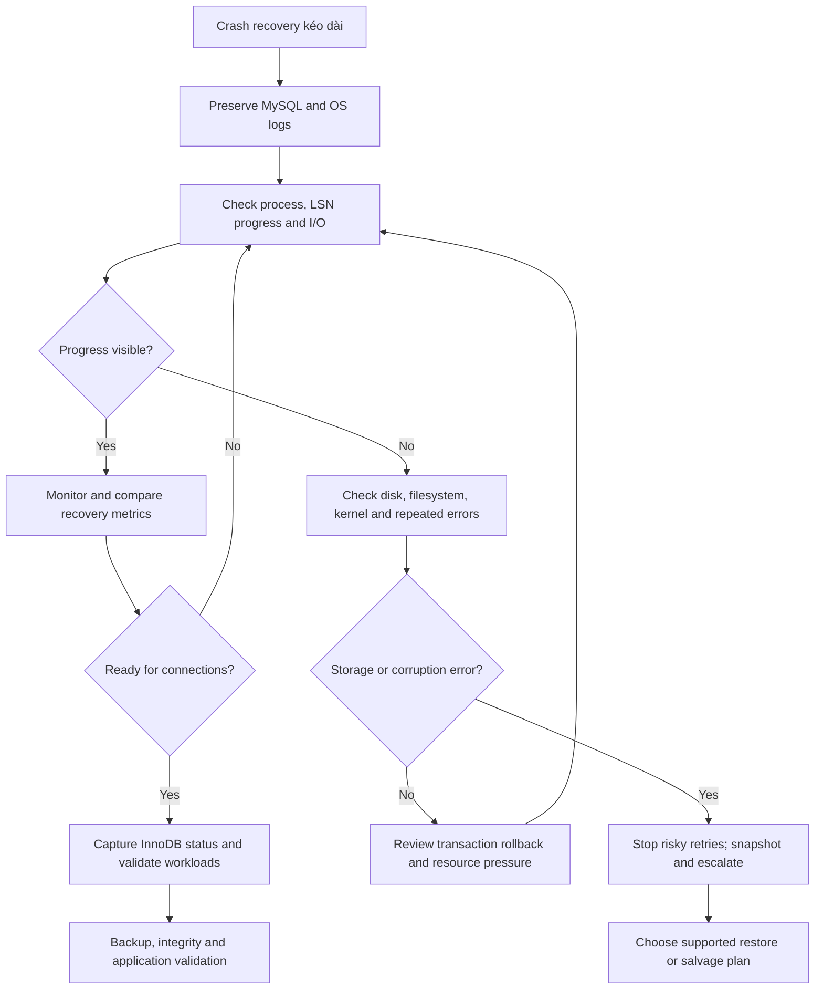

# Crash recovery kéo dài và thu thập log trước khi can thiệp

## Mục tiêu

Khi MySQL khởi động lại sau mất điện, kernel crash hoặc tiến trình bị dừng bất thường, InnoDB phải thực hiện crash recovery để đưa dữ liệu về trạng thái nhất quán. Quá trình này có thể kéo dài nếu redo log cần phát lại lớn, có transaction lớn phải rollback, storage chậm hoặc filesystem gặp lỗi. Một cửa sổ log ít thay đổi chưa đủ chứng minh server bị treo; thao tác restart lặp lại hoặc xóa file redo trong lúc chưa hiểu trạng thái có thể làm sự cố nghiêm trọng hơn.

Bài học thuộc module **DATABASE_MYSQL**, bao quát thiết kế bảng, kiểu dữ liệu, khóa, SQL, index, transaction, kiểm soát đồng thời, đọc kế hoạch thực thi, tối ưu truy vấn và vận hành cơ sở dữ liệu quan hệ. Bài này hướng dẫn hiểu các giai đoạn InnoDB crash recovery, phân biệt tiến trình chậm với bị đình trệ, thu thập log và bằng chứng hệ thống trước khi can thiệp, rồi lựa chọn bước xử lý theo mức độ rủi ro.

Sau bài học, bạn có thể:

- Giải thích vai trò của redo log, checkpoint và undo log trong crash recovery.
- Nhận diện dấu hiệu redo apply, rollback transaction, startup hoàn tất và lỗi storage.
- Thu thập error log, system log, trạng thái filesystem và cấu hình liên quan theo một mốc thời gian thống nhất.
- Theo dõi InnoDB khi server đã nhận kết nối và dùng công cụ hệ điều hành khi server chưa khởi động.
- Tránh các thao tác có thể phá hủy bằng chứng hoặc làm hỏng data directory.
- Chuẩn bị dữ liệu cần thiết để escalation tới DBA, storage team hoặc nhà cung cấp dịch vụ.

## 1. Crash recovery làm gì?

InnoDB dùng write-ahead logging: thay đổi trang dữ liệu được ghi nhận trong redo log trước khi trang dữ liệu tương ứng được ghi bền vững về data file. Vì vậy, khi tiến trình dừng đột ngột, data file có thể chưa chứa mọi thay đổi đã commit. Khi khởi động lại, InnoDB dùng redo log để phát lại các thay đổi cần thiết kể từ checkpoint.

Ở mức khái quát, crash recovery gồm các công việc:

1. Đọc metadata và xác định điểm checkpoint cùng phạm vi redo log cần xử lý.
2. Quét và phát lại redo log để đưa các trang dữ liệu về trạng thái phù hợp với thời điểm crash.
3. Xác định transaction chưa hoàn tất và dùng undo log để rollback thay đổi chưa commit.
4. Hoàn tất khởi tạo InnoDB và đưa instance tới trạng thái có thể phục vụ; một số công việc dọn dẹp hoặc rollback có thể tiếp tục ở nền tùy trạng thái và phiên bản.

Redo và undo có nhiệm vụ khác nhau:

| Thành phần | Vai trò trong recovery |
|---|---|
| Redo log | Phát lại thay đổi đã ghi log để phục hồi trang dữ liệu sau crash |
| Checkpoint | Đánh dấu tiến độ mà các thay đổi trước đó đã được flush theo quy tắc InnoDB; giới hạn phạm vi redo cần phát lại |
| Undo log | Hỗ trợ rollback transaction chưa commit và cung cấp phiên bản cũ cho MVCC |
| Data file | Chứa các trang bảng và index; có thể chưa phản ánh đầy đủ redo tại thời điểm crash |

Crash recovery là quy trình bình thường của InnoDB, không tự động có nghĩa data file bị hỏng. Thời gian recovery phụ thuộc lượng redo cần áp dụng, số transaction chưa hoàn tất, kích thước transaction, tốc độ đọc/ghi và tình trạng storage.

## 2. Vì sao recovery có thể kéo dài?

Các nguyên nhân thường gặp gồm:

- **Redo backlog lớn:** checkpoint ở xa cuối redo log, InnoDB phải đọc và phát lại nhiều log record.
- **Transaction lớn chưa commit:** một transaction cập nhật hàng triệu bản ghi có thể cần nhiều thời gian để rollback.
- **Storage chậm hoặc bận:** latency đọc/ghi cao, queue sâu, IOPS bị giới hạn hoặc volume đang throttling.
- **Filesystem gần đầy:** không gian hoặc inode thiếu khiến MySQL không thể tạo/ghi file cần thiết.
- **Lỗi thiết bị hoặc filesystem:** kernel ghi nhận I/O error, reset thiết bị, read-only remount hoặc filesystem corruption.
- **Thiếu RAM hoặc áp lực hệ thống:** swapping, OOM kill hoặc cạnh tranh CPU làm startup và I/O chậm.
- **Data/redo/undo corruption:** InnoDB gặp page checksum mismatch, log sequence không hợp lệ hoặc lỗi cấu trúc.
- **Cấu hình và thay đổi gần đây:** thay đổi redo capacity, đường dẫn data/log, quyền file, plugin hoặc package có thể khiến startup gặp vấn đề.

Đừng kết luận chỉ từ thời gian đã trôi qua. Một instance có thể recovery lâu nhưng vẫn tiến triển; một instance khác có thể lặp lại cùng lỗi ở một LSN hoặc gặp I/O error. Cần so sánh log theo timestamp và các chỉ số tiến độ qua nhiều lần quan sát.

## 3. Nhận biết recovery đang tiến triển hay bị đình trệ

### Dấu hiệu có tiến triển

- Error log xuất hiện các mốc thời gian mới và LSN được quét/phát lại tăng dần.
- Disk read/write và I/O activity có hoạt động phù hợp với recovery.
- CPU hoặc I/O có tải nhưng không bị bão hòa kéo dài bất thường.
- Các thông báo về rollback transaction hoặc recovery phase tiếp tục thay đổi.
- Không có chuỗi lỗi lặp lại về checksum, I/O, permission hoặc filesystem.

### Dấu hiệu cần điều tra sâu

- Cùng một lỗi lặp lại sau mỗi lần khởi động, tại cùng file/page/LSN.
- LSN hoặc thông báo tiến độ không thay đổi trong thời gian dài, đồng thời I/O gần như không có hoạt động.
- Kernel ghi nhận I/O error, device reset, filesystem error hoặc volume chuyển read-only.
- Tiến trình mysqld bị OOM kill, crash liên tục hoặc thoát với signal.
- Error log báo không thể mở file, thiếu quyền, thiếu dung lượng hoặc redo/undo corruption.

Không dùng một ngưỡng thời gian cố định cho mọi hệ thống. Recovery vài phút có thể là bình thường với instance nhỏ; recovery hàng giờ có thể vẫn hợp lý nếu redo backlog hoặc rollback rất lớn. So sánh với baseline, kích thước dữ liệu, dung lượng redo và tốc độ storage của chính hệ thống.

## 4. Thu thập thông tin trước khi thay đổi trạng thái

Trước khi restart, đổi cấu hình hoặc chạy công cụ sửa chữa, ghi lại một mốc thời gian rõ ràng và thu thập bằng chứng. Dùng cùng timezone hoặc ghi rõ offset khi đối chiếu MySQL error log, system journal và monitoring.

Thông tin cần ghi nhận:

| Nhóm | Dữ liệu cần lưu |
|---|---|
| Sự cố | Thời điểm bắt đầu, thời điểm restart/crash, ai thực hiện, thay đổi gần nhất |
| Phiên bản | MySQL version/build, OS/kernel, package hoặc container image |
| Topology | Primary/replica, Group Replication/InnoDB Cluster, proxy, backup và replication status trước sự cố |
| Cấu hình | `datadir`, `log_error`, redo capacity, buffer pool, storage engine, plugin và option file đã áp dụng |
| Tài nguyên | Dung lượng filesystem, inode, IOPS/latency, RAM, swap, CPU và OOM events |
| Log | MySQL error log, system journal, kernel log, container/orchestrator event |
| Tình trạng dữ liệu | LSN/checkpoint nếu có, transaction lớn, backup gần nhất và binlog/GTID checkpoint |

Giữ nguyên file log gốc và tạo bản sao làm việc. Ghi lại đường dẫn, kích thước, thời gian sửa đổi và khoảng thời gian đã thu thập. Không chỉnh sửa hoặc cắt log gốc.

## 5. Thu thập MySQL error log

Error log là nguồn quan trọng nhất để hiểu InnoDB đang ở giai đoạn nào. Xác định vị trí log từ cấu hình hoặc khi server còn truy cập được:

```sql
SHOW GLOBAL VARIABLES LIKE 'log_error';
SHOW GLOBAL VARIABLES LIKE 'datadir';
SHOW GLOBAL VARIABLES LIKE 'innodb_redo_log_capacity';
SHOW GLOBAL VARIABLES LIKE 'innodb_buffer_pool_size';
```

Nếu server chưa khởi động, lấy các giá trị từ option file, systemd unit, container configuration hoặc deployment manifest đã được triển khai. Không giả định log luôn nằm ở `/var/log/mysql/error.log`; vị trí phụ thuộc package và cấu hình.

Tìm các thông điệp liên quan:

- Bắt đầu InnoDB initialization hoặc crash recovery.
- LSN, checkpoint, redo scan hoặc redo apply progress.
- Rollback transaction và thời gian rollback.
- `ready for connections` hoặc thông báo startup hoàn tất.
- `InnoDB: corruption`, checksum mismatch, page corruption hoặc log sequence mismatch.
- `Operating system error`, `No space left on device`, permission denied hoặc I/O failure.

Ví dụ đọc log file trên Linux:

```bash
sudo tail -n 500 /path/to/mysql-error.log
sudo grep -Ei 'crash recovery|redo|rollback|checkpoint|LSN|corrupt|checksum|I/O error|no space|ready for connections' /path/to/mysql-error.log
```

Giữ cả các dòng trước và sau thông báo lỗi đầu tiên. Dòng cuối cùng không phải lúc nào cũng là nguyên nhân gốc; lỗi đầu tiên trong chuỗi thường cung cấp manh mối tốt hơn.

## 6. Thu thập system journal và kernel log

MySQL có thể chỉ là nạn nhân của lỗi ở tầng hệ điều hành hoặc storage. Trên Linux dùng systemd, lấy log của service:

```bash
sudo journalctl -u mysql --since '2026-11-19 08:00:00' --until '2026-11-19 10:00:00' --no-pager -o short-iso
```

Tên service có thể là `mysqld` thay vì `mysql`; kiểm tra unit thực tế trước khi truy vấn. Thu thập kernel log trong cùng cửa sổ thời gian:

```bash
sudo dmesg -T | tail -n 400
```

Tìm các thông báo như:

- `Out of memory` hoặc `Killed process ... mysqld`.
- I/O error, buffer I/O error, device reset hoặc timeout.
- Filesystem journal error, remount read-only hoặc metadata corruption.
- NVMe/SCSI controller reset, path failover hoặc multipath error.

Nếu có OOM kill, ghi lại tiến trình bị kill, mức memory pressure và các process cùng thời điểm. Nếu có lỗi thiết bị, giữ log và phối hợp storage team trước khi tiếp tục ghi lên volume nghi ngờ hỏng.

## 7. Kiểm tra dung lượng và tình trạng filesystem

Recovery có thể bị ảnh hưởng nếu filesystem chứa data directory, redo log, temporary directory hoặc error log hết dung lượng. Kiểm tra cả dung lượng byte lẫn inode:

```bash
df -hT
df -ih
lsblk -f
```

Kiểm tra đúng mount point của `datadir`, redo log, temporary directory và log directory. Một filesystem có thể còn dung lượng nhưng hết inode; ngược lại, root filesystem có thể đầy dù data directory nằm trên volume khác.

Không xóa file trong data directory để lấy dung lượng. Đặc biệt không xóa `ibdata*`, undo tablespace, redo log, file `#innodb_redo`, `ib_logfile*` của phiên bản cũ, doublewrite file hoặc file bảng để giải phóng không gian. Việc xóa log có thể phá hủy khả năng recovery.

Nếu volume gần đầy, ưu tiên mở rộng volume hoặc giải phóng dữ liệu không liên quan đến MySQL theo quy trình vận hành đã được phê duyệt. Trước khi xóa log ứng dụng hoặc backup cũ, xác minh retention, PITR và chính sách backup.

## 8. Nếu MySQL đã khởi động và nhận kết nối

Khi error log báo server sẵn sàng, có thể thu thập trạng thái InnoDB bằng SQL. Bắt đầu với:

```sql
SELECT VERSION(), @@hostname, @@datadir, @@log_error;
SHOW ENGINE INNODB STATUS\G
```

Trong phần `LOG`, xem log sequence number, log flushed up to, pages flushed up to, last checkpoint at và pending log writes. Chụp kết quả ở các thời điểm cách nhau để so sánh tiến triển; một snapshot đơn lẻ không cho biết tốc độ recovery.

Kiểm tra transaction còn hoạt động:

```sql
SELECT trx_id, trx_state, trx_started,
       trx_wait_started, trx_mysql_thread_id,
       trx_query
FROM information_schema.innodb_trx
ORDER BY trx_started;
```

Kiểm tra process list:

```sql
SHOW FULL PROCESSLIST;
```

Những truy vấn này chỉ dùng được khi server chấp nhận kết nối và account có quyền phù hợp. Tránh chạy truy vấn nặng trên instance đang recovery hoặc chịu tải I/O cao. Không dùng `KILL` transaction chỉ vì thấy nó tồn tại; xác định tác động, chủ sở hữu và trạng thái rollback trước.

## 9. Nếu MySQL chưa khởi động

Khi server chưa nhận kết nối, SQL monitoring không khả dụng. Không cố khởi động một mysqld thứ hai trên cùng `datadir` để xem trạng thái. Dùng log và công cụ hệ điều hành:

```bash
ps -eo pid,ppid,stat,etime,%cpu,%mem,cmd | grep '[m]ysqld'
sudo journalctl -u mysql -n 500 --no-pager -o short-iso
df -hT
df -ih
```

Quan sát PID, elapsed time, CPU, memory và trạng thái tiến trình theo thời gian. `D` trong process state có thể biểu thị uninterruptible I/O wait; kết hợp kernel log và storage metrics để xác định nguyên nhân. CPU thấp không tự chứng minh deadlock; process có thể đang chờ disk hoặc network storage.

Nếu tiến trình vẫn sống và log/LSN cho thấy tiến triển, phối hợp với DBA để tiếp tục quan sát. Nếu tiến trình crash liên tục, lỗi I/O hoặc checksum lặp lại, dừng các lần restart tự động theo runbook và bảo toàn bằng chứng trước khi thử biện pháp tiếp theo.

## 10. Thu thập log trong container và Kubernetes

Với Docker, lấy log có timestamp của đúng container:

```bash
docker logs --timestamps --since 2h mysql-container
docker inspect mysql-container
```

Kiểm tra container exit code, restart count, mount volume và giới hạn CPU/RAM. Đừng xóa container hoặc volume trước khi đã xác định nơi lưu data directory và thu thập log.

Với Kubernetes, thu thập trạng thái pod, event và log hiện tại/previous container:

```bash
kubectl describe pod mysql-0 -n database
kubectl logs mysql-0 -n database --timestamps --since=2h
kubectl logs mysql-0 -n database --previous --timestamps
kubectl get events -n database --sort-by=.lastTimestamp
```

Thay namespace, pod và container theo deployment thực tế. Kiểm tra PVC/PV event, node pressure, OOMKilled, liveness probe failure và thời điểm restart. Không xóa StatefulSet/PVC hoặc tạo pod mới trỏ vào cùng volume khi chưa hiểu fencing và trạng thái mount.

Với MySQL managed service, thu thập database error log, event timeline, maintenance/failover event, storage metrics và support bundle từ control plane. Một số thao tác filesystem hoặc system journal không truy cập được; không giả định quyền host-level.

## 11. Những thao tác cần tránh trước khi hiểu trạng thái

Trong lúc crash recovery kéo dài, không thực hiện các hành động sau chỉ để thử xem server có khởi động được hay không:

- Restart mysqld lặp đi lặp lại hoặc kill -9 tiến trình đang recovery.
- Xóa, đổi tên hoặc tạo lại redo log, undo tablespace, system tablespace, doublewrite file hoặc file dữ liệu.
- Chạy `innodb_force_recovery` ở mức cao mà chưa backup/snapshot và chưa có kế hoạch dump dữ liệu.
- Chạy `REPAIR TABLE` cho bảng InnoDB như cách sửa corruption chung.
- Chép một phần data directory từ backup hoặc instance khác vào thư mục đang dùng.
- Khởi động hai instance MySQL cùng truy cập một data directory.
- Thay đổi quyền sở hữu/quyền truy cập hàng loạt mà chưa xác định user/group và mount option đúng.
- Xóa binary log hoặc relay log mà chưa đánh giá PITR, GTID và replica downstream.

Những thao tác này có thể làm mất redo cần thiết, phá metadata hoặc khiến tình trạng dữ liệu khó đánh giá hơn.

## 12. `innodb_force_recovery` là chế độ cứu dữ liệu khẩn cấp

`innodb_force_recovery` không phải nút tăng tốc crash recovery và không sửa chữa data file. Đây là chế độ khẩn cấp để cố khởi động InnoDB trong tình trạng hỏng, chủ yếu nhằm đọc và dump dữ liệu để dựng lại instance mới.

Các mức được tăng dần từ 1 đến 6:

| Mức | Tác động khái quát |
|---:|---|
| 1 | Bỏ qua một số trang bị đánh dấu corrupt để server có thể tiếp tục |
| 2 | Ngăn master thread và purge thread chạy |
| 3 | Không rollback transaction sau crash |
| 4 | Ngăn insert buffer merge; có nguy cơ làm hỏng dữ liệu lâu dài |
| 5 | Không quét undo log; transaction chưa hoàn tất có thể bị xem như đã commit |
| 6 | Bỏ qua redo log roll-forward; có nguy cơ mất thay đổi và corruption nghiêm trọng |

Các mức cao có thể làm data file hỏng vĩnh viễn hoặc trả về dữ liệu không nhất quán. Khi cần dùng, phải:

1. Bảo toàn error log và system log trước.
2. Tạo storage snapshot hoặc bản sao vật lý nhất quán theo quy trình hỗ trợ; không tự copy data directory đang mở rồi coi là backup hợp lệ.
3. Tham khảo tài liệu đúng phiên bản và escalation procedure của DBA/vendor.
4. Bắt đầu ở mức thấp nhất cần thiết và chỉ tăng từng mức nếu mức trước không khởi động được.
5. Nếu server chạy được, ưu tiên dump dữ liệu có thể đọc ra một nơi khác.
6. Dựng instance mới từ backup hoặc data đã dump, kiểm tra tính toàn vẹn rồi mới đưa vào phục vụ.

Không dùng instance đang chạy với `innodb_force_recovery` làm production writer. Đặc biệt, không xem việc server khởi động được ở mức 4–6 là bằng chứng dữ liệu đã được sửa.

## 13. Đánh giá backup và phương án phục hồi

Trước khi thử biện pháp có rủi ro, xác định backup gần nhất và khả năng phục hồi:

- Full backup nào đã hoàn tất, thời điểm snapshot và công cụ đã dùng.
- Backup có được kiểm tra restore định kỳ hay chỉ có trạng thái job thành công.
- Binary log có liên tục từ checkpoint backup tới thời điểm cần khôi phục không.
- GTID executed/purged và replica nào còn giữ transaction cần thiết.
- Keyring, encryption key, certificate và file cấu hình có sẵn để mở backup không.
- RPO/RTO được phê duyệt và mức dữ liệu có thể mất nếu phải restore.

Không ghi đè backup tốt bằng bản sao lấy từ instance đang nghi ngờ corruption. Giữ một bản gốc bất biến và làm việc trên bản sao. Nếu có storage snapshot, ghi lại ID, timestamp, consistency guarantee và volume mapping.

## 14. Quy trình quyết định trước can thiệp



Thứ tự ưu tiên là bảo toàn bằng chứng, xác định tiến triển, tìm lỗi ở storage/hệ điều hành và xác minh backup. Chỉ sau đó mới chọn can thiệp. Nếu có dấu hiệu corruption hoặc lỗi thiết bị, escalation sớm thường ít rủi ro hơn thử nhiều thay đổi không có kế hoạch.

## 15. Mẫu ghi nhận sự cố

Ghi lại các thông tin sau trong incident ticket hoặc runbook:

```text
Incident ID:
MySQL version/build:
OS/kernel or container image:
Instance role and topology:
Crash/restart time (with timezone):
Last known healthy time:
Recent deployment/config/storage changes:
MySQL error-log path and preserved time range:
System/kernel log time range:
Data directory and filesystem mount:
Free space and inode status:
Process PID/state/elapsed time:
Latest recovery/LSN messages and timestamps:
Latest InnoDB status (if SQL is available):
Backup timestamp and restore-test result:
Binlog/GTID checkpoint:
Observed errors and first occurrence:
Actions already taken:
Current risk and next approved action:
```

Không đưa password, private key, token hoặc dữ liệu khách hàng vào ticket. Redact credential trong option file, JDBC URL, command line và environment dump trước khi chia sẻ log.

## 16. Sau khi server khởi động lại

Thông báo `ready for connections` cho biết server đã bắt đầu chấp nhận kết nối; không tự động chứng minh mọi workload đã khỏe mạnh hoặc replica đã bắt kịp. Trước khi mở toàn bộ traffic:

1. Xem error log từ đầu recovery tới startup complete và xác nhận không còn lỗi nghiêm trọng lặp lại.
2. Chạy `SHOW ENGINE INNODB STATUS\G` và kiểm tra transaction rollback, pending I/O, buffer pool và lock wait.
3. Kiểm tra `information_schema.innodb_trx`, process list và các transaction dài.
4. Xác minh bảng, index, constraint và truy vấn đọc/ghi quan trọng bằng smoke test.
5. Kiểm tra replication receiver/applier, GTID và lag nếu instance thuộc topology.
6. Tạo hoặc xác minh backup mới sau khi hệ thống ổn định.
7. Theo dõi latency, I/O, disk usage, deadlock, error rate và thời gian transaction.

Nếu có nghi ngờ corruption, cần xác minh dữ liệu bằng backup restore test, checksum hoặc đối chiếu nghiệp vụ theo mức độ sự cố. Không chỉ dựa vào việc mysqld đã khởi động.

## 17. Bài tập thực hành

Trong môi trường lab có backup và snapshot dùng để phục hồi:

1. Tạo workload ghi InnoDB có transaction dài, sau đó dừng instance theo cách crash mô phỏng được môi trường lab cho phép.
2. Khởi động lại và thu thập error log; xác định thông báo bắt đầu recovery, redo/LSN và thời điểm server sẵn sàng.
3. So sánh LSN hoặc các mốc log qua nhiều lần quan sát để phân biệt tiến triển với trạng thái không thay đổi.
4. Thu thập system journal, kernel log, disk usage và inode; tìm các sự kiện OOM hoặc I/O.
5. Khi server sẵn sàng, chạy `SHOW ENGINE INNODB STATUS\G` và kiểm tra transaction đang hoạt động.
6. Diễn tập tình huống volume gần đầy trên filesystem thử nghiệm, xác định cách mở rộng dung lượng mà không xóa file InnoDB.
7. Đọc tài liệu `innodb_force_recovery`, lập kế hoạch dump/rebuild trên bản sao; không dùng mức cao trên instance chứa dữ liệu duy nhất.
8. Viết incident report có timestamp, log path, LSN, backup checkpoint, RPO/RTO và quyết định can thiệp.

**Tiêu chí hoàn thành:** bạn có thể giải thích recovery đang làm gì, thu thập được log MySQL và hệ điều hành theo cùng timeline, chứng minh recovery có tiến triển hay gặp lỗi, xác định backup cần thiết và trình bày bước tiếp theo mà không phá hủy bằng chứng.

## Kết luận

Crash recovery kéo dài không đồng nghĩa database đã hỏng. Hãy theo dõi redo/LSN, rollback và I/O theo thời gian; thu thập MySQL error log, system journal, kernel log, tình trạng filesystem và backup checkpoint trước khi thay đổi cấu hình hoặc restart. Tránh xóa redo/undo/data file và chỉ xem `innodb_force_recovery` là phương án cứu dữ liệu có kiểm soát. Khi bằng chứng cho thấy storage hoặc data corruption, bảo toàn snapshot và escalation theo runbook trước khi can thiệp sâu.
