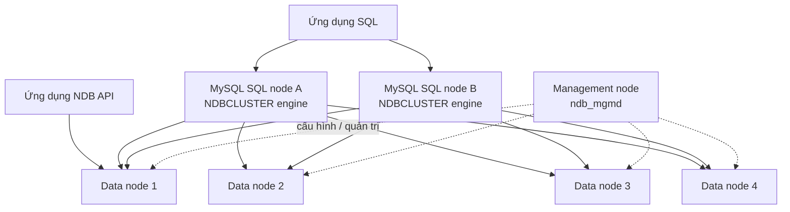
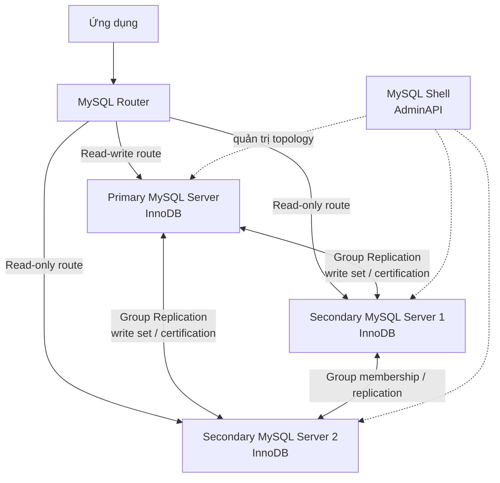

# NDB Cluster và ranh giới với InnoDB Cluster

NDB Cluster và InnoDB Cluster đều hướng tới tính sẵn sàng cao, nhưng chúng giải quyết bài toán ở hai lớp kiến trúc khác nhau. NDB Cluster là hệ thống cơ sở dữ liệu phân tán dùng storage engine NDB: dữ liệu được phân mảnh và nhân bản giữa các data node, còn MySQL Server có thể đóng vai trò SQL node để ứng dụng gửi câu lệnh SQL. InnoDB Cluster là giải pháp HA cho các MySQL Server dùng InnoDB, kết hợp Group Replication, MySQL Router và MySQL Shell AdminAPI để quản lý thành viên, bầu primary và định tuyến kết nối.

Vì vậy, tên gọi InnoDB Cluster không phải một storage engine mới và NDB Cluster không phải một chế độ replication của InnoDB. Hiểu ranh giới này giúp chọn đúng kiến trúc khi cần thiết kế bảng, index, transaction, kiểm soát đồng thời, mở rộng tải đọc/ghi, sao lưu và vận hành MySQL.

## Mục tiêu

Sau bài này, bạn có thể:

- Mô tả các thành phần và đường đi truy vấn của NDB Cluster.
- Giải thích cách NDB phân mảnh, nhân bản và duy trì khả năng phục vụ khi node gặp lỗi.
- Mô tả vai trò của InnoDB, Group Replication, MySQL Router và MySQL Shell trong InnoDB Cluster.
- Phân biệt cluster dùng storage engine phân tán với cluster HA nhân bản các MySQL instance.
- Chọn kiến trúc theo workload và nhận diện các giới hạn cần kiểm tra trước khi di chuyển ứng dụng.

## 1. Phân biệt ngay từ lớp kiến trúc

| Tiêu chí | NDB Cluster | InnoDB Cluster |
|---|---|---|
| Bản chất | Hệ thống database phân tán sử dụng storage engine NDB | Giải pháp HA/topology cho MySQL dựa trên Group Replication và InnoDB |
| Storage engine của bảng trong cluster | `NDBCLUSTER` (còn gọi NDB) | `InnoDB` |
| Phân bố dữ liệu | Dữ liệu được chia thành các fragment/partition và các bản sao đặt trên nhiều data node | Mỗi member giữ một bản sao đầy đủ của dữ liệu được replication trong group |
| Thành phần dữ liệu | NDB data nodes | MySQL Server instances chạy InnoDB |
| Thành phần SQL | Một hoặc nhiều MySQL Server SQL nodes có NDB engine; cũng có thể có client dùng NDB API | MySQL Server member nhận kết nối; MySQL Router thường đứng trước ứng dụng |
| Cơ chế HA chính | Phân mảnh và đồng bộ bản sao giữa các data node; node group và `NoOfReplicas` quyết định mức dự phòng | Group Replication, transaction certification, quorum và bầu primary |
| Quản trị | NDB Management Server/client và công cụ NDB | MySQL Shell AdminAPI và MySQL Router, cùng công cụ MySQL tiêu chuẩn |
| Mục tiêu nổi bật | Workload phân tán, yêu cầu HA, throughput cao và phản hồi ổn định khi dữ liệu được phân phối trên nhiều node | HA cho ứng dụng MySQL/InnoDB hiện có, chuyển đổi primary khi lỗi và định tuyến read/write |

Điểm khác nhau quan trọng nhất: NDB Cluster phân tán chính dữ liệu của bảng ở tầng storage engine; InnoDB Cluster nhân bản transaction giữa các MySQL Server, trong đó mỗi member duy trì dữ liệu InnoDB của cluster. Thêm member vào InnoDB Cluster không tự động chia một bảng thành các shard độc lập.

## 2. NDB Cluster là gì?

NDB Cluster là hệ thống cơ sở dữ liệu phân tán, dùng NDB storage engine (thường được hiển thị là `NDBCLUSTER`). Kiến trúc shared-nothing phân phối dữ liệu và xử lý trên nhiều data node. Các node giao tiếp qua mạng cluster; hệ thống không yêu cầu một thiết bị đĩa dùng chung cho tất cả data node.

NDB được thiết kế cho các workload cần tính sẵn sàng cao, phân phối dữ liệu và khả năng xử lý song song. NDB thường được dùng trong các hệ thống giao dịch thời gian thực hoặc dịch vụ có tải lớn, chẳng hạn một số hệ thống viễn thông, thanh toán và dịch vụ trực tuyến. Đây là lựa chọn có yêu cầu vận hành và mô hình dữ liệu riêng, không phải lựa chọn mặc định cho mọi ứng dụng MySQL.

### 2.1. Các thành phần chính

| Thành phần | Vai trò |
|---|---|
| Data node (`ndbmtd` hoặc `ndbd`) | Lưu và xử lý dữ liệu NDB, quản lý fragment, replica, transaction và phục hồi node |
| Management node (`ndb_mgmd`) | Phân phối cluster configuration, theo dõi và quản trị vòng đời node; không phải nơi lưu bảng nghiệp vụ |
| SQL node (`mysqld` có NDB engine) | Cung cấp giao diện SQL MySQL, thực thi câu SQL và chuyển yêu cầu tới NDB data nodes |
| NDB API client | Ứng dụng có thể truy cập NDB thông qua API mà không cần đi qua SQL node trong những trường hợp phù hợp |
| NDB management client (`ndb_mgm`) | Gửi lệnh quản trị và xem trạng thái cluster |

`ndbmtd` là data node daemon đa luồng; `ndbd` là daemon data node. Việc chọn binary và cách triển khai phụ thuộc phiên bản, cấu hình và nền tảng. Một cluster có thể có nhiều SQL node để nhận kết nối; SQL node không phải bản sao dữ liệu độc lập như một MySQL member trong InnoDB Cluster.

### 2.2. Sơ đồ kiến trúc NDB Cluster



Sơ đồ chỉ thể hiện các vai trò chính, không mô tả đầy đủ đường truyền giữa mọi node. Các data node phối hợp để lưu và xử lý dữ liệu; management node cung cấp cấu hình và công cụ điều khiển. Có thể triển khai management node dự phòng để tăng khả năng quản trị cluster.

### 2.3. Phân mảnh và nhân bản dữ liệu

NDB chia bảng thành các fragment/partition và phân phối chúng giữa các node group. Mỗi fragment có số bản sao được xác định bởi cấu hình `NoOfReplicas`. Ví dụ, với hai bản sao, mỗi phần dữ liệu có một replica trên hai data node khác nhau trong node group. Các bản sao được đồng bộ theo cơ chế của NDB để khi một data node gặp lỗi, replica còn lại có thể tiếp tục phục vụ nếu node group vẫn còn đủ dữ liệu.

Điều này khác với việc sao chép toàn bộ database lên từng server. Một data node thường giữ một phần dữ liệu của cluster cùng các replica mà nó chịu trách nhiệm; toàn bộ dataset được tạo thành từ các fragment phân bố trên cluster.

Phân mảnh có ý nghĩa với hiệu năng: transaction chỉ truy cập một số partition có thể ít tốn giao tiếp liên node hơn transaction phải chạm nhiều partition. Vì vậy, thiết kế khóa chính, phân bố dữ liệu và mẫu truy vấn ảnh hưởng lớn tới locality. Cần kiểm tra khả năng phân phối của khóa và benchmark bằng workload gần với thực tế.

### 2.4. NDB có phải chỉ lưu dữ liệu trong RAM?

NDB thường được biết đến với thiết kế tối ưu cho truy cập dữ liệu trong bộ nhớ, và dung lượng RAM của data node là yếu tố quan trọng khi lập kế hoạch. Tuy nhiên, không nên mô tả NDB Cluster như một hệ thống không thể lưu dữ liệu trên đĩa. NDB hỗ trợ Disk Data tablespace để lưu một số phần dữ liệu trên đĩa; các cấu trúc như index và phần dữ liệu cần truy cập nhanh vẫn có yêu cầu bộ nhớ riêng.

Khi ước lượng tài nguyên, cần tính memory cho dữ liệu/index theo đặc tính bảng, transaction, metadata, redo/undo và các buffer của NDB; đồng thời tính dung lượng đĩa, checkpoint, log, backup và tăng trưởng dữ liệu. Thông số cụ thể phải dựa trên phiên bản NDB Cluster và cấu hình triển khai.

## 3. Transaction và tính sẵn sàng trong NDB

Một transaction NDB có thể đọc hoặc ghi các bản ghi nằm trên một hay nhiều data node. Engine phối hợp các node liên quan để duy trì tính nhất quán và commit transaction phân tán. Việc nhân bản giữa các data node là một phần của cơ chế storage engine, thay vì yêu cầu ứng dụng tự sao chép từng bản ghi giữa các MySQL server.

NDB hỗ trợ transaction và khóa ở mức bản ghi. Tuy nhiên, khi một transaction chạm nhiều fragment, nhiều node hoặc gửi nhiều thao tác, chi phí giao tiếp mạng và phối hợp tăng lên. Transaction lớn, nhiều round-trip và phân bố khóa không hợp lý có thể làm latency tăng đáng kể. Hãy thiết kế transaction gọn, truy cập theo locality và đo hiệu năng với số node cùng cấu hình gần production.

### 3.1. Node group và số bản sao

`NoOfReplicas` trong cluster configuration quy định số replica của mỗi fragment. Cấu hình phải tương thích với số data node và cách tổ chức node group. Nếu một node group mất hết bản sao của một fragment, cluster không còn dữ liệu cần thiết để phục vụ phần đó. Do vậy, khả năng chịu lỗi không chỉ phụ thuộc tổng số node mà còn phụ thuộc cách các node được phân nhóm và vị trí đặt replica.

Ví dụ khái niệm với hai replica:

```text
Node group 0
  Data node A: fragment X (replica 1), fragment Y (replica 2)
  Data node B: fragment X (replica 2), fragment Y (replica 1)

Nếu A lỗi:
  Các replica còn ở B có thể giữ dữ liệu của node group này.
  Cluster cần hoàn tất quy trình phát hiện lỗi và phục hồi theo NDB.
```

Đây là minh họa đơn giản, không phải cấu hình node group đầy đủ. Không đặt hai replica của cùng fragment trên cùng một máy vật lý hoặc cùng một failure domain nếu mục tiêu là chịu lỗi máy chủ, rack hay vùng. Cần thiết kế phân bố node theo failure domain và kiểm thử tình huống node/process/network failure.

### 3.2. Phục hồi và khả năng tiếp tục phục vụ

Khi data node mất kết nối hoặc dừng đột ngột, các node còn lại phát hiện lỗi và thực hiện quy trình phục hồi. Nếu còn replica hợp lệ trong node group, cluster có thể tiếp tục phục vụ dữ liệu thuộc phạm vi đó sau khi đạt trạng thái hoạt động phù hợp. Khi node quay lại, NDB đồng bộ dữ liệu cần thiết theo quy trình phục hồi.

Không đồng nghĩa mọi lỗi đều không gây gián đoạn. Mất nhiều node trong cùng node group, lỗi mạng chia cắt cluster, hết memory, cấu hình replica sai hoặc lỗi storage có thể làm giảm khả năng phục vụ hoặc khiến cluster không thể tiếp tục. HA cần được chứng minh bằng kiểm thử failover, phục hồi, backup và restore định kỳ.

## 4. Nhận diện và làm việc với NDB từ MySQL SQL node

Một MySQL Server chỉ có thể tạo bảng NDB khi binary/distribution được xây dựng và cấu hình với NDB Cluster support, plugin NDB được bật, và server kết nối được tới cluster. Chỉ cài MySQL Server thông thường không có nghĩa là đã có một NDB Cluster.

### 4.1. Kiểm tra storage engine

Trên SQL node, kiểm tra engine được hỗ trợ:

```sql
SHOW ENGINES;
```

Hoặc truy vấn trực tiếp:

```sql
SELECT ENGINE, SUPPORT, TRANSACTIONS, XA, SAVEPOINTS
FROM information_schema.ENGINES
WHERE ENGINE IN ('InnoDB', 'NDBCLUSTER');
```

Nếu `NDBCLUSTER` không xuất hiện hoặc `SUPPORT` không ở trạng thái khả dụng, hãy kiểm tra bản cài đặt, plugin và cấu hình SQL node trước khi tạo bảng. Trên phiên bản/cách cài đặt khác nhau, thông tin plugin và tên biến có thể khác; có thể xem:

```sql
SHOW PLUGINS;
SHOW VARIABLES LIKE 'ndb%';
SHOW STATUS LIKE 'Ndb%';
```

### 4.2. Tạo bảng sử dụng NDB

Ví dụ bảng đơn giản:

```sql
CREATE TABLE device_state (
    device_id BIGINT NOT NULL,
    state_code VARCHAR(24) NOT NULL,
    updated_at TIMESTAMP NOT NULL DEFAULT CURRENT_TIMESTAMP
        ON UPDATE CURRENT_TIMESTAMP,
    PRIMARY KEY (device_id)
) ENGINE=NDBCLUSTER;
```

`ENGINE=NDBCLUSTER` yêu cầu bảng dùng NDB thay vì engine mặc định. Trong NDB Cluster, DDL và kiểu dữ liệu cần tuân theo các quy tắc, giới hạn của NDB; không nên giả định mọi bảng InnoDB đều có thể đổi engine mà không điều chỉnh schema. Kiểm tra bảng sau khi tạo:

```sql
SHOW CREATE TABLE device_state\G

SELECT TABLE_NAME, ENGINE
FROM information_schema.TABLES
WHERE TABLE_SCHEMA = DATABASE()
  AND TABLE_NAME = 'device_state';
```

### 4.3. Kiểm tra trạng thái cluster

NDB Management Client có thể hiển thị trạng thái node. Ví dụ lệnh đọc trạng thái:

```bash
ndb_mgm -e "SHOW"
ndb_mgm -e "ALL STATUS"
```

Các lệnh trên cần chạy tại máy có NDB management client và biết management server/connection string phù hợp. Trong môi trường có nhiều cluster, hãy chỉ rõ connect string theo cấu hình được quản trị. Không chạy lệnh `START`, `STOP`, `RESTART` hoặc thay đổi cấu hình node trên hệ thống đang phục vụ nếu chưa có kế hoạch vận hành được phê duyệt.

## 5. InnoDB Cluster là gì?

InnoDB Cluster là giải pháp HA cho các MySQL Server sử dụng InnoDB. Nó kết hợp ba thành phần chính:

| Thành phần | Vai trò |
|---|---|
| MySQL Server + InnoDB | Mỗi member lưu dữ liệu trong InnoDB và tham gia group replication |
| Group Replication | Trao đổi write set, certification transaction, duy trì membership/quorum và đồng bộ thay đổi giữa các member |
| MySQL Shell AdminAPI | Tạo, cấu hình, thêm/xóa member, kiểm tra trạng thái và quản lý topology |
| MySQL Router | Proxy nhận kết nối ứng dụng và định tuyến tới primary hoặc secondary theo routing mode |

AdminAPI là công cụ quản trị, không phải storage engine. Router là tầng định tuyến kết nối, không phải nơi lưu dữ liệu và cũng không thay thế Group Replication.

### 5.1. Sơ đồ InnoDB Cluster



Trong sơ đồ single-primary, ứng dụng gửi ghi tới primary. Secondary nhận transaction replication và có thể phục vụ đọc qua routing endpoint được cấu hình. Group Replication quản lý membership và trạng thái group; Router sử dụng metadata/topology để đưa kết nối tới member phù hợp.

### 5.2. Group Replication hoạt động ra sao?

Group Replication dùng cơ chế trao đổi write set và certification để phát hiện xung đột trước khi transaction được áp dụng trên các member. Các transaction được sắp thứ tự trong group theo giao thức group communication. Cơ chế này thường được mô tả là virtually synchronous replication: thay đổi được phối hợp trong group theo quy tắc commit/certification, thay vì chỉ gửi một bản sao bất đồng bộ tới một replica độc lập.

Group Replication có hai chế độ chính:

- **Single-primary:** một member là primary nhận ghi; các member còn lại là secondary. Khi primary lỗi hoặc rời group, các member còn lại có thể bầu primary mới nếu group còn quorum.
- **Multi-primary:** nhiều member có thể nhận ghi. Transaction vẫn phải qua certification; các ghi xung đột có thể bị từ chối. Chế độ này cần thiết kế ứng dụng, khóa và workload cẩn thận, không có nghĩa mọi ghi ở mọi node đều tự động không xung đột.

Group Replication cần đa số member có quyền biểu quyết để group duy trì quorum. Nếu mất quorum, group không thể tiếp tục xử lý transaction theo cách thông thường cho đến khi membership được khôi phục hoặc được xử lý theo quy trình phục hồi phù hợp. Vì vậy, ba member phân bố trên các failure domain độc lập là mô hình thường dùng cho HA; số member thực tế phải dựa trên yêu cầu và thiết kế vận hành.

### 5.3. Mỗi member giữ dữ liệu như thế nào?

Trong InnoDB Cluster, mỗi member là một MySQL Server có InnoDB và duy trì bản sao đầy đủ của dữ liệu được replication trong group. Khi transaction được commit và replication, các member áp dụng transaction vào bản sao cục bộ của mình. Dữ liệu không được chia thành fragment lưu độc quyền ở từng member như NDB Cluster.

Do mỗi member giữ toàn bộ dữ liệu, thêm member thường tăng khả năng chịu lỗi và có thể tăng năng lực phục vụ đọc nếu ứng dụng/Router phân phối read traffic phù hợp. Nó không tự động làm tổng dung lượng dataset có thể lưu tăng theo số node và cũng không tạo khả năng scale-out ghi tuyến tính. Mỗi member vẫn phải có đủ tài nguyên để lưu và xử lý dataset được replication.

## 6. Tạo và quản trị InnoDB Cluster bằng MySQL Shell

Các thao tác sau là ví dụ minh họa AdminAPI trên một môi trường lab gồm ba MySQL Server. Trước khi tạo cluster, từng instance phải đáp ứng yêu cầu cấu hình Group Replication của đúng phiên bản MySQL: network, hostname phân giải được, port group communication, GTID/binlog, tài khoản quản trị và các tùy chọn tương thích. Dùng MySQL Shell phiên bản phù hợp với server.

Mở MySQL Shell ở JavaScript mode và kết nối tới instance đầu tiên:

```bash
mysqlsh --js admin@mysql-1.example.internal:3306
```

Kiểm tra cấu hình instance trước khi đưa vào cluster:

```javascript
dba.checkInstanceConfiguration('admin@mysql-1.example.internal:3306');
```

Nếu instance chưa được cấu hình, dùng AdminAPI để áp dụng các thiết lập được yêu cầu sau khi đã xem xét thay đổi:

```javascript
dba.configureInstance('admin@mysql-1.example.internal:3306');
```

Sau khi các instance đều đạt precondition, tạo cluster và thêm member:

```javascript
var cluster = dba.createCluster('ordersCluster');

cluster.addInstance('admin@mysql-2.example.internal:3306');
cluster.addInstance('admin@mysql-3.example.internal:3306');

cluster.status();
```

Đây là trình tự minh họa; AdminAPI có thể hỏi lựa chọn recovery method, xác nhận thay đổi hoặc yêu cầu instance đáp ứng thêm điều kiện. Không sao chép nguyên lệnh lên production mà bỏ qua kết quả kiểm tra và cảnh báo. Sau khi tạo cluster, triển khai MySQL Router để ứng dụng dùng endpoint read-write/read-only theo cấu hình:

```bash
mysqlrouter --bootstrap admin@mysql-1.example.internal:3306
```

Lệnh bootstrap là ví dụ khởi tạo Router; tham số, user hệ điều hành, thư mục cấu hình và cách chạy service phụ thuộc nền tảng. Ứng dụng nên kết nối Router endpoint được cấp thay vì hard-code địa chỉ primary hiện tại, nhờ đó có thể theo topology sau khi failover.

Kiểm tra topology từ MySQL Shell:

```javascript
cluster.status({extended: 1});
```

Trạng thái giúp kiểm tra member nào ONLINE, vai trò primary/secondary, trạng thái replication và thông tin cần xử lý. Cần theo dõi cảnh báo và log từng member, không chỉ nhìn trạng thái Router.

## 7. So sánh cách chịu lỗi và mở rộng

| Tình huống | NDB Cluster | InnoDB Cluster |
|---|---|---|
| Một data/server node lỗi | NDB có thể tiếp tục nếu node group còn replica hợp lệ; phục hồi theo cơ chế NDB | Group Replication cần còn quorum; single-primary có thể bầu primary mới |
| Một member mất kết nối mạng | Ảnh hưởng phụ thuộc node group, replica và tình trạng các fragment | Member có thể bị loại khỏi group; group cần quorum để tiếp tục commit |
| Phân bố dataset | Fragment và replica được đặt trên các data node | Mỗi member giữ bản sao đầy đủ của dataset được replication |
| Tăng dung lượng lưu trữ | Có thể mở rộng bằng cách thêm data node và phân phối lại dữ liệu theo quy trình NDB | Thêm member không chia nhỏ dataset; mỗi member cần đủ dung lượng cho bản sao |
| Tăng khả năng phục vụ đọc | Thêm SQL node/API node và tối ưu phân phối dữ liệu/truy vấn; vẫn cần xét tải data node | Có thể định tuyến đọc tới secondary, tùy yêu cầu consistency và trạng thái replication |
| Tăng throughput ghi | Có thể phân phối workload theo partition và xử lý song song, tùy locality | Single-primary ghi tập trung ở primary; multi-primary có certification/conflict overhead |
| Phụ thuộc mạng | Mạng giữa SQL/API nodes và data nodes là phần cốt lõi của storage engine phân tán | Mạng giữa Group Replication members cần ổn định, độ trễ thấp và đủ băng thông |

Không có cluster nào miễn nhiễm với lỗi cấu hình, lỗi mạng, mất quorum, hết dung lượng, lỗi ứng dụng hoặc thao tác quản trị sai. HA là khả năng phục hồi có điều kiện; phải thử nghiệm failure scenario và đo thời gian khôi phục.

## 8. Ranh giới kỹ thuật: không thể hoán đổi tên gọi

### 8.1. `ENGINE=NDBCLUSTER` không có nghĩa là InnoDB Cluster

Trong NDB Cluster, câu lệnh `ENGINE=NDBCLUSTER` chọn storage engine NDB cho bảng. Trong InnoDB Cluster, bảng vẫn dùng `ENGINE=InnoDB`; tính sẵn sàng đến từ Group Replication giữa các MySQL Server. Tạo một bảng InnoDB trên một MySQL Server độc lập không tự động biến nó thành InnoDB Cluster, và cài MySQL Router cũng không biến server thành NDB Cluster.

### 8.2. InnoDB Cluster không phải sharding tự động

InnoDB Cluster nhân bản transaction tới các member và duy trì một bản sao đầy đủ trên mỗi member. Nó hỗ trợ HA và có thể hỗ trợ read scaling qua secondary, nhưng không tự động chia một bảng lớn thành các mảnh dữ liệu độc lập trên các member. Nếu workload cần sharding hoặc phân vùng dữ liệu phân tán ở tầng storage, cần đánh giá kiến trúc khác và cơ chế phân phối dữ liệu tương ứng.

### 8.3. NDB Cluster không phải MySQL Group Replication

NDB có cơ chế phân phối transaction và đồng bộ replica ở tầng storage engine/data node. Group Replication là plugin replication ở cấp MySQL Server, trao đổi write set giữa các member. NDB SQL nodes có thể cung cấp SQL interface nhưng điều đó không biến NDB thành Group Replication. Hai cơ chế có thành phần, cách quản trị, giới hạn và failure model khác nhau.

### 8.4. Khả năng tương thích SQL và ứng dụng

NDB hỗ trợ giao diện SQL MySQL thông qua SQL node, nhưng không phải mọi tính năng và hành vi của InnoDB đều có sẵn hoặc có cùng giới hạn trên NDB. Trước khi chuyển bảng, cần kiểm tra tài liệu tương thích theo đúng bản NDB Cluster và rà soát:

- Kiểu dữ liệu, độ dài cột, index và primary key.
- Foreign key, constraint, trigger, stored routine và các đặc tính DDL cần dùng.
- Partitioning, unique key, auto-increment và giới hạn kích thước bảng/index.
- Transaction, isolation, locking và mẫu truy vấn nhiều bảng.
- Cách backup/restore, online schema change, monitoring và công cụ vận hành.

Không dùng `ALTER TABLE ... ENGINE=NDBCLUSTER` như một thao tác chuyển đổi vô hại trên hệ thống đang chạy. Cần thử trên bản sao dữ liệu, đo dung lượng và hiệu năng, kiểm tra tương thích, xác minh dữ liệu sau migration và có kế hoạch rollback.

## 9. Backup, restore và vận hành

NDB Cluster và InnoDB Cluster có quy trình backup/restore khác nhau vì cách lưu dữ liệu và quản lý cluster khác nhau.

Với NDB Cluster, backup cluster thường được khởi tạo qua NDB management client (ví dụ lệnh `START BACKUP`) và restore bằng công cụ `ndb_restore` theo đúng phiên bản/cấu hình. Backup gồm các thành phần dữ liệu và log cần thiết theo quy trình NDB; cần lưu metadata về cluster configuration và kiểm tra cách phục hồi từng database/table.

Với InnoDB Cluster, dữ liệu nằm trong các MySQL Server/InnoDB instance. Có thể dùng công cụ backup MySQL phù hợp như MySQL Enterprise Backup, Clone Plugin hoặc logical dump theo yêu cầu. Tuy nhiên, phải phối hợp snapshot/backup với trạng thái replication và topology để bảo đảm tính nhất quán. Không mặc định rằng backup thư mục dữ liệu của một member đang chạy bằng cách copy file thông thường là hợp lệ.

Trong cả hai mô hình, cần:

- Giám sát trạng thái node, replication, network, disk, memory và transaction latency.
- Theo dõi lỗi node, mất quorum, replica lag/apply queue, transaction conflict và cảnh báo capacity.
- Kiểm thử restore trên môi trường riêng; backup chỉ có giá trị khi đã chứng minh có thể phục hồi.
- Lập kế hoạch nâng cấp theo ma trận tương thích giữa server, engine, cluster components, connector và công cụ quản trị.
- Ghi lại quy trình failover, rejoin, rolling restart, thay node và xử lý network partition.

## 10. Chọn kiến trúc nào?

| Nhu cầu | Hướng đánh giá |
|---|---|
| Ứng dụng MySQL hiện tại dùng InnoDB và cần HA, failover primary | InnoDB Cluster thường là điểm bắt đầu phù hợp; đánh giá Group Replication, quorum, Router và giới hạn workload |
| Cần bản sao đầy đủ trên nhiều MySQL server để chịu lỗi và phân phối đọc | InnoDB Cluster phù hợp với mô hình full replica; kiểm tra read consistency và tải replication |
| Cần phân phối dataset thành fragment trên nhiều data node, đồng thời nhân bản fragment để HA | Đánh giá NDB Cluster và yêu cầu partitioning, memory, network, SQL compatibility |
| Workload phân tán, transaction ngắn, truy cập theo partition và yêu cầu throughput/availability cao | NDB có thể phù hợp nếu schema và access pattern tương thích |
| Ứng dụng phụ thuộc sâu vào tính năng InnoDB hoặc SQL behavior phổ biến | Ưu tiên InnoDB; nếu cần HA, đánh giá InnoDB Cluster trước khi cân nhắc chuyển engine |
| Muốn tăng dung lượng dữ liệu chỉ bằng cách thêm member vào InnoDB Cluster | InnoDB Cluster không tự sharding; cần thiết kế phân mảnh ở lớp khác hoặc đánh giá NDB |

Lựa chọn cuối cùng phải dựa trên workload đo được, yêu cầu consistency, SLA, RPO/RTO, kỹ năng vận hành, ngân sách hạ tầng và ma trận hỗ trợ của phiên bản. Đừng chọn NDB chỉ vì cần nhiều node, cũng đừng chọn InnoDB Cluster chỉ vì tên có chữ Cluster.

## 11. Bài thực hành

Thực hiện trên môi trường lab được cấp riêng; không thử dừng node hoặc thay đổi cluster configuration trên hệ thống production.

1. Trên một MySQL Server độc lập, chạy `SHOW ENGINES` và xác nhận InnoDB có sẵn. Nếu không có NDB Cluster được cài, ghi rõ `NDBCLUSTER` không khả dụng trong môi trường hiện tại.
2. Đọc sơ đồ NDB Cluster ở phần 2.2 và mô tả vai trò của SQL node, data node, management node và NDB API client.
3. Trên một NDB Cluster lab đã cấu hình, kiểm tra trạng thái node bằng `ndb_mgm -e "SHOW"`; kiểm tra bảng NDB bằng `SHOW CREATE TABLE` và `information_schema.TABLES`.
4. Ghi lại `NoOfReplicas` và sơ đồ node group của lab. Giải thích một data node failure ảnh hưởng tới fragment và replica như thế nào.
5. Trên một lab InnoDB Cluster, mở MySQL Shell, chạy `cluster.status()` và xác định primary, secondary, trạng thái member và Router endpoint.
6. Tạo một bảng `ENGINE=InnoDB` trên InnoDB Cluster và xác minh engine bằng `information_schema.TABLES`. Giải thích vì sao bảng này không cần engine NDB.
7. Lập bảng so sánh hai kiến trúc theo storage layout, replication, quorum/failure model, cách kết nối ứng dụng, scale-out và quy trình backup/restore.
8. Chọn một workload giả định, nêu lý do chọn NDB hoặc InnoDB Cluster, các giới hạn cần xác minh và một kế hoạch thử nghiệm failover/restore.

Bạn hoàn thành bài khi có thể giải thích rõ NDB Cluster là nền tảng storage phân tán dùng NDB engine, còn InnoDB Cluster là topology HA cho các MySQL Server dùng InnoDB; đồng thời chỉ ra ảnh hưởng của khác biệt này tới thiết kế dữ liệu, truy vấn và vận hành.

## 12. Nguyên tắc cần ghi nhớ

- NDB Cluster phân mảnh và nhân bản dữ liệu giữa các data node; InnoDB Cluster replication toàn bộ dữ liệu của group tới từng member.
- `NDBCLUSTER` là storage engine; InnoDB Cluster là giải pháp HA kết hợp InnoDB, Group Replication, MySQL Shell và MySQL Router.
- NDB cần thiết kế node group, replica, partition locality, RAM, network và SQL compatibility.
- InnoDB Cluster cần quorum, transaction certification, primary election và định tuyến đúng qua Router.
- Thêm member vào InnoDB Cluster không tự động sharding dữ liệu hoặc scale tuyến tính throughput ghi.
- Không di chuyển engine hay đổi topology production nếu chưa kiểm thử tương thích, backup/restore, failover và rollback.
