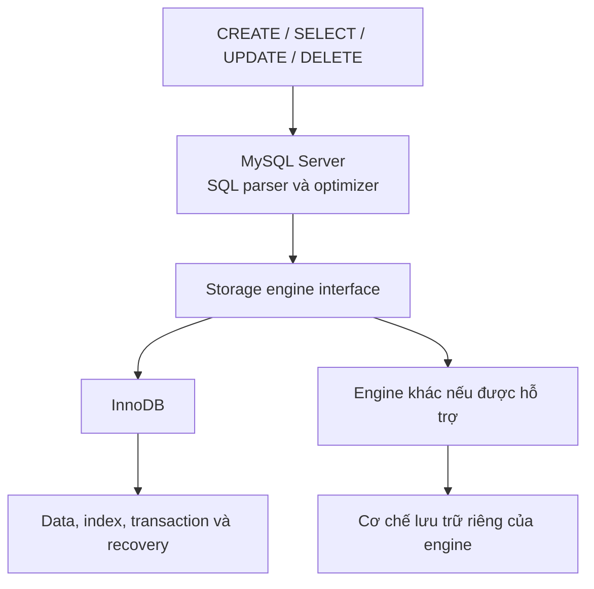

# SHOW ENGINES, default_storage_engine và khai báo engine cho bảng

MySQL có thể sử dụng nhiều storage engine để quản lý cách dữ liệu của bảng được lưu trữ và truy cập. Mỗi engine có đặc điểm riêng về transaction, khóa, khóa ngoại, phục hồi và hiệu năng. Khi tạo bảng, MySQL dùng storage engine mặc định của phiên kết nối nếu câu lệnh không chỉ định engine; người phát triển cũng có thể khai báo engine rõ ràng trong câu lệnh DDL.

Bài học này hướng dẫn kiểm tra engine mà server hỗ trợ bằng `SHOW ENGINES`, xem và thay đổi `default_storage_engine`, cấu hình giá trị mặc định lâu dài, cũng như chỉ định engine cho từng bảng. Các câu lệnh minh họa dùng MySQL 8.x; hãy đối chiếu tài liệu của đúng phiên bản và môi trường đang vận hành trước khi thay đổi cấu hình production.

## 1. Storage engine quyết định điều gì?

MySQL Server xử lý SQL, phân tích truy vấn, tối ưu kế hoạch thực thi và điều phối các thao tác dữ liệu. Storage engine đảm nhiệm phần lưu trữ và truy xuất dữ liệu của bảng theo giao diện mà server cung cấp.

Engine ảnh hưởng đến nhiều hành vi quan trọng:

- Có hỗ trợ transaction và rollback hay không.
- Cơ chế khóa và cách nhiều phiên kết nối đọc/ghi đồng thời.
- Khả năng khai báo và thực thi khóa ngoại.
- Cách ghi dữ liệu, phục hồi sau sự cố và quản lý chỉ mục.
- Những tính năng đặc thù như full-text index hoặc cách tổ chức dữ liệu.

Trong các ứng dụng giao dịch hiện đại, InnoDB thường là lựa chọn phù hợp vì hỗ trợ transaction ACID, khóa ở mức hàng, khóa ngoại và cơ chế phục hồi. Tuy nhiên, cần chọn engine dựa trên yêu cầu thực tế và khả năng của phiên bản MySQL đang dùng.



Một database có thể chứa các bảng dùng những engine khác nhau. Engine được chọn ở cấp bảng, còn `default_storage_engine` cung cấp giá trị mặc định cho bảng mới khi không có chỉ định riêng.

## 2. Liệt kê storage engine bằng SHOW ENGINES

Chạy câu lệnh:

```sql
SHOW ENGINES;
```

MySQL trả về danh sách các engine mà server nhận biết, cùng thông tin hỗ trợ và một số khả năng liên quan. Có thể dùng câu lệnh đồng nghĩa:

```sql
SHOW STORAGE ENGINES;
```

Các cột thường gặp trong kết quả:

| Cột | Ý nghĩa |
| --- | --- |
| `Engine` | Tên storage engine |
| `Support` | Trạng thái hỗ trợ của engine trên server hiện tại |
| `Comment` | Mô tả ngắn về engine |
| `Transactions` | Engine có hỗ trợ transaction hay không |
| `XA` | Engine có hỗ trợ XA hay không |
| `Savepoints` | Engine có hỗ trợ savepoint hay không |

Giá trị `Support` thường có các trạng thái sau:

- `DEFAULT`: engine đang là storage engine mặc định của server.
- `YES`: engine có sẵn và có thể sử dụng.
- `NO`: engine không được hỗ trợ trong bản server hiện tại.
- `DISABLED`: engine có trong bản dựng nhưng đang bị vô hiệu hóa.

Ví dụ kết quả có thể cho thấy `InnoDB` có trạng thái `DEFAULT`, `Transactions`, `XA` và `Savepoints` được hỗ trợ. Kết quả thực tế phụ thuộc phiên bản, cách đóng gói và cấu hình server; không nên giả định danh sách engine giống nhau trên mọi máy.

### 2.1. Truy vấn metadata engine

Có thể đọc thông tin tương tự từ `INFORMATION_SCHEMA.ENGINES`:

```sql
SELECT
    ENGINE,
    SUPPORT,
    COMMENT,
    TRANSACTIONS,
    XA,
    SAVEPOINTS
FROM INFORMATION_SCHEMA.ENGINES
ORDER BY ENGINE;
```

Truy vấn này thuận tiện khi muốn lọc hoặc kết hợp metadata với các truy vấn kiểm kê khác. Ví dụ chỉ liệt kê các engine có thể sử dụng:

```sql
SELECT ENGINE, SUPPORT, TRANSACTIONS, XA, SAVEPOINTS
FROM INFORMATION_SCHEMA.ENGINES
WHERE SUPPORT IN ('YES', 'DEFAULT')
ORDER BY ENGINE;
```

`SHOW ENGINES` cho biết khả năng và trạng thái mà server công bố. Nó không đo tốc độ thực tế, không chứng minh engine phù hợp với workload và cũng không thay thế việc kiểm thử transaction, locking hoặc phục hồi.

## 3. Xem storage engine mặc định

Biến hệ thống `default_storage_engine` xác định engine được chọn khi tạo bảng mà câu lệnh không chỉ định `ENGINE`.

Kiểm tra giá trị hiện tại:

```sql
SHOW VARIABLES LIKE 'default_storage_engine';
```

Hoặc xem rõ phạm vi global và session:

```sql
SELECT
    @@GLOBAL.default_storage_engine AS global_engine,
    @@SESSION.default_storage_engine AS session_engine;
```

Hai giá trị có thể khác nhau. `GLOBAL` là giá trị mặc định được áp dụng cho các kết nối mới; `SESSION` là giá trị đang dùng trong kết nối hiện tại. Khi tạo bảng, phiên kết nối sử dụng giá trị session của nó nếu câu lệnh không khai báo engine riêng.

Có thể xem từng phạm vi bằng:

```sql
SHOW GLOBAL VARIABLES LIKE 'default_storage_engine';
SHOW SESSION VARIABLES LIKE 'default_storage_engine';
```

## 4. Thay đổi default_storage_engine ở phạm vi session

Nếu chỉ muốn áp dụng cho các câu lệnh trong kết nối hiện tại, dùng `SET SESSION`:

```sql
SET SESSION default_storage_engine = InnoDB;

SELECT @@SESSION.default_storage_engine;
```

Sau đó, một bảng mới không ghi `ENGINE` sẽ dùng InnoDB trong phiên này. Thay đổi session không ảnh hưởng đến các kết nối khác. Khi kết nối kết thúc, giá trị session đó cũng hết hiệu lực.

Đây là cách phù hợp để thử nghiệm hoặc điều chỉnh một phiên làm việc riêng mà không thay đổi cấu hình mặc định cho toàn server.

## 5. Thay đổi default_storage_engine ở phạm vi global

Nếu muốn thay đổi giá trị mặc định cho những kết nối được tạo sau đó, quản trị viên có thể dùng:

```sql
SET GLOBAL default_storage_engine = InnoDB;

SELECT @@GLOBAL.default_storage_engine;
```

Thay đổi `GLOBAL` không tự ghi đè giá trị session của các kết nối đang tồn tại. Các phiên cũ tiếp tục dùng giá trị session hiện có; kết nối mới nhận giá trị global làm mặc định session ban đầu.

Việc thay đổi biến global cần quyền quản trị hệ thống phù hợp. Trên các phiên bản MySQL hiện đại, quyền `SYSTEM_VARIABLES_ADMIN` được dùng để quản lý nhiều biến hệ thống; quyền cụ thể còn tùy phiên bản và chính sách phân quyền. Không cấp quyền này cho tài khoản ứng dụng runtime.

**Lưu ý về tính bền vững:** `SET GLOBAL` thay đổi giá trị đang chạy nhưng thông thường không tự lưu cấu hình để giữ nguyên sau khi restart server. Nếu cần giá trị tồn tại qua lần khởi động lại, hãy cấu hình trong option file hoặc dùng cơ chế persist được phiên bản MySQL hỗ trợ.

## 6. Cấu hình giá trị mặc định lâu dài

### 6.1. Cấu hình trong option file

Trong file cấu hình MySQL, ví dụ `my.cnf` hoặc `my.ini`, thêm tùy chọn dưới nhóm `[mysqld]`:

```ini
[mysqld]
default-storage-engine=InnoDB
```

Sau khi thay đổi, cần khởi động lại MySQL Server theo quy trình của hệ điều hành hoặc dịch vụ quản lý. Tên và vị trí option file phụ thuộc cách cài đặt. Với dịch vụ MySQL được quản lý trên cloud, cấu hình có thể được đặt trong parameter group hoặc giao diện cấu hình của nhà cung cấp thay vì chỉnh file trực tiếp.

Sau khi server khởi động, xác minh lại:

```sql
SELECT @@GLOBAL.default_storage_engine;
SHOW ENGINES;
```

### 6.2. Dùng SET PERSIST trên phiên bản hỗ trợ

MySQL 8.0 có hỗ trợ `SET PERSIST` cho nhiều biến hệ thống động. Với phiên bản và biến được hỗ trợ, có thể dùng:

```sql
SET PERSIST default_storage_engine = InnoDB;
```

Lệnh này thay đổi giá trị global đang chạy và lưu giá trị vào file cấu hình persist do MySQL quản lý (`mysqld-auto.cnf`) để áp dụng qua lần khởi động tiếp theo. Cần quyền quản trị phù hợp và kiểm tra chính sách cấu hình của môi trường trước khi dùng.

Không chỉnh sửa `mysqld-auto.cnf` bằng tay để thay đổi biến persist. Nếu cần bỏ một giá trị đã persist, dùng câu lệnh quản lý biến persist tương ứng theo phiên bản MySQL, ví dụ `RESET PERSIST default_storage_engine;`, sau khi đã hiểu tác động của việc trở về cấu hình option file hoặc mặc định.

## 7. Khai báo storage engine khi tạo bảng

Có thể chỉ định engine trực tiếp trong câu lệnh `CREATE TABLE` bằng table option `ENGINE`:

```sql
CREATE TABLE customers (
    id BIGINT UNSIGNED NOT NULL AUTO_INCREMENT,
    email VARCHAR(254) NOT NULL,
    full_name VARCHAR(150) NOT NULL,
    created_at DATETIME NOT NULL DEFAULT CURRENT_TIMESTAMP,
    PRIMARY KEY (id),
    UNIQUE KEY uq_customers_email (email)
) ENGINE=InnoDB;
```

Trong ví dụ, `ENGINE=InnoDB` yêu cầu MySQL tạo bảng bằng InnoDB, bất kể giá trị `default_storage_engine` hiện tại. Khai báo tường minh giúp người đọc schema biết rõ bảng phụ thuộc vào engine nào.

Nếu bỏ table option `ENGINE`, MySQL dùng `@@SESSION.default_storage_engine` của kết nối thực thi lệnh. Có thể kiểm tra DDL đã được tạo như mong đợi:

```sql
SHOW CREATE TABLE customers\G
```

Kết quả có phần `ENGINE=InnoDB` trong định nghĩa bảng. Cũng có thể kiểm tra engine của các bảng trong schema hiện tại:

```sql
SELECT
    TABLE_SCHEMA,
    TABLE_NAME,
    ENGINE
FROM INFORMATION_SCHEMA.TABLES
WHERE TABLE_SCHEMA = DATABASE()
  AND TABLE_TYPE = 'BASE TABLE'
ORDER BY TABLE_NAME;
```

### 7.1. So sánh bảng dùng engine mặc định và engine tường minh

Thử tạo hai bảng trong một schema lab:

```sql
SET SESSION default_storage_engine = InnoDB;

CREATE TABLE engine_from_default (
    id BIGINT UNSIGNED NOT NULL AUTO_INCREMENT,
    note VARCHAR(100) NOT NULL,
    PRIMARY KEY (id)
);

CREATE TABLE engine_explicit (
    id BIGINT UNSIGNED NOT NULL AUTO_INCREMENT,
    note VARCHAR(100) NOT NULL,
    PRIMARY KEY (id)
) ENGINE=InnoDB;

SELECT TABLE_NAME, ENGINE
FROM INFORMATION_SCHEMA.TABLES
WHERE TABLE_SCHEMA = DATABASE()
  AND TABLE_NAME IN ('engine_from_default', 'engine_explicit')
ORDER BY TABLE_NAME;
```

Cả hai bảng đều dùng InnoDB trong ví dụ này. Bảng đầu tiên nhận engine từ session default; bảng thứ hai nhận engine từ table option tường minh.

## 8. Đổi engine của một bảng đã tồn tại

Nếu cần chuyển bảng hiện có sang engine khác, có thể dùng `ALTER TABLE`:

```sql
ALTER TABLE legacy_orders ENGINE=InnoDB;
```

Lệnh trên là ví dụ minh họa. Trước khi chạy, hãy xác minh engine đích có sẵn và hỗ trợ các tính năng mà schema đang sử dụng. Thay đổi engine có thể yêu cầu MySQL tạo lại cấu trúc lưu trữ và sao chép dữ liệu. Với bảng lớn, thao tác có thể tiêu tốn đáng kể CPU, I/O, dung lượng tạm và thời gian; mức độ khóa hoặc khả năng chạy online phụ thuộc engine, phiên bản, câu lệnh cụ thể và workload.

Checklist trước khi đổi engine:

1. Kiểm tra dung lượng trống, kích thước bảng và tải hiện tại.
2. Kiểm tra index, foreign key, trigger và các tính năng phụ thuộc engine.
3. Đọc tài liệu về thuật toán DDL và mức độ khóa của phiên bản đang dùng.
4. Backup dữ liệu và xác minh có thể restore.
5. Thử trên staging với dữ liệu gần thực tế, đo thời gian và ảnh hưởng đến truy vấn.
6. Lập cửa sổ triển khai và kế hoạch rollback.
7. Sau khi chuyển, kiểm tra `SHOW CREATE TABLE`, metadata engine và các truy vấn quan trọng.

Không dùng `ALTER TABLE ... ENGINE=...` như một thao tác sửa lỗi tùy tiện trên production. Đây là thay đổi cấu trúc vật lý có thể ảnh hưởng lớn đến hệ thống.

## 9. Điều gì xảy ra nếu engine được yêu cầu không khả dụng?

Khi tạo bảng bằng một engine mà server không hỗ trợ hoặc đang bị vô hiệu hóa, hành vi phụ thuộc SQL mode `NO_ENGINE_SUBSTITUTION`.

Kiểm tra mode hiện tại:

```sql
SELECT @@SESSION.sql_mode;
```

Khi `NO_ENGINE_SUBSTITUTION` được bật, MySQL báo lỗi nếu engine được yêu cầu không khả dụng. Khi mode này tắt, server có thể phát cảnh báo và thay bằng engine mặc định. Trong môi trường phát triển và production, nên giữ hành vi rõ ràng để tránh nghĩ rằng bảng đã được tạo bằng engine yêu cầu trong khi thực tế dùng engine khác.

Sau khi tạo bảng, luôn xác minh kết quả bằng `SHOW CREATE TABLE` hoặc `INFORMATION_SCHEMA.TABLES`; không chỉ dựa vào việc câu lệnh DDL đã chạy xong.

## 10. Chọn engine và kiểm tra trước khi triển khai

Khi quyết định engine cho bảng, hãy xem xét:

- **Transaction:** nghiệp vụ có cần commit/rollback nhiều câu lệnh như một đơn vị không?
- **Khóa và đồng thời:** nhiều kết nối có thường cập nhật cùng dữ liệu không?
- **Ràng buộc:** schema có cần foreign key hoặc các quy tắc toàn vẹn ở cấp database không?
- **Phục hồi:** yêu cầu khôi phục sau crash và bảo vệ dữ liệu là gì?
- **Tính năng:** workload cần full-text index hay khả năng riêng của một engine nào đó không?
- **Vận hành:** đội ngũ có kinh nghiệm, công cụ backup, giám sát và quy trình xử lý sự cố cho engine đó không?

Với phần lớn bảng nghiệp vụ giao dịch, InnoDB là lựa chọn mặc định hợp lý trong MySQL hiện đại. Chỉ dùng engine khác khi có yêu cầu rõ ràng, hiểu được giới hạn và đã kiểm thử.

`SHOW ENGINES` giúp biết engine nào có thể dùng và một số tính năng mà engine công bố. Nó không trả lời engine nào nhanh nhất cho dữ liệu của bạn. Cần benchmark trên workload thực tế và kiểm tra hành vi transaction, khóa, backup/restore trước khi quyết định.

## 11. Quy trình kiểm tra nhanh cho một schema

Khi tiếp nhận một database hoặc chuẩn bị triển khai, có thể chạy lần lượt:

```sql
-- 1. Liệt kê engine server hỗ trợ
SHOW ENGINES;

-- 2. Xem giá trị mặc định global và session
SELECT
    @@GLOBAL.default_storage_engine,
    @@SESSION.default_storage_engine;

-- 3. Xem SQL mode liên quan thay thế engine
SELECT @@SESSION.sql_mode;

-- 4. Kiểm tra engine của bảng trong schema hiện tại
SELECT TABLE_NAME, ENGINE
FROM INFORMATION_SCHEMA.TABLES
WHERE TABLE_SCHEMA = DATABASE()
  AND TABLE_TYPE = 'BASE TABLE'
ORDER BY TABLE_NAME;

-- 5. Kiểm tra DDL của một bảng cụ thể
SHOW CREATE TABLE customers;
```

Lưu kết quả kiểm tra cùng phiên bản MySQL, thời điểm và môi trường. Nếu schema có bảng dùng engine khác nhau, hãy xác định lý do và kiểm tra xem khác biệt đó có còn phù hợp với yêu cầu ứng dụng.

## 12. Bài tập thực hành

1. Chạy `SHOW ENGINES` và ghi lại những engine có `Support` là `DEFAULT`, `YES`, `NO` hoặc `DISABLED`.
2. Truy vấn `INFORMATION_SCHEMA.ENGINES` và so sánh các cột `TRANSACTIONS`, `XA`, `SAVEPOINTS`.
3. Xem `@@GLOBAL.default_storage_engine` và `@@SESSION.default_storage_engine`; ghi nhận hai giá trị.
4. Dùng `SET SESSION default_storage_engine = InnoDB`, tạo một bảng không khai báo engine và kiểm tra bằng `SHOW CREATE TABLE`.
5. Tạo một bảng khác với `ENGINE=InnoDB` và xác minh qua `INFORMATION_SCHEMA.TABLES`.
6. Thử thay đổi session default trong một kết nối riêng và kiểm tra rằng kết nối khác không bị thay đổi.
7. Trên môi trường lab, tìm hiểu cách cấu hình `default-storage-engine` trong option file hoặc `SET PERSIST` nếu phiên bản hỗ trợ; xác minh sau khi restart theo quy trình an toàn.
8. Giải thích vì sao thay đổi default engine không tự chuyển đổi những bảng đã tồn tại.

## 13. Ghi nhớ

`SHOW ENGINES` liệt kê storage engine và trạng thái hỗ trợ trên MySQL Server. `default_storage_engine` là biến hệ thống có phạm vi global và session: session quyết định engine mặc định cho bảng mới trong kết nối hiện tại; global cung cấp giá trị mặc định cho các kết nối mới. `SET GLOBAL` thay đổi giá trị đang chạy, còn option file hoặc `SET PERSIST` trên phiên bản hỗ trợ giúp duy trì cấu hình qua restart.

Khi tạo bảng, `ENGINE=...` chỉ định engine tường minh và ưu tiên hơn giá trị mặc định của session. Nếu bỏ qua, MySQL dùng `default_storage_engine` của phiên tạo bảng. Đổi engine của bảng đã tồn tại cần `ALTER TABLE` và có thể tốn tài nguyên, thời gian hoặc gây khóa. Luôn xác minh engine thực tế bằng `SHOW CREATE TABLE` hoặc `INFORMATION_SCHEMA.TABLES`, đồng thời kiểm tra engine hỗ trợ và thử nghiệm trước khi thay đổi production.
