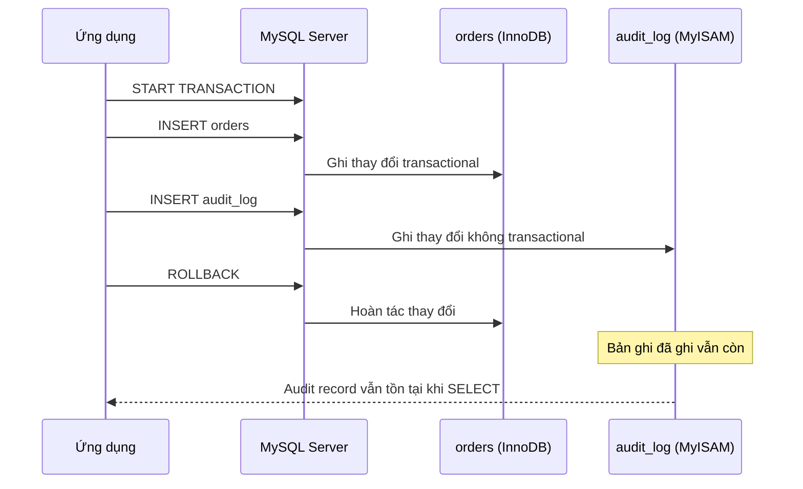

# Nguy cơ giao dịch chứa nhiều bảng thuộc engine khác nhau

Trong MySQL, transaction không tự động biến mọi bảng được câu SQL chạm tới thành dữ liệu có thể rollback. Khả năng commit, rollback, khóa và đọc nhất quán phụ thuộc vào storage engine của từng bảng. Nếu một nghiệp vụ cập nhật bảng InnoDB rồi ghi thêm vào bảng MyISAM trong cùng `START TRANSACTION`, `ROLLBACK` có thể hoàn tác thay đổi InnoDB nhưng không thể hoàn tác thay đổi MyISAM. Kết quả là dữ liệu nghiệp vụ và dữ liệu phụ trợ có thể lệch nhau dù ứng dụng tin rằng toàn bộ transaction đã bị hủy.

Đây là rủi ro thiết kế quan trọng khi làm chủ MySQL: cần hiểu engine của mọi bảng mà một nghiệp vụ tác động, kể cả bảng được ghi gián tiếp qua trigger hoặc stored routine. Phạm vi module `DATABASE_MYSQL` bao gồm thiết kế bảng, kiểu dữ liệu, khóa, SQL, transaction, kiểm soát đồng thời và vận hành; vì vậy lựa chọn storage engine phải phù hợp với yêu cầu nhất quán của nghiệp vụ, không chỉ dựa vào mặc định hoặc hiệu năng đọc.

## 1. Transaction được thực thi bởi storage engine

MySQL Server tiếp nhận và phân tích SQL, kiểm tra quyền, tối ưu câu lệnh rồi phối hợp với storage engine để đọc hoặc thay đổi dữ liệu. Storage engine quản lý cách lưu trang, index, khóa và các đặc tính giao dịch của bảng. Do đó, khi một transaction chạm tới nhiều bảng, engine của từng bảng quyết định thay đổi có thể được hoàn tác và cô lập tới mức nào.

InnoDB là storage engine transactional phổ biến của MySQL. Nó hỗ trợ ACID, `COMMIT`, `ROLLBACK`, MVCC, khóa ở mức hàng và khóa ngoại. MyISAM là engine không hỗ trợ transaction: thay đổi dữ liệu được áp dụng trực tiếp và không thể hoàn tác bằng `ROLLBACK`; cơ chế khóa chính của nó là khóa mức bảng.

| Đặc tính | InnoDB | MyISAM |
|---|---|---|
| Transaction | Có | Không |
| `COMMIT` / `ROLLBACK` | Có hiệu lực với thay đổi transactional | Không hoàn tác thay đổi đã ghi |
| MVCC / consistent read | Có | Không có snapshot MVCC tương đương |
| Khóa ghi điển hình | Khóa mức hàng, cùng các khóa phụ thuộc truy vấn và index | Khóa mức bảng |
| Khóa ngoại | Có hỗ trợ và thực thi | Không thực thi khóa ngoại |
| Phục hồi crash theo transaction | Có cơ chế redo/undo và crash recovery | Không có bảo đảm rollback transaction tương đương InnoDB |

Không nên suy luận rằng mọi engine khác InnoDB đều giống MyISAM; mỗi engine có bộ tính năng riêng. Tuy nhiên, quy tắc thiết kế quan trọng vẫn là: chỉ dựa vào những bảo đảm transaction mà engine thực tế hỗ trợ và tài liệu phiên bản xác nhận.

## 2. Vì sao transaction nhiều engine có thể tạo dữ liệu lệch?

Giả sử một chức năng tạo đơn hàng thực hiện hai thao tác:

1. Ghi đơn hàng vào bảng `orders` dùng InnoDB.
2. Ghi sự kiện vào bảng `audit_log` dùng MyISAM.

Ứng dụng mở transaction, thực hiện cả hai câu lệnh rồi gặp lỗi và gọi `ROLLBACK`. InnoDB có thể khôi phục trạng thái của `orders`, nhưng MyISAM không có undo transaction để quay lại trạng thái trước đó. Bản ghi audit vẫn tồn tại, dù đơn hàng đã biến mất.



Điểm mấu chốt là `ROLLBACK` chỉ có thể hoàn tác thay đổi của engine có hỗ trợ transaction. Nó không phải một nút hoàn tác toàn cục cho tất cả bảng trong câu lệnh hoặc trong quy trình nghiệp vụ.

## 3. Tái hiện rủi ro bằng SQL

Thực hiện ví dụ trong schema thử nghiệm. Các lệnh `CREATE TABLE` cần chạy trước transaction vì DDL trong MySQL thường gây implicit commit.

```sql
CREATE TABLE orders_tx_demo (
    id BIGINT NOT NULL PRIMARY KEY,
    customer_name VARCHAR(100) NOT NULL,
    amount DECIMAL(12,2) NOT NULL
) ENGINE=InnoDB;

CREATE TABLE audit_non_tx_demo (
    id BIGINT NOT NULL AUTO_INCREMENT PRIMARY KEY,
    order_id BIGINT NOT NULL,
    event_name VARCHAR(100) NOT NULL,
    created_at DATETIME NOT NULL DEFAULT CURRENT_TIMESTAMP
) ENGINE=MyISAM;
```

Mở transaction và ghi vào cả hai bảng:

```sql
START TRANSACTION;

INSERT INTO orders_tx_demo (id, customer_name, amount)
VALUES (1001, 'Nguyen An', 250000.00);

INSERT INTO audit_non_tx_demo (order_id, event_name)
VALUES (1001, 'ORDER_CREATED');

ROLLBACK;
```

Kiểm tra kết quả sau rollback:

```sql
SELECT * FROM orders_tx_demo WHERE id = 1001;

SELECT * FROM audit_non_tx_demo WHERE order_id = 1001;

SHOW WARNINGS;
```

Kết quả mong đợi trong ví dụ: `orders_tx_demo` không còn hàng `1001`, còn `audit_non_tx_demo` vẫn có sự kiện `ORDER_CREATED`. Tùy trường hợp, MySQL có thể phát cảnh báo rằng một số bảng non-transactional đã thay đổi và không thể rollback. Không nên dựa vào việc cảnh báo luôn xuất hiện để phát hiện lỗi thiết kế; cần biết engine và kiểm thử kết quả thực tế.

Ví dụ này cũng cho thấy vì sao chỉ nhìn thấy câu `ROLLBACK` trong mã ứng dụng chưa đủ để khẳng định dữ liệu đã trở về trạng thái ban đầu. Phải kiểm tra engine của từng bảng tham gia nghiệp vụ.

## 4. Các dạng lỗi và trạng thái không nhất quán

### 4.1. Ứng dụng rollback sau khi ghi nhiều bảng

Đây là trường hợp ở ví dụ trên: dữ liệu InnoDB được hoàn tác nhưng dữ liệu MyISAM đã ghi vẫn tồn tại. Một báo cáo có thể thấy audit event cho một đơn hàng không tồn tại. Nếu ứng dụng dùng bảng audit để tái dựng lịch sử, hệ thống có thể hiểu sai sự kiện đã xảy ra.

### 4.2. Câu lệnh hoặc nghiệp vụ thất bại giữa chừng

Giả sử ứng dụng ghi vào bảng MyISAM trước, sau đó cập nhật bảng InnoDB và gặp lỗi. Phần MyISAM đã ghi không được tự động quay lui chỉ vì câu lệnh hoặc transaction sau đó thất bại. Tương tự, nếu một trigger ghi sang bảng MyISAM rồi thao tác transactional gặp lỗi, tác động MyISAM có thể vẫn còn.

Đặc biệt nguy hiểm là tác dụng phụ bị ẩn. Mã ứng dụng có thể chỉ gọi `INSERT INTO orders`, nhưng trigger trên `orders` lại ghi vào một bảng thống kê hoặc audit dùng engine non-transactional. Người review transaction chỉ nhìn vào bảng chính có thể bỏ sót bảng phụ.

### 4.3. Sự cố tiến trình hoặc máy chủ

Nếu server dừng đột ngột trong lúc nghiệp vụ đang chạy, InnoDB dùng redo/undo để phục hồi trạng thái transaction theo cơ chế của nó. Bảng non-transactional không có cùng bảo đảm phục hồi theo transaction. Dữ liệu phụ trợ có thể phản ánh một phần công việc đã xảy ra trước khi sự cố, trong khi phần InnoDB được rollback khi recovery.

Vì vậy, một thao tác nhiều engine có thể tạo ra các trạng thái khó xử lý sau crash: bản ghi audit tồn tại nhưng đơn hàng không tồn tại; số liệu tổng hợp đã tăng nhưng bản ghi nguồn bị rollback; hoặc bảng phụ chứa một phần kết quả của batch.

### 4.4. Đọc dữ liệu qua nhiều engine

Transaction InnoDB có thể cung cấp consistent read theo read view, nhưng điều đó không tạo ra snapshot MVCC cho bảng MyISAM. Một câu truy vấn join giữa InnoDB và MyISAM không nên được xem là một ảnh chụp nhất quán đồng nhất của cả hai engine tại cùng một thời điểm. Bảng MyISAM có thể phản ánh thay đổi mới theo quy tắc khóa của nó trong khi bảng InnoDB được đọc theo snapshot.

Nếu nghiệp vụ cần kiểm tra một tập dữ liệu thống nhất, các bảng liên quan nên dùng engine transactional có cơ chế nhất quán phù hợp và được truy cập trong cùng ranh giới transaction.

### 4.5. Khóa và cạnh tranh đồng thời khác nhau

InnoDB chủ yếu dùng khóa mức hàng cùng các loại khóa index và khóa phạm vi phù hợp với isolation level. MyISAM dùng khóa mức bảng cho thao tác đọc/ghi. Một transaction giữ khóa InnoDB và sau đó chờ khóa MyISAM có thể tạo ra chuỗi chờ khó phân tích; công cụ phát hiện deadlock của InnoDB không quản lý toàn bộ mọi loại khóa của engine khác.

Khi truy cập nhiều engine, thời gian giữ khóa và thứ tự truy cập càng khó dự đoán. Điều này có thể làm giảm concurrency và khiến một số deadlock hoặc lock wait không được thể hiện như deadlock thuần InnoDB.

## 5. Trigger, stored routine và các đường ghi gián tiếp

Khi kiểm tra một transaction, không chỉ liệt kê các bảng xuất hiện trực tiếp trong SQL. Cần xác định mọi bảng có thể bị thay đổi bởi:

- Trigger `BEFORE` hoặc `AFTER` trên bảng nguồn.
- Stored procedure hoặc function được gọi trong luồng nghiệp vụ.
- Câu lệnh nhiều bảng như `UPDATE` hoặc `DELETE` có nhiều bảng đích.
- Logic ghi log, audit, thống kê hoặc cache chạy đồng bộ trong cùng request.
- Job nền hoặc consumer cập nhật bảng phụ dựa trên sự kiện.

Ví dụ một trigger ghi audit:

```sql
CREATE TRIGGER orders_after_insert_demo
AFTER INSERT ON orders_tx_demo
FOR EACH ROW
INSERT INTO audit_non_tx_demo (order_id, event_name)
VALUES (NEW.id, 'ORDER_CREATED_BY_TRIGGER');
```

Nếu `orders_tx_demo` là InnoDB còn `audit_non_tx_demo` là MyISAM, trigger không làm cho bảng MyISAM trở thành transactional. Khi transaction bên ngoài rollback, thay đổi MyISAM do trigger tạo ra vẫn không thể được rollback theo cơ chế InnoDB. Trong thiết kế thực tế, không nên đặt tác dụng phụ bắt buộc phải nhất quán vào bảng non-transactional được trigger ghi từ bảng transactional.

Kiểm tra trigger của schema:

```sql
SHOW TRIGGERS FROM learning_shop;
```

Với từng trigger quan trọng, xem định nghĩa để biết bảng đích và các thao tác phát sinh. Đồng thời rà soát stored routine và mã ứng dụng vì truy vấn trigger không thể cho thấy toàn bộ đường ghi bên ngoài database.

## 6. Kiểm tra engine của toàn bộ bảng liên quan

Không nên giả định engine dựa vào tên bảng, lịch sử dự án hoặc cấu hình mặc định. Hãy truy vấn metadata thực tế:

```sql
SELECT
    table_schema,
    table_name,
    engine,
    table_type
FROM information_schema.tables
WHERE table_schema = 'learning_shop'
  AND table_type = 'BASE TABLE'
ORDER BY table_name;
```

Có thể xem engine mặc định cho bảng mới bằng:

```sql
SHOW VARIABLES LIKE 'default_storage_engine';
```

Biến mặc định chỉ giúp hiểu vì sao một bảng mới có engine như vậy; nó không chứng minh engine của các bảng đã tồn tại. Luôn kiểm tra từng bảng qua `information_schema.tables`.

Để kiểm tra một nhóm bảng cụ thể:

```sql
SELECT table_name, engine
FROM information_schema.tables
WHERE table_schema = 'learning_shop'
  AND table_name IN ('orders', 'order_items', 'inventory', 'audit_log');
```

Kiểm tra định nghĩa của từng bảng bằng:

```sql
SHOW CREATE TABLE learning_shop.orders;
SHOW CREATE TABLE learning_shop.audit_log;
```

`SHOW CREATE TABLE` cho biết engine, khóa, index, charset và các ràng buộc được khai báo. Khi review một nghiệp vụ, hãy lập danh sách mọi bảng được đọc/ghi trực tiếp và gián tiếp, rồi đối chiếu engine của chúng.

Một checklist rà soát có thể gồm:

1. Liệt kê các bảng được cập nhật trong cùng một use case.
2. Xác định engine thật của từng bảng.
3. Kiểm tra trigger và stored routine có phát sinh thao tác ghi hay không.
4. Xác nhận bảng nào cần rollback cùng nhau khi có lỗi.
5. Xác nhận truy vấn đọc có yêu cầu một snapshot nhất quán xuyên suốt các bảng không.
6. Kiểm tra quy tắc khóa ngoại và khả năng khóa của từng engine.
7. Thử lỗi có kiểm soát trong môi trường kiểm thử và xác minh dữ liệu sau rollback.

## 7. Thiết kế để giữ tính nhất quán

### 7.1. Dùng InnoDB cho các bảng trong cùng nghiệp vụ

Với dữ liệu nghiệp vụ cần tính đúng đắn, lựa chọn an toàn và phổ biến là dùng InnoDB cho tất cả bảng phải cùng commit hoặc rollback. Ví dụ đơn hàng, dòng đơn hàng, thanh toán nội bộ, tồn kho và outbox nên nằm trong InnoDB nếu chúng phải thay đổi nguyên tử cùng nhau.

```sql
CREATE TABLE orders (
    id BIGINT UNSIGNED NOT NULL AUTO_INCREMENT,
    customer_id BIGINT UNSIGNED NOT NULL,
    status VARCHAR(20) NOT NULL,
    total_amount DECIMAL(12,2) NOT NULL,
    created_at DATETIME NOT NULL DEFAULT CURRENT_TIMESTAMP,
    PRIMARY KEY (id)
) ENGINE=InnoDB;

CREATE TABLE order_items (
    id BIGINT UNSIGNED NOT NULL AUTO_INCREMENT,
    order_id BIGINT UNSIGNED NOT NULL,
    product_id BIGINT UNSIGNED NOT NULL,
    quantity INT UNSIGNED NOT NULL,
    unit_price DECIMAL(12,2) NOT NULL,
    PRIMARY KEY (id),
    KEY idx_order_items_order (order_id),
    CONSTRAINT fk_order_items_order
        FOREIGN KEY (order_id) REFERENCES orders(id)
) ENGINE=InnoDB;

CREATE TABLE audit_events (
    id BIGINT UNSIGNED NOT NULL AUTO_INCREMENT,
    aggregate_id BIGINT UNSIGNED NOT NULL,
    event_type VARCHAR(60) NOT NULL,
    created_at DATETIME NOT NULL DEFAULT CURRENT_TIMESTAMP,
    PRIMARY KEY (id)
) ENGINE=InnoDB;
```

Khi cả ba bảng đều là InnoDB, ứng dụng có thể ghi đơn hàng, dòng đơn và audit event trong cùng transaction rồi commit hoặc rollback như một đơn vị transactional của InnoDB.

### 7.2. Dùng transactional outbox cho tác dụng phụ bất đồng bộ

Nếu một sự kiện cần được gửi tới hệ thống ngoài hoặc bảng legacy không hỗ trợ transaction, tránh ghi trực tiếp tác dụng phụ đó trong transaction tạo đơn. Thay vào đó, ghi một bản ghi outbox bằng InnoDB cùng transaction với dữ liệu nghiệp vụ:

```sql
CREATE TABLE outbox_events (
    event_id CHAR(36) NOT NULL,
    aggregate_id BIGINT UNSIGNED NOT NULL,
    event_type VARCHAR(60) NOT NULL,
    payload JSON NOT NULL,
    created_at DATETIME NOT NULL DEFAULT CURRENT_TIMESTAMP,
    published_at DATETIME NULL,
    PRIMARY KEY (event_id),
    KEY idx_outbox_pending (published_at, created_at)
) ENGINE=InnoDB;
```

```sql
START TRANSACTION;

INSERT INTO orders (customer_id, status, total_amount)
VALUES (42, 'PENDING', 250000.00);

SET @order_id = LAST_INSERT_ID();

INSERT INTO outbox_events (event_id, aggregate_id, event_type, payload)
VALUES (
    'f2a1b4c0-7c19-4b72-aea1-9d2b2e9a1001',
    @order_id,
    'ORDER_CREATED',
    JSON_OBJECT('orderId', @order_id)
);

COMMIT;
```

Một worker riêng đọc outbox, gửi sự kiện tới hệ thống đích hoặc bảng legacy, rồi đánh dấu đã xử lý. Worker phải hỗ trợ retry và xử lý idempotent vì sự kiện có thể được gửi lại nếu worker dừng giữa lúc gửi và lúc cập nhật trạng thái. Có thể dùng `event_id` làm khóa duy nhất ở phía nhận để tránh áp dụng cùng một sự kiện nhiều lần.

Outbox bảo đảm dữ liệu nghiệp vụ và ý định phát sự kiện được ghi nguyên tử trong InnoDB. Nó không tự biến hệ thống đích thành transactional; tính đúng đắn của bước gửi vẫn cần retry, idempotency, giám sát và đối soát.

### 7.3. Khi chưa thể bỏ engine cũ

Nếu một bảng legacy bắt buộc dùng engine non-transactional, hãy xem thao tác ghi vào bảng đó là một side effect không thể rollback. Các biện pháp giảm rủi ro gồm:

- Tách side effect khỏi transaction chính bằng queue hoặc outbox.
- Gắn mã nghiệp vụ duy nhất để phát hiện bản ghi trùng và hỗ trợ idempotency.
- Thiết kế tác vụ đối soát để tìm bản ghi mồ côi hoặc thiếu.
- Có quy trình bù trừ (compensation) khi một phần nghiệp vụ đã hoàn tất nhưng phần khác thất bại.
- Ghi rõ trạng thái chưa hoàn tất thay vì giả định mọi phần đã commit cùng nhau.
- Không dùng trigger ghi đồng bộ sang bảng non-transactional cho tác dụng phụ bắt buộc phải nhất quán.

Compensation là thao tác nghiệp vụ mới nhằm đưa hệ thống về trạng thái chấp nhận được; nó không phải rollback vật lý. Ví dụ, nếu đã ghi một sự kiện legacy nhưng đơn hàng bị hủy, hệ thống có thể phát thêm sự kiện `ORDER_CANCELLED` để đối tác cập nhật trạng thái. Cần thiết kế rõ thứ tự, retry và xử lý sự kiện đến trễ.

## 8. XA có giải quyết được transaction nhiều engine không?

XA là giao thức giao dịch phân tán dựa trên two-phase commit, cho phép transaction coordinator phối hợp nhiều resource manager có hỗ trợ XA. MySQL có hỗ trợ XA cho các resource manager phù hợp, trong đó InnoDB là engine hỗ trợ XA. Tuy nhiên, XA không biến một engine non-transactional như MyISAM thành resource manager có khả năng rollback.

Do đó, không thể dùng `XA START`, `XA END`, `XA PREPARE` và `XA COMMIT` để làm cho thay đổi MyISAM có thể rollback cùng InnoDB. Trước khi dùng XA, phải xác nhận tất cả participant thực sự hỗ trợ XA, hiểu trạng thái prepared transaction và có quy trình recovery cho coordinator. Với một ứng dụng thông thường chỉ cần cập nhật nhiều bảng trong cùng MySQL, dùng InnoDB thống nhất thường đơn giản và an toàn hơn.

## 9. Các lưu ý về DDL và thay đổi engine

### DDL không giống DML trong transaction

Một số lệnh DDL của MySQL như `CREATE TABLE`, `ALTER TABLE` và `DROP TABLE` gây implicit commit. Điều này có nghĩa là không thể bao một migration schema tùy ý trong transaction DML rồi mong `ROLLBACK` hoàn tác toàn bộ. MySQL có atomic DDL cho một số thao tác ở các phiên bản hiện đại, nhưng atomic DDL không đồng nghĩa DDL tham gia transaction ứng dụng như một câu `INSERT` InnoDB.

Vì vậy, hãy tách migration cấu trúc khỏi transaction nghiệp vụ. Chạy migration qua công cụ triển khai schema có kiểm soát, kiểm tra kết quả và có kế hoạch phục hồi phù hợp.

### Chuyển bảng từ MyISAM sang InnoDB

Có thể chuyển engine bằng `ALTER TABLE`:

```sql
ALTER TABLE learning_shop.audit_log ENGINE=InnoDB;
```

Lệnh này là ví dụ thao tác quản trị, không nên chạy trực tiếp trên production mà chưa đánh giá. Việc chuyển engine có thể dựng lại bảng, cần dung lượng đĩa tạm, tạo I/O lớn, ảnh hưởng khóa và thời gian truy cập. Trước khi chuyển:

1. Kiểm tra kích thước bảng, index, full-text index, kiểu dữ liệu và các tính năng phụ thuộc engine.
2. Xác nhận phiên bản MySQL, khả năng hỗ trợ DDL online và mức độ khóa trong suốt quá trình.
3. Đo dung lượng trống và năng lực I/O; chuẩn bị thời gian bảo trì nếu cần.
4. Thử chuyển trên bản sao dữ liệu có kích thước gần thực tế.
5. Kiểm tra số hàng, checksum hoặc các truy vấn đối soát sau chuyển.
6. Kiểm tra lại foreign key, trigger, index và kế hoạch thực thi truy vấn.
7. Có backup và phương án quay lui đã được diễn tập.

Sau chuyển đổi, xác nhận engine bằng `information_schema.tables` và kiểm thử transaction rollback. Không chỉ dựa vào việc câu `ALTER TABLE` trả về thành công.

## 10. Bài tập thực hành và tiêu chí hoàn thành

### Bài tập A — Chứng minh rollback không đồng nhất

1. Tạo một bảng InnoDB và một bảng MyISAM trong schema thử nghiệm.
2. Mở transaction, insert vào cả hai bảng rồi gọi `ROLLBACK`.
3. Truy vấn cả hai bảng để so sánh kết quả.
4. Chạy `SHOW WARNINGS` và ghi lại cảnh báo nếu server phát ra.
5. Giải thích vì sao trạng thái hai bảng khác nhau sau cùng một lệnh rollback.

### Bài tập B — Tìm tác dụng phụ qua trigger

1. Tạo trigger trên bảng InnoDB để ghi một sự kiện vào bảng MyISAM.
2. Bắt đầu transaction và insert vào bảng InnoDB.
3. Gọi `ROLLBACK`.
4. Kiểm tra hàng chính và audit event.
5. Đề xuất thiết kế thay thế bằng bảng outbox InnoDB.

### Bài tập C — Kiểm kê engine của một nghiệp vụ

Chọn một use case có nhiều bước, ví dụ tạo đơn hàng và cập nhật tồn kho. Liệt kê bảng đọc/ghi trực tiếp, trigger, stored routine và tác vụ phụ. Dùng `information_schema.tables` để kiểm tra engine. Đánh dấu những thay đổi nào phải rollback cùng nhau và đề xuất engine hoặc outbox phù hợp.

### Bài tập D — Kiểm thử thiết kế sau khi chuyển đổi

Trên môi trường thử nghiệm, chuyển một bảng legacy sang InnoDB, sau đó chạy lại bài kiểm tra rollback và đối chiếu dữ liệu. Ghi lại thời gian chuyển, dung lượng cần thiết, ảnh hưởng tới truy vấn và các bước xác minh.

Bạn hoàn thành bài khi có thể:

- Giải thích vì sao một transaction chạm nhiều engine không nhất thiết có atomicity toàn cục.
- Dự đoán chính xác thay đổi nào còn lại sau `ROLLBACK`.
- Phát hiện bảng phụ bị ghi bởi trigger hoặc stored routine.
- Kiểm kê engine của toàn bộ bảng trong một nghiệp vụ.
- Thiết kế transaction nhất quán bằng InnoDB hoặc tách side effect bằng outbox.
- Mô tả giới hạn của XA và rủi ro khi chuyển engine.

## 11. Nguyên tắc cần ghi nhớ

Storage engine quyết định khả năng transaction ở cấp bảng. Khi một nghiệp vụ cần commit hoặc rollback nhiều thay đổi cùng nhau, mọi bảng liên quan trực tiếp và gián tiếp nên dùng engine transactional có bảo đảm tương thích, thường là InnoDB. Một bảng MyISAM được ghi trong cùng luồng không thể được hoàn tác chỉ bằng `ROLLBACK` của transaction InnoDB.

Hãy kiểm tra engine thực tế, rà soát trigger và stored routine, thử rollback trong môi trường kiểm thử và thiết kế outbox cho tác dụng phụ bất đồng bộ. XA chỉ hữu ích khi mọi resource tham gia có hỗ trợ XA; nó không bổ sung transaction cho engine vốn không transactional. Những nguyên tắc này giúp tránh bản ghi mồ côi, audit sai lệch, số liệu không nhất quán và lỗi khó phục hồi sau sự cố.
