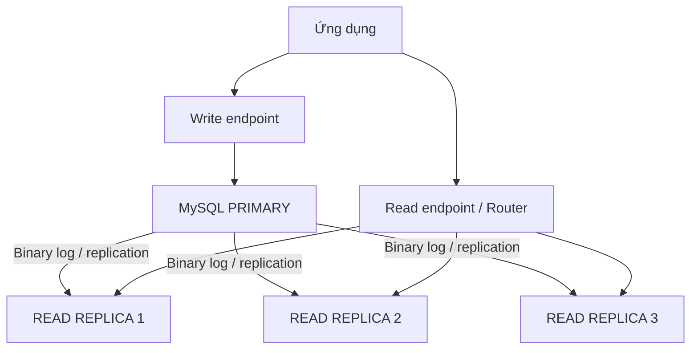
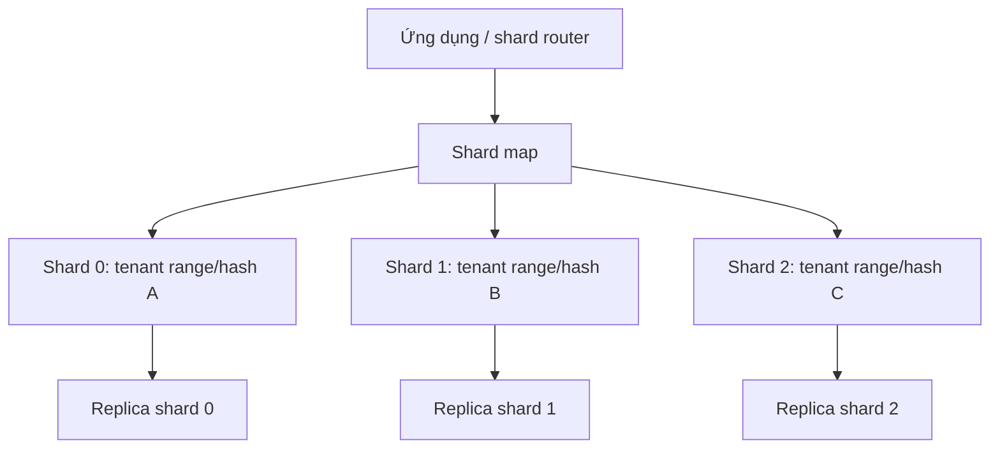

# Mở rộng theo chiều dọc, chiều ngang và xác định giới hạn thực tế

MySQL có thể phục vụ từ một ứng dụng nhỏ trên một máy chủ đến hệ thống có nhiều replica, nhiều shard và nhiều tầng cache. Khi tải tăng, câu hỏi không chỉ là “thêm CPU hay thêm server?” mà là **tài nguyên hoặc thành phần nào đang giới hạn throughput và latency**, phần tải nào có thể phân tán, và chi phí nhất quán dữ liệu sẽ tăng đến đâu.

Mở rộng theo chiều dọc (vertical scaling) tăng năng lực của một máy MySQL bằng CPU, RAM, storage hoặc I/O nhanh hơn. Mở rộng theo chiều ngang (horizontal scaling) phân phối một phần tải qua nhiều máy, thường bắt đầu bằng read replica và có thể tiến đến sharding để phân phối cả dữ liệu lẫn ghi. Hai hướng có thể kết hợp. Quyết định đúng cần dựa trên số liệu đo, workload thực tế, mục tiêu p95/p99, RPO/RTO và khả năng vận hành.

## 1. Phân biệt scale-up, scale-out và các kỹ thuật liên quan

| Kỹ thuật | Cách tăng năng lực | Giải quyết tốt | Giới hạn chính |
|---|---|---|---|
| Vertical scaling (scale-up) | Tăng CPU, RAM, IOPS, throughput hoặc dung lượng của một MySQL server. | Thiếu tài nguyên trên node hiện tại; cần giữ kiến trúc đơn giản. | Cuối cùng vẫn bị giới hạn bởi một node, một writer và khả năng mở rộng phần cứng. |
| Read replica | Thêm MySQL server nhận transaction từ source và phục vụ truy vấn đọc. | Tăng năng lực đọc, tách workload báo cáo, giảm truy vấn đọc trên primary. | Replica thường bất đồng bộ; ghi vẫn tập trung ở source và replica có thể lag. |
| Sharding | Chia dữ liệu thành các phần độc lập trên nhiều MySQL server. | Phân phối dung lượng và tải ghi khi một primary không còn đáp ứng. | Ứng dụng phải định tuyến shard; join, transaction, uniqueness và rebalance phức tạp hơn. |
| Partitioning | Chia một bảng thành partition do một MySQL instance quản lý. | Quản lý bảng lớn, pruning và lifecycle dữ liệu. | Không tự phân phối bảng sang nhiều server hoặc tăng năng lực ghi của một node. |
| Caching | Phục vụ dữ liệu đọc thường xuyên từ cache. | Giảm truy vấn lặp lại và latency đọc. | Invalidation, stale data, cache stampede và đồng bộ dữ liệu. |
| CQRS/read model | Duy trì mô hình đọc riêng từ luồng thay đổi dữ liệu. | Truy vấn đọc phức tạp hoặc nhiều dạng projection. | Tăng độ trễ đồng bộ và chi phí vận hành nhiều mô hình dữ liệu. |

Read replica, sharding và partitioning không phải các tên gọi thay thế cho nhau. Replica là bản sao của dữ liệu; shard là một phần dữ liệu được phân vùng theo khóa; partition là cấu trúc bên trong một bảng trên một server. Chọn sai khái niệm có thể dẫn đến kiến trúc không giải quyết được bottleneck.

## 2. Xác định giới hạn trước khi mở rộng

Không mở rộng chỉ vì CPU có một lần tăng cao hoặc số lượng bản ghi đã lớn. Hãy đo trong giờ cao điểm và trong khoảng thời gian đủ dài để phân biệt spike ngắn với tình trạng bão hòa kéo dài. Xác định mục tiêu dịch vụ trước: throughput cần đạt, p95/p99 latency, tỷ lệ lỗi, thời gian phục hồi và mức trễ đọc chấp nhận được.

Một số dấu hiệu thường gặp:

| Dấu hiệu | Khả năng giới hạn | Bằng chứng cần thu thập |
|---|---|---|
| CPU cao kéo dài, runnable thread tăng, query latency tăng | CPU hoặc query plan tốn tính toán | CPU utilization, top SQL digest, rows examined, execution plan. |
| Disk latency/queue depth cao, I/O wait tăng | Storage IOPS/throughput hoặc truy vấn đọc/ghi nhiều | Latency theo thiết bị, IOPS, throughput, buffer pool reads và file I/O. |
| Buffer pool hit giảm, physical read tăng | Working set lớn hơn RAM hoặc truy vấn quét nhiều dữ liệu | `Innodb_buffer_pool_read_requests`, `Innodb_buffer_pool_reads`, page reads và workload. |
| `Threads_running` cao, nhiều lock wait/deadlock | Tranh chấp khóa hoặc concurrency quá lớn | InnoDB status, Performance Schema lock tables, transaction age và hot rows. |
| `Threads_connected` gần giới hạn, pool chờ connection | Connection budget hoặc connection leak | Pool metrics, `max_connections`, thời gian giữ connection, số app instance. |
| Read replica lag tăng liên tục | Applier không theo kịp hoặc nguồn phát sinh ghi quá nhanh | GTID backlog, relay log space, worker state, CPU/I/O trên replica. |
| p95 tăng dù CPU còn thấp | Locking, network, connection pool, storage latency hoặc một truy vấn chậm | Tracing theo request, wait events, query digest và latency từng tầng. |
| Dung lượng tăng nhanh | Data/index growth, binlog retention, temp/backup hoặc log | Filesystem, tablespace, binary log, backup target và growth rate. |

Một hệ thống có thể có nhiều bottleneck đồng thời. Ví dụ, tăng connection pool khi database đang lock contention có thể làm nhiều transaction tranh chấp hơn và latency xấu thêm. Cần tìm nguyên nhân gần gốc trước khi tăng tài nguyên.

## 3. Thu thập baseline từ MySQL

Ghi nhận phiên bản và một số biến cấu hình quan trọng:

```sql
SELECT
    VERSION() AS mysql_version,
    @@version_comment AS distribution,
    @@GLOBAL.max_connections AS max_connections,
    @@GLOBAL.innodb_buffer_pool_size AS buffer_pool_bytes,
    @@GLOBAL.default_storage_engine AS default_engine;

SHOW GLOBAL STATUS WHERE Variable_name IN (
    'Threads_connected',
    'Threads_running',
    'Max_used_connections',
    'Questions',
    'Queries',
    'Slow_queries',
    'Connections',
    'Aborted_connects',
    'Created_tmp_tables',
    'Created_tmp_disk_tables',
    'Innodb_buffer_pool_read_requests',
    'Innodb_buffer_pool_reads',
    'Innodb_row_lock_waits',
    'Innodb_row_lock_time'
);
```

Các status counter phần lớn là số tích lũy từ lúc server khởi động hoặc reset counter. Lấy hai snapshot cách nhau một khoảng thời gian rồi tính delta để biết tốc độ phát sinh; không so sánh một con số tích lũy đơn lẻ với ngưỡng QPS. Một số counter có scope hoặc cách reset khác nhau theo phiên bản.

Tìm SQL digest tiêu tốn thời gian tổng cộng:

```sql
SELECT
    SCHEMA_NAME,
    DIGEST_TEXT,
    COUNT_STAR,
    ROUND(SUM_TIMER_WAIT / 1000000000000, 2) AS total_seconds,
    ROUND(AVG_TIMER_WAIT / 1000000000000, 6) AS avg_seconds,
    SUM_ROWS_EXAMINED,
    SUM_ROWS_SENT
FROM performance_schema.events_statements_summary_by_digest
WHERE SCHEMA_NAME = 'appdb'
ORDER BY SUM_TIMER_WAIT DESC
LIMIT 15;
```

Truy vấn này giúp tìm nhóm câu SQL tốn thời gian tích lũy. Kiểm tra cả latency trung bình, số lần chạy, rows examined và tần suất; một truy vấn chậm nhưng hiếm có thể ít quan trọng hơn truy vấn vừa phải nhưng chạy hàng nghìn lần. Performance Schema phải được bật và có instrumentation/consumer phù hợp.

Đọc execution plan của truy vấn trọng yếu:

```sql
EXPLAIN FORMAT=TREE
SELECT order_id, created_at, total_amount
FROM orders
WHERE customer_id = 9001
  AND status = 'PAID'
ORDER BY created_at DESC
LIMIT 50;
```

`EXPLAIN FORMAT=TREE` có trên các phiên bản MySQL 8.0 hỗ trợ định dạng này; nếu phiên bản cũ không nhận cú pháp, dùng `EXPLAIN` dạng mặc định. Trên phiên bản hỗ trợ, `EXPLAIN ANALYZE` thực thi truy vấn để đo thời gian và số hàng thực tế. Chỉ chạy trên truy vấn đọc đã đánh giá tải, ưu tiên môi trường staging hoặc bản sao có dữ liệu đại diện. Trước khi tăng server size, sửa truy vấn quét quá nhiều hàng, thiếu index, N+1 query hoặc trả dữ liệu không cần thiết.

Kết hợp số liệu MySQL với hệ điều hành: CPU utilization, memory pressure/swap, disk latency, IOPS, throughput, queue depth, network throughput và giới hạn container/VM. MySQL status không thay thế telemetry của hạ tầng.

## 4. Mở rộng theo chiều dọc

Vertical scaling tăng năng lực của node hiện tại. Có thể thực hiện bằng cách:

- Chuyển sang máy có nhiều core CPU hơn hoặc hiệu năng mỗi core cao hơn.
- Tăng RAM để giữ working set và index nóng trong InnoDB buffer pool.
- Dùng storage có latency thấp và IOPS/throughput phù hợp cho data, redo log và binary log.
- Tăng dung lượng để có headroom cho data growth, backup staging và DDL.
- Điều chỉnh cấu hình MySQL sau khi đo, thay vì tăng mọi buffer theo tỷ lệ RAM một cách máy móc.

### Khi nào scale-up có hiệu quả?

- CPU hoặc storage đang bão hòa và workload có thể tận dụng tài nguyên bổ sung.
- Working set lớn hơn buffer pool, physical reads thường xuyên gây latency.
- Kiến trúc một primary vẫn đáp ứng yêu cầu nhất quán và throughput ghi.
- Đội ngũ muốn giữ topology đơn giản và có một cửa sổ nâng cấp phần cứng chấp nhận được.

### Các giới hạn thực tế

Tăng RAM không sửa được truy vấn có execution plan kém hoặc lock contention. Tăng CPU không giúp nhiều nếu phần lớn thời gian chờ disk hoặc chờ khóa. Tăng IOPS có thể giảm thời gian chờ storage nhưng không làm một transaction tuần tự chạy song song. Máy lớn hơn cũng có chi phí cao, có thể có thời gian provision/resize và vẫn là một failure domain tập trung.

Một MySQL primary thường vẫn là nơi xử lý luồng ghi chính. Khi tải ghi bị giới hạn bởi hot row, transaction dài, index maintenance hoặc commit serialization, thêm CPU có thể chỉ cải thiện một phần. Cần xác định throughput bão hòa trên workload thực tế thay vì giả định tài nguyên tăng gấp đôi thì QPS cũng tăng gấp đôi.

### Checklist scale-up

1. Lưu baseline CPU, RAM, buffer pool, disk latency, IOPS, query latency và throughput.
2. Xác định tài nguyên nào bão hòa và mức headroom cần thiết.
3. Thử cấu hình/hardware mới trên staging với dữ liệu và concurrency tương tự.
4. Đo lại p95/p99, throughput, error rate, lock wait và recovery time.
5. Lập kế hoạch backup, maintenance window và phương án rollback hạ tầng.
6. Sau khi thay đổi, xác minh MySQL sử dụng tài nguyên mới và không phát sinh bottleneck khác.

## 5. Mở rộng đọc bằng read replica

Trong replication thông thường, primary ghi transaction vào binary log; replica nhận event và áp dụng lên dữ liệu cục bộ. Có thể thêm nhiều replica để phục vụ truy vấn đọc, báo cáo hoặc tác vụ phân tích, trong khi ứng dụng tiếp tục gửi ghi đến primary.



Mỗi replica có tài nguyên CPU, RAM và storage riêng để thực thi truy vấn đọc. Đây là cách scale-out tương đối dễ tiếp cận khi phần lớn tải là đọc. Tuy nhiên, replication không chia một transaction ghi thành nhiều writer; mọi replica vẫn phải nhận và áp dụng cùng luồng thay đổi.

### Phân loại truy vấn theo yêu cầu nhất quán

| Truy vấn | Endpoint gợi ý | Lý do |
|---|---|---|
| `INSERT`, `UPDATE`, `DELETE`, DDL | Primary/write | Thay đổi dữ liệu cần thực hiện ở writer. |
| Đọc ngay sau khi vừa ghi trong cùng nghiệp vụ | Primary hoặc cơ chế read-after-write có kiểm chứng | Replica có thể chưa áp dụng transaction mới. |
| Đọc trạng thái thanh toán, tồn kho hoặc quyền cần dữ liệu mới nhất | Primary hoặc replica đã xác nhận watermark cần thiết | Dữ liệu stale có thể dẫn đến quyết định sai. |
| Danh sách, catalog hoặc nội dung chấp nhận trễ ngắn | Read replica | Có thể phân phối tải đọc. |
| Báo cáo dài hoặc export | Replica chuyên biệt nếu workload phù hợp | Cách ly truy vấn nặng khỏi primary. |

Không định tuyến mọi `SELECT` sang replica một cách mù quáng. Một truy vấn đọc có thể phụ thuộc vào transaction vừa ghi, temporary table, session state hoặc dữ liệu cần tính nhất quán mạnh. Phân loại theo nghiệp vụ và giữ transaction trên cùng connection.

### Replication lag và freshness

Replication bất đồng bộ có thể trễ khi mạng chậm, transaction lớn hoặc applier không theo kịp. Theo dõi:

```sql
SHOW REPLICA STATUS\G
```

Kiểm tra `Replica_IO_Running`, `Replica_SQL_Running`, `Seconds_Behind_Source`, lỗi I/O/SQL, `Retrieved_Gtid_Set`, `Executed_Gtid_Set` và relay log space. `Seconds_Behind_Source` không phải thước đo freshness tuyệt đối trong mọi tình huống; kết hợp heartbeat và trạng thái GTID/worker.

Với GTID, một ứng dụng có thể chờ replica thực thi ít nhất một GTID cụ thể bằng `WAIT_FOR_EXECUTED_GTID_SET()` với timeout phù hợp, nếu topology và luồng transaction hỗ trợ cách này. Nếu hết timeout, quyết định đọc primary hoặc trả lỗi/retry theo chính sách. Không chờ vô hạn vì sẽ biến replica lag thành request treo.

### Định tuyến và phân phối kết nối

Có thể dùng MySQL Router, proxy hoặc logic ở tầng ứng dụng để tách write endpoint và read endpoint. Router với InnoDB Cluster có thể định tuyến theo role; replication topology thông thường có thể cần cấu hình endpoint/proxy riêng. Connection pool phải giới hạn số kết nối tổng thể và loại bỏ connection lỗi khi replica failover hoặc bị loại khỏi pool.

Read replica tăng năng lực đọc tổng thể nhưng không đảm bảo mọi truy vấn sẽ nhanh hơn. Một replica nhận workload báo cáo lớn có thể bị bão hòa; phân nhóm replica theo workload, giới hạn concurrency và theo dõi từng node.

## 6. Mở rộng ghi bằng sharding

Khi một primary đã được tối ưu và scale-up nhưng vẫn không đủ throughput ghi hoặc dung lượng, sharding có thể phân phối dữ liệu qua nhiều MySQL instance. Mỗi shard sở hữu một tập dữ liệu riêng và thường có writer riêng.

Ví dụ chia theo tenant:



Ứng dụng hoặc một lớp routing xác định shard từ shard key, sau đó gửi query đến đúng MySQL instance. Mỗi shard có thể tiếp tục dùng read replica để scale đọc và tăng khả năng phục hồi.

### Chọn shard key

Shard key ảnh hưởng phân bố dữ liệu, routing và khả năng thực hiện truy vấn. Một shard key tốt thường có:

- **Phân bố đủ đều**: tránh dồn phần lớn dữ liệu hoặc traffic vào một shard.
- **Tính ổn định**: ít thay đổi sau khi bản ghi được tạo.
- **Có mặt trong truy vấn chính**: giúp ứng dụng xác định shard mà không phải broadcast đến mọi node.
- **Tính locality**: các dữ liệu thường được truy cập cùng nhau nằm trên cùng shard khi phù hợp.
- **Khả năng mở rộng**: có chiến lược xử lý tenant lớn, hot key và tăng số shard.

Ví dụ, `tenant_id` phù hợp nếu phần lớn truy vấn luôn nằm trong một tenant và tenant có quy mô tương đối cân bằng. Nếu một vài tenant lớn hơn nhiều, cần tách tenant lớn hoặc dùng thêm cấp routing để tránh hot shard.

### Range sharding và hash sharding

| Chiến lược | Cách phân phối | Ưu điểm | Rủi ro |
|---|---|---|---|
| Range | Chia theo khoảng khóa, ví dụ tenant ID hoặc thời gian. | Dễ xác định vùng dữ liệu và di chuyển một range. | Range mới nhất hoặc tenant nóng có thể dồn tải vào một shard. |
| Hash | Hash shard key rồi ánh xạ vào shard. | Phân bố tương đối đều nếu hash và key phù hợp. | Truy vấn theo range khó định tuyến; thêm shard có thể phải phân phối lại nhiều dữ liệu. |
| Directory-based | Tra shard map từ bảng/metadata dịch vụ. | Linh hoạt di chuyển tenant hoặc nhóm dữ liệu. | Cần quản lý metadata, cache, cập nhật và tính sẵn sàng của router. |

Không có shard key hoàn hảo cho mọi query. Hãy lập danh sách truy vấn quan trọng và xác định truy vấn nào có shard key, truy vấn nào cần scatter-gather, truy vấn nào nên dùng read model hoặc kho phân tích riêng.

### Hệ quả của sharding

- **Join xuyên shard**: MySQL không thể thực hiện join trực tiếp giữa các instance như join hai bảng trong cùng database. Ứng dụng phải tổng hợp kết quả hoặc thiết kế lại dữ liệu.
- **Transaction xuyên shard**: transaction ACID thông thường của InnoDB chỉ bao phủ một server. Giao dịch nhiều shard cần saga, outbox, workflow hoặc cơ chế phân tán riêng; không mặc định có atomic commit toàn cụm.
- **Unique constraint**: unique index chỉ bảo vệ phạm vi của shard. Muốn email hoặc mã nghiệp vụ duy nhất toàn hệ thống, cần định tuyến theo khóa đó, dịch vụ cấp phát/registry hoặc một chiến lược kiểm tra toàn cục.
- **ID toàn cục**: `AUTO_INCREMENT` trên từng shard có thể tạo ID trùng. Cần ID có phạm vi toàn cục như UUID/ULID/Snowflake, dải ID được cấp trước hoặc khóa ghép có shard identity.
- **Schema migration**: thay đổi phải được triển khai nhất quán trên tất cả shard và replica, có thể theo từng batch.
- **Backup/restore**: cần biết snapshot và watermark của từng shard để khôi phục nhất quán nghiệp vụ.
- **Rebalancing**: thêm shard không tự phân phối lại dữ liệu. Phải di chuyển range/tenant, cập nhật shard map và xử lý ghi trong lúc chuyển.

Sharding làm tăng chi phí phát triển và vận hành đáng kể. Chỉ chọn khi số liệu cho thấy một primary không còn đáp ứng sau khi tối ưu query, index, transaction, scale-up và read replica.

## 7. Partitioning không thay thế sharding

MySQL partitioning chia một bảng thành các partition do cùng một MySQL instance quản lý. Có thể dùng range partition theo thời gian để quản lý dữ liệu lịch sử, pruning theo partition key hoặc xóa dữ liệu cũ bằng thao tác partition phù hợp.

Ví dụ khái quát partition theo tháng:

```sql
CREATE TABLE event_log (
    event_id BIGINT UNSIGNED NOT NULL,
    created_at DATETIME NOT NULL,
    tenant_id BIGINT UNSIGNED NOT NULL,
    payload JSON NOT NULL,
    PRIMARY KEY (event_id, created_at),
    KEY ix_event_log_tenant_created (tenant_id, created_at)
)
PARTITION BY RANGE COLUMNS (created_at) (
    PARTITION p2026_01 VALUES LESS THAN ('2026-02-01'),
    PARTITION p2026_02 VALUES LESS THAN ('2026-03-01'),
    PARTITION p2026_03 VALUES LESS THAN ('2026-04-01'),
    PARTITION p_future VALUES LESS THAN (MAXVALUE)
);
```

Đây là ví dụ minh họa; cần thiết kế partition tương lai, lịch tạo partition và retention trước khi dùng production. Với MySQL partitioning, mọi unique key (bao gồm primary key) phải chứa tất cả cột được dùng trong partition expression. Điều này có thể buộc thay đổi thiết kế khóa và ảnh hưởng tính duy nhất nghiệp vụ.

Partition pruning chỉ có lợi khi điều kiện truy vấn cho phép optimizer loại bỏ các partition không liên quan. Nếu truy vấn không lọc theo partition key, MySQL có thể phải đọc nhiều hoặc tất cả partition. Partitioning không tự thêm CPU/RAM/network node và không làm tăng năng lực ghi của một server như sharding.

## 8. Giảm tải trước khi thêm máy

Trước khi scale-out, xử lý các nguyên nhân làm tiêu thụ tài nguyên không cần thiết:

1. **Tối ưu SQL và index**: giảm rows examined, chọn composite index đúng thứ tự cột, tránh function làm mất khả năng dùng index khi không cần thiết.
2. **Loại N+1 query**: gộp truy vấn, batch fetch hoặc thiết kế projection phù hợp.
3. **Giảm transaction dài**: xử lý theo batch, không giữ lock trong lúc gọi API bên ngoài hoặc chờ người dùng.
4. **Giảm round-trip**: batch insert/update và lấy đúng cột cần thiết.
5. **Dùng connection pool có giới hạn**: tổng connection từ mọi instance phải nằm trong ngân sách database.
6. **Cache dữ liệu đọc lặp lại**: đặt TTL/invalidation theo yêu cầu nhất quán, có chống cache stampede.
7. **Tách workload**: báo cáo dài, export và ETL có thể chạy trên replica riêng hoặc hệ thống phân tích.
8. **Batch write và queue**: làm phẳng spike, gộp thao tác và giới hạn tốc độ producer.

Queue có thể hấp thụ đỉnh tải nhưng không tăng throughput bền vững của MySQL. Nếu producer liên tục tạo việc nhanh hơn tốc độ consumer ghi database, backlog sẽ tăng. Phải đặt giới hạn queue, đo tuổi message và có backpressure.

## 9. Ước lượng capacity và headroom

Capacity nên được đo bằng workload đại diện, không chỉ dựa trên một con số QPS tổng. Một truy vấn lookup theo primary key khác nhiều so với join nhiều bảng, báo cáo aggregate hoặc transaction cập nhật nhiều index.

Một cách lập kế hoạch đơn giản:

1. Đo throughput bền vững của một node ở mức p95/p99 và error rate mục tiêu.
2. Tách tải đọc/ghi và phân loại theo nhóm query/transaction.
3. Xác định mức sử dụng mục tiêu để còn headroom cho spike và failover.
4. Với read replica, ước lượng số replica cần thiết dựa trên read workload và năng lực mỗi replica.
5. Kiểm tra khả năng chịu mất một replica mà các node còn lại vẫn đáp ứng mục tiêu.
6. Đo lại trong điều kiện có replication apply, backup, monitoring và workload nền.

Ví dụ công thức quy hoạch sơ bộ cho read workload đồng nhất:

\[
N_{replicas} \geq \left\lceil \frac{R_{peak}}{C_{replica} \times U_{target}} \right\rceil
\]

Trong đó:

- `R_peak`: read throughput đỉnh dự kiến.
- `C_replica`: throughput bền vững đo được của một replica với workload tương ứng.
- `U_target`: mức sử dụng mục tiêu dưới 1 để dành headroom.
- `N_replicas`: số replica cần có trước khi cộng thêm dự phòng cho tình huống mất node.

Ví dụ, nếu workload đọc đỉnh là 12.000 query/giây, một replica chịu được 5.000 query/giây ở latency mục tiêu và mức sử dụng kế hoạch là 0,6, phép tính sơ bộ cho ra 4 replica. Sau đó cần kiểm tra tình huống mất một replica, độ đồng đều của query, chi phí replication và khả năng phân phối kết nối. Con số này không phải sizing cuối cùng nếu query mix giữa các replica khác nhau.

Ngân sách connection cũng phải tính trên toàn hệ thống:

\[
C_{total} = \sum_{i=1}^{n} (instances_i \times poolMax_i) + C_{jobs} + C_{admin} + C_{replication}
\]

Giữ `C_total` dưới giới hạn vận hành đã chọn, có chỗ cho reconnect và tác vụ quản trị. Không đặt pool max bằng `max_connections` trên từng instance ứng dụng.

Với storage, dự báo dung lượng gồm dữ liệu và index hiện tại, tốc độ tăng trong thời gian retention, binary log, backup staging, temporary space đỉnh khi DDL và headroom cho recovery. Với sharding, tính cả shard lớn nhất và shard nóng nhất, không chỉ tổng dung lượng chia đều.

## 10. Benchmark trước và sau khi mở rộng

Một phép benchmark có ích cần tái tạo được workload:

- Tập truy vấn theo tỷ lệ đọc/ghi thực tế.
- Số client đồng thời, think time và thời gian chạy.
- Kích thước dữ liệu, cardinality, skew và hot key.
- Transaction boundary, batch size và connection pool.
- Replication, backup, cache warm-up và tác vụ nền.
- CPU/RAM/storage/network gần với môi trường mục tiêu.

Đo ít nhất:

| Chỉ số | Mục đích |
|---|---|
| Throughput (transactions/sec hoặc queries/sec) | Biết hệ thống xử lý được bao nhiêu workload. |
| p50/p95/p99 latency | Phát hiện tail latency và request chậm. |
| Error/timeout/deadlock rate | Xác nhận throughput không đạt được bằng cách tăng lỗi. |
| CPU và runnable threads | Xác định giới hạn tính toán. |
| Disk latency/IOPS/queue depth | Xác định áp lực storage. |
| Buffer pool physical reads | Biết working set có nằm trong memory không. |
| Lock wait và transaction age | Phát hiện contention và transaction dài. |
| Replication lag/backlog | Đo chi phí đồng bộ và độ mới dữ liệu. |
| Connection pool wait/active/idle | Phát hiện pool starvation hoặc quá nhiều connection. |

So sánh cùng một workload trước và sau thay đổi. Nếu thêm replica nhưng read p95 không cải thiện, kiểm tra routing có thực sự phân phối, pool có giữ kết nối dồn vào một node, hoặc bottleneck nằm ở network/application. Nếu scale-up nhưng throughput gần như không đổi, có thể giới hạn là lock, serial write, query plan hoặc connection concurrency.

## 11. Lộ trình mở rộng theo từng giai đoạn

Một lộ trình thường dễ vận hành hơn là tăng độ phức tạp theo bằng chứng:

1. **Đo và tối ưu một primary**: query digest, execution plan, index, transaction, pool, buffer pool và storage.
2. **Scale-up khi tài nguyên là bottleneck**: tăng CPU/RAM/storage theo số liệu và kiểm thử.
3. **Thêm read replica khi tải đọc chiếm tỷ trọng lớn**: định tuyến đọc, xử lý stale read, theo dõi lag và tách báo cáo.
4. **Thêm cache/read model cho truy vấn lặp hoặc projection đặc thù**: quy định TTL, invalidation và nguồn chân lý.
5. **Sharding khi giới hạn writer/dung lượng đã được chứng minh**: chọn shard key, thiết kế routing, ID, global uniqueness, transaction và rebalance.
6. **Tự động hóa vận hành**: provisioning, schema migration, backup/restore, failover, shard map, observability và capacity forecast.

Không nhất thiết phải đi hết mọi giai đoạn. Một hệ thống có thể phục vụ lâu dài với một primary và một số replica nếu workload và mục tiêu dịch vụ phù hợp.

## 12. Những lỗi thiết kế thường gặp

| Sai lầm | Hệ quả | Cách phòng tránh |
|---|---|---|
| Thêm replica khi bottleneck là write | Primary vẫn quá tải; replica chỉ nhận thêm backlog. | Tách read/write metrics và xác định phần tải có thể chuyển. |
| Route mọi SELECT sang replica | Read-after-write sai hoặc dữ liệu stale. | Phân loại truy vấn theo yêu cầu nhất quán và có fallback rõ ràng. |
| Tăng connection pool không giới hạn | Nhiều session tranh CPU/lock, memory và connection slot. | Tính connection budget toàn hệ thống, đo pool wait và DB concurrency. |
| Dùng partitioning như sharding | Không phân phối CPU/ghi sang node khác. | Chọn partitioning cho quản lý bảng; sharding cho phân phối dữ liệu qua server. |
| Chọn shard key theo cột ít được query | Nhiều request phải broadcast đến mọi shard. | Thiết kế từ access pattern và workload thực tế. |
| Chọn shard key gây hot tenant/key | Một shard bão hòa dù các shard khác nhàn. | Đo skew, hỗ trợ tenant lớn và có chiến lược tách nóng. |
| Cho phép cross-shard transaction tùy tiện | Tăng latency, khó rollback và khó đảm bảo tính nhất quán. | Giữ dữ liệu nghiệp vụ cùng shard hoặc dùng saga/outbox có thiết kế. |
| Không có kế hoạch resharding | Thêm shard nhưng dữ liệu cũ vẫn dồn vào shard hiện tại. | Thiết kế shard map và quy trình di chuyển/rebalance từ đầu. |
| Chỉ benchmark bằng dữ liệu nhỏ | Không thấy skew, I/O, lock contention hoặc plan khác. | Dùng data shape và concurrency đại diện. |
| Coi HA là scale | Có dự phòng nhưng không tăng throughput đọc/ghi theo mong đợi. | Xác định mục tiêu availability và capacity riêng biệt. |

## 13. Checklist quyết định mở rộng

- [ ] Đã xác định mục tiêu throughput, p95/p99, error rate, RPO và RTO.
- [ ] Đã thu thập baseline ở giờ cao điểm và xác định bottleneck chính.
- [ ] Đã kiểm tra query digest, execution plan, index, lock wait và transaction age.
- [ ] Đã phân biệt tải đọc, tải ghi, báo cáo và tác vụ nền.
- [ ] Đã đánh giá scale-up theo CPU, RAM, buffer pool, IOPS và disk latency.
- [ ] Nếu thêm replica, đã thiết kế read/write routing và chính sách read-after-write.
- [ ] Đã theo dõi replication lag, GTID backlog và năng lực applier.
- [ ] Connection pool được tính theo tổng instance, job và replica.
- [ ] Nếu sharding, shard key phù hợp access pattern và có chiến lược hot key/rebalance.
- [ ] Đã đánh giá cross-shard join/transaction, global ID và uniqueness.
- [ ] Partitioning chỉ được dùng cho mục tiêu quản lý/pruning phù hợp, không coi là scale-out server.
- [ ] Benchmark dùng dữ liệu, concurrency, query mix và hạ tầng đại diện.
- [ ] Đã kiểm thử mất replica, failover, backup/restore và quá trình deploy schema.
- [ ] Có dashboard, alert, capacity forecast và runbook vận hành.

Mở rộng MySQL hiệu quả bắt đầu bằng việc xác định giới hạn thực tế. Scale-up tăng năng lực của một node và thường giữ kiến trúc đơn giản; read replica phân phối tải đọc nhưng không chia tải ghi; sharding phân phối dữ liệu và ghi qua nhiều node với chi phí phối hợp cao; partitioning hỗ trợ quản lý bảng lớn trên một instance. Đo workload, tối ưu trước, rồi chọn mức mở rộng nhỏ nhất đáp ứng mục tiêu dịch vụ và có thể vận hành, phục hồi, kiểm chứng lâu dài.
