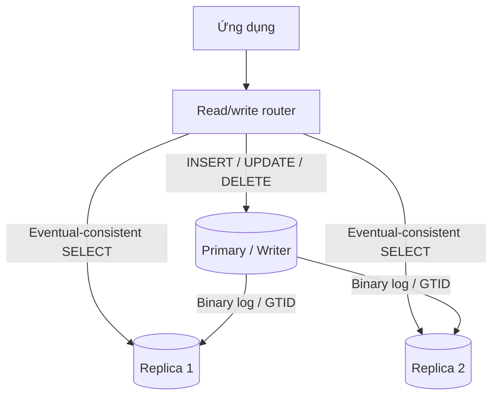
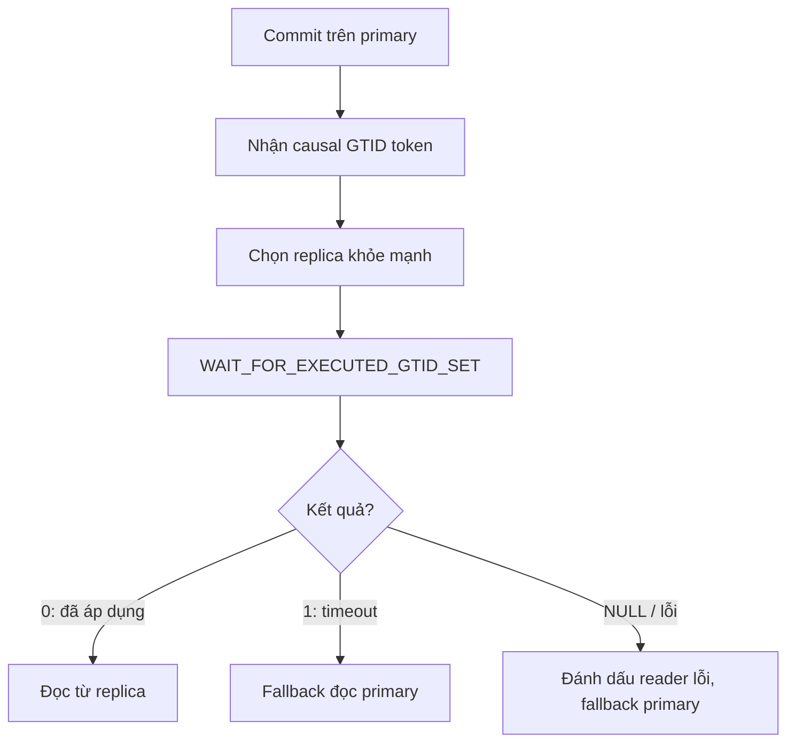

# Tách đọc/ghi qua replica và yêu cầu nhất quán của từng nghiệp vụ

Tách đọc/ghi (*read/write splitting*) là cách gửi các thao tác thay đổi dữ liệu tới MySQL primary và phân phối một phần truy vấn đọc tới các replica. Cách này có thể tăng năng lực phục vụ truy vấn đọc, nhưng replication bất đồng bộ khiến replica có thể chưa nhận hoặc chưa áp dụng giao dịch vừa commit trên primary. Vì vậy, một truy vấn đọc chuyển sang replica có thể trả về dữ liệu cũ.

Thiết kế read/write splitting cần bắt đầu từ yêu cầu nhất quán của nghiệp vụ. Trang báo cáo chấp nhận dữ liệu trễ vài giây có thể đọc replica; màn hình vừa lưu đơn hàng, kiểm tra số dư hoặc xác nhận thanh toán thường cần đọc primary hoặc chờ replica áp dụng đúng giao dịch. Trong module `DATABASE_MYSQL`, bài học này kết nối replication, GTID, transaction, connection routing và mở rộng năng lực đọc.

Sau bài học, bạn có thể:

- Phân biệt primary/writer và replica/reader trong topology MySQL.
- Chọn nghiệp vụ phù hợp với eventual consistency hoặc read-after-write consistency.
- Thiết kế quy tắc định tuyến theo transaction, connection và loại truy vấn.
- Hiểu replication lag và giới hạn của `Seconds_Behind_Source`.
- Dùng GTID barrier để chờ replica áp dụng giao dịch cần đọc.
- Xây dựng sticky routing và fallback về primary khi replica chưa bắt kịp.
- Bảo vệ replica khỏi ghi ngoài ý muốn và giám sát tải đọc.
- Kiểm thử tính đúng đắn khi có độ trễ, lỗi replica và failover.

## 1. Kiến trúc primary và replica

Trong topology replication thông thường, ứng dụng gửi giao dịch ghi tới primary. MySQL ghi các thay đổi vào binary log; replica đọc sự kiện, lưu relay log và áp dụng chúng vào dữ liệu của replica.



Primary chịu trách nhiệm tiếp nhận ghi và là nguồn dữ liệu có thẩm quyền trong mô hình này. Replica duy trì bản sao thông qua replication và có thể phục vụ truy vấn đọc nếu dữ liệu đã được áp dụng tới mốc cần thiết.

Replication bất đồng bộ không bảo đảm replica cập nhật ngay sau khi primary commit. Một giao dịch có thể đã commit ở primary nhưng vẫn đang nằm trong hàng đợi nhận hoặc áp dụng trên replica. Vì vậy, read/write splitting tạo ra một lựa chọn giữa khả năng mở rộng đọc và độ trễ nhìn thấy dữ liệu mới.

### 1.1. Read/write splitting không làm tăng năng lực ghi

Thêm replica thường giúp phân tán truy vấn đọc, giảm tải đọc trên primary và tạo thêm bản sao phục vụ dự phòng. Nó không tự động phân tán các thao tác ghi; primary vẫn phải xử lý transaction ghi, binary log và chi phí duy trì replication.

Khi primary đã bão hòa bởi ghi, thêm reader có thể không cải thiện throughput ghi. Khi đó cần xem xét tối ưu transaction, index, batch, schema, partitioning hoặc kiến trúc ghi phù hợp hơn.

### 1.2. Replica có thể có dữ liệu cũ

Ví dụ:

1. Ứng dụng tạo đơn hàng `order_id = 9001` trên primary.
2. Primary commit thành công.
3. Ứng dụng chuyển sang replica để đọc đơn hàng.
4. Replica chưa áp dụng transaction tạo đơn.
5. Truy vấn trả về `0 rows` dù giao dịch ghi đã thành công.

Đây là replication lag, không nhất thiết là lỗi mất dữ liệu. Ứng dụng phải quyết định có thể chấp nhận kết quả cũ hay cần đọc từ primary/chờ replica.

## 2. Phân loại yêu cầu nhất quán theo nghiệp vụ

Không nên định tuyến chỉ dựa vào việc câu SQL bắt đầu bằng `SELECT`. Cần xác định mức độ mới của dữ liệu mà nghiệp vụ cần.

| Yêu cầu | Ý nghĩa | Ví dụ | Nơi đọc phù hợp |
|---|---|---|---|
| Eventual consistency | Dữ liệu có thể trễ nhưng cuối cùng hội tụ | Dashboard, thống kê, báo cáo tổng hợp | Replica khỏe mạnh với lag trong ngưỡng |
| Read-your-writes | Người dùng thấy được thay đổi do chính request/session của mình vừa ghi | Trang chi tiết đơn hàng ngay sau khi tạo | Primary hoặc replica đã áp dụng GTID của giao dịch |
| Monotonic reads | Một client không quay lại trạng thái cũ hơn trạng thái nó đã quan sát | Theo dõi trạng thái đơn hàng qua nhiều request | Sticky reader hoặc causal/GTID barrier |
| Causal consistency | Đọc sau phải thấy các giao dịch có quan hệ nhân quả trước đó | Dịch vụ B đọc dữ liệu do dịch vụ A vừa ghi và phát sự kiện | Primary hoặc reader chờ causal token |
| Strong/current read | Cần đọc trạng thái hiện tại theo thứ tự transaction đã commit trên writer | Số dư, tồn kho, quyền truy cập, xác nhận thanh toán | Primary/writer |

Các tên trên mô tả hợp đồng ứng dụng. MySQL asynchronous replication không tự cung cấp đầy đủ causal consistency cho mọi client; ứng dụng hoặc routing layer phải giữ thông tin nhân quả và chọn server phù hợp.

### 2.1. Phân loại theo luồng nghiệp vụ

Ví dụ với hệ thống thương mại:

- Trang danh mục, tìm kiếm và báo cáo có thể chấp nhận dữ liệu trễ ngắn: ưu tiên replica.
- Sau khi tạo đơn, trang xác nhận đơn cần thấy đơn vừa tạo: đọc primary hoặc chờ replica tới GTID tương ứng.
- Trước khi trừ tồn kho hoặc xác nhận thanh toán: dùng primary và transaction phù hợp.
- Truy vấn quyền hoặc trạng thái tài khoản ảnh hưởng quyết định bảo mật: dùng nguồn có mức nhất quán được nghiệp vụ yêu cầu, thường là primary.
- Báo cáo lịch sử có thể dùng replica với watermark hiển thị thời điểm dữ liệu đã đồng bộ.

Hãy ghi hợp đồng nhất quán cho từng endpoint/use case. Không đặt một quy tắc chung “mọi SELECT sang replica” cho toàn ứng dụng.

## 3. Những truy vấn phải được định tuyến tới writer

Các thao tác sau thường phải đi tới primary:

- `INSERT`, `UPDATE`, `DELETE`, `REPLACE` và DDL.
- `SELECT ... FOR UPDATE` hoặc `SELECT ... FOR SHARE` vì đây là locking read cần khóa trên server nhận thao tác.
- Truy vấn cần đọc kết quả ngay sau một thay đổi chưa được xác nhận đã áp dụng trên replica.
- Các thao tác phụ thuộc session state như `LAST_INSERT_ID()`, temporary table, user variable, session variable hoặc connection-local state.
- Các thao tác cần đọc/ghi trong cùng transaction.
- Stored procedure hoặc statement có thể ghi dữ liệu, gọi routine có tác dụng phụ hoặc thay đổi session state.
- Các câu lệnh quản trị và thao tác yêu cầu quyền/metadata của primary.

Một câu `SELECT` không đồng nghĩa read-only. Ví dụ `SELECT ... FOR UPDATE` có thể đặt khóa. Một stored function được gọi trong SELECT cũng có thể có tác dụng phụ nếu được định nghĩa cho phép. Router dựa trên phân tích cú pháp đơn giản có thể phân loại sai các trường hợp này.

### 3.1. Không tách các câu trong cùng transaction sang nhiều server

Transaction phải gắn với một connection vật lý và một MySQL server trong suốt vòng đời. Không gửi `BEGIN` tới primary rồi gửi câu `SELECT` tiếp theo tới replica. Replica không có transaction context hoặc khóa mà primary đang giữ.

Quy tắc thực tế: khi một transaction bắt đầu trên writer, pin toàn bộ transaction tới cùng writer connection cho đến `COMMIT` hoặc `ROLLBACK`. Nếu transaction read-only được phép chạy trên replica, toàn bộ transaction phải ở cùng replica và cùng connection.

## 4. Các chiến lược định tuyến đọc/ghi

Có nhiều cách triển khai, từ logic trong ứng dụng đến proxy chuyên dụng.

### 4.1. Tách DataSource trong ứng dụng

Ứng dụng có thể cấu hình một writer DataSource và một reader DataSource. Service chọn datasource theo hợp đồng nghiệp vụ:

```java
public interface OrderReadRepository {
    Optional<OrderView> findView(long orderId);
}

public interface OrderWriteService {
    long createOrder(CreateOrderCommand command);
}
```

Luồng đọc eventual-consistent gọi reader; luồng ghi gọi writer. Với Spring, có thể dùng routing datasource hoặc nhiều repository/entity manager, nhưng cần cấu hình rõ transaction manager và tránh việc cùng một transaction vô tình lấy connection từ hai datasource.

Ưu điểm là hợp đồng nhất quán thể hiện trong code và có thể kiểm thử theo use case. Nhược điểm là cần kỷ luật kiến trúc; một query mới có thể bị định tuyến sai nếu lập trình viên chọn nhầm repository.

### 4.2. Routing DataSource theo transaction read-only

Một ứng dụng có thể dùng `@Transactional(readOnly = true)` để chọn reader và transaction ghi để chọn writer. Tuy nhiên, cần hiểu các giới hạn:

- `readOnly = true` là thuộc tính transaction và gợi ý tối ưu; nó không tự động bảo đảm mọi SELECT an toàn trên replica.
- Routing phải diễn ra trước khi connection được lấy và transaction được mở.
- Một khi connection đã được lấy, thay đổi routing context không chuyển connection đang dùng sang server khác.
- Self-invocation, propagation hoặc transaction ngoài có thể khiến annotation bên trong không quyết định datasource như dự kiến.
- Một phương thức read-only có thể cần read-your-writes hoặc locking read và do đó vẫn phải dùng writer.

Vì vậy, không dùng `readOnly` như tín hiệu duy nhất cho consistency. Có thể kết hợp annotation với một routing policy rõ ràng, ví dụ `READ_EVENTUAL`, `READ_AFTER_WRITE` và `READ_CURRENT` ở cấp use case.

### 4.3. Proxy hoặc database router

Một proxy có thể nhận kết nối từ ứng dụng và phân phối truy vấn tới writer/reader. Một số proxy có thể phân tích câu SQL, transaction state hoặc session để định tuyến; khả năng chính xác phụ thuộc sản phẩm và cấu hình.

Không giả định proxy hiểu được mọi stored procedure, user variable, prepared statement, transaction hoặc session state. Kiểm thử các câu SQL thực tế và xem quy tắc fallback khi proxy không phân loại được truy vấn.

### 4.4. Nhiều endpoint/connection pool

Với nhiều reader, ứng dụng hoặc proxy có thể chọn replica theo tải, health và lag. Không chỉ round-robin theo số connection; một replica quá tải hoặc đang lag có thể làm p99 latency và stale read tăng.

Chọn reader dựa trên:

- Trạng thái replication I/O và SQL/applier.
- GTID executed set hoặc chỉ số lag phù hợp.
- Connection count, CPU, I/O và query latency.
- Vùng địa lý và chi phí mạng.
- Yêu cầu nhất quán của request.

## 5. Đọc trạng thái replication và đo lag

Trên replica, kiểm tra:

```sql
SHOW REPLICA STATUS\G
```

Các trường quan trọng có thể gồm:

| Trường | Ý nghĩa |
|---|---|
| `Replica_IO_Running` | Receiver thread có đang lấy binary log từ source không |
| `Replica_SQL_Running` | Applier thread có đang áp dụng relay log không |
| `Seconds_Behind_Source` | Ước lượng độ trễ theo timestamp sự kiện trong replication |
| `Retrieved_Gtid_Set` | GTID đã nhận từ source |
| `Executed_Gtid_Set` | GTID đã thực thi trên replica |
| `Last_IO_Error` | Lỗi gần nhất của receiver thread |
| `Last_SQL_Error` | Lỗi gần nhất của applier thread |

Tên trường phụ thuộc phiên bản; MySQL cũ dùng tên lệnh/trường có thuật ngữ `Slave`/`Master`. Dùng tài liệu đúng phiên bản đang chạy.

### 5.1. Giới hạn của `Seconds_Behind_Source`

`Seconds_Behind_Source` hữu ích để giám sát xu hướng, nhưng không phải bằng chứng tuyệt đối rằng replica đã phản ánh mọi commit mới nhất:

- Có thể là `NULL` khi receiver/applier dừng hoặc trạng thái thời gian không xác định.
- Giá trị `0` không đảm bảo replica đã áp dụng transaction vừa commit đúng thời điểm ứng dụng đang đọc.
- Timestamp sự kiện, network delay và worker/applier scheduling có thể khiến số đo không phản ánh chính xác độ trễ quan sát của từng transaction.
- Với replication song song, một số transaction có thể chờ dependency hoặc commit theo thứ tự khác với lúc được nhận.

Vì vậy, dùng `Seconds_Behind_Source` như một chỉ số sức khỏe tổng quan, kết hợp GTID position, trạng thái thread, lag theo transaction và kiểm tra dữ liệu.

### 5.2. GTID received và executed

Khi GTID được bật, `Retrieved_Gtid_Set` cho biết các transaction replica đã nhận, còn `Executed_Gtid_Set` cho biết các transaction đã áp dụng. Nếu GTID đã nhận nhưng chưa thực thi, replica vẫn có thể chưa phục vụ dữ liệu mới.

Kiểm tra thêm:

```sql
SELECT
    @@GLOBAL.gtid_executed AS executed_gtids,
    @@GLOBAL.gtid_purged AS purged_gtids;
```

Trên replica, `gtid_executed` cho biết tập GTID đã thực thi trên instance. So sánh với GTID của giao dịch cần đọc là cơ sở để thực hiện causal wait.

## 6. Read-after-write bằng primary pinning

Chiến lược đơn giản và đáng tin cậy nhất cho read-your-writes là giữ request/session trên writer sau khi có thao tác ghi.

Ví dụ:

1. Request tạo đơn hàng trên primary.
2. Ứng dụng ghi nhận request đã thực hiện write.
3. Các truy vấn tiếp theo của cùng request/session đọc từ primary.
4. Sau khoảng thời gian hoặc điều kiện được xác định, ứng dụng có thể quay lại reader.

Đây là sticky routing (writer pinning). Có thể pin theo transaction, request, user session hoặc một causal token. Pin theo transaction là bắt buộc khi các câu lệnh thuộc cùng transaction; pin theo request/session là một cách thực hiện read-your-writes qua nhiều request.

### 6.1. Giới hạn của sticky routing theo thời gian

Một số hệ thống giữ client ở writer trong vài giây sau write. Đây là cách thực dụng nhưng thời gian cố định không bảo đảm replica đã bắt kịp. Nếu replication lag vượt khoảng pin, dữ liệu vẫn có thể cũ.

Tốt hơn là dùng token GTID hoặc một tín hiệu replication đã xác minh. Nếu không thể lấy token chính xác, tiếp tục đọc writer trong toàn bộ luồng cần nhất quán hoặc dùng chính sách chờ/fallback dựa trên lag có kiểm soát.

### 6.2. Không dựa vào session affinity để giải quyết mọi trường hợp

Sticky routing theo cookie hoặc user ID chỉ bảo đảm cùng client có thể về cùng node; nó không tự đảm bảo node đó đã áp dụng giao dịch vừa ghi nếu node được chọn là replica. Session affinity tới cùng một reader cũng không giải quyết read-after-write khi replica đang lag.

Hãy pin tới writer hoặc dùng causal barrier có thể xác minh trạng thái transaction.

## 7. GTID barrier với `WAIT_FOR_EXECUTED_GTID_SET()`

Khi primary và replica dùng GTID replication, ứng dụng có thể chờ replica áp dụng một tập GTID trước khi gửi truy vấn đọc. MySQL cung cấp hàm:

```sql
WAIT_FOR_EXECUTED_GTID_SET(gtid_set, timeout)
```

Hàm chờ cho tới khi tất cả GTID trong `gtid_set` đã được thực thi trên server hiện tại hoặc hết timeout. Kết quả:

- `0`: tất cả GTID trong tập đã được thực thi.
- `1`: hết thời gian chờ trước khi tập GTID được thực thi đầy đủ.
- `NULL`: xảy ra lỗi khi chờ.

### 7.1. Lấy causal token sau khi commit

Ứng dụng cần biết GTID của giao dịch vừa commit. Có thể dùng session state tracking với `session_track_gtids=OWN_GTID` nếu client/driver hỗ trợ đọc GTID được server trả về trong trạng thái session. API cụ thể phụ thuộc Connector/J và phiên bản giao thức.

Một cách đơn giản hơn nhưng có thể chờ rộng hơn là lấy `@@GLOBAL.gtid_executed` trên primary ngay sau commit:

```sql
COMMIT;
SELECT @@GLOBAL.gtid_executed;
```

Tập này chứa giao dịch vừa commit cùng các GTID đã thực thi khác trên primary tại thời điểm đọc. Do đó, nó có thể yêu cầu replica áp dụng thêm những giao dịch đồng thời không liên quan tới request. Với workload lớn, tập GTID toàn cục có thể dài và tạo chờ nhiều hơn cần thiết; ưu tiên own GTID nếu stack hỗ trợ đáng tin cậy.

Không lấy GTID trước khi commit rồi coi nó là bằng chứng transaction đã commit thành công. Chỉ phát causal token sau khi commit được xác nhận.

### 7.2. Chờ trên replica trước khi đọc

Sau khi chọn một replica, ứng dụng gửi GTID token tới replica:

```sql
SELECT WAIT_FOR_EXECUTED_GTID_SET(?, 2) AS wait_result;
```

Tham số đầu là GTID set lấy từ primary; tham số thứ hai là timeout tính bằng giây. Nếu kết quả là `0`, có thể thực hiện truy vấn đọc tiếp theo trên replica. Nếu kết quả là `1`, replica chưa bắt kịp trong ngân sách chờ; ứng dụng nên fallback về primary hoặc trả kết quả theo hợp đồng nghiệp vụ. Nếu `NULL`, xử lý như lỗi replication/connection và không coi replica đã đồng bộ.

Ví dụ luồng:



### 7.3. Những điều cần chú ý khi dùng GTID wait

- GTID replication phải được cấu hình và vận hành đúng ở primary/replica.
- GTID token phải thuộc đúng topology và server nguồn.
- Nếu replica bị filter bỏ một database/table, việc hoàn tất GTID không đồng nghĩa dữ liệu bị filter đã tồn tại trên replica.
- Hàm chờ chỉ xác nhận GTID đã được thực thi trên instance đó; ứng dụng vẫn phải kiểm tra query và transaction logic của mình.
- Timeout nên ngắn hơn deadline request còn lại; không để nhiều request chờ vô hạn trên replica lag.
- Nếu chọn một replica khác sau timeout, phải thực hiện barrier trên replica mới đó.
- Nếu GTID token không có hoặc commit chưa xác nhận, dùng writer cho read-after-write.

## 8. Đảm bảo monotonic reads và causal reads

### 8.1. Monotonic reads

Monotonic reads nghĩa là một client không quan sát trạng thái cũ hơn trạng thái nó đã thấy trước đó. Nếu request thứ nhất đọc replica A đã áp dụng GTID tới mốc G2, request thứ hai không nên đọc replica B mới chỉ áp dụng tới G1.

Có thể thực hiện bằng cách:

- Giữ client ở cùng replica nếu replica tiếp tục tiến về phía trước.
- Ghi nhận GTID watermark đã quan sát và yêu cầu reader mới chờ tới watermark đó.
- Fallback về primary khi không thể tìm reader đáp ứng watermark.

Chỉ dùng sticky session tới một replica không bảo đảm tuyệt đối monotonic reads nếu replica đó bị reset, failover hoặc được thay bằng instance có trạng thái cũ hơn. Cần xác minh watermark sau khi topology thay đổi.

### 8.2. Causal reads giữa các service

Giả sử service A tạo đơn hàng rồi phát event tới service B. Service B nhận event và truy vấn đơn hàng từ replica. Nếu event được phát ngay sau commit nhưng replica chưa áp dụng transaction, service B có thể không tìm thấy đơn.

Giải pháp là đưa causal token (ví dụ GTID) vào metadata event sau khi commit đã được xác nhận. Service B dùng token để chờ replica áp dụng rồi mới đọc. Nếu không thể truyền token, service B đọc primary hoặc dùng cơ chế đồng bộ khác có hợp đồng nhất quán rõ ràng.

Không phát event trước khi transaction commit nếu consumer giả định dữ liệu đã tồn tại. Transactional outbox có thể giúp bảo đảm event được phát sau commit cùng với dữ liệu nghiệp vụ; causal wait vẫn cần thiết nếu consumer đọc từ replica bất đồng bộ.

## 9. Bảo vệ replica khỏi ghi ngoài ý muốn

Trên replica, bật `read_only` và `super_read_only` theo thiết kế topology:

```sql
SET GLOBAL read_only = ON;
SET GLOBAL super_read_only = ON;
```

Các biến này có thể được đặt trong cấu hình server để tồn tại sau restart. `super_read_only` chặn client ghi ngay cả với các account có quyền quản trị đặc biệt trong nhiều trường hợp; replication applier vẫn có thể áp dụng thay đổi từ source. Kiểm tra hành vi và yêu cầu đặc quyền theo đúng phiên bản MySQL.

Kiểm tra:

```sql
SHOW VARIABLES LIKE 'read_only';
SHOW VARIABLES LIKE 'super_read_only';
```

Không coi hai biến này là cơ chế routing. Chúng bảo vệ replica khỏi ghi trực tiếp; router vẫn cần gửi thao tác ghi tới primary. Trong topology do InnoDB Cluster hoặc một hệ thống quản trị HA điều khiển, thay đổi biến thủ công có thể xung đột với cơ chế quản trị; tuân thủ quy trình của topology.

## 10. Transaction, connection pool và session state

Read/write splitting dễ phát sinh lỗi nếu router chuyển server giữa các câu lệnh cùng transaction hoặc cùng session.

Các trạng thái có thể gắn với connection:

- Transaction đang mở và isolation level.
- Lock được giữ bởi transaction.
- Temporary table.
- User variable và session variable.
- Prepared statement phía server.
- `LAST_INSERT_ID()`.
- Session SQL mode, time zone và character set.
- Bảng tạm hoặc trạng thái do stored procedure tạo.

Ví dụ, sau:

```sql
INSERT INTO orders (customer_id, order_status)
VALUES (42, 'CREATED');

SELECT LAST_INSERT_ID();
```

Hai câu phải chạy trên cùng connection tới primary để nhận đúng ID vừa tạo. Nếu router gửi SELECT sang replica hoặc connection khác, kết quả có thể sai hoặc không liên quan.

Với JDBC/Spring, giữ transaction và connection trong cùng transaction manager. Không mở một datasource khác giữa transaction để thực hiện câu SELECT tiếp theo trừ khi đó là một transaction độc lập có chủ đích.

## 11. Chọn replica theo health và lag

Một reader chỉ nên nhận traffic khi đủ điều kiện. Có thể dùng health policy gồm:

- Replica I/O thread và SQL/applier thread đang hoạt động.
- Không có `Last_IO_Error` hoặc `Last_SQL_Error` chưa xử lý.
- Lag dưới ngưỡng phù hợp với workload.
- GTID executed watermark đáp ứng causal token của request nếu có.
- CPU, I/O, connection count và query latency còn trong ngưỡng.
- Replica không đang backup, DDL nặng hoặc bảo trì làm ảnh hưởng latency.

Không chọn replica chỉ dựa trên ping TCP hoặc `Seconds_Behind_Source = 0`. Kết nối được không có nghĩa replication khỏe và dữ liệu mới nhất đã được áp dụng.

### 11.1. Lag threshold

Một hệ thống có thể đặt ngưỡng lag, ví dụ 1 giây cho trang đọc cần dữ liệu tương đối mới hoặc 30 giây cho dashboard chấp nhận dữ liệu trễ. Đây là chính sách sản phẩm, không phải ngưỡng chung cho mọi MySQL.

Khi replica vượt ngưỡng:

1. Ngừng gửi các read request mới tới replica đó.
2. Chuyển các truy vấn cần độ mới cao về primary hoặc replica khác đã đáp ứng watermark.
3. Cho phép các báo cáo eventual-consistent chờ hoặc hiển thị watermark cập nhật gần nhất.
4. Theo dõi replication queue và nguyên nhân lag.
5. Chỉ đưa replica trở lại pool khi health policy xác nhận ổn định.

Nếu tất cả reader đều lag, cần giới hạn fallback về primary để tránh biến sự cố replica thành quá tải writer. Có thể dùng admission control, rate limit hoặc trả thông báo dữ liệu báo cáo chưa cập nhật.

## 12. Replication mode và giới hạn nhất quán

MySQL asynchronous replication có thể để replica chậm hơn primary. Semi-synchronous replication yêu cầu ít nhất một replica xác nhận đã nhận và ghi log sự kiện theo cấu hình, nhưng acknowledgement không đồng nghĩa replica đã apply transaction để SELECT nhìn thấy dữ liệu ngay.

Vì vậy, bật semi-sync không loại bỏ nhu cầu read-after-write routing hoặc GTID barrier. Nếu nghiệp vụ yêu cầu đọc current state, dùng primary hoặc cơ chế chờ áp dụng rõ ràng.

Với Group Replication hoặc InnoDB Cluster, có các consistency setting riêng để điều khiển khi transaction được áp dụng trên các member. Các setting đó có semantics và trade-off riêng, không nên áp dụng lẫn với quy tắc của asynchronous source-replica replication. Hãy theo tài liệu đúng topology và consistency mode đang dùng.

## 13. Những rủi ro của router dựa trên phân tích SQL

Một router có thể phân loại `SELECT` là đọc và `INSERT/UPDATE/DELETE` là ghi. Cách phân loại đơn giản này không đủ cho mọi trường hợp:

- `SELECT ... FOR UPDATE` là locking read.
- Stored procedure có thể ghi dữ liệu dù câu gọi có dạng `CALL`.
- Stored function có thể có tác dụng phụ.
- CTE, comment, multi-statement và prepared statement có thể làm parser đơn giản hiểu sai.
- Session state hoặc transaction đã bắt đầu có thể yêu cầu pin connection.
- DDL và các statement quản trị không nên bị coi là read-only chỉ vì không bắt đầu bằng DML.

Hãy ưu tiên routing dựa trên transaction context và metadata của ứng dụng khi có thể. Nếu dùng proxy, xác nhận parser, transaction pinning, prepared statement, stored routine và fallback behavior theo tài liệu sản phẩm.

## 14. Ma trận chọn nơi đọc

| Tình huống | Nơi đọc | Lý do |
|---|---|---|
| Đọc ngay sau khi tạo/cập nhật dữ liệu trong cùng transaction | Primary | Transaction chưa commit hoặc chưa được replica áp dụng |
| Đọc ngay sau commit trong cùng request | Primary hoặc replica sau GTID wait | Đảm bảo read-your-writes |
| Dashboard tổng hợp, có watermark | Replica | Có thể chấp nhận eventual consistency |
| Báo cáo lịch sử chạy lâu | Replica chuyên báo cáo | Giảm tải primary; chấp nhận dữ liệu trễ đã công bố |
| Kiểm tra tồn kho trước khi trừ | Primary, locking/atomic DML | Cần đọc và cập nhật nhất quán |
| Kiểm tra quyền/thu hồi quyền ảnh hưởng truy cập | Primary hoặc nguồn có hợp đồng current-read | Tránh quyết định dựa trên dữ liệu quyền cũ |
| Consumer nhận event sau commit và cần đọc row tương ứng | Replica sau causal GTID wait hoặc primary | Đảm bảo dữ liệu của event đã có trên nơi đọc |
| Replica lag vượt ngưỡng | Primary cho read quan trọng; hoãn read báo cáo nếu cần | Tránh stale read và không làm quá tải writer |

## 15. Quy trình triển khai read/write splitting

1. **Phân loại nghiệp vụ:** lập danh sách endpoint/query theo eventual, read-your-writes, monotonic, causal hoặc current read.
2. **Kiểm kê topology:** xác định primary, replica, GTID, replication mode, failover manager và phiên bản.
3. **Bảo vệ replica:** bật `read_only`/`super_read_only` theo cơ chế topology và xác minh applier vẫn hoạt động.
4. **Thiết kế datasource/router:** tách writer/reader, pin transaction và bảo toàn connection-local state.
5. **Thiết kế causal token:** quyết định cách lấy GTID sau commit, truyền token giữa request/service và xử lý timeout.
6. **Thiết lập health policy:** kiểm tra replication thread, GTID progress, lag, tài nguyên và lỗi.
7. **Định tuyến có chọn lọc:** chuyển các truy vấn eventual-consistent trước; giữ các luồng quan trọng ở writer.
8. **Kiểm thử stale read:** tạo write rồi đọc ngay từ replica khi cố ý tạo lag.
9. **Kiểm thử fallback:** xác nhận GTID wait timeout hoặc reader lỗi chuyển về writer/hoãn theo hợp đồng.
10. **Kiểm thử failover:** xác minh causal token và sticky routing sau khi primary/replica thay đổi vai trò.
11. **Theo dõi:** đo read distribution, primary load, replica lag, stale-read rate và fallback rate.
12. **Mở rộng dần:** tăng tỷ lệ đọc replica khi số liệu và kết quả nghiệp vụ đạt yêu cầu.

## 16. Tình huống thực hành

Một hệ thống thương mại có một primary và hai replica. API tạo đơn ghi vào primary. Dashboard có thể đọc dữ liệu trễ tối đa 10 giây, nhưng trang xác nhận đơn phải thấy đơn vừa tạo ngay sau commit. Một consumer khác nhận event `OrderCreated` và đọc đơn hàng bằng ID từ database.

Thực hiện trong môi trường lab:

1. Bật GTID replication và xác minh cả hai replica đang đồng bộ.
2. Cấu hình replica với `read_only=ON` và `super_read_only=ON` theo topology.
3. Tạo một đơn hàng trên primary và ghi nhận GTID token sau commit.
4. Cố ý làm replica chậm bằng workload lab hoặc tạm dừng applier theo cách kiểm soát; không thực hiện trên production.
5. Đọc đơn ngay từ replica và quan sát stale read.
6. Đọc lại từ primary để xác nhận đơn đã tồn tại.
7. Dùng `WAIT_FOR_EXECUTED_GTID_SET(?, 2)` trên replica; kiểm tra kết quả `0`, `1` và lỗi.
8. Xây dựng fallback: nếu wait timeout thì đọc primary; nếu thành công thì đọc replica.
9. Kiểm thử monotonic reads bằng cách đọc lần lượt từ replica có GTID watermark khác nhau.
10. Kiểm thử router không chuyển `SELECT ... FOR UPDATE`, `LAST_INSERT_ID()` hoặc câu lệnh trong transaction sang reader.
11. Mô phỏng một replica dừng applier và xác nhận health policy loại nó khỏi reader pool.
12. Đo primary load, replica lag, p95 latency và tỷ lệ fallback khi tăng lưu lượng đọc.

**Câu hỏi tự đánh giá:**

- Vì sao read/write splitting có thể trả dữ liệu cũ dù write trên primary đã commit?
- `Seconds_Behind_Source = 0` có bảo đảm read-after-write không?
- `Retrieved_Gtid_Set` khác `Executed_Gtid_Set` như thế nào?
- Vì sao `SELECT ... FOR UPDATE` phải được định tuyến tới writer?
- Sticky routing theo thời gian có giới hạn gì so với causal GTID token?
- `WAIT_FOR_EXECUTED_GTID_SET()` trả về những giá trị nào và ứng dụng xử lý timeout ra sao?
- Vì sao semi-synchronous replication vẫn không tự bảo đảm replica đã apply dữ liệu?
- Làm thế nào bảo đảm monotonic reads khi một request chuyển sang replica khác?
- Vì sao `LAST_INSERT_ID()` phải chạy trên cùng connection với câu INSERT?
- Khi tất cả replica lag, làm thế nào tránh fallback làm quá tải primary?

## Kết luận

Read/write splitting chỉ an toàn khi từng nghiệp vụ có hợp đồng nhất quán rõ ràng. Gửi write và locking read tới primary, chỉ gửi truy vấn eventual-consistent tới replica khỏe mạnh, và dùng writer pinning hoặc GTID barrier cho read-after-write/causal read. Theo dõi cả trạng thái replication lẫn GTID đã thực thi, giữ transaction trên một connection, và luôn có fallback khi replica chưa bắt kịp.
