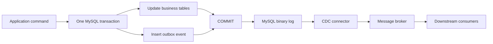

# Outbox, CDC và đồng bộ sự kiện từ binary log

Trong module `DATABASE_MYSQL`, người học làm chủ MySQL từ thiết kế bảng, kiểu dữ liệu, khóa và truy vấn SQL đến index, transaction, kiểm soát đồng thời, đọc kế hoạch thực thi, tối ưu truy vấn, phân quyền, sao lưu và xử lý các vấn đề vận hành cơ sở dữ liệu quan hệ. Bài học này kết nối Transactional Outbox, Change Data Capture (CDC) và binary log để đồng bộ sự kiện từ MySQL sang message broker hoặc các hệ thống downstream.

Một ứng dụng thường cần vừa cập nhật dữ liệu nghiệp vụ trong MySQL vừa phát sự kiện sang Kafka hoặc một hệ thống khác. Nếu ứng dụng commit database trước rồi gửi message, process có thể dừng giữa hai thao tác và làm mất sự kiện. Nếu gửi message trước rồi database rollback, consumer có thể nhận một sự kiện mô tả thay đổi chưa từng được commit. Transactional Outbox giải quyết khoảng trống này bằng cách ghi dữ liệu nghiệp vụ và bản ghi sự kiện trong cùng một transaction MySQL. CDC đọc outbox từ binary log rồi chuyển sự kiện đến broker.

## 1. Bài toán dual-write

Giả sử service xác nhận thanh toán cần:

1. Cập nhật đơn hàng trong MySQL sang trạng thái `PAID`.
2. Phát sự kiện `OrderPaid` để kho, email và hệ thống phân tích xử lý.

Hai hệ thống lưu trữ độc lập không chia sẻ một transaction ACID thông thường. Có hai thứ tự dễ gặp:

```text
Database COMMIT -> publish message
```

Nếu database commit thành công nhưng process dừng trước khi publish, trạng thái đơn hàng đã thay đổi nhưng downstream không nhận được sự kiện.

```text
Publish message -> Database COMMIT
```

Nếu broker nhận message nhưng transaction database thất bại, downstream xử lý một sự kiện không phản ánh trạng thái đã commit.

Đây là bài toán dual-write: hai lần ghi vào hai hệ thống khác nhau không được bảo vệ bởi cùng một transaction. Thử thêm retry cho cả hai thao tác không giải quyết triệt để vì process có thể dừng ở bất kỳ điểm nào và kết quả của một lần gửi có thể không xác định khi timeout.

## 2. Transactional Outbox hoạt động như thế nào?

Outbox là một bảng trong cùng database với dữ liệu nghiệp vụ. Trong một transaction, ứng dụng cập nhật bảng nghiệp vụ và thêm một hàng mô tả sự kiện vào outbox. Nếu transaction commit, cả hai thay đổi cùng tồn tại; nếu rollback, cả hai cùng bị hủy.



Các bước:

1. Service nhận lệnh nghiệp vụ và bắt đầu transaction.
2. Service cập nhật dữ liệu, ví dụ đánh dấu đơn hàng đã thanh toán.
3. Service ghi một outbox event có ID duy nhất, loại sự kiện, aggregate và payload.
4. MySQL commit cả dữ liệu nghiệp vụ và outbox row trong cùng transaction.
5. CDC connector đọc transaction đã commit từ binary log.
6. Connector chuyển outbox row thành message và gửi đến broker.
7. Consumer xử lý message theo cơ chế idempotent.

Outbox bảo đảm thay đổi nghiệp vụ và ý định phát sự kiện được lưu nguyên tử trong MySQL. Nó không tự tạo ra exactly-once delivery giữa MySQL và broker; connector hoặc consumer vẫn có thể phát lại message sau sự cố. Vì vậy, ID sự kiện, offset bền vững và idempotency là các phần bắt buộc của thiết kế.

## 3. Thiết kế bảng outbox

Một bảng outbox nên lưu đủ thông tin để consumer hiểu sự kiện mà không cần truy vấn ngược database nguồn. Ví dụ:

```sql
CREATE TABLE outbox_event (
    id CHAR(36) NOT NULL,
    aggregatetype VARCHAR(100) NOT NULL,
    aggregateid VARCHAR(128) NOT NULL,
    type VARCHAR(100) NOT NULL,
    payload JSON NOT NULL,
    created_at TIMESTAMP(6) NOT NULL DEFAULT CURRENT_TIMESTAMP(6),
    PRIMARY KEY (id),
    KEY idx_outbox_aggregate_created
        (aggregatetype, aggregateid, created_at)
) ENGINE=InnoDB;
```

Ý nghĩa các cột:

| Cột | Vai trò |
|---|---|
| `id` | ID duy nhất của event; dùng để deduplicate khi consumer nhận lại message. |
| `aggregatetype` | Loại đối tượng nghiệp vụ, ví dụ `Order` hoặc `Payment`. |
| `aggregateid` | ID của đối tượng cụ thể; thường dùng làm message key để giữ thứ tự theo aggregate. |
| `type` | Tên sự kiện, ví dụ `OrderPaid` hoặc `OrderCancelled`. |
| `payload` | Nội dung sự kiện đã được chụp tại thời điểm transaction commit. |
| `created_at` | Thời điểm ứng dụng tạo event; không thay thế vị trí commit/offset của binlog. |

Tên cột `id`, `aggregatetype`, `aggregateid`, `type` và `payload` tương thích với các tên mặc định thường dùng bởi Debezium Outbox Event Router. Cấu hình SMT có thể đổi tên field; hãy xác minh theo đúng phiên bản Debezium đang triển khai.

Không nhất thiết phải lưu toàn bộ entity vào payload. Chỉ đưa dữ liệu cần thiết cho consumer, tránh lộ thông tin cá nhân hoặc bí mật không cần thiết. Nên có `schemaVersion` trong payload hoặc envelope để consumer xử lý thay đổi cấu trúc theo thời gian.

### Chọn ID và message key

- `id` phải duy nhất và không thay đổi khi retry. UUID hoặc ID duy nhất do ứng dụng sinh trước khi ghi là lựa chọn phổ biến.
- `aggregateid` biểu diễn thực thể mà sự kiện thuộc về, ví dụ order ID.
- Message key thường nên là aggregate ID nếu cần giữ thứ tự các sự kiện của cùng một đơn hàng trong cùng partition của Kafka.
- Nếu dùng ID sự kiện làm key, các sự kiện cùng aggregate có thể rơi vào các partition khác nhau và mất thứ tự tương đối ở tầng consumer.

Thứ tự được bảo đảm trong một partition của broker, không tự động bảo đảm toàn cục giữa mọi partition hoặc mọi consumer. Nếu một aggregate có yêu cầu thứ tự nghiêm ngặt, phải thiết kế partition key và xử lý song song tương ứng.

## 4. Ghi outbox cùng transaction nghiệp vụ

Ví dụ service Spring:

```java
@Service
public class OrderApplicationService {
    private final OrderRepository orderRepository;
    private final OutboxRepository outboxRepository;
    private final ObjectMapper objectMapper;

    public OrderApplicationService(
            OrderRepository orderRepository,
            OutboxRepository outboxRepository,
            ObjectMapper objectMapper) {
        this.orderRepository = orderRepository;
        this.outboxRepository = outboxRepository;
        this.objectMapper = objectMapper;
    }

    @Transactional
    public void markPaid(long orderId, String paymentId) {
        Order order = orderRepository.findById(orderId)
            .orElseThrow();

        order.markPaid(paymentId);

        OrderPaidPayload payload = new OrderPaidPayload(
            order.getId(),
            paymentId,
            order.getTotalAmount(),
            order.getCurrency(),
            1
        );

        outboxRepository.save(OutboxEvent.create(
            UUID.randomUUID().toString(),
            "Order",
            Long.toString(order.getId()),
            "OrderPaid",
            objectMapper.valueToTree(payload)
        ));
    }
}
```

Đoạn code là ví dụ kiến trúc; entity, repository và constructor của `OutboxEvent` cần được triển khai theo dự án. Điều kiện quan trọng là hai repository dùng cùng MySQL datasource, cùng transaction manager và tham gia cùng một transaction. Nếu outbox được ghi vào database khác hoặc dùng một transaction manager độc lập, tính nguyên tử không còn được bảo đảm.

Không gửi message trực tiếp trong phương thức `@Transactional` rồi coi đó là outbox. Message có thể được publish trước khi transaction commit hoặc được publish dù transaction sau đó rollback. CDC chỉ đọc row đã được ghi vào binary log khi transaction commit.

### Payload là snapshot của sự kiện

Payload nên mô tả sự kiện tại thời điểm phát sinh. Ví dụ `OrderPaid` có thể chứa order ID, payment ID, tổng tiền, currency, thời điểm xác nhận và schema version. Nếu consumer chỉ nhận order ID rồi truy vấn database nguồn sau đó, dữ liệu có thể đã thay đổi hoặc nguồn không còn truy cập được.

Không dùng sự kiện như một lệnh yêu cầu consumer đọc toàn bộ bảng nguồn. Payload rõ ràng giúp downstream độc lập hơn với schema nội bộ và giảm coupling giữa các service.

## 5. CDC đọc thay đổi từ binary log

MySQL binary log ghi lại các thay đổi cần thiết để replication và các công cụ downstream đọc lại. Với CDC theo row, connector đọc các sự kiện row change từ binlog thay vì phân tích câu SQL gốc.

Luồng tổng quát:

```text
MySQL transaction
    |
    v
InnoDB commit + binary log
    |
    v
Binlog reader / CDC connector
    |
    +--> initial snapshot (khi cần)
    |
    v
Decode committed row changes
    |
    v
Transform/filter/map
    |
    v
Broker topic
    |
    v
Consumer
```

CDC thường có hai giai đoạn:

1. **Snapshot:** connector đọc trạng thái hiện tại của các bảng được chọn để downstream có điểm bắt đầu đầy đủ.
2. **Streaming:** connector tiếp tục từ vị trí binlog hoặc GTID tương ứng để gửi các thay đổi phát sinh sau snapshot.

Chi tiết snapshot, locking strategy, offset và schema history phụ thuộc connector. Với Debezium MySQL, connector quản lý offset đọc binlog và metadata schema để có thể tiếp tục sau restart. Cần lưu trữ bền vững offset và schema history; nếu mất chúng, connector có thể phải snapshot lại hoặc không giải mã được log cũ theo cách mong muốn.

## 6. Cấu hình MySQL cho CDC

Các yêu cầu nền tảng thường gồm:

```ini
[mysqld]
server_id=101
log_bin=mysql-bin
binlog_format=ROW
binlog_row_image=FULL
gtid_mode=ON
enforce_gtid_consistency=ON
binlog_expire_logs_seconds=604800
```

Ý nghĩa:

- `server_id` phải duy nhất trong topology replication.
- `log_bin` bật binary logging.
- `binlog_format=ROW` ghi thay đổi ở mức row, phù hợp với CDC cần đọc dữ liệu trước/sau của bản ghi.
- `binlog_row_image=FULL` ghi ảnh đầy đủ của row cho các thay đổi. Điều này dễ dùng cho CDC cần giá trị đầy đủ nhưng làm binlog lớn hơn; chọn theo yêu cầu connector và dữ liệu cần xuất.
- `gtid_mode=ON` và `enforce_gtid_consistency=ON` hỗ trợ định danh transaction và phục hồi vị trí đọc qua topology có GTID.
- `binlog_expire_logs_seconds` đặt thời gian giữ binlog; ví dụ 7 ngày chỉ là giá trị minh họa, phải tính theo thời gian outage, khôi phục và tốc độ sinh log.

Không bật hoặc thay đổi cấu hình production chỉ bằng cách sao chép ví dụ. Kiểm tra phiên bản MySQL, cấu hình hiện hành, dung lượng đĩa và yêu cầu của connector. `binlog_row_image=FULL` tăng lượng log; với workload ghi lớn, phải dự báo dung lượng và network.

### Tài khoản CDC tối thiểu

Tạo tài khoản riêng cho connector, không dùng tài khoản ứng dụng hoặc root. Connector thường cần quyền đọc metadata và quyền replication để đọc binlog; snapshot có thể cần thêm quyền đọc bảng và quyền phục vụ cách snapshot được chọn. Ví dụ khung cấp quyền:

```sql
CREATE USER 'cdc_reader'@'10.20.5.%'
    IDENTIFIED BY 'MAT_KHAU_LAY_TU_SECRET_MANAGER';

GRANT SELECT, RELOAD, SHOW DATABASES,
      REPLICATION SLAVE, REPLICATION CLIENT
ON *.* TO 'cdc_reader'@'10.20.5.%';
```

Đây là ví dụ quyền thường gặp cho Debezium MySQL, không phải bộ quyền tối thiểu cho mọi connector/version và mọi snapshot mode. Một số môi trường có thể cần hoặc không cần từng quyền; hãy đối chiếu tài liệu đúng phiên bản, giới hạn host/IP, thử snapshot và streaming, rồi thu hẹp quyền theo chính sách bảo mật. Không lưu mật khẩu thật trong file connector hoặc repository.

Nếu CDC đọc từ replica thay vì source, cần xác minh replica ghi tiếp các transaction nhận từ upstream vào binary log khi downstream cần đọc chúng; cấu hình `log_replica_updates` có vai trò trong topology này. Đảm bảo replica có binlog retention và GTID state phù hợp.

## 7. Debezium và Outbox Event Router

Debezium là một nền tảng CDC phổ biến. MySQL connector đọc binlog, lưu offset và phát record thay đổi sang Kafka Connect. Với outbox, Debezium cung cấp Outbox Event Router SMT để biến thay đổi của bảng outbox thành message nghiệp vụ có topic, key, type và payload phù hợp.

Các thành phần:

| Thành phần | Trách nhiệm |
|---|---|
| Debezium MySQL connector | Đọc snapshot và binlog, quản lý offset và schema history. |
| Kafka Connect | Chạy connector, lưu trạng thái và điều phối tác vụ. |
| Outbox Event Router SMT | Chuyển row outbox thành event message và định tuyến topic/key/payload. |
| Kafka topic | Lưu và phân phối message cho consumer. |
| Consumer | Xử lý nghiệp vụ downstream và chống xử lý trùng. |

Một cấu hình connector hiện đại thường có các thông tin như hostname/port, tài khoản CDC, `topic.prefix`, `database.include.list`, `table.include.list`, server ID riêng, bootstrap servers, nơi lưu schema history và topic lưu offset. Tên thuộc tính đã thay đổi qua các thế hệ Debezium; ví dụ cấu hình phải được tạo theo đúng phiên bản connector, Kafka Connect và MySQL.

Khi dùng Outbox Event Router, cấu hình cần chỉ rõ bảng outbox, cột event ID, aggregate type, aggregate ID, event type và payload. Có thể cấu hình tên topic theo aggregate type hoặc quy tắc định tuyến của hệ thống. Không bật đồng thời một SMT khác làm biến đổi payload mà chưa xác định rõ thứ tự áp dụng.

Không dùng cấu hình mẫu từ Debezium 1.x cho connector 2.x/3.x mà không kiểm tra tài liệu tương ứng. Trước khi triển khai, kiểm thử:

- Snapshot ban đầu và streaming sau snapshot.
- Sự kiện insert vào outbox được route đúng topic.
- Event ID và aggregate ID được giữ nguyên.
- Payload JSON được chuyển đúng định dạng mà consumer mong đợi.
- Offset và schema history vẫn tồn tại sau khi restart connector.
- Connector phục hồi đúng sau khi tạm ngắt MySQL hoặc broker.

## 8. Delivery guarantee: at-least-once và duplicate

Trong hệ thống CDC, connector có thể gửi một message sang broker nhưng chưa kịp lưu offset bền vững trước khi process dừng. Khi khởi động lại, connector có thể đọc lại transaction và gửi message lần nữa. Đây là hành vi phổ biến của cơ chế at-least-once.

Do đó:

- Không giả định mỗi event chỉ được giao đúng một lần.
- Giữ event ID ổn định qua mọi lần phát lại.
- Consumer phải deduplicate hoặc thực hiện thao tác idempotent.
- Nếu một event tạo nhiều side effect, mỗi side effect cũng cần idempotency phù hợp.

Một bảng inbox ở consumer có thể dùng event ID làm primary key:

```sql
CREATE TABLE processed_event (
    event_id CHAR(36) NOT NULL,
    processed_at TIMESTAMP(6) NOT NULL DEFAULT CURRENT_TIMESTAMP(6),
    PRIMARY KEY (event_id)
) ENGINE=InnoDB;
```

Consumer ghi nhận event ID và thay đổi dữ liệu downstream trong cùng một transaction local:

```java
@Transactional
public void handle(OrderPaidEvent event) {
    if (processedEventRepository.existsById(event.id())) {
        return;
    }

    accountProjection.applyPayment(event);
    processedEventRepository.save(
        new ProcessedEvent(event.id())
    );
}
```

Đoạn code minh họa ý tưởng. Để chống race giữa hai consumer xử lý cùng event, unique primary key là lớp bảo vệ cuối cùng; xử lý duplicate-key exception theo cách phù hợp và rollback toàn bộ transaction hiện tại. Bảng inbox và cập nhật projection phải nằm trong cùng transaction database downstream.

Nếu consumer gọi hệ thống ngoài như cổng thanh toán hoặc gửi email, transaction MySQL của consumer không thể rollback side effect bên ngoài. Hãy dùng idempotency key của hệ thống đích, transactional outbox ở consumer hoặc workflow có khả năng bù trừ.

## 9. Thứ tự sự kiện và transaction boundary

MySQL binlog phản ánh thứ tự commit transaction trên source. Tuy nhiên, thứ tự đến consumer còn phụ thuộc connector, cách phân partition, số consumer và thời gian xử lý.

Để giữ thứ tự trong cùng aggregate:

1. Ghi mọi event của aggregate trong cùng luồng transaction có thứ tự xác định.
2. Dùng `aggregateid` làm message key để các event của cùng aggregate đi cùng partition.
3. Consumer xử lý tuần tự trong partition hoặc có cơ chế kiểm tra version/sequence.
4. Đưa `aggregateVersion` hoặc `eventSequence` vào payload nếu cần phát hiện event đến muộn hoặc trùng thứ tự.

Ví dụ payload:

```json
{
  "schemaVersion": 1,
  "eventId": "9d3f2e7c-7b20-4d1d-a6f0-6c9e7e8f2b11",
  "eventType": "OrderPaid",
  "aggregateType": "Order",
  "aggregateId": "ORD-10025",
  "aggregateVersion": 7,
  "occurredAt": "2026-11-19T10:30:00Z",
  "data": {
    "paymentId": "PAY-9081",
    "amount": "125000.00",
    "currency": "VND"
  }
}
```

Ví dụ dùng chuỗi cho amount để tránh consumer diễn giải số tiền qua floating point. `occurredAt` là thời điểm nghiệp vụ do ứng dụng tạo; nó không thay thế commit order của binlog. Nếu consumer cần phát hiện version bị bỏ qua, kiểm tra `aggregateVersion` trước khi áp dụng.

Không tuyên bố có thứ tự toàn cục chỉ vì source ghi binlog tuần tự. Khi có nhiều topic, partition hoặc connector, cần xác định phạm vi thứ tự mà hệ thống thực sự bảo đảm.

## 10. Snapshot, offset và phục hồi connector

CDC cần nhớ vị trí đã đọc để tiếp tục sau restart. Tùy connector, vị trí có thể được biểu diễn bằng binlog file/position hoặc GTID set cùng metadata transaction.

Vận hành cần bảo vệ:

- Offset storage của connector.
- Schema history storage.
- Kafka topic nhận event.
- Cấu hình connector và secret.
- Binary log trên MySQL đủ lâu để connector tiếp tục sau outage.

Nếu connector ngừng hoạt động lâu hơn thời gian giữ binlog, MySQL có thể purge file mà connector chưa đọc. Khi đó connector không thể tiếp tục từ vị trí cũ nếu transaction cần thiết đã bị xóa. Cách phục hồi có thể cần snapshot mới, đối chiếu dữ liệu downstream và quy trình bù sự kiện. Không chỉ xóa offset để “cho connector chạy lại” vì có thể tạo khoảng trống hoặc phát lại toàn bộ sự kiện ngoài dự kiến.

Retention phải dựa trên thời gian phát hiện lỗi, khôi phục Kafka Connect, sửa mạng, khôi phục MySQL và chạy lại connector, cộng thêm biên an toàn. Cần cảnh báo khi connector lag tiến gần tuổi binlog cũ nhất còn giữ.

### Theo dõi tiến độ CDC

Các chỉ số nên quan sát:

- Connector state và số lần restart/failure.
- Độ trễ từ commit trên MySQL đến message xuất hiện ở broker.
- Vị trí binlog/GTID hiện tại và khoảng cách so với source.
- Tuổi của binlog cũ nhất còn giữ.
- Snapshot progress và thời gian hoàn thành snapshot.
- Kafka Connect task errors, retry và queue size.
- Số event phát ra, số event lỗi hoặc bị loại bỏ.
- Consumer lag, duplicate rate và dead-letter count.

`Seconds_Behind_Source` của MySQL replica không phải metric thay thế cho CDC lag. Một connector có thể chậm dù replica bắt kịp, hoặc đọc từ source trong khi consumer downstream bị chậm.

## 11. CDC trực tiếp từ bảng nghiệp vụ và Outbox khác nhau thế nào?

CDC có thể capture thay đổi từ bất kỳ bảng nào được cấu hình. Nhưng phát toàn bộ thay đổi bảng nghiệp vụ sang downstream thường khiến consumer phụ thuộc cấu trúc database.

| Tiêu chí | CDC trực tiếp từ bảng nghiệp vụ | Outbox kết hợp CDC |
|---|---|---|
| Nội dung phát ra | Thay đổi hàng ở mức database. | Sự kiện nghiệp vụ được ứng dụng định nghĩa. |
| Coupling | Consumer thường phụ thuộc schema và ý nghĩa cột. | Consumer phụ thuộc event contract được công bố. |
| Ngữ nghĩa | Có thể chỉ thấy một row change, khó biết ý nghĩa nghiệp vụ. | Event thể hiện rõ `OrderPaid`, `CustomerAddressChanged`... |
| Thay đổi schema | Có thể ảnh hưởng trực tiếp mọi consumer. | Có thể giữ event contract ổn định dù schema nội bộ đổi. |
| Phù hợp | Đồng bộ dữ liệu, search index, cache, warehouse, audit kỹ thuật. | Phát domain event giữa service và tích hợp nghiệp vụ. |

CDC trực tiếp vẫn hữu ích khi cần sao chép bảng hoặc xây dựng read model. Outbox phù hợp khi muốn công bố sự kiện nghiệp vụ ổn định và tránh để consumer tự suy luận sự kiện từ nhiều thay đổi bảng.

Không nên dùng row change như một domain event mà không có lớp chuyển đổi. Một thao tác nghiệp vụ có thể cập nhật nhiều bảng; consumer nhận từng row change có thể nhìn thấy trạng thái trung gian hoặc hiểu sai ý nghĩa.

## 12. Outbox polling và Outbox CDC

Outbox có thể được chuyển thành message bằng hai cách phổ biến:

| Phương pháp | Cách hoạt động | Đặc điểm |
|---|---|---|
| Polling relay | Worker truy vấn các hàng chưa xử lý, khóa theo batch, publish rồi đánh dấu trạng thái. | Dễ bắt đầu, cần quản lý trạng thái, polling load, lease và retry. |
| CDC relay | Connector đọc insert của outbox từ binlog và route thành message. | Không cần poll bảng liên tục; cần vận hành binlog, connector, offset và schema history. |

Không chạy cả polling relay và CDC trên cùng outbox nếu chưa có thiết kế phân phối rõ ràng; có thể phát cùng một event hai lần từ hai đường khác nhau. Nếu dùng polling, cần xử lý crash sau publish nhưng trước khi đánh dấu đã gửi, vì message có thể được gửi lại. Nếu dùng CDC, consumer vẫn cần idempotency vì connector có thể replay.

Với polling, `SELECT ... FOR UPDATE SKIP LOCKED` có thể giúp nhiều worker lấy batch không trùng nhau trên MySQL hỗ trợ cú pháp này. Tuy nhiên, phải giữ transaction ngắn và không giữ row lock trong lúc gọi broker lâu. Một lease/claim state hoặc thiết kế batch phù hợp có thể giảm thời gian khóa.

## 13. Schema evolution và hợp đồng sự kiện

Outbox giúp tách schema nội bộ khỏi event contract, nhưng payload vẫn cần quản lý phiên bản. Một số nguyên tắc:

1. Thêm trường optional thường dễ tương thích hơn đổi tên hoặc xóa trường.
2. Consumer cũ cần bỏ qua field chưa biết nếu hợp đồng cho phép.
3. Thay đổi kiểu field hoặc ý nghĩa field cần version hoặc event type mới.
4. Không tái sử dụng tên event cho ý nghĩa nghiệp vụ khác.
5. Duy trì ví dụ payload và schema contract có thể kiểm tra tự động.
6. Khi cần backfill hoặc replay event cũ, consumer phải hiểu version của payload.

Nếu dùng Schema Registry với Avro, Protobuf hoặc JSON Schema, đặt compatibility policy phù hợp và kiểm tra schema trước khi publish. Nếu payload là JSON không đăng ký schema, vẫn cần validation ở producer và contract test giữa producer/consumer.

Thay đổi DDL của bảng outbox cũng cần phối hợp với connector. Không xóa/đổi tên cột mà SMT đang đọc trước khi connector được cập nhật. Với DDL lớn, kiểm tra schema history và khả năng connector xử lý event schema mới.

## 14. Bảo mật và quyền truy cập

CDC có thể đọc dữ liệu nhạy cảm từ binlog. Tài khoản connector cần quyền tối thiểu, kết nối TLS, mật khẩu lưu trong secret manager và giới hạn network source. Kafka topic cũng cần ACL, mã hóa khi truyền và mã hóa lưu trữ theo chính sách.

Các nguyên tắc:

- Chỉ capture schema/table cần thiết bằng include list.
- Không đưa password, token, khóa bí mật hoặc dữ liệu cá nhân không cần thiết vào payload.
- Kiểm soát ai được đọc topic và ai được xem connector configuration.
- Không ghi password connector vào log hoặc repository.
- Xoay vòng tài khoản và chứng chỉ có kế hoạch.
- Xác định thời hạn lưu outbox, binlog, topic và dead-letter queue theo yêu cầu bảo mật/dữ liệu.
- Ghi nhận audit cho việc thay đổi quyền, connector và topic ACL.

## 15. Vận hành, dọn dẹp và xử lý sự cố

Outbox là bảng tăng liên tục nếu không có chính sách dọn dẹp. Với CDC, việc xóa row khỏi outbox sau khi đã phát không nhất thiết làm mất message đã gửi, nhưng cần bảo đảm connector đã đọc insert và việc xóa không bị SMT diễn giải thành event nghiệp vụ ngoài ý muốn.

Một chiến lược thường dùng là giữ outbox đủ lâu cho điều tra và replay, sau đó archive hoặc xóa theo batch nhỏ. Nếu cần replay event, phải biết nguồn replay: retained outbox, backup, Kafka topic hay một kho event riêng. Không coi binary log là kho lưu event lâu dài.

Các tình huống thường gặp:

| Hiện tượng | Nguyên nhân có thể | Hướng xử lý |
|---|---|---|
| Connector không khởi động | Sai quyền, sai server ID, binlog chưa bật hoặc config không đúng version. | Kiểm tra connector log, MySQL error log, quyền và biến runtime. |
| Connector báo binlog file không còn | Connector outage vượt retention và MySQL đã purge log cần thiết. | Đánh giá snapshot/rebuild downstream; tăng retention và cảnh báo lag. |
| Event bị phát trùng | Connector replay sau crash hoặc offset chưa được commit. | Deduplicate bằng event ID và transaction inbox ở consumer. |
| Event mất dù business row đã đổi | Ứng dụng dual-write trực tiếp hoặc outbox không cùng transaction. | Đưa business update và outbox insert vào cùng MySQL transaction; đối chiếu dữ liệu. |
| Payload thiếu trường hoặc sai schema | Producer và consumer không tương thích hoặc SMT mapping sai. | Kiểm tra event schema version, SMT field mapping và contract test. |
| Thứ tự event sai | Message key/partition không theo aggregate hoặc consumer xử lý song song không kiểm soát. | Dùng aggregate key, sequence/version và xử lý tuần tự theo partition. |
| Binlog tăng nhanh, đĩa đầy | Row image lớn, workload ghi cao hoặc retention quá dài so với dung lượng. | Dự báo dung lượng, giới hạn capture, xem row image và mở rộng lưu trữ. |
| Outbox phình to | Không có retention/cleanup hoặc cleanup không chạy. | Archive/xóa theo batch sau khi xác minh đã capture và còn khả năng replay cần thiết. |
| Consumer bị lặp side effect | Chỉ dedupe message nhưng side effect ngoài DB không idempotent. | Dùng idempotency key ở hệ thống đích hoặc outbox/workflow tiếp theo. |

## 16. Bài thực hành tổng hợp

Xây dựng một service đơn hàng MySQL có event `OrderPaid` và một consumer cập nhật read model:

1. Tạo bảng `orders` và `outbox_event` bằng migration.
2. Viết service `markPaid()` với một `@Transactional`, cập nhật order và insert outbox row cùng transaction.
3. Thử rollback transaction sau khi tạo outbox row; xác minh cả order update và outbox row đều không tồn tại.
4. Commit transaction; xác minh cả order state và outbox row đều tồn tại.
5. Bật MySQL binary log ở row format, tạo tài khoản CDC riêng và cấu hình retention cho thời gian connector có thể offline.
6. Triển khai Debezium MySQL connector trên môi trường thử nghiệm; thực hiện snapshot và streaming từ binlog.
7. Cấu hình Outbox Event Router theo đúng phiên bản Debezium; xác minh topic, message key, event ID, type và payload.
8. Tạo consumer có bảng inbox với event ID unique; gửi lại cùng một event hai lần và xác minh business effect chỉ xảy ra một lần.
9. Dừng connector, tiếp tục tạo event, rồi khởi động lại; xác minh offset và binlog retention đủ để connector bắt kịp.
10. Thử một thay đổi payload có version mới; kiểm tra consumer cũ/mới và chính sách tương thích.
11. Đo CDC lag, consumer lag, duplicate rate, binlog growth và kích thước outbox.
12. Viết runbook cho connector restart, binlog purged, snapshot lại, replay và dọn dẹp outbox.

Sau bài tập, người học cần giải thích được vì sao outbox giải quyết dual-write ở phía MySQL, vì sao CDC đọc binlog cần retention và offset bền vững, vì sao delivery có thể at-least-once, và cách consumer dùng event ID để chống xử lý trùng. Đây là nền tảng để đồng bộ sự kiện từ MySQL sang các hệ thống khác mà vẫn giữ được tính nhất quán nghiệp vụ và khả năng phục hồi.

## Tài liệu tham khảo chính thức

- [MySQL 8.4 Reference Manual: The Binary Log](https://dev.mysql.com/doc/refman/8.4/en/binary-log.html)
- [MySQL 8.4 Reference Manual: Replication and Binary Logging Options and Variables](https://dev.mysql.com/doc/refman/8.4/en/replication-options-binary-log.html)
- [Debezium Documentation: MySQL Connector](https://debezium.io/documentation/reference/stable/connectors/mysql.html)
- [Debezium Documentation: Outbox Event Router](https://debezium.io/documentation/reference/stable/transformations/outbox-event-router.html)
- [Debezium Documentation: Kafka Connect](https://debezium.io/documentation/reference/stable/architecture.html)
