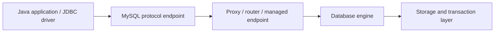

# Tương thích giao thức so với tương thích ngữ nghĩa khi dùng dịch vụ hoặc engine khác

## Mục tiêu

Một dịch vụ được quảng cáo là “MySQL-compatible” thường có thể nhận kết nối từ MySQL client hoặc chạy được nhiều câu SQL quen thuộc. Điều đó chưa bảo đảm ứng dụng sẽ hoạt động giống hệt khi chuyển từ MySQL sang một engine khác, dùng proxy trung gian hoặc chuyển sang dịch vụ managed. Hai khái niệm cần kiểm tra riêng là **tương thích giao thức** và **tương thích ngữ nghĩa**.

Tương thích giao thức cho biết client và server có thể bắt tay, xác thực, trao đổi packet và thực hiện các thao tác giao tiếp mà driver cần hay không. Tương thích ngữ nghĩa cho biết câu SQL, kiểu dữ liệu, transaction, khóa, DDL và hành vi vận hành tạo ra cùng kết quả mà ứng dụng mong đợi hay không.

Bài học thuộc module **DATABASE_MYSQL**, nơi bạn làm chủ thiết kế bảng, kiểu dữ liệu, khóa, truy vấn SQL, index, transaction, kiểm soát đồng thời, đọc kế hoạch thực thi, tối ưu truy vấn và vận hành cơ sở dữ liệu quan hệ. Sau bài học, bạn có thể:

- Phân biệt khả năng kết nối MySQL wire protocol với mức độ tương đương hành vi SQL.
- Xác định lớp tương thích do driver, proxy, dịch vụ managed hoặc storage engine cung cấp.
- Kiểm thử authentication, TLS, prepared statement, session state và các capability của giao thức.
- So sánh kiểu dữ liệu, collation, transaction, locking, DDL và optimizer giữa các engine.
- Xây dựng ma trận tương thích theo phiên bản và kiểm thử trên endpoint thực tế trước khi chuyển workload.

## 1. Hai lớp tương thích khác nhau

**Tương thích giao thức (protocol compatibility)** tập trung vào cách client nói chuyện với endpoint database. Với MySQL, lớp này thường liên quan đến MySQL client/server protocol: handshake, capability flags, authentication exchange, packet format, command, result set và error response.

**Tương thích ngữ nghĩa (semantic compatibility)** tập trung vào ý nghĩa của thao tác database. Hai server có thể nhận cùng một packet `COM_QUERY` và trả result set hợp lệ, nhưng khác nhau về cách ép kiểu, so sánh chuỗi, xử lý `NULL`, isolation level, khóa, thứ tự commit hoặc thực thi DDL.

| Câu hỏi | Protocol compatibility | Semantic compatibility |
|---|---|---|
| Driver có kết nối được không? | Có | Không đủ để kết luận |
| Authentication plugin và TLS có hoạt động không? | Có | Không quyết định semantics SQL |
| `PreparedStatement` có prepare/execute được không? | Có | Cần kiểm tra kiểu bind, lỗi và kết quả |
| Cùng câu SQL có trả cùng kết quả không? | Không bảo đảm | Có |
| Transaction có cùng commit/rollback và isolation không? | Không bảo đảm | Có |
| Failover có giữ session và read-after-write không? | Không chỉ là giao thức | Có liên quan tới semantics vận hành |

Đừng dùng một bài kiểm tra “JDBC connect thành công” để kết luận một dịch vụ có thể thay thế MySQL. Kết nối thành công chỉ xác nhận một phần nhỏ của hợp đồng.

## 2. Các lớp trong đường đi của một truy vấn

Ứng dụng có thể giao tiếp với MySQL trực tiếp hoặc đi qua một hay nhiều lớp trung gian:



Mỗi lớp có thể cung cấp hoặc giới hạn một phần tương thích:

- **JDBC driver:** tạo handshake, chọn authentication, bật TLS, mã hóa tham số, dùng text hoặc binary protocol và diễn giải lỗi.
- **Proxy/router:** nhận protocol từ client, chọn backend, chuyển tiếp câu lệnh, route read/write và quản lý session affinity.
- **Managed service:** cung cấp endpoint, backup, failover, replication hoặc tính năng mở rộng; phiên bản tương thích có thể dựa trên một nhánh engine cụ thể.
- **Database engine:** quyết định SQL dialect, kiểu dữ liệu, transaction, locking, optimizer, DDL và tính nhất quán.

Kiểm thử qua endpoint mà ứng dụng production thực sự dùng. Nếu ứng dụng đi qua proxy, test trực tiếp backend không thể phát hiện lỗi routing, multiplexing hoặc session state do proxy gây ra.

## 3. MySQL wire protocol: những gì cần xác minh

Trong handshake, server gửi thông tin phiên bản, connection ID, capability flags và dữ liệu phục vụ authentication. Client và server thương lượng các tính năng mà cả hai cùng hỗ trợ. Các driver hiện đại còn có thể dùng TLS, compression, connection attributes và các cơ chế xác thực khác nhau.

Những khả năng nên kiểm tra:

| Khả năng giao thức | Câu hỏi kiểm thử |
|---|---|
| Handshake và capability flags | Driver có bắt tay thành công với đúng phiên bản và endpoint không? |
| Authentication | Plugin đang dùng có được hỗ trợ? Có cần round-trip hoặc credential exchange riêng không? |
| TLS | Có xác minh CA, hostname/SAN và chế độ TLS bắt buộc không? |
| Compression | Client và server có thương lượng cùng compression capability không? |
| Prepared statement protocol | `COM_STMT_PREPARE`, bind parameter, execute và close có hoạt động đúng không? |
| Multi-result / stored procedure | Driver có đọc hết các result set và update count không? |
| Multi-statements | Endpoint có cho phép nhiều statement trong một request không, và driver có bật capability tương ứng không? |
| Cursor/fetch | Server và driver có hỗ trợ kiểu fetch mà ứng dụng sử dụng không? |
| `LOAD DATA LOCAL INFILE` | Client/server có bật đúng capability và chính sách bảo mật không? |
| Session tracking | Driver có nhận được trạng thái session hoặc GTID nếu ứng dụng dựa vào nó không? |

Không bật multi-statements hoặc `LOCAL INFILE` chỉ để vượt qua một lỗi kết nối. Đây là capability có ảnh hưởng bảo mật và cần được cho phép có chủ đích ở cả client lẫn server.

### Authentication và TLS

MySQL client/server protocol có thể dùng nhiều authentication plugin. Một driver cũ có thể kết nối được với một server nhưng không hỗ trợ plugin xác thực mà server yêu cầu. Ngược lại, dịch vụ tương thích MySQL có thể triển khai một tập plugin hoặc cơ chế credential riêng.

Kiểm tra user account, plugin xác thực, TLS requirement, CA và hostname trên endpoint đích. Không hạ TLS verification để làm test thành công. Nếu dịch vụ yêu cầu token tạm thời hoặc IAM authentication, xác minh quy trình cấp mới token và cách pool mở connection sau khi token hết hạn.

### Prepared statement và kiểu bind

JDBC `PreparedStatement` có thể được driver mô phỏng ở client hoặc dùng server-side prepare. Một proxy hoặc engine tương thích có thể hỗ trợ text query tốt nhưng có giới hạn ở prepared statement, cursor hoặc kiểu tham số đặc thù.

Test cả `setString`, `setBigDecimal`, `setTimestamp`, `setBytes`, `setNull`, batch update và server-side prepare nếu ứng dụng bật `useServerPrepStmts`. Kiểm tra giá trị nhận được, kiểu trả về, warning, lỗi và khả năng tái sử dụng statement qua connection pool.

## 4. Tương thích cú pháp không đồng nghĩa tương thích ngữ nghĩa

Một engine có thể chấp nhận cú pháp MySQL nhưng diễn giải một số biểu thức khác. Cần kiểm tra ít nhất các nhóm sau:

- Quy tắc chuyển kiểu ngầm định, overflow, rounding và strict SQL mode.
- `NULL`, chuỗi rỗng, phép nối chuỗi, so sánh và thứ tự sắp xếp.
- Charset, collation, phân biệt hoa/thường và dấu.
- `DATE`, `DATETIME`, `TIMESTAMP`, timezone và độ chính xác phần giây.
- `DECIMAL`, `UNSIGNED`, `BOOLEAN`, `JSON`, UUID và generated column.
- Hàm built-in, regular expression, JSON path, window function và stored routine.
- `AUTO_INCREMENT`, sequence, giá trị `LAST_INSERT_ID()` và hành vi khi retry.

Ví dụ, hai engine có thể cùng nhận `VARCHAR` và unique index nhưng dùng collation khác nhau. Hai chuỗi mà MySQL coi là bằng nhau có thể được engine khác phân biệt, hoặc ngược lại. Điều này làm thay đổi kết quả truy vấn và có thể khiến dữ liệu bị từ chối khi tạo unique index.

Không chỉ so sánh tên kiểu dữ liệu. Hãy so sánh miền giá trị, quy tắc chuyển đổi, giá trị biên và cách driver ánh xạ kiểu Java sang kiểu SQL.

## 5. Collation, charset và quy tắc so sánh

Charset quyết định cách mã hóa ký tự; collation quyết định cách so sánh và sắp xếp. Các engine có thể cùng hỗ trợ UTF-8 nhưng không có cùng tập collation hoặc cùng quy tắc so sánh.

Kiểm tra trên endpoint đích:

```sql
SELECT VERSION() AS server_version,
       @@version_comment AS distribution,
       @@character_set_server AS server_charset,
       @@collation_server AS server_collation,
       @@sql_mode AS sql_mode;
```

Kiểm tra collation ở cấp schema/table/column và test:

- So sánh `ABC` với `abc`.
- So sánh chuỗi có và không có dấu.
- So sánh ký tự Unicode ngoài BMP.
- Unique key với hai chuỗi khác byte nhưng có thể tương đương theo collation.
- `ORDER BY`, `LIKE`, prefix search và range scan.

Nếu chuyển từ MySQL sang MariaDB hoặc một engine khác, đừng giả định tên collation giống nhau có nghĩa là quy tắc so sánh hoàn toàn giống nhau. Hãy chạy bộ test bằng dữ liệu thực tế và kiểm tra duplicate trước khi tạo unique constraint.

## 6. Transaction và isolation semantics

Protocol chỉ chuyển lệnh `START TRANSACTION`, `COMMIT` hoặc `ROLLBACK`. Engine quyết định các lệnh này có ý nghĩa gì đối với snapshot, lock, durability và thứ tự commit.

Kiểm tra các thuộc tính:

| Chủ đề | Điều cần xác minh |
|---|---|
| Autocommit | Mặc định của session và tác động khi connection trả về pool |
| Isolation level | Snapshot được tạo khi nào, phantom/read skew và locking read |
| Consistent read | Các câu `SELECT` có nhìn cùng snapshot hay không |
| `SELECT ... FOR UPDATE` | Khóa hàng/phạm vi nào, có hỗ trợ trên câu truy vấn đó không |
| Deadlock | Cơ chế phát hiện, transaction bị rollback và error code |
| Savepoint | `SAVEPOINT`, `ROLLBACK TO SAVEPOINT` và giới hạn nesting |
| DDL | Có implicit commit không, atomic DDL và online DDL được hỗ trợ đến đâu |
| Durability | Commit được flush tới mức nào, chính sách replication/quorum và failover |

Ví dụ kiểm tra session:

```sql
SELECT @@autocommit,
       @@transaction_isolation,
       @@session.time_zone;
```

Với mỗi engine, chạy hai-session test cho lost update, locking read, deadlock và read-after-write. Một dịch vụ có thể cung cấp MySQL protocol và cú pháp transaction tương tự nhưng dùng kiến trúc phân tán, optimistic concurrency hoặc cơ chế commit khác.

### DDL và migration

MySQL có các quy tắc implicit commit đối với nhiều DDL. Engine khác có thể hỗ trợ transactional DDL hoặc cách lock/commit khác. Không giả định một migration script chạy được ở MySQL sẽ rollback giống nhau ở engine khác.

Kiểm tra `ALTER TABLE`, tạo index, đổi kiểu, rename column, foreign key và online schema change trên phiên bản đích. Ghi lại thời gian, lock duration, replication lag và khả năng rollback. Chạy migration trên bản sao có kích thước gần production.

## 7. Khóa, ràng buộc và tính toàn vẹn

Khác biệt về locking và constraint thường gây lỗi chỉ xuất hiện khi tải đồng thời:

- InnoDB dùng record lock, gap lock và next-key lock theo index, isolation level và truy vấn.
- Một engine phân tán có thể dùng optimistic transaction, timestamp ordering hoặc distributed lock coordination.
- Hỗ trợ foreign key, `CHECK`, cascade và deferred constraint có thể khác theo engine và phiên bản.
- `AUTO_INCREMENT` hoặc sequence có thể tạo khoảng trống, thứ tự ID hoặc mức uniqueness khác.
- Trigger và stored routine có thể chạy với quyền definer/invoker và transaction behavior khác.

Kiểm thử các invariant của nghiệp vụ thay vì chỉ kiểm tra statement không lỗi. Ví dụ, hai lần trừ tồn kho đồng thời không được tạo tồn kho âm; chuyển tiền không được làm thay đổi tổng số dư; mỗi request idempotent chỉ được áp dụng một lần.

## 8. Optimizer và hiệu năng cũng là một phần của tương thích

Cùng một câu SQL có thể trả cùng dữ liệu nhưng có execution plan khác. Optimizer phụ thuộc thống kê, cardinality, index, join algorithm, cost model, partitioning và hint được hỗ trợ.

Đối với truy vấn quan trọng:

1. Chạy `EXPLAIN` hoặc công cụ explain tương đương trên engine đích.
2. So sánh index được chọn, join order, estimated rows và access type.
3. Dùng dữ liệu có phân bố giống production; bảng nhỏ trong test không đại diện workload thật.
4. Đo latency p50/p95/p99, throughput, CPU, I/O và lock wait.
5. Kiểm tra query hint hoặc optimizer switch có được hỗ trợ và có ý nghĩa giống nhau không.

Không coi execution plan giống nhau là điều kiện bắt buộc nếu kết quả và SLO vẫn đạt. Ngược lại, query chạy đúng nhưng chậm hơn nhiều có thể làm pool cạn và gây lỗi toàn ứng dụng.

## 9. Khác biệt giữa các dịch vụ và engine phổ biến

Các sản phẩm sau thường xuất hiện trong hệ sinh thái MySQL-compatible, nhưng mức tương thích phải được kiểm tra theo đúng phiên bản, cấu hình và tính năng:

| Dịch vụ/engine | Lớp tương thích thường hướng tới | Những điểm cần xác minh |
|---|---|---|
| MariaDB | MySQL client protocol và nhiều cú pháp SQL quen thuộc | Khác biệt theo phiên bản về kiểu dữ liệu, JSON, collation, authentication, optimizer, replication và system tables |
| TiDB | MySQL protocol và nhiều ứng dụng/SQL MySQL | Transaction phân tán, locking/isolation, DDL, auto ID, foreign key và tính năng MySQL chưa được hỗ trợ đầy đủ |
| Amazon Aurora MySQL-Compatible | Tương thích với một phiên bản MySQL nhất định ở lớp client/SQL | Version mapping, extension, replication/failover, parameter groups và khác biệt vận hành của storage/service |
| Vitess | MySQL protocol và một tập SQL được hỗ trợ qua lớp sharding/routing | SQL không hỗ trợ, transaction qua shard, VSchema/Vindex, session state và yêu cầu query có thể route |
| ProxySQL | Proxy nói chuyện với client theo MySQL protocol và route tới backend | Backend thật sự là gì, query rules, multiplexing, transaction pinning, session variables và prepared statement behavior |

ProxySQL là proxy, không phải storage engine. Một kết nối qua ProxySQL có thể được route tới nhiều backend tùy quy tắc; vì vậy session state và transaction affinity phải được kiểm tra. Các dịch vụ managed cũng có thể bổ sung endpoint đọc/ghi, failover và giới hạn riêng.

Không dùng nhãn “MySQL-compatible” như một bảo đảm tuyệt đối. Hãy lập danh sách feature ứng dụng đang dùng và đối chiếu với tài liệu compatibility matrix của phiên bản đích.

## 10. Session state và connection pooling qua proxy

Nhiều ứng dụng dựa vào trạng thái gắn với một session MySQL:

- `SET SESSION sql_mode`, `time_zone`, `transaction_isolation`.
- User variables như `@request_id`.
- Temporary table.
- Prepared statement phía server.
- Transaction đang mở và savepoint.
- `LAST_INSERT_ID()` hoặc `GET_LOCK()`.
- Session-level advisory lock và trạng thái của connection.

Nếu proxy multiplex nhiều client session lên một số backend connection, nó phải biết khi nào cần pin client vào một backend để giữ semantics. Một số lệnh hoặc trạng thái có thể làm multiplexing bị hạn chế hoặc vô hiệu. Nếu proxy không bảo toàn trạng thái cần thiết, ứng dụng có thể thấy giá trị session thay đổi giữa hai câu lệnh tưởng như cùng connection.

Kiểm thử bằng cách lấy connection từ pool, thiết lập session variable, chạy nhiều câu lệnh, trả connection về pool rồi lấy lại. Xác minh pool reset session hoặc proxy giữ đúng backend theo hợp đồng. Không dựa vào session variable để truyền trạng thái nghiệp vụ giữa các request nếu connection có thể được tái sử dụng.

## 11. Replication, failover và consistency semantics

Một dịch vụ có thể nói MySQL protocol nhưng có topology replication và failover khác MySQL tự quản lý. Kiểm tra:

- Replication đồng bộ hay bất đồng bộ; có thể mất transaction đã xác nhận commit trong failover hay không.
- Replica đọc có eventual consistency hay có cơ chế chờ transaction/GTID.
- Endpoint ghi có tự chuyển primary không; connection hiện tại có bị reset không.
- Có fencing để primary cũ không tiếp tục nhận ghi sau failover không.
- GTID, binlog retention, CDC và backup/PITR có tương thích với công cụ đang dùng không.
- Read/write splitting có giữ read-after-write cho cùng request hay không.

Đừng suy ra RPO bằng 0 chỉ từ việc dịch vụ có nhiều replica. Hãy đọc mô hình durability/replication của nhà cung cấp và kiểm thử failover bằng một transaction có định danh.

## 12. Xây dựng ma trận tương thích

Trước khi thay engine hoặc thêm proxy, lập ma trận feature ứng dụng sử dụng:

| Nhóm tính năng | Đang dùng? | Kiểm thử bắt buộc |
|---|---|---|
| Driver/protocol | JDBC version, authentication, TLS, compression | Handshake, reconnect, certificate validation |
| Query API | Prepared statements, batch, multi-result, cursor | Bind các kiểu dữ liệu, đọc result set và update count |
| SQL | Functions, JSON, window, CTE, upsert, hints | So sánh kết quả và error/warning |
| Data types | Decimal, unsigned, datetime, UUID, JSON, binary | Giá trị biên, round-trip và mapping Java |
| Constraints | PK, unique, FK, CHECK, trigger | Insert/update sai và cascade |
| Transactions | Isolation, savepoint, rollback, DDL | Multi-session tests và crash/failover tests |
| Session | Variables, temp tables, locks, `LAST_INSERT_ID()` | Connection reuse và proxy multiplexing |
| Operations | Backup, restore, replication, failover | Restore drill, RPO/RTO, CDC and cutover |
| Performance | Index, optimizer, partition, query hints | EXPLAIN và benchmark workload thật |

Đánh dấu từng feature là `SUPPORTED`, `SUPPORTED WITH LIMITATIONS`, `NOT SUPPORTED` hoặc `NOT USED`. Ghi rõ phiên bản, cấu hình, tài liệu nguồn và test evidence. Không đánh dấu supported chỉ vì câu SQL parse thành công.

## 13. Bộ kiểm thử protocol tối thiểu

Trên đúng endpoint và driver mà ứng dụng sẽ sử dụng:

1. Mở kết nối bằng account runtime; xác minh authentication plugin và TLS certificate/hostname.
2. Đọc server version/comment và capability/configuration cần thiết.
3. Chạy prepared statement với `NULL`, `DECIMAL`, timestamp, binary và Unicode.
4. Thực thi batch insert/update và xác minh update count, generated keys.
5. Gọi stored procedure hoặc query trả nhiều result set nếu ứng dụng dùng tính năng này.
6. Thử reconnect sau khi connection bị reset hoặc failover; xác minh pool loại bỏ connection hỏng.
7. Nếu dùng proxy, kiểm tra session state, transaction pinning và read/write routing qua proxy.

Ví dụ JDBC smoke test:

```java
String sql = "SELECT ?, ?, ?, CONNECTION_ID()";

try (Connection connection = dataSource.getConnection();
     PreparedStatement statement = connection.prepareStatement(sql)) {
    statement.setBigDecimal(1, new BigDecimal("123.45"));
    statement.setTimestamp(2, Timestamp.from(Instant.parse("2026-01-15T10:20:30Z")));
    statement.setString(3, "Tiếng Việt 😀");

    try (ResultSet resultSet = statement.executeQuery()) {
        if (!resultSet.next()) {
            throw new IllegalStateException("No result row");
        }
        // Kiểm tra kiểu, giá trị round-trip và connection ID.
    }
}
```

Đây là smoke test giao thức/driver cơ bản. Nó không thay thế kiểm thử transaction, collation, DDL hoặc failover semantics.

## 14. Bộ kiểm thử ngữ nghĩa tối thiểu

Thực hiện trên bản sao dữ liệu đại diện:

- **Kiểu dữ liệu:** thử giá trị biên của signed/unsigned, `DECIMAL`, chuỗi Unicode, ngày giờ, JSON và binary; so sánh round-trip.
- **So sánh chuỗi:** kiểm tra hoa/thường, dấu, collation, `LIKE`, `ORDER BY` và unique constraint.
- **NULL:** so sánh `NULL`, `''`, `NOT IN`, `CONCAT` và default.
- **Transaction:** kiểm tra commit, rollback, savepoint, checked error ở tầng ứng dụng và DDL.
- **Concurrency:** chạy hai-session lost update, `SELECT ... FOR UPDATE`, lock wait và deadlock.
- **Generated values:** kiểm tra `AUTO_INCREMENT`, generated key, sequence, `LAST_INSERT_ID()` và retry.
- **Read-after-write:** ghi qua writer, đọc qua reader/proxy và xác minh consistency policy.
- **Migration:** chạy DDL thực tế, đo lock duration, downtime, replication lag và rollback.
- **Performance:** benchmark query quan trọng bằng volume và phân bố dữ liệu gần production.

Đặt assertion ở cấp nghiệp vụ. Ví dụ tổng tiền, tồn kho, trạng thái đơn hàng và uniqueness phải đúng sau khi chạy đồng thời; chỉ so sánh result set của một truy vấn đơn lẻ là chưa đủ.

## 15. Ví dụ kiểm tra semantics bằng hai session

Để so sánh locking behavior, tạo bảng InnoDB và dùng hai kết nối độc lập. Trên Session A:

```sql
START TRANSACTION;
SELECT balance
FROM account_probe
WHERE account_id = 1
FOR UPDATE;
```

Giữ transaction mở. Trên Session B, thử cập nhật cùng hàng:

```sql
START TRANSACTION;
UPDATE account_probe
SET balance = balance - 10
WHERE account_id = 1;
```

Ghi lại câu lệnh có chờ không, loại lock nếu engine cung cấp, lỗi timeout và thời điểm tiếp tục sau khi A commit. Lặp lại với isolation level khác nếu engine hỗ trợ, nhưng chỉ đổi session trong môi trường test.

Đây là phép thử semantics. Hai endpoint có thể đều chấp nhận `START TRANSACTION` và `SELECT ... FOR UPDATE` theo protocol, nhưng hành vi khóa và thời điểm đọc giá trị hiện hành có thể khác.

## 16. Triển khai thay đổi engine hoặc dịch vụ an toàn

Một kế hoạch chuyển đổi nên đi theo các bước:

1. **Inventory:** thu thập driver, SQL, schema, stored routine, session state, topology và workload ứng dụng đang dùng.
2. **Compatibility review:** đối chiếu từng tính năng với phiên bản đích và ghi rõ giới hạn.
3. **Test environment:** dựng dịch vụ đích cùng proxy, TLS, authentication, pool và parameter settings giống production.
4. **Data migration:** nạp snapshot, đồng bộ delta/CDC và xác minh row count, checksum, constraints cùng nghiệp vụ.
5. **Regression:** chạy protocol tests, semantic tests, concurrency tests và workload benchmark.
6. **Canary:** chuyển một workload hoặc nhóm ứng dụng nhỏ; theo dõi lỗi driver, SQL, latency, pool và dữ liệu.
7. **Cutover:** chốt writer, đồng bộ delta cuối, xác minh checkpoint và chuyển endpoint theo runbook.
8. **Rollback plan:** xác định cách bảo toàn dữ liệu đã ghi trên hệ thống mới; đổi DNS/endpoint trở lại không tự đồng bộ dữ liệu ngược.
9. **Post-cutover:** xác minh backup, restore, replication/failover, monitoring và quyền truy cập.

Không chạy dual-write tùy tiện lên hai engine nếu chưa có cơ chế idempotency, conflict resolution và thứ tự dữ liệu. Nếu ứng dụng đã ghi vào hệ thống mới, quay về hệ thống cũ cần reverse sync hoặc đối soát dữ liệu mới.

## 17. Các dấu hiệu không tương thích thường gặp

- **Driver kết nối được nhưng query lỗi:** SQL dialect hoặc feature không được engine hỗ trợ; lập danh sách câu lệnh và kiểm tra version-specific support.
- **Authentication thất bại:** plugin, token, TLS hoặc account host rule khác; kiểm tra handshake và policy của endpoint.
- **Prepared statement chạy khác:** kiểu bind, server-side prepare hoặc proxy capability khác; test từng JDBC setter và result type.
- **Unique constraint từ chối dữ liệu:** collation hoặc normalization khác; tìm duplicate theo collation đích trước migration.
- **Transaction trả kết quả khác:** isolation, locking, distributed commit hoặc autocommit khác; chạy multi-session test.
- **DDL khóa lâu hoặc thất bại:** online DDL/algorithm/metadata lock khác; diễn tập với kích thước production.
- **Read-after-write trả dữ liệu cũ:** reader replica lag hoặc router gửi sai endpoint; xác minh consistency policy và session routing.
- **Hiệu năng suy giảm:** optimizer, index hoặc phân bố dữ liệu khác; dùng EXPLAIN và benchmark.
- **Lỗi chỉ xuất hiện sau khi dùng proxy:** session state bị reset, multiplexing hoặc query rule thay đổi đường route; test qua proxy với connection reuse.

## 18. Bài tập thực hành

Chọn một dịch vụ hoặc engine được quảng bá là MySQL-compatible và so sánh với MySQL trong môi trường thử nghiệm:

1. Ghi lại phiên bản MySQL nguồn, phiên bản/edition engine đích, JDBC driver, proxy và cấu hình TLS/authentication.
2. Tạo ma trận feature cho các kiểu dữ liệu, collation, SQL, transaction, locking, DDL, generated keys, session state và failover.
3. Chạy JDBC smoke test qua đúng endpoint, bao gồm prepared statement, batch, Unicode, timestamp, decimal và generated key.
4. Chạy semantic test cho `NULL`, collation, strict mode, JSON, `AUTO_INCREMENT`, transaction rollback và savepoint.
5. Dùng hai session tái hiện lock wait, deadlock và lost update; ghi lại kết quả và mã lỗi.
6. Chạy migration schema và benchmark truy vấn quan trọng bằng dữ liệu đại diện; lưu EXPLAIN cùng latency.
7. Nếu có proxy, kiểm tra connection pooling, session variable, temporary table, prepared statement và read/write routing.
8. Viết báo cáo phân loại từng feature: supported, limited, unsupported hoặc unused; đề xuất thay đổi code/schema/config cần thiết.

**Tiêu chí hoàn thành:** bạn có thể chứng minh riêng protocol compatibility và semantic compatibility, chỉ ra giới hạn theo phiên bản của dịch vụ đích, và có bằng chứng kiểm thử đủ để quyết định giữ MySQL, thêm proxy hay chuyển sang engine khác.

## Kết luận

Tương thích MySQL protocol chỉ cho biết client có thể giao tiếp với endpoint ở mức wire protocol; nó không bảo đảm cùng SQL sẽ có cùng kiểu dữ liệu, transaction, locking, DDL, optimizer hoặc failover behavior. Hãy kiểm tra từng lớp driver, proxy, managed service và engine; xây dựng ma trận theo phiên bản; chạy cả protocol smoke test lẫn semantic/concurrency test trên endpoint thật. Chỉ chuyển workload khi các giới hạn đã được ghi nhận và kết quả nghiệp vụ, hiệu năng cùng phương án phục hồi đều đạt yêu cầu.
