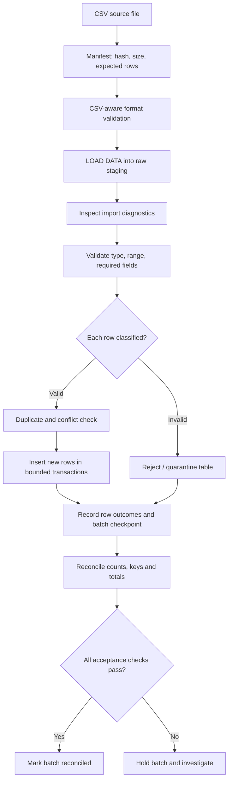

# Nạp dữ liệu CSV lớn, xử lý dòng lỗi và đối soát kết quả

## Mục tiêu

Nạp một file CSV lớn vào MySQL không chỉ là chạy `LOAD DATA` cho tới khi câu lệnh kết thúc. Dữ liệu có thể sai định dạng, vượt miền cột, trùng khóa, thiếu quan hệ hoặc bị chuyển đổi trong lúc import. Một lần nạp báo thành công vẫn chưa chứng minh mọi bản ghi đã được nhập đúng. Cần có batch ID, file manifest, vùng staging, quy tắc validation, nơi lưu dòng lỗi và bước đối soát trước khi công bố dữ liệu.

Bài thực hành thuộc module **DATABASE_MYSQL**: làm chủ thiết kế bảng, kiểu dữ liệu, khóa, SQL, index, transaction, kiểm soát đồng thời, kế hoạch thực thi, tối ưu truy vấn và vận hành cơ sở dữ liệu quan hệ. Trong bài này, bạn xây dựng một pipeline nạp dữ liệu bán hàng từ CSV lớn vào MySQL InnoDB, giữ lại dữ liệu gốc, tách dòng lỗi, nạp phần hợp lệ theo batch và chứng minh kết quả bằng đối soát số lượng cùng tổng nghiệp vụ.

Sau bài học, bạn có thể:

- Chuẩn bị file CSV, manifest và batch ID để có thể truy vết, chạy lại và tiếp tục sau lỗi.
- Chọn `LOAD DATA LOCAL INFILE` hoặc phương thức server-side phù hợp với bảo mật và hạ tầng.
- Nạp dữ liệu vào staging mà chưa ép kiểu sớm, sau đó kiểm tra định dạng và miền giá trị.
- Lưu dòng lỗi vào quarantine/reject table với mã lỗi và dữ liệu nguồn.
- Nạp bản ghi hợp lệ theo transaction có giới hạn, chống nhập trùng và hỗ trợ resume.
- Đối soát số dòng, số bản ghi theo trạng thái, tổng tiền theo tiền tệ và các khóa nghiệp vụ.

## 1. Kịch bản và tiêu chí hoàn thành

Giả sử hệ thống nhận file `sales-2026-11.csv` từ một hệ thống bán hàng bên ngoài. Mỗi bản ghi chứa mã dòng nguồn, mã đơn hàng, số tiền, tiền tệ và thời điểm phát sinh. File có thể chứa hàng triệu dòng; một số dòng có thể thiếu mã, sai số tiền, sai ngày, trùng mã hoặc đã được nhập trong batch trước.

Pipeline cần bảo đảm:

1. File gốc không bị thay đổi và có checksum để nhận diện.
2. Mọi dòng được nạp vào staging hoặc có lỗi import được ghi nhận rõ.
3. Dữ liệu sai được cách ly, không bị cắt hoặc ép về giá trị mặc định âm thầm.
4. Dữ liệu hợp lệ chỉ được ghi vào bảng đích sau khi validation đạt yêu cầu.
5. Chạy lại cùng file không nhân đôi bản ghi nghiệp vụ.
6. Có thể tiếp tục từ chunk đã hoàn tất mà không phải đoán trạng thái.
7. Tổng số dòng và tổng tiền được đối soát theo từng tiền tệ.

## 2. Thiết kế pipeline tổng thể



Phân tách các bước giúp bạn biết lỗi phát sinh ở parser CSV, lúc tải file, khi chuyển kiểu hay trong lúc ghi bảng đích. Không dùng một câu `LOAD DATA` duy nhất để vừa parse, ép kiểu, bỏ dòng lỗi và cập nhật bảng nghiệp vụ nếu cần audit hoặc đối soát.

## 3. Chuẩn hóa hợp đồng file CSV

Trước khi nạp, thống nhất định dạng với hệ thống tạo file:

| Thuộc tính | Ví dụ hợp đồng |
|---|---|
| Encoding | UTF-8; xác định có BOM hay không |
| Header | Có một dòng header, tên cột và thứ tự cố định |
| Delimiter | Dấu phẩy `,` |
| Quote | Dấu nháy kép `"`; quote bên trong field được escape theo quy tắc đã thống nhất |
| Newline | LF hoặc CRLF; ghi rõ định dạng của file |
| NULL | Token dành riêng, ví dụ `__NULL__`, phân biệt với chuỗi rỗng; không được dùng token này như dữ liệu thật |
| Decimal | Dấu chấm `.`; không dùng dấu phân cách hàng nghìn |
| Date/time | ISO-like format đã thống nhất, kèm timezone nếu là thời điểm tuyệt đối |
| Identity | `source_record_id` duy nhất và ổn định cho mỗi bản ghi nguồn |

CSV có thể chứa dấu phẩy, dấu xuống dòng hoặc dấu nháy kép bên trong field được quote. Vì vậy, không chia file bằng cách đếm dòng vật lý hoặc dùng công cụ xử lý text không hiểu CSV. Một record CSV có thể trải qua nhiều dòng vật lý.

Nếu file rất lớn và cần chia chunk, dùng CSV parser hiểu đầy đủ quote/escape để chia theo record, đồng thời giữ nguyên header, encoding và thứ tự. Ghi `chunk_id`, record đầu/cuối và số record dự kiến vào manifest.

Giữ file gốc ở vùng lưu trữ bất biến. Tính SHA-256, ghi kích thước byte, thời điểm nhận, hệ thống nguồn, batch ID và số record kỳ vọng. Checksum giúp phát hiện file bị thay đổi giữa lần kiểm tra và lần nạp.

## 4. Chọn `LOAD DATA LOCAL INFILE` hay server-side `LOAD DATA INFILE`

`LOAD DATA LOCAL INFILE` đọc file từ máy client/ứng dụng rồi truyền nội dung tới MySQL. Đường dẫn trong câu lệnh phải tồn tại trên máy client thực hiện kết nối. Cả cấu hình server lẫn client/driver phải cho phép `LOCAL`.

`LOAD DATA INFILE` không có `LOCAL` đọc file từ filesystem của máy chủ MySQL. Cách này phụ thuộc quyền `FILE`, cấu hình `secure_file_priv` và quyền truy cập filesystem của tiến trình mysqld.

| Tiêu chí | `LOCAL` | Server-side |
|---|---|---|
| File nằm ở đâu? | Máy chạy client/driver | Máy chủ MySQL |
| Dữ liệu đi qua mạng? | Có, từ client tới server | Không cần truyền file từ client |
| Cấu hình bảo mật | Client/driver và server phải cho phép LOCAL | Quyền FILE, secure_file_priv và quyền filesystem |
| Phù hợp khi | File nằm ở worker/import service | File đã được đặt an toàn trên host DB |

`LOCAL` có rủi ro riêng: client cho phép tải file cục bộ cần tin cậy endpoint đang kết nối vì server giả mạo có thể tìm cách yêu cầu client gửi file. Chỉ bật cho endpoint tin cậy, dùng TLS xác minh server, giới hạn quyền và tắt lại nếu chính sách yêu cầu. Không bật `LOCAL` toàn cục chỉ để làm một lần import.

Kiểm tra cấu hình server:

```sql
SHOW GLOBAL VARIABLES LIKE 'local_infile';
SHOW GLOBAL VARIABLES LIKE 'secure_file_priv';
SHOW GLOBAL VARIABLES LIKE 'max_allowed_packet';
```

Driver JDBC cũng có thể có thuộc tính riêng để cho phép `LOCAL`; kiểm tra tài liệu đúng phiên bản Connector/J và không bật tùy chọn rộng hơn mức cần thiết.

## 5. Tạo batch manifest và bảng staging

Mỗi lần nhận file, tạo một batch ID ổn định. Bảng manifest lưu trạng thái và số liệu đối soát:

```sql
CREATE TABLE import_batch (
  batch_id CHAR(36) NOT NULL PRIMARY KEY,
  source_system VARCHAR(32) NOT NULL,
  file_name VARCHAR(255) NOT NULL,
  file_sha256 CHAR(64) NOT NULL,
  file_size_bytes BIGINT UNSIGNED NOT NULL,
  expected_records BIGINT UNSIGNED NOT NULL,
  loaded_records BIGINT UNSIGNED NOT NULL DEFAULT 0,
  inserted_records BIGINT UNSIGNED NOT NULL DEFAULT 0,
  duplicate_records BIGINT UNSIGNED NOT NULL DEFAULT 0,
  rejected_records BIGINT UNSIGNED NOT NULL DEFAULT 0,
  conflict_records BIGINT UNSIGNED NOT NULL DEFAULT 0,
  batch_status VARCHAR(24) NOT NULL DEFAULT 'RECEIVED',
  received_at TIMESTAMP NOT NULL DEFAULT CURRENT_TIMESTAMP,
  completed_at TIMESTAMP NULL,
  KEY idx_batch_status (batch_status, received_at),
  KEY idx_batch_hash (file_sha256)
) ENGINE = InnoDB;
```

Staging giữ dữ liệu nguồn dưới dạng text để tránh ép kiểu trước khi validation. Các trường raw nên đủ rộng theo hợp đồng file; nếu giới hạn staging quá nhỏ, dữ liệu có thể bị cắt ngay từ bước nạp:

```sql
CREATE TABLE stg_sales_raw (
  ingest_id BIGINT UNSIGNED NOT NULL AUTO_INCREMENT PRIMARY KEY,
  batch_id CHAR(36) NOT NULL,
  chunk_no INT UNSIGNED NOT NULL DEFAULT 0,
  source_record_id_raw LONGTEXT NULL,
  source_record_id VARCHAR(128) NULL,
  order_id_raw LONGTEXT NULL,
  amount_raw LONGTEXT NULL,
  currency_raw LONGTEXT NULL,
  occurred_at_raw LONGTEXT NULL,
  validation_status ENUM('PENDING', 'VALID', 'REJECTED') NOT NULL DEFAULT 'PENDING',
  validation_reason_code VARCHAR(64) NULL,
  KEY idx_stg_batch_record (batch_id, source_record_id)
) ENGINE = InnoDB;
```

Không đặt unique key trên `source_record_id` ở staging nếu bạn muốn giữ lại và điều tra các dòng trùng trong file. Unique key nghiệp vụ sẽ được áp dụng ở bảng đích sau bước phân loại.

Theo dõi từng chunk để có thể tiếp tục đúng điểm sau khi worker dừng:

```sql
CREATE TABLE import_chunk (
  batch_id CHAR(36) NOT NULL,
  chunk_no INT UNSIGNED NOT NULL,
  expected_records BIGINT UNSIGNED NOT NULL,
  loaded_records BIGINT UNSIGNED NOT NULL DEFAULT 0,
  chunk_status ENUM('PENDING', 'LOADED', 'VALIDATED', 'APPLIED') NOT NULL DEFAULT 'PENDING',
  started_at TIMESTAMP NULL,
  completed_at TIMESTAMP NULL,
  PRIMARY KEY (batch_id, chunk_no)
) ENGINE = InnoDB;
```

## 6. Bảng đích và bảng quarantine

Bảng đích lưu kiểu dữ liệu đã được xác thực và khóa chống nhập trùng:

```sql
CREATE TABLE sales_events (
  id BIGINT UNSIGNED NOT NULL AUTO_INCREMENT PRIMARY KEY,
  source_system VARCHAR(32) NOT NULL,
  source_record_id VARCHAR(128) NOT NULL,
  order_id BIGINT UNSIGNED NOT NULL,
  amount DECIMAL(12,2) NOT NULL,
  currency CHAR(3) NOT NULL,
  occurred_at DATETIME(6) NOT NULL,
  imported_batch_id CHAR(36) NOT NULL,
  UNIQUE KEY uq_sales_source_record (source_system, source_record_id),
  KEY idx_sales_order_time (order_id, occurred_at)
) ENGINE = InnoDB;
```

Quy ước của ví dụ là `occurred_at` đã được chuẩn hóa về UTC trước khi nạp. Nếu nguồn gửi thời gian địa phương hoặc offset, phải chuyển đổi theo timezone nguồn ở bước ETL; không tự gán UTC cho giá trị chưa rõ timezone.

Bảng reject lưu nguồn gốc, dòng staging và lý do bị loại:

```sql
CREATE TABLE sales_import_reject (
  reject_id BIGINT UNSIGNED NOT NULL AUTO_INCREMENT PRIMARY KEY,
  batch_id CHAR(36) NOT NULL,
  ingest_id BIGINT UNSIGNED NOT NULL,
  source_record_id VARCHAR(128) NULL,
  source_record_id_raw LONGTEXT NULL,
  reason_code VARCHAR(64) NOT NULL,
  reason_detail VARCHAR(500) NULL,
  raw_order_id LONGTEXT NULL,
  raw_amount LONGTEXT NULL,
  raw_currency LONGTEXT NULL,
  raw_occurred_at LONGTEXT NULL,
  rejected_at TIMESTAMP NOT NULL DEFAULT CURRENT_TIMESTAMP,
  UNIQUE KEY uq_reject_batch_ingest_reason (batch_id, ingest_id, reason_code)
) ENGINE = InnoDB;
```

Để resume và đối soát ở cấp từng record, lưu outcome riêng. Mỗi dòng staging phải có đúng một outcome chính; bảng reject có thể chứa nhiều chi tiết lỗi cho cùng record:

```sql
CREATE TABLE sales_import_row_outcome (
  batch_id CHAR(36) NOT NULL,
  ingest_id BIGINT UNSIGNED NOT NULL,
  source_record_id VARCHAR(128) NULL,
  outcome ENUM('INSERTED', 'DUPLICATE', 'REJECTED', 'CONFLICT') NOT NULL,
  reason_code VARCHAR(64) NULL,
  processed_at TIMESTAMP NOT NULL DEFAULT CURRENT_TIMESTAMP,
  PRIMARY KEY (batch_id, ingest_id),
  KEY idx_outcome_batch_status (batch_id, outcome)
) ENGINE = InnoDB;
```

Nếu cần ghi nhiều lỗi trên một dòng, lưu một record cho mỗi cặp `ingest_id`/`reason_code`; nếu chỉ cần một lý do chính, dùng thứ tự ưu tiên rõ ràng. Giữ raw value để sửa và nạp lại mà không phải xin lại file nguồn.

## 7. Nạp file vào raw staging

Ví dụ file có header và dùng LF, dấu phẩy, quote kép; các quote bên trong field được escape bằng cách lặp đôi quote. Thay path và batch ID bằng giá trị của lần import:

```sql
SET @batch_id = '2026-11-19-sales-0001';
SET @chunk_no = 1;

LOAD DATA LOCAL INFILE '/import/inbox/sales-2026-11.csv'
INTO TABLE stg_sales_raw
CHARACTER SET utf8mb4
FIELDS TERMINATED BY ','
OPTIONALLY ENCLOSED BY '"'
ESCAPED BY '"'
LINES TERMINATED BY '\n'
IGNORE 1 LINES
(@source_record_id, @order_id_raw, @amount_raw, @currency_raw, @occurred_at_raw)
SET batch_id = @batch_id,
    chunk_no = @chunk_no,
    source_record_id_raw = NULLIF(@source_record_id, '__NULL__'),
    source_record_id = CASE
      WHEN CHAR_LENGTH(TRIM(NULLIF(@source_record_id, '__NULL__'))) BETWEEN 1 AND 128
        THEN TRIM(NULLIF(@source_record_id, '__NULL__'))
      ELSE NULL
    END,
    order_id_raw = NULLIF(@order_id_raw, '__NULL__'),
    amount_raw = NULLIF(@amount_raw, '__NULL__'),
    currency_raw = NULLIF(@currency_raw, '__NULL__'),
    occurred_at_raw = NULLIF(@occurred_at_raw, '__NULL__');
```

Nếu file dùng CRLF, điều chỉnh `LINES TERMINATED BY` theo đúng định dạng. Không copy nguyên câu lệnh này nếu file có quy tắc escape, NULL token hoặc thứ tự cột khác. Hãy thử trên một mẫu nhỏ có dấu phẩy, quote, Unicode, chuỗi rỗng và newline bên trong field.

Với `LOCAL`, path là path trên client/import worker. Với server-side `INFILE`, path là path server và phải tuân thủ `secure_file_priv`. Sau khi nạp, ghi lại kết quả statement do client trả về (Records, Skipped, Warnings nếu driver hiển thị) và batch ID.

## 8. Đọc diagnostics ngay sau khi nạp

Chạy diagnostics trong cùng session và ngay sau `LOAD DATA`, trước khi thực hiện statement khác:

```sql
SHOW COUNT(*) WARNINGS;
SHOW WARNINGS LIMIT 100;
```

`SHOW WARNINGS` cho biết level, code và message. Số warning hiển thị chịu giới hạn `max_error_count`; nếu file có nhiều lỗi, danh sách này không phải báo cáo đầy đủ từng record. Ghi lại cả tổng warning và số warning có thể đọc được.

Phân biệt các nhóm:

- Lỗi cấu trúc CSV: số field sai, quote không đóng, escape không hợp lệ hoặc encoding không đúng.
- Lỗi chuyển đổi: dữ liệu bị ép kiểu, cắt hoặc giá trị ngày/giờ không hợp lệ.
- Lỗi ràng buộc: duplicate key hoặc giá trị thiếu khi nạp trực tiếp vào bảng có constraint.
- Lỗi hạ tầng: file không đọc được, LOCAL bị chặn, hết dung lượng hoặc connection bị ngắt.

Vì raw staging dùng cột text rộng, phần lớn lỗi nghiệp vụ nên được phát hiện ở bước validation sau import. Nếu ngay cả staging cũng có warning, dừng pipeline và điều tra; không coi số dòng đã nạp là số dòng hợp lệ.

Không dựa vào số thứ tự dòng trong warning như định danh ổn định. CSV có thể chứa newline trong quoted field, nên dòng vật lý không nhất thiết tương ứng một record. Dùng `source_record_id` trong file; nếu nguồn không có, thêm record ordinal bằng CSV-aware parser trước khi nạp.

## 9. Đếm số dòng và phát hiện thiếu record

Đếm số record thực tế trong staging:

```sql
SELECT COUNT(*) AS loaded_records
FROM stg_sales_raw
WHERE batch_id = '2026-11-19-sales-0001';
```

So sánh với `expected_records` trong manifest. Nếu số lượng lệch, chưa chuyển dữ liệu sang bảng đích. Kiểm tra header, dòng cuối thiếu newline, quote, delimiter, encoding, `IGNORE 1 LINES` và diagnostics.

Đếm mã nguồn bị thiếu hoặc rỗng:

```sql
SELECT COUNT(*) AS missing_source_id
FROM stg_sales_raw
WHERE batch_id = '2026-11-19-sales-0001'
  AND (source_record_id IS NULL OR TRIM(source_record_id) = '');
```

Phát hiện duplicate trong cùng file:

```sql
SELECT source_record_id, COUNT(*) AS occurrences
FROM stg_sales_raw
WHERE batch_id = '2026-11-19-sales-0001'
  AND source_record_id IS NOT NULL
GROUP BY source_record_id
HAVING COUNT(*) > 1;
```

Không tự chọn một dòng trùng để giữ lại nếu chưa có quy tắc nghiệp vụ. Có thể hai dòng cùng mã là bản sao truyền lại, hoặc là hai payload khác nhau dùng nhầm cùng ID. So sánh payload và xác định quy tắc nguồn.

## 10. Validation trước khi ép kiểu

Validation phải phản ánh kiểu đích và quy tắc nghiệp vụ. Với bảng đích ví dụ:

- `order_id` là số nguyên không âm trong miền mà ứng dụng cho phép.
- `amount` là `DECIMAL(12,2)`, tối đa 10 chữ số phần nguyên và 2 chữ số thập phân.
- `currency` là mã gồm đúng 3 chữ cái in hoa được hệ thống hỗ trợ.
- `occurred_at_raw` dùng định dạng đã thống nhất, ví dụ `YYYY-MM-DD HH:MM:SS.ffffff` theo UTC.

Ví dụ tìm các dòng có trường bắt buộc rỗng hoặc định dạng số sai:

```sql
SELECT ingest_id, source_record_id, order_id_raw, amount_raw, currency_raw
FROM stg_sales_raw
WHERE batch_id = '2026-11-19-sales-0001'
  AND (
       source_record_id IS NULL
       OR TRIM(source_record_id) = ''
       OR order_id_raw IS NULL
       OR order_id_raw NOT REGEXP '^[0-9]{1,19}$'
       OR amount_raw IS NULL
       OR amount_raw NOT REGEXP '^-?[0-9]{1,10}([.][0-9]{1,2})?$'
       OR currency_raw IS NULL
       OR currency_raw NOT REGEXP '^[A-Z]{3}$'
  );
```

Regex chỉ kiểm tra hình dạng chuỗi. Nó không thay thế kiểm tra miền nghiệp vụ như số tiền không âm, currency có nằm trong danh mục cho phép hoặc ngày có tồn tại trên lịch. Kiểm tra ngày bằng parser hiểu timezone/format hoặc bằng bước chuyển đổi có kiểm soát; đọc warning của phép parse.

Sau khi toàn bộ quy tắc đã chạy, validation worker cập nhật `validation_status` thành `VALID` chỉ khi mọi kiểm tra đạt; các dòng còn lại chuyển thành `REJECTED` và được ghi vào quarantine. Với ngày giờ, xác minh cả ngày trên lịch và timezone, không chỉ regex. `LOAD DATA` mặc định để mọi dòng ở trạng thái `PENDING`.

Ví dụ kiểm tra tiền không âm và tiền tệ nằm trong danh mục cho phép:

```sql
SELECT s.ingest_id, s.source_record_id, s.amount_raw, s.currency_raw
FROM stg_sales_raw AS s
WHERE s.batch_id = '2026-11-19-sales-0001'
  AND (
       CASE
         WHEN s.amount_raw REGEXP '^-?[0-9]{1,10}([.][0-9]{1,2})?$'
           THEN CAST(s.amount_raw AS DECIMAL(12,2)) < 0
         ELSE 0
       END = 1
       OR s.currency_raw NOT IN ('VND', 'USD', 'EUR')
  );
```

Chỉ chạy `CAST` sau khi đã loại chuỗi không đúng định dạng. Trong pipeline thực tế, chia validation thành các bước có điều kiện rõ ràng hoặc thực hiện parse trong ứng dụng/ETL để tránh implicit conversion và warning không được kiểm soát.

## 11. Ghi dòng lỗi vào quarantine

Ví dụ lưu các dòng thiếu mã nguồn, sai định dạng ID, sai định dạng số tiền hoặc mã tiền tệ:

```sql
INSERT INTO sales_import_reject (
  batch_id, ingest_id, source_record_id, source_record_id_raw,
  reason_code, reason_detail,
  raw_order_id, raw_amount, raw_currency, raw_occurred_at
)
SELECT
  batch_id,
  ingest_id,
  source_record_id,
  source_record_id_raw,
  COALESCE(validation_reason_code, CASE
    WHEN source_record_id_raw IS NULL OR TRIM(source_record_id_raw) = ''
      THEN 'MISSING_SOURCE_ID'
    WHEN CHAR_LENGTH(TRIM(source_record_id_raw)) > 128
      THEN 'SOURCE_ID_TOO_LONG'
    WHEN source_record_id IS NULL
      THEN 'INVALID_SOURCE_ID'
    WHEN order_id_raw IS NULL OR order_id_raw NOT REGEXP '^[0-9]{1,19}$'
      THEN 'INVALID_ORDER_ID'
    WHEN amount_raw IS NULL OR amount_raw NOT REGEXP '^-?[0-9]{1,10}([.][0-9]{1,2})?$'
      THEN 'INVALID_AMOUNT_FORMAT'
    WHEN currency_raw IS NULL OR currency_raw NOT REGEXP '^[A-Z]{3}$'
      THEN 'INVALID_CURRENCY_FORMAT'
    ELSE 'REVIEW_REQUIRED'
  END),
  'Validation failed before target conversion',
  order_id_raw, amount_raw, currency_raw, occurred_at_raw
FROM stg_sales_raw
WHERE batch_id = '2026-11-19-sales-0001'
  AND validation_status = 'REJECTED';
```

Ví dụ trên lưu một lý do ưu tiên cho mỗi dòng. Để ghi mọi lỗi cùng lúc, tạo bảng `sales_import_reject_issue` với một hàng cho mỗi `ingest_id` và `reason_code`, rồi chạy từng quy tắc validation riêng.

Không xóa raw staging sau khi quarantine. Giữ liên kết `batch_id` và `ingest_id` để có thể điều tra, sửa quy tắc hoặc nạp lại các dòng được chấp thuận.

## 12. Chuyển đổi dữ liệu hợp lệ

Chỉ chuyển đổi sau khi dòng đã vượt qua validation định dạng, miền giá trị, ngày giờ, danh mục tiền tệ và duplicate check. Với `DECIMAL`, dùng `CAST(... AS DECIMAL(12,2))` sau khi đã xác minh scale để tránh làm tròn ngoài ý muốn.

Ví dụ chèn các dòng mới chưa tồn tại vào bảng đích:

```sql
INSERT INTO sales_events (
  source_system, source_record_id, order_id, amount,
  currency, occurred_at, imported_batch_id
)
SELECT
  'external-sales',
  s.source_record_id,
  CAST(s.order_id_raw AS UNSIGNED),
  CAST(s.amount_raw AS DECIMAL(12,2)),
  s.currency_raw,
  STR_TO_DATE(s.occurred_at_raw, '%Y-%m-%d %H:%i:%s.%f'),
  s.batch_id
FROM stg_sales_raw AS s
WHERE s.batch_id = '2026-11-19-sales-0001'
  AND s.validation_status = 'VALID'
  AND s.source_record_id IS NOT NULL
  AND TRIM(s.source_record_id) <> ''
  AND s.order_id_raw REGEXP '^[0-9]{1,19}$'
  AND s.amount_raw REGEXP '^-?[0-9]{1,10}([.][0-9]{1,2})?$'
  AND s.currency_raw IN ('VND', 'USD', 'EUR')
  AND s.occurred_at_raw REGEXP '^[0-9]{4}-[0-9]{2}-[0-9]{2} [0-9]{2}:[0-9]{2}:[0-9]{2}[.][0-9]{6}$'
  AND NOT EXISTS (
    SELECT 1
    FROM sales_events AS existing
    WHERE existing.source_system = 'external-sales'
      AND existing.source_record_id = s.source_record_id
  );
```

Đây là mẫu minh họa; cần bổ sung kiểm tra ngày lịch hợp lệ và mọi quy tắc nghiệp vụ trước khi chạy. Unique key trên `(source_system, source_record_id)` là hàng rào cuối cùng chống trùng. Nếu hai worker cùng nạp một source ID, `NOT EXISTS` riêng lẻ không loại được race condition; unique constraint vẫn có thể báo duplicate. Khi đó, rollback chunk và phân loại lại các dòng trùng thay vì dùng `INSERT IGNORE` để che xung đột.

Đối với các bản ghi hợp lệ, chỉ giữ một dòng chuẩn cho mỗi `source_record_id` trong batch sau khi đã so sánh payload nội bộ. Các dòng lặp có payload giống nhau được phân loại `DUPLICATE`; cùng ID nhưng payload khác nhau là `CONFLICT`. Không chọn tùy tiện dòng đầu tiên nếu nguồn chưa định nghĩa quy tắc.

Khi một source ID đã có trong bảng đích, so sánh payload đã chuẩn hóa trước khi phân loại. Ví dụ, join staging với `sales_events` theo `(source_system, source_record_id)`, sau đó so sánh `order_id`, `amount`, `currency` và `occurred_at`. Nếu tất cả bằng nhau, ghi outcome `DUPLICATE`; nếu có ít nhất một trường khác, ghi `CONFLICT` và đưa vào quarantine. Thực hiện so sánh sau validation để không ép kiểu dữ liệu lỗi.

Sau khi insert thành công, ghi outcome `INSERTED` trong cùng transaction với thao tác insert. Chỉ đánh dấu các dòng staging có source key vừa được tạo bởi batch hiện tại (join với `sales_events.imported_batch_id`), và bảo đảm các duplicate nội bộ đã được phân loại trước. Tương tự, ghi outcome `REJECTED` cùng transaction với việc lưu reject record. Khóa chính `(batch_id, ingest_id)` bảo đảm một dòng staging chỉ có một outcome chính; khi resume, chỉ xử lý những dòng chưa có outcome.

## 13. Idempotency và xử lý bản ghi đã tồn tại

Chạy lại cùng batch có thể xảy ra sau timeout, worker restart hoặc deploy. Thiết kế phải phân biệt:

- **Bản ghi mới:** source ID chưa tồn tại; có thể insert.
- **Duplicate giống hệt:** source ID đã tồn tại và payload chuẩn hóa giống dữ liệu đích; đánh dấu `DUPLICATE`, không insert lại.
- **Conflict:** source ID đã tồn tại nhưng order ID, amount, currency hoặc thời điểm khác; đưa vào quarantine để điều tra.

Không mặc định dùng `REPLACE`, `INSERT IGNORE` hoặc upsert để bỏ qua mọi duplicate. Các cách đó có thể che việc cùng một source ID mang payload khác nhau. Hãy so sánh payload theo quy tắc chuẩn hóa và giữ lại bằng chứng.

Để một batch có thể resume:

1. Batch ID và file hash phải ổn định qua lần retry.
2. Mỗi source record có identity ổn định.
3. Lưu chunk ID/checkpoint và trạng thái outcome.
4. Bảng đích có unique key theo source identity.
5. Ghi kết quả insert/duplicate/reject/conflict theo từng record hoặc chunk.
6. Khi retry, chỉ xử lý record chưa có outcome hoàn tất; kiểm tra lại các record đã insert bằng source key.

## 14. Ghi theo chunk và ranh giới transaction

Không nhất thiết nạp hàng triệu dòng vào bảng đích trong một transaction duy nhất. Transaction quá lớn có thể tạo undo/redo lớn, giữ khóa lâu, tăng replication lag, làm rollback rất tốn thời gian và gây áp lực lên buffer pool.

Chia file bằng CSV-aware parser thành chunk theo số record hoặc dung lượng byte. Chọn kích thước dựa trên thử nghiệm và giới hạn hệ thống; không có một con số tối ưu chung. Với mỗi chunk:

1. Nạp raw staging và xác nhận số dòng.
2. Validation và ghi quarantine.
3. Kiểm tra duplicate/conflict.
4. Insert các dòng mới trong transaction InnoDB có giới hạn.
5. Ghi row outcomes và cập nhật checkpoint cùng transaction nếu chúng phải nhất quán với insert.
6. Commit rồi mới đánh dấu chunk hoàn tất.

Nếu transaction thất bại, rollback chunk đó và chạy lại bằng batch ID/source ID ổn định. Không đánh dấu checkpoint hoàn tất trước khi commit dữ liệu đích và outcome tương ứng.

## 15. Đối soát số dòng

Với mỗi batch, ghi các con số:

- `expected_records`: số record theo manifest từ CSV parser.
- `loaded_records`: số dòng raw staging đã nhận.
- `inserted_records`: số dòng mới được ghi vào bảng đích.
- `duplicate_records`: số dòng đã tồn tại với payload giống nhau.
- `rejected_records`: số dòng sai định dạng hoặc vi phạm nghiệp vụ.
- `conflict_records`: source ID đã tồn tại nhưng payload khác.

Điều kiện đối soát cơ bản:

```text
expected_records = loaded_records
loaded_records = inserted_records
               + duplicate_records
               + rejected_records
               + conflict_records
```

Đếm outcome từ bảng theo dõi thay vì chỉ cộng bộ đếm trong ứng dụng:

```sql
SELECT outcome, COUNT(*) AS record_count
FROM sales_import_row_outcome
WHERE batch_id = '2026-11-19-sales-0001'
GROUP BY outcome;
```

Tổng `record_count` phải bằng `loaded_records`. Cập nhật các counter trong `import_batch` từ kết quả này sau khi mọi chunk đã commit; không tăng counter trước commit vì retry có thể làm đếm hai lần.

Nếu một dòng có nhiều lỗi, vẫn chỉ tính một outcome chính trong tổng số record; bảng reject detail có thể chứa nhiều issue. Nếu parser không thể tạo record hợp lệ từ một đoạn file, ghi nhận `parse_error_records` riêng và điều chỉnh phương trình đối soát để bao gồm số record không parse được.

Không đánh dấu batch `RECONCILED` nếu còn record không có outcome, count lệch hoặc file hash không khớp manifest.

## 16. Đối soát tổng tiền và dữ liệu nghiệp vụ

Đối soát tổng tiền theo từng currency; không cộng VND, USD và EUR vào cùng một tổng:

```sql
SELECT currency,
       COUNT(*) AS row_count,
       SUM(amount) AS total_amount
FROM sales_events
WHERE imported_batch_id = '2026-11-19-sales-0001'
GROUP BY currency
ORDER BY currency;
```

Đối chiếu với tổng hợp độc lập từ nguồn hoặc từ staging đã validation. Nếu batch có duplicate đã được nhập ở batch trước, chúng không xuất hiện trong `imported_batch_id` của lần đầu; khi đối soát batch hiện tại, cộng cả kết quả duplicate theo payload đã xác minh hoặc dùng bảng outcome để tổng hợp đúng.

Kiểm tra khóa nguồn trùng:

```sql
SELECT source_system, source_record_id, COUNT(*) AS occurrences
FROM sales_events
GROUP BY source_system, source_record_id
HAVING COUNT(*) > 1;
```

Kiểm tra dữ liệu đích ngoài miền:

```sql
SELECT COUNT(*) AS invalid_amounts
FROM sales_events
WHERE amount < 0;
```

Điều kiện `amount < 0` chỉ phù hợp nếu nghiệp vụ không cho phép hoàn tiền hoặc điều chỉnh âm. Đối soát phải phản ánh quy tắc domain, không áp đặt một invariant không đúng với nghiệp vụ.

## 17. Theo dõi hiệu năng và tác động vận hành

Trong lúc import lớn, theo dõi:

- Tốc độ record/giây và byte/giây ở bước transfer, load, validation và insert.
- CPU, memory, buffer pool hit, disk throughput, IOPS và storage latency.
- Dung lượng data, temporary, redo, undo, binlog và filesystem còn trống.
- Số connection, transaction dài, lock wait, deadlock và lỗi pool.
- Replication lag, relay log growth và khả năng phục vụ read workload.
- Thời gian commit, rollback và số warning theo chunk.

Index giúp truy vấn và bảo vệ uniqueness nhưng làm tăng chi phí ghi vì mỗi insert phải cập nhật index liên quan. Staging thường chỉ cần primary key và index phục vụ lọc theo batch/source ID. Không xóa unique/foreign key trên bảng đích chỉ để tăng tốc nếu điều đó làm mất bảo vệ dữ liệu; mọi thay đổi index phải có kế hoạch và kiểm thử riêng.

Nếu import ảnh hưởng workload production, giới hạn tốc độ, chạy ngoài giờ cao điểm hoặc dùng replica/instance riêng theo kiến trúc. Không tăng `max_connections` hoặc pool size như phản xạ đầu tiên khi import chậm.

## 18. Khôi phục sau lỗi giữa chừng

Giả sử worker dừng sau khi nạp ba trong năm chunk. Dựa vào manifest và checkpoint:

1. Kiểm tra batch ID, file hash và trạng thái chunk cuối cùng.
2. Xác minh transaction cuối đã commit hay rollback; không suy đoán từ log ứng dụng đơn lẻ.
3. Đối chiếu số dòng raw, outcomes và target theo source identity.
4. Chỉ nạp lại chunk chưa hoàn tất hoặc record chưa có outcome.
5. Nếu batch được gửi lại với hash khác nhưng cùng batch ID, dừng và điều tra.
6. Nếu source ID tồn tại với payload khác, chuyển thành conflict; không ghi đè tự động.
7. Chạy lại đối soát trước khi đánh dấu batch hoàn tất.

Giữ raw staging và file gốc tới khi batch được xác nhận và hết thời gian lưu giữ theo chính sách. Sau khi hoàn tất, có thể archive staging theo retention thay vì xóa ngay.

## 19. Checklist trước khi chạy import lớn

- File gốc được lưu bất biến, có SHA-256 và manifest.
- CSV contract rõ encoding, header, delimiter, quote, escape, newline, NULL và timezone.
- Chia chunk bằng CSV-aware parser nếu cần.
- Account import có quyền tối thiểu; `LOCAL` chỉ bật cho endpoint tin cậy và trong phạm vi cần thiết.
- Staging đủ rộng để giữ raw value và có batch ID.
- Bảng đích có kiểu dữ liệu, constraint và unique source identity.
- Validation có quy tắc rõ cho required fields, số, ngày, tiền tệ và duplicate.
- Reject/quarantine giữ raw value cùng reason code.
- Mỗi chunk có transaction boundary và checkpoint sau commit.
- Có giới hạn dung lượng, redo/binlog, disk và replication lag.
- Đối soát count, totals, duplicates, conflicts và rejected trước khi công bố.

## 20. Bài tập thực hành

Trên MySQL thử nghiệm với InnoDB:

1. Tạo `import_batch`, `import_chunk`, `stg_sales_raw`, `sales_events`, `sales_import_reject` và `sales_import_row_outcome` theo các ví dụ trong bài.
2. Chuẩn bị CSV nhỏ có header, Unicode, quoted comma, quote escape, chuỗi rỗng, token `__NULL__`, số sai định dạng và một source ID trùng.
3. Tính SHA-256, ghi manifest và nạp file vào staging bằng `LOAD DATA LOCAL INFILE` hoặc server-side `INFILE` theo chính sách.
4. Đọc diagnostics ngay sau load; đối chiếu số record với manifest.
5. Chạy validation cho source ID, order ID, amount, currency và timestamp; đưa dòng lỗi vào quarantine.
6. Phân loại duplicate giống hệt và conflict khác payload.
7. Chèn dữ liệu hợp lệ vào bảng đích theo chunk trong transaction; tạo tình huống worker dừng giữa hai chunk rồi chạy tiếp.
8. Đối soát `expected = loaded` và `loaded = inserted + duplicate + rejected + conflict`.
9. Đối chiếu count và `SUM(amount)` theo currency với kết quả độc lập từ file nguồn.
10. Chạy lại cùng file để chứng minh idempotency; thử cùng source ID nhưng payload khác để xác nhận conflict được cách ly.

**Tiêu chí hoàn thành:** mọi record có outcome, dữ liệu sai được giữ nguyên trong quarantine, dữ liệu đích không bị nhân đôi, batch có thể resume sau lỗi và các phép đối soát số lượng/tổng nghiệp vụ đạt yêu cầu.

## Kết luận

Nạp CSV lớn an toàn cần manifest, raw staging, validation, quarantine, transaction theo chunk và đối soát độc lập. `LOAD DATA` giúp chuyển file nhanh nhưng không thay thế việc kiểm tra warning, kiểu dữ liệu, duplicate hay quan hệ nghiệp vụ. Giữ file gốc và source identity, chỉ chuyển bản ghi đã hợp lệ vào InnoDB, ghi checkpoint sau commit và chỉ công bố batch khi mọi dòng đã được phân loại cùng các tổng đối soát khớp.
