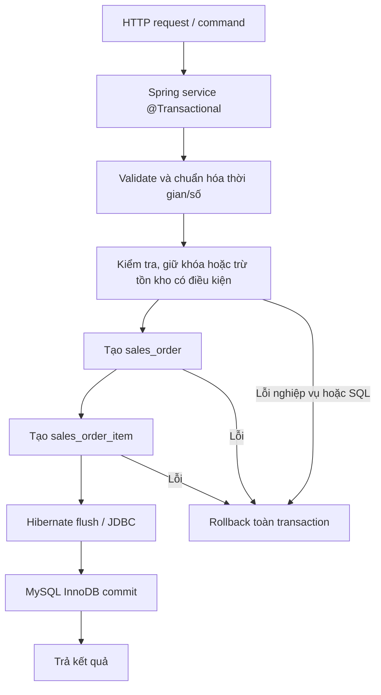

# Tích hợp Java/Spring Boot với giao dịch và ánh xạ thời gian/số

Một ứng dụng Spring Boot kết nối MySQL phải giữ đúng hai loại hợp đồng: hợp đồng transaction của nghiệp vụ và hợp đồng biểu diễn dữ liệu. Transaction cần bảo đảm nhiều thay đổi liên quan cùng commit hoặc rollback; kiểu thời gian phải giữ đúng ý nghĩa múi giờ và độ chính xác; kiểu số phải tránh sai lệch khi tính tiền, thuế, tỷ giá hoặc tồn kho. Nếu chỉ dựa vào kiểu Java hoặc annotation mà không kiểm tra schema, JDBC driver và MySQL session, dữ liệu có thể lệch thời gian, mất microsecond, làm tròn sai hoặc commit một phần nghiệp vụ.

Bài học này tích hợp Spring Boot, Spring Data JPA/Hibernate, Connector/J và InnoDB qua một luồng đặt hàng. Trong module `DATABASE_MYSQL`, nội dung kết hợp thiết kế bảng, kiểu dữ liệu, khóa, transaction, kiểm soát đồng thời và vận hành ứng dụng Java.

Sau bài học, bạn có thể:

- Thiết kế schema MySQL cho đơn hàng, chi tiết đơn hàng, tồn kho và số tiền.
- Ánh xạ `DATE`, `TIME`, `DATETIME(6)`, `TIMESTAMP(6)` sang Java Time API.
- Thiết lập quy ước UTC và kiểm soát time zone của MySQL session/JDBC.
- Dùng `BigDecimal` cùng `DECIMAL(p,s)` cho dữ liệu chính xác.
- Hiểu độ chính xác microsecond của MySQL và nanosecond của Java.
- Đặt transaction boundary ở service để ghi nhiều bảng một cách nguyên tử.
- Dùng locking hoặc cập nhật có điều kiện để tránh bán vượt tồn kho.
- Kiểm thử commit, rollback, ánh xạ thời gian/số và tính đồng thời trên MySQL thật.

## 1. Kiến trúc của luồng nghiệp vụ

Ví dụ một khách hàng đặt đơn gồm nhiều sản phẩm. Ứng dụng cần:

1. Kiểm tra và trừ tồn kho.
2. Tạo bản ghi đơn hàng.
3. Tạo các dòng chi tiết.
4. Lưu tổng tiền và loại tiền.
5. Ghi nhận thời điểm tạo đơn hoặc thanh toán.
6. Commit tất cả thay đổi cùng nhau.

Các thao tác trên phải thuộc cùng transaction InnoDB. Nếu một sản phẩm hết hàng hoặc một ràng buộc dữ liệu vi phạm, transaction cần rollback để không còn đơn hàng dở dang hoặc tồn kho bị trừ một phần.



Spring quản lý transaction context, Hibernate theo dõi entity và sinh SQL, Connector/J chuyển dữ liệu qua JDBC, còn InnoDB thực hiện khóa, commit và rollback. Cần xác minh cả bốn lớp.

## 2. Thiết kế schema cho thời gian và số tiền

Schema cần thể hiện rõ ý nghĩa của từng trường. Không chọn `DATETIME` hay `DECIMAL` chỉ vì chúng có vẻ tổng quát.

Ví dụ DDL:

```sql
CREATE DATABASE shop
    CHARACTER SET utf8mb4
    COLLATE utf8mb4_0900_ai_ci;

USE shop;

CREATE TABLE inventory (
    product_id BIGINT NOT NULL,
    available_quantity INT NOT NULL,
    PRIMARY KEY (product_id),
    CONSTRAINT chk_inventory_available
        CHECK (available_quantity >= 0)
) ENGINE=InnoDB;

CREATE TABLE sales_order (
    order_id BIGINT NOT NULL AUTO_INCREMENT,
    order_number VARCHAR(40) NOT NULL,
    order_date DATE NOT NULL,
    created_at_utc DATETIME(6) NOT NULL,
    paid_at TIMESTAMP(6) NULL,
    total_amount DECIMAL(19, 2) NOT NULL,
    currency CHAR(3) NOT NULL,
    status VARCHAR(20) NOT NULL,
    version BIGINT NOT NULL DEFAULT 0,
    PRIMARY KEY (order_id),
    UNIQUE KEY uq_sales_order_number (order_number),
    KEY idx_sales_order_created (created_at_utc),
    CONSTRAINT chk_sales_order_amount CHECK (total_amount >= 0)
) ENGINE=InnoDB;

CREATE TABLE sales_order_item (
    order_item_id BIGINT NOT NULL AUTO_INCREMENT,
    order_id BIGINT NOT NULL,
    product_id BIGINT NOT NULL,
    quantity INT NOT NULL,
    unit_price DECIMAL(19, 4) NOT NULL,
    line_total DECIMAL(19, 2) NOT NULL,
    PRIMARY KEY (order_item_id),
    KEY idx_order_item_order (order_id),
    CONSTRAINT fk_order_item_order
        FOREIGN KEY (order_id) REFERENCES sales_order(order_id),
    CONSTRAINT chk_order_item_quantity CHECK (quantity > 0),
    CONSTRAINT chk_order_item_price CHECK (unit_price >= 0),
    CONSTRAINT chk_order_item_total CHECK (line_total >= 0)
) ENGINE=InnoDB;
```

Đây là schema minh họa. Chọn precision/scale, tên trạng thái, khóa ngoại, index và quy tắc currency theo nghiệp vụ thực tế. `CHECK` được thực thi trong các phiên bản MySQL hỗ trợ enforcement; xác nhận phiên bản đích trước khi dựa vào constraint để bảo vệ dữ liệu.

Các trường được chọn có ý nghĩa riêng:

| Cột | Kiểu MySQL | Ý nghĩa |
|---|---|---|
| `order_date` | `DATE` | Ngày nghiệp vụ, không có giờ và múi giờ |
| `created_at_utc` | `DATETIME(6)` | Thời điểm theo quy ước UTC do ứng dụng ghi |
| `paid_at` | `TIMESTAMP(6)` | Instant được MySQL chuyển đổi theo time zone của session |
| `total_amount` | `DECIMAL(19,2)` | Tổng tiền theo scale nghiệp vụ đã chọn |
| `unit_price` | `DECIMAL(19,4)` | Giá đơn vị có thể cần độ chính xác cao hơn tổng tiền |
| `quantity` | `INT` | Số lượng nguyên dương |
| `version` | `BIGINT` | Phiên bản entity dùng cho optimistic locking |

## 3. Ánh xạ kiểu thời gian MySQL sang Java

MySQL có nhiều kiểu thời gian nhưng không phải kiểu nào cũng lưu múi giờ.

| MySQL | Ý nghĩa | Java thường dùng |
|---|---|---|
| `DATE` | Ngày lịch, không có thời điểm trong ngày | `LocalDate` |
| `TIME` | Giá trị thời gian/độ dài thời gian theo miền của MySQL | `LocalTime` cho giờ trong ngày; `Duration` cần quy ước lưu riêng nếu có thể vượt 24 giờ |
| `DATETIME(fsp)` | Ngày và giờ dạng wall-clock, không tự chuyển múi giờ | `LocalDateTime` |
| `TIMESTAMP(fsp)` | Thời điểm được chuyển đổi giữa session time zone và UTC khi lưu/đọc | `Instant` hoặc kiểu phù hợp theo Hibernate/driver |

### 3.1. `DATE` và `LocalDate`

Ngày sinh, ngày đặt hàng theo lịch, ngày đáo hạn hoặc ngày nghỉ lễ thường không đại diện cho một instant trên timeline. Dùng `DATE` và `LocalDate`:

```java
private LocalDate orderDate;
```

Không chuyển một `LocalDate` thành `Instant` bằng cách tự gắn múi giờ nếu nghiệp vụ chỉ cần ngày lịch. Khi đổi sang instant, ngày có thể thay đổi tùy múi giờ.

### 3.2. `TIME` và `LocalTime`

Giờ mở cửa, giờ hẹn trong ngày hoặc giờ bắt đầu ca làm có thể dùng `TIME` và `LocalTime`:

```java
private LocalTime storeOpensAt;
```

MySQL `TIME` cũng biểu diễn được khoảng thời gian âm hoặc lớn hơn 24 giờ (tới miền hỗ trợ của kiểu `TIME`), nên không phải lúc nào cũng tương đương `LocalTime`. Nếu cần lưu thời lượng như thời gian xử lý 36 giờ, dùng kiểu biểu diễn rõ ràng, chẳng hạn số microsecond trong `BIGINT` hoặc số giây trong `DECIMAL`, và ánh xạ sang `Duration` ở Java.

### 3.3. `DATETIME(6)` và `LocalDateTime`

`DATETIME` lưu ngày và giờ như một giá trị lịch; MySQL không tự chuyển đổi nó theo session time zone. Nó phù hợp với:

- Thời gian địa phương cần giữ nguyên như người dùng nhập.
- Lịch hẹn theo giờ địa phương khi lưu thêm vùng múi giờ riêng.
- Thời điểm UTC theo quy ước của ứng dụng, nếu mọi thành phần thống nhất rằng giá trị luôn là UTC.

Java thường ánh xạ `DATETIME` sang `LocalDateTime`:

```java
private LocalDateTime createdAtUtc;
```

Tên thuộc tính `createdAtUtc` nhắc rằng ứng dụng lưu giá trị UTC theo quy ước. Bản thân `LocalDateTime` không chứa offset hoặc zone, vì vậy phải bảo đảm mọi code path chuyển đổi cùng một cách.

### 3.4. `TIMESTAMP(6)` và instant

`TIMESTAMP` đại diện cho một thời điểm. MySQL chuyển giá trị từ session time zone sang UTC khi lưu và từ UTC về session time zone khi đọc. Giá trị múi giờ ban đầu của người gửi không được giữ lại.

Java `Instant` phù hợp để biểu diễn thời điểm tuyệt đối:

```java
private Instant paidAt;
```

Nếu nghiệp vụ cần giữ múi giờ hoặc vùng của người dùng (ví dụ `Asia/Ho_Chi_Minh`, `Europe/Paris`) để tái tạo lịch địa phương, lưu thêm `ZoneId` hoặc offset riêng. `TIMESTAMP` không lưu lại tên vùng hoặc offset gốc.

MySQL `TIMESTAMP` có miền giá trị giới hạn, thường từ năm 1970 đến đầu năm 2038 theo UTC trong các phiên bản MySQL hiện hành. `DATETIME` có miền rộng hơn, từ năm 1000 đến năm 9999. Với dữ liệu lịch xa trong tương lai hoặc lịch sử ngoài miền `TIMESTAMP`, cân nhắc `DATETIME` cùng quy ước timezone rõ ràng.

## 4. Độ chính xác thời gian: microsecond và nanosecond

Java Time API có thể biểu diễn nanosecond (9 chữ số phần thập phân). MySQL hỗ trợ fractional seconds precision (`fsp`) từ 0 tới 6, tức tối đa microsecond.

Ví dụ:

```sql
created_at DATETIME(6) NOT NULL,
paid_at TIMESTAMP(6) NULL
```

Nếu cột khai báo `DATETIME` hoặc `TIMESTAMP` không có `(fsp)`, độ chính xác mặc định là 0 chữ số phần thập phân. Khi lưu giá trị Java có nanosecond vào cột `fsp=6`, phần vượt microsecond không thể được giữ nguyên.

Chuẩn hóa trước khi ghi để so sánh ổn định:

```java
Instant now = clock.instant().truncatedTo(ChronoUnit.MICROS);
LocalDateTime createdAtUtc = LocalDateTime.ofInstant(
    now,
    ZoneOffset.UTC
);
```

Chọn rõ chính sách làm tròn hay cắt phần dư. `truncatedTo(MICROS)` cắt nanosecond dư; nếu nghiệp vụ yêu cầu rounding, hãy làm tròn ở tầng ứng dụng bằng quy tắc được định nghĩa và kiểm thử.

Không so sánh hai timestamp Java trước/sau round-trip bằng `equals()` nếu một bên có nanosecond mà database chỉ lưu microsecond. Hãy chuẩn hóa precision trước khi lưu và so sánh.

## 5. Quy tắc UTC xuyên suốt ứng dụng

Một cách thiết kế phổ biến là:

- Lưu instant của sự kiện theo UTC.
- Dùng `Instant` ở domain/service cho thời điểm tuyệt đối.
- Dùng `LocalDate` cho ngày lịch.
- Dùng `LocalDateTime` chỉ khi ý nghĩa là wall-clock hoặc khi có quy ước UTC rõ ràng.
- Chuyển sang múi giờ người dùng ở tầng trình bày, không thay đổi instant gốc.

### 5.1. MySQL session time zone

Kiểm tra:

```sql
SELECT
    @@GLOBAL.time_zone AS global_time_zone,
    @@SESSION.time_zone AS session_time_zone,
    @@system_time_zone AS system_time_zone;
```

`TIMESTAMP` được chuyển đổi theo session time zone, vì vậy hai connection có `time_zone` khác nhau có thể hiển thị cùng một instant dưới dạng wall-clock khác nhau. Với ứng dụng lưu instant UTC, đặt session time zone thống nhất, thường là `+00:00`.

Ví dụ kiểm tra trong session:

```sql
SET SESSION time_zone = '+00:00';
SELECT @@SESSION.time_zone;
```

Không nên chạy `SET time_zone` tùy tiện trên connection pool cho từng request nếu pool không reset session state trước khi tái sử dụng connection.

### 5.2. Connector/J

Với Connector/J hiện đại, có thể cấu hình múi giờ kết nối và yêu cầu driver đặt session time zone theo UTC:

```text
jdbc:mysql://mysql.example.internal:3306/shop?connectionTimeZone=UTC&forceConnectionTimeZoneToSession=true
```

Hai thuộc tính này có semantics và hỗ trợ phụ thuộc phiên bản Connector/J. Kiểm tra tài liệu đúng phiên bản driver trước khi triển khai. Các ứng dụng cũ có thể dùng thuộc tính `serverTimezone`; không trộn nhiều cấu hình timezone theo các đời driver mà chưa xác minh kết quả.

Sau khi kết nối, xác nhận `@@SESSION.time_zone` trên connection thực tế. Đừng chỉ nhìn URL trong file cấu hình.

### 5.3. Hibernate/JPA

Có thể đặt JDBC timezone của Hibernate về UTC:

```properties
spring.jpa.properties.hibernate.jdbc.time_zone=UTC
```

Thuộc tính này giúp Hibernate dùng timezone được chỉ định khi bind/extract các giá trị thời gian qua JDBC theo cơ chế của provider. Nó không thay thế việc xác định semantics của cột MySQL hoặc cấu hình session time zone. Dùng một quy ước nhất quán giữa server, Connector/J, Hibernate và ứng dụng.

### 5.4. Ví dụ chuyển đổi giữa UTC và giờ Việt Nam

```java
Instant paidAt = clock.instant();

ZonedDateTime displayTime = paidAt.atZone(
    ZoneId.of("Asia/Ho_Chi_Minh")
);
```

`paidAt` giữ cùng một instant ở mọi nơi. `displayTime` chỉ là cách hiển thị theo múi giờ Việt Nam. Không lưu `LocalDateTime.now()` trên máy chủ rồi giả định nó luôn là UTC; timezone hệ điều hành hoặc container có thể khác.

## 6. Ánh xạ JPA entity

Ví dụ entity minh họa các kiểu dữ liệu trong schema:

```java
@Entity
@Table(name = "sales_order")
public class SalesOrder {
    @Id
    @GeneratedValue(strategy = GenerationType.IDENTITY)
    @Column(name = "order_id")
    private Long id;

    @Column(name = "order_number", nullable = false, length = 40)
    private String orderNumber;

    @Column(name = "order_date", nullable = false)
    private LocalDate orderDate;

    @Column(name = "created_at_utc", nullable = false,
            columnDefinition = "DATETIME(6)")
    private LocalDateTime createdAtUtc;

    @Column(name = "paid_at", columnDefinition = "TIMESTAMP(6)")
    private Instant paidAt;

    @Column(name = "total_amount", nullable = false,
            precision = 19, scale = 2)
    private BigDecimal totalAmount;

    @Column(name = "currency", nullable = false, length = 3)
    private String currency;

    @Enumerated(EnumType.STRING)
    @Column(name = "status", nullable = false, length = 20)
    private OrderStatus status;

    @Version
    @Column(name = "version", nullable = false)
    private long version;
}
```

Đây là phần entity minh họa; cần constructor, accessor, enum và mapping quan hệ phù hợp trong dự án. `columnDefinition` gắn entity với kiểu MySQL cụ thể; nếu muốn portability cao hơn, quản lý schema bằng Flyway/Liquibase và dùng Hibernate `ddl-auto=validate` thay vì để Hibernate tự sinh DDL production.

Với `Instant`, kiểm tra mapping thực tế của phiên bản Hibernate và Connector/J đang dùng. JDBC 4.2 hỗ trợ nhiều kiểu Java Time nhưng mức hỗ trợ cho từng kiểu cụ thể phụ thuộc driver/provider. Nếu cần bảo đảm tuyệt đối, viết integration test round-trip với MySQL đúng phiên bản.

## 7. `DECIMAL` và `BigDecimal` cho dữ liệu chính xác

Tiền, thuế, tỷ giá, giá đơn vị và số liệu tài chính không nên dùng `FLOAT` hoặc `DOUBLE` làm kiểu lưu trữ chính vì đây là kiểu dấu phẩy động gần đúng. Ví dụ, phép tính nhị phân có thể biểu diễn `0.1` bằng một giá trị gần đúng thay vì chính xác tuyệt đối.

MySQL `DECIMAL(p,s)` là kiểu fixed-point chính xác:

- `p` là tổng số chữ số tối đa.
- `s` là số chữ số sau dấu thập phân.
- Số chữ số phần nguyên tối đa là `p - s`.
- MySQL hỗ trợ precision tối đa 65 và scale tối đa 30 trong các giới hạn của kiểu `DECIMAL`.

Ví dụ `DECIMAL(19,2)` có tối đa 17 chữ số phần nguyên và 2 chữ số thập phân. `DECIMAL(19,4)` có tối đa 15 chữ số phần nguyên và 4 chữ số thập phân.

Java nên dùng `BigDecimal`:

```java
BigDecimal unitPrice = new BigDecimal("125000.5000");
BigDecimal quantity = new BigDecimal("2");
BigDecimal lineTotal = unitPrice.multiply(quantity);
```

Không tạo tiền bằng `new BigDecimal(0.1)` vì constructor nhận giá trị binary floating-point đã gần đúng. Dùng chuỗi thập phân hoặc `BigDecimal.valueOf(...)` nếu dữ liệu đầu vào thực sự là một số double đã được kiểm soát.

### 7.1. Quy tắc scale và rounding

Không để MySQL tự quyết định rounding theo hành vi mặc định nếu nghiệp vụ có quy tắc cụ thể. Chuẩn hóa ở tầng ứng dụng:

```java
BigDecimal amount = new BigDecimal("125000.567");

BigDecimal payable = amount.setScale(
    2,
    RoundingMode.HALF_UP
);
```

`HALF_UP` chỉ là ví dụ. Một số nghiệp vụ yêu cầu `HALF_EVEN`, `DOWN`, hoặc quy tắc riêng theo currency. Chọn và ghi rõ chính sách cho từng bước: đơn giá, chiết khấu, thuế, quy đổi tiền và tổng hóa đơn.

Nếu một loại tiền có số chữ số thập phân khác nhau (ví dụ VND thường hiển thị 0 chữ số, USD thường 2, KWD thường 3), lưu currency code và áp dụng scale theo chính sách tiền tệ. Có thể lưu giá trị với scale chung đủ lớn rồi làm tròn ở bước nghiệp vụ, hoặc thiết kế scale phù hợp từng đại lượng. Không giả định mọi currency đều có 2 chữ số thập phân.

### 7.2. So sánh `BigDecimal`

`BigDecimal.equals()` so sánh cả giá trị và scale. Vì vậy `new BigDecimal("10.0").equals(new BigDecimal("10.00"))` trả về `false`, dù giá trị số bằng nhau.

Để so sánh giá trị số:

```java
if (actual.compareTo(expected) == 0) {
    // Hai giá trị số bằng nhau.
}
```

Khi kiểm thử dữ liệu đọc từ MySQL, cân nhắc scale trả về theo cột `DECIMAL` và chính sách chuẩn hóa của ứng dụng.

### 7.3. Kiểm soát overflow và SQL mode

Nếu giá trị vượt precision của `DECIMAL(p,s)`, MySQL có thể báo lỗi hoặc cảnh báo/chuyển đổi tùy SQL mode và ngữ cảnh. Production nên dùng strict SQL mode phù hợp, kiểm tra giá trị trước khi ghi và có test cho biên min/max.

Ví dụ:

```sql
SELECT @@SESSION.sql_mode;
```

Đừng dựa vào việc database tự cắt bớt chữ số. Hãy xác định rõ hành vi khi giá trị quá lớn hoặc có quá nhiều chữ số thập phân.

## 8. Ánh xạ số nguyên và kiểu unsigned

Các kiểu nguyên MySQL thường được ánh xạ như sau:

| MySQL | Java thường dùng | Lưu ý |
|---|---|---|
| `TINYINT` | `Byte` hoặc `Short` tùy miền | `TINYINT(1)` không tự động là boolean theo semantics SQL |
| `SMALLINT` | `Short` hoặc `Integer` | Kiểm tra signed/unsigned |
| `INT` | `Integer` hoặc `Long` | `INT UNSIGNED` vượt miền `Integer` signed |
| `BIGINT` | `Long` | `BIGINT UNSIGNED` có thể vượt `Long.MAX_VALUE` |

Nếu ứng dụng Java dùng `Long`, ưu tiên `BIGINT` signed khi không cần toàn bộ miền unsigned. Nếu phải lưu giá trị `BIGINT UNSIGNED` vượt miền signed 64-bit, cần chiến lược kiểu dữ liệu như `BigInteger` và mapping JDBC/provider phù hợp; không ép sang `long` rồi làm tràn số.

Đừng dùng kiểu số nguyên cho tiền có phần lẻ nếu chưa xác định đơn vị nhỏ nhất và giới hạn. Lưu tiền theo minor unit (ví dụ đồng xu/cent) bằng `BIGINT` là một lựa chọn hợp lệ nếu currency scale cố định và mọi phép tính được thiết kế theo đơn vị đó.

## 9. Transaction boundary trong Spring Boot

Đặt transaction ở service bao trùm toàn bộ thao tác cần nguyên tử. Repository thường tham gia transaction hiện tại thay vì tự tạo transaction độc lập.

Ví dụ:

```java
@Service
public class OrderService {
    private final InventoryRepository inventoryRepository;
    private final SalesOrderRepository orderRepository;
    private final SalesOrderItemRepository itemRepository;
    private final Clock clock;

    public OrderService(
            InventoryRepository inventoryRepository,
            SalesOrderRepository orderRepository,
            SalesOrderItemRepository itemRepository,
            Clock clock) {
        this.inventoryRepository = inventoryRepository;
        this.orderRepository = orderRepository;
        this.itemRepository = itemRepository;
        this.clock = clock;
    }

    @Transactional
    public Long placeOrder(CreateOrderCommand command) {
        List<OrderLineCommand> lines = command.lines().stream()
            .sorted(Comparator.comparing(OrderLineCommand::productId))
            .toList();

        BigDecimal total = BigDecimal.ZERO.setScale(2);
        for (OrderLineCommand line : lines) {
            Inventory stock = inventoryRepository
                .findForUpdate(line.productId())
                .orElseThrow(() -> new ProductNotFoundException(line.productId()));

            if (stock.getAvailableQuantity() < line.quantity()) {
                throw new InsufficientStockException(line.productId());
            }
            stock.decrease(line.quantity());

            BigDecimal lineTotal = line.unitPrice()
                .multiply(BigDecimal.valueOf(line.quantity()))
                .setScale(2, RoundingMode.HALF_UP);
            total = total.add(lineTotal);
        }

        Instant now = clock.instant().truncatedTo(ChronoUnit.MICROS);
        SalesOrder order = SalesOrder.create(
            command.orderNumber(),
            LocalDate.ofInstant(now, ZoneId.of("Asia/Ho_Chi_Minh")),
            LocalDateTime.ofInstant(now, ZoneOffset.UTC),
            total,
            command.currency()
        );
        orderRepository.save(order);

        for (OrderLineCommand line : lines) {
            BigDecimal lineTotal = line.unitPrice()
                .multiply(BigDecimal.valueOf(line.quantity()))
                .setScale(2, RoundingMode.HALF_UP);
            itemRepository.save(SalesOrderItem.create(
                order,
                line.productId(),
                line.quantity(),
                line.unitPrice(),
                lineTotal
            ));
        }

        return order.getId();
    }
}
```

Đây là ví dụ cấu trúc, cần bổ sung entity, DTO, constructor và repository tương ứng. Các điểm quan trọng:

- `@Transactional` nằm ở service bao trùm cập nhật tồn kho, tạo đơn và chi tiết.
- Khóa tồn kho theo thứ tự `productId` để giảm khả năng deadlock khi nhiều đơn chứa các sản phẩm giống nhau theo thứ tự khác nhau.
- `InsufficientStockException` nên là `RuntimeException` hoặc được khai báo `rollbackFor` để bảo đảm rollback.
- Dùng `Clock` được inject để kiểm thử thời gian xác định, không gọi đồng loạt `LocalDateTime.now()` ở nhiều nơi.
- `orderDate` được lấy theo múi giờ nghiệp vụ `Asia/Ho_Chi_Minh`; thay bằng `ZoneId` cấu hình của cửa hàng nếu hệ thống hoạt động ở vùng khác. `createdAtUtc` vẫn là wall-clock UTC theo quy ước lưu.
- Chuẩn hóa thời gian tới microsecond trước khi lưu cột `fsp=6`.
- Tính tiền bằng `BigDecimal`, với scale và rounding policy rõ ràng.

### 9.1. Repository locking read

```java
public interface InventoryRepository
        extends JpaRepository<Inventory, Long> {

    @Lock(LockModeType.PESSIMISTIC_WRITE)
    @Query("select i from Inventory i where i.productId = :productId")
    Optional<Inventory> findForUpdate(@Param("productId") long productId);
}
```

Với Hibernate/MySQL, `PESSIMISTIC_WRITE` thường được ánh xạ thành locking read tương tự `SELECT ... FOR UPDATE`. Transaction giữ khóa tới commit hoặc rollback. Bảo đảm điều kiện truy vấn có index/primary key để khóa đúng hàng và giữ transaction ngắn.

### 9.2. Cập nhật tồn kho có điều kiện

Một lựa chọn khác là thực hiện update nguyên tử:

```sql
UPDATE inventory
SET available_quantity = available_quantity - ?
WHERE product_id = ?
  AND available_quantity >= ?;
```

Đây là câu lệnh dùng placeholder positional của JDBC; bind số lượng, mã sản phẩm và số lượng cần kiểm tra bằng `PreparedStatement`. Nếu số hàng bị cập nhật là `1`, thao tác thành công; nếu là `0`, sản phẩm không tồn tại hoặc không đủ hàng. Cần phân biệt hai trường hợp nếu thông báo nghiệp vụ yêu cầu. Câu UPDATE kiểm tra và trừ tồn kho trong cùng một statement, tránh race condition giữa SELECT kiểm tra và UPDATE.

Bulk update qua JPQL/JDBC có thể bỏ qua entity đang được quản lý trong persistence context. Nếu dùng cách này, đồng bộ/clear entity phù hợp để không đọc lại giá trị tồn kho cũ trong cùng transaction.

## 10. Rollback và quy tắc exception của Spring

Theo mặc định, Spring rollback transaction khi phương thức transactional kết thúc bằng `RuntimeException` hoặc `Error`. Checked exception không tự động rollback trong cấu hình mặc định.

Ví dụ:

```java
@Transactional(rollbackFor = PaymentRejectedException.class)
public void capturePayment(long orderId) throws PaymentRejectedException {
    // Ghi nhận thanh toán và cập nhật đơn hàng.
}
```

Nếu exception nghiệp vụ là checked exception, khai báo `rollbackFor` hoặc quy tắc tương ứng. Nếu bắt exception rồi không ném lại, Spring có thể thấy phương thức kết thúc bình thường và commit. Không nuốt lỗi khi transaction cần rollback.

### 10.1. Proxy và self-invocation

Trong proxy mode thông thường, lời gọi nội bộ từ một phương thức tới phương thức khác trong cùng bean không đi qua Spring proxy. Annotation `@Transactional` trên phương thức được gọi nội bộ có thể không mở transaction mới như dự kiến.

Đặt transaction boundary ở phương thức service được gọi từ bean khác/proxy. Không mặc định transaction được truyền sang thread mới, `@Async` hoặc tác vụ nền.

### 10.2. Không giữ transaction khi gọi dịch vụ ngoài

Không giữ row lock trong khi gọi cổng thanh toán, HTTP API hoặc chờ người dùng. Một transaction dài làm tăng lock contention, deadlock và thời gian giữ connection. Với quy trình thanh toán ngoài hệ thống, thường cần state machine, idempotency key và outbox/saga thay vì giữ một transaction MySQL xuyên suốt network call.

Nếu kết nối bị mất trong lúc `COMMIT`, client có thể không biết transaction đã commit hay chưa. Không retry thao tác ghi không idempotent một cách mù quáng. Dùng order number/idempotency key duy nhất để xác định kết quả trước khi gửi lại.

## 11. Cấu hình Spring Boot và Connector/J

Ví dụ cấu hình cơ bản:

```properties
spring.datasource.url=jdbc:mysql://mysql.example.internal:3306/shop?connectionTimeZone=UTC&forceConnectionTimeZoneToSession=true
spring.datasource.username=${SHOP_DB_USER}
spring.datasource.password=${SHOP_DB_PASSWORD}

spring.jpa.hibernate.ddl-auto=validate
spring.jpa.open-in-view=false
spring.jpa.properties.hibernate.jdbc.time_zone=UTC
```

Các thuộc tính timezone của Connector/J cần phiên bản hỗ trợ; xác minh `@@SESSION.time_zone` sau khi ứng dụng mở connection. `ddl-auto=validate` giúp Hibernate kiểm tra mapping so với schema do migration quản lý, thay vì tự thay đổi schema production. `open-in-view=false` làm rõ phạm vi persistence context và tránh giữ session qua toàn bộ quá trình render response.

Quản lý schema bằng Flyway hoặc Liquibase. Không để mỗi instance ứng dụng tự thực hiện DDL tùy ý khi khởi động production. Password phải được inject từ secret manager hoặc môi trường được bảo vệ, không lưu trong repository.

### 11.1. Kiểm tra cấu hình runtime

Từ connection thực tế của ứng dụng, chạy:

```sql
SELECT
    VERSION() AS mysql_version,
    @@SESSION.time_zone AS session_time_zone,
    @@SESSION.autocommit AS autocommit,
    @@SESSION.transaction_isolation AS transaction_isolation,
    @@SESSION.sql_mode AS sql_mode;
```

Điều này xác nhận trạng thái server session, không chỉ giá trị trong file properties. Với phiên bản MySQL cũ, tên biến isolation có thể khác; dùng tên phù hợp phiên bản.

## 12. Kiểm thử ánh xạ thời gian và số trên MySQL

Không chỉ test getter/setter của entity. Cần round-trip qua MySQL để phát hiện khác biệt driver, Hibernate, precision và timezone.

### 12.1. Kiểm thử `DATE`, `DATETIME(6)` và `TIMESTAMP(6)`

Tạo dữ liệu với:

```java
LocalDate orderDate = LocalDate.of(2026, 11, 19);

Instant expectedInstant = Instant.parse("2026-11-19T08:15:30.123456Z");
expectedInstant = expectedInstant.truncatedTo(ChronoUnit.MICROS);

LocalDateTime expectedUtcDateTime = LocalDateTime.ofInstant(
    expectedInstant,
    ZoneOffset.UTC
);
```

Lưu entity, flush và commit; sau đó đọc lại bằng transaction/connection mới. So sánh:

- `LocalDate` phải giữ nguyên ngày.
- `DATETIME(6)` phải giữ đúng wall-clock theo quy ước UTC đã đặt.
- `TIMESTAMP(6)` phải biểu diễn cùng instant khi session timezone là UTC.
- Microsecond phải được giữ trong phạm vi 6 chữ số.

Thử lại khi session timezone đổi sang một offset khác trong lab để quan sát `TIMESTAMP` được hiển thị theo session, còn `DATETIME` giữ nguyên trường ngày/giờ đã lưu.

### 12.2. Kiểm thử DST và lịch địa phương

Nếu lưu lịch hẹn theo giờ địa phương, chỉ lưu `LocalDateTime` có thể chưa đủ vì giờ có thể bị lặp hoặc không tồn tại khi chuyển đổi daylight saving time. Lưu thêm `ZoneId`, ví dụ `Europe/Paris`, và xác định chính sách cho thời điểm mơ hồ/không tồn tại.

Với một cuộc hẹn tại Việt Nam, `Asia/Ho_Chi_Minh` là vùng múi giờ cụ thể. Nếu ứng dụng có nhiều quốc gia, không hardcode offset cố định cho mọi vùng.

### 12.3. Kiểm thử `DECIMAL`/`BigDecimal`

Tạo các giá trị biên:

- Số có đúng scale cột.
- Số có nhiều chữ số thập phân hơn scale.
- Giá trị lớn gần precision tối đa.
- Giá trị âm nếu nghiệp vụ cho phép.
- Giá trị bằng 0.
- Phép cộng nhiều dòng và phép nhân đơn giá với số lượng.

Lưu bằng `PreparedStatement.setBigDecimal()` hoặc Hibernate, đọc lại và so sánh `compareTo()`. Kiểm tra lỗi overflow và hành vi rounding trong SQL mode production.

## 13. Kiểm thử transaction với Spring Boot

Integration test cần dùng MySQL thật hoặc MySQL container tương thích phiên bản production. H2 có cú pháp và semantics thời gian, decimal, locking, DDL và transaction khác MySQL; test chỉ chạy trên H2 không đủ chứng minh hành vi MySQL.

Ví dụ cấu trúc test với Testcontainers:

```java
@SpringBootTest
@Testcontainers
class OrderServiceIT {
    @Container
    static final MySQLContainer<?> mysql =
        new MySQLContainer<>("mysql:8.4")
            .withDatabaseName("shop_test")
            .withUsername("test_user")
            .withPassword("test_password");

    @DynamicPropertySource
    static void databaseProperties(DynamicPropertyRegistry registry) {
        registry.add("spring.datasource.url", mysql::getJdbcUrl);
        registry.add("spring.datasource.username", mysql::getUsername);
        registry.add("spring.datasource.password", mysql::getPassword);
    }
}
```

Đây là khung minh họa; dự án cần dependency Testcontainers MySQL/JUnit tương ứng, migration test và cấu hình driver phù hợp. Dùng image MySQL khớp phiên bản production khi kiểm thử semantics phụ thuộc phiên bản.

### 13.1. Test commit thành công

Gọi `orderService.placeOrder(command)` từ test không được bao bởi test-managed transaction nếu mục tiêu là kiểm tra commit thật của service. Sau khi service trả về, dùng repository/JdbcTemplate trong transaction đọc mới để xác minh:

- Đơn hàng tồn tại.
- Các dòng chi tiết đủ số lượng.
- Tồn kho đã giảm đúng.
- Tổng tiền và currency chính xác.
- Thời điểm được lưu đúng precision/timezone.

### 13.2. Test rollback khi thiếu hàng

Chuẩn bị tồn kho nhỏ hơn số lượng đặt. Gọi service và mong đợi `InsufficientStockException`. Sau khi method kết thúc, đọc bằng connection mới và xác nhận:

- Không có đơn hàng được tạo.
- Không có dòng chi tiết.
- Tồn kho giữ nguyên baseline.

Điều này xác nhận exception thực sự làm rollback toàn transaction, không chỉ làm test assertion thành công.

### 13.3. Test thời gian/số sau commit

Lưu một đơn với instant có microsecond và giá trị `BigDecimal` có scale xác định. Sau commit, đọc lại trong connection mới, kiểm tra instant, LocalDate, LocalDateTime, currency, amount và rounding. Tránh chỉ so sánh object còn nằm trong persistence context vì giá trị trong bộ nhớ có thể chưa phản ánh cách MySQL lưu.

### 13.4. Test đồng thời bán sản phẩm cuối cùng

Tạo hai request đồng thời cùng mua số lượng cuối. Dùng hai transaction/connection thực sự độc lập và đồng bộ thời điểm bắt đầu. Kết quả mong đợi:

- Chỉ một transaction thành công nếu chỉ còn đủ hàng cho một đơn.
- Transaction còn lại nhận lỗi hết hàng hoặc update count bằng 0.
- Tồn kho không âm.
- Chỉ có một đơn hợp lệ được commit.

Không đặt `@Transactional` trên test method nếu nó làm các thread dùng chung transaction hoặc connection ngoài ý muốn. Mỗi worker phải chạy transaction riêng.

## 14. Ma trận lỗi và cách điều tra

| Triệu chứng | Nguyên nhân có thể | Hướng kiểm tra |
|---|---|---|
| Thời gian lệch vài giờ | MySQL session timezone, JVM timezone, Connector/J hoặc Hibernate cấu hình không đồng nhất | Kiểm tra `@@SESSION.time_zone`, JVM zone và JDBC properties |
| Thời gian lệch sau round-trip | `TIMESTAMP` chuyển đổi theo session hoặc mapping `Instant` không thống nhất | Test cùng instant với session UTC và mapping thực tế |
| Mất phần lẻ giây | Cột không có `(fsp)` hoặc chỉ lưu tối đa microsecond | Kiểm tra DDL và chuẩn hóa Java tới microsecond |
| Lịch hẹn sai ngày | Dùng instant thay cho ngày lịch hoặc chuyển timezone sai | Dùng `LocalDate` cho ngày lịch, lưu zone cho lịch địa phương |
| Tiền lệch một vài đơn vị nhỏ | Dùng `double`/`float`, rounding không nhất quán hoặc scale sai | Dùng `BigDecimal`, `DECIMAL`, quy tắc rounding rõ ràng |
| `BigDecimal.equals()` trả false | Scale khác nhau dù giá trị số bằng nhau | Dùng `compareTo()` hoặc chuẩn hóa scale |
| Giá trị bị làm tròn khi insert | Scale cột không đủ hoặc driver bind sai kiểu | Kiểm tra DDL, bind `setBigDecimal`, SQL mode |
| Số vượt miền Java | MySQL unsigned lớn hơn kiểu Java signed | Kiểm tra miền dữ liệu và dùng kiểu phù hợp |
| Tạo đơn nhưng tồn kho không giảm hoặc ngược lại | Transaction boundary sai, nhiều datasource/manager hoặc exception không rollback | Kiểm tra proxy, transaction manager và rollback rules |
| Bán vượt tồn kho | Kiểm tra tồn kho rồi cập nhật không nguyên tử hoặc không khóa | Dùng conditional UPDATE hoặc `PESSIMISTIC_WRITE` |
| Deadlock khi tạo đơn nhiều sản phẩm | Các transaction khóa sản phẩm theo thứ tự khác nhau | Sắp xếp product ID trước khi lock, retry có giới hạn |
| Duplicate order khi retry | Commit thành công nhưng response mất, request gửi lại | Dùng idempotency key/unique constraint và đối soát |

## 15. Quy trình triển khai có thể lặp lại

1. **Chốt semantics:** xác định trường nào là ngày lịch, giờ địa phương, instant, thời lượng, tiền, tỷ giá và số lượng.
2. **Thiết kế schema:** chọn `DATE`, `TIME`, `DATETIME(6)`, `TIMESTAMP(6)`, `DECIMAL(p,s)` và kiểu nguyên phù hợp.
3. **Chốt UTC:** xác định quy ước lưu instant, session time zone và cách chuyển đổi khi hiển thị.
4. **Chọn precision:** thống nhất microsecond cho MySQL và chính sách rounding/truncation từ Java nanosecond.
5. **Thiết kế transaction:** gom mọi thay đổi thuộc một nghiệp vụ vào service transaction.
6. **Thiết kế concurrency:** chọn conditional DML, optimistic lock hoặc pessimistic lock; giữ thứ tự khóa ổn định.
7. **Quản lý migration:** dùng Flyway/Liquibase, kiểm tra schema và index trước khi deploy.
8. **Kiểm thử round-trip:** chạy trên đúng MySQL/Connector/J/Hibernate version, kiểm tra thời gian và BigDecimal.
9. **Kiểm thử rollback:** gây lỗi ở giữa nghiệp vụ và xác minh dữ liệu sau rollback bằng connection mới.
10. **Kiểm thử đồng thời:** chạy nhiều transaction cùng cạnh tranh tồn kho hoặc tài nguyên.
11. **Quan sát production:** theo dõi deadlock, lock wait, transaction duration, connection pool và lỗi dữ liệu.
12. **Chuẩn bị retry:** dùng idempotency key cho thao tác có thể bị gửi lại khi kết quả commit chưa rõ.

## 16. Tình huống thực hành tổng hợp

Một cửa hàng trực tuyến dùng Spring Boot và MySQL 8.4. API nhận đơn gồm nhiều sản phẩm, giá theo currency, ngày đặt hàng theo lịch Việt Nam và thời điểm tạo đơn tuyệt đối. Một sản phẩm có thể chỉ còn một đơn vị nhưng nhiều request đến cùng lúc.

Thực hiện trong môi trường lab:

1. Tạo schema InnoDB gồm `inventory`, `sales_order` và `sales_order_item` như ví dụ.
2. Ánh xạ `order_date` sang `LocalDate`, `created_at_utc` sang `LocalDateTime`, `paid_at` sang `Instant` và amount sang `BigDecimal`.
3. Cấu hình Connector/J và Hibernate dùng UTC; kiểm tra `@@SESSION.time_zone` từ connection của ứng dụng.
4. Tạo `Clock` injectable và chuẩn hóa instant tới microsecond trước khi lưu.
5. Dùng `BigDecimal` từ chuỗi, xác định scale/rounding cho đơn giá, thuế và tổng tiền.
6. Tạo service `@Transactional` cập nhật tồn kho, tạo đơn và chi tiết trong cùng transaction.
7. Thử lỗi thiếu hàng sau khi đã xử lý một dòng; xác minh mọi thay đổi được rollback.
8. Chạy hai request đồng thời mua sản phẩm cuối cùng; xác minh chỉ một request thành công và tồn kho không âm.
9. Dùng Testcontainers với đúng MySQL version; kiểm tra commit, rollback và round-trip dữ liệu sau khi đọc lại bằng transaction mới.
10. Thử giá trị thời gian có nanosecond, kiểm tra chính sách truncation tới microsecond.
11. Thử amount có nhiều chữ số thập phân, overflow và rounding theo currency.
12. Mô phỏng timeout ngay quanh commit; xác minh idempotency key ngăn tạo đơn trùng.
13. Ghi lại DDL, mapping, transaction boundary, kết quả test và các giả định timezone/rounding trong runbook.

**Câu hỏi tự đánh giá:**

- Vì sao `LocalDate` phù hợp với `DATE` hơn `Instant`?
- `DATETIME` và `TIMESTAMP` khác nhau thế nào khi session time zone thay đổi?
- Vì sao `TIMESTAMP` không giữ lại timezone ban đầu của client?
- MySQL `fsp=6` ảnh hưởng thế nào tới `Instant` có nanosecond?
- Khi nào nên lưu `ZoneId` riêng cho lịch hẹn?
- Vì sao tiền cần `BigDecimal` và `DECIMAL` thay vì `double`/`DOUBLE`?
- `BigDecimal.equals()` khác `compareTo()` như thế nào?
- Vì sao currency scale không phải lúc nào cũng là 2?
- Điều gì bảo đảm cập nhật tồn kho và tạo đơn commit cùng nhau?
- Vì sao cần sắp xếp thứ tự khóa khi một transaction cập nhật nhiều sản phẩm?
- Làm thế nào kiểm thử transaction commit thật thay vì chỉ rollback test-managed transaction?
- Vì sao cần idempotency key khi client không chắc `COMMIT` đã thành công?

## Kết luận

Tích hợp Java/Spring Boot với MySQL chính xác cần xác định ý nghĩa của từng trường trước khi chọn kiểu. Dùng `LocalDate` cho ngày lịch, `LocalDateTime` cho wall-clock có quy ước rõ, `Instant` cho thời điểm tuyệt đối, và phối hợp `TIMESTAMP`/`DATETIME` với UTC cùng session timezone nhất quán. Dùng `BigDecimal` với `DECIMAL(p,s)` và chính sách rounding cụ thể. Đặt transaction ở service bao trùm mọi thay đổi nghiệp vụ, kiểm soát đồng thời bằng khóa hoặc DML nguyên tử, rồi xác minh commit, rollback và round-trip trên MySQL thật.
