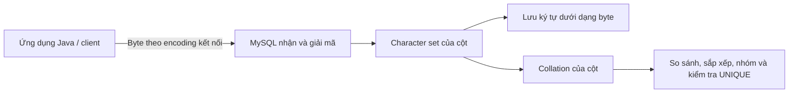
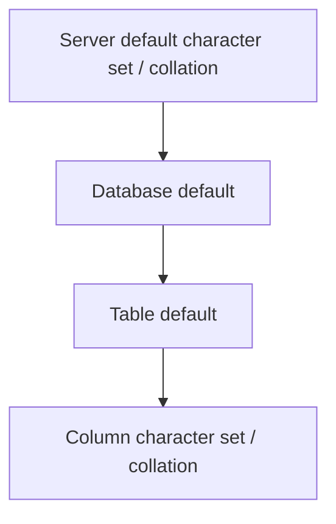

# Bộ ký tự, mã hóa và quy tắc so sánh (collation) giải quyết vấn đề nào

Một ứng dụng Java có thể gửi tên khách hàng tiếng Việt vào MySQL nhưng khi đọc lại lại thấy ký tự lỗi như `?`, `Ã`, hoặc các dấu bị biến dạng. Một vấn đề khác thường gặp là hai chuỗi `Nguyen` và `NGUYEN` được xem là giống nhau khi tìm kiếm, hoặc một unique index từ chối lưu `cafe` vì đã có `café`. Hai nhóm vấn đề này liên quan đến **character set** và **collation**.

Character set xác định tập ký tự và cách biểu diễn ký tự thành byte. Collation xác định cách so sánh và sắp xếp các chuỗi thuộc character set đó. Trong module **DATABASE_MYSQL**, hiểu hai khái niệm này giúp lưu đúng tiếng Việt và Unicode, thiết kế tìm kiếm, bảo đảm quy tắc duy nhất và tránh lỗi khi kết nối từ Java hoặc di chuyển dữ liệu.

## 1. Character set và collation giải quyết hai việc khác nhau

**Character set (bộ ký tự)** quy định những ký tự nào được hỗ trợ và cách mã hóa chúng thành byte. Ví dụ, `utf8mb4` là character set Unicode của MySQL, có thể mã hóa một ký tự bằng từ 1 đến 4 byte. Nhờ đó, cột dùng `utf8mb4` có thể lưu tiếng Việt có dấu, nhiều ngôn ngữ khác và các ký tự ngoài BMP như emoji.

**Collation (quy tắc đối chiếu)** quy định cách so sánh và sắp xếp các chuỗi thuộc một character set. Collation có thể quyết định chữ hoa và chữ thường có được xem là bằng nhau hay không, dấu có ảnh hưởng đến phép so sánh không, thứ tự ký tự khi `ORDER BY` và cách xác định hai giá trị có trùng nhau trong `DISTINCT`, `GROUP BY` hoặc unique index.

| Khái niệm | Trả lời câu hỏi | Ví dụ |
|---|---|---|
| Character set | Ký tự được biểu diễn thành byte như thế nào? | `utf8mb4` mã hóa Unicode bằng tối đa 4 byte cho một ký tự |
| Collation | Hai chuỗi được so sánh và sắp xếp ra sao? | `utf8mb4_0900_ai_ci` không phân biệt dấu và hoa/thường |

Có thể hình dung luồng dữ liệu như sau:



Character set không quyết định chuỗi nào bằng chuỗi nào; collation không sửa được byte đã bị mã hóa sai. Muốn xử lý đúng dữ liệu, cần cấu hình cả hai theo mục đích.

## 2. Vì sao nên dùng `utf8mb4`?

Trong MySQL, `utf8mb4` là lựa chọn phù hợp cho phần lớn ứng dụng mới cần hỗ trợ Unicode. Tên `utf8` trong MySQL có lịch sử đặc biệt: nó là alias của `utf8mb3`, một cách mã hóa Unicode tối đa 3 byte, không biểu diễn được toàn bộ Unicode. `utf8mb3` và alias `utf8` đã bị deprecated; không nên chọn chúng cho schema mới.

| Character set | Số byte tối đa cho một ký tự | Khả năng |
|---|---:|---|
| `ascii` | 1 | Tập ký tự ASCII cơ bản |
| `latin1` | 1 | Bộ ký tự Tây Âu theo cách triển khai của MySQL |
| `utf8mb3` (alias cũ `utf8`) | 3 | Một phần Unicode; không hỗ trợ đầy đủ các ký tự cần 4 byte |
| `utf8mb4` | 4 | Hỗ trợ đầy đủ Unicode, bao gồm emoji và ký tự ngoài BMP |

Ví dụ, một số ký tự tiếng Việt có thể biểu diễn bằng nhiều byte trong UTF-8; emoji như `😀` cần 4 byte. Cột dùng `utf8mb3` không thể lưu mọi ký tự này, trong khi `utf8mb4` có thể.

Kiểm tra character set được máy chủ hỗ trợ:

```sql
SHOW CHARACTER SET LIKE 'utf8mb4';
SHOW CHARACTER SET LIKE 'utf8mb3';
```

`utf8mb4` có thể dùng nhiều byte hơn ASCII hoặc latin1 cho cùng một nội dung. Điều này ảnh hưởng đến dung lượng lưu trữ và giới hạn độ dài index, vì vậy khi nâng cấp bảng cũ cần kiểm tra index và cấu trúc thực tế. Đổi sang `utf8mb4` là lựa chọn đúng cho Unicode, nhưng vẫn cần lập kế hoạch chuyển đổi thay vì chỉ đổi một dòng cấu hình.

## 3. Đọc tên collation

Tên collation thường chứa thông tin về bộ quy tắc so sánh. Ví dụ:

```text
utf8mb4_0900_ai_ci
```

- `utf8mb4`: character set mà collation áp dụng.
- `0900`: nhóm quy tắc Unicode Collation Algorithm (UCA) phiên bản 9.0.0 được MySQL sử dụng.
- `ai`: accent-insensitive, không phân biệt dấu.
- `ci`: case-insensitive, không phân biệt chữ hoa/chữ thường.

Các hậu tố thường gặp:

| Hậu tố | Ý nghĩa | Ví dụ tác động |
|---|---|---|
| `_ai` | Không phân biệt dấu (accent-insensitive) | `cafe` có thể được xem là bằng `café` |
| `_as` | Phân biệt dấu (accent-sensitive) | `cafe` khác `café` |
| `_ci` | Không phân biệt hoa/thường (case-insensitive) | `Alice` bằng `alice` |
| `_cs` | Phân biệt hoa/thường (case-sensitive) | `Alice` khác `alice` |
| `_bin` | So sánh theo giá trị mã ký tự của character set | Thường dùng khi cần quy tắc so sánh chặt theo mã ký tự |

Ví dụ một số collation của `utf8mb4`:

- `utf8mb4_0900_ai_ci`: không phân biệt dấu và hoa/thường; là collation mặc định của `utf8mb4` trong MySQL 8.0.
- `utf8mb4_0900_as_cs`: phân biệt dấu và hoa/thường.
- `utf8mb4_0900_as_ci`: phân biệt dấu nhưng không phân biệt hoa/thường.

Không phải mọi collation đều có sẵn trên mọi phiên bản MySQL. Có thể kiểm tra bằng:

```sql
SHOW COLLATION LIKE 'utf8mb4_0900%';
SHOW COLLATION LIKE 'utf8mb4%';
```

Một điểm khác giữa các thế hệ collation là quy tắc xử lý khoảng trắng ở cuối chuỗi. Các collation `0900` của MySQL 8.0 sử dụng thuộc tính `NO PAD`; nhiều collation cũ dùng `PAD SPACE`. Vì vậy, việc so sánh chuỗi có khoảng trắng cuối có thể khác khi chuyển từ collation cũ sang collation `0900`. Khi nâng cấp, cần kiểm tra các phép so sánh và unique index có liên quan.

## 4. Collation ảnh hưởng đến tìm kiếm và tính duy nhất như thế nào?

Giả sử hệ thống có cột tên người dùng và muốn tìm kiếm không phân biệt hoa/thường, dấu. Có thể dùng collation `utf8mb4_0900_ai_ci`:

```sql
SELECT
    _utf8mb4'cafe' COLLATE utf8mb4_0900_ai_ci =
    _utf8mb4'café' COLLATE utf8mb4_0900_ai_ci AS same_without_accent,
    _utf8mb4'Alice' COLLATE utf8mb4_0900_ai_ci =
    _utf8mb4'alice' COLLATE utf8mb4_0900_ai_ci AS same_without_case;
```

Với collation này, cả hai phép so sánh đều cho kết quả đúng. Nếu cần phân biệt cả dấu và hoa/thường, dùng collation phù hợp như `utf8mb4_0900_as_cs`:

```sql
SELECT
    _utf8mb4'cafe' COLLATE utf8mb4_0900_as_cs =
    _utf8mb4'café' COLLATE utf8mb4_0900_as_cs AS same_with_accent,
    _utf8mb4'Alice' COLLATE utf8mb4_0900_as_cs =
    _utf8mb4'alice' COLLATE utf8mb4_0900_as_cs AS same_with_case;
```

Hai phép so sánh này cho kết quả sai vì dấu và kiểu chữ đều được phân biệt.

### Collation ảnh hưởng đến UNIQUE

Collation của cột được dùng khi so sánh giá trị trong index trên cột đó. Ví dụ:

```sql
CREATE TABLE username_registry (
    username VARCHAR(100)
        CHARACTER SET utf8mb4
        COLLATE utf8mb4_0900_ai_ci
        NOT NULL,
    UNIQUE KEY uq_username (username)
);
```

Với collation này, sau khi lưu `Alice`, việc thêm `alice` có thể bị từ chối vì hai giá trị được xem là bằng nhau. Tương tự, `cafe` và `café` có thể xung đột trong unique index. Đây là hành vi của collation, không phải lỗi ngẫu nhiên của index.

Nếu yêu cầu nghiệp vụ là phân biệt hoa/thường và dấu, hãy chọn collation phù hợp ngay từ thiết kế:

```sql
CREATE TABLE api_tokens (
    token_label VARCHAR(100)
        CHARACTER SET utf8mb4
        COLLATE utf8mb4_0900_as_cs
        NOT NULL,
    UNIQUE KEY uq_token_label (token_label)
);
```

Không nên chọn collation chỉ dựa trên việc tìm kiếm “dễ hơn”. Hãy xác định rõ hai giá trị nào được xem là cùng một danh tính, mã hoặc khóa nghiệp vụ. Collation ảnh hưởng đến `=`, `ORDER BY`, `GROUP BY`, `DISTINCT`, `LIKE` và unique index; thay đổi nó có thể thay đổi kết quả truy vấn và tính hợp lệ của dữ liệu.

## 5. Collation `_bin` và kiểu dữ liệu binary

Collation có hậu tố `_bin` so sánh các ký tự dựa trên giá trị mã của chúng thay vì quy tắc ngôn ngữ thông thường. Tuy nhiên, cột vẫn là kiểu chuỗi có character set; `_bin` không biến `VARCHAR` thành dữ liệu nhị phân.

Các kiểu `BINARY`, `VARBINARY` và `BLOB` lưu byte, không áp dụng character set và collation văn bản theo cách của `CHAR`, `VARCHAR` hoặc `TEXT`:

| Kiểu | Bản chất | Dùng khi |
|---|---|---|
| `VARCHAR` với collation `_bin` | Chuỗi ký tự, so sánh theo mã ký tự | Nội dung vẫn là văn bản nhưng cần quy tắc so sánh chặt |
| `VARBINARY` | Dãy byte có độ dài thay đổi | Token, hash hoặc dữ liệu nhị phân cần so sánh byte |
| `BLOB` | Dữ liệu nhị phân có thể lớn | Tệp hoặc payload nhị phân |

Ví dụ, token được tạo từ byte ngẫu nhiên nên có thể lưu bằng `VARBINARY`; tên người dùng là văn bản nên thường phù hợp với `VARCHAR` và collation được chọn theo nghiệp vụ. Không dùng `_bin` như một cách thay thế tùy tiện cho mọi kiểu binary.

## 6. Character set và collation được áp dụng ở những cấp nào?

MySQL có thể đặt mặc định ở nhiều cấp. Khi không chỉ định rõ, đối tượng mới kế thừa cấu hình từ cấp bên trên:



| Cấp | Khai báo mặc định | Ý nghĩa |
|---|---|---|
| Server | `character_set_server`, `collation_server` | Giá trị mặc định cho database mới nếu không chỉ định |
| Database | `DEFAULT CHARACTER SET`, `DEFAULT COLLATE` | Giá trị mặc định cho bảng mới trong database |
| Table | `DEFAULT CHARACTER SET`, `DEFAULT COLLATE` | Giá trị mặc định cho cột văn bản mới trong bảng |
| Column | `CHARACTER SET`, `COLLATE` | Quyết định mã hóa và quy tắc so sánh của cột cụ thể |

Ví dụ tạo database với mặc định Unicode:

```sql
CREATE DATABASE customer_app
    CHARACTER SET utf8mb4
    COLLATE utf8mb4_0900_ai_ci;
```

Tạo bảng dùng mặc định của database:

```sql
CREATE TABLE customers (
    id BIGINT UNSIGNED NOT NULL AUTO_INCREMENT,
    display_name VARCHAR(150) NOT NULL,
    PRIMARY KEY (id)
) DEFAULT CHARACTER SET utf8mb4
  COLLATE utf8mb4_0900_ai_ci;
```

Nếu một cột cần quy tắc khác, có thể ghi đè ở cấp cột:

```sql
CREATE TABLE account_names (
    id BIGINT UNSIGNED NOT NULL AUTO_INCREMENT,
    display_name VARCHAR(100)
        CHARACTER SET utf8mb4
        COLLATE utf8mb4_0900_ai_ci NOT NULL,
    external_code VARCHAR(100)
        CHARACTER SET utf8mb4
        COLLATE utf8mb4_0900_as_cs NOT NULL,
    PRIMARY KEY (id)
) DEFAULT CHARACTER SET utf8mb4
  COLLATE utf8mb4_0900_ai_ci;
```

`display_name` không phân biệt dấu và hoa/thường khi so sánh; `external_code` phân biệt cả hai. Chỉ dùng collation riêng khi yêu cầu nghiệp vụ thực sự khác nhau.

Thay đổi mặc định database bằng `ALTER DATABASE` chỉ ảnh hưởng mặc định cho đối tượng tạo sau đó; nó không tự chuyển đổi các cột đã tồn tại. Tương tự, đổi mặc định table không tự động thay đổi character set/collation của từng cột cũ.

## 7. Character set của kết nối client/server

Một schema được cấu hình `utf8mb4` vẫn có thể lưu sai nếu client gửi byte theo encoding khác với điều MySQL nghĩ rằng nó đang nhận. Khi kết nối, MySQL dùng các biến session để xử lý dữ liệu:

| Biến | Vai trò |
|---|---|
| `character_set_client` | Character set mà MySQL dùng để giải mã byte của câu lệnh do client gửi |
| `character_set_connection` | Character set dùng cho các literal và biểu thức sau khi chuyển từ `character_set_client` |
| `character_set_results` | Character set dùng để chuyển kết quả trả về client |
| `collation_connection` | Collation mặc định cho các phép so sánh liên quan đến literal/biểu thức của kết nối |

Kiểm tra cấu hình trong session hiện tại:

```sql
SHOW SESSION VARIABLES WHERE Variable_name IN (
    'character_set_client',
    'character_set_connection',
    'character_set_results',
    'collation_connection'
);
```

Có thể đặt bộ ký tự cho một session bằng:

```sql
SET NAMES utf8mb4 COLLATE utf8mb4_0900_ai_ci;
```

Lệnh `SET NAMES` thiết lập các biến character set của client, connection và results, đồng thời thiết lập collation của connection. Nó có hiệu lực trong session hiện tại; khi mở connection mới, ứng dụng cần thương lượng/cấu hình lại theo driver.

Với ứng dụng Java, hãy dùng phiên bản MySQL Connector/J phù hợp và để driver quản lý encoding của kết nối. Nếu cấu hình `characterEncoding`, hãy xác minh cách driver phiên bản đó ánh xạ UTF-8 sang `utf8mb4`; Connector/J hiện đại hỗ trợ ánh xạ này. Không nên ghép `SET NAMES` thủ công vào mọi truy vấn khi driver đã quản lý character set, vì cấu hình trong driver và session có thể lệch nhau. Hãy kiểm tra các biến session trên chính connection mà ứng dụng đang sử dụng.

Ví dụ kiểm tra sau khi mở kết nối JDBC:

```java
try (Connection connection = dataSource.getConnection();
     Statement statement = connection.createStatement();
     ResultSet resultSet = statement.executeQuery(
         "SELECT @@character_set_client, " +
         "@@character_set_connection, " +
         "@@character_set_results, @@collation_connection")) {

    if (resultSet.next()) {
        System.out.println("client charset: " + resultSet.getString(1));
        System.out.println("connection charset: " + resultSet.getString(2));
        System.out.println("results charset: " + resultSet.getString(3));
        System.out.println("connection collation: " + resultSet.getString(4));
    }
}
```

Ví dụ giả định `dataSource` đã cấu hình JDBC URL, MySQL Connector/J và thông tin xác thực. Khi debug, chạy kiểm tra trên cùng connection mà thao tác lưu dữ liệu sử dụng; một session SQL riêng có thể có cấu hình khác.

## 8. Chẩn đoán lỗi tiếng Việt và mojibake

Mojibake là hiện tượng byte được giải mã bằng character set sai, làm văn bản hiển thị thành chuỗi ký tự vô nghĩa. Ví dụ, dữ liệu UTF-8 bị đọc như latin1 có thể tạo ra dạng `Tiếng Việt` thay vì `Tiếng Việt`.

Khi gặp lỗi, không vội chạy `ALTER TABLE ... CONVERT TO CHARACTER SET`. Trước hết, kiểm tra:

1. Character set của cột đang lưu dữ liệu.
2. `character_set_client`, `character_set_connection` và `character_set_results` trên session ứng dụng.
3. Encoding thực tế của dữ liệu được gửi từ ứng dụng hoặc file import.
4. Byte đang lưu trong cột, có thể kiểm tra một giá trị bằng `HEX(column_name)`.
5. Cách client hiển thị kết quả; một lỗi ở terminal hoặc log có thể nằm ở bước giải mã kết quả chứ không phải dữ liệu trong database.

Ví dụ kiểm tra metadata cột:

```sql
SHOW CREATE TABLE customers;

SELECT
    display_name,
    HEX(display_name),
    CHAR_LENGTH(display_name),
    LENGTH(display_name)
FROM customers
LIMIT 5;
```

`CHAR_LENGTH()` đếm số ký tự; `LENGTH()` đếm số byte. Với chuỗi Unicode `utf8mb4`, hai kết quả có thể khác nhau. `HEX()` giúp xem byte đang được lưu để đối chiếu với encoding nguồn.

Nếu byte được ghi đúng nhưng client giải mã sai, cần sửa cấu hình kết nối hoặc client. Nếu dữ liệu đã bị ghi sai byte do khai báo character set không khớp, cần xác định cách dữ liệu bị mã hóa và lập kế hoạch sửa từ bản backup. Chuyển đổi character set không thể tự đoán văn bản gốc mà người dùng mong muốn; chuyển đổi mù có thể làm dữ liệu hỏng thêm.

## 9. Chuyển đổi character set cho database, table và column

Có ba thao tác thường bị nhầm lẫn:

| Lệnh | Tác động |
|---|---|
| `ALTER DATABASE ... CHARACTER SET ...` | Đổi mặc định cho các bảng được tạo sau đó; không tự chuyển các cột hiện tại |
| `ALTER TABLE ... DEFAULT CHARACTER SET ...` | Đổi mặc định của bảng cho cột mới; không tự chuyển đổi mọi cột hiện có |
| `ALTER TABLE ... CONVERT TO CHARACTER SET ...` | Chuyển đổi các cột ký tự của bảng sang character set/collation đích |

Ví dụ đổi mặc định database:

```sql
ALTER DATABASE customer_app
    CHARACTER SET utf8mb4
    COLLATE utf8mb4_0900_ai_ci;
```

Ví dụ chuyển đổi cột văn bản trong bảng:

```sql
ALTER TABLE customers
    CONVERT TO CHARACTER SET utf8mb4
    COLLATE utf8mb4_0900_ai_ci;
```

Lệnh `CONVERT TO CHARACTER SET` có thể làm MySQL xây dựng lại bảng, thay đổi dung lượng, index hoặc metadata và gây khóa/ảnh hưởng hiệu năng tùy phiên bản, engine, kích thước bảng và thuật toán DDL được chọn. Trước khi thực hiện trên production, cần:

- Backup và thử restore để bảo đảm có thể khôi phục.
- Kiểm tra dữ liệu hiện tại có thật sự được mã hóa đúng theo character set đã khai báo không.
- Kiểm tra index, unique constraint và độ dài cột; khi collation mới xem hai giá trị là bằng nhau, unique index có thể không tạo được hoặc dữ liệu có thể xung đột.
- Đo thời gian chạy, dung lượng tạm, khóa và tác động đến replication.
- Thử trên bản sao dữ liệu có kích thước gần production và chuẩn bị kế hoạch rollback.

Đổi collation mà không đổi character set có thể thực hiện riêng cho cột bằng `ALTER TABLE ... MODIFY COLUMN` với định nghĩa cột đầy đủ. Khi dùng cách này, phải giữ lại các thuộc tính hiện có như `NOT NULL`, `DEFAULT`, comment và các thuộc tính khác; khai báo thiếu có thể làm thay đổi schema ngoài dự kiến.

## 10. Chọn character set và collation cho một ứng dụng

Một cấu hình thực tế cho ứng dụng mới thường bắt đầu bằng `utf8mb4` ở server/database/table và dùng collation mặc định phù hợp. Với MySQL 8.0, `utf8mb4_0900_ai_ci` là lựa chọn mặc định phổ biến khi muốn tìm kiếm không phân biệt dấu và hoa/thường.

Tuy nhiên, không nên áp dụng một collation cho mọi cột mà không xem nghiệp vụ:

| Dữ liệu | Hướng lựa chọn |
|---|---|
| Tên hiển thị, nội dung tiếng Việt cần tìm kiếm thân thiện | `utf8mb4` với collation không phân biệt dấu/hoa thường nếu nghiệp vụ mong muốn |
| Mã định danh cần phân biệt chính xác hoa/thường | Collation `_as_cs` hoặc quy tắc so sánh chặt hơn đã được kiểm thử |
| Token/hash hoặc payload nhị phân | `VARBINARY`/`BLOB`, vì đây là byte chứ không phải văn bản |
| Email, username hoặc mã đăng nhập | Chọn quy tắc duy nhất theo đặc tả nghiệp vụ và quy tắc chuẩn hóa; không mặc định rằng mọi hệ thống đều muốn phân biệt hoa/thường |
| Mã có cấu trúc và số 0 đầu | Thường dùng `CHAR`/`VARCHAR` với character set phù hợp nếu đó là định danh văn bản |

Collation là một phần của hợp đồng dữ liệu. Nếu thay đổi collation của username, email hoặc mã nghiệp vụ, kết quả tìm kiếm và quy tắc duy nhất có thể thay đổi. Hãy kiểm tra dữ liệu trùng theo collation đích trước khi tạo unique index hoặc chuyển đổi schema.

## 11. Bài tập thực hành

Thực hiện trên database thử nghiệm:

1. Chạy `SHOW CHARACTER SET LIKE 'utf8mb4'` và `SHOW COLLATION LIKE 'utf8mb4_0900%'` để xem charset/collation được hỗ trợ.
2. Tạo database với `utf8mb4` và `utf8mb4_0900_ai_ci`; tạo bảng có một cột dùng collation mặc định và một cột dùng `utf8mb4_0900_as_cs`.
3. Chèn các giá trị `Alice`, `alice`, `cafe` và `café`; so sánh kết quả bằng `=` dưới hai collation.
4. Tạo unique index trên cột `ai_ci`, thử chèn hai giá trị chỉ khác hoa/thường hoặc dấu và giải thích kết quả.
5. Kết nối bằng ứng dụng Java, kiểm tra bốn biến session của kết nối và lưu/đọc một chuỗi tiếng Việt có dấu cùng emoji.
6. Dùng `HEX()`, `CHAR_LENGTH()` và `LENGTH()` để so sánh byte với số ký tự.
7. Trên bản sao database, thử `ALTER TABLE ... CONVERT TO CHARACTER SET` và ghi nhận tác động đến dữ liệu, index và thời gian thực thi.

Bạn hoàn thành bài khi giải thích được character set quyết định cách mã hóa, collation quyết định cách so sánh, biết vì sao `utf8mb4` phù hợp cho Unicode và có thể kiểm tra toàn bộ đường đi từ Java client đến cột MySQL. Hãy chọn collation theo quy tắc nghiệp vụ, vì nó ảnh hưởng trực tiếp đến tìm kiếm, sắp xếp và tính duy nhất của dữ liệu.
