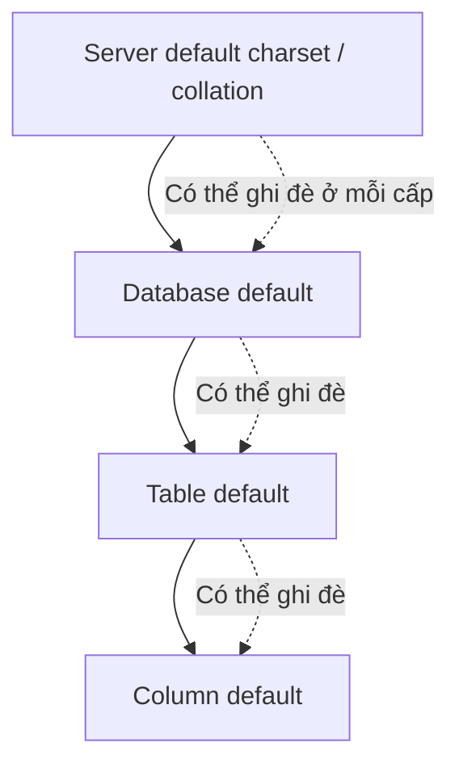

# Thiết lập bộ ký tự/collation ở server, database, table và column

## Mục tiêu

Sau bài này, bạn có thể:

- Giải thích cách MySQL áp dụng character set và collation theo các cấp server, database, table và column.
- Cấu hình mặc định cho server và tạo database, table, column với bộ ký tự/collation phù hợp.
- Phân biệt thay đổi giá trị mặc định với chuyển đổi dữ liệu đã tồn tại.
- Cấu hình bộ ký tự cho kết nối client và kiểm tra trạng thái charset/collation của session.
- Phát hiện nguy cơ mất dữ liệu, lỗi index hoặc xung đột unique key khi chuyển đổi charset/collation.
- Lập kế hoạch chuẩn hóa dữ liệu văn bản sang `utf8mb4` an toàn.

## 1. Character set và collation là hai khái niệm khác nhau

**Character set** (bộ ký tự) xác định tập ký tự và cách mã hóa ký tự thành byte. Ví dụ, `utf8mb4` có thể biểu diễn các ký tự Unicode cần tối đa bốn byte, gồm chữ tiếng Việt và nhiều ký tự ngoài BMP như emoji.

**Collation** xác định cách so sánh và sắp xếp các chuỗi thuộc một character set. Collation quyết định những khác biệt nào được xem là tương đương trong phép so sánh, `ORDER BY`, `GROUP BY` và unique index. Một số hậu tố thường gặp:

- `_ai`: accent-insensitive, không phân biệt dấu trong phép so sánh.
- `_as`: accent-sensitive, phân biệt dấu.
- `_ci`: case-insensitive, không phân biệt chữ hoa/chữ thường.
- `_cs`: case-sensitive, phân biệt chữ hoa/chữ thường.
- `_bin`: so sánh theo giá trị nhị phân của chuỗi hoặc mã ký tự theo collation tương ứng.

Ví dụ, với collation không phân biệt hoa thường và dấu, hai chuỗi như `An` và `an` hoặc `a` và `á` có thể được xem là bằng nhau trong phép so sánh. Hành vi chính xác phụ thuộc collation cụ thể. Đây không phải là thay đổi nội dung chuỗi được lưu; collation chỉ thay đổi cách so sánh và sắp xếp.

Không nên chọn collation chỉ vì tên có chữ `utf8`. Hãy xác định nghiệp vụ cần tìm kiếm và so sánh như thế nào: tên người có cần phân biệt dấu không, mã định danh có phân biệt hoa thường không, email có quy tắc chuẩn hóa riêng không, và dữ liệu ngôn ngữ nào sẽ được lưu.

## 2. Cách MySQL kế thừa charset và collation

MySQL có các cấp mặc định từ rộng đến hẹp:

1. **Server:** mặc định cho database mới khi không chỉ định charset/collation.
2. **Database:** mặc định cho table mới trong database khi không chỉ định rõ ở câu lệnh tạo bảng.
3. **Table:** mặc định cho các column ký tự mới khi không chỉ định ở từng column.
4. **Column:** charset/collation thực tế dùng để lưu và so sánh dữ liệu của column đó.



Khi tạo đối tượng, cấp hẹp hơn có thể kế thừa mặc định của cấp cha hoặc ghi đè bằng khai báo tường minh. Ví dụ, database có mặc định `utf8mb4`, nhưng một table có thể khai báo `latin1`; một column trong table đó cũng có thể khai báo charset/collation riêng nếu kiểu dữ liệu cho phép.

Điểm quan trọng: **thay đổi mặc định không tự động chuyển dữ liệu hoặc thay đổi các đối tượng đã tồn tại**. `ALTER DATABASE ... CHARACTER SET` thay đổi mặc định của database cho các đối tượng tạo sau này; nó không chuyển các table cũ. Tương tự, `ALTER TABLE ... DEFAULT CHARACTER SET` thay đổi mặc định của table cho column mới, không tự chuyển mọi column hiện tại. Muốn chuyển các column đã tồn tại, cần dùng `ALTER TABLE ... CONVERT TO CHARACTER SET` hoặc sửa từng column.

## 3. Chọn charset và collation phù hợp

### 3.1. Vì sao nên dùng utf8mb4?

Với hệ thống mới, `utf8mb4` thường là lựa chọn phù hợp cho dữ liệu văn bản đa ngôn ngữ. Nó hỗ trợ đầy đủ Unicode với tối đa bốn byte cho một ký tự. Trong MySQL, tên `utf8` là bí danh lịch sử cho `utf8mb3` ở các phiên bản hiện đại; `utf8mb3` chỉ hỗ trợ tối đa ba byte và không biểu diễn được toàn bộ Unicode. Vì vậy, khi thiết kế mới, nên khai báo rõ `utf8mb4` thay vì dùng `utf8` mơ hồ.

Charset không quyết định ngôn ngữ của dữ liệu. Một cột `utf8mb4` có thể chứa tiếng Việt, tiếng Anh, tiếng Nhật hoặc emoji. Việc hiển thị đúng còn phụ thuộc dữ liệu đầu vào được giải mã đúng, kết nối client khai báo đúng charset và ứng dụng xử lý chuỗi chính xác.

### 3.2. Chọn collation theo yêu cầu so sánh

Ví dụ một số collation thường gặp trong hệ MySQL:

| Collation | Đặc điểm tổng quát | Tình huống có thể cân nhắc |
|---|---|---|
| `utf8mb4_0900_ai_ci` | UCA 9.0, không phân biệt dấu và hoa thường; có quy tắc NO PAD | MySQL 8.0, tìm kiếm văn bản thông thường khi không cần phân biệt dấu/hoa thường |
| `utf8mb4_0900_as_cs` | UCA 9.0, phân biệt dấu và hoa thường | So sánh cần phân biệt chính xác hơn |
| `utf8mb4_unicode_ci` | Collation dựa trên Unicode, không phân biệt dấu/hoa thường theo quy tắc của collation | Môi trường cần collation tương thích với phiên bản MySQL/MariaDB hỗ trợ tên này |
| `utf8mb4_bin` | So sánh theo giá trị nhị phân của chuỗi | Mã hoặc token cần phân biệt chính xác từng byte/ký tự theo cách biểu diễn |

Tên và bộ collation khả dụng thay đổi theo phiên bản MySQL, MariaDB và nhà cung cấp. Ví dụ, các collation `utf8mb4_0900_*` là đặc trưng của MySQL 8.0 và không nên giả định có trên mọi bản MariaDB. Luôn kiểm tra `SHOW COLLATION` trên server đích trước khi dùng trong DDL.

Không dùng collation không phân biệt hoa thường cho mọi dữ liệu một cách máy móc. Mã đăng nhập, API token, mã sản phẩm hoặc định danh có thể cần so sánh chính xác. Ngược lại, tìm kiếm tên người thường cần trải nghiệm không quá nhạy với hoa thường hoặc dấu. Có thể dùng collation ở cấp column hoặc chỉ định `COLLATE` trong một truy vấn cụ thể nếu nhu cầu khác với mặc định.

## 4. Cấu hình ở cấp server

### 4.1. Kiểm tra mặc định hiện tại

Kết nối vào MySQL và chạy:

```sql
SHOW GLOBAL VARIABLES LIKE 'character_set_server';
SHOW GLOBAL VARIABLES LIKE 'collation_server';

SELECT
    @@GLOBAL.character_set_server AS server_charset,
    @@GLOBAL.collation_server AS server_collation;
```

Xem các charset và collation được server hỗ trợ:

```sql
SHOW CHARACTER SET;
SHOW COLLATION;
```

Có thể lọc riêng các collation của `utf8mb4`:

```sql
SHOW COLLATION WHERE Charset = 'utf8mb4';
```

`character_set_server` và `collation_server` là mặc định của server. Chúng chủ yếu ảnh hưởng database được tạo mà không chỉ định rõ charset/collation. Chúng không tự chuyển các database, table hoặc column hiện có.

### 4.2. Khai báo trong file cấu hình

Trên máy chủ tự quản lý, có thể đặt mặc định trong file cấu hình MySQL, thường là `my.cnf` trên Linux hoặc `my.ini` trên Windows. Ví dụ cho MySQL 8.0:

```ini
[mysqld]
character-set-server = utf8mb4
collation-server = utf8mb4_0900_ai_ci
```

Collation trong ví dụ cần được server hiện tại hỗ trợ. Nếu triển khai MariaDB hoặc phiên bản khác, chọn một collation có trong `SHOW COLLATION` và tài liệu của đúng sản phẩm.

Sau khi sửa file cấu hình, áp dụng theo quy trình restart hoặc cơ chế quản lý cấu hình của môi trường. Với dịch vụ cloud, việc chỉnh cấu hình có thể thực hiện qua parameter group hoặc giao diện quản trị của nhà cung cấp; không phải lúc nào cũng có quyền sửa file cấu hình trực tiếp.

Trong một số phiên bản MySQL, biến global có thể thay đổi ở runtime bằng `SET GLOBAL` hoặc được lưu bằng `SET PERSIST` nếu biến và phiên bản hỗ trợ. Thay đổi runtime không cập nhật session đã mở và không thay thế việc quản lý cấu hình bền vững. Trước khi dùng, kiểm tra phạm vi, khả năng dynamic, quyền cần thiết và tác động restart của biến.

### 4.3. Xác minh sau khi thay đổi

Sau khi áp dụng cấu hình, mở một kết nối mới và kiểm tra:

```sql
SELECT
    @@GLOBAL.character_set_server,
    @@GLOBAL.collation_server;
```

Đồng thời tạo một database thử nghiệm không chỉ định charset/collation rồi kiểm tra metadata để xác nhận nó nhận đúng mặc định. Không dùng database production để thử cấu hình nếu chưa có kế hoạch thay đổi rõ ràng.

## 5. Cấu hình ở cấp database

### 5.1. Tạo database với charset/collation tường minh

Khuyến nghị khai báo rõ cho database mới thay vì phụ thuộc vào mặc định server:

```sql
CREATE DATABASE shop_db
    CHARACTER SET utf8mb4
    COLLATE utf8mb4_0900_ai_ci;
```

Database mới sẽ dùng charset/collation này làm mặc định cho table được tạo mà không chỉ định giá trị riêng.

Kiểm tra:

```sql
SELECT
    SCHEMA_NAME,
    DEFAULT_CHARACTER_SET_NAME,
    DEFAULT_COLLATION_NAME
FROM information_schema.SCHEMATA
WHERE SCHEMA_NAME = 'shop_db';
```

Hoặc:

```sql
SHOW CREATE DATABASE shop_db;
```

### 5.2. Thay đổi mặc định database hiện tại

```sql
ALTER DATABASE shop_db
    CHARACTER SET utf8mb4
    COLLATE utf8mb4_0900_ai_ci;
```

Lệnh này thay đổi mặc định của database cho các table tạo sau đó nếu table không khai báo giá trị riêng. Nó **không chuyển charset/collation của các table và column đã tồn tại**. Sau lệnh, hãy kiểm tra metadata của database và từng table để tránh hiểu nhầm rằng toàn bộ dữ liệu đã được chuyển.

Nếu ứng dụng tạo table bằng migration có khai báo `DEFAULT CHARSET` hoặc column có charset riêng, khai báo tường minh trong DDL sẽ ghi đè mặc định database. Do đó, cần quản lý charset/collation trong migration và schema source control, không chỉ cấu hình ở server.

## 6. Cấu hình ở cấp table

### 6.1. Tạo table với mặc định riêng

```sql
CREATE TABLE customers (
    customer_id BIGINT UNSIGNED NOT NULL AUTO_INCREMENT,
    display_name VARCHAR(200) NOT NULL,
    email VARCHAR(255) NOT NULL,
    notes TEXT,
    PRIMARY KEY (customer_id),
    UNIQUE KEY uq_customers_email (email)
) ENGINE = InnoDB
  DEFAULT CHARACTER SET = utf8mb4
  COLLATE = utf8mb4_0900_ai_ci;
```

Các column ký tự không khai báo charset/collation riêng sẽ kế thừa mặc định table. Các column số và ngày giờ không có character set.

Kiểm tra:

```sql
SHOW CREATE TABLE customers\G

SELECT
    TABLE_NAME,
    TABLE_COLLATION
FROM information_schema.TABLES
WHERE TABLE_SCHEMA = DATABASE()
  AND TABLE_NAME = 'customers';
```

`TABLE_COLLATION` thể hiện collation mặc định của table; để xem charset/collation thực tế từng column, truy vấn `information_schema.COLUMNS`.

### 6.2. Thay đổi mặc định table cho column tạo mới

```sql
ALTER TABLE customers
    DEFAULT CHARACTER SET = utf8mb4
    COLLATE = utf8mb4_0900_ai_ci;
```

Lệnh này thay đổi mặc định table cho các column ký tự được thêm sau đó. Các column hiện có giữ charset/collation cũ. Đây là khác biệt quan trọng với `CONVERT TO CHARACTER SET` ở phần tiếp theo.

### 6.3. Kiểm tra column thực tế

```sql
SELECT
    COLUMN_NAME,
    COLUMN_TYPE,
    CHARACTER_SET_NAME,
    COLLATION_NAME,
    IS_NULLABLE
FROM information_schema.COLUMNS
WHERE TABLE_SCHEMA = DATABASE()
  AND TABLE_NAME = 'customers'
ORDER BY ORDINAL_POSITION;
```

Các cột `CHARACTER_SET_NAME` và `COLLATION_NAME` là `NULL` với kiểu không phải chuỗi. Đừng suy ra charset của mọi column chỉ từ `TABLE_COLLATION`.

## 7. Cấu hình ở cấp column

### 7.1. Ghi đè charset/collation cho một column

Một table có thể dùng mặc định `utf8mb4_0900_ai_ci`, nhưng một column định danh cần so sánh nhị phân hoặc phân biệt hoa thường:

```sql
CREATE TABLE api_clients (
    client_id BIGINT UNSIGNED NOT NULL AUTO_INCREMENT,
    display_name VARCHAR(150) NOT NULL,
    api_key VARCHAR(128)
        CHARACTER SET utf8mb4
        COLLATE utf8mb4_bin NOT NULL,
    PRIMARY KEY (client_id),
    UNIQUE KEY uq_api_key (api_key)
) ENGINE = InnoDB
  DEFAULT CHARACTER SET = utf8mb4
  COLLATE = utf8mb4_0900_ai_ci;
```

Trong ví dụ, `display_name` kế thừa collation của table, còn `api_key` ghi đè bằng `utf8mb4_bin`. Với token hoặc mã định danh, cần chọn quy tắc so sánh dựa trên định dạng thực tế; có trường hợp nên dùng kiểu binary thay vì chuỗi văn bản.

### 7.2. Thay đổi một column hiện có

Để thay charset/collation của riêng column, dùng `MODIFY` hoặc `CHANGE` với định nghĩa column đầy đủ:

```sql
ALTER TABLE customers
    MODIFY display_name VARCHAR(200)
        CHARACTER SET utf8mb4
        COLLATE utf8mb4_0900_ai_ci
        NOT NULL;
```

Khi dùng `MODIFY`, phải khai báo lại đầy đủ các thuộc tính cần giữ như kiểu, độ dài, `NULL`/`NOT NULL`, `DEFAULT`, `COMMENT`, `AUTO_INCREMENT` hoặc thuộc tính khác có liên quan. Bỏ sót thuộc tính có thể làm thay đổi schema ngoài dự định. Hãy lấy `SHOW CREATE TABLE` trước khi sửa.

Thay đổi một column bằng `MODIFY` có thể chuyển đổi dữ liệu của column đó. Nếu mục tiêu chỉ là thay đổi cách so sánh, hãy cân nhắc tác động của collation mới tới index, unique key và truy vấn trước khi áp dụng.

### 7.3. Chỉ định COLLATE trong truy vấn

Đôi khi chỉ một truy vấn cần cách so sánh khác với collation của column. Có thể dùng `COLLATE` trong biểu thức:

```sql
SELECT customer_id, display_name
FROM customers
WHERE display_name COLLATE utf8mb4_0900_as_cs = 'Nguyễn An';
```

Ví dụ này yêu cầu collation phân biệt dấu và hoa thường cho phép so sánh. Collation phải tương thích với character set của biểu thức và phải được server hỗ trợ.

Chỉ định `COLLATE` trong truy vấn không thay đổi metadata của table hoặc column. Việc áp dụng hàm/ép kiểu lên cột cũng có thể ảnh hưởng khả năng sử dụng index; hãy xem `EXPLAIN` nếu truy vấn quan trọng về hiệu năng.

## 8. Cấu hình charset/collation cho kết nối client

### 8.1. Vì sao kết nối cũng cần đúng charset?

Một client có thể gửi chuỗi tiếng Việt tới MySQL. Server cần biết byte nhận được được giải mã theo charset nào; khi trả kết quả, client cũng cần biết cách diễn giải byte phản hồi. Nếu charset của kết nối không khớp, dữ liệu có thể bị lỗi dấu hoặc mojibake dù column đã dùng `utf8mb4`.

Các biến session thường cần kiểm tra:

```sql
SHOW SESSION VARIABLES LIKE 'character_set%';
SHOW SESSION VARIABLES LIKE 'collation%';

SELECT
    @@SESSION.character_set_client,
    @@SESSION.character_set_connection,
    @@SESSION.character_set_results,
    @@SESSION.collation_connection;
```

- `character_set_client`: charset mà server dùng để diễn giải dữ liệu client gửi.
- `character_set_connection`: charset dùng cho biểu thức và literal sau khi server chuyển đổi từ charset client.
- `character_set_results`: charset dùng khi server gửi kết quả về client.
- `collation_connection`: collation mặc định cho các phép so sánh chuỗi trong ngữ cảnh kết nối khi không có collation rõ hơn.

### 8.2. Dùng SET NAMES

Trong MySQL client, có thể thiết lập session:

```sql
SET NAMES utf8mb4 COLLATE utf8mb4_0900_ai_ci;
```

Lệnh này đặt các biến charset của kết nối (client, connection và results), đồng thời đặt collation của connection theo collation được chỉ định. Nó chỉ ảnh hưởng session hiện tại; không đổi charset/collation của server, database, table hoặc dữ liệu đã lưu.

Có thể kiểm tra lại ngay:

```sql
SELECT
    @@SESSION.character_set_client,
    @@SESSION.character_set_connection,
    @@SESSION.character_set_results,
    @@SESSION.collation_connection;
```

Không chạy `SET NAMES` một cách tùy tiện giữa các request trên cùng connection pool nếu ứng dụng không quản lý session state. Connection pool có thể tái sử dụng connection; session state cần được đặt nhất quán hoặc reset theo cấu hình pool.

### 8.3. Cấu hình trong ứng dụng

Với ứng dụng Java/JDBC, nên sử dụng driver hiện đại và cấu hình kết nối theo tài liệu đúng phiên bản connector. Tránh tự ghép câu SQL hoặc byte encoding thủ công nếu driver đã xử lý charset theo cấu hình. Có thể xác minh từ chính connection do ứng dụng mở bằng truy vấn `@@SESSION.character_set_client`, `@@SESSION.character_set_connection` và `@@SESSION.character_set_results`.

Đừng chỉ kiểm tra bằng MySQL client trên máy cá nhân. Ứng dụng chạy trong container hoặc máy chủ khác có thể dùng driver, JVM, locale hoặc cấu hình khác. Hãy kiểm tra trên đúng môi trường triển khai và qua đúng connection pool.

## 9. Kiểm tra dữ liệu và phát hiện lỗi encoding

### 9.1. Xem charset/collation theo từng cấp

Có thể dùng các truy vấn sau để chụp trạng thái:

```sql
-- Server
SELECT @@GLOBAL.character_set_server,
       @@GLOBAL.collation_server;

-- Session hiện tại
SELECT @@SESSION.character_set_client,
       @@SESSION.character_set_connection,
       @@SESSION.character_set_results,
       @@SESSION.collation_connection;

-- Database
SELECT SCHEMA_NAME,
       DEFAULT_CHARACTER_SET_NAME,
       DEFAULT_COLLATION_NAME
FROM information_schema.SCHEMATA
WHERE SCHEMA_NAME = DATABASE();

-- Table
SELECT TABLE_NAME, TABLE_COLLATION
FROM information_schema.TABLES
WHERE TABLE_SCHEMA = DATABASE()
  AND TABLE_TYPE = 'BASE TABLE';

-- Column
SELECT TABLE_NAME, COLUMN_NAME,
       CHARACTER_SET_NAME, COLLATION_NAME
FROM information_schema.COLUMNS
WHERE TABLE_SCHEMA = DATABASE()
  AND CHARACTER_SET_NAME IS NOT NULL
ORDER BY TABLE_NAME, ORDINAL_POSITION;
```

Những truy vấn này giúp phát hiện schema không đồng nhất, ví dụ database mặc định `utf8mb4` nhưng một số table hoặc column vẫn dùng charset cũ.

### 9.2. Thử ghi và đọc tiếng Việt, ký tự ngoài BMP

Trong môi trường thử nghiệm, tạo bảng nhỏ:

```sql
CREATE TABLE charset_probe (
    probe_id INT NOT NULL AUTO_INCREMENT,
    sample_text VARCHAR(100)
        CHARACTER SET utf8mb4
        COLLATE utf8mb4_0900_ai_ci NOT NULL,
    PRIMARY KEY (probe_id)
) ENGINE = InnoDB;

INSERT INTO charset_probe (sample_text)
VALUES ('Tiếng Việt: Trường học, dữ liệu, Nguyễn Ái Quốc'),
       ('Unicode: 😀 🚀 𠜎');

SELECT probe_id, sample_text
FROM charset_probe
ORDER BY probe_id;
```

Chạy phép thử từ đúng client/driver ứng dụng sẽ dùng. Nếu chuỗi đã bị mã hóa sai trước khi gửi tới server, cột `utf8mb4` không thể tự sửa lại nội dung ban đầu.

### 9.3. Phân biệt lỗi khai báo charset và dữ liệu đã bị mojibake

Ví dụ, byte UTF-8 có thể đã bị đọc nhầm như một charset khác rồi lưu vào column. Khi đó, metadata có thể nói column là `utf8mb4`, nhưng nội dung hiển thị đã sai. Chuyển table sang `utf8mb4` một lần nữa không tự khôi phục chuỗi ban đầu.

Trước khi sửa dữ liệu lỗi encoding:

1. Lưu bản backup và một mẫu byte/dữ liệu gốc.
2. Xác định charset thực sự của byte ban đầu và charset mà ứng dụng đã khai báo khi gửi.
3. Tái hiện quá trình chuyển đổi sai trên một bản sao nhỏ.
4. Xác định phép chuyển đổi có thể đảo ngược hay không và đối chiếu với nguồn có thẩm quyền.
5. Thử sửa trên bản sao, kiểm tra tiếng Việt và ký tự ngoài BMP, rồi mới lập kế hoạch cập nhật production.

Không chạy các phép `CONVERT()` hoặc `CAST()` hàng loạt trên dữ liệu production chỉ dựa vào hình thức chuỗi hiển thị. Nếu byte gốc đã bị thay thế hoặc mất, việc đổi charset không thể phục hồi thông tin đã mất.

## 10. Chuyển table/column hiện có sang utf8mb4

### 10.1. Thay mặc định table và chuyển dữ liệu là hai việc khác nhau

Chỉ đổi mặc định table:

```sql
ALTER TABLE customers
    DEFAULT CHARACTER SET = utf8mb4
    COLLATE = utf8mb4_0900_ai_ci;
```

Lệnh trên tác động tới mặc định của table và các column ký tự tạo sau đó. Column cũ vẫn giữ charset/collation hiện tại.

Chuyển các column ký tự hiện có của table:

```sql
ALTER TABLE customers
    CONVERT TO CHARACTER SET utf8mb4
    COLLATE utf8mb4_0900_ai_ci;
```

`CONVERT TO CHARACTER SET` chuyển đổi các column ký tự của table sang charset/collation mới. Nó có thể thay đổi định nghĩa column để bảo toàn khả năng chứa số ký tự tối đa; ví dụ một số `VARCHAR` có thể được mở rộng thành kiểu `TEXT` nếu giới hạn byte của kiểu cũ không còn đủ sau chuyển đổi. Hãy xem `SHOW CREATE TABLE` sau khi chạy.

Nếu chỉ muốn chuyển một số column, dùng `MODIFY` với định nghĩa đầy đủ cho từng column. Cần kiểm tra kỹ index và constraint liên quan.

### 10.2. Kiểm tra xung đột unique trước khi đổi collation

Đổi collation từ phân biệt hoa thường/dấu sang không phân biệt hoa thường/dấu có thể làm hai giá trị trước đây khác nhau trở thành bằng nhau. Nếu column có unique index, việc chuyển đổi có thể thất bại do duplicate key.

Ví dụ kiểm tra trước với collation đích:

```sql
SELECT
    CONVERT(email USING utf8mb4)
        COLLATE utf8mb4_0900_ai_ci AS normalized_email,
    COUNT(*) AS duplicate_count
FROM customers
GROUP BY normalized_email
HAVING COUNT(*) > 1;
```

Ví dụ này giả định server hỗ trợ `utf8mb4_0900_ai_ci` và column nguồn có thể chuyển đổi sang `utf8mb4`. Với collation khác, thay bằng collation thực tế sẽ sử dụng. Cần kiểm tra cả unique index ghép bằng cách nhóm theo toàn bộ các biểu thức/cột của khóa.

Nếu có kết quả, hãy xác định bản ghi nào cần hợp nhất, chuẩn hóa hoặc giữ nguyên bằng một collation phân biệt hơn. Không xóa bản ghi tự động để migration chạy qua. Ngoài unique key, collation mới cũng có thể làm thay đổi kết quả `GROUP BY`, `DISTINCT`, join và tìm kiếm.

### 10.3. Kiểm tra giới hạn index

`utf8mb4` có thể dùng tối đa bốn byte cho mỗi ký tự. Khi chuyển một column có index, chiều dài index theo byte có thể tăng. Với InnoDB, giới hạn key length phụ thuộc phiên bản, page size, row format và cấu hình. Một index từng hợp lệ ở charset một byte có thể vượt giới hạn khi chuyển sang `utf8mb4`.

Trước khi chuyển, kiểm tra:

- Độ dài cột được index và prefix length hiện tại.
- Index ghép có tổng độ dài theo byte bao nhiêu.
- Row format và giới hạn key length của phiên bản InnoDB.
- Các foreign key trên cột chuỗi có charset/collation tương thích ở hai phía hay không.

Nếu index vượt giới hạn, cần thiết kế lại prefix hoặc độ dài cột, hoặc điều chỉnh schema có chủ đích. Prefix index làm giảm số byte index nhưng có thể không đủ phân biệt giá trị; unique prefix index còn có thể thay đổi quy tắc duy nhất. Không cắt ngắn index tùy tiện.

### 10.4. Kế hoạch chuyển đổi an toàn

1. Kiểm tra phiên bản server và collation đích bằng `SHOW COLLATION`.
2. Backup và thử restore; lưu `SHOW CREATE TABLE`, index, constraint và metadata charset/collation.
3. Xác định encoding thực sự của dữ liệu hiện tại; phân biệt dữ liệu hợp lệ với dữ liệu đã mojibake.
4. Kiểm tra duplicate theo collation đích, nhất là các cột unique và khóa ghép.
5. Kiểm tra độ dài index theo byte, foreign key và dung lượng đĩa cần cho việc dựng lại bảng/index.
6. Thử `ALTER TABLE ... CONVERT TO CHARACTER SET` trên bản sao có dữ liệu tương đương.
7. Đối chiếu số hàng, dữ liệu mẫu, chuỗi tiếng Việt, emoji, unique key và kế hoạch truy vấn.
8. Lên lịch chuyển đổi production, kiểm soát ghi đồng thời và chuẩn bị phương án khôi phục.
9. Sau chuyển đổi, xác minh metadata từng column và kiểm thử ứng dụng qua đúng driver/connection pool.

Với table lớn, thao tác chuyển charset có thể rebuild table và index, tiêu tốn I/O/dung lượng và giữ metadata lock. Không giả định mọi phiên bản hỗ trợ chuyển đổi online không khóa. Thử trên bản sao, xác định downtime và chọn công cụ migration phù hợp với giới hạn foreign key/trigger của hệ thống.

## 11. Những lỗi cấu hình thường gặp

| Triệu chứng | Nguyên nhân có thể | Cách kiểm tra |
|---|---|---|
| Tiếng Việt bị lỗi dấu sau khi ghi | Client khai báo sai charset hoặc byte đầu vào đã bị giải mã sai | Kiểm tra charset session và quy trình encoding từ nguồn đến driver |
| Emoji bị lỗi hoặc bị từ chối | Một cấp vẫn dùng `utf8mb3` hoặc charset không hỗ trợ bốn byte | Kiểm tra charset của connection, database, table và column |
| Database đã utf8mb4 nhưng table mới vẫn dùng charset khác | DDL table chỉ định charset/collation riêng hoặc migration ghi đè mặc định | Kiểm tra `SHOW CREATE TABLE` và migration tạo table |
| Đổi mặc định database nhưng dữ liệu cũ không đổi | `ALTER DATABASE` chỉ thay default, không chuyển table/column hiện tại | Kiểm tra metadata `information_schema.COLUMNS` và dùng lệnh chuyển đổi phù hợp |
| Thêm unique index thất bại sau khi đổi collation | Các chuỗi khác nhau trước đây trở thành bằng nhau theo collation mới | Group dữ liệu bằng collation đích để tìm collision trước migration |
| `ALTER TABLE ... CONVERT` báo lỗi key too long | Index vượt giới hạn byte sau khi chuyển sang charset nhiều byte | Kiểm tra prefix, tổng chiều dài index, row format và giới hạn phiên bản |
| Truy vấn so sánh chuỗi cho kết quả bất ngờ | Collation không phù hợp hoặc các biểu thức có collation khác nhau | Kiểm tra collation column, `COLLATE` tường minh và quy tắc coercibility |
| Client thấy ký tự sai dù column là utf8mb4 | Charset của connection hoặc ứng dụng không khớp | Kiểm tra `character_set_client`, `character_set_connection`, `character_set_results` từ chính ứng dụng |

## 12. Bộ truy vấn kiểm tra nhanh

Có thể chạy bộ truy vấn sau để lập báo cáo charset/collation:

```sql
-- Charset/collation server
SELECT @@GLOBAL.character_set_server AS server_charset,
       @@GLOBAL.collation_server AS server_collation;

-- Charset/collation session
SELECT @@SESSION.character_set_client AS client_charset,
       @@SESSION.character_set_connection AS connection_charset,
       @@SESSION.character_set_results AS results_charset,
       @@SESSION.collation_connection AS connection_collation;

-- Charset/collation database hiện tại
SELECT SCHEMA_NAME,
       DEFAULT_CHARACTER_SET_NAME,
       DEFAULT_COLLATION_NAME
FROM information_schema.SCHEMATA
WHERE SCHEMA_NAME = DATABASE();

-- Collation mặc định theo table
SELECT TABLE_NAME, TABLE_COLLATION
FROM information_schema.TABLES
WHERE TABLE_SCHEMA = DATABASE()
  AND TABLE_TYPE = 'BASE TABLE'
ORDER BY TABLE_NAME;

-- Charset/collation thực tế của các column văn bản
SELECT TABLE_NAME, COLUMN_NAME,
       CHARACTER_SET_NAME, COLLATION_NAME
FROM information_schema.COLUMNS
WHERE TABLE_SCHEMA = DATABASE()
  AND CHARACTER_SET_NAME IS NOT NULL
ORDER BY TABLE_NAME, ORDINAL_POSITION;
```

Lưu kết quả cùng phiên bản server, thời điểm kiểm tra và môi trường. Một báo cáo chỉ xem `character_set_server` là chưa đủ để xác nhận toàn bộ database đã dùng utf8mb4.

## 13. Kết luận

MySQL áp dụng charset/collation theo mặc định server, database, table và column; cấp hẹp hơn có thể kế thừa hoặc ghi đè cấp rộng hơn. Kết nối client còn có charset và collation session riêng, quyết định cách diễn giải dữ liệu gửi đến và trả về.

Hãy khai báo `utf8mb4` và collation phù hợp một cách tường minh cho schema mới. Khi thay đổi hệ thống hiện có, phân biệt rõ đổi default với chuyển dữ liệu, kiểm tra duplicate theo collation đích, giới hạn index theo byte và xác minh dữ liệu từ chính ứng dụng. Việc chọn đúng charset/collation ở mọi cấp giúp lưu trữ Unicode chính xác và bảo đảm hành vi so sánh chuỗi phù hợp với nghiệp vụ MySQL.
