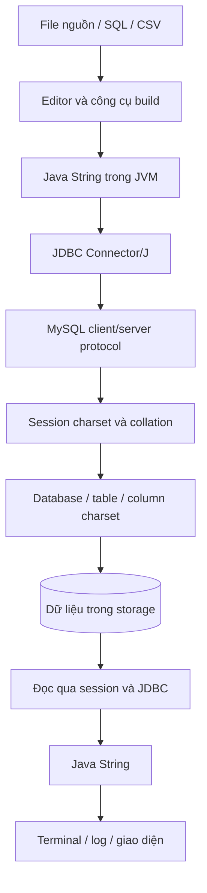

# Kiểm chứng mã hóa xuyên suốt file, client, JDBC và database

Một ứng dụng có thể dùng `utf8mb4` trong database nhưng vẫn lưu sai tiếng Việt hoặc emoji. Lỗi có thể bắt đầu từ file nguồn được lưu sai encoding, terminal gửi byte theo charset khác, JDBC driver thương lượng charset không như dự kiến, session MySQL khai báo sai `character_set_client`, hoặc column thực tế vẫn dùng `utf8mb3`. Muốn xử lý đúng, cần kiểm tra toàn bộ đường đi của dữ liệu từ file đến database rồi quay trở lại ứng dụng.

Bài học thuộc module **DATABASE_MYSQL**. Module hướng tới việc làm chủ MySQL từ thiết kế bảng, kiểu dữ liệu, khóa và truy vấn SQL đến index, transaction và kiểm soát đồng thời; đồng thời thực hành đọc kế hoạch thực thi, tối ưu truy vấn, phân quyền, sao lưu và xử lý các vấn đề vận hành cơ sở dữ liệu quan hệ. Trong chương **Bộ ký tự và collation**, bài này tập trung vào việc kiểm chứng mã hóa xuyên suốt file, client, JDBC và database bằng cấu hình rõ ràng, truy vấn chẩn đoán và phép thử round-trip.

## 1. Đường đi của một ký tự

Giả sử ứng dụng lưu chuỗi `Tiếng Việt: ă â ê ô ơ ư đ — 😀` vào MySQL. Chuỗi này phải đi qua nhiều lớp:



Ở mỗi ranh giới, dữ liệu có thể được mã hóa, giải mã hoặc chuyển đổi:

1. **File:** byte trong `.java`, `.sql`, `.csv`, `.properties` hoặc file cấu hình phải được công cụ đọc theo encoding đúng.
2. **JVM:** Java xử lý chuỗi bằng Unicode; một `String` không phải là một mảng byte UTF-8.
3. **JDBC:** Connector/J chuyển chuỗi Java thành byte theo charset kết nối đã thương lượng hoặc cấu hình.
4. **MySQL session:** server diễn giải byte client gửi theo `character_set_client`, chuyển đổi qua `character_set_connection` và trả kết quả theo `character_set_results`.
5. **Column:** MySQL lưu chuỗi theo character set của column; collation quyết định quy tắc so sánh và sắp xếp.
6. **Kết quả:** dữ liệu được chuyển ngược qua protocol, driver và ứng dụng trước khi terminal hoặc giao diện hiển thị.

Một lỗi hiển thị ở cuối đường đi chưa chứng minh dữ liệu trong database đã sai. Cần xác định lỗi bắt đầu ở file, ở byte trên kết nối, lúc chuyển đổi vào column, hay chỉ ở cách hiển thị kết quả.

## 2. Phân biệt character set, encoding và collation

Ba khái niệm liên quan nhưng không đồng nghĩa:

- **Character set** xác định tập ký tự có thể biểu diễn.
- **Character encoding** là cách biểu diễn ký tự thành byte. Ví dụ, UTF-8 mã hóa một code point thành từ một đến bốn byte.
- **Collation** quy định cách so sánh, sắp xếp và xác định chuỗi có tương đương nhau hay không.

Trong MySQL, `utf8mb4` là character set hỗ trợ Unicode đầy đủ với tối đa bốn byte cho một ký tự. `utf8mb4_0900_ai_ci` là một collation của character set đó: `ai` không phân biệt dấu và `ci` không phân biệt chữ hoa/thường. Collation không thay đổi byte mã hóa mà quyết định cách so sánh chuỗi.

Không nhầm `utf8` lịch sử của MySQL với UTF-8 đầy đủ. Trên nhiều phiên bản, tên `utf8` là bí danh của `utf8mb3`, chỉ hỗ trợ tối đa ba byte cho một ký tự. `utf8mb4` mới hỗ trợ đầy đủ các ký tự bổ sung như nhiều emoji. Chuỗi tiếng Việt cơ bản có thể lưu được trong `utf8mb3`, nên chỉ thử chữ tiếng Việt chưa đủ để chứng minh đường truyền hỗ trợ Unicode đầy đủ.

Ví dụ chuỗi kiểm thử nên chứa nhiều nhóm ký tự:

```text
Tiếng Việt: ă â ê ô ơ ư đ; dấu hỏi/ngã/nặng; emoji 😀 🧪; ký hiệu € —
```

Hãy dùng cùng một chuỗi ở file, ứng dụng, câu SQL kiểm thử và phép so sánh sau khi đọc lại.

## 3. Chuẩn hóa encoding của file nguồn và file dữ liệu

### 3.1. Lưu file bằng UTF-8

Các file chứa nội dung Unicode nên được lưu bằng UTF-8 nhất quán:

- File mã nguồn `.java` chứa string literal hoặc comment tiếng Việt.
- Script `.sql` chứa dữ liệu mẫu, migration và tên có ký tự Unicode nếu dự án cho phép.
- File `.csv`, `.json`, `.xml`, `.yml` hoặc file cấu hình được ứng dụng đọc.
- Tài liệu và fixture dùng trong kiểm thử tích hợp.

Trong editor, kiểm tra encoding thực tế của file thay vì chỉ nhìn nội dung đang hiển thị. Một editor có thể tự đoán encoding hoặc hiển thị byte sai theo thiết lập hiện tại. Khi lưu lại, nó có thể biến đổi byte gốc nếu chọn sai encoding.

UTF-8 không BOM thường là lựa chọn tương thích tốt cho file nguồn và script. Một số công cụ có thể xử lý BOM, một số công cụ cũ có thể coi BOM là ký tự đầu tiên của file và làm câu SQL đầu tiên bị lỗi. Nếu pipeline có nhiều công cụ, thống nhất UTF-8 không BOM và line ending rõ ràng.

### 3.2. Cấu hình encoding cho Java build

Với Maven, khai báo encoding của project và compiler để build không phụ thuộc code page của máy:

```xml
<properties>
    <project.build.sourceEncoding>UTF-8</project.build.sourceEncoding>
    <maven.compiler.release>17</maven.compiler.release>
    <maven.compiler.encoding>UTF-8</maven.compiler.encoding>
</properties>
```

Với Gradle dùng Groovy DSL:

```groovy
tasks.withType(JavaCompile).configureEach {
    options.encoding = 'UTF-8'
}
```

JDK 18 trở lên mặc định dùng UTF-8 cho nhiều API liên quan đến charset mặc định theo JEP 400. Dự án vẫn nên khai báo encoding tường minh trong build để kết quả nhất quán với JDK cũ hơn, plugin build và các công cụ xử lý file khác.

Trong Git, `.gitattributes` có thể chuẩn hóa cách xử lý text và line ending, nhưng không tự bảo đảm file được lưu bằng UTF-8. Ví dụ:

```gitattributes
*.java text eol=lf
*.sql text eol=lf
*.properties text eol=lf
*.csv text eol=lf
```

Encoding và line ending là hai vấn đề riêng. Kiểm tra cả hai khi file hoạt động khác nhau trên Windows và Linux.

### 3.3. Kiểm tra file SQL và CSV

Nếu script `.sql` chứa literal tiếng Việt, hãy xác nhận file thực sự là UTF-8 trước khi chạy. Nếu file đã bị lưu sai encoding, thay đổi charset kết nối không thể khôi phục ký tự ban đầu.

Với file CSV, thống nhất:

- Encoding của file, thường là UTF-8.
- Ký tự phân cách cột và ký tự quote.
- Quy tắc escape dấu quote và newline bên trong trường.
- Dòng tiêu đề và thứ tự cột.
- Charset mà công cụ import/export sử dụng.

Không dùng việc mở CSV bằng một ứng dụng bảng tính rồi lưu lại như một phép kiểm tra encoding duy nhất; ứng dụng đó có thể tự diễn giải hoặc chuyển đổi file theo locale.

## 4. Kiểm tra charset ở MySQL Server và session

### 4.1. Các biến charset quan trọng

MySQL có nhiều biến ở cấp server và session:

| Biến | Phạm vi | Vai trò |
|---|---|---|
| `character_set_server` | Global | Character set mặc định của server khi tạo database mới nếu không chỉ định. |
| `collation_server` | Global | Collation mặc định của server. |
| `character_set_client` | Session | Charset mà server dùng để diễn giải byte client gửi lên. |
| `character_set_connection` | Session | Charset dùng trong bước chuyển đổi và xử lý chuỗi của câu lệnh. |
| `character_set_results` | Session | Charset dùng để chuyển kết quả chuỗi trả về client. |
| `collation_connection` | Session | Collation mặc định cho biểu thức chuỗi thuộc ngữ cảnh connection. |

`character_set_database` và `collation_database` đã bị deprecated trong MySQL 8.0. Khi cần kiểm tra metadata database, ưu tiên truy vấn `INFORMATION_SCHEMA.SCHEMATA`; không xây cấu hình mới dựa vào hai biến này.

Kiểm tra phiên bản và cấu hình:

```sql
SELECT VERSION() AS mysql_version;

SELECT
    @@GLOBAL.character_set_server AS server_charset,
    @@GLOBAL.collation_server AS server_collation,
    @@SESSION.character_set_client AS client_charset,
    @@SESSION.character_set_connection AS connection_charset,
    @@SESSION.character_set_results AS results_charset,
    @@SESSION.collation_connection AS connection_collation;
```

Có thể xem nhanh nhóm biến:

```sql
SHOW SESSION VARIABLES LIKE 'character_set%';
SHOW SESSION VARIABLES LIKE 'collation%';
SHOW GLOBAL VARIABLES LIKE 'character_set%';
SHOW GLOBAL VARIABLES LIKE 'collation%';
```

Không chỉ nhìn `character_set_server`. Một server có default `utf8mb4` nhưng table cũ hoặc column được khai báo riêng vẫn có thể dùng charset khác.

### 4.2. Ý nghĩa của `SET NAMES`

Trong một phiên MySQL tương tác, có thể đặt charset kết nối:

```sql
SET NAMES utf8mb4 COLLATE utf8mb4_0900_ai_ci;
```

Lệnh này cập nhật các biến session liên quan đến client, connection, results và collation connection. Nó thông báo với server cách diễn giải byte client gửi và cách mã hóa kết quả trả về.

`SET NAMES` không:

- Chuyển đổi charset của database, table hoặc column đã tồn tại.
- Sửa byte đã được ghi sai vào database.
- Thay thế cấu hình encoding của file nguồn.
- Bảo đảm terminal hoặc ứng dụng gửi đúng byte UTF-8.

Chỉ dùng `SET NAMES utf8mb4` khi client thực sự gửi byte UTF-8. Nếu client gửi byte Windows-1258 nhưng khai báo là UTF-8, server sẽ giải mã sai. Khi dùng JDBC, thông thường để Connector/J quản lý charset kết nối; không chạy `SET NAMES` tùy tiện sau khi driver đã thiết lập connection vì trạng thái server có thể không còn khớp với giả định nội bộ của driver.

### 4.3. Charset mặc định không thay thế khai báo schema

Có thể tạo database và table với charset/collation tường minh:

```sql
CREATE DATABASE encoding_lab
    CHARACTER SET utf8mb4
    COLLATE utf8mb4_0900_ai_ci;

USE encoding_lab;

CREATE TABLE encoding_probe (
    probe_id BIGINT UNSIGNED NOT NULL AUTO_INCREMENT,
    content  VARCHAR(500) CHARACTER SET utf8mb4
                           COLLATE utf8mb4_0900_ai_ci NOT NULL,
    PRIMARY KEY (probe_id)
) ENGINE = InnoDB
  DEFAULT CHARACTER SET = utf8mb4
  COLLATE = utf8mb4_0900_ai_ci;
```

`utf8mb4_0900_ai_ci` thuộc MySQL 8.0. Nếu dự án dùng MySQL 5.7, hãy chọn collation có hỗ trợ trên phiên bản đó, chẳng hạn `utf8mb4_unicode_ci`. Không sao chép tên collation từ một phiên bản khác mà chưa kiểm tra.

Default ở server và database chủ yếu ảnh hưởng đối tượng được tạo sau đó. Đổi default database không tự chuyển các column cũ. Khi cần, phải lập migration riêng sau khi kiểm tra dữ liệu và index.

## 5. Kiểm tra charset và collation của database, table, column

### 5.1. Kiểm tra database hiện tại

```sql
SELECT
    SCHEMA_NAME,
    DEFAULT_CHARACTER_SET_NAME,
    DEFAULT_COLLATION_NAME
FROM INFORMATION_SCHEMA.SCHEMATA
WHERE SCHEMA_NAME = 'encoding_lab';
```

### 5.2. Kiểm tra table

```sql
SELECT
    TABLE_NAME,
    TABLE_COLLATION
FROM INFORMATION_SCHEMA.TABLES
WHERE TABLE_SCHEMA = 'encoding_lab'
  AND TABLE_TYPE = 'BASE TABLE';
```

`TABLE_COLLATION` cho biết collation mặc định của table. Character set tương ứng có thể lấy qua metadata collation hoặc xem trực tiếp trong `SHOW CREATE TABLE`.

```sql
SHOW CREATE TABLE encoding_lab.encoding_probe;
```

### 5.3. Kiểm tra từng column

```sql
SELECT
    TABLE_NAME,
    COLUMN_NAME,
    CHARACTER_SET_NAME,
    COLLATION_NAME,
    COLUMN_TYPE
FROM INFORMATION_SCHEMA.COLUMNS
WHERE TABLE_SCHEMA = 'encoding_lab'
  AND CHARACTER_SET_NAME IS NOT NULL
ORDER BY TABLE_NAME, ORDINAL_POSITION;
```

Đây là bước quan trọng khi table có column ghi đè charset/collation mặc định. Một column `VARCHAR` có thể dùng charset riêng dù table đã là `utf8mb4`.

### 5.4. Phân biệt charset và collation khi đọc metadata

Ví dụ:

```sql
SELECT
    CHARSET(content) AS value_charset,
    COLLATION(content) AS value_collation
FROM encoding_probe
LIMIT 1;
```

`CHARSET()` cho biết character set của biểu thức; `COLLATION()` cho biết collation áp dụng. Hai hàm này hữu ích khi biểu thức có `CONVERT()`, `CAST()` hoặc `COLLATE` và không còn đơn giản là column gốc.

## 6. Kiểm tra mysql command-line client và terminal

Khi chạy câu SQL trực tiếp từ terminal, client cũng phải gửi byte đúng charset. Có thể chỉ định charset mặc định khi mở MySQL client:

```bash
mysql --default-character-set=utf8mb4 \
  -h 127.0.0.1 -P 3306 -u app_user -p encoding_lab
```

Tùy shell và cách cài đặt, lệnh có thể viết trên một dòng. Tùy chọn `--default-character-set` cấu hình charset cho client connection; nó không tự chuyển đổi file nguồn đang được đọc nếu file đã bị mã hóa sai.

Sau khi kết nối, kiểm tra session:

```sql
SELECT
    @@character_set_client,
    @@character_set_connection,
    @@character_set_results,
    @@collation_connection;
```

Nếu các giá trị không như mong đợi, xác minh client có hỗ trợ charset đó và tùy chọn kết nối đã được áp dụng. Không nên chữa lỗi bằng cách đổi charset nhiều lần mà không kiểm tra byte đầu vào.

### 6.1. Chạy script SQL từ file

Khi chạy script trong MySQL client:

```sql
SOURCE C:/project/database/seed.sql;
```

Hãy bảo đảm:

1. `seed.sql` thực sự được lưu bằng UTF-8.
2. MySQL client được khởi chạy với `--default-character-set=utf8mb4`.
3. Session báo `character_set_client=utf8mb4` và `character_set_connection=utf8mb4`.
4. Column nhận dữ liệu có charset hỗ trợ đầy đủ ký tự cần lưu.

Một lệnh `SET NAMES utf8mb4` đặt ở đầu file không thể sửa byte của file nếu file không phải UTF-8. Nó chỉ đúng khi client gửi byte UTF-8 ngay từ đầu.

### 6.2. Terminal hiển thị sai nhưng dữ liệu có thể vẫn đúng

Terminal có encoding hoặc font không phù hợp có thể hiển thị sai dù server lưu đúng. Để tách lỗi hiển thị khỏi lỗi lưu trữ, hãy kiểm tra bằng `HEX()` trong MySQL và đọc cùng dữ liệu qua một ứng dụng khác đã biết hỗ trợ Unicode. Đừng sửa schema hoặc chuyển đổi dữ liệu chỉ vì một cửa sổ terminal hiển thị ký tự lạ.

## 7. Kiểm tra JDBC và MySQL Connector/J

### 7.1. Java String không phải byte UTF-8

Trong Java, `String` biểu diễn chuỗi Unicode bằng các code unit UTF-16. Khi gọi `PreparedStatement.setString()`, Connector/J chuyển chuỗi sang dạng truyền trên kết nối MySQL. Charset của file `.java` ảnh hưởng việc compiler đọc literal; charset kết nối ảnh hưởng việc driver truyền chuỗi tới server.

Hai bước này độc lập. Nếu file nguồn bị đọc sai, Java `String` đã chứa ký tự sai trước khi JDBC gửi đi. Nếu `String` đúng nhưng connection charset sai, byte truyền tới server có thể bị diễn giải sai.

### 7.2. Chọn Connector/J và cấu hình connection

Dùng phiên bản MySQL Connector/J tương thích với phiên bản MySQL Server và JDK của ứng dụng. Với Connector/J hiện đại, có thể chỉ định collation của kết nối bằng thuộc tính `connectionCollation` nếu dự án cần một giá trị tường minh:

```properties
spring.datasource.url=jdbc:mysql://localhost:3306/encoding_lab?connectionCollation=utf8mb4_0900_ai_ci
```

Collation này phù hợp với MySQL 8.0. Với server cũ hơn, chọn collation `utf8mb4` được phiên bản đó hỗ trợ, ví dụ `utf8mb4_unicode_ci`.

Connector/J cũng có thuộc tính `characterEncoding`. Giá trị của thuộc tính này là tên encoding phía Java, chẳng hạn `UTF-8`, không phải lúc nào cũng là tên character set MySQL. Ánh xạ giữa tên Java và charset MySQL phụ thuộc phiên bản driver; Connector/J 8.0.26 trở lên ánh xạ `UTF-8` sang `utf8mb4`, trong khi các bản cũ có thể ánh xạ sang `utf8mb3`. Vì vậy, hãy kiểm tra tài liệu đúng phiên bản driver trước khi thêm `characterEncoding=UTF-8` vào URL.

Không cấu hình nhiều thuộc tính charset/collation mâu thuẫn nhau. Nếu dùng `connectionCollation`, hãy hiểu rằng collation này quyết định charset tương ứng cho connection. Sau khi kết nối, xác minh biến session thực tế thay vì chỉ tin vào URL.

### 7.3. Không chạy SET NAMES tùy tiện qua JDBC

Connector/J quản lý charset kết nối và chuyển đổi chuỗi Java. Nếu ứng dụng chạy:

```sql
SET NAMES latin1;
```

trên một connection mà driver vẫn nghĩ kết nối đang dùng UTF-8, trạng thái của server và driver có thể không còn đồng bộ. Hậu quả có thể là dữ liệu bị hỏng theo một chiều hoặc cả hai chiều.

Hãy cấu hình charset qua thuộc tính được driver hỗ trợ và kiểm tra session. Nếu buộc phải dùng init SQL cho connection pool, chỉ đặt giá trị khớp với cấu hình mà driver đã thương lượng; không đổi encoding độc lập sau đó.

### 7.4. Kiểm tra session từ chính connection của ứng dụng

Đừng chỉ chạy truy vấn kiểm tra trong Workbench hoặc mysql client rồi kết luận JDBC đã đúng. Hãy chạy truy vấn qua `Connection` mà ứng dụng lấy từ `DataSource`:

```java
String sql = """
    SELECT
        @@character_set_client AS client_charset,
        @@character_set_connection AS connection_charset,
        @@character_set_results AS results_charset,
        @@collation_connection AS connection_collation
    """;

try (Connection connection = dataSource.getConnection();
     PreparedStatement statement = connection.prepareStatement(sql);
     ResultSet resultSet = statement.executeQuery()) {

    if (resultSet.next()) {
        System.out.println(resultSet.getString("client_charset"));
        System.out.println(resultSet.getString("connection_charset"));
        System.out.println(resultSet.getString("results_charset"));
        System.out.println(resultSet.getString("connection_collation"));
    }
}
```

Nếu ứng dụng dùng connection pool, kiểm tra trên các connection được mượn từ pool sau khi pool khởi tạo. Cấu hình session thuộc về từng kết nối vật lý. Một câu `SET NAMES` chạy trên một connection không tự áp dụng cho các connection khác.

## 8. Thực hiện phép thử round-trip bằng JDBC

Round-trip test gửi một chuỗi từ Java vào database rồi đọc lại và so sánh với chuỗi ban đầu. Đây là cách kiểm chứng thực tế toàn bộ đường đi, thay vì chỉ nhìn cấu hình.

### 8.1. Tạo bảng kiểm thử

```sql
CREATE TABLE encoding_probe (
    probe_id BIGINT UNSIGNED NOT NULL AUTO_INCREMENT,
    content  VARCHAR(500) CHARACTER SET utf8mb4
                           COLLATE utf8mb4_0900_ai_ci NOT NULL,
    PRIMARY KEY (probe_id)
) ENGINE = InnoDB;
```

Nếu đã tạo bảng ở phần trước, không cần tạo lại. Với MySQL 5.7, đổi collation thành giá trị được hỗ trợ.

### 8.2. Gửi chuỗi bằng PreparedStatement

```java
String expected = "Tiếng Việt: ă â ê ô ơ ư đ — emoji 😀 🧪";

String insertSql = "INSERT INTO encoding_probe (content) VALUES (?)";
long probeId;

try (Connection connection = dataSource.getConnection();
     PreparedStatement insert = connection.prepareStatement(
         insertSql, Statement.RETURN_GENERATED_KEYS)) {

    insert.setString(1, expected);
    insert.executeUpdate();

    try (ResultSet keys = insert.getGeneratedKeys()) {
        if (!keys.next()) {
            throw new SQLException("Không nhận được generated key");
        }
        probeId = keys.getLong(1);
    }
}
```

`setString()` giúp driver truyền chuỗi như dữ liệu tham số, không ghép chuỗi thành SQL. Không dùng `Statement` và nối trực tiếp nội dung người dùng vào câu lệnh.

### 8.3. Đọc lại và so sánh chính xác

```java
String selectSql = "SELECT content FROM encoding_probe WHERE probe_id = ?";

try (Connection connection = dataSource.getConnection();
     PreparedStatement select = connection.prepareStatement(selectSql)) {

    select.setLong(1, probeId);

    try (ResultSet resultSet = select.executeQuery()) {
        if (!resultSet.next()) {
            throw new SQLException("Không tìm thấy bản ghi kiểm thử");
        }

        String actual = resultSet.getString("content");
        if (!expected.equals(actual)) {
            throw new IllegalStateException("Round-trip Unicode không khớp");
        }
    }
}
```

So sánh `String.equals()` giúp phát hiện chuỗi đã thay đổi trong quá trình truyền. Nếu chuỗi hiển thị giống nhau nhưng `equals()` trả về `false`, hãy kiểm tra Unicode normalization: một ký tự có thể được biểu diễn bằng một code point dựng sẵn hoặc bằng ký tự gốc cộng dấu kết hợp. Hai chuỗi có thể nhìn giống nhau nhưng có dãy code point khác nhau.

### 8.4. Kiểm tra byte được lưu trong MySQL

```sql
SELECT
    probe_id,
    content,
    CHAR_LENGTH(content) AS character_count,
    LENGTH(content) AS byte_count,
    HEX(content) AS stored_bytes,
    CHARSET(content) AS value_charset,
    COLLATION(content) AS value_collation
FROM encoding_probe
WHERE probe_id = 1;
```

- `CHAR_LENGTH()` đếm số ký tự trong chuỗi.
- `LENGTH()` đếm số byte của chuỗi sau khi biểu diễn theo character set của nó.
- `HEX()` hiển thị byte dưới dạng hexadecimal, hữu ích khi ký tự bị biến dạng.
- `CHARSET()` và `COLLATION()` xác nhận thuộc tính của biểu thức.

Thay `probe_id = 1` bằng ID thực tế do phép thử trả về. Với chuỗi có emoji, số byte thường lớn hơn số ký tự vì một code point có thể chiếm bốn byte trong UTF-8.

## 9. Kiểm chứng riêng từng chặng

Khi round-trip thất bại, kiểm tra lần lượt để tìm ranh giới đầu tiên làm dữ liệu thay đổi.

### 9.1. Kiểm tra chuỗi ngay trong JVM

Trước khi gửi JDBC, in chuỗi và các code point:

```java
String sample = "Tiếng Việt: ă â ê ô ơ ư đ — 😀";

System.out.println(sample);
sample.codePoints()
      .mapToObj(codePoint -> String.format("U+%04X", codePoint))
      .forEach(System.out::println);
```

Nếu console hiển thị sai nhưng danh sách code point đúng với nội dung mong đợi, lỗi có thể nằm ở font hoặc encoding của console. Nếu code point đã sai trước khi gọi JDBC, kiểm tra encoding file nguồn và quá trình build.

### 9.2. Kiểm tra byte trong database

Chạy:

```sql
SELECT HEX(content), CHAR_LENGTH(content), LENGTH(content)
FROM encoding_probe
WHERE probe_id = 1;
```

Nếu byte trong database đúng với UTF-8 của chuỗi mong đợi nhưng terminal hiển thị sai, tập trung kiểm tra `character_set_results`, driver và terminal. Nếu byte đã là dạng ký tự lỗi (mojibake), dữ liệu có thể đã bị giải mã sai trước hoặc trong lúc ghi.

### 9.3. So sánh client độc lập và JDBC

Đọc cùng một bản ghi qua:

1. MySQL Workbench hoặc mysql command-line client đã cấu hình UTF-8.
2. Một truy vấn JDBC chạy qua connection pool của ứng dụng.
3. Một công cụ quản trị khác nếu cần đối chứng.

Nếu chỉ một client hiển thị sai, kiểm tra cấu hình của client đó trước. Nếu mọi client đều đọc ra chuỗi lỗi và `HEX()` cũng cho byte không đúng, điều tra dữ liệu đã lưu. Nếu JDBC trả `String` khác nhưng mysql client đúng, kiểm tra Connector/J và session của ứng dụng.

## 10. Import và export file dữ liệu

### 10.1. LOAD DATA

Khi nhập CSV, cần chỉ định charset của file nếu muốn kết quả không phụ thuộc mặc định:

```sql
LOAD DATA LOCAL INFILE 'C:/project/data/customers.csv'
INTO TABLE customers
CHARACTER SET utf8mb4
FIELDS TERMINATED BY ','
ENCLOSED BY '"'
LINES TERMINATED BY '\n'
IGNORE 1 LINES
(email, full_name);
```

`CHARACTER SET utf8mb4` khai báo encoding của file đầu vào cho thao tác import. File CSV vẫn phải thực sự được tạo bằng UTF-8. `LOCAL` yêu cầu khả năng local infile được bật và chịu ảnh hưởng của cấu hình bảo mật ở cả client lẫn server; chỉ bật khi dự án có nhu cầu và đã kiểm soát nguồn file.

Trên Windows, file CSV có thể dùng CRLF (`\r\n`) thay vì LF (`\n`). Hãy đặt `LINES TERMINATED BY` theo định dạng file thực tế, nếu không dòng cuối hoặc dữ liệu có thể được phân tích sai.

### 10.2. SELECT INTO OUTFILE

Có thể chỉ định charset khi xuất dữ liệu:

```sql
SELECT customer_id, email, full_name
INTO OUTFILE '/var/lib/mysql-files/customers-export.csv'
CHARACTER SET utf8mb4
FIELDS TERMINATED BY ','
ENCLOSED BY '"'
LINES TERMINATED BY '\n'
FROM customers;
```

File được ghi trên máy chủ MySQL theo đường dẫn mà server có quyền truy cập và còn chịu ảnh hưởng của `secure_file_priv`. `INTO OUTFILE` không ghi đè file đã tồn tại. Sau khi export, kiểm tra byte của file và mở bằng công cụ được cấu hình UTF-8.

## 11. Chẩn đoán lỗi encoding thường gặp

| Hiện tượng | Nguyên nhân có thể | Kiểm tra đầu tiên |
|---|---|---|
| Tiếng Việt thành `?` | Ký tự không biểu diễn được ở một chặng, hoặc ứng dụng thay thế khi decode/encode | Kiểm tra file, Java code point, session charset, column charset và `HEX()`. |
| Chuỗi thành `Tiếng Việt` | Byte UTF-8 bị giải mã như charset khác rồi lưu lại hoặc chuyển đổi hai lần | So sánh code point trong JVM với `HEX()`; kiểm tra client charset khai báo có khớp byte thực tế không. |
| Emoji báo `Incorrect string value` | Một chặng đang dùng `utf8mb3` hoặc charset không hỗ trợ code point đó | Kiểm tra charset của connection, database, table và chính column. |
| Workbench đúng nhưng Java sai | Connector/J, URL, connection pool hoặc session JDBC khác cấu hình | Chạy truy vấn charset variables qua chính `DataSource` và làm round-trip bằng `PreparedStatement`. |
| Java đúng nhưng mysql client sai | Terminal, code page hoặc mysql client charset không phù hợp | Dùng `--default-character-set=utf8mb4`, kiểm tra session và hiển thị bằng terminal/font khác. |
| Đọc trong DB đúng nhưng export CSV sai | Charset export hoặc ứng dụng mở CSV đoán sai encoding | Chỉ định `CHARACTER SET utf8mb4` và kiểm tra byte file sau export. |
| Database default là utf8mb4 nhưng insert vẫn lỗi | Column cũ có charset riêng hoặc dữ liệu đi qua connection sai charset | Kiểm tra `INFORMATION_SCHEMA.COLUMNS` và session variables. |
| Ký tự nhìn giống nhau nhưng Java equals false | Unicode normalization khác nhau | So sánh code point và chuẩn hóa NFC/NFD theo quy ước ứng dụng nếu nghiệp vụ yêu cầu. |

### 11.1. Phân biệt lỗi hiển thị và lỗi dữ liệu

Một nguyên tắc chẩn đoán hữu ích:

- Nếu `HEX(column)` đúng nhưng giao diện hiển thị sai, tập trung vào result charset, driver, terminal hoặc font.
- Nếu Java `String` đã sai trước khi gửi, kiểm tra source file, editor, compiler và quá trình đọc resource.
- Nếu Java `String` đúng nhưng `HEX(column)` sai, kiểm tra charset kết nối và charset/collation của column.
- Nếu chỉ emoji lỗi, kiểm tra `utf8mb3` ở bất kỳ chặng nào; tiếng Việt cơ bản vẫn có thể hoạt động nên lỗi dễ bị bỏ sót.
- Nếu client gửi byte UTF-8 nhưng khai báo `character_set_client` là charset khác, server sẽ diễn giải sai byte ngay từ đầu.

Không sửa dữ liệu chỉ dựa vào ảnh chụp màn hình. Cần xác nhận byte và code point ở hai đầu trước khi quyết định migration.

## 12. Chuyển đổi schema hoặc sửa dữ liệu sai encoding

Nếu phát hiện column cũ chưa dùng `utf8mb4`, có thể cần chuyển đổi schema. Nhưng phải phân biệt hai tình huống:

1. **Metadata và byte đều đúng theo charset cũ:** dữ liệu đang được lưu đúng, chỉ cần chuyển đổi có kiểm soát sang charset đích.
2. **Byte thực tế không khớp với charset mà metadata khai báo:** dữ liệu đã bị diễn giải sai. Chuyển đổi thông thường có thể làm hỏng thêm vì MySQL tin vào metadata hiện tại khi giải mã nguồn.

Đối với tình huống thứ nhất, cú pháp chuyển đổi table là:

```sql
ALTER TABLE customers
    CONVERT TO CHARACTER SET utf8mb4
    COLLATE utf8mb4_0900_ai_ci;
```

Không chạy câu lệnh này trước khi xác nhận nguồn dữ liệu và collation đích. Chuyển đổi có thể làm thay đổi index, unique key, độ dài byte, thời gian khóa và dung lượng. Nếu collation đích xem hai chuỗi trước đây khác nhau là tương đương, unique index có thể phát hiện duplicate.

Đối với tình huống byte và metadata không khớp, không có một câu `ALTER TABLE` chung an toàn cho mọi trường hợp. Hãy:

1. Sao lưu và tạo bản sao để thử nghiệm.
2. Xác định encoding thực tế của byte gốc và encoding đang được metadata khai báo.
3. Xác định lỗi xảy ra một lần hay bị double-encoding.
4. Thử phương án chuyển đổi trên bản sao, so sánh `HEX()`, `CHAR_LENGTH()` và nội dung đọc lại.
5. Chỉ triển khai khi có kết quả đối chiếu và kế hoạch rollback rõ ràng.

Không dùng `SET NAMES` hoặc `CONVERT TO CHARACTER SET` như cách sửa thử trên production. Hai thao tác này giải quyết các vấn đề khác nhau và không thể tự đoán encoding gốc của dữ liệu đã hỏng.

## 13. Checklist kiểm chứng xuyên suốt

Trước khi phát hành một tính năng lưu dữ liệu Unicode, hãy kiểm tra:

- [ ] File `.java`, `.sql`, `.csv` và file cấu hình được lưu bằng UTF-8.
- [ ] Editor và build tool đọc file theo UTF-8; cấu hình compiler tường minh.
- [ ] Chuỗi Java trước khi gửi JDBC có code point đúng.
- [ ] Phiên bản Connector/J tương thích và có ánh xạ charset được hiểu rõ.
- [ ] Charset/collation của connection được kiểm tra qua chính connection ứng dụng.
- [ ] `character_set_client`, `character_set_connection`, `character_set_results` đúng mong đợi.
- [ ] Database, table và column dùng `utf8mb4` nếu cần hỗ trợ đầy đủ Unicode.
- [ ] Collation được chọn theo quy tắc so sánh nghiệp vụ.
- [ ] Phép thử round-trip bằng `PreparedStatement` trả lại chuỗi đúng.
- [ ] `HEX()`, `LENGTH()` và `CHAR_LENGTH()` phù hợp với dữ liệu kiểm thử.
- [ ] MySQL client, import/export và terminal hiển thị đúng.
- [ ] Connection pool khởi tạo session nhất quán cho từng connection vật lý.
- [ ] Có kế hoạch sao lưu và thử nghiệm trước khi chuyển đổi dữ liệu cũ.

## 14. Bài tập thực hành

### Bài tập 1: Kiểm tra encoding file nguồn

Tạo một file Java có string literal tiếng Việt và emoji. Lưu file bằng UTF-8, cấu hình build encoding, in chuỗi và danh sách code point.

**Yêu cầu:** đổi cách mở file trong editor hoặc thử một cấu hình encoding khác trên bản sao để quan sát lỗi trước khi chuỗi tới JDBC.

### Bài tập 2: Kiểm tra session MySQL

Kết nối bằng mysql client với `--default-character-set=utf8mb4`. Chạy truy vấn các biến charset/collation ở session và global.

**Yêu cầu:** giải thích vì sao `character_set_server=utf8mb4` không đủ chứng minh `character_set_client` cũng là UTF-8.

### Bài tập 3: Kiểm tra schema

Tạo database, table và column bằng `utf8mb4`. Sau đó truy vấn `INFORMATION_SCHEMA.SCHEMATA`, `TABLES` và `COLUMNS`.

**Yêu cầu:** tạo thêm một column dùng charset khác trong môi trường thử nghiệm và quan sát metadata cho từng column.

### Bài tập 4: Round-trip qua JDBC

Dùng `PreparedStatement` ghi chuỗi `Tiếng Việt: ă â ê ô ơ ư đ — 😀 🧪`, đọc lại bằng `ResultSet` và so sánh `String.equals()`.

**Yêu cầu:** ghi nhận kết quả qua JDBC và `HEX()` trong MySQL; giải thích vai trò của driver và column charset.

### Bài tập 5: Phân biệt mojibake và lỗi hiển thị

Mở cùng một bản ghi qua mysql client và JDBC. So sánh nội dung hiển thị, code point trong Java và byte `HEX()` trong MySQL.

**Yêu cầu:** xác định lỗi nằm ở lưu trữ hay chỉ ở client hiển thị.

### Bài tập 6: Import CSV

Tạo CSV UTF-8 có tiếng Việt và emoji, sau đó import bằng `LOAD DATA LOCAL INFILE ... CHARACTER SET utf8mb4`.

**Yêu cầu:** xác nhận dữ liệu sau import bằng round-trip và metadata; thử một file có encoding khác trên môi trường riêng để nhận diện dấu hiệu sai.

## 15. Ghi nhớ

Mã hóa Unicode phải đúng ở mọi chặng: file nguồn, editor/build, Java String, JDBC driver, MySQL protocol, session charset và column charset. `utf8mb4` hỗ trợ Unicode đầy đủ; collation quyết định so sánh và sắp xếp. `SET NAMES` chỉ khai báo charset của connection hiện tại, không chuyển đổi schema hay sửa byte đã hỏng.

Hãy xác minh cấu hình từ chính connection ứng dụng, kiểm tra metadata của từng column và thực hiện round-trip với tiếng Việt cùng ký tự ngoài BMP như emoji. Khi gặp mojibake, dùng code point và `HEX()` để tìm chặng đầu tiên làm dữ liệu thay đổi trước khi quyết định sửa schema hoặc chuyển đổi dữ liệu.
