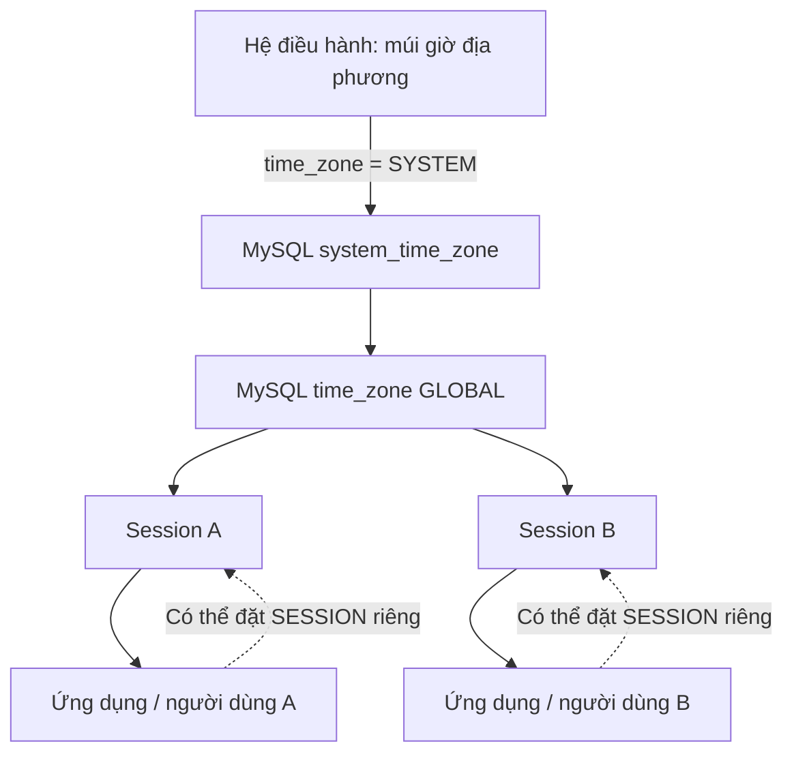

# Múi giờ hệ điều hành, server và session

## Mục tiêu

Sau bài này, bạn có thể:

- Phân biệt múi giờ của hệ điều hành, MySQL Server và từng session kết nối.
- Kiểm tra các biến `system_time_zone`, `time_zone` ở phạm vi GLOBAL và SESSION.
- Cấu hình múi giờ UTC hoặc múi giờ có tên cho server và session.
- Hiểu cách MySQL xử lý `TIMESTAMP`, `DATETIME`, hàm ngày giờ và Unix timestamp theo múi giờ.
- Nhận biết vai trò của timezone tables, quy tắc giờ mùa hè (DST) và múi giờ trong ứng dụng.
- Thiết kế kết nối pool và quy trình vận hành tránh lệch thời gian, chuyển đổi hai lần hoặc ghi nhận sai thời điểm.

## 1. Vì sao múi giờ cần được quản lý ở nhiều cấp?

Một ứng dụng có thể chạy trên máy chủ ở một quốc gia, MySQL chạy trên máy chủ ở quốc gia khác, còn người dùng truy cập từ nhiều múi giờ. Nếu các thành phần không thống nhất cách hiểu thời gian, cùng một sự kiện có thể hiển thị thành những giờ khác nhau, báo cáo ngày bị lệch hoặc tác vụ được lên lịch chạy sai thời điểm.

MySQL có các lớp múi giờ cần phân biệt:

1. **Múi giờ hệ điều hành (OS time zone):** múi giờ được cấu hình trên máy chạy tiến trình MySQL. Khi MySQL dùng giá trị `SYSTEM`, nó dựa vào múi giờ hệ thống.
2. **Múi giờ server (`time_zone` GLOBAL):** giá trị mặc định ở cấp MySQL Server. Nó được dùng để khởi tạo múi giờ cho session mới.
3. **Múi giờ session (`time_zone` SESSION):** múi giờ của một kết nối cụ thể. Nó ảnh hưởng đến nhiều hàm ngày giờ, cách đọc/ghi `TIMESTAMP` và các phép chuyển đổi trong phiên đó.
4. **Múi giờ ứng dụng/người dùng:** múi giờ mà ứng dụng dùng để hiển thị hoặc diễn giải lịch làm việc. Nó có thể khác với múi giờ session của MySQL.



Sơ đồ thể hiện quan hệ mặc định. Session có thể đặt múi giờ riêng; thay đổi múi giờ GLOBAL không tự thay đổi session đang mở. Ứng dụng cũng có thể chuyển đổi thời gian sang múi giờ người dùng ở tầng trình bày.

## 2. Phân biệt system_time_zone và time_zone

### 2.1. system_time_zone

`system_time_zone` là biến chỉ đọc cho biết múi giờ hệ thống mà MySQL nhận diện khi server khởi động. Giá trị thường là tên viết tắt hoặc tên múi giờ do hệ điều hành cung cấp, ví dụ `UTC`, `ICT` hoặc một giá trị tương tự tùy nền tảng.

Biến này phản ánh thông tin hệ thống; không phải nơi để đặt múi giờ session của ứng dụng. Không thể dùng `SET GLOBAL system_time_zone = ...` để đổi nó.

### 2.2. time_zone ở phạm vi GLOBAL

`@@GLOBAL.time_zone` là múi giờ mặc định của MySQL Server. Giá trị thường là `SYSTEM` nếu server dùng múi giờ hệ điều hành, hoặc một offset/tên múi giờ được cấu hình.

Giá trị GLOBAL được dùng làm mặc định cho các kết nối mới. Nếu thay đổi GLOBAL, các session đã tồn tại giữ giá trị SESSION hiện tại của chúng.

### 2.3. time_zone ở phạm vi SESSION

`@@SESSION.time_zone` quyết định múi giờ của kết nối hiện tại. Một ứng dụng có thể đặt session về UTC ngay sau khi lấy connection từ pool, trong khi một công cụ báo cáo có thể dùng múi giờ nghiệp vụ để thực hiện truy vấn theo ngày.

Kiểm tra cả ba giá trị:

```sql
SELECT
    @@system_time_zone AS os_time_zone_seen_by_mysql,
    @@GLOBAL.time_zone AS server_time_zone,
    @@SESSION.time_zone AS session_time_zone;
```

Ví dụ kết quả:

| Biến | Giá trị minh họa | Ý nghĩa |
|---|---|---|
| `system_time_zone` | `ICT` | MySQL nhận diện múi giờ hệ điều hành tại thời điểm khởi động |
| `@@GLOBAL.time_zone` | `SYSTEM` | Server lấy mặc định từ múi giờ hệ điều hành |
| `@@SESSION.time_zone` | `SYSTEM` | Session hiện tại đang dùng mặc định hệ thống |

Nếu `@@GLOBAL.time_zone` là `+00:00`, session mới thường kế thừa `+00:00` trừ khi ứng dụng đặt lại. Giá trị `system_time_zone` vẫn có thể là múi giờ địa phương; hai biến không cần giống nhau.

## 3. Kiểm tra múi giờ trên hệ điều hành và MySQL

### 3.1. Kiểm tra hệ điều hành

Trên Linux, có thể kiểm tra bằng:

```bash
timedatectl
date
```

Trên Windows, dùng:

```powershell
tzutil /g
Get-Date
```

Các lệnh này cho biết múi giờ và thời gian hệ điều hành ở môi trường đang chạy lệnh. Nếu MySQL chạy trong container, VM hoặc máy chủ riêng, cần kiểm tra đúng môi trường chứa tiến trình MySQL; múi giờ trên máy laptop quản trị không nói lên múi giờ của database server.

### 3.2. Kiểm tra biến và thời gian hiện tại trong MySQL

```sql
SELECT
    NOW() AS session_now,
    UTC_TIMESTAMP() AS utc_now,
    CURRENT_TIMESTAMP() AS current_timestamp_value,
    @@system_time_zone AS system_time_zone,
    @@GLOBAL.time_zone AS global_time_zone,
    @@SESSION.time_zone AS session_time_zone;
```

`NOW()` và `CURRENT_TIMESTAMP()` trả về thời gian theo múi giờ SESSION. `UTC_TIMESTAMP()` trả về thời gian UTC. Nếu hai giá trị lệch nhau, hãy kiểm tra session đang dùng múi giờ nào trước khi kết luận đồng hồ server sai.

Có thể xem riêng các biến:

```sql
SHOW GLOBAL VARIABLES LIKE 'time_zone';
SHOW SESSION VARIABLES LIKE 'time_zone';
SHOW GLOBAL VARIABLES LIKE 'system_time_zone';
```

`system_time_zone` là biến chỉ đọc nên truy vấn bằng `SHOW` chỉ phục vụ quan sát.

### 3.3. Đừng chỉ dựa vào tên viết tắt

Các tên viết tắt như `CST`, `IST` hoặc `BST` có thể mơ hồ vì được dùng ở nhiều khu vực với offset hoặc quy tắc DST khác nhau. Khi cần quy tắc địa lý, hãy ưu tiên tên múi giờ IANA như `Asia/Ho_Chi_Minh`, `Asia/Tokyo` hoặc `America/New_York`.

Offset cố định như `+07:00` chỉ biểu diễn độ lệch so với UTC tại mọi thời điểm. Nó không chứa lịch sử hoặc quy tắc thay đổi theo mùa của một khu vực. Với nơi có DST, tên IANA quan trọng hơn offset cố định khi chuyển đổi ngày giờ lịch sử hoặc tương lai.

## 4. Cấu hình múi giờ ở cấp server

### 4.1. Cấu hình mặc định UTC trong file cấu hình

Đối với server tự quản lý, có thể cấu hình tùy chọn `default-time-zone` trong file `my.cnf` hoặc `my.ini`. Ví dụ:

```ini
[mysqld]
default-time-zone = '+00:00'
```

Sau khi thay đổi, áp dụng theo quy trình quản trị của môi trường; tùy phiên bản và cách triển khai, có thể cần restart server. Với dịch vụ database được quản lý, hãy dùng cơ chế cấu hình do nhà cung cấp hỗ trợ.

UTC là lựa chọn mặc định hữu ích cho hệ thống lưu thời điểm sự kiện vì không có DST. Ứng dụng có thể chuyển UTC sang múi giờ của người dùng khi hiển thị.

### 4.2. Thay đổi GLOBAL khi server đang chạy

Nếu biến cho phép thay đổi động và tài khoản có quyền quản trị cần thiết, có thể chạy:

```sql
SET GLOBAL time_zone = '+00:00';
```

Lệnh này thay đổi mặc định cho các session được tạo sau đó. Nó không đổi `@@SESSION.time_zone` của kết nối hiện tại hoặc những kết nối đang mở.

Ví dụ, sau khi thay đổi GLOBAL, kiểm tra:

```sql
SELECT
    @@GLOBAL.time_zone AS global_time_zone,
    @@SESSION.time_zone AS current_session_time_zone;
```

Hai giá trị có thể khác nhau. Để thay đổi session hiện tại, phải đặt SESSION riêng.

### 4.3. Lưu cấu hình qua restart

`SET GLOBAL` thường chỉ thay đổi runtime. Để giữ cấu hình sau khi server restart, hãy khai báo trong file cấu hình hoặc dùng cơ chế lưu cấu hình bền vững được phiên bản hỗ trợ. MySQL 8.0 có `SET PERSIST` cho các biến phù hợp:

```sql
SET PERSIST time_zone = '+00:00';
```

Chỉ dùng `SET PERSIST` sau khi xác minh phiên bản, quyền, khả năng persist của biến và chính sách quản lý cấu hình. Môi trường dùng configuration management hoặc dịch vụ cloud nên lưu thay đổi ở nguồn cấu hình chuẩn để tránh bị ghi đè ở lần triển khai tiếp theo.

### 4.4. Cấu hình theo tên múi giờ

Server có thể dùng tên múi giờ như `Asia/Ho_Chi_Minh` nếu timezone tables đã được nạp và tên đó tồn tại:

```sql
SET GLOBAL time_zone = 'Asia/Ho_Chi_Minh';
```

Tên múi giờ hỗ trợ quy tắc lịch sử và DST. Tuy nhiên, với ứng dụng đa khu vực, thường nên giữ session xử lý dữ liệu sự kiện ở UTC và chuyển sang múi giờ địa phương tại lớp ứng dụng hoặc trong truy vấn báo cáo có chủ đích.

## 5. Cấu hình múi giờ ở cấp session

### 5.1. Đặt session về UTC

Để session hiện tại sử dụng UTC:

```sql
SET SESSION time_zone = '+00:00';
```

Hoặc cách viết tương đương trong session hiện tại:

```sql
SET time_zone = '+00:00';
```

Kiểm tra:

```sql
SELECT
    @@SESSION.time_zone,
    NOW() AS now_in_session,
    UTC_TIMESTAMP() AS utc_now;
```

Khi session ở UTC, `NOW()` và `UTC_TIMESTAMP()` thường cho cùng thời điểm, dù cách hiển thị kiểu dữ liệu có thể khác. Lệnh `SET SESSION` chỉ ảnh hưởng connection đang chạy lệnh.

### 5.2. Đặt session theo múi giờ nghiệp vụ

Ví dụ một báo cáo cần nhóm sự kiện theo ngày địa phương tại Việt Nam:

```sql
SET SESSION time_zone = 'Asia/Ho_Chi_Minh';

SELECT
    CURDATE() AS local_business_date,
    NOW() AS local_session_time,
    UTC_TIMESTAMP() AS utc_time;
```

Nếu chỉ cần offset cố định UTC+7, có thể dùng `'+07:00'`. Tuy nhiên, tên `Asia/Ho_Chi_Minh` diễn tả khu vực địa lý rõ hơn và được timezone tables quản lý. Không dùng offset cố định để đại diện một vùng có quy tắc DST thay đổi theo thời gian.

### 5.3. Session trong connection pool

Connection pool tái sử dụng kết nối vật lý. Nếu request A chạy `SET SESSION time_zone = 'Asia/Ho_Chi_Minh'` rồi trả connection về pool, request B có thể nhận đúng connection đó với session timezone vẫn còn là Việt Nam.

Để tránh trạng thái rò rỉ giữa request:

- Đặt timezone cố định khi connection được tạo hoặc khi pool khởi tạo connection.
- Nếu mỗi request cần timezone khác nhau, đặt lại rõ ràng mỗi lần mượn connection và khôi phục trạng thái trước khi trả về pool.
- Cấu hình pool reset session state nếu driver/pool hỗ trợ và xác minh hành vi thực tế.
- Không giả định đóng đối tượng `Connection` trong JDBC luôn đóng kết nối vật lý; với pool, thao tác này thường trả connection về pool.

Một chính sách phổ biến là mọi connection của ứng dụng dùng UTC. Khi cần hiển thị ngày giờ theo người dùng, ứng dụng chuyển đổi từ UTC bằng thư viện thời gian có timezone database. Điều này giúp các request không phải thay đổi session timezone liên tục.

## 6. MySQL xử lý TIMESTAMP và DATETIME như thế nào?

Hai kiểu này đều có thể lưu ngày giờ, nhưng cách xử lý múi giờ khác nhau.

| Kiểu | Cách lưu và đọc | Chuyển đổi theo session timezone? | Dùng cho |
|---|---|---|---|
| `TIMESTAMP` | MySQL chuyển thời gian từ session timezone sang UTC khi ghi; khi đọc chuyển từ UTC sang session timezone | Có | Một thời điểm tuyệt đối như lúc thanh toán, đăng nhập hoặc tạo sự kiện |
| `DATETIME` | Lưu các thành phần ngày/giờ như được cung cấp, không tự chuyển đổi múi giờ | Không | Giờ lịch địa phương, thời gian do nghiệp vụ quy định hoặc giá trị đã được chuẩn hóa theo một quy ước riêng |
| `DATE` | Lưu ngày lịch, không chứa giờ | Không | Ngày sinh, ngày hóa đơn hoặc ngày nghiệp vụ |

### 6.1. TIMESTAMP chuyển đổi theo session

Ví dụ:

```sql
CREATE TABLE timestamp_demo (
    event_id BIGINT UNSIGNED NOT NULL AUTO_INCREMENT,
    occurred_at TIMESTAMP NOT NULL,
    PRIMARY KEY (event_id)
) ENGINE = InnoDB;

SET SESSION time_zone = '+00:00';

INSERT INTO timestamp_demo (occurred_at)
VALUES ('2026-06-01 03:00:00');

SELECT occurred_at
FROM timestamp_demo;
```

Sau đó đổi session sang UTC+7:

```sql
SET SESSION time_zone = '+07:00';

SELECT occurred_at
FROM timestamp_demo;
```

MySQL hiển thị cùng một thời điểm theo hai giờ địa phương khác nhau. Giá trị thời điểm được lưu không đổi; cách hiển thị thay đổi theo session timezone.

### 6.2. DATETIME không tự chuyển đổi

```sql
CREATE TABLE datetime_demo (
    event_id BIGINT UNSIGNED NOT NULL AUTO_INCREMENT,
    scheduled_local DATETIME NOT NULL,
    PRIMARY KEY (event_id)
) ENGINE = InnoDB;

SET SESSION time_zone = '+00:00';

INSERT INTO datetime_demo (scheduled_local)
VALUES ('2026-06-01 10:00:00');

SET SESSION time_zone = '+07:00';

SELECT scheduled_local
FROM datetime_demo;
```

Giá trị `10:00:00` vẫn được đọc là `10:00:00`. MySQL không biết đây là 10 giờ UTC hay 10 giờ tại Việt Nam. Nếu dùng `DATETIME` để lưu thời điểm UTC, ứng dụng phải duy trì quy ước rằng mọi giá trị trong cột đều là UTC và không được diễn giải nó như giờ địa phương.

### 6.3. Giới hạn TIMESTAMP

`TIMESTAMP` có miền thời gian hữu hạn, truyền thống từ năm 1970 tới đầu năm 2038 theo UTC trong các phiên bản MySQL phổ biến. `DATETIME` có miền ngày giờ rộng hơn nhiều. Khi lưu ngày lịch hoặc lịch hẹn ngoài miền của `TIMESTAMP`, hãy cân nhắc `DATETIME` cùng quy ước timezone được lưu riêng.

Không chọn `TIMESTAMP` chỉ vì muốn MySQL tự chuyển đổi. Hãy xác định dữ liệu biểu diễn một instant tuyệt đối hay một thời gian lịch địa phương.

## 7. Hàm ngày giờ phụ thuộc múi giờ

Một số hàm sử dụng session timezone:

| Hàm | Hành vi tổng quát |
|---|---|
| `NOW()` / `CURRENT_TIMESTAMP()` | Thời điểm hiện tại theo session timezone |
| `CURDATE()` / `CURRENT_DATE()` | Ngày hiện tại theo session timezone |
| `LOCALTIME()` / `LOCALTIMESTAMP()` | Tương đương các hàm thời gian hiện tại theo session |
| `UTC_TIMESTAMP()` | Thời điểm hiện tại theo UTC |
| `UTC_DATE()` | Ngày hiện tại theo UTC |
| `UNIX_TIMESTAMP()` không đối số | Unix timestamp của thời điểm hiện tại |
| `UNIX_TIMESTAMP(date)` | Diễn giải đối số ngày giờ theo session timezone rồi chuyển thành Unix timestamp |
| `FROM_UNIXTIME(value)` | Chuyển Unix timestamp thành ngày giờ theo session timezone |

Ví dụ:

```sql
SET SESSION time_zone = '+07:00';

SELECT
    NOW() AS session_now,
    CURDATE() AS session_date,
    UTC_TIMESTAMP() AS utc_now,
    UTC_DATE() AS utc_date,
    FROM_UNIXTIME(1780275600) AS local_from_epoch;
```

Kết quả `FROM_UNIXTIME()` phụ thuộc session timezone. Nếu cùng một Unix timestamp được truy vấn ở hai session có múi giờ khác nhau, phần ngày giờ hiển thị có thể khác nhưng vẫn biểu diễn cùng một instant.

`UNIX_TIMESTAMP('2026-06-01 10:00:00')` cũng phụ thuộc `@@SESSION.time_zone` vì chuỗi đầu vào không chứa offset. Nếu cần diễn giải một thời điểm có offset hoặc múi giờ khác session, hãy chuyển đổi rõ ràng trước khi gọi hàm.

## 8. Chuyển đổi bằng CONVERT_TZ và timezone tables

### 8.1. Dùng CONVERT_TZ

Hàm `CONVERT_TZ(datetime, from_tz, to_tz)` chuyển một giá trị ngày giờ từ múi giờ nguồn sang múi giờ đích:

```sql
SELECT CONVERT_TZ(
    '2026-06-01 10:00:00',
    'Asia/Ho_Chi_Minh',
    'UTC'
) AS utc_value;
```

Kết quả tương ứng là thời điểm 03:00 UTC nếu đầu vào là 10:00 tại Việt Nam vào ngày ví dụ. Hàm trả về `NULL` nếu đối số không hợp lệ hoặc MySQL không nhận diện được múi giờ theo dữ liệu timezone đang có.

### 8.2. Vì sao cần timezone tables?

MySQL dùng các bảng múi giờ trong database hệ thống `mysql` để xử lý tên vùng như `Asia/Ho_Chi_Minh` hoặc `America/New_York`. Nếu các bảng này chưa được nạp hoặc đã cũ, chuyển đổi bằng tên múi giờ có thể trả về `NULL` hoặc dùng quy tắc không cập nhật.

Có thể kiểm tra tên múi giờ đã có:

```sql
SELECT Name
FROM mysql.time_zone_name
WHERE Name IN ('UTC', 'Asia/Ho_Chi_Minh', 'America/New_York');
```

Quyền đọc database `mysql` có thể bị giới hạn. Một phép thử thực tế cũng hữu ích:

```sql
SELECT CONVERT_TZ(
    '2026-01-01 12:00:00',
    'UTC',
    'Asia/Ho_Chi_Minh'
) AS timezone_test;
```

Nếu kết quả `NULL`, kiểm tra timezone tables, tên múi giờ và quyền cần thiết. Đừng thay tên vùng bằng offset cố định nếu nghiệp vụ cần lịch sử hoặc DST.

### 8.3. Nạp và cập nhật timezone tables

Trên hệ Unix-like, MySQL cung cấp tiện ích `mysql_tzinfo_to_sql` để chuyển dữ liệu zoneinfo của hệ điều hành vào các bảng múi giờ của MySQL. Ví dụ tổng quát:

```bash
mysql_tzinfo_to_sql /usr/share/zoneinfo | mysql -u root -p mysql
```

Đường dẫn zoneinfo và cách triển khai phụ thuộc hệ điều hành. Trên Windows hoặc dịch vụ database được quản lý, làm theo hướng dẫn riêng của phiên bản/nền tảng; không giả định lệnh trên dùng được nguyên trạng.

Sau khi nạp hoặc cập nhật timezone tables, hãy xác minh lại bằng `CONVERT_TZ()` và cân nhắc restart server theo hướng dẫn MySQL nếu cần để các thành phần sử dụng dữ liệu mới một cách nhất quán. Việc cập nhật dữ liệu múi giờ là công việc vận hành định kỳ vì quy tắc timezone của các quốc gia có thể thay đổi.

## 9. Giờ mùa hè (DST) và thời gian địa phương

Một số khu vực điều chỉnh đồng hồ theo mùa. Khi chuyển sang giờ mùa hè, một khoảng thời gian địa phương có thể không tồn tại; khi quay lại giờ chuẩn, một khoảng giờ có thể xuất hiện hai lần.

Ví dụ, một lịch hẹn được lưu là `01:30` tại khu vực có DST có thể mơ hồ vào ngày đồng hồ quay lùi: có hai thời điểm UTC khác nhau cùng hiển thị là 01:30. Ngược lại, giờ 02:30 trong khoảng đồng hồ nhảy từ 02:00 lên 03:00 có thể không tồn tại.

Vì vậy, đối với lịch hẹn hoặc lịch chạy theo giờ địa phương:

- Lưu thời gian lịch địa phương và tên múi giờ IANA, ví dụ `America/New_York`.
- Xác định chính sách khi thời gian bị mơ hồ hoặc không tồn tại: chọn lần xuất hiện đầu/cuối, từ chối, hoặc dịch sang thời điểm hợp lệ tiếp theo.
- Khi một lịch đã được xác nhận thành instant cụ thể, lưu cả instant UTC để thực thi nhất quán.
- Không chỉ lưu offset như `-05:00` nếu cần áp dụng quy tắc DST trong tương lai.

Với sự kiện đã xảy ra, lưu instant UTC là cách thuận tiện để đối soát xuyên múi giờ. Với sự kiện tương lai gắn với giờ địa phương, cần giữ cả múi giờ địa lý vì quy tắc pháp lý có thể thay đổi.

## 10. Múi giờ trong ứng dụng Java

MySQL chỉ là một thành phần của luồng xử lý. Ứng dụng Java cũng có timezone mặc định của JVM, cấu hình driver và quy ước kiểu dữ liệu.

Các kiểu Java thường dùng:

| Kiểu Java | Ý nghĩa | Dùng khi |
|---|---|---|
| `Instant` | Một thời điểm tuyệt đối trên timeline UTC | Thời điểm thanh toán, log sự kiện, thời điểm tạo bản ghi |
| `OffsetDateTime` | Ngày giờ cùng UTC offset cụ thể | Cần giữ offset được gửi từ client hoặc trao đổi qua API |
| `ZonedDateTime` | Ngày giờ gắn với `ZoneId` và quy tắc múi giờ | Lịch địa phương, thời gian có DST |
| `LocalDateTime` | Ngày giờ không kèm offset/múi giờ | Giờ lịch địa phương chưa được xác định thành instant |
| `LocalDate` | Ngày lịch không có giờ | Ngày sinh, ngày kế toán hoặc ngày nghỉ |

Không ánh xạ mọi giá trị MySQL `DATETIME` sang `Instant` mà không có quy ước. `DATETIME` tự nó không chứa timezone. Nếu ứng dụng coi `DATETIME` là UTC, cần ghi rõ quy ước đó trong schema và code.

Ví dụ chuyển thời gian địa phương thành instant bằng Java:

```java
import java.time.LocalDateTime;
import java.time.ZoneId;
import java.time.ZonedDateTime;
import java.time.Instant;

LocalDateTime localAppointment = LocalDateTime.of(2026, 6, 1, 10, 0);
ZoneId zone = ZoneId.of("Asia/Ho_Chi_Minh");
ZonedDateTime zonedAppointment = localAppointment.atZone(zone);
Instant appointmentInstant = zonedAppointment.toInstant();
```

Đối với khu vực có DST, `atZone()` áp dụng quy tắc mặc định của Java khi gặp giờ mơ hồ hoặc không tồn tại. Nếu nghiệp vụ cần người dùng chọn cách xử lý, hãy kiểm tra `ZoneRules.getValidOffsets()` và `ZoneRules.getTransition()` để phát hiện tình huống đặc biệt thay vì chấp nhận mặc định.

Với JDBC, hãy kiểm tra hành vi của phiên bản driver đang dùng khi đọc/ghi `TIMESTAMP`, `DATETIME`, `Timestamp` và `Calendar`. Có thể đặt timezone của session ở UTC và chuyển đổi bằng `java.time` ở tầng ứng dụng. Không vừa chuyển đổi trong Java vừa để server diễn giải cùng giá trị theo một timezone khác mà không có quy ước rõ ràng.

## 11. Quy trình chuẩn hóa thời gian cho hệ thống MySQL

Một chính sách dễ vận hành cho hệ thống nhiều vùng thường gồm:

1. **Đồng bộ đồng hồ:** dùng NTP hoặc cơ chế đồng bộ thời gian của nền tảng để OS clock không bị trôi đáng kể.
2. **Đặt server default:** dùng UTC (`+00:00`) nếu không có yêu cầu đặc biệt cần server theo giờ địa phương.
3. **Đặt session ứng dụng:** giữ connection pool ở UTC và xác minh `@@SESSION.time_zone` khi tạo kết nối.
4. **Chọn kiểu cột:** dùng `TIMESTAMP` cho instant trong miền hỗ trợ; dùng `DATETIME` cho giờ lịch hoặc khi cần miền ngày rộng hơn và có quy ước timezone riêng.
5. **Lưu timezone nghiệp vụ:** với lịch địa phương, lưu `ZoneId` riêng cùng thời gian lịch hoặc instant đã xác nhận.
6. **Hiển thị ở ứng dụng:** chuyển instant UTC sang timezone người dùng ở tầng trình bày.
7. **Cập nhật timezone tables:** duy trì dữ liệu IANA trong MySQL và runtime Java theo lịch quản trị.
8. **Kiểm thử DST:** thử các ngày chuyển giờ, giờ bị lặp và giờ không tồn tại tại những khu vực hệ thống hỗ trợ.

Không phải mọi hệ thống đều bắt buộc dùng `TIMESTAMP` cho mọi cột. Điều quan trọng là xác định dữ liệu biểu diễn instant hay giờ lịch, ghi quy ước rõ và bảo đảm mọi tầng cùng tuân thủ.

## 12. Các lỗi thường gặp và cách xử lý

| Triệu chứng | Nguyên nhân có thể | Cách kiểm tra |
|---|---|---|
| Giờ trong MySQL lệch so với máy ứng dụng | OS timezone, server timezone hoặc session timezone khác nhau | So sánh `system_time_zone`, GLOBAL/SESSION `time_zone`, `NOW()` và `UTC_TIMESTAMP()` |
| `SET GLOBAL time_zone` xong kết nối hiện tại vẫn giữ giờ cũ | GLOBAL chỉ là mặc định cho session mới | Kiểm tra `@@SESSION.time_zone`; đặt SESSION hoặc mở connection mới |
| Cùng một TIMESTAMP hiển thị giờ khác nhau trên hai client | Hai session dùng timezone khác nhau | Kiểm tra `@@SESSION.time_zone`; so sánh instant UTC |
| DATETIME không đổi khi đổi timezone | DATETIME không tự chuyển đổi theo session | Xác định quy ước dữ liệu và chuyển đổi rõ ở ứng dụng hoặc SQL |
| `CONVERT_TZ()` trả về NULL với tên vùng | Timezone tables chưa nạp, tên không tồn tại hoặc tham số không hợp lệ | Kiểm tra `mysql.time_zone_name` và thử chuyển đổi với vùng đã xác nhận |
| Báo cáo theo ngày bị lệch một ngày | Nhóm theo UTC trong khi nghiệp vụ cần ngày địa phương, hoặc ngược lại | Xác định timezone nghiệp vụ trước khi dùng `DATE()`/`DATE_FORMAT()` |
| Request trong pool có giờ khác request trước | Session timezone bị thay đổi và không reset | Đặt lại timezone khi mượn connection hoặc cố định UTC cho pool |
| Lịch tương lai chạy sai khi đổi DST | Chỉ lưu offset hoặc DATETIME mà không lưu ZoneId | Lưu tên múi giờ IANA và xử lý giờ mơ hồ/không tồn tại |

## 13. Bộ truy vấn kiểm tra nhanh

Có thể dùng bộ lệnh sau để chụp trạng thái múi giờ của một kết nối:

```sql
-- Múi giờ hệ thống, mặc định server và session hiện tại
SELECT
    @@system_time_zone AS system_time_zone,
    @@GLOBAL.time_zone AS global_time_zone,
    @@SESSION.time_zone AS session_time_zone;

-- Thời điểm hiện tại theo session và UTC
SELECT
    NOW() AS session_now,
    UTC_TIMESTAMP() AS utc_now,
    TIMEDIFF(NOW(), UTC_TIMESTAMP()) AS displayed_difference;

-- Kiểm tra timezone tables và chuyển đổi tên vùng
SELECT Name
FROM mysql.time_zone_name
WHERE Name IN ('UTC', 'Asia/Ho_Chi_Minh');

SELECT CONVERT_TZ(
    '2026-06-01 10:00:00',
    'Asia/Ho_Chi_Minh',
    'UTC'
) AS converted_utc;

-- Xác minh kiểu cột ngày giờ trong schema hiện tại
SELECT
    TABLE_NAME,
    COLUMN_NAME,
    DATA_TYPE,
    COLUMN_TYPE,
    DATETIME_PRECISION
FROM information_schema.COLUMNS
WHERE TABLE_SCHEMA = DATABASE()
  AND DATA_TYPE IN ('date', 'datetime', 'timestamp', 'time')
ORDER BY TABLE_NAME, ORDINAL_POSITION;
```

`TIMEDIFF(NOW(), UTC_TIMESTAMP())` là phép so sánh hai giá trị hiển thị, hữu ích để quan sát offset tại thời điểm truy vấn; không dùng nó để suy ra quy tắc DST hoặc thay thế tên múi giờ địa lý. Khi kiểm tra timezone tables, quyền đọc database `mysql` có thể bị giới hạn; có thể dùng phép thử `CONVERT_TZ()` nếu không có quyền xem bảng hệ thống.

## 14. Kết luận

Múi giờ hệ điều hành, múi giờ GLOBAL của MySQL và múi giờ SESSION là ba lớp riêng. `SYSTEM` khiến server dựa vào timezone của hệ điều hành; GLOBAL cung cấp mặc định cho session mới; SESSION quyết định cách kết nối hiện tại diễn giải nhiều hàm ngày giờ và `TIMESTAMP`.

Với hệ thống nghiệp vụ, hãy ưu tiên quy ước lưu instant theo UTC, giữ session ứng dụng ở UTC và chuyển sang múi giờ người dùng khi hiển thị. Dùng `DATETIME` cho giờ lịch khi cần, lưu `ZoneId` riêng cho lịch địa phương, cập nhật timezone tables và kiểm thử DST. Một chính sách rõ ràng giữa OS, server, session và ứng dụng giúp dữ liệu thời gian nhất quán qua nhiều môi trường và khu vực.
