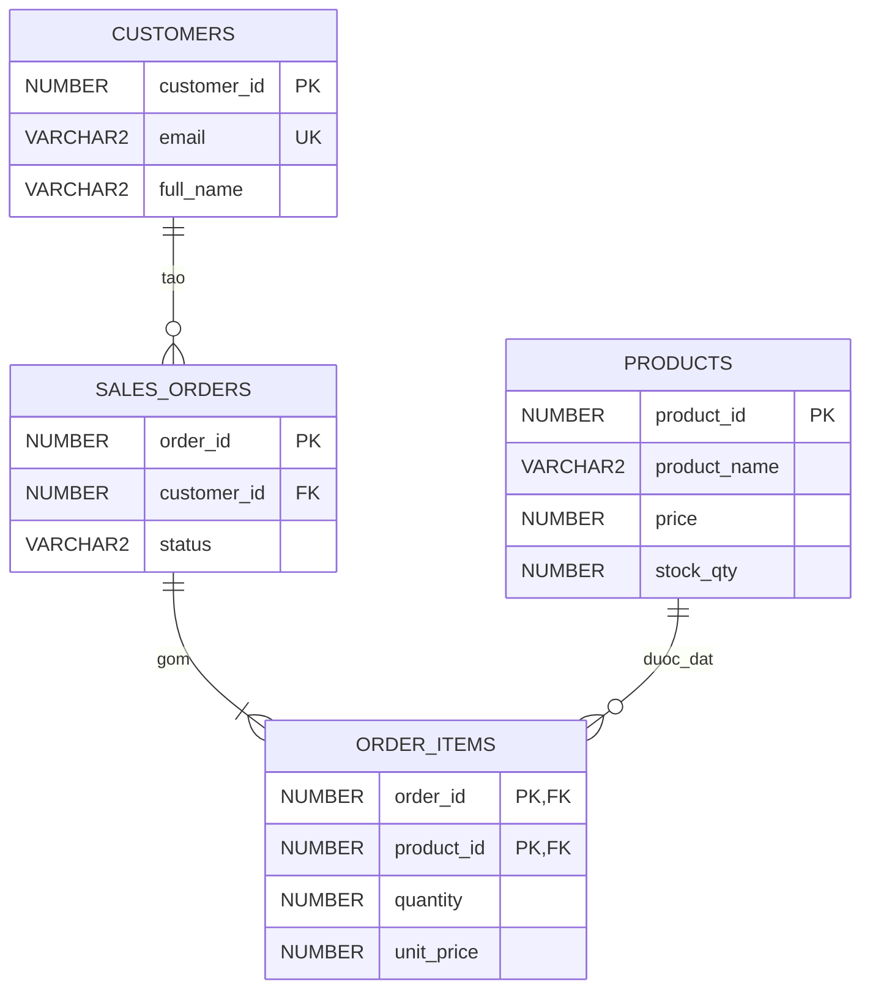
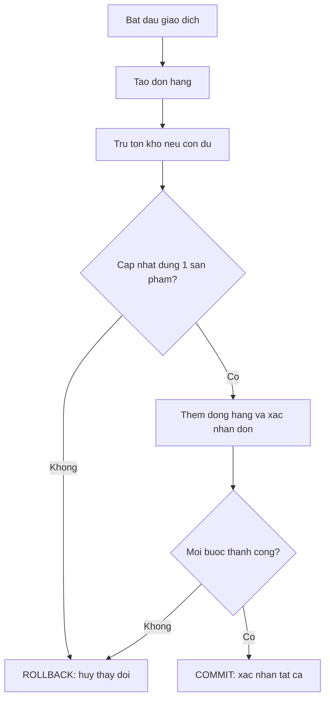

# Bài toán lưu trữ quan hệ, tính toàn vẹn và xử lý giao dịch trong Oracle

Một hệ thống bán hàng không chỉ cần **lưu được dữ liệu**, mà còn phải trả lời được ba câu hỏi: dữ liệu thuộc về thực thể nào và liên hệ với nhau ra sao; làm thế nào để ngăn dữ liệu sai; và điều gì xảy ra khi nhiều người cùng thay đổi dữ liệu hoặc một thao tác bị lỗi giữa chừng? Đây là các bài toán nền tảng mà hệ quản trị cơ sở dữ liệu quan hệ như **Oracle Database** giải quyết.

Sau bài học, bạn có thể:

- Chuyển yêu cầu nghiệp vụ thành các bảng, khóa và quan hệ 1–nhiều, nhiều–nhiều.
- Phân biệt tính toàn vẹn thực thể, tham chiếu, miền giá trị và quy tắc nghiệp vụ liên bảng.
- Dùng giao dịch `COMMIT`, `ROLLBACK`, `SAVEPOINT` để giữ nhiều thao tác SQL thành một đơn vị công việc.
- Giải thích vì sao khóa dòng, tính nhất quán khi đọc và cơ chế `UNDO`/`REDO` của Oracle quan trọng khi nhiều phiên cùng thao tác.

## 1. Từ nhu cầu lưu dữ liệu đến mô hình quan hệ

Giả sử một cửa hàng có khách hàng, sản phẩm, đơn hàng và các dòng hàng trong từng đơn. Hệ thống cần đáp ứng:

1. Một khách hàng có thể tạo nhiều đơn hàng; mỗi đơn thuộc về đúng một khách hàng.
2. Một đơn có thể chứa nhiều sản phẩm; cùng một sản phẩm xuất hiện trong nhiều đơn khác nhau.
3. Không thể tạo đơn cho khách hàng không tồn tại, bán số lượng âm hoặc để tồn kho trở thành số âm.
4. Khi xác nhận đơn, hệ thống phải tạo đơn, ghi dòng hàng và trừ tồn kho **cùng thành công**, hoặc không ghi nhận gì nếu có lỗi.
5. Hai người cùng mua sản phẩm cuối cùng không được khiến hệ thống bán quá số hàng có sẵn.

Nếu lưu tất cả vào một bảng duy nhất như `customer_name, customer_email, order_id, product_name, quantity, stock_qty`, tên và email khách hàng sẽ lặp lại trên nhiều dòng; thông tin sản phẩm lặp lại theo từng đơn; cập nhật ở một dòng mà quên các dòng khác tạo ra dữ liệu mâu thuẫn. Một ô chứa danh sách sản phẩm như `"101:2,102:1"` còn khiến tìm kiếm, kiểm tra khóa ngoại và tính tổng phức tạp hơn.

Mô hình quan hệ tách các **thực thể** và nối chúng bằng **khóa**:



Trong sơ đồ, `CUSTOMERS` và `SALES_ORDERS` có quan hệ **1–N**. Quan hệ **N–N** giữa đơn hàng và sản phẩm được biểu diễn qua bảng trung gian `ORDER_ITEMS`, nơi mỗi dòng chỉ giữ một cặp đơn hàng–sản phẩm và số lượng tương ứng.

| Khái niệm | Ý nghĩa | Ví dụ |
| --- | --- | --- |
| Bảng (*table*) | Tập các bản ghi cùng cấu trúc | `PRODUCTS` |
| Hàng (*row*) | Một bản ghi của thực thể | Sản phẩm mã `101` |
| Cột (*column*) | Thuộc tính có kiểu dữ liệu | `stock_qty NUMBER(12)` |
| Khóa chính (*primary key*) | Định danh duy nhất cho từng hàng, không `NULL` | `product_id` |
| Khóa ngoại (*foreign key*) | Giá trị tham chiếu tới khóa hợp lệ ở bảng khác | `sales_orders.customer_id` |
| Khóa duy nhất (*unique*) | Ngăn các giá trị trùng nhau theo quy tắc đã khai báo | `customers.email` |

Phân tách này cũng là trực giác của **chuẩn hóa dữ liệu**: mỗi loại sự thật được quản lý tại nơi phù hợp. Ví dụ, tên hiện tại của sản phẩm nằm ở `PRODUCTS`, nhưng **đơn giá tại lúc mua** phải được ghi vào `ORDER_ITEMS` để đơn hàng cũ không thay đổi khi bảng giá hiện tại đổi. Chuẩn hóa không có nghĩa là cấm mọi bản sao dữ liệu; một bản chụp có ý nghĩa nghiệp vụ lịch sử vẫn là dữ liệu cần thiết.

## 2. Hiện thực các quan hệ bằng Oracle SQL

Ví dụ dưới đây dùng kiểu `NUMBER` cho số và tiền, `VARCHAR2` cho chuỗi, `TIMESTAMP WITH TIME ZONE` cho thời điểm. Các khóa định danh được khai báo `GENERATED BY DEFAULT AS IDENTITY`, nên Oracle có thể tự sinh số khi câu `INSERT` bỏ qua cột khóa. Để các ví dụ dễ theo dõi, phần dữ liệu mẫu sẽ chủ động dùng các mã cố định.

```sql
CREATE TABLE customers (
    customer_id NUMBER(12) GENERATED BY DEFAULT AS IDENTITY,
    full_name   VARCHAR2(120 CHAR) NOT NULL,
    email       VARCHAR2(255 CHAR) NOT NULL,
    CONSTRAINT pk_customers PRIMARY KEY (customer_id),
    CONSTRAINT uq_customers_email UNIQUE (email)
);

CREATE TABLE products (
    product_id   NUMBER(12) GENERATED BY DEFAULT AS IDENTITY,
    product_name VARCHAR2(200 CHAR) NOT NULL,
    price        NUMBER(12, 2) NOT NULL,
    stock_qty    NUMBER(12) DEFAULT 0 NOT NULL,
    CONSTRAINT pk_products PRIMARY KEY (product_id),
    CONSTRAINT ck_products_price CHECK (price >= 0),
    CONSTRAINT ck_products_stock CHECK (stock_qty >= 0)
);

CREATE TABLE sales_orders (
    order_id    NUMBER(12) GENERATED BY DEFAULT AS IDENTITY,
    customer_id NUMBER(12) NOT NULL,
    status      VARCHAR2(20 CHAR) DEFAULT 'CREATED' NOT NULL,
    created_at  TIMESTAMP WITH TIME ZONE DEFAULT SYSTIMESTAMP NOT NULL,
    CONSTRAINT pk_sales_orders PRIMARY KEY (order_id),
    CONSTRAINT fk_orders_customer FOREIGN KEY (customer_id)
        REFERENCES customers (customer_id),
    CONSTRAINT ck_orders_status
        CHECK (status IN ('CREATED', 'CONFIRMED', 'CANCELLED'))
);

CREATE TABLE order_items (
    order_id   NUMBER(12) NOT NULL,
    product_id NUMBER(12) NOT NULL,
    quantity   NUMBER(12) NOT NULL,
    unit_price NUMBER(12, 2) NOT NULL,
    CONSTRAINT pk_order_items PRIMARY KEY (order_id, product_id),
    CONSTRAINT fk_items_order FOREIGN KEY (order_id)
        REFERENCES sales_orders (order_id),
    CONSTRAINT fk_items_product FOREIGN KEY (product_id)
        REFERENCES products (product_id),
    CONSTRAINT ck_items_quantity CHECK (quantity > 0),
    CONSTRAINT ck_items_price CHECK (unit_price >= 0)
);

-- Index hỗ trợ tìm đơn theo khách hàng và dòng hàng theo sản phẩm.
CREATE INDEX ix_orders_customer ON sales_orders (customer_id);
CREATE INDEX ix_items_product ON order_items (product_id);
```

Những điều cần nhận ra từ lược đồ:

- **Khóa chính** của `ORDER_ITEMS` là cặp `(order_id, product_id)`: cùng một sản phẩm chỉ xuất hiện một lần trong một đơn. Nếu nghiệp vụ cho phép nhiều dòng trùng sản phẩm với mức giá/khuyến mại khác nhau, hãy dùng `order_item_id` hoặc `line_no` làm khóa thay vì cặp này.
- **Khóa ngoại** buộc đơn hàng tham chiếu khách hàng có thật, và mỗi dòng hàng tham chiếu cả đơn lẫn sản phẩm có thật.
- **`NOT NULL` và `CHECK`** giới hạn miền giá trị. `CHECK (stock_qty >= 0)` ngăn tồn kho âm kể cả khi một chương trình khác viết SQL trực tiếp.
- **Index** giúp tra cứu và có thể giảm tranh chấp khi xóa/cập nhật hàng cha có khóa ngoại liên quan. Oracle không tự tạo index cho mọi khóa ngoại; cần đánh giá theo truy vấn và tải thực tế. Index của khóa chính `(order_id, product_id)` đã bắt đầu bằng `order_id`, nhưng không tối ưu tương đương cho mọi truy vấn chỉ lọc `product_id`.
- **Khóa ngoại mặc định không tự xóa hàng con.** Oracle cho phép chỉ định `ON DELETE CASCADE` hoặc `ON DELETE SET NULL` khi thích hợp. Với lịch sử đơn hàng, thường nên hạn chế xóa cứng và dùng trạng thái thay vì xóa dây chuyền.

`CREATE TABLE` và `CREATE INDEX` là DDL. Trong Oracle, DDL gây **implicit commit** đối với giao dịch đang có trước khi thực hiện; DDL thành công còn được commit. Vì vậy, nên tạo cấu trúc bảng ở giai đoạn triển khai riêng, không xen vào giữa chuỗi DML cần rollback.

### Dữ liệu khởi tạo và truy vấn JOIN

```sql
INSERT INTO customers (customer_id, full_name, email)
VALUES (1, 'An Nguyen', 'an@example.com');

INSERT INTO products (product_id, product_name, price, stock_qty)
VALUES (101, 'Sach Oracle co ban', 150000, 5);

INSERT INTO products (product_id, product_name, price, stock_qty)
VALUES (102, 'So tay SQL', 80000, 10);

COMMIT;
```

Sau khi có đơn hàng, có thể nối các bảng để xem ai mua gì, số lượng bao nhiêu và giá lịch sử là bao nhiêu:

```sql
SELECT o.order_id,
       c.full_name,
       p.product_name,
       i.quantity,
       i.unit_price,
       i.quantity * i.unit_price AS line_total
FROM sales_orders o
JOIN customers c   ON c.customer_id = o.customer_id
JOIN order_items i ON i.order_id = o.order_id
JOIN products p    ON p.product_id = i.product_id
WHERE o.order_id = 1001;
```

`JOIN` không làm dữ liệu bị sao chép vật lý giữa các bảng; nó kết hợp hàng theo điều kiện khóa tại thời điểm truy vấn. `INNER JOIN` ở ví dụ chỉ trả về những hàng có quan hệ khớp; với yêu cầu hiển thị cả đơn chưa có dòng hàng, có thể cân nhắc `LEFT JOIN`.

## 3. Các tầng của tính toàn vẹn dữ liệu

**Tính toàn vẹn** (*data integrity*) có nghĩa là trạng thái lưu trong cơ sở dữ liệu thỏa mãn những bất biến đã định nghĩa. Không nên mặc định rằng mọi thao tác gửi tới database đều hợp lệ chỉ vì giao diện đã kiểm tra đầu vào.

| Tầng toàn vẹn | Cách bảo vệ | Hậu quả nếu bỏ qua |
| --- | --- | --- |
| Thực thể | `PRIMARY KEY`, `NOT NULL` | Hai hàng không phân biệt được, hoặc thiếu định danh |
| Tham chiếu | `FOREIGN KEY` | Đơn hàng trỏ tới khách hàng không tồn tại |
| Miền giá trị | Kiểu dữ liệu, `CHECK`, `NOT NULL` | Giá âm, số lượng bằng 0, trạng thái lạ |
| Duy nhất nghiệp vụ | `UNIQUE` hoặc unique index phù hợp | Hai tài khoản dùng cùng email trong phạm vi phải duy nhất |
| Liên hàng/liên bảng | Giao dịch, khóa, logic dịch vụ hoặc cơ chế chuyên biệt | Trừ tồn kho không đi cùng việc xác nhận đơn |

Ví dụ những lệnh sau bị Oracle từ chối theo ràng buộc đã khai báo:

```sql
-- Không có customer_id = 999: vi phạm khóa ngoại.
INSERT INTO sales_orders (order_id, customer_id)
VALUES (1999, 999);

-- Tồn kho không thể âm: vi phạm CHECK.
UPDATE products SET stock_qty = -1 WHERE product_id = 101;

-- Email trùng: vi phạm UNIQUE.
INSERT INTO customers (customer_id, full_name, email)
VALUES (2, 'Binh Tran', 'an@example.com');
```

Mỗi câu trên là một **ví dụ lỗi độc lập**; đừng chạy chúng như một phần của giao dịch đặt hàng thành công. Oracle sẽ báo lỗi ràng buộc, chẳng hạn nhóm lỗi `ORA-02291` khi thiếu hàng cha, `ORA-02290` khi vi phạm `CHECK`, hay `ORA-00001` khi trùng giá trị duy nhất. Khi một câu DML bị lỗi, các thay đổi của chính câu đó bị hủy, nhưng giao dịch trước đó trong cùng phiên **không mặc nhiên rollback toàn bộ**. Chương trình phải quyết định có `ROLLBACK` phần còn lại hay không.

Hai giới hạn quan trọng:

1. `CHECK` trong Oracle kiểm tra biểu thức trên dữ liệu hàng phù hợp, không thể trực tiếp dùng truy vấn sang bảng khác để bảo đảm, chẳng hạn, tổng số lượng đã bán không vượt tồn kho. Bất biến nhiều bảng cần thiết kế thao tác giao dịch và quy tắc cập nhật đồng bộ.
2. Một biểu thức `CHECK` có thể chấp nhận kết quả `UNKNOWN` khi một giá trị là `NULL`; nếu thuộc tính bắt buộc, cần khai báo `NOT NULL` riêng. Với `VARCHAR2`, Oracle hiện coi chuỗi rỗng `''` như `NULL`, cần nhớ khi xử lý dữ liệu đầu vào.

Thông thường Oracle kiểm tra ràng buộc ngay khi thực hiện lệnh (*immediate*). Một số ràng buộc có thể được **khai báo từ đầu** là `DEFERRABLE` để trì hoãn kiểm tra đến `COMMIT`; đây là tính năng chuyên biệt cho trường hợp thứ tự cập nhật dữ liệu liên quan đòi hỏi như vậy, không phải lý do để trì hoãn mọi kiểm tra.

## 4. Tại sao cần giao dịch?

Hãy xét thao tác mua hai cuốn sách mã `101`, khi tồn kho ban đầu là **5**. Luồng nghiệp vụ gồm: tạo đơn `1001`, trừ tồn kho xuống **3**, tạo dòng hàng số lượng **2**, đổi trạng thái đơn thành `CONFIRMED`.

Nếu mỗi bước được ghi nhận độc lập, lỗi mạng hoặc lỗi ràng buộc ở bước thứ ba có thể để lại đơn đã tạo và tồn kho đã giảm nhưng không có chi tiết đơn hàng. Đây là **trạng thái dở dang**: từng câu SQL có thể đúng riêng lẻ, nhưng toàn bộ nghiệp vụ đã sai.

Một **transaction** gom nhiều thao tác vào một đơn vị công việc logic. Bốn đặc tính ACID mô tả cam kết mà hệ quản trị hỗ trợ:

| ACID | Ý nghĩa thực tế trong đơn hàng |
| --- | --- |
| **Atomicity – Nguyên tử** | Hoặc cả chuỗi tạo đơn–trừ kho–thêm dòng hàng thành công, hoặc các thay đổi được hoàn tác. |
| **Consistency – Nhất quán** | Trạng thái trước và sau giao dịch phải thỏa các ràng buộc; logic nghiệp vụ vẫn cần được viết đúng. |
| **Isolation – Cô lập** | Các phiên đồng thời không được quan sát các thay đổi chưa commit của nhau; mức cô lập quyết định các hiện tượng còn có thể xảy ra. |
| **Durability – Bền vững** | Sau khi `COMMIT` thành công, Oracle có cơ chế ghi nhật ký và khôi phục để giữ thay đổi đã xác nhận qua sự cố hệ thống theo cam kết database. |

Trong Oracle, DML như `INSERT`, `UPDATE`, `DELETE` thường thuộc giao dịch hiện tại cho đến khi phiên `COMMIT` hoặc `ROLLBACK`. Tuy nhiên, công cụ/driver có thể bật **autocommit**, tự commit sau từng lệnh; phải chủ động cấu hình ranh giới giao dịch ở tầng ứng dụng.



### Ví dụ giao dịch PL/SQL có xử lý lỗi

Chạy ví dụ này **một lần** trên dữ liệu mẫu ở phần trước. Trong môi trường SQL*Plus, SQLcl hoặc SQL Developer ở chế độ script, dấu `/` sau khối PL/SQL dùng để thực thi khối vừa khai báo.

```sql
BEGIN
    INSERT INTO sales_orders (order_id, customer_id, status)
    VALUES (1001, 1, 'CREATED');

    -- Điều kiện stock_qty >= 2 là một phần của cùng lệnh UPDATE.
    UPDATE products
       SET stock_qty = stock_qty - 2
     WHERE product_id = 101
       AND stock_qty >= 2;

    -- SQL%ROWCOUNT phải được đọc ngay sau UPDATE này.
    IF SQL%ROWCOUNT <> 1 THEN
        RAISE_APPLICATION_ERROR(-20001, 'San pham khong ton tai hoac khong du hang');
    END IF;

    INSERT INTO order_items (order_id, product_id, quantity, unit_price)
    VALUES (1001, 101, 2, 150000);

    UPDATE sales_orders
       SET status = 'CONFIRMED'
     WHERE order_id = 1001;

    COMMIT;
EXCEPTION
    WHEN OTHERS THEN
        ROLLBACK;
        RAISE;
END;
/
```

Sau khi chạy thành công, đơn `1001` được xác nhận, có một dòng hàng số lượng 2 và `products.stock_qty` của mã `101` giảm từ 5 xuống 3. Nếu điều kiện kiểm tra tồn kho không đạt hoặc có bất kỳ lỗi chưa xử lý nào, nhánh `EXCEPTION` thực hiện `ROLLBACK`: không để lại đơn dở dang. Việc `RAISE` tiếp tục trả lỗi cho phía gọi, để ứng dụng biết yêu cầu chưa thành công.

Khối trên minh họa **một transaction độc lập**. Trong ứng dụng thực tế, tầng dịch vụ hoặc transaction manager thường sở hữu `COMMIT`/`ROLLBACK`; không nên nhúng thao tác commit tùy tiện vào thủ tục được gọi bên trong một transaction lớn hơn, vì commit sẽ kết thúc cả transaction của phiên.

### `SAVEPOINT` khi chỉ muốn hoàn tác một phần

```sql
SAVEPOINT before_optional_change;

UPDATE products
   SET price = price + 1000
 WHERE product_id = 102;

ROLLBACK TO SAVEPOINT before_optional_change;

-- Các thay đổi trong cùng giao dịch trước SAVEPOINT vẫn còn chờ commit.
COMMIT;
```

`ROLLBACK TO SAVEPOINT` quay về một mốc trong **giao dịch hiện tại**, còn `ROLLBACK` không chỉ định mốc hoàn tác toàn bộ phần chưa commit. Không thao tác nào trong số đó có thể thu hồi giao dịch đã commit. `COMMIT`/`ROLLBACK` kết thúc giao dịch hiện tại và giải phóng các khóa giao dịch tương ứng.

## 5. Nhiều phiên cùng mua: tính đúng đắn dưới cạnh tranh

Một vấn đề khác xuất hiện ngay cả khi mỗi yêu cầu đều có transaction: **hai giao dịch chạy đồng thời** có thể cùng dựa trên một giá trị đã đọc. Ví dụ chỉ còn 3 sản phẩm và hai khách hàng đều muốn mua 2.

Lối viết nguy hiểm là: đọc `stock_qty` về ứng dụng, tính `new_stock = old_stock - 2`, rồi ghi đè `UPDATE products SET stock_qty = :new_stock WHERE product_id = 101`. Hai phiên cùng đọc 3 có thể cùng ghi 1. Kết quả database còn 1 dù đã nhận hai đơn bán tổng cộng 4 sản phẩm: một dạng **lost update** hoặc kiểm tra–rồi–ghi không nguyên tử.

Giải pháp trong ví dụ sử dụng **cập nhật có điều kiện tại database**:

```sql
UPDATE products
   SET stock_qty = stock_qty - :requested_qty
 WHERE product_id = :product_id
   AND stock_qty >= :requested_qty;
```

Ứng dụng kiểm tra số hàng được cập nhật: `1` nghĩa là giữ được số lượng cần thiết cho hàng đó; `0` nghĩa là mã không tồn tại hoặc không đủ tồn. Nếu cần cập nhật nhiều sản phẩm, tất cả các cập nhật và dòng đơn hàng phải nằm trong **cùng một transaction**; bất kỳ bước nào thất bại thì rollback cả đơn. Nên truy cập các sản phẩm theo thứ tự ổn định để giảm nguy cơ deadlock khi các đơn đặt nhiều sản phẩm.

Diễn biến có thể xảy ra ở Oracle (giả sử `stock_qty = 3` ban đầu):

| Thời điểm | Phiên A – mua 2 | Phiên B – mua 2 |
| --- | --- | --- |
| T1 | `UPDATE ... stock_qty >= 2` cập nhật 3 → 1, giữ khóa dòng | — |
| T2 | Chưa `COMMIT` | Cũng `UPDATE ... stock_qty >= 2`, phải chờ khóa của A |
| T3 | `COMMIT`; giá trị 1 trở thành đã xác nhận | Được tiếp tục và đánh giá lại điều kiện trên trạng thái phù hợp |
| T4 | Đơn A thành công | Điều kiện `stock_qty >= 2` không đạt, cập nhật 0 hàng; B phải rollback/đưa ra thông báo hết hàng |

Oracle dùng **row-level locking** cho thao tác cập nhật và cơ chế đọc nhất quán đa phiên bản (*multi-version read consistency*). Lệnh `SELECT` thông thường không cần chờ khóa ghi để đọc bản dữ liệu đã commit phù hợp với snapshot của nó; lệnh `UPDATE` trên cùng hàng thì phải phối hợp với khóa. Điều này giảm chặn đọc nhưng **không tự biến mọi đoạn mã đọc–tính–ghi ở ứng dụng thành an toàn**.

Khi nghiệp vụ buộc phải đọc trạng thái rồi xử lý trước khi cập nhật, có thể cân nhắc khóa tường minh:

```sql
SELECT stock_qty
FROM products
WHERE product_id = 101
FOR UPDATE;

-- Sau đó kiểm tra/cập nhật trong cùng transaction rồi COMMIT hoặc ROLLBACK.
```

`SELECT ... FOR UPDATE` khóa các hàng được chọn cho đến khi giao dịch kết thúc; chỉ dùng khi cần vì nó làm các giao dịch ghi khác phải chờ. Cập nhật có điều kiện thường gọn và phù hợp hơn cho bài toán giảm tồn kho đơn giản.

## 6. Mức cô lập, UNDO và REDO của Oracle

Oracle mặc định dùng **`READ COMMITTED`**. Mỗi câu truy vấn nhận một góc nhìn nhất quán của dữ liệu đã commit tại thời điểm bắt đầu câu lệnh; truy vấn lần hai trong cùng transaction có thể thấy commit mới từ phiên khác. Do đó, Oracle không đọc thay đổi chưa commit (*dirty read*), nhưng ở `READ COMMITTED` vẫn có thể gặp **non-repeatable read** hoặc tập hàng khác giữa hai câu truy vấn (*phantom*) khi giao dịch khác commit xen vào.

Oracle cũng hỗ trợ chế độ `SERIALIZABLE` và `READ ONLY` ở cấp giao dịch:

```sql
-- Đặt ở đầu một giao dịch, trước các câu DML khác của giao dịch đó.
SET TRANSACTION ISOLATION LEVEL SERIALIZABLE;

-- Các truy vấn và DML hợp lệ của giao dịch tiếp theo dùng snapshot giao dịch.
-- Cần COMMIT hoặc ROLLBACK khi hoàn tất.
```

`SERIALIZABLE` cho góc nhìn nhất quán theo transaction nhưng **không bảo đảm mọi transaction cạnh tranh tự động thành công**. Khi có xung đột cập nhật, Oracle có thể trả `ORA-08177: can't serialize access for this transaction`; phía ứng dụng cần rollback và quyết định retry **toàn bộ** transaction một cách có kiểm soát. Oracle không có mức `REPEATABLE READ` riêng giống một số hệ quản trị khác. `SET TRANSACTION READ ONLY` hữu ích cho loạt báo cáo cần nhìn một snapshot ổn định mà không thực hiện DML.

Hai nhóm dữ liệu hỗ trợ cơ chế transaction:

| Thành phần | Vai trò chính | Liên hệ với tình huống |
| --- | --- | --- |
| **UNDO** | Giữ thông tin cần thiết để hoàn tác thay đổi chưa commit và dựng phiên bản cũ cho đọc nhất quán | Người đang xem hàng có thể đọc trạng thái đã commit phù hợp mà không thấy giá trị chưa commit của người mua khác |
| **REDO** | Ghi lại thông tin thay đổi cần thiết cho cơ chế khôi phục sau sự cố | Giao dịch đã commit có thể được phục hồi khi database phải khôi phục sau lỗi hệ thống |
| **Row locks** | Điều phối ghi đồng thời lên cùng hàng | Hai lệnh trừ tồn kho không tùy ý ghi đè lên cùng sản phẩm |
| **SCN** (*System Change Number*) | Mốc logic để Oracle tổ chức thứ tự thay đổi và tính nhất quán của snapshot | Một câu truy vấn nhìn dữ liệu nhất quán tương ứng với thời điểm đọc của nó |

Đừng nhầm **UNDO** với **REDO**: UNDO chủ yếu phục vụ rollback và đọc phiên bản cũ; REDO phục vụ độ bền và phục hồi. Chi tiết vận hành còn liên quan data files, buffer cache, redo log, undo tablespace, checkpoint và cấu hình hệ thống, nhưng người thiết kế ứng dụng trước hết cần hiểu ranh giới transaction và cạnh tranh ghi.

## 7. Những giới hạn mà chỉ khai báo khóa chưa giải quyết được

Một schema có đầy đủ `PRIMARY KEY`, `FOREIGN KEY` và `CHECK` vẫn chưa đủ để bảo đảm mọi quy tắc nghiệp vụ:

- **Tổng tiền đơn hàng:** `SUM(order_items.quantity * order_items.unit_price)` là giá trị tính từ nhiều hàng. Nếu lưu thêm `sales_orders.total_amount`, cần quy tắc cập nhật đồng bộ trong cùng transaction, hoặc ưu tiên tính từ dòng hàng khi phù hợp. `CHECK` trên một hàng không thể trực tiếp xác nhận tổng liên bảng.
- **Chuyển trạng thái:** `CHECK (status IN (...))` chỉ giới hạn tập trạng thái hợp lệ; nó không chặn chuyển ngược từ `CONFIRMED` về `CREATED`. Trạng thái và quy tắc chuyển trạng thái cần logic nghiệp vụ, kiểm tra đồng thời và có thể là optimistic locking.
- **Giá lịch sử:** Khóa ngoại bảo đảm sản phẩm tồn tại, không giữ giá tại thời điểm bán. Việc lưu `unit_price` ở dòng hàng là một quyết định mô hình hóa có chủ đích.
- **Xử lý lỗi và retry:** Khi kết nối ngắt đúng lúc commit, ứng dụng có thể chưa biết transaction đã thành công hay chưa. Một mã yêu cầu nghiệp vụ duy nhất (*idempotency key*) được ràng buộc `UNIQUE`, cộng với cơ chế tra cứu trạng thái, giúp tránh tạo đơn trùng khi gửi lại.
- **Thời gian lưu trữ và xóa:** Xóa khách hàng có đơn hàng thường không phải thao tác đơn giản. Chính sách giữ lịch sử, ẩn/xóa dữ liệu cá nhân và trạng thái nghiệp vụ cần thiết kế trước khi chọn `ON DELETE`.

Giữa **điều kiện tại database** và **kiểm tra trong ứng dụng** có sự bổ trợ: database bảo vệ các bất biến cốt lõi bất kể ai ghi dữ liệu; ứng dụng điều phối quy trình, thông báo lỗi dễ hiểu và các quy tắc phụ thuộc bối cảnh. Không thay thế ràng buộc database bằng một câu `if` chỉ chạy ở một API, bởi batch job, công cụ quản trị hay dịch vụ khác có thể bỏ qua câu `if` đó.

## 8. Tự kiểm tra hiểu biết

1. **Vì sao không ghi mọi đơn hàng vào một bảng có cột `product_ids = '101,102'`?** Vì mất cấu trúc một giá trị/ô, khó khóa ngoại, khó truy vấn từng dòng hàng và khó đảm bảo số lượng, giá theo từng sản phẩm.
2. **`CHECK (stock_qty >= 0)` có đủ ngăn hai giao dịch bán quá số lượng không?** Chưa đủ để biểu diễn quan hệ với số lượng đơn đã xác nhận. Cần cập nhật tồn kho có điều kiện trong transaction cùng việc ghi đơn và xử lý kết quả cập nhật.
3. **Một câu `INSERT` thứ ba bị lỗi sau hai câu thành công thì điều gì xảy ra?** Câu lỗi bị hủy, nhưng hai câu trước vẫn có thể đang chờ commit trong transaction. Phải rollback transaction khi yêu cầu nghiệp vụ cần tất cả hoặc không có gì.
4. **Vì sao ở `READ COMMITTED`, hai lần `SELECT` trong một transaction có thể trả kết quả khác nhau?** Vì mỗi câu lệnh lấy một snapshot đã commit tương ứng với thời điểm bắt đầu riêng của nó.
5. **Khác nhau giữa `ROLLBACK` và `ROLLBACK TO SAVEPOINT`?** Lệnh thứ nhất hoàn tác toàn bộ thay đổi chưa commit trong transaction; lệnh thứ hai chỉ hoàn tác từ mốc savepoint trong transaction đó.

### Cách suy nghĩ khi thiết kế một chức năng ghi dữ liệu

Với mỗi chức năng như “đặt hàng”, “chuyển tiền” hay “đăng ký lớp”, hãy xác định lần lượt: **thực thể và quan hệ**, **bất biến bắt buộc**, **ranh giới transaction**, **dữ liệu có thể bị nhiều phiên cùng sửa**, rồi **hành vi khi gặp lỗi/retry**. Oracle cung cấp bảng, khóa, constraint, transaction, undo, redo và locking để hiện thực những quyết định đó. Chất lượng dữ liệu cuối cùng phụ thuộc vào việc phối hợp đúng các cơ chế này với quy tắc nghiệp vụ của ứng dụng.
