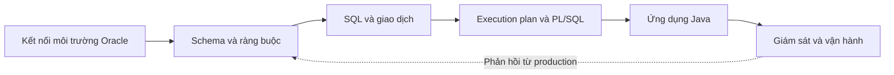
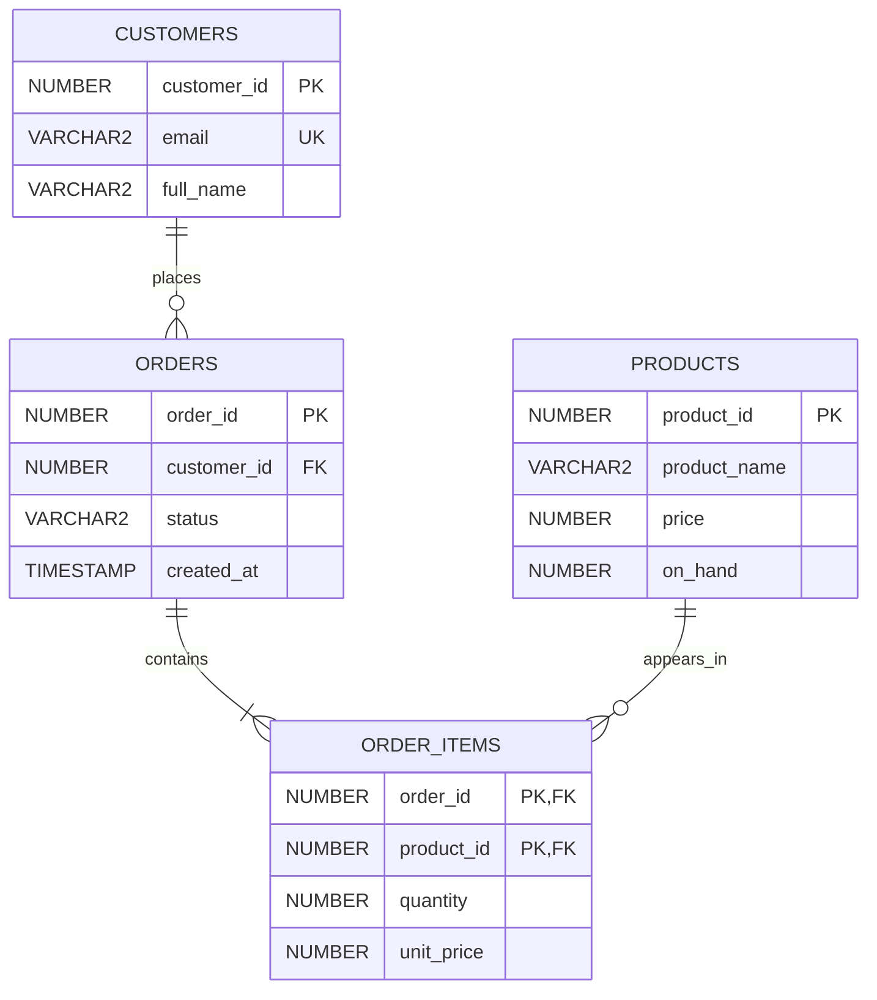

# Trình tự học từ môi trường thực hành đến ứng dụng và vận hành Oracle Database

Học Oracle Database hiệu quả là đi theo vòng đời của một hệ quản trị cơ sở dữ liệu quan hệ: **tạo môi trường có thể thao tác → thiết kế dữ liệu → truy vấn và cập nhật → bảo đảm giao dịch → tối ưu truy cập → kết nối ứng dụng → theo dõi, bảo vệ và khôi phục hệ thống**. Mỗi chặng cần tạo ra một kết quả kiểm chứng được trước khi chuyển sang chặng sau. Cách học này giúp liên kết các câu lệnh SQL với những vấn đề thật sự xảy ra khi một ứng dụng sử dụng Oracle.

Tài liệu sử dụng ví dụ xuyên suốt là một hệ thống bán hàng nhỏ gồm khách hàng, sản phẩm, đơn hàng và chi tiết đơn hàng. Các lệnh mẫu hướng tới **Oracle Database Free/XE hoặc một PDB thực hành được cấp quyền phù hợp**, không dành để chạy trực tiếp trên hệ thống production.

## 1. Bản đồ học tập: học gì, theo thứ tự nào?

| Chặng | Trọng tâm | Sản phẩm thực hành cần có | Điều kiện để chuyển tiếp |
|---|---|---|---|
| 1. Môi trường | Database instance, listener, service, CDB/PDB, user/schema, công cụ SQL | Kết nối được vào PDB bằng tài khoản riêng | Biết đang kết nối tới database, service và schema nào |
| 2. Mô hình quan hệ | Bảng, kiểu dữ liệu Oracle, khóa, quan hệ, ràng buộc | Schema bán hàng có các bảng liên kết | Dữ liệu sai vi phạm ràng buộc và bị từ chối |
| 3. SQL ứng dụng | `SELECT`, `JOIN`, tổng hợp, lọc, sắp xếp, `INSERT/UPDATE/DELETE` | Truy vấn được danh sách đơn và tổng tiền | Giải thích được kết quả khi dữ liệu có nhiều bản ghi |
| 4. Giao dịch và đồng thời | `COMMIT`, `ROLLBACK`, isolation, lock, tính nhất quán | Quy trình tạo đơn và trừ tồn kho có khả năng rollback | Lỗi giữa quy trình không để dữ liệu ở trạng thái dở dang |
| 5. Hiệu năng SQL | Index, execution plan, thống kê, chi phí đọc/ghi | Phân tích được một truy vấn chậm | Có căn cứ từ plan và dữ liệu trước khi tối ưu |
| 6. Logic trong database | PL/SQL, procedure, function, exception | Chạy được khối PL/SQL và hiểu khi nào nên dùng | Phân biệt trách nhiệm trong database và ứng dụng |
| 7. Tích hợp ứng dụng | Oracle JDBC, Spring Boot/JDBC, pool, transaction, migration | API Java đọc và ghi dữ liệu Oracle | Kiểm chứng được kết quả và rollback qua ứng dụng |
| 8. Vận hành | Quyền truy cập, quan sát, backup/restore, lỗi, capacity | Checklist vận hành và một kịch bản khôi phục | Có thể nhận diện và xử lý sự cố theo bằng chứng |



Đây là trình tự phụ thuộc kiến thức, không phải các chủ đề tách rời. Chẳng hạn, chưa hiểu khóa ngoại thì khó xác định nguyên nhân lỗi khi tạo đơn; chưa hiểu transaction thì không thể thiết kế nghiệp vụ trừ tồn kho an toàn; chưa hiểu execution plan thì việc thêm index dễ trở thành phỏng đoán.

## 2. Chặng 1 — Tạo môi trường thực hành và hiểu điểm kết nối

### 2.1. Cần chuẩn bị những gì?

- **Oracle Database:** dùng bản Free/XE có sẵn, container thực hành hoặc một PDB trong máy chủ đào tạo. Chọn một phiên bản phù hợp rồi giữ cố định trong suốt bài để kết quả có thể lặp lại.
- **SQL client:** Oracle SQLcl, SQL Developer hoặc một công cụ hỗ trợ Oracle JDBC để chạy SQL và xem lỗi.
- **Máy thực hành:** đủ bộ nhớ, dung lượng đĩa và tài nguyên theo yêu cầu của phiên bản Oracle đã chọn; nếu chạy container cần có Docker đang hoạt động.
- **Giai đoạn ứng dụng:** JDK và dự án Java/Spring Boot; chưa cần thiết lập ngay khi đang học DDL/SQL.

Ví dụ tạo container thực hành bằng image Oracle Database Free (tên image, quyền tải image và biến cấu hình có thể thay đổi theo bản phát hành; cần kiểm tra hướng dẫn của image đang sử dụng):

```bash
docker run -d --name oracle-lab -p 127.0.0.1:1521:1521 -e ORACLE_PWD=ChangeMeOnlyForLab123 container-registry.oracle.com/database/free:latest
docker logs oracle-lab
```

Chỉ dùng mật khẩu minh họa trên máy lab; thay bằng bí mật riêng và không đưa mật khẩu thật vào mã nguồn hay nhật ký chia sẻ. Chờ database báo sẵn sàng trước khi kết nối. Nếu cơ sở dữ liệu đã được cung cấp sẵn, bỏ qua bước khởi tạo container.

Trong Oracle hiện đại, cần phân biệt:

| Khái niệm | Hiểu đúng trong lab |
|---|---|
| **Instance** | Bộ nhớ và các tiến trình phục vụ database; khác với một kết nối từ client |
| **Listener** | Thành phần nhận yêu cầu kết nối mạng, thường qua cổng 1521 trong lab |
| **Service name** | Tên dịch vụ client yêu cầu để kết nối đúng database/PDB; không đồng nghĩa với tên bảng hoặc tên user |
| **CDB/PDB** | Container Database chứa các Pluggable Database; tài khoản ứng dụng thường được tạo trong **PDB** |
| **User và schema** | User dùng xác thực; schema chứa các đối tượng do user sở hữu, ví dụ bảng và view |

Với cấu hình Oracle Database Free thông dụng, service PDB mẫu là `FREEPDB1`. Nếu dùng máy chủ khác, lấy service name thực tế từ người quản trị:

```text
Host          localhost
Port          1521
Service name  FREEPDB1
Admin user    SYSTEM (chỉ dùng để chuẩn bị lab)
App user      LAB_APP
```

Từ SQLcl có thể kết nối bằng `sql system@//localhost:1521/FREEPDB1` rồi nhập mật khẩu ở lời nhắc. Kết nối bằng `SYSTEM` vào **PDB** để tạo user thực hành:

```sql
CREATE USER lab_app IDENTIFIED BY "ChangeThisLabUserPassword123";
GRANT CREATE SESSION, CREATE TABLE, CREATE VIEW,
      CREATE SEQUENCE, CREATE PROCEDURE TO lab_app;
ALTER USER lab_app QUOTA 100M ON USERS;
```

Quyền trên chỉ phục vụ bài tập. Ứng dụng thật chỉ nên được cấp quyền tối thiểu cần cho chức năng, và cần tách quyền triển khai schema khỏi quyền chạy ứng dụng.

Sau đó kết nối lại bằng `sql lab_app@//localhost:1521/FREEPDB1` và xác nhận:

```sql
SELECT USER AS schema_name,
       SYS_CONTEXT('USERENV', 'CON_NAME') AS pdb_name
FROM dual;
```

**Kết quả cần đạt:** câu lệnh trả về `LAB_APP` và PDB dự kiến; người học giải thích được vì sao tài khoản ứng dụng không sử dụng `SYS` hoặc `SYSTEM`. Nếu tạo user ở CDB root thay vì PDB, Oracle có thể báo `ORA-65096`; cần sửa điểm kết nối thay vì cố tạo common user cho bài tập.

## 3. Chặng 2 — Thiết kế schema có ràng buộc rõ ràng

Trước khi viết SQL phức tạp, chuyển yêu cầu nghiệp vụ thành các thực thể và quan hệ:

- Một **khách hàng** có nhiều **đơn hàng** (1–N).
- Một **đơn hàng** có nhiều **dòng hàng** (1–N).
- Một **sản phẩm** có thể xuất hiện ở nhiều dòng hàng; bảng `order_items` thể hiện quan hệ giữa đơn hàng và sản phẩm.
- Giá tại thời điểm mua phải được lưu ở `order_items.unit_price`; không tính lại lịch sử đơn bằng giá sản phẩm hiện tại.



Tạo bốn bảng trong schema `LAB_APP`:

```sql
CREATE TABLE customers (
    customer_id NUMBER(10) CONSTRAINT pk_customers PRIMARY KEY,
    full_name   VARCHAR2(100 CHAR) NOT NULL,
    email       VARCHAR2(255 CHAR) NOT NULL,
    CONSTRAINT uq_customers_email UNIQUE (email)
);

CREATE TABLE products (
    product_id   NUMBER(10) CONSTRAINT pk_products PRIMARY KEY,
    product_name VARCHAR2(120 CHAR) NOT NULL,
    price        NUMBER(12, 2) NOT NULL,
    on_hand      NUMBER(10) DEFAULT 0 NOT NULL,
    CONSTRAINT ck_products_price CHECK (price >= 0),
    CONSTRAINT ck_products_stock CHECK (on_hand >= 0)
);

CREATE TABLE orders (
    order_id    NUMBER(10) CONSTRAINT pk_orders PRIMARY KEY,
    customer_id NUMBER(10) NOT NULL,
    status      VARCHAR2(20 CHAR) DEFAULT 'NEW' NOT NULL,
    created_at  TIMESTAMP DEFAULT LOCALTIMESTAMP NOT NULL,
    CONSTRAINT fk_orders_customer
        FOREIGN KEY (customer_id) REFERENCES customers(customer_id),
    CONSTRAINT ck_orders_status
        CHECK (status IN ('NEW', 'PAID', 'CANCELLED'))
);

CREATE TABLE order_items (
    order_id   NUMBER(10) NOT NULL,
    product_id NUMBER(10) NOT NULL,
    quantity   NUMBER(10) NOT NULL,
    unit_price NUMBER(12, 2) NOT NULL,
    CONSTRAINT pk_order_items PRIMARY KEY (order_id, product_id),
    CONSTRAINT fk_items_order
        FOREIGN KEY (order_id) REFERENCES orders(order_id),
    CONSTRAINT fk_items_product
        FOREIGN KEY (product_id) REFERENCES products(product_id),
    CONSTRAINT ck_items_qty CHECK (quantity > 0),
    CONSTRAINT ck_items_price CHECK (unit_price >= 0)
);
```

Các ID trên được nhập thủ công để dễ tái hiện bài học; trong ứng dụng thật có thể dùng `IDENTITY` hoặc `SEQUENCE` để cấp ID và cần thiết kế cách trả ID sau khi `INSERT`. Nếu chạy DDL lần hai trên cùng schema, bảng đã tồn tại sẽ gây lỗi: dùng schema lab mới hoặc quản lý thay đổi bằng migration, không âm thầm xóa bảng đang chứa dữ liệu.

Những nguyên tắc Oracle cần nắm ngay:

1. `NUMBER(p,s)` dùng cho số có độ chính xác xác định; tiền trong bài dùng `NUMBER(12,2)`, không dùng số thực nhị phân để tính tiền.
2. `VARCHAR2(n CHAR)` giới hạn theo ký tự; không mặc định coi kích thước này là số byte. Chọn `DATE`, `TIMESTAMP` hoặc `TIMESTAMP WITH TIME ZONE` theo ý nghĩa thời gian.
3. `PRIMARY KEY`, `UNIQUE`, `FOREIGN KEY` và `CHECK` bảo vệ dữ liệu ngay cả khi có nhiều ứng dụng cùng ghi.
4. Oracle thường **implicit commit** trước và sau DDL như `CREATE TABLE` hoặc `ALTER TABLE`; không dựa vào `ROLLBACK` để hoàn tác DDL theo cách hoàn tác DML.
5. Giá trị `NULL` cần được xử lý có chủ ý. Ràng buộc `CHECK` không tự thay thế `NOT NULL`.

**Bài thực hành kiểm chứng:** thử chèn hai khách hàng cùng email, dòng hàng có `quantity = -1` và đơn có `customer_id` không tồn tại. Nêu được ràng buộc nào ngăn mỗi lỗi. Một schema tốt phải tự bảo vệ các quy tắc dữ liệu cơ bản, không phụ thuộc hoàn toàn vào giao diện ứng dụng.

## 4. Chặng 3 — Từ dữ liệu mẫu đến truy vấn có ý nghĩa nghiệp vụ

Tạo dữ liệu bằng tài khoản `LAB_APP`:

```sql
INSERT INTO customers (customer_id, full_name, email)
VALUES (1, 'An', 'an@example.test');

INSERT INTO products (product_id, product_name, price, on_hand)
VALUES (10, 'Ban phim', 350000, 5);

INSERT INTO orders (order_id, customer_id)
VALUES (100, 1);

INSERT INTO order_items (order_id, product_id, quantity, unit_price)
VALUES (100, 10, 2, 350000);

COMMIT;
```

Ở bước này, việc ghi `order_items` **chưa tự động trừ `products.on_hand`**: đó là một quy tắc nghiệp vụ cần hiện thực bằng giao dịch ở chặng kế tiếp.

Truy vấn danh sách đơn hàng và tổng tiền:

```sql
SELECT o.order_id,
       c.full_name,
       o.status,
       SUM(oi.quantity * oi.unit_price) AS total_amount
FROM orders o
JOIN customers c ON c.customer_id = o.customer_id
JOIN order_items oi ON oi.order_id = o.order_id
GROUP BY o.order_id, c.full_name, o.status
ORDER BY o.order_id;
```

Với dữ liệu trên, đơn `100` có tổng tiền `700000`. Đây là một phép tổng hợp từ các dòng hàng, không phải một trường tính sẵn trong bảng `orders`.

Truy vấn đơn của một khách hàng và giới hạn số bản ghi:

```sql
SELECT o.order_id, o.status, o.created_at
FROM orders o
WHERE o.customer_id = 1
ORDER BY o.created_at DESC, o.order_id DESC
FETCH FIRST 10 ROWS ONLY;
```

Sau truy vấn cơ bản, học tuần tự các biến thể: `INNER JOIN` so với `LEFT JOIN`, `WHERE` so với `HAVING`, `GROUP BY`, `EXISTS`, `CASE`, xử lý `NULL`, truy vấn con và phân trang. Chú ý rằng `INNER JOIN` bỏ các đơn chưa có dòng hàng; nếu cần danh sách **mọi** đơn, phải chọn cách join và xử lý tổng tiền phù hợp.

Trong ứng dụng, **dùng bind parameter** (ví dụ `WHERE customer_id = ?` với JDBC) thay vì nối dữ liệu người dùng trực tiếp vào SQL. Việc này vừa tránh SQL injection vừa giúp cơ sở dữ liệu tái sử dụng câu lệnh hiệu quả hơn trong nhiều trường hợp.

**Kết quả cần đạt:** tự viết được ba truy vấn: tổng tiền từng đơn, khách hàng chưa có đơn, và sản phẩm bán nhiều nhất. Giải thích được vì sao kết quả và số lượng dòng thay đổi khi bổ sung dữ liệu.

## 5. Chặng 4 — Transaction, tính nhất quán và truy cập đồng thời

Một nghiệp vụ tạo đơn có thể cần nhiều thao tác: kiểm tra/trừ tồn kho, tạo đơn, ghi chi tiết. Nếu chỉ bước đầu thành công mà các bước còn lại lỗi, dữ liệu sẽ sai. Do đó tất cả thao tác liên quan phải nằm trong **một transaction** và phải xác định rõ điều kiện thành công.

Thực hành tạo đơn mới, trừ thêm một sản phẩm:

```sql
SAVEPOINT before_checkout;

UPDATE products
SET on_hand = on_hand - 1
WHERE product_id = 10
  AND on_hand >= 1;

-- Chỉ tiếp tục nếu kết quả là "1 row updated".
-- Nếu là "0 rows updated": ROLLBACK TO before_checkout; rồi dừng.

INSERT INTO orders (order_id, customer_id) VALUES (101, 1);

INSERT INTO order_items (order_id, product_id, quantity, unit_price)
SELECT 101, product_id, 1, price
FROM products
WHERE product_id = 10;

COMMIT;
```

Nếu một lệnh sau `UPDATE` lỗi, thực hiện `ROLLBACK` thay vì `COMMIT`. Trong code ứng dụng, phải kiểm tra **số dòng bị ảnh hưởng**; câu lệnh `UPDATE` thực hiện thành công về cú pháp nhưng cập nhật 0 dòng không đồng nghĩa nghiệp vụ trừ tồn đã thành công.

Thử thêm một lần với `SAVEPOINT` rồi `ROLLBACK TO before_checkout` trước khi commit; so sánh tồn kho và số đơn trước/sau. Lưu ý: `SAVEPOINT` chỉ là mốc bên trong giao dịch, không thay thế `COMMIT`.

### 5.1. Điều cần hiểu về đồng thời

Oracle dùng cơ chế đọc nhất quán dựa trên undo, giúp truy vấn đọc dữ liệu theo snapshot phù hợp mà không phải khóa mọi hàng đang được người khác sửa. Ở mức cô lập mặc định `READ COMMITTED`, mỗi câu lệnh thấy một trạng thái dữ liệu đã commit tại thời điểm nhất định; giao dịch vẫn cần kiểm soát thay đổi đồng thời.

Thử mở hai SQL session cùng cập nhật một sản phẩm:

1. **Session A:** chạy `UPDATE products SET on_hand = on_hand - 1 WHERE product_id = 10` nhưng chưa commit.
2. **Session B:** chạy một `UPDATE` trên cùng dòng và quan sát việc chờ lock; một `SELECT` thông thường vẫn có thể đọc phiên bản nhất quán.
3. **Session A:** `COMMIT` hoặc `ROLLBACK`; quan sát Session B tiếp tục như thế nào.

Từ đây tìm hiểu **row lock**, deadlock, timeout, lost update và khác biệt giữa `READ COMMITTED` và `SERIALIZABLE`. Trong bài toán tồn kho, phép cập nhật có điều kiện `on_hand >= ?` và kiểm tra row count giúp tránh bán vượt số lượng khi nhiều yêu cầu cạnh tranh cùng một dòng. Với nghiệp vụ phức tạp hơn, cần xác định thứ tự khóa, mức cô lập và cơ chế thử lại phù hợp.

**Kết quả cần đạt:** chứng minh được một thao tác đặt hàng thất bại không làm giảm tồn kho hoặc tạo đơn dang dở; mô tả được vì sao hai yêu cầu đồng thời có thể chờ nhau.

## 6. Chặng 5 — Đọc execution plan trước khi tối ưu SQL

Hiệu năng không chỉ phụ thuộc câu SQL ngắn hay dài, mà còn phụ thuộc lượng dữ liệu, phân bố giá trị, index, thống kê và cách Oracle Optimizer chọn kế hoạch.

Với một bảng có nhiều đơn hàng, tra cứu theo `customer_id` có thể được hỗ trợ bằng index:

```sql
CREATE INDEX ix_orders_customer_id ON orders (customer_id);

EXPLAIN PLAN FOR
SELECT order_id, status, created_at
FROM orders
WHERE customer_id = 1;

SELECT * FROM TABLE(DBMS_XPLAN.DISPLAY);
```

Quan sát các thao tác như `TABLE ACCESS FULL`, `INDEX RANGE SCAN` và chi phí ước tính. **Không kỳ vọng bảng vài dòng sẽ luôn dùng index:** full scan có thể rẻ hơn. `EXPLAIN PLAN` là kế hoạch **ước tính**, không chứng minh thời gian chạy thực tế; khi phân tích vấn đề thật phải bổ sung thời gian, lượng đọc và kế hoạch thực tế nếu được cấp quyền xem.

Một số quy tắc thực hành:

- Primary key và unique constraint thường có index hỗ trợ; **foreign key không mặc nhiên được Oracle tạo index**.
- Index tăng tốc một số truy vấn nhưng tiêu tốn không gian và tăng chi phí ghi; cần quyết định theo truy vấn và tần suất thực tế.
- Kiểm tra tính chọn lọc, thứ tự cột trong composite index, điều kiện lọc và sắp xếp; đừng tạo index cho mọi cột.
- Thống kê bảng/index ảnh hưởng lựa chọn plan. Việc thu thập thống kê trong môi trường vận hành cần tuân theo chính sách quản trị, không tự ý chạy hàng loạt.
- Đặt câu hỏi về số dòng trả về, số lần round trip, kiểu join và việc phân trang trước khi thay đổi tham số Oracle.

**Kết quả cần đạt:** lưu lại truy vấn, giải thích được plan trước và sau khi thêm index, đồng thời nêu vì sao một plan khác chưa chắc chứng minh hiệu năng tốt hơn nếu chưa có phép đo phù hợp.

## 7. Chặng 6 — Đặt PL/SQL đúng vị trí

PL/SQL là ngôn ngữ thủ tục của Oracle, hỗ trợ biến, điều kiện, vòng lặp, procedure/function, package và exception. Đây là bước nên học **sau SQL và transaction**, bởi PL/SQL không thay thế kiến thức về truy vấn hoặc khóa dữ liệu.

Ví dụ một khối PL/SQL đọc tồn kho và xử lý trường hợp không tìm thấy sản phẩm (chạy trong SQLcl/SQL*Plus):

```sql
SET SERVEROUTPUT ON

DECLARE
    v_stock products.on_hand%TYPE;
BEGIN
    SELECT on_hand INTO v_stock
    FROM products
    WHERE product_id = 10;

    DBMS_OUTPUT.PUT_LINE('Ton kho hien tai: ' || v_stock);
EXCEPTION
    WHEN NO_DATA_FOUND THEN
        DBMS_OUTPUT.PUT_LINE('Khong tim thay san pham');
END;
/
```

Sau khi hiểu khối ẩn danh, học `CREATE PROCEDURE`, `CREATE FUNCTION`, package, tham số `IN/OUT`, cursor, exception và cách gọi từ Java. Đặt logic trong PL/SQL khi cần thao tác dữ liệu gần database, tái sử dụng có kiểm soát hoặc giảm nhiều lượt gọi; giữ điều phối HTTP, xác thực người dùng và các quy tắc thuộc ứng dụng ở tầng phù hợp. Không bắt `WHEN OTHERS` rồi im lặng bỏ lỗi: lỗi nghiệp vụ phải được phản ánh tới bên gọi và giao dịch phải được xử lý nhất quán.

**Kết quả cần đạt:** viết được procedure nhận mã sản phẩm, trả tồn kho hoặc thông báo rõ trường hợp không tìm thấy; biết ai chịu trách nhiệm `COMMIT` khi procedure được gọi trong transaction của ứng dụng.

## 8. Chặng 7 — Kết nối Oracle với ứng dụng Java/Spring Boot

Khi chuyển sang ứng dụng, cùng một database được sử dụng qua Oracle JDBC. Đầu tiên kết nối thành công bằng tài khoản `LAB_APP`; sau đó mới triển khai repository/service/API. Ví dụ dưới đây dùng **Spring JDBC** để thấy rõ SQL, bind parameter và transaction. Không cần bắt đầu bằng ORM để hiểu cơ chế database.

Trong dự án Spring Boot sử dụng dependency management tương thích, bổ sung các phụ thuộc tương ứng (nếu không có BOM quản lý phiên bản, cần khai báo phiên bản JDBC driver được hỗ trợ):

```groovy
dependencies {
    implementation 'org.springframework.boot:spring-boot-starter-jdbc'
    runtimeOnly 'com.oracle.database.jdbc:ojdbc11'
}
```

Đặt cấu hình kết nối ở ứng dụng, lấy tài khoản và mật khẩu từ môi trường:

```yaml
spring:
  datasource:
    url: jdbc:oracle:thin:@//localhost:1521/FREEPDB1
    username: ${DB_USERNAME}
    password: ${DB_PASSWORD}
    hikari:
      maximum-pool-size: 5
```

Trong container hoặc môi trường triển khai khác, `localhost` là máy/container đang chạy ứng dụng, không mặc nhiên trỏ tới container Oracle; thay hostname phù hợp mạng chạy thực tế.

Ví dụ service đặt một dòng sản phẩm vào đơn mới. `orderId` được truyền từ bên ngoài **chỉ để phục vụ schema lab dùng ID thủ công**; hệ thống thật nên có cơ chế sinh ID và chống yêu cầu tạo đơn trùng:

```java
import java.math.BigDecimal;
import org.springframework.jdbc.core.JdbcTemplate;
import org.springframework.stereotype.Service;
import org.springframework.transaction.annotation.Transactional;

@Service
public class CheckoutService {
    private final JdbcTemplate jdbc;

    public CheckoutService(JdbcTemplate jdbc) {
        this.jdbc = jdbc;
    }

    @Transactional
    public void placeOrder(long orderId, long customerId,
                           long productId, int quantity) {
        if (quantity <= 0) {
            throw new IllegalArgumentException("Quantity must be positive");
        }

        BigDecimal unitPrice = jdbc.queryForObject(
            "SELECT price FROM products WHERE product_id = ?",
            BigDecimal.class,
            productId
        );

        int updated = jdbc.update(
            "UPDATE products SET on_hand = on_hand - ? " +
            "WHERE product_id = ? AND on_hand >= ?",
            quantity, productId, quantity
        );
        if (updated != 1) {
            throw new IllegalStateException("Insufficient stock");
        }

        jdbc.update(
            "INSERT INTO orders (order_id, customer_id) VALUES (?, ?)",
            orderId, customerId
        );
        jdbc.update(
            "INSERT INTO order_items " +
            "(order_id, product_id, quantity, unit_price) VALUES (?, ?, ?, ?)",
            orderId, productId, quantity, unitPrice
        );
    }
}
```

Ở đây, `@Transactional` bao trùm các câu lệnh do Spring quản lý khi phương thức được gọi qua cơ chế transaction của Spring. Nếu `UPDATE` không trừ được hàng, `INSERT` vi phạm constraint hoặc có runtime exception khác, transaction sẽ rollback theo quy tắc mặc định. Không thực hiện `COMMIT` thủ công xen giữa các câu lệnh trong service này.

Các điểm cần học khi đưa ứng dụng tiến gần production:

- **Kết nối và pool:** cấu hình datasource, pool size, timeout và cách trả connection về pool; pool quá lớn cũng có thể làm database quá tải.
- **Transaction boundary:** đặt transaction ở thao tác nghiệp vụ có nhiều bước; hiểu giới hạn của `@Transactional` khi gọi nội bộ cùng bean hoặc khi phải phối hợp nhiều hệ thống.
- **Mapping kiểu dữ liệu:** `NUMBER` có thể ánh xạ sang `BigDecimal` hoặc kiểu số nguyên phù hợp; xử lý timezone có chủ đích.
- **Schema migration:** quản lý thay đổi DDL theo phiên bản bằng Flyway/Liquibase hoặc quy trình DBA, không trông chờ mọi instance tự tạo bảng theo trạng thái code.
- **Kiểm thử:** test integration với Oracle thật cho SQL đặc thù, constraint và transaction; database giả lập khác có thể không tái hiện đúng Oracle.
- **Bảo mật:** dùng bind parameter, secret store, tài khoản có quyền tối thiểu và kết nối mã hóa theo yêu cầu môi trường.

**Kết quả cần đạt:** gọi API tạo đơn thành công làm giảm tồn kho và lưu cả hai bảng; cố tình truyền `orderId` trùng hoặc số lượng vượt tồn kho và xác nhận không có dữ liệu ghi dở. Từ đây mới mở rộng sang REST controller, DTO, validation, exception mapping và API test.

## 9. Chặng 8 — Từ ứng dụng chạy được đến database vận hành được

Một ứng dụng chạy đúng trên máy học vẫn có thể thất bại khi số kết nối tăng, bảng lớn lên, tài khoản hết quota, listener gặp vấn đề hoặc cần phục hồi dữ liệu. Giai đoạn vận hành cần phân biệt rõ trách nhiệm **developer**, **DBA** và **hạ tầng**:

| Mảng vận hành | Cần theo dõi và hiểu | Bài thực hành hoặc minh chứng |
|---|---|---|
| Kết nối | Service/PDB, listener, giới hạn session, số connection trong pool | Phân biệt lỗi mạng với lỗi xác thực hoặc sai service |
| Tài nguyên | Tablespace, quota, dung lượng datafile, CPU, I/O, bộ nhớ | Nhận diện dấu hiệu thiếu chỗ chứa trước khi ghi thất bại |
| Hiệu năng | Truy vấn chậm, lock waits, deadlocks, contention, plan thay đổi | Ghi nhận SQL, tham số, thời điểm và triệu chứng cụ thể |
| Tính toàn vẹn | Constraint, transaction lỗi, retry, thay đổi schema | Tạo tình huống rollback và kiểm tra dữ liệu |
| Bảo mật | Quyền tối thiểu, tách user, quản lý secret, patch, audit | Kiểm kê quyền và kiểm tra app không đăng nhập bằng tài khoản admin |
| Sao lưu/khôi phục | RMAN, restore/recover, lưu trữ backup, RPO/RTO | Đọc hoặc tham gia diễn tập khôi phục trên lab riêng |
| Thay đổi | Migration, kế hoạch triển khai và rollback, tương thích API-schema | Chạy migration có phiên bản trong môi trường thử nghiệm |

Với quyền của schema `LAB_APP`, có thể tự kiểm tra đối tượng mình sở hữu:

```sql
SELECT table_name FROM user_tables ORDER BY table_name;

SELECT index_name, table_name
FROM user_indexes
ORDER BY table_name, index_name;

SELECT constraint_name, constraint_type, status
FROM user_constraints
WHERE table_name = 'ORDERS'
ORDER BY constraint_name;
```

Các view quản trị như `V$SESSION`, `V$SQL` hay `DBA_*` cần quyền thích hợp. Khi không có quyền, ghi nhận vấn đề và phối hợp DBA; không mở rộng đặc quyền cho tài khoản ứng dụng chỉ để tiện quan sát.

### 9.1. Phân loại lỗi trước khi xử lý

| Dấu hiệu | Hướng kiểm tra đầu tiên |
|---|---|
| `ORA-01017` | Username/password, account, service đang kết nối |
| `ORA-12514` | Service name và trạng thái listener/PDB |
| `ORA-00942` | Bảng/view có tồn tại trong schema hoặc có được cấp quyền không |
| `ORA-00001` | Vi phạm unique/primary key; xem ID, khóa nghiệp vụ và cơ chế retry |
| `ORA-02291` | Foreign key tham chiếu bản ghi cha chưa tồn tại |
| `ORA-02292` | Đang xóa bản ghi cha còn bản ghi con tham chiếu |
| `ORA-00060` | Deadlock; xác định các giao dịch/lock liên quan và thứ tự cập nhật |
| `ORA-01536` | Hết quota trong tablespace đối với user; liên hệ quản trị |

Thông báo lỗi là **điểm bắt đầu điều tra**, không đủ để kết luận nguyên nhân cuối cùng. Khi báo sự cố, đính kèm thời gian, thao tác, service/schema, mã lỗi, transaction và truy vấn liên quan (đã loại bỏ bí mật và dữ liệu nhạy cảm).

### 9.2. Backup khác với khôi phục thành công

Sao lưu chỉ có giá trị khi bản sao có thể được phục hồi. Với Oracle, cần hiểu **RMAN** cho backup/recovery vật lý, redo/archived redo khi áp dụng và **Data Pump** cho xuất/nhập dữ liệu logic theo phạm vi phù hợp. Data Pump không thay thế toàn bộ chiến lược phục hồi database.

Hai khái niệm quan trọng là **RPO** (mức mất dữ liệu tối đa chấp nhận được theo thời gian) và **RTO** (thời gian mục tiêu để khôi phục dịch vụ). Quy trình vận hành cần xác định người chịu trách nhiệm, nơi lưu backup, tần suất, kiểm tra restore, cảnh báo thất bại và kịch bản khôi phục. Thực hành restore trên môi trường riêng do DBA quản lý; không chạy lệnh phục hồi hoặc xóa dữ liệu trên database dùng chung.

## 10. Bài tổng hợp: đưa một tính năng đi hết vòng đời

Thiết kế một chức năng **đặt hàng một sản phẩm** và hoàn thành lần lượt các đầu việc sau:

1. **Môi trường:** kết nối Oracle bằng user lab, xác nhận đúng PDB và chụp lại kết quả truy vấn định danh schema.
2. **Dữ liệu:** tạo bốn bảng, khai báo khóa/ràng buộc; nhập tối thiểu hai khách hàng, ba sản phẩm và một số đơn mẫu.
3. **Truy vấn:** viết truy vấn lịch sử đơn, tổng tiền, sản phẩm bán chạy; làm rõ trường hợp đơn chưa có chi tiết.
4. **Giao dịch:** tạo đơn và giảm tồn kho trong cùng transaction; thử sai khóa ngoại, ID trùng, thiếu hàng và kiểm tra rollback.
5. **Đồng thời:** cho hai session cùng mua sản phẩm chỉ còn một đơn vị; giải thích kết quả dựa trên lock và điều kiện cập nhật.
6. **Hiệu năng:** chạy execution plan cho truy vấn theo khách hàng, thử index có mục đích và ghi lại nhận xét dựa trên dữ liệu.
7. **Ứng dụng:** gọi service/API Java qua Oracle JDBC; dùng bind parameters, cấu hình pool và tách secret khỏi code.
8. **Vận hành:** chuẩn bị ghi chú điều tra lỗi kết nối, lỗi constraint, truy vấn chậm; mô tả ai và khi nào thực hiện backup/restore.

Hồ sơ bàn giao bài thực hành có thể gồm: sơ đồ dữ liệu, các file DDL/DML, ba truy vấn có kết quả, mô tả hai kịch bản rollback, code Java gọi Oracle, execution plan đã ghi nhận và runbook sự cố ngắn. Người học nên **giải thích được mỗi thành phần phục vụ mục tiêu nghiệp vụ nào**, thay vì chỉ trình diễn lệnh chạy không lỗi.

### Các câu hỏi tự kiểm tra sau cùng

- Vì sao phải kết nối vào PDB đúng service trước khi tạo schema?
- Ràng buộc nào bảo vệ tính hợp lệ của đơn hàng kể cả khi ứng dụng có bug?
- Điều gì xảy ra nếu đã trừ tồn kho nhưng ghi `order_items` thất bại?
- Vì sao `UPDATE ... WHERE on_hand >= ?` cần kết hợp với kiểm tra số dòng cập nhật?
- Tại sao một truy vấn dùng index chưa chắc nhanh hơn full scan?
- Ai sở hữu transaction khi Spring service gọi procedure PL/SQL?
- Sự khác biệt giữa một database **có backup** và một hệ thống **đã kiểm chứng khả năng restore** là gì?

Khi trả lời được những câu hỏi trên bằng kết quả thực nghiệm, người học đã hình thành một vòng kiến thức Oracle tương đối hoàn chỉnh: từ kết nối và mô hình quan hệ, qua câu lệnh SQL và transaction, đến ứng dụng và trách nhiệm vận hành. Các chủ đề nâng cao như partitioning, materialized view, Data Guard, RAC, sâu hơn về optimizer hay kiến trúc sao lưu có thể học tiếp dựa trên nhu cầu và môi trường thực tế.
