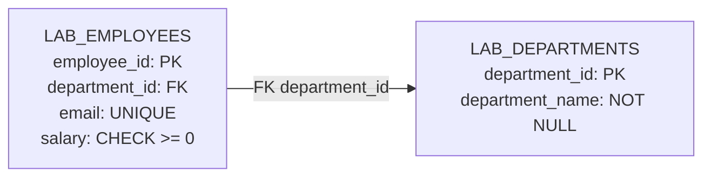
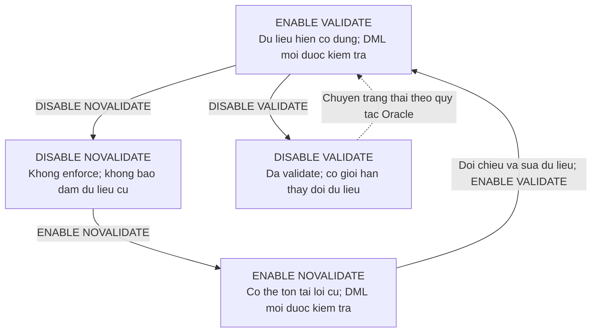

# ENABLE, DISABLE, VALIDATE, NOVALIDATE và RELY trong Oracle

Khi tạo bảng Oracle, ràng buộc (*constraint*) là một trong những lớp bảo vệ quan trọng nhất của dữ liệu quan hệ. Khóa chính ngăn trùng định danh, khóa ngoại liên kết bảng con với bảng cha, `UNIQUE` ngăn trùng giá trị cần duy nhất, còn `CHECK` và `NOT NULL` giới hạn miền dữ liệu. Nhưng một ràng buộc không chỉ có hai trạng thái “tồn tại” hoặc “không tồn tại”: Oracle cho phép quản trị viên **bật/tắt thực thi, kiểm tra hoặc chưa kiểm tra dữ liệu đã có**, và trong một số hoàn cảnh **đánh dấu ràng buộc được tin cậy cho query rewrite**.

Năm từ khóa của bài học thuộc hai nhóm khác nhau:

- **`ENABLE` / `DISABLE`:** Oracle có **thực thi kiểm tra ràng buộc đối với thao tác dữ liệu** hay không?
- **`VALIDATE` / `NOVALIDATE`:** Oracle có **xác nhận toàn bộ dữ liệu hiện có thỏa ràng buộc** hay không?
- **`RELY` / `NORELY`:** Trong điều kiện phù hợp, Oracle có thể **tin thông tin ràng buộc chưa được validate để phục vụ tối ưu hóa truy vấn** hay không? Đây **không phải** công tắc bật kiểm tra dữ liệu.

Những trạng thái này đặc biệt hữu ích khi nhập dữ liệu lớn, chuyển hệ thống cũ sang một schema mới, làm sạch dữ liệu lịch sử hoặc xây dựng kho dữ liệu. Tuy nhiên, nếu dùng sai, chúng có thể cho phép dữ liệu vi phạm tồn tại trong bảng trong khi người vận hành tưởng ràng buộc vẫn đang bảo vệ toàn bộ bảng.

Bài học triển khai trên Oracle Database trong chủ đề **Bảng và ràng buộc** của *Database Engine Relational Oracle*. Ví dụ sử dụng hai bảng `LAB_DEPARTMENTS` và `LAB_EMPLOYEES` trong một schema thực hành. Chỉ thực thi lệnh quản trị ràng buộc trên bảng bạn sở hữu hoặc có quyền phù hợp; **không tắt constraint ở hệ thống thật** để thử nghiệm.

## 1. Vai trò của constraint trong mô hình quan hệ

Trước khi thay đổi trạng thái, cần biết ràng buộc đang bảo đảm điều gì.

| Loại ràng buộc | Ký hiệu trong `USER_CONSTRAINTS` | Quy tắc dữ liệu |
| --- | --- | --- |
| **PRIMARY KEY** | `P` | Mỗi hàng có khóa không `NULL` và duy nhất; Oracle thường tạo/dùng index hỗ trợ. |
| **UNIQUE** | `U` | Các giá trị khóa cần duy nhất theo ngữ nghĩa `NULL` của Oracle; có thể có giá trị `NULL` khi cột không khai báo `NOT NULL`. |
| **FOREIGN KEY** | `R` | Giá trị khóa ngoại khác `NULL` phải khớp khóa được tham chiếu ở bảng cha, trừ những trường hợp ngữ nghĩa khóa ghép/`NULL` tương ứng. |
| **CHECK** | `C` | Biểu thức điều kiện không được cho kết quả `FALSE`; `TRUE` hoặc `UNKNOWN` do `NULL` thường không vi phạm `CHECK`. |
| **NOT NULL** | Thường được biểu diễn như ràng buộc loại `C` trong dictionary | Cột bắt buộc có giá trị khác `NULL`. |

Ví dụ mô hình:



Nếu constraint đang `ENABLE VALIDATE`, Oracle không chỉ có định nghĩa ràng buộc mà còn xác nhận tính đúng đắn của các hàng hiện có và thực thi đối với thao tác DML phù hợp. Khi chuyển sang một trạng thái khác, mức bảo đảm đó có thể thay đổi đáng kể.

**Phạm vi ràng buộc** luôn thuộc bảng/schema trong đúng container của Oracle. Nếu làm việc trong kiến trúc CDB/PDB, hãy kiểm tra session đã kết nối tới **PDB thực hành** trước khi chạy DDL. Thay đổi trạng thái constraint không đồng nghĩa thay đổi phân quyền user: `GRANT` và `REVOKE` là một cơ chế khác.

## 2. Hai trục độc lập: thực thi và xác minh

Đọc trạng thái constraint như một cặp:

1. **`ENABLE` / `DISABLE`**: có áp dụng cơ chế kiểm tra/bảo vệ khi dữ liệu được ghi hay không?
2. **`VALIDATE` / `NOVALIDATE`**: có xác nhận dữ liệu **đang tồn tại** đều phù hợp hay không?

Kết hợp chúng tạo ra bốn trạng thái hay gặp:

| Trạng thái | Dữ liệu hiện có | DML mới hoặc thay đổi | Ý nghĩa thực tế |
| --- | --- | --- | --- |
| **`ENABLE VALIDATE`** | Được kiểm tra và bảo đảm hợp lệ theo constraint | Được Oracle kiểm tra/thực thi | Trạng thái đáng tin cậy nhất cho dữ liệu OLTP thông thường. |
| **`ENABLE NOVALIDATE`** | **Chưa được Oracle xác nhận toàn bộ**; có thể có hàng vi phạm lịch sử | Các thay đổi mới thuộc phạm vi kiểm tra vẫn được thực thi ràng buộc | Phù hợp giai đoạn chuyển tiếp khi muốn chặn vi phạm mới trước khi dọn hết dữ liệu cũ. |
| **`DISABLE NOVALIDATE`** | Không có bảo đảm xác minh hiện tại | Ràng buộc không được thực thi | Phù hợp một số quy trình nạp/bảo trì có kiểm soát, rủi ro phát sinh dữ liệu sai cao. |
| **`DISABLE VALIDATE`** | Trạng thái đã được xác minh theo constraint | Không hoạt động như `ENABLE`; có **hạn chế DML/DDL đặc biệt**, nhất là với các cột bị ràng buộc | Trạng thái chuyên biệt cho một số luồng kho dữ liệu/quản trị; không phải cách “tắt kiểm tra hoàn toàn nhưng cho sửa tự do”. |



Không phải mọi kiểu ràng buộc, mọi trạng thái hiện tại và mọi phiên bản Oracle đều cho phép chuyển theo cùng cách hoặc cùng chi phí. Ví dụ **PRIMARY KEY/UNIQUE** thường có index hỗ trợ; disable/re-enable có thể liên quan việc giữ, xóa, xây dựng lại index hoặc kiểm tra khóa trùng. **FOREIGN KEY** phụ thuộc khóa được tham chiếu, và **NOT NULL** có các quy tắc thay đổi riêng. Trước thao tác thật, cần kiểm tra DDL hiện có, dữ liệu, index và các constraint liên quan.

### ENABLE không có nghĩa dữ liệu cũ đều đúng

Đây là nhầm lẫn quan trọng nhất về `ENABLE NOVALIDATE`. Giả sử trước đó đã tắt một `CHECK` và nhập một hàng `salary = -50`. Khi bật:

```sql
ALTER TABLE lab_employees
ENABLE NOVALIDATE CONSTRAINT ck_lab_emp_salary;
```

Oracle sẽ kiểm tra ràng buộc đối với những thao tác dữ liệu mới phù hợp, nhưng **không quay lại quét và chứng nhận mọi hàng cũ** chỉ vì `ENABLE`. Hàng có lương âm vẫn có thể tồn tại. Dữ liệu “mới không sai thêm” **khác** với “toàn bảng đã đúng”.

## 3. Tạo các bảng dùng chung cho bài thực hành

Ví dụ được thực hiện trong schema `LAB_USER` hoặc một tài khoản thực hành tương đương có `CREATE TABLE` và quota trên permanent tablespace. Không cần quyền `SYSDBA`. Câu lệnh `CREATE TABLE` và `ALTER TABLE` là **DDL** và có cơ chế *implicit commit* của Oracle; không xen chúng vào transaction đang mong muốn `ROLLBACK` toàn bộ.

```sql
CREATE TABLE lab_departments (
    department_id   NUMBER(6) CONSTRAINT pk_lab_dept PRIMARY KEY,
    department_name VARCHAR2(100 CHAR) NOT NULL
);

CREATE TABLE lab_employees (
    employee_id   NUMBER(8) CONSTRAINT pk_lab_emp PRIMARY KEY,
    department_id NUMBER(6) NOT NULL,
    email         VARCHAR2(180 CHAR) NOT NULL,
    salary        NUMBER(12,2) NOT NULL,
    CONSTRAINT uq_lab_emp_email UNIQUE (email),
    CONSTRAINT ck_lab_emp_salary CHECK (salary >= 0),
    CONSTRAINT fk_lab_emp_dept FOREIGN KEY (department_id)
        REFERENCES lab_departments (department_id)
);

INSERT INTO lab_departments (department_id, department_name)
VALUES (10, 'Engineering');

INSERT INTO lab_departments (department_id, department_name)
VALUES (20, 'Operations');

INSERT INTO lab_employees (
    employee_id, department_id, email, salary
) VALUES (1, 10, 'alice@example.test', 1500);

COMMIT;
```

Các ràng buộc đặt tên rõ ràng để có thể quản trị sau này. Trong trường hợp bình thường, constraint tạo mới sẽ ở trạng thái thực thi và đã được xác minh theo quy tắc của câu DDL.

Xem metadata của bảng:

```sql
SELECT constraint_name,
       constraint_type,
       status,
       validated,
       NVL(rely, 'NORELY') AS rely_state,
       deferrable,
       deferred
FROM user_constraints
WHERE table_name = 'LAB_EMPLOYEES'
ORDER BY constraint_type, constraint_name;
```

Các trường đáng chú ý:

- `STATUS` cho biết `ENABLED` hay `DISABLED`.
- `VALIDATED` cho biết `VALIDATED` hay `NOT VALIDATED`.
- `RELY` cho biết ràng buộc được đánh dấu tin cậy cho một số mục đích query rewrite trong trạng thái hỗ trợ hay không.
- `DEFERRABLE` và `DEFERRED` liên quan **thời điểm kiểm tra trong transaction**, là khái niệm khác với `ENABLE`/`VALIDATE`.

Vì `NOT NULL` cũng xuất hiện trong dictionary như constraint, kết quả có thể gồm nhiều hàng hơn các tên do bạn đặt trực tiếp. Tên constraint do Oracle tự sinh thường có dạng `SYS_C...`.

## 4. ENABLE VALIDATE: thực thi và kiểm tra toàn bộ dữ liệu

`ENABLE VALIDATE` là lựa chọn mặc định nên hướng tới khi dữ liệu được dùng cho nghiệp vụ cần toàn vẹn.

```sql
ALTER TABLE lab_employees
ENABLE VALIDATE CONSTRAINT ck_lab_emp_salary;
```

Oracle phải bảo đảm:

1. **Dữ liệu hiện có** thỏa `salary >= 0`.
2. **Các DML liên quan tiếp theo** không thể đưa bảng vào trạng thái vi phạm ràng buộc.

Nếu bảng đang chứa lương âm do từng disable ràng buộc, lệnh validate sẽ thất bại; bạn phải sửa dữ liệu hoặc giải quyết ngoại lệ trước khi yêu cầu toàn vẹn mạnh hơn.

Với **FOREIGN KEY**, `ENABLE VALIDATE` tương đương yêu cầu không có hàng con tham chiếu tới khóa cha không tồn tại, theo ngữ nghĩa `NULL` và khóa ghép của Oracle. Với **PRIMARY KEY/UNIQUE**, yêu cầu khóa hợp lệ, không có các giá trị trùng vi phạm; với **CHECK**, điều kiện phải đúng theo ngữ nghĩa `TRUE`/`UNKNOWN`. Không thể thay validation bằng việc xem vài hàng mẫu.

### Chi phí trên bảng lớn

Validate dữ liệu hiện có có thể cần quét dữ liệu và thực hiện kiểm tra quan hệ/index; trên bảng hàng trăm triệu dòng, thời gian và tài nguyên đáng kể. Hành vi khóa và mức đồng thời DML trong lúc validate phụ thuộc loại constraint, trạng thái trước đó, phiên bản và các tùy chọn triển khai. Một chiến lược thường dùng là:

```text
Du lieu cu chua sach
    |
    v
ENABLE NOVALIDATE  --> ngan vi pham moi
    |
    v
Kiem tra/lam sach du lieu cu
    |
    v
ENABLE VALIDATE    --> Oracle xac nhan toan bang
```

Quy trình này giúp giới hạn thời gian một constraint **không được thực thi**. Tuy nhiên, `ENABLE NOVALIDATE` không phải chứng nhận dữ liệu đã đúng, và `ENABLE VALIDATE` sau đó vẫn cần Oracle xác minh điều kiện hiện hành.

## 5. DISABLE NOVALIDATE: tắt thực thi, không bảo đảm dữ liệu

Đây là trạng thái minh họa dễ nhất về rủi ro:

```sql
ALTER TABLE lab_employees
DISABLE NOVALIDATE CONSTRAINT ck_lab_emp_salary;
```

Constraint vẫn **tồn tại trong metadata**, nhưng không được thực thi khi DML thay đổi dữ liệu; cũng không có chứng nhận rằng các hàng đang phù hợp. Chèn một hàng lương âm trong lab:

```sql
INSERT INTO lab_employees (
    employee_id, department_id, email, salary
) VALUES (
    2, 10, 'legacy@example.test', -50
);

COMMIT;

SELECT employee_id, salary
FROM lab_employees
WHERE salary < 0;
```

Hàng `employee_id = 2` có thể xuất hiện với `salary = -50`. Như vậy, **định nghĩa `CHECK(salary >= 0)` vẫn nằm trong database**, nhưng không còn bảo vệ dữ liệu khi nó ở trạng thái `DISABLE NOVALIDATE`.

Nếu tắt **FOREIGN KEY** thay vì `CHECK`, hàng con có thể tham chiếu department không tồn tại. Nếu tắt **PRIMARY KEY/UNIQUE**, việc nạp có thể tạo khóa trùng, nhưng tác động tới index và các constraint phụ thuộc cần được phân tích trước.

**Không dùng `DISABLE NOVALIDATE` như cách chữa lỗi `ORA-02290` hay `ORA-02291` trong ứng dụng bình thường.** Thao tác có thể khiến dữ liệu vi phạm lan sang những báo cáo, API và phép join vốn giả định ràng buộc được thực thi.

## 6. ENABLE NOVALIDATE: chặn vi phạm mới, giữ nguyên nợ dữ liệu cũ

Sau khi đã tạo hàng lương âm như phần trước, thử:

```sql
ALTER TABLE lab_employees
ENABLE NOVALIDATE CONSTRAINT ck_lab_emp_salary;
```

Lệnh này yêu cầu Oracle **thực thi `CHECK` đối với thay đổi mới**, nhưng **chưa quét toàn bảng để chứng nhận tất cả hàng cũ**.

Thử chèn hàng mới sai:

```sql
-- Dự kiến bị từ chối: CHECK đang ENABLE.
INSERT INTO lab_employees (
    employee_id, department_id, email, salary
) VALUES (
    3, 10, 'new-bad@example.test', -10
);
-- Thường gặp ORA-02290: check constraint violated.
```

Hàng `employee_id = 2` từ trước vẫn có thể đọc được:

```sql
SELECT employee_id, salary
FROM lab_employees
WHERE salary < 0;
```

Điểm cần phân biệt: `ENABLE NOVALIDATE` không có nghĩa Oracle **cho phép mọi câu UPDATE trên hàng cũ** mà không kiểm tra. Một thay đổi DML tác động đến hàng vi phạm có thể bị từ chối theo cách constraint được thực thi. Vì vậy cần thiết kế bước sửa dữ liệu hợp lệ, thay vì nghĩ NOVALIDATE đồng nghĩa “bỏ qua hàng lịch sử trong mọi thao tác về sau”.

### ENABLE VALIDATE sẽ thất bại nếu dữ liệu cũ còn sai

```sql
-- Chạy khi employee_id = 2 vẫn có salary âm.
ALTER TABLE lab_employees
ENABLE VALIDATE CONSTRAINT ck_lab_emp_salary;
-- Thường gặp ORA-02293: không thể validate CHECK vì dữ liệu vi phạm.
```

Sau đó sửa dữ liệu và thử lại:

```sql
UPDATE lab_employees
SET salary = 0
WHERE employee_id = 2;

COMMIT;

ALTER TABLE lab_employees
ENABLE VALIDATE CONSTRAINT ck_lab_emp_salary;

SELECT constraint_name, status, validated
FROM user_constraints
WHERE table_name = 'LAB_EMPLOYEES'
  AND constraint_name = 'CK_LAB_EMP_SALARY';
```

Kết quả mong đợi của hai cột là `ENABLED` và `VALIDATED`. Tại thời điểm này, dữ liệu đang có đã được Oracle kiểm tra và DML mới tiếp tục được bảo vệ.

### Kiểm tra dữ liệu cũ không thay thế validation chính thức

Bạn có thể xác định hàng sai bằng SQL:

```sql
SELECT employee_id, salary
FROM lab_employees
WHERE salary < 0;
```

Nhưng `SELECT` phát hiện lỗi là bước **chẩn đoán/làm sạch**, không phải trạng thái dictionary `VALIDATED`. Trong môi trường có DML đồng thời, kết quả truy vấn tại một thời điểm có thể khác trạng thái dữ liệu khi thao tác tiếp theo chạy. Chỉ chuyển `ENABLE VALIDATE` thành công mới cho biết Oracle đã kiểm tra constraint theo semantics tương ứng.

## 7. DISABLE VALIDATE: một trạng thái chuyên biệt

`DISABLE VALIDATE` có tên dễ gây hiểu nhầm: **DISABLE** không thực thi constraint theo cách `ENABLE`, nhưng **VALIDATE** là trạng thái được xác minh; Oracle có thể **hạn chế những thay đổi vào cột bị ràng buộc** khi dùng kết hợp này, đặc biệt trong quy trình kho dữ liệu với `PRIMARY KEY`/`UNIQUE`.

Ví dụ cú pháp:

```sql
-- Chỉ dùng trên bảng thử nghiệm nếu đã hiểu loại constraint và hệ quả DML.
ALTER TABLE lab_employees
DISABLE VALIDATE CONSTRAINT uq_lab_emp_email;
```

Đối với một số ràng buộc, Oracle quản lý lại hoặc loại bỏ index hỗ trợ khi disable. Ở trạng thái `DISABLE VALIDATE`, đừng giả định có thể tùy ý `INSERT`/`UPDATE` như khi `DISABLE NOVALIDATE`. Việc sửa các cột tham gia constraint có thể bị từ chối và các thao tác DDL/DML có giới hạn tùy loại constraint.

Trong hệ thống kho dữ liệu, trạng thái này có thể hữu ích khi:

- Dữ liệu đã được xác minh từ một quy trình nạp/bảo trì có kiểm soát.
- Có nhu cầu duy trì thông tin về tính đúng đắn, đồng thời tránh chi phí index/ràng buộc theo một chiến lược triển khai cụ thể.
- Dữ liệu chủ yếu được trao đổi qua thao tác phân vùng hoặc cơ chế ETL đã được thiết kế phù hợp với hạn chế của Oracle.

**Không chọn `DISABLE VALIDATE` chỉ vì muốn “tắt ràng buộc để import cho nhanh”.** Với import có khả năng chứa dữ liệu sai cần làm sạch sau đó, trạng thái `DISABLE NOVALIDATE` hoặc một staging table được thiết kế rõ ràng thường dễ diễn giải hơn. Hãy để DBA quyết định trạng thái và chiến lược index trong quá trình nạp lớn.

## 8. RELY và NORELY: đánh dấu tính đáng tin cậy cho query rewrite

**`RELY` không phải một trạng thái thứ năm thay thế bốn tổ hợp bên trên**. Nó là **thông tin về việc có thể dựa vào constraint chưa validate** trong một số cơ chế tối ưu hóa/truy vấn, đặc biệt **query rewrite** của Oracle. Với constraint đã `ENABLE VALIDATE`, Oracle đã có chứng cứ toàn vẹn chính thức nên đánh dấu RELY không tạo thêm bảo đảm dữ liệu.

Hiểu đúng ba câu hỏi:

| Câu hỏi | Cơ chế trả lời |
| --- | --- |
| Có chặn DML vi phạm không? | `ENABLE`/`DISABLE` |
| Các hàng hiện có đã được Oracle xác minh chưa? | `VALIDATE`/`NOVALIDATE` |
| Có cho optimizer/query rewrite dựa vào constraint chưa validate theo chính sách trust phù hợp không? | `RELY`/`NORELY` cùng cấu hình query rewrite |

Khi `RELY` được đặt cho một constraint chưa validate, **Oracle không tự quét bảng để kiểm tra**. DBA/ETL đang đưa ra một khẳng định rằng quan hệ dữ liệu đủ đáng tin theo chính sách hệ thống. Nếu khẳng định **sai**, một số phép rewrite dựa trên thông tin quan hệ giả định có thể cho kết quả không phù hợp dữ liệu thực.

### Ví dụ RELY trên FOREIGN KEY chưa validate

Đầu tiên, chỉ thực hiện khi dữ liệu hiện có đáp ứng quan hệ cha–con trong ví dụ:

```sql
-- Kiểm tra các hàng mồ côi (với department_id NOT NULL trong bảng mẫu).
SELECT e.employee_id, e.department_id
FROM lab_employees e
LEFT JOIN lab_departments d
  ON d.department_id = e.department_id
WHERE d.department_id IS NULL;
```

Nếu đã xử lý các hàng vi phạm và đang dùng workflow kiểm soát dữ liệu, có thể đưa foreign key về `NOVALIDATE`, sau đó đặt `RELY`:

```sql
-- Ví dụ minh họa trên bảng thử nghiệm, không chạy trên hệ thống thật.
ALTER TABLE lab_employees
DISABLE NOVALIDATE CONSTRAINT fk_lab_emp_dept;

ALTER TABLE lab_employees
ENABLE NOVALIDATE CONSTRAINT fk_lab_emp_dept;

ALTER TABLE lab_employees
MODIFY CONSTRAINT fk_lab_emp_dept RELY;

SELECT constraint_name, status, validated, NVL(rely, 'NORELY') AS rely_state
FROM user_constraints
WHERE table_name = 'LAB_EMPLOYEES'
  AND constraint_name = 'FK_LAB_EMP_DEPT';
```

Lúc này:

- `ENABLE` vẫn là cơ chế thực thi những thao tác dữ liệu mới liên quan.
- `NOVALIDATE` vẫn có nghĩa chưa có chứng nhận toàn bộ các hàng hiện có.
- `RELY` cung cấp metadata tin cậy có thể được cơ chế query rewrite xem xét trong điều kiện cho phép.

**Đừng suy rằng truy vấn kiểm tra thủ công trả 0 hàng thì RELY luôn an toàn.** Nếu việc kiểm tra không bao phủ mọi điều kiện hoặc có ghi dữ liệu đồng thời, dữ liệu có thể thay đổi. Trong một pipeline trưởng thành, chỉ đánh dấu RELY khi quy trình kiểm soát chất lượng dữ liệu có thể chứng minh giả định và quy tắc cập nhật được duy trì.

### Khi nào query rewrite sử dụng RELY?

Các hệ thống có **materialized view** hoặc cơ chế query rewrite có thể dựa trên constraint để suy ra quan hệ giữa các bảng và thay đổi cách đáp ứng câu truy vấn. Oracle có các mức `QUERY_REWRITE_INTEGRITY`, thường gặp:

- **`ENFORCED`:** giới hạn rewrite theo những bảo đảm được database thực thi.
- **`TRUSTED`:** có thể tin thêm một số quan hệ/constraint do hệ thống khai báo, theo các quy tắc hỗ trợ.
- **`STALE_TOLERATED`:** có thể cho phép những lựa chọn rewrite kém nghiêm ngặt hơn, kể cả dùng dữ liệu vật hóa cũ trong các tình huống thích hợp.

`RELY` phát huy vai trò khi constraint ở trạng thái **NOVALIDATE** và môi trường cho phép optimizer tin các thông tin đó. **RELY không đảm bảo optimizer luôn rewrite một truy vấn**, vì còn phụ thuộc `QUERY_REWRITE_ENABLED`, plan, khả năng sử dụng materialized view, loại constraint và phiên bản Oracle.

DBA có thể **quan sát** tham số ở phiên đã có quyền:

```sql
SELECT name, value
FROM v$parameter
WHERE name IN (
    'query_rewrite_enabled',
    'query_rewrite_integrity'
)
ORDER BY name;
```

Đây là việc đọc cấu hình, không phải đề nghị bật các mức trust rộng hơn. **Không thay `QUERY_REWRITE_INTEGRITY` thành `TRUSTED` hoặc `STALE_TOLERATED` trên môi trường dùng chung chỉ để trình diễn RELY.**

### Bỏ RELY và đưa constraint về trạng thái mạnh

Khi không còn chủ đích dựa vào constraint chưa validate:

```sql
ALTER TABLE lab_employees
MODIFY CONSTRAINT fk_lab_emp_dept NORELY;

ALTER TABLE lab_employees
ENABLE VALIDATE CONSTRAINT fk_lab_emp_dept;
```

`NORELY` loại bỏ lựa chọn tin metadata chưa validate cho mục đích thích hợp; `ENABLE VALIDATE` mới là bước Oracle xác nhận dữ liệu và thực thi constraint theo mức bảo đảm mạnh. Tùy loại constraint và trạng thái, Oracle có thể quản lý khác nhau việc hiển thị metadata RELY khi đã validated; hãy dùng `USER_CONSTRAINTS` để đọc kết quả thực tế.

## 9. Các ràng buộc khác nhau có tác động vận hành khác nhau

Không nên áp dụng máy móc cùng một playbook cho mọi constraint.

### CHECK và NOT NULL

`CHECK` là ví dụ thuận tiện để quan sát `ENABLE NOVALIDATE` vì điều kiện thường chỉ phụ thuộc một hàng. Tuy nhiên, `CHECK(salary >= 0)` **không tự cấm `NULL`**: một biểu thức CHECK đánh giá là `UNKNOWN` do `NULL` thường không bị xem là vi phạm. Muốn cột bắt buộc có giá trị phải thêm `NOT NULL` hoặc biểu thức thích hợp.

Các constraint `NOT NULL` có semantics riêng và được Oracle thể hiện qua metadata ràng buộc. Việc thay trạng thái NOT NULL phải cân nhắc thao tác `ALTER TABLE ... MODIFY column ...` và những hạn chế đặc thù, không mặc định mọi cú pháp dành cho CHECK được chấp nhận y hệt.

### PRIMARY KEY và UNIQUE

`PRIMARY KEY` bảo đảm duy nhất và không NULL; `UNIQUE` bảo đảm tính duy nhất theo ngữ nghĩa Oracle. Oracle thường cần **index hỗ trợ** để thực thi hai kiểu constraint này.

Khi disable, Oracle có thể **loại bỏ index unique được tạo để phục vụ constraint** hoặc giữ/sử dụng index khác tùy cách tạo và metadata. Bật lại có thể cần xây dựng index hoặc phát hiện giá trị trùng đã lọt vào khi disabled. Vì vậy:

- Đừng giả định `DISABLE`/`ENABLE` PK chỉ đổi một cờ metadata không tốn chi phí.
- Kiểm tra `USER_INDEXES` và `USER_CONSTRAINTS.INDEX_NAME` nếu cần phân tích index hỗ trợ.
- Khi cần chiến lược giữ nonunique index phục vụ chuyển trạng thái constraint trên bảng lớn, DBA phải thiết kế từ đầu và xác nhận phù hợp phiên bản.

Ví dụ quan sát:

```sql
SELECT c.constraint_name,
       c.constraint_type,
       c.status,
       c.validated,
       c.index_name
FROM user_constraints c
WHERE c.table_name = 'LAB_EMPLOYEES'
  AND c.constraint_type IN ('P', 'U');

SELECT index_name, uniqueness, status
FROM user_indexes
WHERE table_name = 'LAB_EMPLOYEES';
```

### FOREIGN KEY

`FOREIGN KEY` liên quan **hai bảng**. Khi validate, Oracle cần bảo đảm giá trị khóa ngoại hợp lệ theo khóa được tham chiếu. Nếu từng disable trong quá trình nạp, kiểm tra mồ côi là bắt buộc trước khi tin dữ liệu:

```sql
SELECT e.employee_id, e.department_id
FROM lab_employees e
LEFT JOIN lab_departments d
  ON d.department_id = e.department_id
WHERE d.department_id IS NULL;
```

Nếu câu truy vấn trả hàng, đang có khóa ngoại không khớp bảng cha (với mô hình department_id bắt buộc trong ví dụ). Trạng thái `ENABLE NOVALIDATE` có thể **bảo vệ thao tác mới** trong khi để các orphan row cũ tồn tại; `ENABLE VALIDATE` sẽ từ chối nếu còn orphan row.

Oracle **không mặc định tạo index cho mọi cột khóa ngoại** chỉ vì thêm FK. Trên hệ thống có cập nhật/xóa khóa cha và nhiều giao dịch đồng thời, việc thiết kế index cho foreign key có thể ảnh hưởng hiệu năng và locking. Cần phân tích workload thực tế; trạng thái ENABLE/DISABLE không thay thế index design.

## 10. DEFERRABLE không phải VALIDATE hay NOVALIDATE

Một khái niệm thường bị trộn với chủ đề này là **kiểm tra ràng buộc trì hoãn** (*deferrable constraint*).

- `ENABLE`: có thực thi constraint hay không.
- `VALIDATE`: dữ liệu đang có đã được xác minh hay chưa.
- `DEFERRABLE`/`NOT DEFERRABLE`: constraint **có thể** bị trì hoãn thời điểm kiểm tra trong một transaction hay không.
- `INITIALLY IMMEDIATE`/`INITIALLY DEFERRED`: thời điểm kiểm tra mặc định nếu constraint được khai báo deferrable.

Ví dụ một quan hệ FK được thiết kế cho phép kiểm tra cuối transaction:

```sql
CREATE TABLE lab_def_parent (
    id NUMBER(6) PRIMARY KEY
);

CREATE TABLE lab_def_child (
    id        NUMBER(6) PRIMARY KEY,
    parent_id NUMBER(6),
    CONSTRAINT fk_lab_def_child_parent
        FOREIGN KEY (parent_id)
        REFERENCES lab_def_parent (id)
        DEFERRABLE INITIALLY IMMEDIATE
);
```

Trong transaction cần tạo hàng con trước rồi mới tạo hàng cha, ứng dụng có thể **chủ động trì hoãn** constraint deferrable:

```sql
SET CONSTRAINTS fk_lab_def_child_parent DEFERRED;

INSERT INTO lab_def_child (id, parent_id)
VALUES (1, 100);

INSERT INTO lab_def_parent (id)
VALUES (100);

COMMIT;
```

`SET CONSTRAINTS ... DEFERRED` là lệnh SQL quản lý thời điểm kiểm tra trong transaction khi constraint có `DEFERRABLE`. Nếu dữ liệu vẫn vi phạm tại thời điểm phải kiểm tra/commit, Oracle không thể xác nhận giao dịch đó như thể ràng buộc hợp lệ. Ví dụ trên **không phải** `ENABLE NOVALIDATE`: FK vẫn có thể là `ENABLE VALIDATE`, chỉ khác thời điểm kiểm tra.

Không dùng deferrable để thay cho bước làm sạch dữ liệu cũ trong ETL; đây là hai bài toán khác nhau.

## 11. Quy trình nạp dữ liệu lớn hoặc chuyển đổi hệ thống

Giả sử một hệ thống cũ có bảng nhân viên với một số department không tồn tại. Đội dự án muốn nhập dữ liệu vào Oracle và dần đưa bảng về trạng thái toàn vẹn. Có nhiều cách thực hiện, trong đó an toàn nhất thường là tách **staging** khỏi bảng nghiệp vụ chính.

### Phương án A: staging table trước, dữ liệu chuẩn sau

1. Nạp dữ liệu gốc vào bảng staging có cấu trúc đủ linh hoạt để lưu cả giá trị cần làm sạch.
2. Phát hiện lỗi `NULL`, khóa trùng, giá trị ngoài miền và orphan foreign key bằng SQL đối chiếu.
3. Ghi báo cáo lỗi, quy tắc sửa, nguồn dữ liệu và người phê duyệt; xử lý phần bị loại hoặc cần bổ sung.
4. Đưa dữ liệu sạch vào bảng đích **`ENABLE VALIDATE`** theo batch/transaction phù hợp.
5. Theo dõi số hàng đã nạp, từ chối và kiểm tra đối chiếu sau nạp.

Ưu điểm là bảng nghiệp vụ ít có giai đoạn constraint không thực thi. Nhược điểm là phải thiết kế thêm staging và bước biến đổi dữ liệu.

### Phương án B: chuyển trạng thái trên bảng đích có kiểm soát

Trong trường hợp cần dùng trực tiếp bảng đích và đã có kế hoạch gián đoạn/khóa phù hợp:

```text
Bat dau: ENABLE VALIDATE
    |
    | DBA phe duyet maintenance window va phuong an khoi phuc
    v
DISABLE NOVALIDATE (neu that su can)
    |
    | Nap du lieu, ghi nhan log, phan tich loi
    v
ENABLE NOVALIDATE
    |
    | Chan vi pham moi; don du lieu cu
    | Doi chieu key trung, FK orphan, CHECK invalid
    v
ENABLE VALIDATE
    |
    | Xac nhan dictionary va so lieu, ket thuc maintenance
    v
Van hanh binh thuong
```

Đây là **mô hình quyết định**, không phải khuyến nghị disable mọi constraint khi import. Có hệ thống nên giữ PK và UNIQUE luôn enabled, chỉ xử lý một vài FK/CHECK; có hệ thống cần tính tới partition exchange load, index rebuild hoặc tính toàn vẹn liên bảng ở nhiều batch. **Đừng tắt `PRIMARY KEY` hoặc `FOREIGN KEY` của bảng sản xuất đang được ứng dụng ghi liên tục** mà chưa có kế hoạch kiểm soát nhất quán.

### Mẫu truy vấn phát hiện lỗi trước khi validate

Lương âm:

```sql
SELECT employee_id, salary
FROM lab_employees
WHERE salary < 0;
```

Khóa ngoại mồ côi:

```sql
SELECT e.department_id, COUNT(*) AS affected_rows
FROM lab_employees e
LEFT JOIN lab_departments d
  ON d.department_id = e.department_id
WHERE d.department_id IS NULL
GROUP BY e.department_id;
```

Email trùng:

```sql
SELECT email, COUNT(*) AS duplicate_count
FROM lab_employees
GROUP BY email
HAVING COUNT(*) > 1;
```

Ví dụ `EMAIL` được khai báo `NOT NULL`, vì vậy phần đếm trùng không phải xử lý `NULL`. Nếu UNIQUE là khóa ghép với các cột nullable, cần hiểu rõ semantics tính duy nhất của Oracle đối với khóa ghép và giá trị NULL trước khi viết truy vấn đối chiếu.

Những truy vấn trên giúp tìm dữ liệu không phù hợp trước khi kích hoạt `ENABLE VALIDATE`. **Kết quả bằng 0 không tự đánh dấu constraint thành VALIDATED**: chỉ khi Oracle thực hiện lệnh validation thành công, dictionary mới phản ánh trạng thái xác minh.

## 12. Quan sát trạng thái bằng data dictionary

Khi một quản trị viên nói “constraint đã bật rồi”, điều nên xác nhận là **cả `STATUS` và `VALIDATED`**, không chỉ một cột.

```sql
SELECT table_name,
       constraint_name,
       constraint_type,
       status,
       validated,
       NVL(rely, 'NORELY') AS rely_state,
       deferrable,
       deferred
FROM user_constraints
WHERE table_name IN ('LAB_DEPARTMENTS', 'LAB_EMPLOYEES')
ORDER BY table_name, constraint_name;
```

Nếu truy vấn do DBA chạy cho nhiều schema:

```sql
SELECT owner,
       table_name,
       constraint_name,
       status,
       validated,
       NVL(rely, 'NORELY') AS rely_state
FROM dba_constraints
WHERE owner = 'LAB_USER'
  AND table_name = 'LAB_EMPLOYEES'
ORDER BY constraint_name;
```

`USER_CONSTRAINTS` chỉ dữ liệu constraint thuộc schema hiện tại, còn `DBA_CONSTRAINTS` cần quyền xem dictionary tương ứng. Trong môi trường multitenant, chạy truy vấn trong đúng PDB; DBA root có thể dùng những view có `CON_ID` khi cần so sánh nhiều container.

### Tìm những constraint chưa đạt trạng thái mong muốn

Trong schema thực hành:

```sql
SELECT table_name, constraint_name, status, validated,
       NVL(rely, 'NORELY') AS rely_state
FROM user_constraints
WHERE status = 'DISABLED'
   OR validated = 'NOT VALIDATED'
   OR rely = 'RELY'
ORDER BY table_name, constraint_name;
```

Câu SQL này giúp phát hiện **trạng thái cần điều tra**, không mặc định kết luận mọi dòng đều sai. Một số môi trường kho dữ liệu chủ động dùng NOVALIDATE/RELY. Khi kiểm tra hệ thống, phải đối chiếu với **chính sách được phê duyệt** và nhiệm vụ từng bảng.

Để xem các cột thuộc từng constraint:

```sql
SELECT constraint_name,
       column_name,
       position
FROM user_cons_columns
WHERE table_name = 'LAB_EMPLOYEES'
ORDER BY constraint_name, position;
```

Đối với FK, `USER_CONSTRAINTS.R_CONSTRAINT_NAME` tham chiếu constraint khóa được dùng tại bảng cha; có thể join tới metadata constraint tương ứng để phân tích mối quan hệ. Không dựa vào tên FK tự đặt để suy bảng cha, đặc biệt trong schema có nhiều khóa thay thế.

## 13. Lỗi Oracle thường gặp khi chuyển trạng thái

| Mã lỗi / triệu chứng | Nguyên nhân điển hình | Hướng xử lý |
| --- | --- | --- |
| `ORA-02290` | DML vi phạm một `CHECK` đang được thực thi. | Xác định biểu thức check; sửa dữ liệu đầu vào, không mặc định disable constraint. |
| `ORA-02291` | Tham chiếu FK đến khóa cha không tồn tại. | Nạp cha đúng thứ tự hoặc sửa giá trị FK; xem dữ liệu transaction. |
| `ORA-02292` | Xóa/sửa khóa cha khi còn bản ghi con được tham chiếu. | Quyết định chính sách xóa/cập nhật quan hệ; không tắt FK tùy tiện. |
| `ORA-00001` | Vi phạm tính duy nhất của PK/UNIQUE đang enforced. | Xử lý khóa trùng, thiết kế idempotent insert/merge. |
| `ORA-02293` | Không thể validate vì `CHECK` đang có hàng vi phạm. | Truy vấn điều kiện sai, sửa dữ liệu rồi validate lại. |
| `ORA-02298` | Không thể validate foreign key vì parent key không được tìm thấy. | Truy vấn orphan rows, nạp/sửa bảng cha/bảng con. |
| `ORA-02299` hoặc lỗi validate uniqueness tương ứng | Có khóa trùng khi validate UNIQUE. | Tìm nhóm duplicate, giải quyết theo quy tắc nghiệp vụ. |
| `ORA-02437` | Không thể validate PRIMARY KEY khi dữ liệu không thỏa khóa. | Xử lý dữ liệu NULL/trùng theo constraint cụ thể. |
| Re-enable PK/UNIQUE mất thời gian hoặc gặp lỗi index | Oracle cần index hỗ trợ, index bị loại bỏ khi disable hoặc không thể tạo do trùng khóa. | Kiểm tra index, constraint và kế hoạch rebuild. |
| Constraint hiển thị `ENABLED` nhưng báo cáo có hàng sai | Đang ở `ENABLE NOVALIDATE`, có vi phạm lịch sử. | Đọc `VALIDATED`; làm sạch và chạy `ENABLE VALIDATE`. |
| RELY được bật nhưng SQL không rewrite | Query rewrite có nhiều điều kiện: cấu hình, plan, materialized view, loại constraint… | Đừng coi RELY là câu lệnh bắt buộc optimizer rewrite. |

Khi chẩn đoán, nên lưu **mã lỗi đầy đủ, tên constraint, container, câu DDL/DML, các phụ thuộc index/FK và snapshot dictionary**. Một lệnh `ENABLE VALIDATE` thất bại cần được xử lý dựa trên nguyên nhân cụ thể, không phải bằng cách bỏ qua lỗi và ghi nhận “đã validate”.

### Vấn đề quan trọng: DDL là ranh giới transaction

Các lệnh `ALTER TABLE ... DISABLE/ENABLE/MODIFY CONSTRAINT` là **DDL**. Oracle thường thực hiện commit ngầm trước một câu DDL và sau một DDL hoàn thành thành công. Vì vậy:

- Không cho rằng có thể chạy `ALTER TABLE ... DISABLE`, nạp hàng sai, rồi `ROLLBACK` để “quay toàn bộ database về trước DDL”.
- Không xen DDL thay đổi constraint vào transaction nghiệp vụ đang mở nếu muốn giữ tính nguyên tử của DML.
- Nếu thao tác quản trị có khả năng thất bại, phải có kế hoạch **trạng thái mong muốn, điều kiện dừng và cách khôi phục**, vì `ROLLBACK` thông thường không phải công cụ đảo ngược mọi thay đổi cấu trúc.

## 14. Bài tập tổng hợp

### Bài tập A — Quan sát bốn trạng thái

Dùng `LAB_EMPLOYEES` và `CK_LAB_EMP_SALARY`:

1. Xác nhận constraint đang `ENABLE VALIDATE` trong `USER_CONSTRAINTS`.
2. Chuyển sang `DISABLE NOVALIDATE`, chèn hàng salary âm, `COMMIT`.
3. Chuyển sang `ENABLE NOVALIDATE` rồi thử chèn một hàng salary âm khác. Ghi nhận lỗi.
4. Chạy `ENABLE VALIDATE` khi còn hàng âm và quan sát lỗi xác minh.
5. Sửa hàng âm thành giá trị hợp lệ, `COMMIT`, rồi `ENABLE VALIDATE` thành công.
6. Truy vấn lại `STATUS`, `VALIDATED` và giải thích sự khác biệt giữa hai lần `ENABLE`.

**Điểm học được:** `ENABLE` là việc thực thi; `VALIDATE` là xác minh toàn bộ dữ liệu cũ. Không thể dùng một từ thay cho từ kia.

### Bài tập B — Trạng thái FK và RELY

1. Xác nhận bảng con tham chiếu department hợp lệ.
2. Trong bảng thử nghiệm, chuyển `FK_LAB_EMP_DEPT` sang `ENABLE NOVALIDATE` theo quy trình được mô tả.
3. Đặt `RELY` và quan sát `USER_CONSTRAINTS.RELY`.
4. Giải thích vì sao RELY không sửa dữ liệu mồ côi nếu dữ liệu thực sự đã sai.
5. Trả về `NORELY`, sau đó `ENABLE VALIDATE`.

**Điểm học được:** RELY là một lựa chọn metadata phục vụ tối ưu hóa/trust trong hoàn cảnh thích hợp, không phải biện pháp bảo vệ DML hoặc công cụ kiểm tra dữ liệu.

### Bài tập C — Thiết kế ETL an toàn

Giả sử batch cần nhập 5 triệu bản ghi con:

- 0,2% hàng có department không tồn tại.
- Có thể có email trùng từ nhiều nguồn.
- Hệ thống online vẫn có người dùng tạo đơn/bản ghi mới.

Hãy so sánh **staging table** với việc trực tiếp `DISABLE NOVALIDATE` constraint trên bảng online. Nêu rủi ro đối với khóa ngoại, uniqueness, giao dịch đồng thời và hệ quả implicit commit của DDL. Thiết kế trình tự xác minh dữ liệu, ghi nhận hàng bị từ chối và điều kiện chuyển về `ENABLE VALIDATE`.

### Bài tập D — Phân tích trạng thái từ dictionary

Cho ba dòng giả định:

| Constraint | STATUS | VALIDATED | RELY |
| --- | --- | --- | --- |
| `PK_ORDER_ID` | `ENABLED` | `VALIDATED` | `NORELY` |
| `FK_ORDER_CUSTOMER` | `ENABLED` | `NOT VALIDATED` | `RELY` |
| `CK_ORDER_AMOUNT` | `DISABLED` | `NOT VALIDATED` | `NORELY` |

Trả lời:

1. Constraint nào đang bảo đảm cả dữ liệu cũ và DML mới? **`PK_ORDER_ID`**.
2. Constraint nào vẫn chặn vi phạm mới nhưng chưa chứng nhận dữ liệu cũ? **`FK_ORDER_CUSTOMER`**.
3. Constraint nào không đang thực thi DML? **`CK_ORDER_AMOUNT`**.
4. `RELY` trên FK có chứng minh mọi order đều thuộc customer tồn tại không? **Không**.
5. Muốn tất cả đều `ENABLE VALIDATE`, cần làm gì? **Kiểm tra/sửa dữ liệu lịch sử, xử lý phụ thuộc và bật validation chính thức**.

### Dọn môi trường học tập

Sau khi không còn cần dữ liệu, đảm bảo các constraint đang được trả về trạng thái `ENABLE VALIDATE` phù hợp rồi xóa **chỉ các bảng thử nghiệm của chính mình**:

```sql
-- Bảng con trước bảng cha.
DROP TABLE lab_def_child PURGE;
DROP TABLE lab_def_parent PURGE;
DROP TABLE lab_employees PURGE;
DROP TABLE lab_departments PURGE;
```

Những lệnh `DROP` là DDL; `PURGE` bỏ qua Recycle Bin. Nếu không tạo hai bảng `LAB_DEF_*` ở phần deferrable thì bỏ hai câu DROP tương ứng. Không chạy trên môi trường cần giữ dữ liệu.

## 15. Câu hỏi tự kiểm tra

1. **`ENABLE` khác `VALIDATE` thế nào?** ENABLE điều khiển thực thi constraint đối với thao tác dữ liệu; VALIDATE xác nhận dữ liệu hiện có đáp ứng ràng buộc.
2. **`ENABLE NOVALIDATE` có cho phép lưu hàng sai đã tồn tại trước đó không?** Có thể; Oracle chưa xác minh toàn bộ dữ liệu lịch sử, dù vẫn kiểm tra thay đổi mới.
3. **`DISABLE NOVALIDATE` nguy hiểm ở đâu?** Constraint không còn được thực thi và không có bảo đảm dữ liệu cũ, nên DML có thể tạo thêm vi phạm.
4. **`DISABLE VALIDATE` có giống `DISABLE NOVALIDATE` không?** Không; nó giữ thông tin validation và có các hạn chế thao tác dữ liệu/constraint riêng, đặc biệt với khóa.
5. **Khi `ENABLE VALIDATE` FK thất bại do `ORA-02298`, nên làm gì?** Tìm khóa con không có cha, sửa dữ liệu hoặc hoàn thiện bảng cha rồi validate lại.
6. **Khi `ENABLE VALIDATE` PK/UNIQUE cần kiểm tra thêm gì?** Giá trị khóa trùng/NULL theo loại constraint và index hỗ trợ.
7. **`RELY` có làm Oracle bắt đầu từ chối các INSERT sai không?** Không. Đó không phải cơ chế enforcement; trạng thái ENABLE/DISABLE mới điều khiển kiểm tra DML.
8. **`RELY` liên quan gì đến query rewrite?** Có thể cho optimizer sử dụng thông tin constraint chưa validate theo cấu hình và điều kiện trusted rewrite, nhưng không bắt buộc mọi query rewrite.
9. **`DEFERRABLE` có phải đồng nghĩa với `NOVALIDATE`?** Không. Deferrable liên quan lúc kiểm tra bên trong transaction; NOVALIDATE liên quan việc xác minh dữ liệu đã có.
10. **`STATUS='ENABLED'` có đủ kết luận toàn bộ bảng đúng không?** Không; phải xem thêm `VALIDATED` và loại constraint.
11. **`ALTER TABLE ... ENABLE CONSTRAINT` có thể rollback như UPDATE không?** Không; đây là DDL có cơ chế implicit commit.
12. **Tại sao nhiều hệ thống nên dùng staging thay vì disable mọi constraint trên bảng nghiệp vụ?** Vì có thể phát hiện/làm sạch dữ liệu lỗi trước khi đưa vào bảng đang phục vụ ứng dụng, hạn chế thời gian không được bảo vệ và giảm rủi ro cạnh tranh dữ liệu.

## Kết luận

Để sử dụng constraint an toàn trong Oracle, đừng hỏi riêng “đã bật chưa?” mà cần hỏi **“có đang thực thi với DML không?”, “dữ liệu lịch sử đã được xác minh chưa?” và “optimizer có được phép tin constraint chưa xác minh không?”**. Ba câu hỏi lần lượt được trả lời bởi **`ENABLE/DISABLE`**, **`VALIDATE/NOVALIDATE`** và **`RELY/NORELY`**.

Với dữ liệu nghiệp vụ thông thường, **`ENABLE VALIDATE`** là trạng thái đích dễ hiểu và có mức bảo đảm mạnh. **`ENABLE NOVALIDATE`** có ích như bước chuyển tiếp khi cần ngăn dữ liệu sai mới trong lúc làm sạch dữ liệu cũ. **`DISABLE NOVALIDATE`** chỉ nên dùng trong workflow nạp/bảo trì được quản lý chặt; **`DISABLE VALIDATE`** có semantics chuyên biệt; và **`RELY`** không thay cho integrity validation. Kết hợp đúng các trạng thái, kiểm tra dictionary và thiết kế pipeline ETL sẽ giúp ràng buộc Oracle trở thành công cụ bảo vệ dữ liệu thay vì một cờ cấu hình dễ gây hiểu nhầm.
