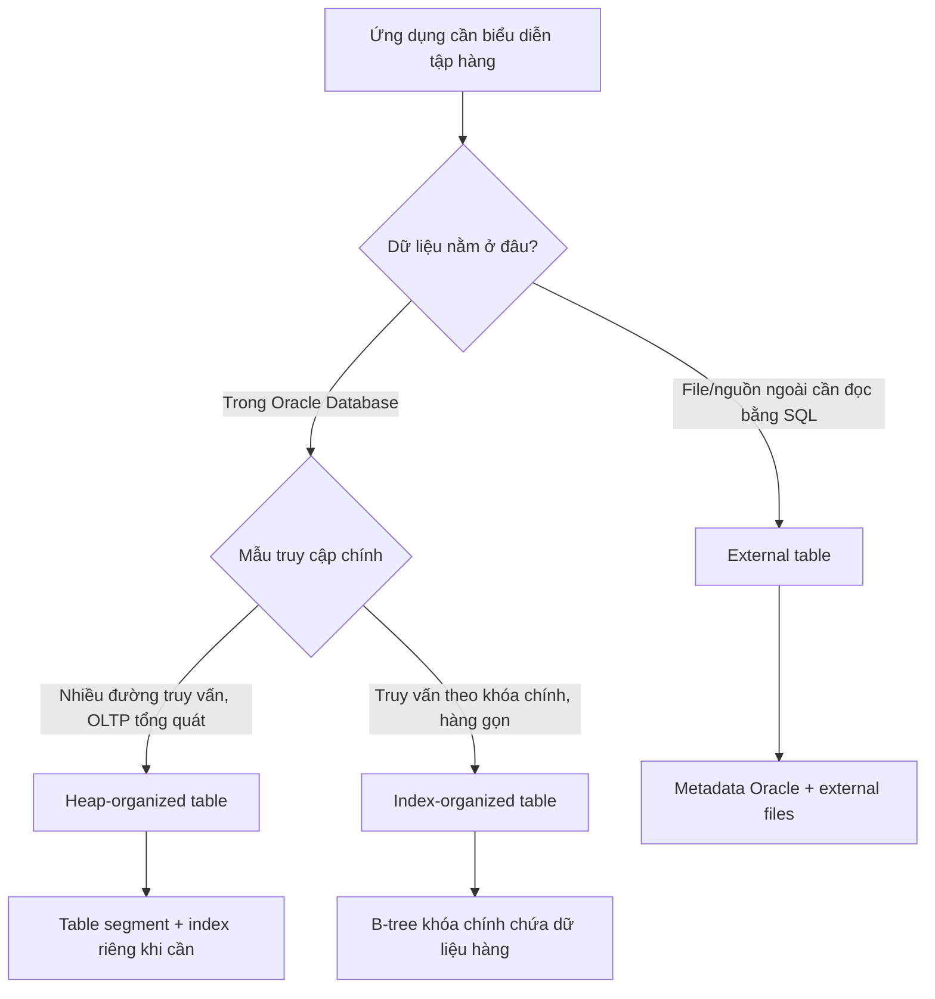
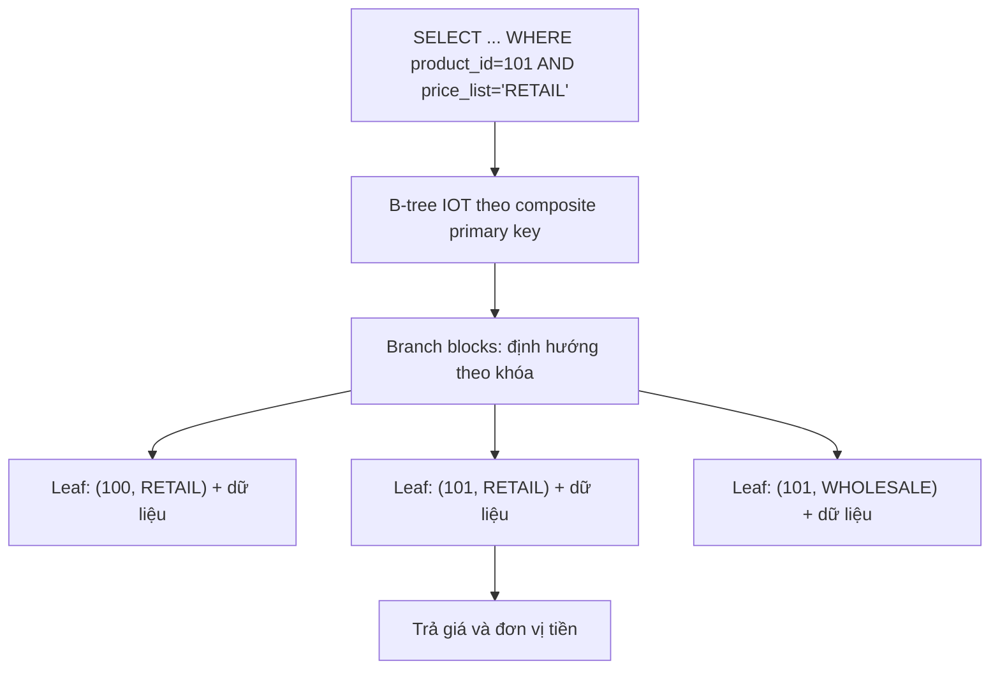
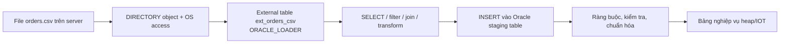
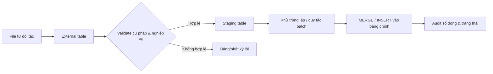

# Index-organized table, external table và lựa chọn cấu trúc bảng trong Oracle Database

Khi viết `CREATE TABLE` trong Oracle Database, chúng ta không chỉ chọn tên cột và kiểu dữ liệu. Một quyết định kiến trúc quan trọng hơn là **Oracle sẽ tổ chức và truy cập dữ liệu bằng cơ chế nào**. Bảng heap thông thường lưu hàng trong một table segment và dùng index như cấu trúc hỗ trợ tìm kiếm. **Index-organized table (IOT)** lưu bản thân dữ liệu hàng trong cấu trúc B-tree được sắp xếp theo khóa chính. **External table** lại cung cấp cách truy vấn dữ liệu nằm ở file hoặc nguồn bên ngoài database bằng cú pháp SQL, thay vì nạp mọi hàng vào một segment Oracle thông thường.

Ba cách tiếp cận giải quyết các nhu cầu khác nhau:

- Ứng dụng quản lý đơn hàng có nhiều truy vấn và cập nhật theo nhiều tiêu chí: thường bắt đầu với **heap-organized table**.
- Danh mục mã ngắn, bảng ánh xạ hay dữ liệu thường được truy vấn bằng **khóa chính**, với hàng tương đối gọn: có thể cân nhắc **index-organized table**.
- Hệ thống nhận file CSV định kỳ từ đối tác, cần xem và chuyển đổi trước khi nhập vào dữ liệu nghiệp vụ: **external table** là một lựa chọn thích hợp.

Mục tiêu của bài học là hiểu cơ chế, đọc và viết DDL, xem vai trò của khóa chính/ràng buộc, nhận biết giới hạn về giao dịch và quản trị, rồi lựa chọn cấu trúc dựa trên **workload** thay vì theo tên gọi hoặc giả định “loại bảng mới luôn nhanh hơn”.

## 1. Bức tranh tổng quan: logic bảng và tổ chức lưu trữ

Trong mô hình quan hệ, **table** đại diện cho tập hàng gồm các cột, có thể kèm **primary key**, **foreign key**, **unique constraint** và **check constraint**. Trong Oracle, cách dữ liệu được lưu và truy cập còn tùy **table organization**.



### 1.1. Tên bảng không nói lên tổ chức của nó

Một bảng `ORDERS` có thể là heap, IOT hoặc một loại cấu trúc chuyên biệt khác tùy DDL. Thông thường, nếu không ghi chỉ thị tổ chức đặc biệt, `CREATE TABLE` tạo **heap-organized table**. Đối với IOT, phải chỉ định `ORGANIZATION INDEX`. Đối với external table dùng cơ chế truyền thống, phải chỉ định `ORGANIZATION EXTERNAL` và các thuộc tính nguồn ngoài.

| Đặc điểm | Heap table | Index-organized table | External table kiểu `ORACLE_LOADER` |
|---|---|---|---|
| Dữ liệu hàng nằm ở đâu? | Table segment trong Oracle | Leaf blocks của B-tree trên khóa chính | File bên ngoài do Oracle truy cập |
| Khóa chính có bắt buộc? | Không bắt buộc về cú pháp, nhưng thường nên có | **Bắt buộc** | Không dùng như bảng OLTP có PK/FK được Oracle thực thi |
| Có thể `INSERT/UPDATE/DELETE` thông thường? | Có | Có | **Không** đối với external table `ORACLE_LOADER` |
| Có index phụ trợ? | Có | Có thể có secondary index | Không dùng index B-tree thông thường trực tiếp trên file như heap |
| Truy vấn theo PK | Có thể dùng index rồi truy cập table | Truy cập B-tree tổ chức dữ liệu | Đọc và phân tích file theo access driver |
| Truy cập theo ROWID | Physical ROWID ở heap thông thường | Logical ROWID dạng `UROWID` | Không có rowid hàng nội bộ như heap thông thường |
| Transaction DML/rollback | Có | Có | Nội dung file ngoài không chịu transaction DML của Oracle |
| Backup datafile Oracle | Bảo vệ dữ liệu thuộc tablespace | Bảo vệ dữ liệu thuộc tablespace | Không tự bao gồm nội dung file ngoài |
| Phù hợp nhất | Tải ứng dụng tổng quát | Đọc/ghi theo khóa chính với hàng phù hợp | Truy vấn hoặc nhập dữ liệu từ nguồn ngoài |

**Quan trọng:** heap, IOT và external table là các **lựa chọn tổ chức/lưu trữ**. Trong khi đó, partitioning, compression, tablespace, index bổ sung hoặc connection pool là những quyết định khác. Chúng có thể tương tác nhưng không phải cùng một trục lựa chọn.

## 2. Heap-organized table: mốc so sánh mặc định

Với heap table, các hàng nằm trong một hoặc nhiều data block của table segment. Oracle không cam kết chúng được lưu theo thứ tự của khóa chính. Khi tạo B-tree index riêng, các index entry lưu giá trị khóa và thông tin định vị hàng, thường là **ROWID**.


Ví dụ:

```sql
CREATE TABLE product_price_heap (
    product_id    NUMBER(12) NOT NULL,
    price_list    VARCHAR2(20 CHAR) NOT NULL,
    unit_price    NUMBER(12, 2) NOT NULL,
    currency_code CHAR(3 CHAR) DEFAULT 'VND' NOT NULL,
    CONSTRAINT pk_product_price_heap
        PRIMARY KEY (product_id, price_list),
    CONSTRAINT ck_product_price_heap
        CHECK (unit_price >= 0)
);
```

Oracle tạo hoặc sử dụng index thích hợp để thực thi primary key theo quy tắc của constraint. **Index primary key không có nghĩa bản thân table segment được lưu theo thứ tự PK**. Các cột dữ liệu khác vẫn nằm trong heap table segment.

Khi truy vấn:

```sql
SELECT unit_price, currency_code
FROM product_price_heap
WHERE product_id = 101
  AND price_list = 'RETAIL';
```

Optimizer có thể truy cập index theo khóa, nhận ROWID, rồi lấy các cột cần thiết từ heap table. Nhưng với bảng nhỏ hoặc yêu cầu khác, nó cũng có thể chọn full table scan. **Không mặc định mọi truy vấn PK đều có cùng execution plan**.

### 2.1. Vì sao heap thường là lựa chọn đầu tiên?

- Không bắt buộc thiết kế mọi hàng theo một thứ tự clustering trên PK.
- Linh hoạt khi ứng dụng lọc/sắp xếp theo nhiều cột khác nhau.
- Phù hợp với bảng có hàng rộng, nhiều cột tùy chọn và các truy vấn báo cáo đa dạng.
- Các ràng buộc quan hệ, index và cơ chế DML thông thường được dùng rộng rãi.
- DBA, công cụ ORM và ứng dụng thường đã quen với tổ chức lưu trữ này.

Tuy nhiên, heap không phải lúc nào cũng tối ưu cho một bảng rất thường xuyên được đọc theo một khóa chính ngắn và hầu như không cần tra cứu theo các đường khác. Đó là một trong các tình huống đáng đánh giá IOT.

## 3. Index-organized table (IOT): dữ liệu là phần của B-tree khóa chính

### 3.1. Cơ chế chính

Trong một **index-organized table**, cấu trúc B-tree tổ chức theo **primary key** chính là cấu trúc lưu dữ liệu hàng. Leaf entry chứa giá trị khóa và dữ liệu tương ứng, thay vì chỉ lưu khóa + physical ROWID trỏ sang một heap table segment độc lập.



Với truy vấn theo toàn bộ khóa chính, Oracle có thể lấy dữ liệu ngay từ cấu trúc B-tree của IOT, không cần bước lấy hàng từ heap table riêng. Với truy vấn theo **tiền tố dẫn đầu** của khóa composite, tính sắp xếp theo khóa cũng có thể hữu ích.

IOT không phải “bảng heap + index được đánh dấu đặc biệt”; đây là **một tổ chức lưu trữ khác**. Vì dữ liệu đi cùng B-tree, kích thước hàng, cách chọn khóa và pattern cập nhật ảnh hưởng trực tiếp tới cấu trúc index.

### 3.2. Tạo IOT bằng `ORGANIZATION INDEX`

Ví dụ bảng danh mục giá có một dòng cho mỗi cặp sản phẩm và bảng giá:

```sql
CREATE TABLE product_price_iot (
    product_id    NUMBER(12) NOT NULL,
    price_list    VARCHAR2(20 CHAR) NOT NULL,
    unit_price    NUMBER(12, 2) NOT NULL,
    currency_code CHAR(3 CHAR) DEFAULT 'VND' NOT NULL,
    updated_at    TIMESTAMP(6),
    CONSTRAINT pk_product_price_iot
        PRIMARY KEY (product_id, price_list),
    CONSTRAINT ck_product_price_iot
        CHECK (unit_price >= 0)
)
ORGANIZATION INDEX;
```

Đặc điểm:

1. `ORGANIZATION INDEX` yêu cầu tổ chức dữ liệu theo dạng IOT.
2. `PRIMARY KEY (product_id, price_list)` là **bắt buộc** với IOT thông thường.
3. Khóa chính gồm hai cột; các hàng được sắp xếp theo thứ tự khóa composite trong B-tree.
4. `unit_price`, `currency_code` và `updated_at` là dữ liệu của hàng, được lưu cùng tổ chức IOT theo giới hạn/cấu hình tương ứng.
5. `CHECK` và `NOT NULL` vẫn có ý nghĩa như trong bảng nghiệp vụ thông thường.

Ví dụ DML:

```sql
INSERT INTO product_price_iot (
    product_id, price_list, unit_price, currency_code, updated_at
)
VALUES (101, 'RETAIL', 125000.00, 'VND', SYSTIMESTAMP);

INSERT INTO product_price_iot (
    product_id, price_list, unit_price, currency_code, updated_at
)
VALUES (101, 'WHOLESALE', 112000.00, 'VND', SYSTIMESTAMP);

INSERT INTO product_price_iot (
    product_id, price_list, unit_price, currency_code, updated_at
)
VALUES (102, 'RETAIL', 89000.00, 'VND', SYSTIMESTAMP);

COMMIT;

SELECT product_id, price_list, unit_price
FROM product_price_iot
WHERE product_id = 101
ORDER BY price_list;
```

Ứng dụng vẫn làm việc với IOT bằng câu SQL thông thường; không cần biết địa chỉ block hay dùng ROWID để truy vấn nghiệp vụ.

### 3.3. Khóa chính là một quyết định về bố trí dữ liệu

Với primary key `(product_id, price_list)`:

- `WHERE product_id = :id` có thể hưởng lợi vì tập hàng cùng `product_id` nằm gần nhau trong thứ tự khóa.
- `WHERE product_id = :id AND price_list = :list` phù hợp với việc tìm đúng một hàng.
- `WHERE price_list = 'RETAIL'` mà không lọc `product_id` không đương nhiên được truy cập hiệu quả chỉ từ thứ tự khóa chính. Có thể cần secondary index hoặc cách thiết kế khác.

Đổi thứ tự khóa thành `(price_list, product_id)` có thể giúp một workload khác, nhưng cũng thay đổi clustering/order của dữ liệu. Đừng chọn thứ tự PK chỉ theo thói quen “ID đi trước”; hãy xét đồng thời **tính duy nhất**, **khối lượng truy vấn theo tiền tố**, **kích thước khóa** và **mức độ thay đổi khóa**.

### 3.4. IOT vẫn có transaction và constraint

IOT là bảng dữ liệu Oracle được quản lý bình thường, không phải một file bên ngoài. Các thao tác:

```sql
UPDATE product_price_iot
SET unit_price = 127000.00,
    updated_at = SYSTIMESTAMP
WHERE product_id = 101
  AND price_list = 'RETAIL';

SAVEPOINT after_price_change;

UPDATE product_price_iot
SET unit_price = -1
WHERE product_id = 102
  AND price_list = 'RETAIL';
```

Lệnh thứ hai bị ràng buộc `CHECK (unit_price >= 0)` từ chối khi tìm được hàng tương ứng. Để phục hồi thay đổi thử nghiệm trước đó, ứng dụng có thể dùng `ROLLBACK` toàn transaction hoặc xử lý theo savepoint phù hợp. `SAVEPOINT` sau lệnh cập nhật thứ nhất không có nghĩa rollback tới savepoint sẽ hoàn tác lệnh thứ nhất; thứ tự điểm lưu cần được hiểu đúng.

Oracle vẫn sử dụng undo, redo, khóa và kiểm soát đồng thời cho DML trên IOT như các bảng Oracle khác. **IOT không có nghĩa tự động nhanh hơn hoặc bỏ qua tính nhất quán giao dịch**.

## 4. ROWID, logical rowid và secondary index của IOT

### 4.1. Heap dùng physical ROWID; IOT dùng logical ROWID

Với heap table, `ROWID` thường mô tả vị trí vật lý của hàng (data object, file, block, slot). Với IOT, vị trí leaf có thể đổi khi B-tree phân tách/cân bằng lại, nên Oracle sử dụng **logical rowid**, thường biểu diễn bằng kiểu `UROWID`.

```sql
SELECT product_id,
       price_list,
       ROWID AS iot_logical_rowid
FROM product_price_iot
ORDER BY product_id, price_list;
```

Tên pseudocolumn vẫn là `ROWID`, nhưng giá trị của IOT không nên được diễn giải bằng những giả định về **physical ROWID 18 ký tự** của heap table. Logical rowid có liên hệ với primary key của hàng và có thể mang thông tin gợi ý vị trí vật lý để hỗ trợ truy cập.

**Không dùng rowid làm khóa nghiệp vụ**. Dù logical rowid mang tính logic hơn physical rowid, nó không thay thế một primary key ổn định trong API, foreign key hoặc message. Khi khóa chính đổi hoặc hàng bị xóa, ý nghĩa định danh và hành vi truy cập cũng thay đổi.

### 4.2. Secondary index của IOT

Một IOT vẫn có thể có index phụ trên cột không nằm ở đầu primary key:

```sql
CREATE INDEX ix_product_price_iot_list
ON product_price_iot (price_list, unit_price);
```

Với heap table, secondary index thường giúp tìm physical ROWID. Với IOT, secondary index cần định vị lại hàng trong tổ chức B-tree và sử dụng **logical rowid** theo cơ chế Oracle, không dựa mãi vào một slot vật lý ổn định.

Vì thế:

- Truy cập theo khóa chính IOT có thể rất thuận lợi.
- Truy cập theo một secondary index rồi tìm đầy đủ hàng IOT có thể phát sinh thêm công việc; lợi ích phụ thuộc độ chọn lọc và dữ liệu cần trả về.
- Secondary index tiêu tốn không gian và chi phí bảo trì khi `INSERT`, `UPDATE`, `DELETE`.
- Một primary key quá dài làm tăng chi phí lưu/so sánh và có thể ảnh hưởng hoạt động của secondary index.

Không tự suy ra “IOT có secondary index thì chắc chắn chậm hơn heap”. Hãy kiểm tra kế hoạch thực thi, logical reads, CPU và thời gian thực tế cho workload cụ thể.

### 4.3. Index của IOT và index của heap không tương đương hoàn toàn

| Góc nhìn | Heap + primary key index | IOT |
|---|---|---|
| Hàng được lưu | Trong heap table segment | Trong cấu trúc B-tree PK |
| Primary key structure | Index hỗ trợ PK, tách với heap theo cơ chế thông thường | B-tree tổ chức chính dữ liệu |
| Tra PK đọc nhiều cột | Có thể cần từ index sang table block | Có thể lấy dữ liệu ngay từ IOT B-tree |
| Tìm bằng cột không có trong PK | Cần index phụ/scan theo plan | Cần index phụ/scan theo plan |
| Thay đổi giá trị PK | Cần cập nhật index PK | Tác động trực tiếp vị trí logic trong B-tree |
| Hàng rất rộng | Heap thường linh hoạt | Cần cân nhắc overflow và chi phí B-tree |
| Thứ tự vật lý row | Không cam kết theo PK | Tổ chức theo PK trong B-tree |

## 5. IOT overflow segment: khi hàng quá rộng

Trong IOT, nếu dữ liệu hàng quá rộng, việc giữ mọi cột trong leaf entry có thể làm B-tree nặng và giảm mật độ lưu trữ. Oracle hỗ trợ **overflow segment** để đưa một phần dữ liệu không thuộc vùng bắt buộc của khóa ra vùng lưu trữ khác.

Ví dụ trong **schema lab** có tablespace `USERS` và quota phù hợp:

```sql
CREATE TABLE catalog_info_iot (
    catalog_id     NUMBER(12) NOT NULL,
    catalog_code   VARCHAR2(30 CHAR) NOT NULL,
    status_code    VARCHAR2(12 CHAR) NOT NULL,
    description    VARCHAR2(1000 CHAR),
    updated_at     TIMESTAMP(6),
    CONSTRAINT pk_catalog_info_iot PRIMARY KEY (catalog_id)
)
ORGANIZATION INDEX
PCTTHRESHOLD 30
INCLUDING status_code
OVERFLOW TABLESPACE users;
```

Ý tưởng:

- `PCTTHRESHOLD 30` giới hạn phần trăm kích thước block dành cho row-piece của IOT theo cơ chế quy định, giúp tránh giữ một hàng quá lớn trong leaf block.
- `INCLUDING status_code` là điểm định hướng phần cột giữ trong tổ chức IOT trước khi dữ liệu có thể được đưa sang overflow theo cơ chế IOT. Các cột khóa chính luôn có vai trò bắt buộc trong index organization.
- `OVERFLOW TABLESPACE users` chỉ định nơi lưu phần overflow nếu phát sinh. Đây là tablespace minh họa; hệ thống thật có thể tách riêng theo chính sách.

**Không phải mọi hàng đều tự động được đưa sang overflow**; quyết định lưu phụ thuộc kích thước và tùy chọn. Khi truy vấn cột nằm ở overflow, Oracle có thể phải truy cập thêm segment, làm tăng logical/physical I/O. Overflow hữu ích khi:

- PK và các cột tra cứu thường xuyên có kích thước nhỏ.
- Phần dữ liệu mô tả dài ít được đọc.
- Dữ liệu giữ trong IOT leaf đủ gọn để truy cập theo PK hiệu quả.

Ngược lại, nếu mọi truy vấn đều cần toàn bộ cột dài, việc phải đọc overflow có thể làm mất lợi thế mong đợi. Không thêm overflow theo mặc định mà không đo.

## 6. Khi nào IOT có lợi, và khi nào không?

### 6.1. Những workload đáng thử IOT

1. **Lookup table / dictionary:** nhiều truy vấn tìm chính xác một mã và vài thuộc tính nhỏ.
2. **Bảng ánh xạ khóa kép:** ví dụ `(product_id, price_list)` hoặc `(tenant_id, external_key)` được truy cập qua toàn bộ hoặc tiền tố PK.
3. **Dữ liệu nhóm theo primary key:** các bản ghi có khóa composite và truy vấn theo cột dẫn đầu, ví dụ lịch sử thay đổi của một thực thể với khóa `(entity_id, sequence_no)`.
4. **Bảng nhỏ-vừa nhưng được tra cứu rất thường xuyên**, trong đó việc tránh một bước index-to-heap lookup có thể có lợi.

IOT không phải giải pháp “miễn phí” cho lookup. Nếu một heap table có index covering đủ đáp ứng truy vấn, khác biệt có thể nhỏ. Chi phí thay đổi khóa và bảo trì IOT cũng cần được cân nhắc.

### 6.2. Những workload nên thận trọng

- Hàng quá rộng, nhiều LOB hoặc dữ liệu mô tả lớn thường xuyên đọc.
- Primary key dài, thay đổi thường xuyên hoặc mang nhiều cột ít dùng để tìm.
- Truy vấn chủ yếu theo nhiều cột không phải PK, cần nhiều secondary index.
- Tải ghi/update rất cao làm phát sinh nhiều B-tree block split hoặc contention ở vùng khóa nóng.
- Cần lưu dữ liệu theo một cách tổ chức khác được tối ưu cho báo cáo lớn, partition pruning hoặc lưu trữ cột theo phiên bản/tính năng riêng.
- Ứng dụng và công cụ ORM giả định có physical ROWID bền vững, hoặc dựa vào tính năng không hỗ trợ cho IOT theo phiên bản.

Đặc biệt, **index-organized table không mặc định tối ưu hơn heap chỉ vì tên chứa “index”**. Đây là quyết định thay đổi tổ chức dữ liệu, cần benchmark với truy vấn và DML đại diện.

## 7. External table: đọc file như một bảng SQL

### 7.1. Ý tưởng và luồng dữ liệu

**External table** cho phép Oracle trình bày dữ liệu từ file/nguồn ngoài dưới một tên bảng trong data dictionary. Người dùng có thể viết `SELECT` và kết hợp với các bảng khác như một nguồn dữ liệu SQL. Với mô hình **`ORACLE_LOADER`** thông dụng, dữ liệu gốc vẫn là các file ở phía database server; Oracle **không nạp tất cả các dòng đó vào table segment khi chỉ tạo external table**.



Khi truy vấn external table, Oracle dùng **access driver** để đọc và diễn giải file theo định nghĩa. External table là **metadata + cơ chế truy cập**, không phải một bảng OLTP có row storage, primary key enforcement và transaction DML giống heap/IOT.

### 7.2. External table và SQL*Loader khác nhau thế nào?

| Khía cạnh | External table | SQL*Loader |
|---|---|---|
| Nguồn dữ liệu | File/nguồn ngoài được mô tả bằng external table | File nguồn được loader xử lý |
| Điểm vào chính | SQL `SELECT` từ tên bảng bên ngoài | Công cụ nạp dữ liệu từ client/server theo cấu hình |
| Khi đọc file | Khi câu truy vấn external table được thực thi | Khi chạy job nạp dữ liệu |
| Dữ liệu đã nằm trong table segment nội bộ ngay chưa? | Chưa, trừ khi thực hiện `INSERT/CTAS` vào bảng nội bộ | Có khi đã load thành công |
| Kiểm tra và chuyển đổi | SQL trên external table, thường đẩy vào staging | SQL*Loader control file, load options và xử lý lỗi |
| Phù hợp | Tích hợp staging bằng SQL, inspect file, join/transform | ETL/load trực tiếp với control file và phương thức nạp phù hợp |

Hai công cụ có thể bổ sung cho nhau trong quy trình ETL. Không nên đánh giá “cái nào luôn nhanh hơn” nếu chưa xét kích thước file, format, parallelism, loại chuyển đổi, log và throughput thực tế.

### 7.3. Hai loại access driver cần phân biệt

Trong các phiên bản Oracle quen thuộc:

- **`ORACLE_LOADER`:** dùng external table để **đọc** dữ liệu từ file văn bản/record, ví dụ CSV có cấu trúc phù hợp; không cho thao tác `INSERT/UPDATE/DELETE` trực tiếp vào external table như bảng nội bộ.
- **`ORACLE_DATAPUMP`:** định dạng external table phục vụ trao đổi dữ liệu theo binary format chuyên dụng của Oracle, có cơ chế tạo file từ `CREATE TABLE AS SELECT` trong những trường hợp được hỗ trợ. Nó **không giống file dump SQL văn bản** và không đồng nghĩa external table thông thường trở thành bảng DML mutable.

Một số phiên bản và dịch vụ Oracle hiện đại còn có cơ chế external data/cloud/object storage riêng. Tên driver, DDL và giới hạn phải được đối chiếu với nền tảng đang chạy. Bài thực hành sau dùng **`ORACLE_LOADER` và file văn bản phía server** để làm rõ nguyên tắc.

## 8. DIRECTORY object và quyền truy cập file

### 8.1. Đường dẫn là đường dẫn từ server, không phải laptop

Một trong những lỗi nhiều người gặp: đặt `LOCATION ('orders.csv')` rồi chờ Oracle đọc file nằm trên ổ đĩa của máy chạy SQL Developer. Trong cấu hình external table theo file trên server, Oracle truy cập file từ **môi trường máy chủ chạy database** theo đường dẫn do DIRECTORY object trỏ tới.

Ví dụ trong PDB lab, DBA có thể chuẩn bị một thư mục trên máy chủ:

```text
/u02/oracle/inbound/orders_2026_11.csv
```

Đây chỉ là đường dẫn minh họa cho Linux/Unix; trên hệ điều hành và dịch vụ database khác, đường dẫn và khả năng truy cập có thể khác. Việc dùng Oracle DIRECTORY không tự tạo thư mục vật lý và không tự cấp quyền file của hệ điều hành.

DBA, trong container phù hợp và với quyền `CREATE ANY DIRECTORY` hoặc quyền quản trị tương ứng, khai báo:

```sql
CREATE OR REPLACE DIRECTORY inbound_dir
AS '/u02/oracle/inbound';
```

Sau đó cấp quyền cần thiết:

```sql
GRANT READ, WRITE ON DIRECTORY inbound_dir TO lab_ingest;
```

Giải thích:

- `READ` cho phép truy cập nguồn file theo cơ chế directory object.
- `WRITE` có thể cần để Oracle tạo **log file/bad file/discard file** của access driver. Không cấp quyền ghi rộng khi không cần.
- `LAB_INGEST` vẫn cần những quyền database khác như `CREATE SESSION`, `CREATE TABLE` và quota tương ứng nếu tự tạo bảng.
- Tài khoản tiến trình Oracle trên hệ điều hành phải **thực sự có quyền** đọc file và ghi log vào thư mục liên quan.

**Không dùng thư mục chứa secret, backup hay file cấu hình nhạy cảm làm DIRECTORY cho tài khoản ingest.** Hạn chế đường dẫn, quyền OS, quyền DIRECTORY và tài khoản SQL; không chấp nhận đường dẫn tùy ý do người dùng cuối nhập vào mà không kiểm soát.

### 8.2. Ví dụ file CSV đầu vào

Giả sử file có nội dung:

```csv
order_id,customer_code,amount,order_date
1001,C-01,245000.50,2026-11-11
1002,C-02,37000.00,2026-11-12
1003,C-01,59000.00,2026-11-12
```

Các giả định để ví dụ dễ học:

1. File được lưu bằng mã hóa ký tự tương thích với cấu hình đọc của Oracle.
2. Một record nằm trên một dòng vật lý, không có dấu xuống dòng bên trong trường được trích dẫn.
3. Dấu phân cách trường là dấu phẩy; dấu thập phân trong `amount` là dấu chấm.
4. Dòng đầu tiên là header và cần bỏ qua.
5. `order_date` có định dạng `YYYY-MM-DD`.

File CSV thực tế có thể chứa BOM, nháy kép được escape, dấu phẩy trong trường trích dẫn, xuống dòng trong giá trị, ký tự Unicode, dữ liệu thiếu cột hoặc dạng ngày khác. Cần định nghĩa **contract định dạng dữ liệu** và điều chỉnh access parameters tương ứng, không coi ví dụ này là parser đầy đủ cho mọi biến thể CSV.

## 9. Tạo external table `ORACLE_LOADER`

Trong schema `LAB_INGEST` đã có quyền đọc DIRECTORY và `CREATE TABLE` thích hợp:

```sql
CREATE TABLE ext_orders_csv (
    order_id_text   VARCHAR2(30 CHAR),
    customer_code   VARCHAR2(30 CHAR),
    amount_text     VARCHAR2(30 CHAR),
    order_date_text VARCHAR2(10 CHAR)
)
ORGANIZATION EXTERNAL (
    TYPE ORACLE_LOADER
    DEFAULT DIRECTORY inbound_dir
    ACCESS PARAMETERS (
        RECORDS DELIMITED BY NEWLINE
        SKIP 1
        BADFILE 'ext_orders_csv.bad'
        LOGFILE 'ext_orders_csv.log'
        FIELDS TERMINATED BY ','
               OPTIONALLY ENCLOSED BY '"'
        MISSING FIELD VALUES ARE NULL
        (
            order_id_text   CHAR(30),
            customer_code   CHAR(30),
            amount_text     CHAR(30),
            order_date_text CHAR(10)
        )
    )
    LOCATION ('orders_2026_11.csv')
)
REJECT LIMIT 10;
```

Đọc từng phần:

| Thành phần | Vai trò |
|---|---|
| `ORGANIZATION EXTERNAL` | Đánh dấu external table |
| `TYPE ORACLE_LOADER` | Sử dụng access driver đọc file theo quy tắc loader |
| `DEFAULT DIRECTORY inbound_dir` | DIRECTORY object để tìm file tương đối và dùng cho access driver |
| `RECORDS DELIMITED BY NEWLINE` | Xác định ranh giới record theo dòng |
| `SKIP 1` | Bỏ qua dòng header đầu tiên trong ví dụ |
| `FIELDS TERMINATED BY ','` | Phân cách các trường bằng dấu phẩy |
| `OPTIONALLY ENCLOSED BY '"'` | Cho phép trường được bao bằng nháy kép |
| `MISSING FIELD VALUES ARE NULL` | Xử lý trường thiếu theo quy tắc access driver |
| `LOCATION (...)` | Tên file nguồn; không khai báo một file system path tùy ý trong mỗi query |
| `BADFILE` / `LOGFILE` | File phục vụ ghi nhận record bị reject và thông tin loader |
| `REJECT LIMIT 10` | Số record có lỗi khi access driver có thể bỏ qua trước khi truy vấn thất bại theo giới hạn |

Cột được khai báo là `VARCHAR2` để có thể **nhìn thấy dữ liệu thô dưới dạng văn bản trước khi chuyển sang NUMBER/DATE**. Đây là lựa chọn có chủ đích cho ví dụ ETL: nếu định nghĩa NUMBER/DATE ngay ở tầng external, một số lỗi định dạng được phát hiện sớm bởi loader, nhưng cách ghi nhận/kiểm tra dữ liệu không hợp lệ cũng khác.

### 9.1. Đọc external table bằng SQL

```sql
SELECT order_id_text,
       customer_code,
       amount_text,
       order_date_text
FROM ext_orders_csv
ORDER BY order_id_text;
```

Nếu file và quyền hợp lệ, Oracle trả ba hàng theo nội dung ví dụ. Tên `EXT_ORDERS_CSV` xuất hiện như một bảng trong dictionary nhưng các hàng vẫn ở file bên ngoài.

Đừng suy ra việc query trả ba hàng có nghĩa Oracle đã nạp ba hàng vào một table segment có thể cập nhật bằng DML. Nếu file bị thay thế sau đó, kết quả truy vấn external table có thể thay đổi theo dữ liệu và thời điểm đọc, độc lập với transaction đã commit ở bảng nghiệp vụ.

### 9.2. Kiểm tra metadata external table

```sql
SELECT table_name,
       type_name,
       default_directory_name
FROM user_external_tables
WHERE table_name = 'EXT_ORDERS_CSV';

SELECT table_name,
       location
FROM user_external_locations
WHERE table_name = 'EXT_ORDERS_CSV';
```

Các view giúp kiểm tra table dùng access driver nào và file location nào. Nếu truy vấn dictionary thành công nhưng `SELECT` từ external table thất bại, có thể lỗi ở **file vật lý, DIRECTORY, quyền OS, access parameters hoặc dữ liệu file**; metadata tồn tại không chứng minh nguồn file có sẵn.

### 9.3. Vì sao external table có thể lỗi chỉ khi SELECT?

Với external table, câu `CREATE TABLE` chủ yếu tạo metadata và định nghĩa access. Tùy cấu hình, lỗi file thiếu, định dạng record sai hoặc không ghi được log có thể chỉ xuất hiện khi Oracle thực sự đọc bảng.

Ví dụ:

```sql
SELECT COUNT(*) FROM ext_orders_csv;
```

Thường phải đọc nguồn ngoài để đếm theo access driver, không dùng bộ đếm hàng được duy trì như bảng Oracle có segment. Nếu file quá lớn hoặc phải đọc qua storage chậm, `COUNT(*)` có thể tốn I/O đáng kể.

## 10. Nạp external data vào bảng có ràng buộc

Đối với hệ thống nghiệp vụ, external table thường là **bước biên nhập liệu**. Đích đến sau khi kiểm tra thường là bảng Oracle có dữ liệu bền vững, ràng buộc và quyền giao dịch.

### 10.1. Tạo bảng staging bên trong Oracle

```sql
CREATE TABLE orders_stage (
    import_batch   VARCHAR2(30 CHAR) NOT NULL,
    order_id       NUMBER(12) NOT NULL,
    customer_code  VARCHAR2(30 CHAR) NOT NULL,
    amount         NUMBER(14, 2) NOT NULL,
    order_date     DATE NOT NULL,
    loaded_at      TIMESTAMP(6) DEFAULT LOCALTIMESTAMP NOT NULL,
    CONSTRAINT ck_orders_stage_amount CHECK (amount >= 0)
);
```

Ở bảng staging này:

- `NUMBER` và `DATE` giúp xác nhận kiểu dữ liệu trong schema Oracle.
- `NOT NULL` và `CHECK` thực thi quy tắc tối thiểu.
- `import_batch` cho phép truy nguyên file/lần nhập.
- Không vội đặt PK nếu dữ liệu cần **ghi nhận cả hàng trùng** trước khi quyết định loại bỏ, thay thế hoặc báo lỗi.

### 10.2. Chuyển kiểu có kiểm soát

Với file mẫu đúng định dạng:

```sql
INSERT INTO orders_stage (
    import_batch,
    order_id,
    customer_code,
    amount,
    order_date
)
SELECT
    'NOV_2026',
    TO_NUMBER(TRIM(order_id_text)),
    TRIM(customer_code),
    TO_NUMBER(
        TRIM(amount_text),
        '999999999999D99',
        'NLS_NUMERIC_CHARACTERS = ''.,'''
    ),
    TO_DATE(TRIM(order_date_text), 'FXYYYY-MM-DD')
FROM ext_orders_csv;

COMMIT;
```

Các chi tiết quan trọng:

1. `TO_NUMBER` chuyển ID và số tiền từ văn bản sang số.
2. Với `amount`, `NLS_NUMERIC_CHARACTERS` chỉ định dấu thập phân/nhóm chữ số theo contract file, tránh phụ thuộc thiết lập phiên.
3. `FXYYYY-MM-DD` yêu cầu cách parse ngày chặt chẽ hơn so với format mặc định.
4. Nếu một dòng làm `TO_NUMBER`/`TO_DATE` thất bại trong câu `INSERT ... SELECT` thông thường, toàn statement có thể thất bại. Cần thiết kế cơ chế ghi nhận hàng lỗi, không mặc định chỉ riêng dòng hỏng bị bỏ qua.
5. `COMMIT` khiến các hàng đã chèn thành công vào **bảng Oracle nội bộ** trở nên bền vững theo cơ chế transaction; nó không commit/khóa nội dung file CSV bên ngoài.

Với nghiệp vụ production, cần tách bước kiểm tra chất lượng, đánh dấu batch, idempotency, unique key, xử lý duplicate, file checksum và cơ chế reject/error logging. Một mô hình tổng quát:



### 10.3. Reject limit và lỗi chuyển đổi là hai lớp khác nhau

`REJECT LIMIT` và `BADFILE` của `ORACLE_LOADER` chủ yếu liên quan đến lỗi đọc/parse/convert của **access driver** theo external table definition. Nếu ta cố ý định nghĩa tất cả cột external là văn bản, chuỗi `abc` trong `amount_text` có thể vẫn được loader đọc thành công và chỉ lỗi khi câu `INSERT ... SELECT` gọi `TO_NUMBER`. **Không thể cho rằng `REJECT LIMIT 10` tự động bỏ qua mọi lỗi nghiệp vụ trong câu SQL nạp dữ liệu**.

Đối với quy trình nhập nhiều nguồn khó kiểm soát, có thể cân nhắc:

- Kiểm tra điều kiện bằng SQL trước khi chèn (ví dụ các hàm validate conversion khi phiên bản Oracle hỗ trợ).
- Chuyển mọi dòng vào raw staging để giữ input nguyên vẹn và gắn mã lỗi riêng.
- Dùng **DML error logging** (ví dụ `DBMS_ERRLOG` và `LOG ERRORS`) cho các trường hợp phù hợp, nhưng cần hiểu loại lỗi nào được log và loại nào làm statement thất bại.
- Chia batch và thống kê reject theo file/đối tác, không che mất dữ liệu lỗi.

Mục tiêu không phải “chèn được mọi giá trị”, mà là **dữ liệu đã qua kiểm tra có ý nghĩa rõ ràng** và có thể truy nguyên.

### 10.4. Ràng buộc nằm ở đâu?

Ở bước external table, đừng dựa vào file như một nguồn dữ liệu đã có **PK/FK/UNIQUE/CHECK** được thực thi tương đương bảng OLTP. Sau khi đưa vào `ORDERS_STAGE` và bảng nghiệp vụ:

```sql
CREATE TABLE orders_main (
    order_id       NUMBER(12) PRIMARY KEY,
    customer_code  VARCHAR2(30 CHAR) NOT NULL,
    amount         NUMBER(14, 2) NOT NULL,
    order_date     DATE NOT NULL,
    CONSTRAINT ck_orders_main_amount CHECK (amount >= 0)
);
```

Bảng chính có thể sử dụng unique/PK và foreign key theo thiết kế. Trước khi copy dữ liệu từ stage vào main, cần quyết định khi cùng `order_id` đến hai lần: báo lỗi, giữ bản đầu, cập nhật bản mới hay xử lý theo version. Một câu `MERGE` không tự giải quyết được file có duplicate source rows mâu thuẫn; nghiệp vụ phải định nghĩa quy tắc.

## 11. Giới hạn quan trọng của external table

### 11.1. DML và transaction

External table dùng `ORACLE_LOADER` được xem như nguồn dữ liệu **chỉ đọc** qua SQL; không cập nhật trực tiếp file bằng `UPDATE ext_orders_csv`, không xóa record bằng `DELETE` và không bảo đảm file được khóa nhất quán với Oracle transaction. `COMMIT` hoặc `ROLLBACK` ở database không làm thay đổi một file CSV đã nằm trên filesystem.

Với `ORACLE_DATAPUMP`, có cơ chế **unload** theo cú pháp tạo bảng/ghi file được hỗ trợ, nhưng không nên nhầm đó là CRUD tương đương heap table. Luôn xem giới hạn của access driver/phiên bản cụ thể.

### 11.2. Ràng buộc và index

Đừng xây quan hệ dữ liệu quan trọng bằng cách giả định external file có **index B-tree và PK/FK enforcement** như bảng nội bộ. Oracle có thể sử dụng metadata/optimizer statistics cho external table trong phạm vi hỗ trợ, nhưng không quản lý data blocks của file CSV thành một heap/IOT segment có rowid/index thông thường.

Nếu truy vấn join hoặc lọc theo khóa diễn ra thường xuyên, hãy cân nhắc nạp dữ liệu đã kiểm tra vào bảng Oracle và tạo index phù hợp. Đọc lại hàng triệu record CSV mỗi lần người dùng mở màn hình có thể không đáp ứng SLA của hệ thống OLTP.

### 11.3. Tính nhất quán của file

Nếu file bên ngoài bị ghi đè trong lúc Oracle đang đọc, kết quả có thể không nhất quán hoặc truy vấn lỗi. Cần quy trình **đưa file vào thư mục nhận khi đã hoàn chỉnh**, ví dụ:

1. Đối tác tải file lên khu vực tạm không được external query đọc.
2. Hệ thống xác thực kích thước, checksum, tên file, định dạng và quyền sở hữu.
3. Chỉ sau khi file đã hoàn tất, một tác vụ quản trị đưa file vào đường dẫn/đối tượng mà Oracle sẽ đọc theo một giao thức chuyển giao đã thiết kế.
4. Job ingest ghi nhận batch, trạng thái, số dòng nhập và lỗi.
5. Sau khi nhập thành công, file được lưu trữ hoặc chuyển sang vùng archive theo chính sách.

Đối với filesystem, tính atomic của bước đổi tên/di chuyển phụ thuộc cùng filesystem và công cụ dùng; không nên giả định mọi hình thức upload/move đều atomic.

### 11.4. Backup và disaster recovery

RMAN bảo vệ datafile/control file/redo theo phạm vi backup, nhưng **không tự đảm bảo sao lưu nội dung file CSV nằm ngoài database** chỉ vì có một external table trỏ tới nó. Cần chính sách lưu trữ/backup riêng cho file nguồn, checksum, version và khả năng phục hồi ở môi trường standby.

Khi chạy Oracle Data Guard hoặc dịch vụ nhiều máy, file nằm ở một đường dẫn trên primary **không mặc nhiên tồn tại ở standby**; topology và cơ chế chia sẻ dữ liệu phải được thiết kế riêng.

### 11.5. Bảo mật dữ liệu

Đường dẫn external có thể tiếp cận dữ liệu mà Oracle không tự quản lý theo cùng cơ chế datafile. Cần:

- Giới hạn DIRECTORY object và quyền `READ`/`WRITE` theo least privilege.
- Kiểm soát quyền hệ điều hành của Oracle process và dịch vụ ingest.
- Bảo vệ dữ liệu nhạy cảm trong file, log, bad file và archive.
- Tránh tên file chứa dữ liệu cá nhân hoặc token bí mật.
- Đảm bảo môi trường backup/DR cũng áp dụng phân quyền tương ứng.
- Không tin rằng các cơ chế như TDE cho tablespace tự động mã hóa file CSV bên ngoài.

## 12. Sự khác nhau giữa external table và temporary table

Hai tên đều có thể xuất hiện trong quy trình ETL, nhưng không giống nhau:

| Loại | Nằm ở đâu? | Vòng đời dữ liệu | DML |
|---|---|---|---|
| **External table** `ORACLE_LOADER` | File bên ngoài database | Theo file nguồn, không theo `COMMIT` của Oracle | Đọc qua SQL |
| **Global temporary table (GTT)** | Metadata bảng trong Oracle; dữ liệu tạm của phiên/transaction theo cơ chế Oracle | `ON COMMIT DELETE ROWS` hoặc `PRESERVE ROWS` | Có DML trong phạm vi phiên |
| **Private temporary table (PTT)** | Đối tượng tạm thuộc phiên theo khả năng phiên bản Oracle | Theo vòng đời tương ứng của PTT | Có DML theo giới hạn |
| **Heap staging table** | Segment bền vững trong Oracle | Dữ liệu tồn tại sau commit cho đến khi được xóa/archived | Có |

Ví dụ GTT:

```sql
CREATE GLOBAL TEMPORARY TABLE session_order_ids (
    order_id NUMBER(12) NOT NULL
)
ON COMMIT DELETE ROWS;
```

GTT có thể phục vụ bước xử lý trung gian trong một session, nhưng nó **không tự đọc file CSV** như external table. Tên “temporary” của GTT nói về vòng đời dữ liệu trong database; còn “external” nói về **nguồn lưu dữ liệu ngoài database**.

## 13. Metadata và execution plan: nhìn cấu trúc thật

### 13.1. Nhận diện heap hay IOT

Kết nối bằng schema sở hữu các bảng lab:

```sql
SELECT table_name,
       iot_type,
       tablespace_name
FROM user_tables
WHERE table_name IN (
    'PRODUCT_PRICE_HEAP',
    'PRODUCT_PRICE_IOT',
    'CATALOG_INFO_IOT',
    'EXT_ORDERS_CSV'
)
ORDER BY table_name;
```

Cột `IOT_TYPE` giúp nhận diện loại IOT khi áp dụng; với heap thông thường nó thường là `NULL`. Metadata của external table nên được xem bằng `USER_EXTERNAL_TABLES` thay vì chỉ nhìn `IOT_TYPE`.

Để xem index liên quan:

```sql
SELECT table_name,
       index_name,
       index_type,
       uniqueness
FROM user_indexes
WHERE table_name IN (
    'PRODUCT_PRICE_HEAP',
    'PRODUCT_PRICE_IOT'
)
ORDER BY table_name, index_name;
```

Index của IOT có vai trò và thông tin tổ chức khác index phụ của heap. Khi diễn giải cột `INDEX_TYPE`, sử dụng giá trị Oracle trả về theo phiên bản/cấu hình thực tế.

### 13.2. So sánh kế hoạch truy vấn

```sql
EXPLAIN PLAN FOR
SELECT unit_price, currency_code
FROM product_price_heap
WHERE product_id = 101
  AND price_list = 'RETAIL';

SELECT * FROM TABLE(DBMS_XPLAN.DISPLAY);

EXPLAIN PLAN FOR
SELECT unit_price, currency_code
FROM product_price_iot
WHERE product_id = 101
  AND price_list = 'RETAIL';

SELECT * FROM TABLE(DBMS_XPLAN.DISPLAY);
```

Ở heap có thể thấy cách truy cập index rồi table; ở IOT có thể thấy đường truy cập qua primary-key B-tree của IOT. Tuy nhiên:

- Dữ liệu mẫu chỉ vài hàng có thể khiến optimizer chọn cách khác.
- `EXPLAIN PLAN` là kế hoạch dự kiến, chưa thay thế số liệu của execution thực.
- Lựa chọn bị ảnh hưởng bởi statistics, histogram, bind, số hàng, version optimizer và hệ thống lưu trữ.
- Cần so sánh cùng workload và cùng điều kiện đo để kết luận có lợi ích hiệu năng.

Đối với external table, Oracle thường dùng một phép **external table access** theo khả năng access driver; nó không thể tự dùng một secondary index B-tree trên file CSV như heap table.

### 13.3. Các chỉ số cần đo

| Chỉ số | Ý nghĩa trong quyết định |
|---|---|
| Latency p50/p95/p99 | Truy vấn giao dịch có đáp ứng độ trễ mục tiêu không? |
| Logical reads/buffer gets | Số block đọc logic khi truy vấn/ghi |
| Physical I/O | Chi phí đọc đĩa, đặc biệt với overflow hoặc external file |
| CPU per execution | Chi phí parse/chuyển đổi/so sánh khóa |
| Rows returned/processed | Có so sánh cùng kết quả và khối lượng không? |
| DML throughput | Tốc độ insert/update/delete trong tải đại diện |
| Index/table segment size | Mức dùng không gian của heap/IOT/secondary index |
| Wait events/lock contention | Có bị nghẽn bởi concurrency hay storage không? |
| Error/reject rate của ETL | File ngoài có đủ chất lượng để nạp vào bảng chuẩn không? |
| Thời gian nạp batch | External scan + validation + insert so với giải pháp khác |

Đừng đo mỗi `SELECT` một lần rồi quyết định cả hệ thống. IOT có thể cải thiện truy vấn theo PK nhưng làm nặng một số đường ghi hoặc truy vấn secondary index; external table thuận tiện cho ingest nhưng không phù hợp cung cấp giao dịch lặp lại với latency thấp.

## 14. Bảng lựa chọn cấu trúc cho các bài toán thường gặp

| Tình huống | Hướng nên đánh giá đầu tiên | Lý do |
|---|---|---|
| Đơn hàng có nhiều truy vấn theo customer, status, date và các phép update | **Heap** + PK/index phù hợp | Nhiều đường truy vấn; linh hoạt với DML và index |
| Bảng mã trạng thái với khóa ngắn và lookup rất thường xuyên | **Heap hoặc IOT**, đo trước khi chọn | IOT có thể tránh bước index-to-heap nhưng lợi ích tùy kích thước |
| Bảng ánh xạ `(tenant_id, external_id)`, thường lookup theo cặp và theo tenant | **IOT** đáng thử | Composite PK tạo thứ tự hữu ích |
| Bản ghi có hàng nghìn byte text và truy vấn theo nhiều cột | **Heap** hoặc IOT có overflow cần benchmark | Hàng rộng có thể làm B-tree IOT nặng |
| File CSV hàng ngày để đọc, lọc và chuyển đổi vào Oracle | **External table ORACLE_LOADER** + staging | SQL trực tiếp trên file, quản trị chất lượng trước khi nạp |
| Bảng nghiệp vụ cần FK, transaction, cập nhật trực tiếp | **Heap hoặc IOT**, không dùng ORACLE_LOADER làm nơi lưu chính | Cần PK/FK và ACID |
| Tập dữ liệu tạm cho một session xử lý nhiều bước | **GTT/PTT** theo tính năng/version | Tạm theo phiên/transaction, không phải nguồn file |
| Bảng rất lớn có truy vấn theo thời gian/tenant | **Partitioning** trên tổ chức bảng được hỗ trợ | Partitioning giải quyết pruning/maintenance, không đồng nhất IOT/external |
| Tập dữ liệu từ object storage/cloud data lake | Cơ chế **external data** được nền tảng Oracle hỗ trợ | Khác biệt driver, auth, format, pushdown và chi phí cần kiểm tra |
| Bảng audit append-heavy có retention dài | **Heap + partitioning/retention** là điểm xuất phát thường gặp | Mẫu ghi, xóa theo thời gian và truy vấn lịch sử chi phối thiết kế |

**Partitioning không tự động quyết định chọn IOT hay heap.** Có giới hạn và khả năng kết hợp tùy phiên bản/edition. Cũng tương tự, materialized view, in-memory column store và các cơ chế nén không phải biến thể đồng nghĩa của external table.

### 14.1. Quy trình ra quyết định sáu bước

1. **Xác định nguồn dữ liệu:** hàng sống trong Oracle lâu dài hay file/nguồn ngoài?
2. **Xác định ràng buộc:** có cần PK, FK, CHECK, transaction, rollback và audit ngay lúc người dùng thao tác không?
3. **Xác định đường truy cập phổ biến:** theo PK/composite prefix, secondary index hay full scan/báo cáo?
4. **Xem hình dạng hàng:** khóa dài/ngắn, hàng rộng/hẹp, cột thường xuyên update, tỷ lệ NULL, LOB.
5. **Đo cùng workload:** so sánh heap/IOT cho DML và query thực, đồng thời đo chi phí ingest/file parsing nếu dùng external.
6. **Đánh giá vận hành:** backup, quyền, storage, migration, thay đổi file, khả năng dùng công cụ DBA/ORM, monitoring và xử lý lỗi.

Không chọn IOT chỉ để “đỡ viết CREATE INDEX” và không chọn external table chỉ vì “không phải tạo table segment” nếu dữ liệu đó cần được quản lý như các bản ghi giao dịch.

## 15. Những hiểu lầm cần tránh

### “IOT giống bảng heap đã có primary key”

**Không đúng.** Heap và PK index là các cấu trúc lưu trữ tách biệt theo mô hình thông thường; IOT lưu dữ liệu hàng trong B-tree theo khóa chính. Khác biệt này ảnh hưởng physical storage, rowid, secondary index và cập nhật khóa.

### “IOT không cần index nào nữa”

**Không đúng.** Truy vấn chủ yếu theo cột không nằm ở tiền tố của PK vẫn có thể cần secondary index, và mỗi index có chi phí lưu trữ/bảo trì.

### “IOT luôn nhanh hơn vì không phải đọc table block”

**Không có bảo đảm.** Hàng rộng, overflow, secondary index, full scan, B-tree maintenance, contention và optimizer plan có thể khiến IOT kém lợi hơn trong một workload nhất định.

### “External table là bảng tạm của Oracle”

**Không đúng.** External table trỏ tới nguồn ngoài; GTT/PTT quản lý dữ liệu tạm theo phiên/transaction trong database.

### “CREATE EXTERNAL TABLE sẽ copy file CSV vào database”

**Không đúng.** Với `ORACLE_LOADER`, `CREATE` định nghĩa metadata và truy cập. Chỉ khi thực hiện nạp vào bảng nội bộ bằng `INSERT`/`CTAS` hoặc cơ chế khác, dữ liệu mới được lưu thành segment Oracle.

### “Cứ SELECT từ external table được là dữ liệu đã qua ràng buộc nghiệp vụ”

**Không đúng.** Đọc/parse được file không đồng nghĩa ID duy nhất, foreign key hợp lệ, tiền không âm hay ngày tháng thuộc phạm vi yêu cầu. Kiểm tra và thực thi constraint ở tầng phù hợp.

### “FILE của external table có trong RMAN backup”

**Không tự động.** File ngoài cần kế hoạch sao lưu riêng. Backup dictionary/datafile chứa định nghĩa external table không đồng nghĩa backup được byte của CSV.

### “DIRECTORY object tự cấp quyền OS”

**Không đúng.** Oracle privilege và filesystem/ASM/cloud storage permission là các lớp khác nhau; cần thỏa mãn cả hai.

## 16. Các sự cố thường gặp và cách điều tra

| Dấu hiệu / mã lỗi | Nhóm nguyên nhân | Bước kiểm tra đầu tiên |
|---|---|---|
| `ORA-00001` trên IOT | Trùng primary key/unique | Giá trị PK trong input và logic idempotency |
| `ORA-01400` trên IOT | Cột bắt buộc, gồm PK, bị nhập `NULL` | Schema, bind, giá trị đầu vào |
| `ORA-02290` trên IOT/heap | Dữ liệu vi phạm `CHECK` | Tên constraint và giá trị nghiệp vụ |
| IOT có PK lookup chậm | Khóa/plan/statistics, block I/O, overflow, contention | Execution plan, workload, kích thước hàng |
| IOT có nhiều DML chi phí cao | Update key, secondary indexes, block split, cạnh tranh | Mẫu ghi, bảng/index statistics, wait events |
| `ORA-29913` khi truy vấn external | Lỗi từ ODCI/external access driver; thông điệp thường kèm lỗi chi tiết | Đọc toàn bộ stack lỗi, log/bad file và directory |
| `KUP-04040` trong thông báo loader | File nguồn không tìm thấy hoặc không truy cập được theo ngữ cảnh | Tên file, đường dẫn server, DIRECTORY và OS permissions |
| `ORA-30653` hoặc thông báo reject limit | Số record bị loader từ chối vượt ngưỡng cấu hình | Bad file, cấu trúc CSV, delimiter và kiểu trường |
| `ORA-29400` | Data cartridge/external access error tùy trường hợp | Lỗi KUP chi tiết, access parameters |
| `ORA-00942` khi query external | Không thấy bảng hoặc không có quyền phù hợp | Schema owner, grant và PDB/service |
| `ORA-01031` lúc tạo DIRECTORY/external | Thiếu quyền hệ thống/đối tượng | Quyền tạo DIRECTORY, CREATE TABLE, directory grants |
| Lỗi `TO_NUMBER`/`TO_DATE` khi nhập staging | Giá trị trong file không hợp lệ theo quy tắc chuyển kiểu | Raw text, NLS format, kiểm tra từng record |
| Query external thành công hôm trước, hôm nay khác dữ liệu | File bị thay, ghi dở, đường dẫn nguồn đổi | Quy trình nhận file, checksum, version, lịch ingest |

**Không chữa `ORA-29913` chỉ bằng cách tăng `REJECT LIMIT UNLIMITED`.** Nếu lỗi do file không tồn tại, quyền OS, format sai hoặc lẫn dữ liệu nhạy cảm, việc bỏ qua vô hạn không giải quyết gốc vấn đề và còn có thể che mất chất lượng nhập liệu.

### 16.1. Một quy trình điều tra external table có hệ thống

1. Kiểm tra session đang ở **đúng PDB và schema** bằng `SYS_CONTEXT('USERENV', 'CON_NAME')` và `USER`.
2. Kiểm tra định nghĩa trong `USER_EXTERNAL_TABLES` và `USER_EXTERNAL_LOCATIONS`.
3. Xác nhận DIRECTORY object trỏ đúng thư mục trên **server**, không phải workstation.
4. Xác nhận file nguồn có tên, ký tự, encoding, line ending và quyền OS như contract.
5. Kiểm tra quyền Oracle `READ`, `WRITE` nếu cần log/bad file, đồng thời giới hạn quyền theo nguyên tắc least privilege.
6. Đọc toàn bộ thông báo `ORA-29913`, `KUP-*` và log/bad file trước khi thay DDL.
7. Chạy truy vấn đọc thử giới hạn trên môi trường lab rồi kiểm tra bước conversion/staging riêng.
8. Ghi lại số row đọc, reject, số row sau validation và số row commit vào bảng chính.

Khi lỗi xảy ra giữa các bước, cần giữ file/nhật ký của batch để có thể tái hiện. Không chỉnh trực tiếp file đang được ứng dụng khác xử lý.

## 17. Kiến trúc CDB/PDB, quyền và vận hành

Trong Oracle Multitenant, schema/tablespace và nhiều đối tượng ứng dụng nằm trong **PDB**. Khi thực hành:

```sql
SELECT USER AS login_user,
       SYS_CONTEXT('USERENV', 'CON_NAME') AS container_name,
       SYS_CONTEXT('USERENV', 'SERVICE_NAME') AS service_name
FROM dual;
```

Đừng tạo nhầm bảng học trong `CDB$ROOT` khi định dùng PDB lab. Kiểm tra DIRECTORY object và quyền trong container đang sử dụng theo cơ chế Oracle/version, thay vì giả định một DIRECTORY ở nơi khác tự có hiệu lực trong PDB hiện tại.

Về vận hành:

- **Heap/IOT:** lưu dữ liệu trong Oracle datafile, thuộc cơ chế backup/recovery, redo/undo và quản lý tablespace. Cần theo dõi segment/index size, thống kê optimizer, corruption và maintenance.
- **External table:** metadata nằm trong Oracle; file bên ngoài có vòng đời, backup, bảo mật và monitoring riêng. PDB được restore không có nghĩa file external chắc chắn tồn tại tại server mới.
- **Schema migration:** việc thay heap thành IOT hoặc ngược lại không phải thay một từ khóa đơn giản trên bảng production. Cần kế hoạch chuyển dữ liệu, constraints, index, downtime/online methods được hỗ trợ, đồng bộ DML và rollback.
- **Tác vụ ETL:** nên gắn file với batch ID, checksum, ngày nhận và trạng thái xử lý; phải hỗ trợ retry/idempotency.

Nếu ứng dụng có hàng triệu row và thời gian dừng rất hạn chế, nên phối hợp DBA để lựa chọn công cụ chuyển đổi bảng được Oracle hỗ trợ theo phiên bản. Không tự dùng `DROP TABLE` rồi tạo lại chỉ để thay `ORGANIZATION INDEX`.

## 18. Bài thực hành hoàn chỉnh

Môi trường cần một PDB lab với quota cho schema thử nghiệm. Các bước liên quan tạo DIRECTORY và đặt file lên database server phải do người có quyền quản trị thích hợp thực hiện. Không chạy trên production hoặc thư mục hệ thống.

### Bước 1 — Tạo hai bảng cùng logic nhưng khác tổ chức

Sử dụng DDL `PRODUCT_PRICE_HEAP` ở mục 2 và `PRODUCT_PRICE_IOT` ở mục 3. Nạp vào cả hai cùng tập dữ liệu:

```sql
INSERT INTO product_price_heap
    (product_id, price_list, unit_price, currency_code)
VALUES (101, 'RETAIL', 125000, 'VND');

INSERT INTO product_price_heap
    (product_id, price_list, unit_price, currency_code)
VALUES (101, 'WHOLESALE', 112000, 'VND');

COMMIT;
```

Đối với IOT, dùng các dòng tương đương đã chèn tại mục 3. Nếu đã chạy ví dụ trước, không chèn trùng PK; có thể làm lại trên schema lab sạch hoặc dùng các ID khác.

### Bước 2 — Quan sát metadata và ROWID

```sql
SELECT table_name, iot_type
FROM user_tables
WHERE table_name IN (
    'PRODUCT_PRICE_HEAP',
    'PRODUCT_PRICE_IOT'
)
ORDER BY table_name;

SELECT product_id, price_list, ROWID
FROM product_price_heap
ORDER BY product_id, price_list;

SELECT product_id, price_list, ROWID
FROM product_price_iot
ORDER BY product_id, price_list;
```

Ghi lại sự khác biệt giữa physical ROWID và logical UROWID mà IOT có thể trả về. Không lấy độ dài chuỗi ROWID làm chứng cứ duy nhất để đánh giá tổ chức bảng; dùng thêm dictionary.

### Bước 3 — Thử truy vấn theo khóa chính và cột phụ

Đánh giá hai truy vấn sau trên cả heap và IOT:

```sql
SELECT unit_price
FROM product_price_iot
WHERE product_id = 101
  AND price_list = 'RETAIL';

SELECT product_id, unit_price
FROM product_price_iot
WHERE price_list = 'RETAIL';
```

Dự đoán truy vấn nào phù hợp hơn với PK `(product_id, price_list)`. Quan sát execution plan với dữ liệu lab, sau đó diễn giải vì sao bảng quá nhỏ có thể khiến optimizer chọn scan dù lý thuyết truy cập index hợp lý.

### Bước 4 — Thử ràng buộc

Trên IOT, cố chèn lại đúng cặp `(101, 'RETAIL')` và quan sát lỗi primary key. Thử giá âm trong một transaction lab rồi quan sát check constraint. Giải thích tại sao IOT vẫn đảm bảo tính duy nhất và transaction giống bảng nghiệp vụ thông thường.

### Bước 5 — Chuẩn bị file external

Nhờ DBA hoặc quản trị viên lab tạo file `orders_2026_11.csv` tại thư mục server, có đúng nội dung mẫu ở mục 8. Tạo DIRECTORY object, phân quyền `LAB_INGEST` và đảm bảo Oracle process có quyền đọc file/ghi log như mục 8.

Không chuyển file trực tiếp từ máy laptop vào `LOCATION` rồi mặc định database sẽ tìm thấy.

### Bước 6 — Tạo external table và kiểm tra nguồn

Tạo `EXT_ORDERS_CSV` theo mục 9. Chạy:

```sql
SELECT COUNT(*) AS raw_rows
FROM ext_orders_csv;

SELECT *
FROM ext_orders_csv
ORDER BY order_id_text;
```

Đối chiếu số dòng với file gốc và ghi lại thời gian đọc. Nếu lỗi loader, xem log/bad file và điều chỉnh contract dữ liệu sau khi xác định nguyên nhân.

### Bước 7 — Nạp staging và quan sát constraint

Tạo `ORDERS_STAGE` và chạy `INSERT ... SELECT` ở mục 10. Sau khi commit:

```sql
SELECT import_batch,
       COUNT(*) AS row_count,
       SUM(amount) AS total_amount
FROM orders_stage
GROUP BY import_batch
ORDER BY import_batch;
```

Với dữ liệu file mẫu, có ba hàng và tổng tiền tương ứng ba dòng. Không coi ví dụ giá trị mô phỏng là một dữ liệu thực tế; tập file lab phải là nguồn kết quả khi kiểm tra.

### Bước 8 — Thử lỗi đầu vào an toàn

Trên **bản sao file lab**, thay `amount` của một dòng thành `ABC` và chạy lại câu `SELECT` external table. Vì cột được khai báo văn bản, loader có thể đọc được giá trị đó, nhưng bước `TO_NUMBER` khi insert staging sẽ thất bại nếu không xử lý trước.

Thiết kế cách ghi record lỗi vào bảng/log riêng rồi chỉ nạp các dòng hợp lệ. Không tự tăng `REJECT LIMIT` để bỏ qua lỗi chuyển kiểu ở bước SQL.

### Bước 9 — Chọn cấu trúc cho một tình huống mới

Giả sử dự án nhận 2 GB CSV mỗi ngày, bảng nghiệp vụ giữ 100 triệu đơn hàng, ứng dụng chủ yếu:

- Lọc theo `customer_id` và khoảng `created_at`.
- Cập nhật `status` hàng ngày.
- Yêu cầu khóa chính và foreign key tới khách hàng.
- Cần truy nguyên file/batch gốc.

Đề xuất:

1. External table để đọc file và kiểm tra đầu vào.
2. Bảng staging nội bộ để lưu dữ liệu đã chuyển kiểu cùng `batch_id`.
3. Bảng đơn hàng **heap** là lựa chọn ban đầu hợp lý, cân nhắc partitioning theo thời gian và index theo workload khi phiên bản hỗ trợ.
4. Chỉ chọn IOT cho một bảng phụ nhỏ có pattern PK lookup phù hợp, sau khi benchmark.
5. Quản lý file nguồn và log bên ngoài theo chính sách backup, security, retention.

Mô hình này cho thấy không cần chọn **duy nhất một loại bảng cho toàn hệ thống**. External, heap và IOT có thể phối hợp ở các tầng khác nhau.

## 19. Câu hỏi tự kiểm tra

1. Heap table lưu row và index ở đâu? IOT thay đổi cấu trúc này như thế nào?
2. Vì sao IOT bắt buộc có primary key? Khóa composite ảnh hưởng đến thứ tự truy cập ra sao?
3. Truy vấn `WHERE product_id=...` khác thế nào với `WHERE price_list=...` trên IOT có PK `(product_id, price_list)`?
4. Logical rowid (`UROWID`) của IOT khác physical rowid của heap như thế nào? Có nên dùng chúng làm ID trong REST API không?
5. Secondary index của IOT có vai trò gì và vì sao nó vẫn có chi phí bảo trì?
6. Khi nào `PCTTHRESHOLD`/`OVERFLOW` có thể hữu ích cho IOT? Vì sao không phải mọi hàng rộng đều nên chọn IOT?
7. External table `ORACLE_LOADER` lưu dữ liệu ở đâu? `CREATE EXTERNAL TABLE` có copy file vào Oracle datafile không?
8. Vì sao DIRECTORY object và quyền hệ điều hành là hai lớp quyền khác nhau?
9. `REJECT LIMIT` xử lý những lỗi nào? Vì sao một chuỗi `ABC` trong cột CSV kiểu text có thể chỉ lỗi khi `TO_NUMBER` được gọi ở bước sau?
10. External table có thể dùng làm bảng đơn hàng cần `UPDATE`/`DELETE`/FK/ACID thông thường không? Vì sao?
11. External table khác global temporary table ở đâu?
12. Bằng cách nào phân biệt heap, IOT và external table qua data dictionary?
13. Vì sao RMAN backup database không tự đảm bảo backup cả file CSV của external table?
14. Trong môi trường CDB/PDB, phải xác nhận điều gì trước khi tạo bảng và DIRECTORY?
15. Để quyết định IOT hay heap, cần đo thêm những gì ngoài thời gian của một câu `SELECT` theo PK?

**Kết luận:** Hãy chọn cấu trúc theo **nguồn dữ liệu, yêu cầu giao dịch/ràng buộc, đường truy cập, kích thước hàng và năng lực vận hành**. Heap table là điểm xuất phát linh hoạt cho nhiều hệ thống quan hệ; IOT đáng thử khi dữ liệu gọn và được truy cập thường xuyên qua khóa chính; external table phù hợp đưa file/nguồn ngoài vào thế giới SQL trước khi chuẩn hóa và lưu bền vững. Một thiết kế Oracle tốt thường dùng **đúng loại bảng cho đúng giai đoạn dữ liệu**, thay vì cố áp dụng một tổ chức cho mọi bài toán.
