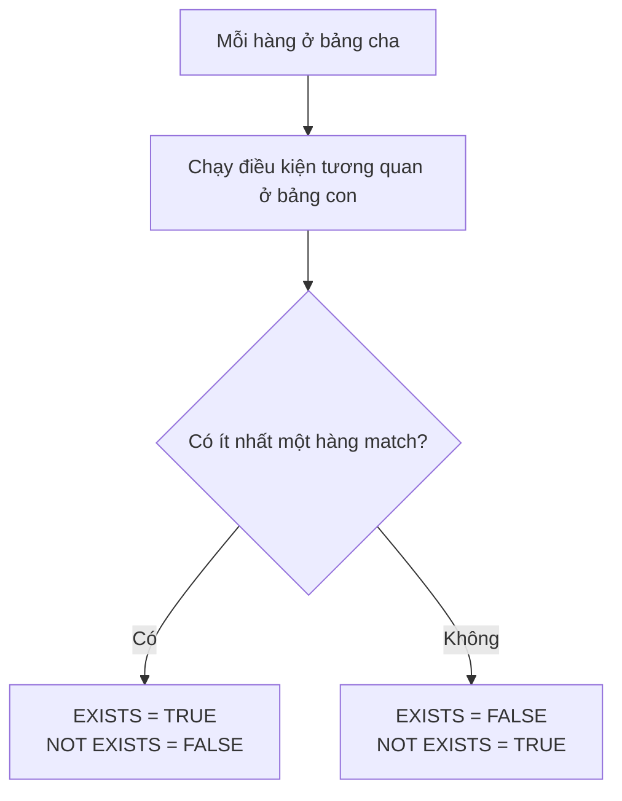

# IN, NOT IN và bẫy NULL trong truy vấn con của Oracle Database

Các truy vấn SQL thường cần kiểm tra một giá trị có thuộc một tập hay không: đơn hàng có trạng thái nằm trong danh sách được phép, nhân viên thuộc một phòng ban, khách hàng chưa phát sinh giao dịch, hoặc bản ghi không có quan hệ với bảng khác. Oracle cung cấp hai toán tử quen thuộc **`IN`** và **`NOT IN`** để diễn đạt những phép kiểm tra đó, thường kết hợp với **subquery (truy vấn con)**.

Điều dễ gây lỗi là **`NULL` không phải một giá trị bình thường**. Nó biểu thị dữ liệu không xác định/không có, nên phép so sánh với NULL thường cho kết quả **UNKNOWN**, không phải TRUE hay FALSE. Trong khi `WHERE` chỉ giữ những hàng mà điều kiện là TRUE, một truy vấn `NOT IN` có thể bất ngờ trả về 0 hàng chỉ vì truy vấn con chứa một NULL.

Bài học giải thích ngữ nghĩa SQL ba giá trị, cách `IN`/`NOT IN` hoạt động với danh sách và subquery, các trường hợp NULL ở hai phía, cách thay bằng `NOT EXISTS`, và cách đọc kế hoạch thực thi của Oracle. Các ví dụ dùng mô hình phòng ban, nhân viên và đơn hàng để người học có thể chạy trực tiếp trong schema lab.

## 1. IN và NOT IN dùng để làm gì?

### 1.1. IN — kiểm tra thuộc một tập

`IN` trả TRUE khi biểu thức bên trái bằng ít nhất một phần tử trong tập ở bên phải:

```sql
SELECT employee_id, employee_name, department_id
FROM employees
WHERE department_id IN (10, 20, 30);
```

Câu lệnh lấy nhân viên thuộc một trong ba phòng ban 10, 20 hoặc 30.

Tập bên phải có thể là:

- Danh sách literal: `IN (10, 20, 30)`.
- Danh sách biểu thức: `IN (:id1, :id2, :id3)`.
- Một subquery trả về một cột: `IN (SELECT department_id FROM departments ...)`.

Ví dụ với subquery:

```sql
SELECT employee_id, employee_name
FROM employees e
WHERE e.department_id IN (
    SELECT d.department_id
    FROM departments d
    WHERE d.location_id = 1700
);
```

Truy vấn ngoài trả nhân viên thuộc các phòng ban có địa điểm 1700. Subquery có thể trả về nhiều hàng; Oracle dùng tập kết quả đó để kiểm tra membership.

### 1.2. NOT IN — kiểm tra không thuộc tập

`NOT IN` là phủ định của `IN`:

```sql
SELECT employee_id, employee_name, department_id
FROM employees
WHERE department_id NOT IN (10, 20, 30);
```

Câu lệnh chọn nhân viên có department_id khác cả ba giá trị 10, 20 và 30, với điều kiện phép so sánh cho kết quả TRUE.

Ví dụ subquery:

```sql
SELECT d.department_id, d.department_name
FROM departments d
WHERE d.department_id NOT IN (
    SELECT e.department_id
    FROM employees e
);
```

Ý định thường là tìm phòng ban chưa có nhân viên. Nhưng nếu `EMPLOYEES.DEPARTMENT_ID` chứa chỉ một giá trị NULL, kết quả có thể không như mong đợi. Đây là bẫy chính của bài học.

## 2. SQL có ba giá trị logic: TRUE, FALSE và UNKNOWN

### 2.1. NULL không bằng NULL

Trong SQL, `NULL` không biểu thị một giá trị cụ thể có thể so sánh bằng dấu `=`. Nó biểu thị giá trị chưa biết hoặc không có. Vì thế:

```sql
SELECT
    CASE WHEN 5 = 5 THEN 'TRUE'
         WHEN NOT (5 = 5) THEN 'FALSE'
         ELSE 'UNKNOWN'
    END AS normal_comparison,
    CASE WHEN 5 = NULL THEN 'TRUE'
         WHEN NOT (5 = NULL) THEN 'FALSE'
         ELSE 'UNKNOWN'
    END AS null_comparison,
    CASE WHEN NULL = NULL THEN 'TRUE'
         WHEN NOT (NULL = NULL) THEN 'FALSE'
         ELSE 'UNKNOWN'
    END AS null_to_null
FROM dual;
```

Hai phép so sánh có NULL cho UNKNOWN. Để kiểm tra một cột có NULL, phải dùng:

```sql
WHERE department_id IS NULL

-- hoặc
WHERE department_id IS NOT NULL
```

Không viết `department_id = NULL` hay `department_id <> NULL` để kiểm tra NULL.

### 2.2. WHERE chỉ giữ TRUE

Mệnh đề `WHERE` không giữ hàng khi điều kiện là FALSE **hoặc UNKNOWN**. Ví dụ:

```sql
SELECT 'TRUE' AS result FROM dual WHERE 1 = 1
UNION ALL
SELECT 'FALSE' FROM dual WHERE 1 = 2
UNION ALL
SELECT 'UNKNOWN' FROM dual WHERE 1 = NULL;
```

Chỉ dòng TRUE được trả về. Hai dòng còn lại không xuất hiện. Vì vậy một biểu thức có vẻ “không sai” nhưng ra UNKNOWN vẫn khiến hàng bị lọc.

### 2.3. Bảng chân trị cơ bản

Một số quy tắc quan trọng:

| A | NOT A |
|---|---|
| TRUE | FALSE |
| FALSE | TRUE |
| UNKNOWN | UNKNOWN |

| A | B | A AND B |
|---|---|---|
| TRUE | TRUE | TRUE |
| TRUE | UNKNOWN | UNKNOWN |
| FALSE | UNKNOWN | FALSE |
| UNKNOWN | UNKNOWN | UNKNOWN |

| A | B | A OR B |
|---|---|---|
| TRUE | UNKNOWN | TRUE |
| FALSE | UNKNOWN | UNKNOWN |
| FALSE | FALSE | FALSE |
| UNKNOWN | UNKNOWN | UNKNOWN |

Phép AND với một vế FALSE cho kết quả FALSE; phép OR với một vế TRUE cho kết quả TRUE. Trong các trường hợp còn lại, UNKNOWN có thể lan truyền.

## 3. Vì sao NULL làm NOT IN trả về 0 hàng?

### 3.1. NOT IN tương đương chuỗi phép so sánh khác tất cả phần tử

Về logic:

```sql
x IN (a, b, c)
```

tương đương ý nghĩa:

```sql
x = a OR x = b OR x = c
```

Trong khi:

```sql
x NOT IN (a, b, c)
```

tương đương:

```sql
x <> a AND x <> b AND x <> c
```

Khi một phần tử trong tập là NULL, phép so sánh `x <> NULL` cho UNKNOWN nếu x không thể xác định bằng NULL. Phép AND với UNKNOWN có thể khiến toàn bộ điều kiện thành UNKNOWN.

### 3.2. Ví dụ nhỏ với một NULL

Chạy trực tiếp:

```sql
SELECT
    CASE WHEN 10 IN (10, 20, NULL)
         THEN 'TRUE'
         WHEN NOT (10 IN (10, 20, NULL))
         THEN 'FALSE'
         ELSE 'UNKNOWN'
    END AS match_found,
    CASE WHEN 30 IN (10, 20, NULL)
         THEN 'TRUE'
         WHEN NOT (30 IN (10, 20, NULL))
         THEN 'FALSE'
         ELSE 'UNKNOWN'
    END AS no_match_but_null,
    CASE WHEN 30 NOT IN (10, 20, NULL)
         THEN 'TRUE'
         WHEN NOT (30 NOT IN (10, 20, NULL))
         THEN 'FALSE'
         ELSE 'UNKNOWN'
    END AS not_in_result
FROM dual;
```

Diễn giải:

- `10 IN (10, 20, NULL)` là TRUE vì đã có một phép bằng đúng.
- `30 IN (10, 20, NULL)` là UNKNOWN: 30 không bằng 10, không bằng 20, còn 30 = NULL là UNKNOWN; không có bằng chứng đủ để kết luận FALSE.
- `30 NOT IN (10, 20, NULL)` cũng là UNKNOWN vì NOT UNKNOWN vẫn là UNKNOWN.

Vì `WHERE` chỉ giữ TRUE, truy vấn sau không trả dòng nào:

```sql
SELECT 30 AS candidate
FROM dual
WHERE 30 NOT IN (10, 20, NULL);
```

### 3.3. Bảng kết quả khi tập chứa NULL

| Giá trị bên trái | IN (10, 20, NULL) | NOT IN (10, 20, NULL) | Hàng được WHERE giữ? |
|---:|---|---|---|
| 10 | TRUE | FALSE | IN có; NOT IN không |
| 20 | TRUE | FALSE | IN có; NOT IN không |
| 30 | UNKNOWN | UNKNOWN | Không bên nào giữ |
| NULL | UNKNOWN | UNKNOWN | Không bên nào giữ |

Điểm cần nhớ: **NULL trong tập không làm mọi phép IN sai**. Nếu tìm thấy một giá trị khớp, `IN` vẫn TRUE. Bẫy xuất hiện rõ nhất khi cần chứng minh “không có phần tử nào khớp” mà tập còn chứa một giá trị không xác định.

### 3.4. Subquery trả NULL cũng có hiệu ứng tương tự

Không cần viết literal NULL. Chỉ một hàng NULL trong kết quả truy vấn con cũng đủ:

```sql
SELECT department_id, department_name
FROM departments
WHERE department_id NOT IN (
    SELECT department_id
    FROM employees
);
```

Nếu subquery trả các giá trị `10`, `20` và `NULL`:

- Phòng ban 10: có match nên NOT IN là FALSE.
- Phòng ban 20: có match nên NOT IN là FALSE.
- Phòng ban 30: không match với 10 hoặc 20, nhưng so sánh với NULL là UNKNOWN; tổng AND thành UNKNOWN.

Không phòng ban nào được chọn, kể cả phòng ban 30 chưa có nhân viên. Đây là nguyên nhân phổ biến của truy vấn “tìm dữ liệu không tồn tại” trả 0 hàng.

## 4. NULL ở vế trái cũng cần được hiểu

Ngay cả khi subquery không chứa NULL, giá trị bên trái có thể là NULL:

```sql
SELECT
    CASE WHEN NULL IN (10, 20)
         THEN 'TRUE'
         WHEN NOT (NULL IN (10, 20))
         THEN 'FALSE'
         ELSE 'UNKNOWN'
    END AS null_in,
    CASE WHEN NULL NOT IN (10, 20)
         THEN 'TRUE'
         WHEN NOT (NULL NOT IN (10, 20))
         THEN 'FALSE'
         ELSE 'UNKNOWN'
    END AS null_not_in
FROM dual;
```

Kết quả của cả hai là UNKNOWN. Do đó:

```sql
SELECT employee_id
FROM employees
WHERE department_id NOT IN (
    SELECT department_id
    FROM departments
);
```

không trả nhân viên có `department_id IS NULL`. Đây thường là hành vi đúng nếu nghiệp vụ yêu cầu “có department_id và department_id không thuộc danh sách phòng ban”. Nhưng nếu muốn xem cả nhân viên chưa gán phòng ban, cần diễn đạt rõ:

```sql
SELECT employee_id
FROM employees
WHERE department_id IS NULL
   OR department_id NOT IN (
       SELECT department_id
       FROM departments
       WHERE department_id IS NOT NULL
   );
```

Việc thêm nhánh `IS NULL` là quyết định nghiệp vụ, không chỉ là mẹo cú pháp.

## 5. Ví dụ đầy đủ với bảng cha và bảng con

### 5.1. Tạo dữ liệu lab

Chạy trong schema thử nghiệm:

```sql
CREATE TABLE dept_lab (
    department_id   NUMBER(6) CONSTRAINT pk_dept_lab PRIMARY KEY,
    department_name VARCHAR2(60 CHAR) NOT NULL
);

CREATE TABLE employee_lab (
    employee_id   NUMBER(8) CONSTRAINT pk_employee_lab PRIMARY KEY,
    employee_name VARCHAR2(80 CHAR) NOT NULL,
    department_id NUMBER(6)
);

INSERT INTO dept_lab VALUES (10, 'Sales');
INSERT INTO dept_lab VALUES (20, 'Engineering');
INSERT INTO dept_lab VALUES (30, 'Finance');
INSERT INTO dept_lab VALUES (40, 'Human Resources');

INSERT INTO employee_lab VALUES (1001, 'An', 10);
INSERT INTO employee_lab VALUES (1002, 'Binh', 20);
INSERT INTO employee_lab VALUES (1003, 'Chi', 10);
INSERT INTO employee_lab VALUES (1004, 'Dung', NULL);

COMMIT;
```

Để tập trung vào NULL, bảng con chưa khai báo foreign key và cố ý cho phép `department_id` là NULL. Trong hệ thống thật, có thể tạo FK đến `DEPT_LAB` nhưng FK vẫn cho phép NULL nếu cột không có `NOT NULL`.

### 5.2. Kiểm tra dữ liệu

```sql
SELECT * FROM dept_lab ORDER BY department_id;

SELECT * FROM employee_lab ORDER BY employee_id;
```

Kết quả có bốn phòng ban; ba nhân viên có phòng ban và một nhân viên chưa được gán phòng ban.

### 5.3. Tìm phòng ban có nhân viên bằng IN

```sql
SELECT department_id, department_name
FROM dept_lab
WHERE department_id IN (
    SELECT department_id
    FROM employee_lab
)
ORDER BY department_id;
```

Kết quả là phòng ban 10 và 20. Hàng NULL của subquery không làm mất các hàng có match: 10 và 20 vẫn thỏa `IN`. Các phòng ban 30 và 40 không match, nhưng biểu thức IN của chúng là UNKNOWN vì có NULL trong tập; do đó không được trả về.

### 5.4. Tìm phòng ban chưa có nhân viên bằng NOT IN — phiên bản lỗi logic

```sql
SELECT department_id, department_name
FROM dept_lab
WHERE department_id NOT IN (
    SELECT department_id
    FROM employee_lab
)
ORDER BY department_id;
```

Kết quả bất ngờ là **không có hàng nào**. Subquery trả 10, 20, 10 và NULL. Với phòng ban 30 và 40, Oracle không thể kết luận chúng khác NULL, nên điều kiện NOT IN là UNKNOWN.

### 5.5. Sửa NOT IN bằng cách loại NULL trong subquery

Nếu ý nghĩa là “phòng ban không xuất hiện trong danh sách department_id đã gán cho nhân viên”, chỉ cần loại NULL:

```sql
SELECT department_id, department_name
FROM dept_lab
WHERE department_id NOT IN (
    SELECT department_id
    FROM employee_lab
    WHERE department_id IS NOT NULL
)
ORDER BY department_id;
```

Kết quả là phòng ban 30 và 40. Cách này đúng khi:

- Cột phía ngoài là NOT NULL, hoặc
- Bạn chủ ý loại các giá trị NULL ở vế trái bằng semantics của NOT IN.

Trong lab, `DEPT_LAB.DEPARTMENT_ID` là primary key nên không thể NULL; vì vậy lọc NULL trong subquery là đủ.

### 5.6. Dùng NOT EXISTS — cách thường dễ an toàn hơn

```sql
SELECT d.department_id, d.department_name
FROM dept_lab d
WHERE NOT EXISTS (
    SELECT 1
    FROM employee_lab e
    WHERE e.department_id = d.department_id
)
ORDER BY d.department_id;
```

Kết quả cũng là phòng ban 30 và 40. Subquery tương quan chỉ hỏi: **có hàng nhân viên nào có department_id bằng phòng ban ngoài không?** Nếu không có, `NOT EXISTS` là TRUE.

Hàng employee có department_id NULL không thỏa phép bằng với bất kỳ department_id cụ thể nào, nên nó không làm hỏng truy vấn. Đây là lý do `NOT EXISTS` thường được chọn cho anti-join khi cột phía trong có thể NULL.

### 5.7. Đối chiếu ba cách

| Cách viết | Khi subquery có NULL | Kết quả với dữ liệu lab |
|---|---|---|
| `IN (SELECT department_id ...)` | Giá trị không match có thể thành UNKNOWN; match vẫn TRUE | Phòng ban 10, 20 |
| `NOT IN (SELECT department_id ...)` | NULL trong tập có thể khiến mọi giá trị không match thành UNKNOWN | Không có hàng |
| `NOT IN (... WHERE department_id IS NOT NULL)` | Loại NULL khỏi tập phía trong | Phòng ban 30, 40 |
| `NOT EXISTS (correlated subquery)` | NULL phía trong không làm phép bằng thành TRUE | Phòng ban 30, 40 |

## 6. NOT EXISTS: diễn đạt phép anti-join

### 6.1. EXISTS chỉ quan tâm có hàng hay không

`EXISTS(subquery)` trả TRUE khi subquery trả ít nhất một hàng, bất kể danh sách cột trong `SELECT` là gì. Vì vậy cách viết phổ biến là:

```sql
WHERE EXISTS (
    SELECT 1
    FROM child_table c
    WHERE c.parent_id = p.parent_id
)
```

`NOT EXISTS` trả TRUE khi không có hàng nào thỏa điều kiện tương quan.



Subquery có thể đọc nhiều cột, join các bảng khác hoặc có điều kiện bổ sung; kết quả EXISTS chỉ phụ thuộc vào việc có hàng thỏa hay không.

### 6.2. Tìm khách hàng chưa có đơn hàng

```sql
SELECT c.customer_id, c.customer_name
FROM customers c
WHERE NOT EXISTS (
    SELECT 1
    FROM orders o
    WHERE o.customer_id = c.customer_id
)
ORDER BY c.customer_id;
```

Đây là dạng anti-join thường dùng trong hệ thống nghiệp vụ. Nếu `ORDERS.CUSTOMER_ID` có NULL, hàng NULL không thỏa phép bằng với một customer cụ thể; nó không làm truy vấn trả rỗng như `NOT IN`.

### 6.3. EXISTS không kiểm tra giá trị cột SELECT

Các câu sau có cùng semantics tồn tại:

```sql
WHERE EXISTS (SELECT 1 FROM employee_lab e
              WHERE e.department_id = d.department_id)

WHERE EXISTS (SELECT NULL FROM employee_lab e
              WHERE e.department_id = d.department_id)

WHERE EXISTS (SELECT e.employee_id FROM employee_lab e
              WHERE e.department_id = d.department_id)
```

Giá trị được chọn không quyết định EXISTS; **sự tồn tại của hàng** mới là điều quan trọng. Dùng `SELECT 1` để thể hiện ý định rõ ràng.

### 6.4. NOT EXISTS và giá trị NULL ở phía ngoài

Giả sử:

```sql
SELECT e.employee_id
FROM employee_lab e
WHERE NOT EXISTS (
    SELECT 1
    FROM dept_lab d
    WHERE d.department_id = e.department_id
);
```

Nhân viên có `department_id IS NULL` sẽ được trả về bởi NOT EXISTS, vì không có phòng ban nào thỏa `d.department_id = NULL`. Điều này khác với:

```sql
SELECT e.employee_id
FROM employee_lab e
WHERE e.department_id NOT IN (
    SELECT d.department_id
    FROM dept_lab d
);
```

Ở đây subquery không có NULL (department_id là PK), nhưng giá trị bên trái NULL vẫn làm `NULL NOT IN (...)` thành UNKNOWN, nên nhân viên chưa gán phòng ban không được trả về.

Nếu mục tiêu là chỉ tìm nhân viên có mã phòng ban cụ thể nhưng không tồn tại trong bảng phòng ban, có thể thêm:

```sql
WHERE e.department_id IS NOT NULL
  AND NOT EXISTS (
      SELECT 1
      FROM dept_lab d
      WHERE d.department_id = e.department_id
  )
```

Nếu mục tiêu là tìm cả nhân viên chưa gán phòng ban lẫn nhân viên có mã phòng ban không tồn tại, hãy dùng hai nhánh logic rõ ràng. Không giả định NOT EXISTS và NOT IN luôn thay thế được nhau mà không xét NULL phía ngoài.

## 7. Khi nào nên dùng IN, NOT IN hay EXISTS?

### 7.1. IN cho membership và semi-join

Dùng `IN` khi ý định là “giá trị này thuộc tập các giá trị được truy vấn”:

```sql
SELECT p.product_id, p.product_name
FROM products p
WHERE p.category_id IN (
    SELECT c.category_id
    FROM categories c
    WHERE c.is_active = 'Y'
);
```

Nếu subquery có NULL, các giá trị không match có thể thành UNKNOWN và bị loại; các giá trị match vẫn được giữ. Với phép membership, đây thường là semantics tự nhiên.

### 7.2. NOT IN khi cả hai phía được kiểm soát NULL

`NOT IN` phù hợp khi:

- Tập literal rõ ràng không chứa NULL.
- Cột subquery được đảm bảo NOT NULL hoặc có điều kiện lọc NULL.
- Cột phía ngoài cũng có semantics NULL đã được xử lý rõ.

Ví dụ:

```sql
SELECT d.department_id
FROM dept_lab d
WHERE d.department_id NOT IN (
    SELECT e.department_id
    FROM employee_lab e
    WHERE e.department_id IS NOT NULL
);
```

Đây là cách viết rõ ràng nếu muốn giữ cú pháp NOT IN và đã hiểu điều kiện nullability.

### 7.3. NOT EXISTS cho “không có hàng liên quan”

Dùng `NOT EXISTS` khi bài toán là quan hệ giữa hàng ngoài và hàng trong:

```sql
SELECT d.department_id
FROM dept_lab d
WHERE NOT EXISTS (
    SELECT 1
    FROM employee_lab e
    WHERE e.department_id = d.department_id
);
```

Đây thường là cách dễ đọc nhất cho câu hỏi “không có bản ghi con nào match”. Nó tránh bẫy NULL ở cột so sánh phía trong, nhưng vẫn cần quyết định riêng nếu cột khóa phía ngoài NULL có ý nghĩa đặc biệt.

### 7.4. Bảng quyết định

| Nhu cầu | Cách viết thường phù hợp | Lưu ý |
|---|---|---|
| Giá trị thuộc một danh sách literal chắc chắn không NULL | `IN` | Dễ đọc |
| Giá trị thuộc tập subquery | `IN` | Match vẫn TRUE dù tập còn có NULL |
| Giá trị không thuộc tập literal không NULL | `NOT IN` | Xem xét NULL ở vế trái |
| Giá trị không thuộc tập subquery | `NOT IN` sau khi kiểm soát NULL | Cả vế ngoài và tập trong đều cần semantics rõ |
| Không tồn tại hàng con liên quan | `NOT EXISTS` | Thường là lựa chọn tốt cho anti-join |
| Có tồn tại hàng con liên quan | `EXISTS` | Không cần DISTINCT ở subquery |
| Cần giữ cả giá trị khóa ngoài NULL | `NOT EXISTS` hoặc nhánh `IS NULL` | Quyết định theo nghiệp vụ |

## 8. IN và NOT IN với danh sách literal

### 8.1. Danh sách không có NULL

```sql
SELECT employee_id
FROM employee_lab
WHERE department_id IN (10, 20);

SELECT employee_id
FROM employee_lab
WHERE department_id NOT IN (10, 20);
```

Truy vấn thứ hai không trả nhân viên có department_id NULL, vì phép NOT IN với vế trái NULL là UNKNOWN. Nếu muốn thêm các nhân viên chưa có phòng ban:

```sql
SELECT employee_id
FROM employee_lab
WHERE department_id IS NULL
   OR department_id NOT IN (10, 20);
```

### 8.2. Literal list chứa NULL

```sql
SELECT 30 AS candidate
FROM dual
WHERE 30 NOT IN (10, 20, NULL);
```

Không có hàng được trả về. Nếu muốn loại 10 và 20 nhưng không quan tâm NULL như một phần tử của tập, hãy bỏ NULL khỏi danh sách:

```sql
SELECT 30 AS candidate
FROM dual
WHERE 30 NOT IN (10, 20);
```

### 8.3. Danh sách bind variable

Ứng dụng có thể bind một giá trị vào mỗi placeholder:

```sql
SELECT employee_id
FROM employee_lab
WHERE department_id IN (:dept_1, :dept_2, :dept_3);
```

Nếu một bind parameter được đặt NULL, semantics của phép IN thay đổi như khi có NULL literal. Không coi bind NULL là “tham số không dùng” tự động. Nếu danh sách tùy chọn, ứng dụng phải quyết định:

- Bỏ phần tử NULL trước khi tạo danh sách/bind.
- Dùng điều kiện riêng khi filter không được cung cấp.
- Tách hai trường hợp “không truyền bộ lọc” và “lọc giá trị NULL”.

Không ghép danh sách người dùng nhập trực tiếp vào chuỗi SQL. Bind variable an toàn hơn, nhưng số lượng placeholder vẫn phải được quản lý theo cách driver và ứng dụng hỗ trợ.

## 9. Subquery rỗng: trường hợp đặc biệt

Một truy vấn con có thể trả về **không hàng nào**. Khi đó:

- `x IN (empty set)` là FALSE.
- `x NOT IN (empty set)` là TRUE, kể cả khi x là NULL theo semantics tập rỗng.

Trong Oracle, subquery trả rỗng là hợp lệ; danh sách literal `IN ()` không phải cú pháp SQL hợp lệ.

Ví dụ:

```sql
SELECT 10 AS candidate
FROM dual
WHERE 10 IN (
    SELECT department_id
    FROM dept_lab
    WHERE department_id < 0
);

SELECT 10 AS candidate
FROM dual
WHERE 10 NOT IN (
    SELECT department_id
    FROM dept_lab
    WHERE department_id < 0
);
```

Câu đầu không trả hàng; câu thứ hai trả hàng vì tập con rỗng. Không nên nhầm tình huống subquery rỗng với subquery có NULL: **tập rỗng không có phép so sánh nào tạo UNKNOWN**.

## 10. Composite IN: nhiều cột và NULL

Oracle hỗ trợ row-value comparison để kiểm tra một cặp hoặc bộ giá trị:

```sql
SELECT order_id, customer_id, status_code
FROM orders
WHERE (customer_id, status_code) IN (
    SELECT customer_id, status_code
    FROM allowed_customer_status
);
```

Số cột và kiểu dữ liệu hai phía phải tương thích. Khi có NULL trong một thành phần, phép so sánh bộ có thể trở thành UNKNOWN tùy các thành phần đã khớp hay chưa; không áp dụng trực giác “một cặp bằng nhau hoặc khác nhau” như với giá trị scalar.

Ví dụ minh họa:

```sql
SELECT CASE
           WHEN (1, 2) IN (
               SELECT 1, CAST(NULL AS NUMBER) FROM dual
           ) THEN 'TRUE'
           WHEN NOT (
               (1, 2) IN (
                   SELECT 1, CAST(NULL AS NUMBER) FROM dual
               )
           ) THEN 'FALSE'
           ELSE 'UNKNOWN'
       END AS tuple_result
FROM dual;
```

Thành phần đầu khớp, nhưng thành phần thứ hai so sánh với NULL là UNKNOWN; do đó cả phép so sánh bộ là UNKNOWN. Khi viết composite NOT IN, cần đặc biệt thận trọng nếu bất kỳ cột khóa nào nullable. Một correlated NOT EXISTS với điều kiện từng cột thường dễ kiểm soát hơn:

```sql
SELECT o.order_id
FROM orders o
WHERE NOT EXISTS (
    SELECT 1
    FROM allowed_customer_status a
    WHERE a.customer_id = o.customer_id
      AND a.status_code = o.status_code
);
```

Nếu muốn NULL khớp NULL theo nghiệp vụ, phải viết quy tắc null-safe rõ ràng cho từng cột, ví dụ:

```sql
WHERE (
        a.customer_id = o.customer_id
        OR (a.customer_id IS NULL AND o.customer_id IS NULL)
      )
  AND (
        a.status_code = o.status_code
        OR (a.status_code IS NULL AND o.status_code IS NULL)
      )
```

Đây là một định nghĩa “NULL bằng NULL” do ứng dụng chủ động chọn; nó không phải semantics mặc định của toán tử `=`.

## 11. Các lỗi logic thường gặp

### 11.1. NOT IN bị đầu độc bởi NULL trong dữ liệu con

```sql
-- Có thể trả 0 hàng nếu subquery có ít nhất một NULL.
SELECT d.department_id
FROM dept_lab d
WHERE d.department_id NOT IN (
    SELECT e.department_id
    FROM employee_lab e
);
```

Sửa bằng lọc NULL hoặc NOT EXISTS, tùy ý nghĩa:

```sql
-- Cách 1: loại NULL khỏi tập.
SELECT d.department_id
FROM dept_lab d
WHERE d.department_id NOT IN (
    SELECT e.department_id
    FROM employee_lab e
    WHERE e.department_id IS NOT NULL
);

-- Cách 2: dùng anti-join.
SELECT d.department_id
FROM dept_lab d
WHERE NOT EXISTS (
    SELECT 1
    FROM employee_lab e
    WHERE e.department_id = d.department_id
);
```

### 11.2. NOT IN bỏ qua NULL ở vế ngoài

```sql
SELECT employee_id
FROM employee_lab
WHERE department_id NOT IN (10, 20);
```

Nhân viên chưa gán phòng ban không được trả về. Nếu cần giữ họ:

```sql
SELECT employee_id
FROM employee_lab
WHERE department_id IS NULL
   OR department_id NOT IN (10, 20);
```

### 11.3. Dùng DISTINCT để chữa NULL không có tác dụng

Một cách sửa sai:

```sql
WHERE d.department_id NOT IN (
    SELECT DISTINCT e.department_id
    FROM employee_lab e
)
```

`DISTINCT` vẫn giữ một hàng NULL nếu tập có NULL. Nó loại bản ghi trùng, không loại NULL. Cần thêm `WHERE e.department_id IS NOT NULL` nếu thật sự muốn lọc NULL.

### 11.4. Dùng NVL thay NULL bằng một số giả

Ví dụ:

```sql
WHERE NVL(d.department_id, -1) NOT IN (
    SELECT NVL(e.department_id, -1)
    FROM employee_lab e
)
```

Cách này tránh UNKNOWN trong phép so sánh nhưng có rủi ro **giá trị sentinel -1 có thể là một mã hợp lệ** ở tương lai hoặc làm thay đổi semantics. Nó cũng áp dụng hàm lên cột, có thể ảnh hưởng index. Chỉ dùng sentinel khi domain/ràng buộc bảo đảm giá trị đó không bao giờ xuất hiện và ý nghĩa NULL đã được định nghĩa; thông thường `NOT EXISTS` rõ ràng hơn.

### 11.5. Lẫn lộn NULL với chuỗi rỗng

Trong SQL Oracle, chuỗi VARCHAR2 có độ dài 0 được xử lý như NULL. Vì vậy:

```sql
SELECT
    CASE WHEN '' IS NULL THEN 'EMPTY_IS_NULL'
         ELSE 'OTHER'
    END AS oracle_empty_string
FROM dual;
```

Nếu subquery chọn một cột chuỗi có dữ liệu rỗng, giá trị đó có thể xuất hiện dưới dạng NULL và kích hoạt bẫy NOT IN. Dữ liệu import từ hệ thống khác có thể coi chuỗi rỗng là khác NULL; khi đi vào Oracle cần chuẩn hóa contract rõ ràng.

### 11.6. Dùng NOT IN trên biểu thức chuyển kiểu có lỗi

Ví dụ:

```sql
WHERE numeric_code NOT IN (
    SELECT TO_NUMBER(text_code)
    FROM imported_codes
)
```

Nếu `text_code` chứa ký tự không chuyển được thành NUMBER, câu truy vấn có thể lỗi chuyển đổi; đây là vấn đề kiểu dữ liệu, không phải NULL logic. Hãy làm sạch/validate và thống nhất kiểu hai vế trước khi so sánh. Tránh phụ thuộc implicit conversion, vì nó có thể gây lỗi như `ORA-01722` hoặc kế hoạch thực thi khó dự đoán.

## 12. IN/NOT IN so với JOIN và anti-join

### 12.1. IN thường có thể được optimizer xử lý như semi-join

Ví dụ:

```sql
SELECT d.department_id, d.department_name
FROM dept_lab d
WHERE d.department_id IN (
    SELECT e.department_id
    FROM employee_lab e
);
```

Đây là **semi-join** về mặt ý nghĩa: chỉ trả hàng phía ngoài nếu có ít nhất một hàng bên trong khớp. Nếu một phòng ban có 100 nhân viên, hàng phòng ban vẫn xuất hiện một lần; không nhân bản theo số nhân viên như join thông thường.

### 12.2. JOIN có thể nhân bản hàng

```sql
SELECT d.department_id, d.department_name
FROM dept_lab d
JOIN employee_lab e
  ON e.department_id = d.department_id;
```

Phòng ban Sales xuất hiện hai lần vì có hai nhân viên. Nếu chỉ cần kiểm tra tồn tại, `IN` hoặc `EXISTS` thường thể hiện ý định tốt hơn. Nếu dùng JOIN rồi `DISTINCT` để khử trùng, cần cân nhắc chi phí và ngữ nghĩa.

### 12.3. NOT EXISTS có ý nghĩa anti-join

```sql
SELECT d.department_id, d.department_name
FROM dept_lab d
WHERE NOT EXISTS (
    SELECT 1
    FROM employee_lab e
    WHERE e.department_id = d.department_id
);
```

Đây là **anti-join**: trả hàng ngoài khi không có hàng trong thỏa điều kiện. Oracle optimizer có thể biến NOT EXISTS/NOT IN phù hợp thành một dạng anti-join vật lý, nhưng semantics NULL của biểu thức vẫn phải được bảo toàn.

### 12.4. NOT IN không đơn giản là LEFT JOIN ... IS NULL trong mọi trường hợp

Một cách viết khác:

```sql
SELECT d.department_id, d.department_name
FROM dept_lab d
LEFT JOIN employee_lab e
  ON e.department_id = d.department_id
WHERE e.employee_id IS NULL;
```

Vì `EMPLOYEE_ID` là primary key NOT NULL, kiểm tra NULL trên cột này nhận diện hàng không match. Nhưng nếu kiểm tra một cột nullable của bảng con, một hàng match có giá trị NULL ở cột đó có thể bị hiểu nhầm thành không match. Hãy chọn một cột chắc chắn NOT NULL, thường là PK.

LEFT JOIN anti-join cũng có thể tương đương NOT EXISTS trong nhiều trường hợp, nhưng phải đặt các điều kiện của bảng con ở `ON` đúng vị trí. Đưa điều kiện bảng con xuống `WHERE` có thể vô tình biến outer join thành inner join.

## 13. Oracle optimizer và hiệu năng

### 13.1. IN, EXISTS và JOIN không có quy tắc “cú pháp nào luôn nhanh hơn”

Oracle optimizer có thể chuyển đổi subquery thành join hoặc semi/anti-join khi phép biến đổi bảo toàn semantics. Cách viết SQL nên ưu tiên **ý nghĩa rõ ràng và đúng NULL**, rồi mới xem kế hoạch thực thi.

Các yếu tố ảnh hưởng:

- Số hàng của bảng ngoài và subquery.
- Tính chọn lọc của điều kiện.
- Index trên khóa liên kết.
- Statistics/histogram và phân bố NULL.
- Khả năng unnest subquery.
- Cardinality estimate và join method (nested loops, hash, merge).
- Bind peeking/adaptive behavior và phiên bản optimizer.

### 13.2. Anti-join và null-aware anti-join

Với NOT IN có thể chứa NULL, Oracle phải bảo toàn semantics ba giá trị. Tùy phiên bản và execution plan, có thể thấy operation liên quan **null-aware anti-join**, chẳng hạn tên dạng `ANTI NA` hoặc `ANTI SNA` trong plan. Đây là chi tiết implementation của optimizer, không phải lý do để bỏ kiểm tra NULL trong thiết kế SQL.

`NOT EXISTS` với phép bằng tương quan thường dễ được chuyển thành anti-join thông thường vì NULL phía trong không thể làm phép bằng với một khóa ngoài không NULL thành TRUE. Tuy nhiên, điều kiện bổ sung, kiểu dữ liệu và NULL phía ngoài vẫn có thể ảnh hưởng semantics.

### 13.3. Index cho khóa liên kết

Ví dụ:

```sql
CREATE INDEX ix_employee_lab_dept
ON employee_lab(department_id);
```

Index có thể giúp truy vấn EXISTS/NOT EXISTS tìm hàng con theo department_id, đặc biệt khi bảng ngoài có ít hàng và truy cập con bằng nested loops. Với bảng lớn, hash anti-join có thể phù hợp hơn. Optimizer quyết định dựa cost và statistics; index không phải bảo đảm plan sẽ dùng.

### 13.4. Xem execution plan

```sql
EXPLAIN PLAN FOR
SELECT d.department_id
FROM dept_lab d
WHERE NOT EXISTS (
    SELECT 1
    FROM employee_lab e
    WHERE e.department_id = d.department_id
);

SELECT *
FROM TABLE(DBMS_XPLAN.DISPLAY);
```

Khi cần phân tích truy vấn đã chạy, có thể dùng `DBMS_XPLAN.DISPLAY_CURSOR` với quyền phù hợp và thống kê thực thi được thu thập. `EXPLAIN PLAN` chỉ cho biết kế hoạch ước tính; trên bảng lab rất nhỏ, full scan có thể là lựa chọn rẻ hơn index.

## 14. Subquery tương quan và không tương quan

### 14.1. Subquery không tương quan

```sql
SELECT department_id
FROM dept_lab
WHERE department_id IN (
    SELECT department_id
    FROM employee_lab
    WHERE employee_id >= 1000
);
```

Subquery không tham chiếu cột của truy vấn ngoài. Về mặt logic, nó mô tả tập department_id từ nhân viên có employee_id phù hợp.

### 14.2. Subquery tương quan

```sql
SELECT d.department_id
FROM dept_lab d
WHERE NOT EXISTS (
    SELECT 1
    FROM employee_lab e
    WHERE e.department_id = d.department_id
      AND e.employee_id >= 1000
);
```

Subquery tham chiếu `d.department_id` từ truy vấn ngoài. Nó biểu đạt “không có nhân viên thuộc phòng ban này và thỏa điều kiện employee_id”. Optimizer thường có thể unnest/tối ưu hóa; không nhất thiết thực thi lại subquery đầy đủ theo từng hàng như một vòng lặp thủ công.

### 14.3. Điều kiện phải đặt đúng phía

Ví dụ muốn tìm phòng ban không có nhân viên active:

```sql
SELECT d.department_id
FROM dept_lab d
WHERE NOT EXISTS (
    SELECT 1
    FROM employee_lab e
    WHERE e.department_id = d.department_id
      AND e.status = 'ACTIVE'
);
```

Điều kiện `status='ACTIVE'` nằm trong subquery, vì ta chỉ quan tâm sự tồn tại của nhân viên active. Nếu đưa điều kiện này ra ngoài bảng nhân viên qua outer join/where sai vị trí, có thể đổi ý nghĩa. Hãy viết câu hỏi nghiệp vụ bằng lời trước khi chọn cấu trúc SQL.

## 15. Các tình huống dữ liệu và kết quả cần dự đoán

Giả sử tập subquery trả:

```text
{10, 20}
```

thì:

| x | x IN tập | x NOT IN tập |
|---:|---|---|
| 10 | TRUE | FALSE |
| 30 | FALSE | TRUE |
| NULL | UNKNOWN | UNKNOWN |

Nếu tập trả:

```text
{10, 20, NULL}
```

thì:

| x | x IN tập | x NOT IN tập |
|---:|---|---|
| 10 | TRUE | FALSE |
| 30 | UNKNOWN | UNKNOWN |
| NULL | UNKNOWN | UNKNOWN |

Nếu tập rỗng:

```text
{}
```

thì:

| x | x IN tập rỗng | x NOT IN tập rỗng |
|---|---|---|
| 10 | FALSE | TRUE |
| NULL | FALSE | TRUE |

Bảng cuối phản ánh logic membership trong tập rỗng: không có phần tử nào có thể khớp và không có phần tử nào vi phạm điều kiện khác tất cả. Đây là trường hợp khác hẳn tập có NULL.

## 16. Câu hỏi thực tế và cách chọn semantics

### 16.1. “Tìm các phòng ban không có nhân viên”

Thường dùng:

```sql
SELECT d.department_id
FROM dept_lab d
WHERE NOT EXISTS (
    SELECT 1
    FROM employee_lab e
    WHERE e.department_id = d.department_id
);
```

### 16.2. “Tìm nhân viên có mã phòng ban không tồn tại”

Nếu muốn loại nhân viên chưa được gán phòng ban:

```sql
SELECT e.employee_id, e.department_id
FROM employee_lab e
WHERE e.department_id IS NOT NULL
  AND NOT EXISTS (
      SELECT 1
      FROM dept_lab d
      WHERE d.department_id = e.department_id
  );
```

Đây là kiểm tra orphan reference. Trong hệ thống có foreign key được bật và dữ liệu nhất quán, trường hợp này không nên xuất hiện trừ khi constraint bị disable/novalidate hoặc dữ liệu đến từ nguồn chưa được kiểm soát.

### 16.3. “Tìm những khách hàng chưa có đơn hoàn tất”

```sql
SELECT c.customer_id, c.customer_name
FROM customers c
WHERE NOT EXISTS (
    SELECT 1
    FROM orders o
    WHERE o.customer_id = c.customer_id
      AND o.status = 'COMPLETED'
);
```

Nếu customer_id trong orders có NULL, nó không match với một customer ID cụ thể và không làm truy vấn sai. Nếu customer_id ở bảng ngoài có NULL, hàng đó sẽ được giữ bởi NOT EXISTS; hãy thêm `c.customer_id IS NOT NULL` nếu không muốn.

### 16.4. “Tìm trạng thái không thuộc danh mục cho phép”

```sql
SELECT s.record_id, s.status_code
FROM incoming_status s
WHERE s.status_code IS NOT NULL
  AND s.status_code NOT IN (
      SELECT a.status_code
      FROM allowed_status a
      WHERE a.status_code IS NOT NULL
  );
```

Đây là kiểm tra dữ liệu ngoài danh mục, với NULL được xử lý riêng. Nếu NULL có nghĩa “chưa phân loại”, có thể cần trả về một nhóm validation khác thay vì loại bỏ hoàn toàn.

## 17. Bài thực hành tổng hợp

Thực hiện trong schema lab riêng, không chạy các lệnh tạo/xóa bảng trên hệ thống production.

### Bước 1 — Quan sát NOT IN khi subquery có NULL

```sql
SELECT d.department_id
FROM dept_lab d
WHERE d.department_id NOT IN (
    SELECT e.department_id
    FROM employee_lab e
);
```

Ghi lại số hàng trả về và giải thích vì sao phòng ban 30, 40 không xuất hiện.

### Bước 2 — Loại NULL phía trong

```sql
SELECT d.department_id
FROM dept_lab d
WHERE d.department_id NOT IN (
    SELECT e.department_id
    FROM employee_lab e
    WHERE e.department_id IS NOT NULL
)
ORDER BY d.department_id;
```

Xác nhận phòng ban 30 và 40 xuất hiện.

### Bước 3 — Viết lại bằng NOT EXISTS

```sql
SELECT d.department_id
FROM dept_lab d
WHERE NOT EXISTS (
    SELECT 1
    FROM employee_lab e
    WHERE e.department_id = d.department_id
)
ORDER BY d.department_id;
```

So sánh kết quả với Bước 2. Giải thích vì sao NULL phía trong không làm hỏng phép so sánh tương quan.

### Bước 4 — Thêm một nhân viên chưa có phòng ban

Dữ liệu lab đã có employee_id 1004 với department_id NULL. Thử:

```sql
SELECT employee_id
FROM employee_lab
WHERE department_id NOT IN (
    SELECT department_id
    FROM dept_lab
);

SELECT employee_id
FROM employee_lab e
WHERE NOT EXISTS (
    SELECT 1
    FROM dept_lab d
    WHERE d.department_id = e.department_id
);
```

Hai truy vấn khác nhau ở hàng 1004. Giải thích kết quả theo NULL phía ngoài; sau đó quyết định câu nào phù hợp nếu yêu cầu là “nhân viên có department_id sai”.

### Bước 5 — Thử subquery rỗng

```sql
SELECT department_id
FROM dept_lab
WHERE department_id NOT IN (
    SELECT department_id
    FROM employee_lab
    WHERE 1 = 0
);
```

Kết quả có tất cả phòng ban vì subquery rỗng. Thử thay bằng subquery trả NULL và so sánh.

### Bước 6 — Kiểm tra NULL với literal list

```sql
SELECT 'MATCH' AS test_case FROM dual
WHERE 10 IN (10, NULL);

SELECT 'NO_MATCH' AS test_case FROM dual
WHERE 30 IN (10, NULL);

SELECT 'NOT_MATCH' AS test_case FROM dual
WHERE 30 NOT IN (10, NULL);
```

Dự đoán từng câu trả hàng hay không trước khi chạy.

### Bước 7 — So sánh IN với JOIN

```sql
SELECT d.department_id
FROM dept_lab d
WHERE d.department_id IN (
    SELECT e.department_id
    FROM employee_lab e
);

SELECT d.department_id
FROM dept_lab d
JOIN employee_lab e
  ON e.department_id = d.department_id;
```

Đếm số lần phòng ban 10 xuất hiện ở hai kết quả. Giải thích semi-join membership khác join trả cặp hàng như thế nào.

### Bước 8 — Đọc execution plan

Tạo index lab:

```sql
CREATE INDEX ix_employee_lab_department
ON employee_lab(department_id);
```

Sau đó dùng `EXPLAIN PLAN` và `DBMS_XPLAN.DISPLAY` cho các truy vấn NOT EXISTS và NOT IN đã sửa. Ghi lại operation mà optimizer chọn. Với bảng nhỏ, full scan có thể hợp lý; hãy thử trên dữ liệu đủ lớn nếu cần đánh giá hiệu năng.

### Bước 9 — Viết truy vấn theo yêu cầu nghiệp vụ

Viết SQL cho các yêu cầu:

1. Khách hàng có ít nhất một đơn hàng.
2. Khách hàng chưa từng có đơn hàng.
3. Đơn hàng có product_id không tồn tại trong bảng sản phẩm, loại product_id NULL.
4. Bản ghi chưa được gán trạng thái.
5. Trạng thái không thuộc danh mục hợp lệ, nhưng giữ riêng nhóm NULL để báo cáo.

Mỗi câu trả lời cần nêu rõ NULL được giữ, bỏ hay coi là dữ liệu không hợp lệ.

## 18. Quy tắc thực hành khi viết IN/NOT IN

1. **Kiểm tra nullability của cả hai phía.** Đừng chỉ nhìn khóa ngoại; cột nullable vẫn có thể chứa NULL.
2. **Hiểu kết quả subquery.** Một hàng NULL có thể đến từ dữ liệu thật, biểu thức, outer join hoặc chuyển đổi.
3. **Nhớ WHERE chỉ giữ TRUE.** UNKNOWN bị loại giống FALSE trong điều kiện lọc.
4. **Dùng IS NULL/IS NOT NULL.** Không so sánh NULL bằng dấu bằng/khác.
5. **NOT IN cần kiểm soát NULL.** Lọc NULL phía trong và quyết định rõ NULL phía ngoài.
6. **Ưu tiên NOT EXISTS cho câu hỏi không tồn tại hàng liên quan.** Nó thường diễn đạt anti-join rõ ràng và tránh NULL poisoning phía trong.
7. **Không dùng DISTINCT để loại NULL.** DISTINCT giữ một NULL nếu có.
8. **Không dùng sentinel tùy tiện.** NVL/COALESCE có thể va chạm giá trị hợp lệ và làm thay đổi logic.
9. **Phân biệt membership với join.** IN/EXISTS không nhân bản hàng ngoài theo số match; JOIN có thể nhân bản.
10. **Kiểm tra composite key từng thành phần.** NULL ở bất kỳ cột nào có thể ảnh hưởng row comparison.
11. **Dùng bind variables.** Tránh ghép danh sách người dùng gửi trực tiếp vào SQL.
12. **Đo plan và workload.** Không kết luận EXISTS nhanh hơn IN hoặc ngược lại chỉ từ cú pháp.

## 19. Câu hỏi tự kiểm tra

1. `IN` trả TRUE khi nào? Nó khác JOIN thông thường ở số hàng trả về thế nào?
2. `NOT IN` có thể viết tương đương chuỗi phép so sánh nào?
3. Tại sao `30 NOT IN (10, 20, NULL)` trả UNKNOWN thay vì TRUE?
4. Vì sao một giá trị NULL trong subquery có thể làm NOT IN không trả bất kỳ hàng không khớp nào?
5. Tại sao `10 IN (10, NULL)` vẫn là TRUE?
6. `WHERE` xử lý UNKNOWN như thế nào?
7. `NULL NOT IN (10, 20)` có trả TRUE không?
8. Tại sao DISTINCT không giải quyết NULL poisoning?
9. Khi nào thêm `WHERE inner_col IS NOT NULL` là đủ để sửa NOT IN?
10. Khi nào phải thêm nhánh `outer_col IS NULL`?
11. Vì sao NOT EXISTS thường phù hợp với bài toán “không có hàng con”?
12. NOT EXISTS xử lý NULL phía ngoài khác NOT IN ra sao?
13. Subquery rỗng làm IN và NOT IN trả kết quả gì?
14. Composite NOT IN có những rủi ro nào khi một thành phần khóa nullable?
15. Khi nào LEFT JOIN ... IS NULL tương đương NOT EXISTS và phải chọn cột kiểm tra nào?
16. Oracle optimizer có thể biến IN/EXISTS/NOT EXISTS thành loại join nào?
17. Khi đọc execution plan, tại sao không nên kết luận từ một bảng lab chỉ có vài hàng?

**Nguyên tắc cần nhớ:** `IN` là phép kiểm tra thuộc tập; `NOT IN` là phép phủ định của membership và nhạy với NULL ở cả vế ngoài lẫn tập con; `NOT EXISTS` diễn đạt việc không tồn tại hàng thỏa điều kiện tương quan. Khi viết truy vấn, hãy xác định NULL có nghĩa gì trong nghiệp vụ rồi chọn cú pháp bảo toàn đúng ý nghĩa đó. Đừng chữa lỗi bằng cách thêm DISTINCT hoặc thay NULL bằng một số giả nếu chưa chứng minh được semantics.
