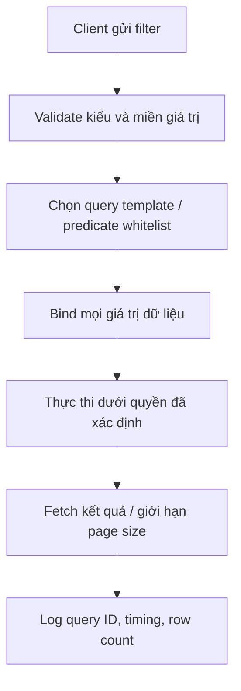

# SQL động theo nhu cầu lọc và nguyên tắc giữ an toàn trong Oracle Database

Một màn hình tìm kiếm đơn hàng có thể cho phép lọc theo khách hàng, trạng thái, ngày tạo, tổng tiền và sắp xếp theo nhiều cột. Người dùng có thể chỉ nhập một vài điều kiện; các điều kiện còn lại được bỏ qua. Nếu viết một câu SQL riêng cho mọi tổ hợp bộ lọc, số lượng câu lệnh sẽ tăng nhanh. **Dynamic SQL (SQL động)** cho phép chương trình tạo câu lệnh tại thời điểm chạy dựa trên những lựa chọn hợp lệ của ứng dụng.

SQL động hữu ích khi cấu trúc câu lệnh thực sự thay đổi: số điều kiện tùy chọn, tên bảng/cột được chọn từ danh sách cho phép, hoặc cấu trúc truy vấn chỉ xác định được lúc chạy. Nhưng nếu ghép trực tiếp dữ liệu người dùng vào chuỗi SQL, kẻ tấn công có thể thay đổi ý nghĩa câu lệnh, đọc dữ liệu ngoài phạm vi hoặc thực hiện thao tác không mong muốn.

Nguyên tắc cốt lõi:

- Dùng **bind variable** cho giá trị dữ liệu.
- Chỉ ghép các mảnh cú pháp do chương trình kiểm soát.
- Tên bảng, tên cột, toán tử và chiều sắp xếp phải đến từ **whitelist** (danh sách cho phép).
- Dùng quyền tối thiểu và hiểu rõ SQL động chạy dưới quyền của ai.
- Xử lý lỗi, log và kiểm thử mọi nhánh lọc như một phần của thiết kế.

Bài học tập trung vào Oracle SQL/PLSQL: `EXECUTE IMMEDIATE`, `OPEN FOR`, `DBMS_SQL`, cách xây bộ lọc tùy chọn, bảo vệ tên đối tượng, SQL injection, quyền definer/invoker và cách đánh giá hiệu năng.

## 1. SQL tĩnh và SQL động

### 1.1. SQL tĩnh

SQL tĩnh có cấu trúc đã biết khi viết chương trình:

```sql
SELECT order_id, customer_id, status, created_at
FROM orders
WHERE customer_id = :customer_id;
```

Giá trị customer_id có thể thay đổi giữa các lần chạy, nhưng cấu trúc câu lệnh không đổi. Đây là cách nên ưu tiên khi đủ khả năng biểu diễn yêu cầu.

Trong PL/SQL:

```sql
DECLARE
    l_count NUMBER;
BEGIN
    SELECT COUNT(*)
    INTO l_count
    FROM orders
    WHERE customer_id = 1001;
END;
/
```

Oracle biết câu SQL khi compile PL/SQL, kiểm tra tên đối tượng và kiểu dữ liệu theo cơ chế SQL tĩnh. SQL tĩnh thường dễ đọc, dễ kiểm tra dependency và dễ quản trị quyền hơn.

### 1.2. SQL động

SQL động là câu lệnh được lưu dưới dạng chuỗi và phân tích/thực thi khi chạy:

```sql
DECLARE
    l_sql   VARCHAR2(1000);
    l_count NUMBER;
BEGIN
    l_sql := 'SELECT COUNT(*) FROM orders WHERE customer_id = :b1';

    EXECUTE IMMEDIATE l_sql
        INTO l_count
        USING 1001;
END;
/
```

Phần cấu trúc câu lệnh nằm trong biến `l_sql`; giá trị 1001 được bind riêng. Bind variable giúp Oracle tái sử dụng cursor khi câu lệnh và môi trường parse tương thích, đồng thời ngăn giá trị dữ liệu trở thành cú pháp SQL.

### 1.3. Khi nào cần SQL động?

Các tình huống phù hợp:

1. Một màn hình có các điều kiện lọc tùy chọn, và chỉ điều kiện được nhập mới được đưa vào câu SQL.
2. Báo cáo cho phép chọn cột sắp xếp hoặc nhóm từ danh sách định nghĩa trước.
3. Công cụ quản trị làm việc với nhiều bảng có tên được xác định lúc chạy.
4. Tiện ích triển khai tạo hoặc thay đổi đối tượng database theo cấu hình đã kiểm soát.
5. Bộ truy vấn tổng quát không biết số cột hoặc kiểu cột cho tới khi đọc metadata.

Không cần SQL động chỉ vì giá trị thay đổi. Ví dụ `WHERE customer_id = :id` đã xử lý được customer_id khác nhau bằng bind variable; không cần ghép ID vào chuỗi.

## 2. Cơ chế SQL động trong Oracle

Oracle có hai cách chính để thực thi SQL động trong PL/SQL:

| Cơ chế | Dùng khi nào? | Đặc điểm |
|---|---|---|
| **Native Dynamic SQL (NDS)** | Phần lớn trường hợp thông thường | `EXECUTE IMMEDIATE`, `OPEN FOR`, cú pháp ngắn và dễ dùng |
| **DBMS_SQL** | Số lượng/kiểu bind hoặc số cột chưa biết khi compile | API mức thấp: parse, bind, define, execute, fetch |

Hãy bắt đầu với Native Dynamic SQL. Chỉ dùng `DBMS_SQL` khi nhu cầu metadata hoặc số lượng tham số/cột động thực sự đòi hỏi.

### 2.1. EXECUTE IMMEDIATE

`EXECUTE IMMEDIATE` phân tích và thực thi một câu SQL hoặc PL/SQL block động. Các thành phần thường dùng:

- `INTO` nhận một hàng từ SELECT.
- `BULK COLLECT INTO` nhận nhiều hàng vào collection.
- `USING` truyền bind argument.
- `RETURNING INTO` nhận giá trị được trả về từ DML.

**DML không trả một hàng:**

```sql
DECLARE
    l_sql VARCHAR2(1000);
BEGIN
    l_sql := 'UPDATE orders
              SET status = :b1
              WHERE order_id = :b2';

    EXECUTE IMMEDIATE l_sql
        USING 'APPROVED', 5001;
END;
/
```

**SELECT trả đúng một hàng:**

```sql
DECLARE
    l_sql       VARCHAR2(1000);
    l_order_sum NUMBER;
BEGIN
    l_sql := 'SELECT total_amount
              FROM orders
              WHERE order_id = :b1';

    EXECUTE IMMEDIATE l_sql
        INTO l_order_sum
        USING 5001;
END;
/
```

Nếu SELECT trả nhiều hàng trong trường hợp dùng `INTO` scalar, Oracle báo lỗi như `ORA-01422`. Nếu không trả hàng, câu lệnh có thể phát sinh `NO_DATA_FOUND`. Dùng cursor hoặc `BULK COLLECT` khi kết quả có thể gồm nhiều hàng.

**SELECT trả nhiều hàng bằng BULK COLLECT:**

```sql
DECLARE
    TYPE t_order_ids IS TABLE OF orders.order_id%TYPE;
    l_order_ids t_order_ids;
BEGIN
    EXECUTE IMMEDIATE
        'SELECT order_id FROM orders WHERE status = :b1'
        BULK COLLECT INTO l_order_ids
        USING 'PENDING';
END;
/
```

**DML có RETURNING INTO:**

```sql
DECLARE
    l_new_status orders.status%TYPE;
BEGIN
    EXECUTE IMMEDIATE
        'UPDATE orders
         SET status = :b1
         WHERE order_id = :b2
         RETURNING status INTO :b3'
        USING 'APPROVED', 5001
        RETURNING INTO l_new_status;
END;
/
```

Đối với bind đầu ra, cần khai báo kiểu tương thích và sử dụng đúng cú pháp `OUT`/`IN OUT` hoặc `RETURNING INTO` theo loại câu lệnh.

### 2.2. OPEN FOR với REF CURSOR

Khi truy vấn trả nhiều hàng và cần đọc từng hàng, có thể mở `SYS_REFCURSOR`:

```sql
DECLARE
    l_sql VARCHAR2(1000);
    l_rc  SYS_REFCURSOR;
    l_id  orders.order_id%TYPE;
    l_amt orders.total_amount%TYPE;
BEGIN
    l_sql := 'SELECT order_id, total_amount
              FROM orders
              WHERE status = :b1
              ORDER BY created_at DESC';

    OPEN l_rc FOR l_sql USING 'PENDING';

    LOOP
        FETCH l_rc INTO l_id, l_amt;
        EXIT WHEN l_rc%NOTFOUND;
        -- Xử lý hàng hiện tại.
        NULL;
    END LOOP;

    CLOSE l_rc;
EXCEPTION
    WHEN OTHERS THEN
        IF l_rc%ISOPEN THEN
            CLOSE l_rc;
        END IF;
        RAISE;
END;
/
```

Trong ứng dụng thực tế, procedure thường trả REF CURSOR cho tầng gọi thay vì fetch toàn bộ. Bên nhận cursor phải đóng nó sau khi dùng xong để giải phóng tài nguyên.

### 2.3. Placeholder và thứ tự bind

Với dynamic SQL là **SQL statement**, Oracle gắn bind argument theo **vị trí xuất hiện** của placeholder. Không nên nghĩ rằng tên `:customer_id` tự động ghép với biến PL/SQL cùng tên:

```sql
DECLARE
    l_value NUMBER;
BEGIN
    EXECUTE IMMEDIATE
        'SELECT :x + :x FROM dual'
        INTO l_value
        USING 10, 20;
    -- Hai vị trí placeholder nhận hai bind argument theo thứ tự.
END;
/
```

Với dynamic SQL là anonymous PL/SQL block hoặc `CALL` statement, placeholder được association theo tên duy nhất, không theo cách bind vị trí của SQL statement. Hãy xác định đúng loại statement và quy tắc bind trước khi thêm placeholder lặp.

Để dễ bảo trì:

- Dùng tên placeholder có ý nghĩa như `:b_customer`, `:b_status`.
- Ghi chú thứ tự bind ngay nơi gọi.
- Khi thêm điều kiện, cập nhật đồng thời chuỗi SQL và danh sách `USING`.
- Không ghép giá trị vào SQL chỉ để tránh quản lý thứ tự bind.

### 2.4. DDL bằng EXECUTE IMMEDIATE

DDL như CREATE, ALTER, DROP có thể được thực thi động:

```sql
BEGIN
    EXECUTE IMMEDIATE
        'CREATE TABLE temp_report_data (
             report_id NUMBER,
             created_at DATE
         )';
END;
/
```

DDL không hỗ trợ bind biến cho tên đối tượng hoặc cấu trúc câu lệnh. Các tên bảng/cột phải được ghép vào sau khi kiểm soát chặt. Ngoài ra, DDL Oracle thường tạo **implicit commit** trước khi thực thi và sau khi DDL thành công; không xem DDL động như DML có thể rollback cùng transaction.

Không nhận nguyên câu DDL do người dùng gửi rồi chạy bằng `EXECUTE IMMEDIATE`. Công cụ triển khai schema phải có quyền riêng, đầu vào đã xác thực và audit.

## 3. DBMS_SQL khi số cột hoặc bind chưa biết

Native Dynamic SQL phù hợp khi số lượng và kiểu bind/cột đã biết trong code. Nếu chương trình cần đọc một câu SELECT bất kỳ mà số cột chỉ xác định sau khi parse, `DBMS_SQL` cung cấp API mức thấp.

Quy trình khái quát:

1. `DBMS_SQL.OPEN_CURSOR` tạo cursor handle.
2. `DBMS_SQL.PARSE` phân tích câu lệnh.
3. `DBMS_SQL.BIND_VARIABLE` gắn bind.
4. Với truy vấn, `DBMS_SQL.DESCRIBE_COLUMNS` lấy metadata.
5. `DBMS_SQL.DEFINE_COLUMN` khai báo vùng nhận dữ liệu cho từng cột.
6. `DBMS_SQL.EXECUTE` thực thi.
7. `DBMS_SQL.FETCH_ROWS` đọc từng hàng; `COLUMN_VALUE` lấy giá trị.
8. `DBMS_SQL.CLOSE_CURSOR` đóng cursor.

Khung minh họa:

```sql
DECLARE
    l_cursor INTEGER;
    l_exec   INTEGER;
    l_value  NUMBER;
BEGIN
    l_cursor := DBMS_SQL.OPEN_CURSOR;

    DBMS_SQL.PARSE(
        l_cursor,
        'SELECT order_id FROM orders WHERE status = :b1',
        DBMS_SQL.NATIVE
    );

    DBMS_SQL.BIND_VARIABLE(l_cursor, ':b1', 'PENDING');
    DBMS_SQL.DEFINE_COLUMN(l_cursor, 1, l_value);
    l_exec := DBMS_SQL.EXECUTE(l_cursor);

    WHILE DBMS_SQL.FETCH_ROWS(l_cursor) > 0 LOOP
        DBMS_SQL.COLUMN_VALUE(l_cursor, 1, l_value);
        -- Xử lý l_value.
        NULL;
    END LOOP;

    DBMS_SQL.CLOSE_CURSOR(l_cursor);
EXCEPTION
    WHEN OTHERS THEN
        IF DBMS_SQL.IS_OPEN(l_cursor) THEN
            DBMS_SQL.CLOSE_CURSOR(l_cursor);
        END IF;
        RAISE;
END;
/
```

Đây là ví dụ khung cho một cột NUMBER; framework tổng quát phải xử lý kiểu dữ liệu, precision, LOB, NULL và define/fetch phù hợp. `DBMS_SQL` phức tạp hơn NDS, nên không dùng nó chỉ vì muốn viết SQL động.

Oracle còn hỗ trợ chuyển đổi giữa DBMS_SQL cursor và REF CURSOR qua các API như `DBMS_SQL.TO_REFCURSOR`/`TO_CURSOR_NUMBER` trong tình huống phù hợp. Kiểm tra quyền và giới hạn phiên bản trước khi xây framework dùng các API này.

## 4. Xây câu truy vấn với bộ lọc tùy chọn

### 4.1. Yêu cầu mẫu

Màn hình tìm kiếm đơn hàng cho phép người dùng nhập:

- Customer ID (không bắt buộc).
- Status (không bắt buộc).
- Ngày tạo từ/đến (không bắt buộc).
- Cột sắp xếp từ một danh sách cố định.
- Chiều sắp xếp ASC hoặc DESC.

Mục tiêu là chỉ thêm điều kiện khi tham số được cung cấp. Cấu trúc câu lệnh thay đổi theo số filter, còn **giá trị filter luôn bind riêng**.

### 4.2. Cách đơn giản: predicate tùy chọn bằng OR

Một câu SQL cố định có thể viết:

```sql
SELECT order_id, customer_id, status, created_at
FROM orders
WHERE (:p_customer_id IS NULL OR customer_id = :p_customer_id)
  AND (:p_status IS NULL OR status = :p_status);
```

Trong SQL động:

```sql
DECLARE
    l_rc SYS_REFCURSOR;
BEGIN
    OPEN l_rc FOR
        'SELECT order_id, customer_id, status, created_at
         FROM orders
         WHERE (:b1 IS NULL OR customer_id = :b2)
           AND (:b3 IS NULL OR status = :b4)'
        USING 1001, 1001, 'PENDING', 'PENDING';
END;
/
```

Vì đây là SQL statement, bốn vị trí placeholder cần bốn bind argument. Cách viết này dễ giữ một câu SQL, nhưng các điều kiện dạng `(:p IS NULL OR col = :p)` có thể khiến optimizer khó chọn access path tối ưu ở một số workload. Cần đo với dữ liệu thật và bind thực tế.

### 4.3. Thêm predicate động, bind mọi giá trị

Một cách khác là chỉ nối **mảnh điều kiện cố định do code viết**:

```sql
CREATE OR REPLACE PROCEDURE open_order_search (
    p_customer_id IN orders.customer_id%TYPE,
    p_status      IN orders.status%TYPE,
    p_result      OUT SYS_REFCURSOR
)
AUTHID DEFINER
AS
    l_sql VARCHAR2(32767) :=
        'SELECT order_id, customer_id, status, created_at
           FROM orders
          WHERE 1 = 1';
BEGIN
    IF p_customer_id IS NOT NULL THEN
        l_sql := l_sql || ' AND customer_id = :b_customer';
    END IF;

    IF p_status IS NOT NULL THEN
        l_sql := l_sql || ' AND status = :b_status';
    END IF;

    IF p_customer_id IS NOT NULL AND p_status IS NOT NULL THEN
        OPEN p_result FOR l_sql USING p_customer_id, p_status;
    ELSIF p_customer_id IS NOT NULL THEN
        OPEN p_result FOR l_sql USING p_customer_id;
    ELSIF p_status IS NOT NULL THEN
        OPEN p_result FOR l_sql USING p_status;
    ELSE
        OPEN p_result FOR l_sql;
    END IF;
END;
/
```

Đoạn code minh họa cách ghép predicate có thứ tự xác định. Trong SQL statement, các bind argument được gắn theo thứ tự placeholder xuất hiện: nếu chỉ có status, placeholder status là placeholder duy nhất và `USING p_status` là đúng. Khi số filter tăng nhiều, số nhánh bind có thể tăng nhanh; lúc đó nên đóng gói logic xây bind hoặc dùng framework có kiểm soát.

### 4.4. Thêm khoảng ngày theo nửa mở

Với filter thời gian, thường nên dùng:

```sql
created_at >= :b_from
AND created_at < :b_to_exclusive
```

Ví dụ người dùng chọn từ 01/11 đến hết 30/11, ứng dụng có thể tính mốc đầu tháng 12 làm exclusive upper bound. Cách này không bỏ sót phần giây lẻ ở cuối ngày. Nếu cột là TSTZ, cần thống nhất timezone của hai bind và cách xác định ranh giới địa phương.

Không tạo điều kiện như:

```sql
TO_CHAR(created_at, 'YYYY-MM-DD') = '2026-11-30'
```

chỉ để so sánh ngày; việc chuyển cột thành chuỗi có thể ảnh hưởng index và phụ thuộc format. Dùng typed bind và range.

### 4.5. Xử lý sắp xếp động an toàn

Không thể bind tên cột hoặc từ khóa ASC/DESC như một giá trị:

```sql
ORDER BY :sort_column
```

không làm Oracle sắp xếp theo tên cột được bind; bind là giá trị dữ liệu. Để chọn cột, ánh xạ một khóa lựa chọn đã biết sang biểu thức SQL cố định:

```sql
DECLARE
    l_sort_expression VARCHAR2(100);
    l_direction       VARCHAR2(4);
    l_sql             VARCHAR2(2000);
    l_rc              SYS_REFCURSOR;
    p_sort_key        VARCHAR2(20) := 'CREATED';
    p_sort_direction VARCHAR2(4)  := 'DESC';
BEGIN
    l_sort_expression :=
        CASE UPPER(p_sort_key)
            WHEN 'CREATED' THEN 'created_at'
            WHEN 'AMOUNT'  THEN 'total_amount'
            WHEN 'ID'      THEN 'order_id'
            ELSE 'order_id'
        END;

    IF UPPER(p_sort_direction) = 'ASC' THEN
        l_direction := 'ASC';
    ELSIF UPPER(p_sort_direction) = 'DESC' THEN
        l_direction := 'DESC';
    ELSE
        RAISE_APPLICATION_ERROR(-20001, 'Invalid sort direction');
    END IF;

    l_sql := 'SELECT order_id, total_amount, created_at
              FROM orders
              ORDER BY ' || l_sort_expression || ' ' || l_direction;

    OPEN l_rc FOR l_sql;
END;
/
```

Các chuỗi được ghép vào SQL ở đây đều đến từ nhánh CASE/IF do chương trình định nghĩa, không phải giá trị tùy ý của người dùng. Trong ứng dụng thật, nên từ chối khóa sắp xếp không hợp lệ thay vì âm thầm chuyển về ID nếu việc đó làm người dùng hiểu sai kết quả.

## 5. Bind variable: ranh giới giữa dữ liệu và cú pháp

### 5.1. Không nối giá trị vào câu SQL

Ví dụ nguy hiểm:

```sql
-- Không an toàn:
l_sql := 'SELECT order_id
          FROM orders
          WHERE customer_name = ''' || p_customer_name || '''';
EXECUTE IMMEDIATE l_sql;
```

Nếu input chứa dấu nháy và phần cú pháp SQL, chuỗi câu lệnh có thể bị thay đổi. Một input như `' OR '1' = '1` có thể biến điều kiện tìm một khách hàng thành điều kiện luôn đúng, tùy cách ghép chuỗi.

Cách an toàn:

```sql
l_sql := 'SELECT order_id
          FROM orders
          WHERE customer_name = :b1';

OPEN p_result FOR l_sql USING p_customer_name;
```

Bind variable gửi giá trị riêng cho SQL engine. Dấu nháy, dấu chấm phẩy hoặc từ khóa trong giá trị được coi là dữ liệu, không được parse thành cú pháp.

### 5.2. Bind bảo vệ giá trị, không bảo vệ tên đối tượng

Bind được dùng cho biểu thức giá trị:

```sql
WHERE customer_id = :b_customer
AND created_at >= :b_from
```

Nhưng không thể dùng bind cho:

- Tên bảng: `FROM :table_name`.
- Tên cột: `ORDER BY :column_name`.
- Tên schema, index hoặc constraint.
- Toán tử: `WHERE amount :operator :value`.
- Từ khóa hoặc chiều sắp xếp: `ORDER BY created_at :direction`.

Các thành phần này là cấu trúc SQL. Phải chọn từ whitelist và chỉ ghép biểu thức do chương trình kiểm soát.

### 5.3. Bind giúp tái sử dụng cursor

Hai câu SQL sau có text khác nhau:

```sql
SELECT * FROM orders WHERE customer_id = 1001;
SELECT * FROM orders WHERE customer_id = 1002;
```

Khi ghép literal, Oracle có thể phải parse nhiều statement riêng. Dùng một statement:

```sql
SELECT * FROM orders WHERE customer_id = :b1;
```

và bind 1001, 1002 giúp tăng khả năng dùng lại cursor, giảm hard parse và giữ dữ liệu tách khỏi cú pháp. Việc chia sẻ cursor còn phụ thuộc schema, optimizer environment, bind metadata và các điều kiện tương thích khác.

### 5.4. Bind không có nghĩa mọi giá trị đều có cùng execution plan

Bind variable có thể khiến optimizer ước lượng cardinality dựa trên statistics và cơ chế bind peeking/adaptive cursor sharing. Với dữ liệu lệch phân bố mạnh, một giá trị phổ biến và một giá trị hiếm có thể cần plan khác nhau. Hãy dùng thống kê và quan sát cursor thực tế; không bỏ bind chỉ vì một trường hợp plan chưa tối ưu.

## 6. SQL injection và các điểm tấn công

### 6.1. SQL injection xảy ra khi dữ liệu trở thành cú pháp

Giả sử code ghép:

```sql
l_sql := 'SELECT order_id FROM orders WHERE status = '''
         || p_status || '''';
```

Người dùng bình thường gửi `PENDING`. Nhưng nếu gửi chuỗi chứa dấu nháy, toán tử và comment, cấu trúc câu SQL có thể bị sửa. Hậu quả phụ thuộc quyền của schema chạy câu lệnh:

- Bỏ qua điều kiện lọc.
- Đọc thêm dữ liệu.
- Cập nhật/xóa dữ liệu ngoài dự kiến.
- Gọi PL/SQL hoặc package có quyền cao nếu câu lệnh cho phép.
- Lạm dụng quyền của procedure chạy dưới definer.

### 6.2. SQL injection trong dynamic PL/SQL block

Ghép input vào anonymous block đặc biệt nguy hiểm vì block có thể chứa nhiều câu lệnh PL/SQL:

```sql
-- Không an toàn: input có thể thay đổi cấu trúc block.
l_block := 'BEGIN
              UPDATE audit_target
                 SET note_text = ''' || p_note || '''
               WHERE audit_id = 1;
            END;';
EXECUTE IMMEDIATE l_block;
```

Hãy bind:

```sql
l_block := 'BEGIN
              UPDATE audit_target
                 SET note_text = :b_note
               WHERE audit_id = :b_id;
            END;';

EXECUTE IMMEDIATE l_block USING p_note, 1;
```

Với anonymous PL/SQL block, placeholder association theo tên duy nhất; khi có placeholder trùng tên, cần áp dụng quy tắc bind của loại statement đó và tránh tạo block có placeholder mơ hồ. Trong code mới, giữ placeholder đơn giản và kiểm tra thứ tự/kiểu bind.

### 6.3. Second-order SQL injection

Không phải mọi payload nguy hiểm đều đến trực tiếp từ màn hình người dùng. Một giá trị có thể được lưu trong bảng cấu hình, rồi sau đó được đọc và nối vào SQL động. Khi được lưu, nó chỉ là dữ liệu; khi được ghép vào câu SQL sau này, nó có thể trở thành cú pháp.

Ví dụ: tên cột hoặc bộ lọc được lưu trong bảng cấu hình do quản trị viên nhập. Khi sử dụng lại, vẫn phải kiểm tra whitelist/identifier, không tin dữ liệu chỉ vì nó đã nằm trong database.

### 6.4. NLS injection và implicit conversion

Việc ghép DATE/NUMBER thành chuỗi dựa trên NLS có thể tạo ra nội dung không dự kiến:

```sql
-- Không nên: giá trị ngày bị chuyển thành text theo NLS session.
l_sql := 'SELECT ... WHERE created_at = '''
         || p_date
         || '''';
```

Giá trị số cũng có thể được chuyển sang chuỗi theo ký tự thập phân/nhóm số của session. Không xây SQL bằng cách dựa vào `NLS_DATE_FORMAT` hoặc `NLS_NUMERIC_CHARACTERS` ngầm định. Bind typed DATE, TIMESTAMP và NUMBER để loại bỏ lớp chuyển đổi chuỗi này.

### 6.5. LIKE vẫn có wildcard dù đã bind

Bind variable ngăn SQL injection, nhưng không thay đổi ý nghĩa của wildcard `%` và `_` trong toán tử LIKE. Nếu chức năng tìm kiếm muốn xem các ký tự đó là ký tự literal, cần escape chúng theo quy ước:

```sql
WHERE customer_name LIKE :b_pattern ESCAPE '\'
```

Ứng dụng phải escape ký tự escape trước, sau đó escape `%` và `_`, rồi mới thêm wildcard mà chức năng tìm kiếm chủ động cho phép. Đây là vấn đề semantics tìm kiếm, khác với SQL injection.

## 7. Whitelist tên bảng, tên cột và từ khóa

### 7.1. Whitelist tốt hơn kiểm tra chuỗi tùy ý

Giả sử báo cáo cho phép sắp xếp theo ngày tạo, số tiền hoặc mã đơn. Hãy ánh xạ:

| Giá trị ứng dụng gửi | SQL fragment cố định |
|---|---|
| `CREATED` | `created_at` |
| `AMOUNT` | `total_amount` |
| `ID` | `order_id` |

Không nối nguyên input:

```sql
-- Sai:
l_sql := 'SELECT ... ORDER BY ' || p_sort_column;
```

Mà dùng mapping:

```sql
CASE UPPER(p_sort_column)
    WHEN 'CREATED' THEN l_sort_column := 'created_at';
    WHEN 'AMOUNT'  THEN l_sort_column := 'total_amount';
    WHEN 'ID'      THEN l_sort_column := 'order_id';
    ELSE
        RAISE_APPLICATION_ERROR(-20002, 'Unsupported sort key');
END CASE;
```

Sau đó chỉ ghép `l_sort_column` do mapping tạo ra.

### 7.2. DBMS_ASSERT hỗ trợ xác thực identifier

Oracle cung cấp package `DBMS_ASSERT` để xác thực một số dạng tên/chuỗi SQL. Các hàm thường gặp:

| Hàm | Mục đích khái quát |
|---|---|
| `SIMPLE_SQL_NAME` | Xác thực dạng simple SQL name |
| `QUALIFIED_SQL_NAME` | Xác thực tên SQL có qualification phù hợp |
| `SQL_OBJECT_NAME` | Xác thực tên đối tượng SQL tồn tại theo quy tắc hàm |
| `ENQUOTE_NAME` | Kiểm tra và quote một identifier |
| `ENQUOTE_LITERAL` | Quote một literal theo quy tắc SQL |

Ví dụ minh họa:

```sql
DECLARE
    l_table_name VARCHAR2(128);
    l_sql        VARCHAR2(1000);
    l_count      NUMBER;
BEGIN
    -- p_table_name phải được giới hạn theo chính sách ứng dụng.
    l_table_name := DBMS_ASSERT.SQL_OBJECT_NAME('APP_REPORTS');
    l_sql := 'SELECT COUNT(*) FROM ' || l_table_name;
    EXECUTE IMMEDIATE l_sql INTO l_count;
END;
/
```

DBMS_ASSERT giúp xác thực cú pháp/tên theo chức năng của từng hàm. Nó **không thay thế whitelist nghiệp vụ, authorization hoặc least privilege**. Một tên đối tượng hợp lệ vẫn có thể là bảng mà người gọi không được phép xem; một object tồn tại vẫn không có nghĩa người dùng được quyền truy cập nó.

Nếu chỉ cho phép ba bảng báo cáo cụ thể, whitelist ba bảng vẫn là cách kiểm soát rõ ràng hơn việc chấp nhận mọi tên hợp lệ.

### 7.3. ENQUOTE_LITERAL không thay bind

`DBMS_ASSERT.ENQUOTE_LITERAL` có thể hỗ trợ quote một literal trong một số công cụ tạo SQL, nhưng đối với giá trị dữ liệu trong câu lệnh thực thi, **bind variable vẫn là lựa chọn ưu tiên**. Quote thủ công dễ sai với NLS, encoding, dấu nháy và kiểu dữ liệu.

Không dùng `DBMS_ASSERT` để “làm sạch” toàn bộ câu SQL. Nó không phải SQL parser hay bộ lọc injection tổng quát.

## 8. Xây truy vấn động có nhiều điều kiện một cách có kiểm soát

### 8.1. Chỉ nối predicate do code định nghĩa

Ví dụ thêm các điều kiện lọc:

```sql
IF p_customer_id IS NOT NULL THEN
    l_sql := l_sql || ' AND customer_id = :b_customer';
END IF;

IF p_status IS NOT NULL THEN
    l_sql := l_sql || ' AND status = :b_status';
END IF;

IF p_from_date IS NOT NULL THEN
    l_sql := l_sql || ' AND created_at >= :b_from';
END IF;

IF p_to_date IS NOT NULL THEN
    l_sql := l_sql || ' AND created_at < :b_to';
END IF;
```

Các mảnh được ghép là chuỗi cố định nằm trong source code. Không có phần nào lấy trực tiếp từ nội dung người dùng. Các giá trị sẽ được bind theo đúng thứ tự predicate được thêm.

### 8.2. Giữ thứ tự bind nhất quán

Khi có bốn filter tùy chọn, có thể tạo procedure có nhánh theo tổ hợp như ví dụ hai filter ở mục 4.3. Với nhiều filter hơn, số nhánh sẽ tăng theo tổ hợp; giải pháp phù hợp hơn có thể là:

- Dùng các predicate cố định với bind và chấp nhận đánh giá plan.
- Dùng một package helper xây SQL và quản lý danh sách bind có kiểu.
- Dùng `DBMS_SQL` để bind động theo từng tham số.
- Tách một số nhóm truy vấn thành các procedure/query template riêng.

Không viết một framework bind quá tổng quát nếu chỉ có vài filter cố định; sự phức tạp cũng là rủi ro bảo trì.

### 8.3. Danh sách IN có số phần tử thay đổi

Không thể bind một chuỗi `'10,20,30'` vào một placeholder rồi mong Oracle coi đó là ba giá trị:

```sql
-- Không hoạt động như một danh sách ba phần tử:
WHERE department_id IN (:id_list)
```

Placeholder chỉ là một giá trị scalar. Các cách phù hợp:

1. Sinh số lượng placeholder theo số phần tử, nhưng chỉ ghép dấu `:bN` do code tạo và bind từng giá trị.
2. Dùng SQL collection type và `TABLE(collection_bind)` nếu ứng dụng/driver hỗ trợ.
3. Đưa danh sách vào global temporary table hoặc staging table có khóa batch rồi join.

Ví dụ với ba bind:

```sql
SELECT employee_id
FROM employees
WHERE department_id IN (:b1, :b2, :b3);
```

Giá trị 10, 20, 30 phải được truyền qua `USING`; không ghép thành literal. Nếu danh sách có NULL, hãy áp dụng quy tắc `IN/NOT IN` và NULL phù hợp.

### 8.4. Bộ lọc rỗng cần có định nghĩa

Nếu người dùng không chọn trạng thái, điều kiện status nên được bỏ qua. Nếu người dùng chọn danh sách trạng thái rỗng, nghiệp vụ có thể có nghĩa “không trả hàng nào” hoặc “không lọc theo trạng thái”. Hai trường hợp không giống nhau.

Đừng để danh sách rỗng tự động sinh `IN ()`. Hãy xử lý ở ứng dụng trước khi tạo SQL:

- Filter không được cung cấp: không thêm predicate.
- Filter được cung cấp với tập rỗng: trả không hàng hoặc báo input không hợp lệ theo contract.
- Filter có giá trị: sinh placeholder và bind.

## 9. Quyền thực thi: AUTHID DEFINER và AUTHID CURRENT_USER

SQL động không chỉ có rủi ro injection; nó còn chịu ảnh hưởng của **quyền thực thi**.

### 9.1. Definer-rights

PL/SQL stored procedure mặc định dùng definer-rights nếu không khai báo khác:

```sql
CREATE OR REPLACE PROCEDURE report_orders
AUTHID DEFINER
AS
BEGIN
    -- SQL chạy trong ngữ cảnh quyền của owner theo mô hình definer-rights.
    NULL;
END;
/
```

Trong definer-rights unit, quyền được kiểm tra theo ngữ cảnh owner của unit; các role thường bị vô hiệu hóa khi thực thi named definer-rights PL/SQL. Các quyền cần thiết trên object được tham chiếu phải được cấp trực tiếp cho owner theo yêu cầu Oracle, không dựa vào role của owner.

Nếu procedure cho phép người gọi truyền tên bảng hoặc mảnh SQL tùy ý, nó có thể trở thành **đường nâng quyền**: người gọi lợi dụng quyền cao hơn của owner để truy cập đối tượng họ không được phép truy cập trực tiếp. Vì vậy definer-rights cần API hẹp, whitelist chặt và kiểm tra quyền theo nghiệp vụ.

### 9.2. Invoker-rights

Khai báo:

```sql
CREATE OR REPLACE PROCEDURE user_scoped_report
AUTHID CURRENT_USER
AS
BEGIN
    NULL;
END;
/
```

`AUTHID CURRENT_USER` yêu cầu procedure chạy theo quyền của invoker trong các ngữ cảnh Oracle quy định. Nó có thể phù hợp với tiện ích dùng quyền của từng người gọi, nhưng không tự động giải quyết mọi vấn đề authorization. Vẫn cần xác thực input, kiểm tra object và hiểu current schema, role, quyền truy cập cùng các package được gọi.

### 9.3. Chọn mô hình quyền theo mục đích

| Mục đích | Cân nhắc |
|---|---|
| API nghiệp vụ truy cập một tập bảng cố định thuộc schema ứng dụng | Definer-rights với quyền owner tối thiểu và interface hẹp |
| Công cụ chạy truy vấn theo quyền riêng của người gọi | Invoker-rights có thể phù hợp |
| Công cụ DBA quản trị nhiều schema | Quyền quản trị riêng, kiểm soát chặt, audit; không mở cho tài khoản ứng dụng |
| Báo cáo cho người dùng cuối | Cấp quyền qua view/API có phạm vi rõ, tránh nhận SQL tùy ý |

Không cấp `SELECT ANY TABLE`, `UPDATE ANY TABLE` hoặc quyền mạnh tương tự chỉ để làm một procedure động chạy được. Hãy cấp quyền tối thiểu trên đúng đối tượng cần thiết.

## 10. DDL động và các tác động vận hành

### 10.1. Không bind được tên bảng

DDL thường cần ghép identifier:

```sql
EXECUTE IMMEDIATE
    'CREATE INDEX ix_orders_status
     ON orders(status)';
```

Nếu tên đối tượng phụ thuộc cấu hình, phải xác thực tên và giới hạn phạm vi:

```sql
DECLARE
    l_table VARCHAR2(128);
    l_sql   VARCHAR2(1000);
BEGIN
    CASE UPPER('ORDERS')
        WHEN 'ORDERS' THEN l_table := 'ORDERS';
        WHEN 'INVOICES' THEN l_table := 'INVOICES';
        ELSE
            RAISE_APPLICATION_ERROR(-20010, 'Unsupported table');
    END CASE;

    l_sql := 'CREATE INDEX ix_status_dynamic ON '
             || l_table || '(status)';
    EXECUTE IMMEDIATE l_sql;
END;
/
```

Trong ví dụ, table name đến từ mapping cố định. Tên index cũng nên được tạo theo quy tắc có kiểm soát để tránh trùng tên, ký tự đặc biệt hoặc vượt giới hạn identifier của phiên bản.

### 10.2. DDL có implicit commit

DDL trong Oracle có thể commit transaction hiện tại trước khi chạy và commit sau khi DDL thành công. Vì vậy:

- Không chạy DDL động giữa một transaction nghiệp vụ mà kỳ vọng rollback sẽ hoàn tác tất cả.
- Tách migration/schema change khỏi request người dùng.
- Chuẩn bị kiểm tra trạng thái trước và sau DDL.
- Có kế hoạch khôi phục riêng; không coi DROP/ALTER là thao tác có thể rollback thông thường.

### 10.3. Chạy DDL với quyền cao

Một package có thể được cấp quyền tạo/xóa object. Nếu package nhận tên object hoặc DDL fragment từ input không đáng tin cậy, nó có thể bị lạm dụng. Công cụ DDL phải tách khỏi API tìm kiếm, chỉ cho nhóm vận hành được phép gọi, ghi audit và xác định trước tập thao tác.

## 11. Xử lý lỗi và quản lý cursor

### 11.1. Không nuốt lỗi

Tránh:

```sql
EXCEPTION
    WHEN OTHERS THEN
        NULL;
```

Cách này làm ứng dụng tưởng thao tác thành công dù câu SQL đã thất bại. Ít nhất hãy đóng cursor/tài nguyên và ném lại lỗi:

```sql
EXCEPTION
    WHEN OTHERS THEN
        IF l_rc%ISOPEN THEN
            CLOSE l_rc;
        END IF;
        RAISE;
```

Nếu cần đổi lỗi thành mã nghiệp vụ, giữ lại nguyên nhân qua logging an toàn và dùng `RAISE_APPLICATION_ERROR` có thông điệp phù hợp; không trả raw SQL hoặc dữ liệu bí mật ra màn hình.

### 11.2. Log câu lệnh và bind an toàn

Để điều tra, có thể log:

- Mã template/query ID.
- Tên filter đã bật.
- Thời gian parse/execute và số hàng trả.
- Mã lỗi Oracle, module/action/client identifier.
- Hash của template hoặc thông tin bind đã được che.

Không log mật khẩu, token, dữ liệu cá nhân hoặc toàn bộ bind value nhạy cảm. Nếu log raw SQL, phải bảo đảm nó không chứa literal người dùng đã bị ghép vào; mục tiêu là sửa thiết kế để giá trị được bind.

### 11.3. Đóng cursor ở mọi nhánh

REF CURSOR là tài nguyên. Nếu ứng dụng mở cursor nhưng không fetch/close, session có thể giữ tài nguyên lâu hơn cần thiết. Tầng nhận cursor cần đóng trong finally/try-with-resources tương ứng của framework. Với DBMS_SQL, luôn đóng cursor trong exception handler nếu còn mở.

## 12. Hiệu năng và khả năng bảo trì

### 12.1. Dynamic SQL có thể tạo nhiều SQL text

Nếu mỗi tổ hợp filter tạo một câu SQL text khác, database có thể phải quản lý nhiều cursor. Đây không phải luôn là vấn đề; việc bỏ predicate không dùng có thể giúp optimizer chọn plan phù hợp hơn. Nhưng nếu mỗi giá trị lại được ghép literal, số statement tăng mạnh và hard parse có thể nhiều.

Kết hợp dynamic predicate với bind values:

- Các template có cấu trúc giống nhau có thể được chia sẻ cursor.
- Chỉ các tổ hợp predicate khác nhau mới tạo text khác.
- Các giá trị cụ thể không làm câu SQL text thay đổi.

### 12.2. Predicate OR cố định hay dynamic predicate?

| Cách | Ưu điểm | Trade-off |
|---|---|---|
| `(:p IS NULL OR col = :p)` | Một câu SQL cố định, dễ bind | Có thể khó chọn index/cardinality tối ưu với một số workload |
| Thêm predicate động khi có filter | Câu SQL chỉ chứa điều kiện cần thiết | Có nhiều SQL text theo tổ hợp filter; phải quản lý bind order |
| Nhiều query template chuyên biệt | Plan dễ dự đoán, logic rõ cho nhóm truy vấn | Nhiều code/template cần bảo trì |

Không có lựa chọn tốt nhất cho mọi hệ thống. Dùng execution plan, buffer gets, parse count và latency theo workload thật.

### 12.3. Pagination và ORDER BY

Ví dụ Oracle 12c+ hỗ trợ row limiting clause:

```sql
SELECT order_id, created_at, total_amount
FROM orders
WHERE status = :b1
ORDER BY created_at DESC, order_id DESC
OFFSET :b2 ROWS
FETCH NEXT :b3 ROWS ONLY;
```

Các giá trị filter/offset/page size có thể bind. Tên cột và hướng sort vẫn phải được kiểm soát bằng whitelist. Thêm khóa duy nhất vào cuối ORDER BY (ví dụ order_id) giúp thứ tự ổn định hơn khi nhiều hàng có cùng created_at.

Với trang sâu, OFFSET lớn có thể phải đọc/bỏ qua nhiều hàng. Có thể cân nhắc keyset pagination:

```sql
SELECT order_id, created_at, total_amount
FROM orders
WHERE status = :b_status
  AND (
       created_at < :b_last_created
       OR (created_at = :b_last_created AND order_id < :b_last_id)
  )
ORDER BY created_at DESC, order_id DESC
FETCH FIRST :b_page_size ROWS ONLY;
```

Keyset pagination cần thứ tự và điều kiện so sánh nhất quán, xử lý NULL rõ ràng, và bind tất cả giá trị cursor.

## 13. Một kiến trúc an toàn cho API tìm kiếm

Một procedure tìm kiếm nên có ranh giới rõ:



Các lớp:

1. **API layer:** giới hạn độ dài, kiểu, số lượng filter, page size và sort key.
2. **Query builder:** chỉ nối các predicate/identifier cố định đã duyệt.
3. **Bind layer:** quản lý kiểu dữ liệu và thứ tự bind.
4. **Privilege layer:** procedure chạy với quyền tối thiểu và đúng AUTHID.
5. **Execution layer:** cursor được đóng đúng lúc, timeout/cancel được hỗ trợ theo framework.
6. **Observability:** log template, elapsed time, error code và số hàng; che dữ liệu nhạy cảm.

Đừng để client gửi một đoạn `WHERE`, `ORDER BY` hoặc câu SQL hoàn chỉnh. API nên nhận các trường có cấu trúc, không nhận cú pháp SQL.

## 14. Các mẫu SQL không an toàn và cách thay thế

| Mẫu không an toàn | Rủi ro | Cách sửa |
|---|---|---|
| Nối input vào `WHERE name = '...'` | SQL injection | Bind value |
| Nối số/ngày đã implicit convert thành text | NLS injection và lỗi định dạng | Bind NUMBER/DATE/TIMESTAMP |
| Nối trực tiếp sort column | Thay đổi cú pháp/đọc cột ngoài ý muốn | Whitelist mapping |
| Nối trực tiếp sort direction | Chèn token SQL | Chỉ nhận ASC/DESC qua enum |
| Nhận tên bảng tùy ý trong definer-rights procedure | Lạm dụng quyền owner | Whitelist + authorization + quyền tối thiểu |
| Ghép danh sách ID thành chuỗi literal | Injection, parse nhiều, lỗi quote | Bind từng phần tử hoặc collection/table |
| Dùng `IN (:csv_text)` | Một bind chỉ là một giá trị scalar | Placeholder theo phần tử hoặc SQL collection |
| Nuốt mọi exception | Che giấu lỗi, trạng thái sai | Log an toàn, cleanup, re-raise |
| Dùng DDL trong transaction nghiệp vụ | Implicit commit ngoài ý muốn | Tách migration và quản trị schema |
| Log toàn bộ bind nhạy cảm | Rò rỉ dữ liệu | Redact/tokenize, log metadata |

## 15. Bài thực hành có hướng dẫn

Thực hiện trong schema lab, với bảng `ORDERS` đã tồn tại hoặc tạo một bảng thử nghiệm riêng. Không cấp quyền DBA cho tài khoản thực hành.

### Bước 1 — SQL động đơn giản với bind

```sql
DECLARE
    l_sql   VARCHAR2(1000);
    l_count NUMBER;
BEGIN
    l_sql := 'SELECT COUNT(*) FROM orders WHERE status = :b1';
    EXECUTE IMMEDIATE l_sql INTO l_count USING 'PENDING';
    DBMS_OUTPUT.PUT_LINE('Rows: ' || l_count);
END;
/
```

Chạy lại với trạng thái khác và quan sát SQL text không thay đổi.

### Bước 2 — Tạo REF CURSOR với OPEN FOR

```sql
DECLARE
    l_rc SYS_REFCURSOR;
BEGIN
    OPEN l_rc FOR
        'SELECT order_id, total_amount
         FROM orders
         WHERE customer_id = :b1'
        USING 1001;

    -- Trong lab có thể fetch ở đây; đóng cursor sau khi dùng.
    CLOSE l_rc;
END;
/
```

### Bước 3 — Thêm filter tùy chọn

Viết procedure theo mẫu mục 4.3 với hai filter customer/status. Thử bốn trường hợp:

1. Không có filter.
2. Chỉ customer.
3. Chỉ status.
4. Cả customer và status.

Ghi lại SQL text và thứ tự bind trong từng trường hợp.

### Bước 4 — Thử sort whitelist

Cho phép sort theo CREATED, AMOUNT, ID. Gửi một giá trị không nằm trong danh sách như `TOTAL_AMOUNT DESC NULLS FIRST` và xác nhận API từ chối. Không ghép nguyên input vào câu SQL.

### Bước 5 — Quan sát SQL injection

Trong lab riêng, thử hai phiên bản:

- Phiên bản ghép literal không an toàn với input chứa dấu nháy và điều kiện luôn đúng.
- Phiên bản bind cùng input.

So sánh cấu trúc SQL và kết quả. Không thử trên dữ liệu production hoặc đối tượng không thuộc quyền kiểm soát của bạn.

### Bước 6 — Xử lý danh sách IN

Viết query có ba placeholder và bind ba ID. Sau đó thử danh sách rỗng và danh sách có NULL; xác định semantics mong muốn trước khi tạo câu SQL.

### Bước 7 — Kiểm tra AUTHID

Trong schema lab có hai user và một bảng riêng, tạo procedure definer-rights và invoker-rights theo hướng dẫn DBA. Cấp quyền tối thiểu, thử gọi từ user khác và quan sát quyền nào được áp dụng. Không cấp quyền ANY chỉ để làm thử nghiệm.

### Bước 8 — Đo execution plan

So sánh:

- Predicate tùy chọn bằng OR.
- Dynamic predicate chỉ thêm filter được nhập.
- Query template chuyên biệt cho các filter thường gặp.

Thu thập plan, buffer gets, elapsed time và số lần parse trên dữ liệu đủ đại diện. Bảng chỉ vài hàng không đủ để kết luận chiến lược tốt hơn.

## 16. Checklist thiết kế SQL động an toàn

Trước khi đưa SQL động vào ứng dụng, hãy xác nhận:

- [ ] Có lý do thực sự cần thay đổi cấu trúc câu SQL.
- [ ] Mọi giá trị dữ liệu được bind theo đúng kiểu.
- [ ] Không ghép input người dùng vào literal, predicate hoặc PL/SQL block.
- [ ] Tên bảng/cột/sort key/toán tử đến từ whitelist.
- [ ] Nếu dùng DBMS_ASSERT, hiểu rõ nó xác thực điều gì và không xác thực điều gì.
- [ ] Danh sách rỗng, NULL và filter không được cung cấp có semantics riêng.
- [ ] Bind placeholder và thứ tự USING được kiểm soát, có test cho mọi nhánh.
- [ ] Quyền AUTHID và quyền trực tiếp/role được hiểu rõ.
- [ ] Procedure không mở rộng quyền của người gọi ngoài mục đích.
- [ ] DDL được tách khỏi transaction nghiệp vụ.
- [ ] Cursor được đóng khi thành công và khi có exception.
- [ ] Lỗi được ghi nhận mà không lộ dữ liệu nhạy cảm.
- [ ] Log có query/template ID và thời gian thực thi.
- [ ] Execution plan và workload đã được đo.

## 17. Câu hỏi tự kiểm tra

1. SQL tĩnh khác SQL động ở thời điểm cấu trúc câu lệnh được xác định như thế nào?
2. Khi nào nên dùng `EXECUTE IMMEDIATE` và khi nào cần `OPEN FOR`?
3. `INTO` và `BULK COLLECT INTO` khác nhau ra sao khi SELECT trả nhiều hàng?
4. Native Dynamic SQL bind placeholder của SQL statement theo vị trí hay tên?
5. Vì sao không thể bind tên bảng hoặc tên cột bằng placeholder?
6. Tại sao phải dùng whitelist cho sort key và ASC/DESC?
7. `DBMS_ASSERT` hỗ trợ những loại kiểm tra nào? Vì sao nó không thay authorization?
8. SQL injection có thể xảy ra trong anonymous PL/SQL block như thế nào?
9. Second-order SQL injection là gì?
10. NLS injection có thể xuất hiện khi ghép DATE/NUMBER thành chuỗi ra sao?
11. Bind variable hỗ trợ cursor sharing như thế nào? Nó có bảo đảm một execution plan tốt cho mọi giá trị không?
12. `AUTHID DEFINER` và `AUTHID CURRENT_USER` khác nhau về ngữ cảnh quyền như thế nào?
13. Vì sao definer-rights procedure nhận tên bảng tùy ý là một rủi ro?
14. DDL động ảnh hưởng transaction bằng cơ chế nào?
15. Vì sao `IN (:id_list)` không thể nhận một chuỗi CSV như nhiều phần tử?
16. Khi nào nên chọn DBMS_SQL thay vì Native Dynamic SQL?
17. Vì sao phải đóng REF CURSOR/DBMS_SQL cursor trong exception handler?

SQL động là công cụ mạnh để xây truy vấn linh hoạt, nhưng chỉ an toàn khi **cấu trúc và dữ liệu được tách biệt**. Hãy giữ câu SQL trong các template có kiểm soát, bind mọi giá trị, whitelist mọi identifier và chạy với quyền tối thiểu. Khi những ranh giới này được thiết kế rõ, ứng dụng có thể đáp ứng nhu cầu lọc/sắp xếp đa dạng mà vẫn bảo vệ dữ liệu và giữ khả năng vận hành, tối ưu hóa lâu dài.
