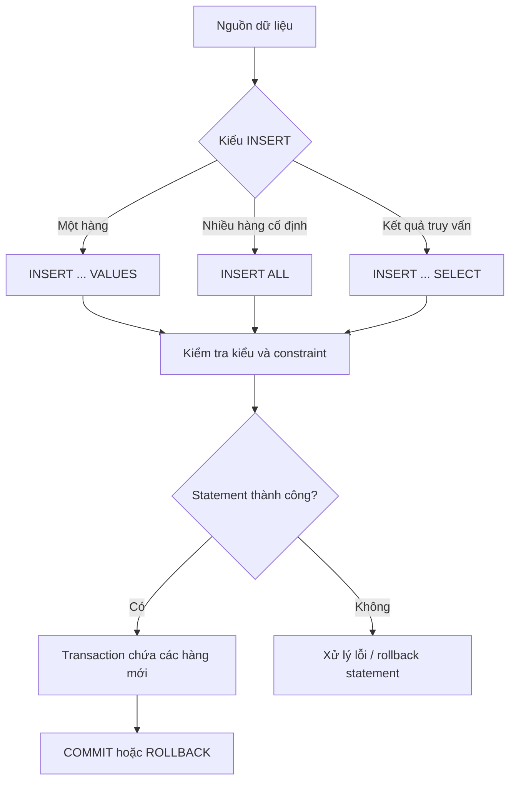

# INSERT một dòng, nhiều dòng và INSERT từ SELECT trong Oracle Database

`INSERT` là câu lệnh DML dùng để thêm hàng mới vào bảng. Trong ứng dụng Oracle, dữ liệu có thể đến từ một biểu mẫu người dùng, một tập giá trị được tạo trong chương trình, một bảng staging, một truy vấn tổng hợp hoặc một bảng khác. Cùng là thao tác thêm dữ liệu, nhưng cách viết SQL sẽ khác nhau tùy nguồn:

- **INSERT một dòng:** thêm một hàng bằng `VALUES`.
- **INSERT nhiều dòng:** thêm nhiều hàng bằng một câu lệnh, ví dụ `INSERT ALL` hoặc `INSERT ... SELECT`.
- **INSERT từ SELECT:** lấy một tập hàng từ truy vấn nguồn rồi ghi vào bảng đích.

Hiểu đúng ba hình thức này giúp giảm số lần gọi database, kiểm soát kiểu dữ liệu, xử lý ràng buộc và thiết kế quy trình nạp dữ liệu có thể chạy lại an toàn. Bài học sử dụng cú pháp Oracle SQL/PLSQL, tập trung vào danh sách cột, giá trị mặc định, identity/sequence, multi-table insert, transaction, lỗi dữ liệu, bulk processing và hiệu năng.

## 1. INSERT thêm dữ liệu vào bảng như thế nào?

Một bảng quan hệ lưu các hàng theo cấu trúc cột đã khai báo. Khi chèn hàng, Oracle cần biết:

1. **Bảng đích**: đối tượng nhận dữ liệu.
2. **Các cột đích**: cột nào sẽ được gán giá trị.
3. **Nguồn giá trị**: literal, bind variable, biểu thức hoặc kết quả SELECT.
4. **Ràng buộc**: dữ liệu có thỏa NOT NULL, PRIMARY KEY, UNIQUE, FOREIGN KEY, CHECK và các quy tắc khác không?
5. **Transaction**: thay đổi được commit hay rollback?

Ví dụ đơn giản:

```sql
INSERT INTO departments (
    department_id,
    department_name,
    location_id
)
VALUES (
    50,
    'Research',
    1700
);
```

Câu lệnh thêm một hàng vào bảng `DEPARTMENTS`. Nếu câu lệnh thành công, hàng đã nằm trong transaction hiện tại; các session khác chưa chắc nhìn thấy nó cho đến khi transaction được commit.

Sơ đồ tổng quát:



## 2. INSERT một dòng bằng VALUES

### 2.1. Cú pháp cơ bản

```sql
INSERT INTO table_name (
    column_1,
    column_2,
    ...
)
VALUES (
    expression_1,
    expression_2,
    ...
);
```

Số lượng giá trị phải tương ứng với số cột được liệt kê; kiểu dữ liệu và biểu thức phải tương thích với cột đích. Nếu không liệt kê danh sách cột, Oracle yêu cầu cung cấp giá trị theo thứ tự cột của bảng và phải đáp ứng các cột không có default/nullable.

Nên **luôn ghi danh sách cột**:

```sql
INSERT INTO customers (
    customer_id,
    customer_name,
    email_address,
    status
)
VALUES (
    1001,
    'Nguyen An',
    'an@example.test',
    'ACTIVE'
);
```

Danh sách cột giúp câu lệnh tự mô tả, tránh phụ thuộc thứ tự cột trong DDL và giảm nguy cơ gán nhầm dữ liệu khi bảng được thay đổi.

### 2.2. Không liệt kê cột: vì sao dễ lỗi?

Ví dụ:

```sql
INSERT INTO customers
VALUES (
    1002,
    'Tran Binh',
    'binh@example.test',
    'ACTIVE'
);
```

Oracle ghép giá trị theo thứ tự cột của bảng. Nếu bảng được thêm một cột mới hoặc thứ tự cột khác với giả định của người viết, câu lệnh có thể lỗi hoặc gán sai ý nghĩa. Khi schema thay đổi, các lệnh INSERT không có danh sách cột thường khó bảo trì.

### 2.3. INSERT một dòng từ DUAL

`DUAL` là bảng đặc biệt có một hàng, thường được dùng để đánh giá biểu thức hoặc tạo một hàng SELECT:

```sql
INSERT INTO system_events (
    event_id,
    event_name,
    created_at
)
SELECT
    9001,
    'IMPORT_STARTED',
    SYSTIMESTAMP
FROM dual;
```

Về kết quả, đây là một hàng được thêm từ một truy vấn. Cách này hữu ích khi giá trị được tạo bằng hàm SQL, biểu thức hoặc khi cần dùng cú pháp SELECT. Với một hàng literal đơn giản, `VALUES` thường rõ ràng hơn.

### 2.4. Giá trị biểu thức và hàm SQL

`VALUES` không chỉ nhận literal. Có thể sử dụng bind variable, phép toán và hàm:

```sql
INSERT INTO audit_log (
    audit_id,
    action_code,
    actor_name,
    created_at,
    note
)
VALUES (
    audit_seq.NEXTVAL,
    'CUSTOMER_CREATED',
    USER,
    SYSTIMESTAMP,
    'Created from customer screen'
);
```

Các biểu thức được đánh giá trong ngữ cảnh câu lệnh. `SYSTIMESTAMP` trả timestamp của hệ thống database host cùng timezone/độ chính xác phù hợp; `USER` trả tên user database hiện tại. Nếu ứng dụng cần thời điểm do client tạo hoặc một timezone nghiệp vụ cụ thể, cần định nghĩa rõ nguồn thời gian thay vì dùng hàm hệ thống một cách mặc định.

## 3. Danh sách cột, DEFAULT và NULL

### 3.1. Bỏ cột khỏi INSERT

Giả sử bảng:

```sql
CREATE TABLE customer_demo (
    customer_id   NUMBER(10) PRIMARY KEY,
    customer_name VARCHAR2(100 CHAR) NOT NULL,
    status        VARCHAR2(20 CHAR) DEFAULT 'NEW' NOT NULL,
    created_at    TIMESTAMP(6) DEFAULT SYSTIMESTAMP NOT NULL,
    note          VARCHAR2(300 CHAR)
);
```

Có thể chèn mà không truyền `STATUS`, `CREATED_AT` và `NOTE`:

```sql
INSERT INTO customer_demo (
    customer_id,
    customer_name
)
VALUES (
    1,
    'Le Chi'
);
```

Kết quả:

- `STATUS` nhận default `NEW`.
- `CREATED_AT` nhận `SYSTIMESTAMP` tại thời điểm thực thi.
- `NOTE` không có default nên nhận NULL vì cột nullable.

Việc bỏ cột khỏi danh sách INSERT khác với truyền NULL một cách tường minh.

### 3.2. Bỏ cột và truyền NULL không giống nhau

Với cột có default:

```sql
INSERT INTO customer_demo (
    customer_id,
    customer_name,
    status
)
VALUES (
    2,
    'Do Dung',
    NULL
);
```

Ở đây `STATUS` được truyền NULL tường minh. Nếu cột có ràng buộc NOT NULL, câu lệnh thất bại; Oracle không tự thay NULL bằng default thông thường chỉ vì cột có default.

Nếu muốn dùng default, có thể:

```sql
INSERT INTO customer_demo (
    customer_id,
    customer_name
)
VALUES (
    3,
    'Pham Ha'
);
```

Hoặc trong các phiên bản hỗ trợ cú pháp DEFAULT ở values expression:

```sql
INSERT INTO customer_demo (
    customer_id,
    customer_name,
    status
)
VALUES (
    4,
    'Vu Nam',
    DEFAULT
);
```

Kiểm tra cú pháp theo phiên bản Oracle đang sử dụng nếu làm việc với hệ thống cũ. Cách bỏ cột khỏi danh sách là cách đơn giản và dễ tương thích nhất để nhận default.

### 3.3. DEFAULT ON NULL

Oracle hỗ trợ khai báo default được áp dụng khi giá trị đầu vào là NULL:

```sql
CREATE TABLE source_channel_demo (
    channel_id NUMBER(10) PRIMARY KEY,
    channel_code VARCHAR2(20 CHAR)
        DEFAULT ON NULL 'WEB'
);
```

Với cấu hình này, khi chèn NULL cho `CHANNEL_CODE`, default có thể được sử dụng theo semantics `DEFAULT ON NULL` của Oracle. Khả năng dùng cú pháp và tương tác với kiểu cột cần xác nhận theo release; nó cũng kéo theo ràng buộc NOT NULL trong các dạng khai báo Oracle tương ứng. Không dùng default-on-null nếu NULL có ý nghĩa nghiệp vụ riêng như “chưa xác định”.

### 3.4. DEFAULT trong INSERT ... SELECT

Không thể mặc định viết `DEFAULT` như một biểu thức SELECT tùy ý:

```sql
-- Không dùng DEFAULT như một biểu thức SELECT thông thường:
INSERT INTO customer_demo (customer_id, customer_name, status)
SELECT customer_id, customer_name, DEFAULT
FROM customer_stage;
```

Nếu muốn cột đích nhận default, hãy bỏ cột đó khỏi danh sách đích:

```sql
INSERT INTO customer_demo (
    customer_id,
    customer_name
)
SELECT
    customer_id,
    customer_name
FROM customer_stage;
```

Oracle áp dụng default cho cột đích bị bỏ qua. Số cột và thứ tự trong SELECT phải khớp danh sách cột đích.

### 3.5. Oracle xử lý chuỗi rỗng

Trong SQL Oracle, chuỗi ký tự độ dài bằng 0 trong kiểu VARCHAR2 được xử lý như NULL:

```sql
INSERT INTO customer_demo (
    customer_id,
    customer_name,
    note
)
VALUES (
    5,
    'Hoang Lan',
    ''
);
```

`NOTE` được lưu theo semantics NULL, không phải một chuỗi rỗng phân biệt. Nếu ứng dụng cần phân biệt “không cung cấp”, “đã cung cấp chuỗi rỗng” và “chưa biết”, cần thiết kế thêm trạng thái hoặc quy ước dữ liệu.

## 4. Sinh khóa bằng IDENTITY và SEQUENCE

### 4.1. Identity column

Oracle hỗ trợ identity column để tự sinh số:

```sql
CREATE TABLE order_demo (
    order_id NUMBER GENERATED ALWAYS AS IDENTITY
        CONSTRAINT pk_order_demo PRIMARY KEY,
    customer_id NUMBER(10) NOT NULL,
    status VARCHAR2(20 CHAR) DEFAULT 'NEW' NOT NULL,
    created_at TIMESTAMP(6) DEFAULT SYSTIMESTAMP NOT NULL
);
```

Chèn hàng mà không cung cấp `ORDER_ID`:

```sql
INSERT INTO order_demo (customer_id)
VALUES (1001);
```

Với `GENERATED ALWAYS`, ứng dụng không được tự truyền giá trị vào identity column theo cách INSERT thông thường; Oracle tự sinh giá trị. Các biến thể thường gặp:

| Khai báo | Ý nghĩa |
|---|---|
| `GENERATED ALWAYS AS IDENTITY` | Luôn để Oracle sinh giá trị; không nhận giá trị tường minh theo INSERT thông thường |
| `GENERATED BY DEFAULT AS IDENTITY` | Oracle sinh khi bỏ cột; có thể cung cấp giá trị tường minh |
| `GENERATED BY DEFAULT ON NULL AS IDENTITY` | Oracle sinh khi cột bị bỏ qua hoặc giá trị đầu vào là NULL theo semantics khai báo |

Identity column dựa trên sequence nội bộ do Oracle quản lý. Không dựa vào identity để tạo số thứ tự không có khoảng trống; sequence có thể tạo gap do rollback, cache hoặc lỗi.

### 4.2. SEQUENCE tường minh

Sequence hữu ích khi khóa được sinh từ nhiều bảng hoặc cần quản lý độc lập:

```sql
CREATE SEQUENCE order_seq
    START WITH 10000
    INCREMENT BY 1
    CACHE 100
    NOCYCLE;
```

Chèn một hàng:

```sql
INSERT INTO order_demo (
    order_id,
    customer_id,
    status
)
VALUES (
    order_seq.NEXTVAL,
    1002,
    'NEW'
);
```

Ví dụ này giả định `ORDER_ID` không phải identity GENERATED ALWAYS; không dùng đồng thời hai cơ chế sinh khóa theo cách xung đột. Trong hệ thống thật, chọn một cơ chế rõ ràng.

### 4.3. NEXTVAL và CURRVAL

- `sequence_name.NEXTVAL` lấy giá trị sequence kế tiếp trong session.
- `sequence_name.CURRVAL` trả giá trị NEXTVAL gần nhất mà session đó đã lấy; session phải gọi NEXTVAL trước.

Ví dụ:

```sql
SELECT order_seq.NEXTVAL FROM dual;
SELECT order_seq.CURRVAL FROM dual;
```

Sequence không phải bộ đếm transaction:

- Rollback không trả lại giá trị đã cấp.
- Nhiều session có thể lấy giá trị đồng thời.
- CACHE và sự cố instance có thể làm mất một số giá trị đã cache.
- Không bảo đảm số liên tục không có gap.

Nếu cần mã nghiệp vụ không có gap do quy định kiểm toán, phải thiết kế quy trình đánh số/khóa riêng; sequence thông thường không cung cấp bảo đảm đó.

### 4.4. Lấy khóa vừa sinh

Với INSERT một dòng, có thể dùng `RETURNING INTO`:

```sql
DECLARE
    l_new_order_id order_demo.order_id%TYPE;
BEGIN
    INSERT INTO order_demo (
        customer_id,
        status
    )
    VALUES (
        1003,
        'NEW'
    )
    RETURNING order_id INTO l_new_order_id;

    DBMS_OUTPUT.PUT_LINE('New order: ' || l_new_order_id);
END;
/
```

Nếu khóa được cấp bởi sequence, có thể lấy NEXTVAL trước và dùng cùng giá trị cho các bảng liên quan trong một transaction:

```sql
DECLARE
    l_order_id NUMBER;
BEGIN
    l_order_id := order_seq.NEXTVAL;

    INSERT INTO order_header (order_id, customer_id)
    VALUES (l_order_id, 1001);

    INSERT INTO order_audit (order_id, action_code)
    VALUES (l_order_id, 'CREATED');
END;
/
```

Đây là cách đảm bảo hai hàng dùng cùng khóa. Hai INSERT vẫn nằm trong cùng transaction; caller quyết định COMMIT hoặc ROLLBACK.

## 5. INSERT nhiều dòng cố định bằng INSERT ALL

### 5.1. Vì sao cần multi-row insert?

Nếu phải thêm 100 hàng, gọi 100 câu INSERT riêng lẻ từ ứng dụng có thể tạo nhiều round trip và tăng chi phí parse/execute. Oracle có cú pháp **multi-table insert** với `INSERT ALL`/`INSERT FIRST`, trong đó một truy vấn nguồn tạo ra các hàng và các nhánh INTO quyết định nơi ghi dữ liệu.

Đối với các phiên bản Oracle truyền thống, không nên giả định cú pháp nhiều tuple kiểu một số hệ quản trị khác luôn được hỗ trợ:

```sql
-- Dạng này không phải cú pháp portable cho nhiều release Oracle:
INSERT INTO departments (department_id, department_name)
VALUES (50, 'Research'), (60, 'Support');
```

Hãy dùng `INSERT ALL` hoặc `INSERT ... SELECT ... UNION ALL` nếu cần tương thích rộng. Một số release mới có thể bổ sung cú pháp row constructor; kiểm tra tài liệu đúng phiên bản thay vì mang cú pháp từ MySQL/PostgreSQL sang Oracle.

### 5.2. INSERT ALL với nhiều hàng cố định vào một bảng

```sql
INSERT ALL
    INTO departments (department_id, department_name, location_id)
    VALUES (50, 'Research', 1700)
    INTO departments (department_id, department_name, location_id)
    VALUES (60, 'Support', 1800)
    INTO departments (department_id, department_name, location_id)
    VALUES (70, 'Training', 1700)
SELECT 1
FROM dual;
```

SELECT nguồn trả một hàng từ DUAL. Mỗi nhánh INTO tạo một hàng mới trong bảng đích. Kết quả là ba hàng được thêm bằng một statement.

### 5.3. INSERT ALL từ tập dữ liệu nguồn

`INSERT ALL` cũng có thể áp dụng cho từng hàng của SELECT:

```sql
INSERT ALL
    INTO employee_archive (
        employee_id,
        employee_name,
        archive_reason
    )
    VALUES (
        employee_id,
        employee_name,
        'YEAR_END'
    )
SELECT employee_id, employee_name
FROM employees
WHERE status = 'INACTIVE';
```

Với mỗi hàng SELECT nguồn, nhánh INTO được thực hiện. Nếu SELECT nguồn trả 500 hàng, nhánh trên có thể thêm 500 hàng vào archive.

### 5.4. INSERT ALL có nhiều bảng đích

Một SELECT nguồn có thể phân phối dữ liệu vào nhiều bảng:

```sql
INSERT ALL
    INTO order_audit (
        order_id,
        action_code,
        action_time
    )
    VALUES (
        order_id,
        'IMPORTED',
        SYSTIMESTAMP
    )
    INTO order_search_index (
        order_id,
        customer_id,
        status
    )
    VALUES (
        order_id,
        customer_id,
        status
    )
SELECT order_id, customer_id, status
FROM orders_stage
WHERE import_batch_id = 20261114;
```

Mỗi hàng nguồn tạo một hàng audit và một hàng search index trong ví dụ này. Các bảng đích phải được thiết kế để chấp nhận cùng một tập nguồn; ràng buộc hoặc trigger ở một bảng đích có thể làm statement thất bại theo quy tắc xử lý lỗi.

### 5.5. INSERT FIRST và INSERT ALL có điều kiện

Hai dạng conditional multi-table insert:

- `INSERT ALL`: thực hiện **mọi nhánh WHEN đúng** cho từng hàng nguồn.
- `INSERT FIRST`: thực hiện **nhánh WHEN đầu tiên đúng** cho từng hàng nguồn rồi dừng xét các nhánh tiếp theo.

Ví dụ phân loại giao dịch:

```sql
INSERT ALL
    WHEN amount >= 100000000 THEN
        INTO high_value_transactions (
            transaction_id, amount
        )
        VALUES (
            transaction_id, amount
        )
    WHEN amount >= 10000000 THEN
        INTO medium_value_transactions (
            transaction_id, amount
        )
        VALUES (
            transaction_id, amount
        )
    WHEN amount < 10000000 THEN
        INTO standard_transactions (
            transaction_id, amount
        )
        VALUES (
            transaction_id, amount
        )
SELECT transaction_id, amount
FROM transaction_stage;
```

Mỗi hàng nguồn thỏa đúng một nhánh theo các điều kiện loại trừ nhau. Nếu các điều kiện chồng lấn, INSERT ALL có thể ghi một hàng nguồn vào nhiều bảng; đây có thể là chủ đích hoặc lỗi thiết kế.

Với `INSERT FIRST`:

```sql
INSERT FIRST
    WHEN amount >= 100000000 THEN
        INTO high_value_transactions (
            transaction_id, amount
        )
        VALUES (
            transaction_id, amount
        )
    WHEN amount >= 10000000 THEN
        INTO medium_value_transactions (
            transaction_id, amount
        )
        VALUES (
            transaction_id, amount
        )
    ELSE
        INTO standard_transactions (
            transaction_id, amount
        )
        VALUES (
            transaction_id, amount
        )
SELECT transaction_id, amount
FROM transaction_stage;
```

Nếu amount >= 100000000, chỉ nhánh đầu được thực hiện; nhánh thứ hai không chạy dù điều kiện amount >= 10000000 cũng đúng. `ELSE` xử lý hàng không thỏa WHEN nào trong INSERT FIRST/ALL conditional syntax.

### 5.6. Giá trị trong VALUES của multi-table insert

Các biểu thức ở nhánh INTO tham chiếu cột của SELECT nguồn. Vì thế, SELECT nguồn phải cung cấp tất cả cột cần dùng:

```sql
INSERT ALL
    INTO employee_copy (employee_id, employee_name)
    VALUES (employee_id, employee_name)
SELECT employee_id, employee_name
FROM employees;
```

Nếu nhánh INTO tham chiếu một alias không có trong SELECT nguồn, câu lệnh không hợp lệ. Đặt alias rõ ràng khi biểu thức nguồn phức tạp.

## 6. INSERT nhiều dòng bằng SELECT và UNION ALL

### 6.1. Tạo nhiều hàng bằng SELECT ... UNION ALL

Một lựa chọn dễ đọc cho tập giá trị cố định:

```sql
INSERT INTO departments (
    department_id,
    department_name,
    location_id
)
SELECT 80, 'Security', 1700 FROM dual
UNION ALL
SELECT 90, 'Operations', 1800 FROM dual
UNION ALL
SELECT 100, 'Analytics', 1700 FROM dual;
```

Mỗi SELECT tạo một hàng; `UNION ALL` giữ lại mọi hàng kể cả trùng. Nếu dùng `UNION`, Oracle phải loại trùng theo toàn bộ cột SELECT, có thể làm mất hàng trùng có chủ ý và phát sinh chi phí sort/hash.

### 6.2. UNION ALL và INSERT ALL khác nhau thế nào?

| Tiêu chí | INSERT ALL | INSERT ... SELECT ... UNION ALL |
|---|---|---|
| Cách tạo nhiều hàng cố định | Mỗi INTO là một nhánh | Mỗi SELECT là một hàng nguồn |
| Nhiều bảng đích | Có thể phân phối vào nhiều bảng | SELECT nguồn thường đổ vào một bảng đích của INSERT |
| Điều kiện phân nhánh | WHEN / FIRST / ALL | WHERE trong từng SELECT |
| Cách nhìn | Một nguồn, nhiều nhánh ghi | Nhiều nhánh SELECT tạo tập nguồn |
| Dùng cho ETL | Rất phù hợp khi một nguồn phân phối nhiều đích | Phù hợp khi tập nguồn được tạo từ nhiều SELECT |

Chọn cách diễn đạt rõ nhất cho cấu trúc dữ liệu. Không cần dùng INSERT ALL chỉ vì có hai hoặc ba hàng cố định.

### 6.3. Dùng CTE làm nguồn cho INSERT

Có thể chuẩn bị dữ liệu trong common table expression:

```sql
INSERT INTO customer_summary (
    customer_id,
    order_count,
    total_amount
)
WITH order_totals AS (
    SELECT customer_id,
           COUNT(*) AS order_count,
           SUM(total_amount) AS total_amount
    FROM orders
    WHERE status = 'COMPLETED'
    GROUP BY customer_id
)
SELECT customer_id,
       order_count,
       total_amount
FROM order_totals;
```

CTE giúp tách bước tạo tập dữ liệu khỏi bước ghi. Cú pháp đặt WITH và SELECT có thể được tổ chức khác nhau tùy phiên bản/statement; ví dụ trên là dạng INSERT có subquery factoring được Oracle hỗ trợ trong các release hiện đại. Khi làm với release cũ, kiểm tra cú pháp tương ứng.

## 7. INSERT ... SELECT: nạp dữ liệu từ một truy vấn

### 7.1. Cú pháp tổng quát

```sql
INSERT INTO target_table (
    target_column_1,
    target_column_2,
    ...
)
SELECT
    source_expression_1,
    source_expression_2,
    ...
FROM source_table
WHERE condition;
```

Quy tắc:

- Số biểu thức SELECT phải bằng số cột đích được liệt kê.
- Các vị trí phải có kiểu dữ liệu tương thích.
- Thứ tự biểu thức SELECT ánh xạ theo thứ tự danh sách cột đích.
- WHERE lọc tập hàng nguồn.
- SELECT trả 0 hàng thì INSERT thêm 0 hàng; statement vẫn có thể thành công.

Ví dụ:

```sql
INSERT INTO inactive_customers (
    customer_id,
    customer_name,
    email_address,
    archived_at
)
SELECT
    customer_id,
    customer_name,
    email_address,
    SYSTIMESTAMP
FROM customers
WHERE status = 'INACTIVE';
```

Mỗi khách hàng inactive từ nguồn được thêm vào bảng archive. Không cần vòng lặp PL/SQL cho từng hàng nếu một câu INSERT SELECT có thể thực hiện toàn bộ công việc.

### 7.2. Nạp từ bảng staging

Trong ETL, dữ liệu thường được đưa vào bảng staging trước:

```sql
INSERT INTO orders (
    order_id,
    customer_id,
    order_date,
    total_amount,
    status
)
SELECT
    s.order_id,
    s.customer_id,
    TO_DATE(s.order_date_text, 'FXYYYY-MM-DD'),
    TO_NUMBER(
        s.amount_text,
        '999999999999D99',
        'NLS_NUMERIC_CHARACTERS = ''.,'''
    ),
    'NEW'
FROM orders_stage s
WHERE s.batch_id = :batch_id
  AND s.validation_status = 'VALID';
```

Ví dụ chuyển ngày và số từ text sang kiểu dữ liệu đích. Trong quy trình thật, phải xử lý dữ liệu không parse được, duplicate, FK không tồn tại và batch chạy lại. Không giả định mọi dòng có trạng thái VALID đều chắc chắn hợp lệ với tất cả constraint của bảng đích.

### 7.3. INSERT SELECT có JOIN

Có thể kết hợp nhiều bảng nguồn:

```sql
INSERT INTO order_customer_snapshot (
    order_id,
    customer_id,
    customer_name,
    order_amount
)
SELECT
    o.order_id,
    c.customer_id,
    c.customer_name,
    o.total_amount
FROM orders o
JOIN customers c
  ON c.customer_id = o.customer_id
WHERE o.created_at >= DATE '2026-11-01'
  AND o.created_at <  DATE '2026-12-01';
```

JOIN quyết định cách ghép dữ liệu. Nếu quan hệ không phải 1-1, truy vấn có thể tạo nhiều hàng cho một order và dẫn đến duplicate ở bảng đích. Hãy xác định cardinality và khóa trước khi insert.

### 7.4. INSERT SELECT với GROUP BY

Tạo bảng tổng hợp:

```sql
INSERT INTO monthly_sales (
    sales_year,
    sales_month,
    customer_id,
    order_count,
    sales_total
)
SELECT
    EXTRACT(YEAR FROM order_date),
    EXTRACT(MONTH FROM order_date),
    customer_id,
    COUNT(*),
    SUM(total_amount)
FROM orders
WHERE order_date >= DATE '2026-11-01'
  AND order_date <  DATE '2026-12-01'
  AND status = 'COMPLETED'
GROUP BY
    EXTRACT(YEAR FROM order_date),
    EXTRACT(MONTH FROM order_date),
    customer_id;
```

INSERT chỉ nhận tập kết quả đã group. Cần bảo đảm khóa duy nhất ở bảng tổng hợp phản ánh đúng grain, ví dụ (sales_year, sales_month, customer_id). Nếu chạy lại cùng kỳ mà không xóa hoặc merge theo chính sách, câu lệnh có thể vi phạm unique constraint hoặc tạo duplicate logic.

### 7.5. INSERT SELECT với DISTINCT

Nếu nguồn có nhiều hàng trùng và nghiệp vụ chỉ cần một hàng cho mỗi tập giá trị:

```sql
INSERT INTO active_categories (
    category_id,
    category_name
)
SELECT DISTINCT
    category_id,
    category_name
FROM product_import_stage
WHERE category_id IS NOT NULL;
```

`DISTINCT` loại các hàng trùng trên toàn bộ danh sách SELECT. Nó không thay thế ràng buộc UNIQUE ở bảng đích, vì hai session có thể cùng chèn dữ liệu đồng thời hoặc dữ liệu có thể trùng theo một khóa khác với toàn bộ projection.

### 7.6. INSERT SELECT từ chính bảng đích

Có thể tạo bản sao hoặc snapshot từ cùng bảng:

```sql
INSERT INTO orders_archive (
    order_id,
    customer_id,
    order_date,
    total_amount
)
SELECT
    order_id,
    customer_id,
    order_date,
    total_amount
FROM orders
WHERE order_date < DATE '2024-01-01';
```

Đây là một statement đọc tập nguồn theo cơ chế read consistency của Oracle và chèn vào bảng đích. Nếu bảng nguồn và đích là cùng một bảng, cần cẩn thận điều kiện lọc để tránh tạo thêm hàng thỏa điều kiện trong các lần chạy tiếp theo.

## 8. Kiểu dữ liệu và chuyển đổi khi INSERT

### 8.1. Khớp cột theo vị trí, không theo alias

Ví dụ:

```sql
INSERT INTO employee_copy (
    employee_id,
    employee_name,
    department_id
)
SELECT
    department_id,
    employee_name,
    employee_id
FROM employees;
```

Alias hoặc tên cột nguồn không tự ghép theo tên. Giá trị SELECT đầu tiên đi vào employee_id, giá trị thứ hai vào employee_name, thứ ba vào department_id. Ví dụ này có thể sai logic dù kiểu dữ liệu vẫn tương thích.

Hãy sắp xếp SELECT theo đúng thứ tự cột đích và đặt alias có ý nghĩa để dễ đọc:

```sql
INSERT INTO employee_copy (
    employee_id,
    employee_name,
    department_id
)
SELECT
    e.employee_id,
    e.employee_name,
    e.department_id
FROM employees e;
```

### 8.2. Tránh implicit conversion

Không dựa vào Oracle tự chuyển chuỗi thành ngày hoặc số theo NLS:

```sql
-- Không nên phụ thuộc NLS:
INSERT INTO orders (order_id, order_date, total_amount)
VALUES (7001, '11/12/2026', '1,250.50');
```

Thay bằng typed literal hoặc conversion rõ ràng:

```sql
INSERT INTO orders (order_id, order_date, total_amount)
VALUES (
    7001,
    DATE '2026-12-11',
    1250.50
);
```

Nếu nguồn là text:

```sql
INSERT INTO orders (order_id, order_date, total_amount)
SELECT
    order_id_text,
    TO_DATE(order_date_text, 'FXYYYY-MM-DD'),
    TO_NUMBER(
        amount_text,
        '999999999999D99',
        'NLS_NUMERIC_CHARACTERS = ''.,'''
    )
FROM orders_stage;
```

Định dạng đầu vào phải thống nhất với hợp đồng file. Chuyển đổi tường minh giúp lỗi dễ điều tra và kết quả không phụ thuộc cấu hình session.

### 8.3. CLOB, LOB và kiểu dữ liệu lớn

Khi chèn LOB:

- Có thể bind nội dung CLOB/BLOB từ ứng dụng bằng API driver phù hợp.
- Có thể chèn giá trị LOB từ bảng nguồn bằng INSERT SELECT.
- Tránh ghép nội dung rất lớn vào chuỗi SQL động.
- Với LOB locator, phải hiểu vòng đời locator và transaction.

Ví dụ sao chép CLOB:

```sql
INSERT INTO document_archive (
    document_id,
    document_title,
    document_body
)
SELECT
    document_id,
    document_title,
    document_body
FROM document_store
WHERE archived_flag = 'Y';
```

Không chuyển CLOB lớn thành VARCHAR2 chỉ để đưa vào VALUES; giới hạn kiểu chuỗi SQL và bộ nhớ ứng dụng có thể khiến thao tác thất bại hoặc tốn tài nguyên.

## 9. INSERT và các ràng buộc dữ liệu

### 9.1. NOT NULL

Cột NOT NULL phải nhận giá trị không NULL, từ literal, bind, default hoặc SELECT:

```sql
INSERT INTO customer_demo (
    customer_id,
    customer_name
)
VALUES (
    10,
    NULL
);
```

Câu lệnh thất bại vì `CUSTOMER_NAME` là NOT NULL. Oracle thường báo lỗi `ORA-01400`. Nếu bỏ cột customer_name khỏi INSERT mà không có default, kết quả vẫn là NULL và cũng thất bại.

### 9.2. PRIMARY KEY và UNIQUE

```sql
INSERT INTO dept_lab (department_id, department_name)
VALUES (10, 'Another Sales');
```

Nếu department_id 10 đã tồn tại và là PK, Oracle từ chối hàng mới với lỗi unique constraint, thường là `ORA-00001`. Không nên chỉ kiểm tra trước bằng SELECT rồi cho rằng chắc chắn insert sẽ thành công; hai session có thể cùng kiểm tra “chưa có” rồi cùng chèn. Constraint ở database mới là hàng rào cuối cùng đảm bảo uniqueness.

### 9.3. FOREIGN KEY

```sql
INSERT INTO employee_lab (
    employee_id,
    employee_name,
    department_id
)
VALUES (
    2001,
    'Minh',
    999
);
```

Nếu bảng employee có FK đến department và department 999 không tồn tại, câu lệnh thất bại, thường với `ORA-02291`. Nếu cột FK nullable và giá trị là NULL, FK không bắt buộc phải tìm một hàng cha cho NULL; thêm NOT NULL nếu nghiệp vụ yêu cầu mọi nhân viên phải có phòng ban.

### 9.4. CHECK constraint

```sql
INSERT INTO orders (
    order_id,
    total_amount,
    status
)
VALUES (
    7002,
    -100,
    'NEW'
);
```

Nếu có CHECK `total_amount >= 0`, hàng bị từ chối. Cần nhớ CHECK trong Oracle chấp nhận UNKNOWN: biểu thức check có kết quả UNKNOWN do NULL không tương đương FALSE. Nếu cột bắt buộc phải có giá trị, kết hợp NOT NULL với CHECK.

### 9.5. Constraint có thể trì hoãn

Một số PK/UNIQUE/FOREIGN KEY constraints có thể được khai báo DEFERRABLE để kiểm tra tại thời điểm commit thay vì ngay sau từng statement, tùy trạng thái constraint:

```sql
SET CONSTRAINTS ALL DEFERRED;
```

Chỉ dùng khi schema đã khai báo constraint DEFERRABLE và transaction cần trạng thái trung gian tạm thời chưa thỏa ràng buộc. `SET CONSTRAINTS` không biến một constraint NOT DEFERRABLE thành deferred. Kiểm tra lại trước COMMIT; lỗi có thể xuất hiện ở cuối transaction thay vì tại câu INSERT.

## 10. Trigger và các tác động phụ khi INSERT

INSERT có thể kích hoạt trigger:

- BEFORE INSERT FOR EACH ROW.
- AFTER INSERT FOR EACH ROW.
- BEFORE/AFTER INSERT ở mức statement.
- Compound trigger với các section tương ứng.

Ví dụ trigger gán ngày tạo:

```sql
CREATE OR REPLACE TRIGGER trg_customer_demo_bi
BEFORE INSERT ON customer_demo
FOR EACH ROW
BEGIN
    IF :NEW.created_at IS NULL THEN
        :NEW.created_at := SYSTIMESTAMP;
    END IF;
END;
/
```

Trong hệ thống thật, không nên đặt cùng một quy tắc tạo giá trị ở nhiều nơi (DEFAULT, trigger và ứng dụng) mà không có thứ tự ưu tiên rõ. Trigger cũng có thể ghi audit, cập nhật bảng phụ hoặc gọi logic khác, làm chi phí của INSERT cao hơn dự kiến.

INSERT nhiều hàng kích hoạt row trigger cho từng hàng và statement trigger cho statement theo semantics của Oracle. Nếu trigger có lỗi không được xử lý, statement có thể thất bại. Không giả định một INSERT SELECT lớn chỉ chạy trigger một lần cho toàn bộ tập.

## 11. Transaction: COMMIT và ROLLBACK sau INSERT

### 11.1. INSERT không tự commit thông thường

Ví dụ:

```sql
INSERT INTO customer_demo (customer_id, customer_name)
VALUES (20, 'Test User');

-- Session hiện tại nhìn thấy hàng chưa commit.
SELECT *
FROM customer_demo
WHERE customer_id = 20;

-- Xác nhận transaction:
COMMIT;
```

Các thay đổi DML thông thường như INSERT, UPDATE và DELETE thuộc transaction. `COMMIT` xác nhận; `ROLLBACK` hủy các thay đổi chưa commit trong transaction.

### 11.2. ROLLBACK

```sql
INSERT INTO customer_demo (customer_id, customer_name)
VALUES (21, 'Temporary User');

ROLLBACK;
```

Sau rollback, hàng mới không còn trong trạng thái dữ liệu đã commit. Các sequence/identity value đã cấp không nhất thiết quay lại; vì vậy có thể thấy gap trong khóa.

### 11.3. SAVEPOINT

Có thể đánh dấu điểm trong transaction:

```sql
INSERT INTO customer_demo (customer_id, customer_name)
VALUES (22, 'First User');

SAVEPOINT before_second_insert;

INSERT INTO customer_demo (customer_id, customer_name)
VALUES (23, 'Second User');

ROLLBACK TO before_second_insert;

COMMIT;
```

Sau commit, hàng 22 được giữ; hàng 23 bị rollback tới savepoint. Savepoint không phải transaction độc lập.

### 11.4. Statement atomicity và nhiều hàng

Với một câu INSERT thông thường không dùng cơ chế ghi lỗi theo từng hàng, nếu một hàng trong INSERT SELECT vi phạm constraint và làm statement thất bại, Oracle rollback phần thay đổi của **statement đó**. Các statement trước trong cùng transaction vẫn còn cho tới khi caller commit hoặc rollback.

Điều này quan trọng khi một quy trình có nhiều bước:

1. Chèn header batch.
2. Chèn detail.
3. Cập nhật trạng thái.
4. Commit khi tất cả bước thành công.

Nếu bước 3 thất bại, ứng dụng có thể rollback toàn transaction để không để lại header/detail dở dang.

## 12. INSERT nhiều dòng và xử lý lỗi từng hàng

### 12.1. Mặc định: một lỗi có thể làm statement thất bại

Giả sử nguồn có 1.000 hàng, một hàng vi phạm unique constraint. Với INSERT SELECT thông thường, statement có thể thất bại thay vì chỉ bỏ qua hàng lỗi. Nếu nghiệp vụ cần nạp phần hợp lệ và ghi nhận từng hàng lỗi, phải thiết kế cơ chế riêng.

### 12.2. DML error logging

Oracle hỗ trợ DML error logging qua `DBMS_ERRLOG` cho nhiều tình huống INSERT/UPDATE/DELETE/MERGE. Ví dụ tạo error table:

```sql
BEGIN
    DBMS_ERRLOG.CREATE_ERROR_LOG(
        dml_table_name => 'ORDERS'
    );
END;
/
```

Oracle tạo bảng lỗi theo quy tắc tên mặc định (thường có tiền tố `ERR$_`) trong schema phù hợp. Sau đó:

```sql
INSERT INTO orders (
    order_id,
    customer_id,
    total_amount,
    status
)
SELECT
    order_id,
    customer_id,
    amount,
    'NEW'
FROM orders_stage
WHERE batch_id = :batch_id
LOG ERRORS INTO err$_orders ('BATCH_20261114')
REJECT LIMIT UNLIMITED;
```

Các lỗi hàng đủ điều kiện được ghi vào error table cùng thông tin lỗi và tag. Sau đó có thể kiểm tra:

```sql
SELECT ora_err_number$,
       ora_err_mesg$,
       ora_err_tag$,
       order_id,
       customer_id
FROM err$_orders
WHERE ora_err_tag$ = 'BATCH_20261114';
```

DML error logging không ghi được mọi loại lỗi trong mọi tình huống. Một số lỗi statement-level, lỗi cấu trúc, lỗi parse hoặc loại constraint/trigger cụ thể có thể vẫn làm statement thất bại. Hãy thử với loại lỗi dự kiến trên đúng phiên bản và schema trước khi dùng trong production. Không dùng REJECT LIMIT UNLIMITED như cách che giấu lỗi dữ liệu; phải theo dõi số hàng reject và đặt chính sách dừng batch.

### 12.3. FORALL và SAVE EXCEPTIONS trong PL/SQL

Nếu dữ liệu nằm trong PL/SQL collection và cần thực thi cùng một DML nhiều lần, `FORALL` có thể giảm context switch giữa PL/SQL engine và SQL engine:

```sql
DECLARE
    TYPE t_customer_ids IS TABLE OF customer_demo.customer_id%TYPE;
    TYPE t_customer_names IS TABLE OF customer_demo.customer_name%TYPE;

    l_ids   t_customer_ids := t_customer_ids(101, 102, 103);
    l_names t_customer_names := t_customer_names(
        'Customer A',
        'Customer B',
        'Customer C'
    );
BEGIN
    FORALL i IN 1 .. l_ids.COUNT
        INSERT INTO customer_demo (
            customer_id,
            customer_name
        )
        VALUES (
            l_ids(i),
            l_names(i)
        );
END;
/
```

`FORALL` không phải vòng FOR thông thường: nó gửi các lần thực thi DML theo cơ chế bulk binding. Với dữ liệu lớn, có thể kết hợp collection được nạp bằng BULK COLLECT.

Để tiếp tục các phần tử khác khi một số DML iteration lỗi, dùng `SAVE EXCEPTIONS`:

```sql
DECLARE
    TYPE t_ids IS TABLE OF NUMBER;
    l_ids t_ids := t_ids(101, 102, 101, 103);
BEGIN
    FORALL i IN 1 .. l_ids.COUNT SAVE EXCEPTIONS
        INSERT INTO customer_demo (
            customer_id,
            customer_name
        )
        VALUES (
            l_ids(i),
            'Bulk customer'
        );
EXCEPTION
    WHEN OTHERS THEN
        IF SQLCODE = -24381 THEN
            FOR i IN 1 .. SQL%BULK_EXCEPTIONS.COUNT LOOP
                DBMS_OUTPUT.PUT_LINE(
                    'Index=' || SQL%BULK_EXCEPTIONS(i).ERROR_INDEX
                    || ', Code=' || SQL%BULK_EXCEPTIONS(i).ERROR_CODE
                );
            END LOOP;
        ELSE
            RAISE;
        END IF;
END;
/
```

`SQL%BULK_EXCEPTIONS` cung cấp vị trí iteration và mã lỗi. Ứng dụng cần ánh xạ iteration về dữ liệu nguồn để log row cụ thể. SAVE EXCEPTIONS không tự quyết định commit/rollback; transaction vẫn do caller quản lý.

### 12.4. Chọn INSERT SELECT, INSERT ALL hay FORALL?

| Nguồn dữ liệu | Lựa chọn thường phù hợp | Lý do |
|---|---|---|
| Một hàng từ form | INSERT VALUES | Đơn giản, bind trực tiếp |
| Một tập hàng có sẵn trong bảng | INSERT SELECT | Database xử lý tập dữ liệu trong SQL |
| Một số hàng cố định cần chèn trong một statement | INSERT ALL hoặc SELECT UNION ALL | Giảm số statement |
| Một SELECT cần phân phối sang nhiều bảng | INSERT ALL/FIRST | Multi-table insert |
| Collection trong PL/SQL cần lặp cùng DML | FORALL | Bulk binding, giảm context switch |
| File/nguồn rất lớn | SQL*Loader, external table, direct-path/bulk strategy | Tối ưu quy trình nạp theo quy mô |

Không dùng FORALL chỉ để thay một câu INSERT SELECT có thể xử lý toàn bộ dữ liệu ngay trong database. Ngược lại, không cần dựng staging table nếu chương trình đã có collection nhỏ-vừa và FORALL là cách đơn giản phù hợp.

## 13. Direct-path INSERT và nạp dữ liệu khối lượng lớn

### 13.1. Conventional path

Thông thường, INSERT sử dụng conventional path:

- Oracle dùng buffer cache theo cơ chế DML thông thường.
- Ghi undo/redo theo yêu cầu phục hồi.
- Có thể chèn vào các block có không gian phù hợp trong segment.
- Tương tác với khóa, trigger và constraint theo quy tắc DML.

Đây là lựa chọn phù hợp cho phần lớn OLTP và các lần chèn thông thường.

### 13.2. Direct-path INSERT

Với một số câu INSERT SELECT, có thể yêu cầu direct-path bằng hint:

```sql
INSERT /*+ APPEND */ INTO orders_archive (
    order_id,
    customer_id,
    order_date,
    total_amount
)
SELECT
    order_id,
    customer_id,
    order_date,
    total_amount
FROM orders
WHERE order_date < DATE '2024-01-01';
```

Direct-path insert có thể ghi dữ liệu vào vùng mới phía trên high-water mark, giảm một số chi phí của conventional path và hữu ích cho bulk load. Nhưng nó có các hạn chế về truy cập đồng thời, trigger/constraint, index, logging và thao tác tiếp theo trên cùng đối tượng. Oracle có thể bỏ qua hint nếu điều kiện không phù hợp; hãy xác nhận execution plan và behavior thực tế.

### 13.3. Không đọc lại bảng sau direct-path insert trước khi commit

Một số thao tác direct-path trong cùng transaction có thể dẫn tới lỗi `ORA-12838` nếu session cố truy cập/modify lại đối tượng vừa được direct-path modified trước khi commit. Hãy tuân thủ quy tắc transaction và giới hạn của direct-path; không thêm `APPEND` chỉ vì muốn câu lệnh chạy nhanh hơn.

### 13.4. NOLOGGING không có nghĩa không cần backup

Một số bulk load có thể dùng NOLOGGING theo cấu hình/tùy chọn, nhưng điều này ảnh hưởng khả năng media recovery. NOLOGGING không loại bỏ mọi redo trong mọi trường hợp, và dữ liệu mới có thể cần backup phù hợp ngay sau thao tác. Không thay đổi logging mode trên production chỉ để tăng tốc mà chưa có kế hoạch backup/standby/DR được DBA phê duyệt.

## 14. Hiệu năng và khả năng mở rộng

### 14.1. Giảm round trip

Nếu ứng dụng gửi 1.000 INSERT riêng:

- Có thể phát sinh nhiều lần gọi database.
- Mỗi statement cần execute và quản lý lỗi riêng.
- Latency mạng tích lũy đáng kể.

Một INSERT SELECT hoặc multi-row/bulk strategy có thể giảm round trip và tận dụng xử lý tập hợp trong database. Lợi ích phụ thuộc dữ liệu, index, trigger, constraint và network.

### 14.2. Index làm INSERT tốn chi phí hơn

Mỗi hàng chèn có thể cần cập nhật các index liên quan. Bảng có nhiều index giúp SELECT nhưng làm INSERT nặng hơn:

- Tăng redo/undo và I/O.
- Tăng công việc cập nhật B-tree.
- Có thể phát sinh block contention ở index key nóng.
- Có thể làm direct-path load bị hạn chế hoặc cần rebuild index theo quy trình bulk load.

Không xóa index trên production để tăng tốc load nếu chưa đánh giá tính toàn vẹn, truy vấn đồng thời và kế hoạch phục hồi.

### 14.3. Statistics sau bulk load

Sau khi nạp lượng lớn dữ liệu, optimizer có thể cần statistics phù hợp để chọn plan cho truy vấn tiếp theo. DBA có thể thu thập statistics theo chính sách:

```sql
BEGIN
    DBMS_STATS.GATHER_TABLE_STATS(
        ownname => USER,
        tabname => 'ORDERS_ARCHIVE',
        cascade => TRUE
    );
END;
/
```

Không chạy gather statistics một cách máy móc sau mỗi INSERT nhỏ; với bulk load lớn, cần cân nhắc thời điểm, incremental stats nếu partitioned và workload đang hoạt động.

### 14.4. Đo những gì?

| Chỉ số | Ý nghĩa |
|---|---|
| Rows inserted | Số hàng thực tế được thêm |
| Elapsed time | Thời gian hoàn thành |
| CPU time | Chi phí tính toán |
| Logical/physical reads | Đọc nguồn và cấu trúc liên quan |
| Redo/undo | Chi phí phục hồi và transaction |
| Index maintenance | Chi phí cập nhật index |
| Wait events | Chờ I/O, lock, log buffer hoặc contention |
| Reject count | Chất lượng dữ liệu nguồn |
| Parse count | Chi phí parse và tái sử dụng cursor |

Đo trên kích thước dữ liệu và concurrency đại diện. Một câu lệnh nhanh với 100 hàng trong lab không chứng minh chiến lược phù hợp với 100 triệu hàng production.

## 15. INSERT chạy lại an toàn: idempotency và duplicate

### 15.1. Chạy lại INSERT SELECT có thể tạo duplicate

Ví dụ:

```sql
INSERT INTO monthly_sales (
    sales_year,
    sales_month,
    customer_id,
    sales_total
)
SELECT
    EXTRACT(YEAR FROM order_date),
    EXTRACT(MONTH FROM order_date),
    customer_id,
    SUM(total_amount)
FROM orders
GROUP BY
    EXTRACT(YEAR FROM order_date),
    EXTRACT(MONTH FROM order_date),
    customer_id;
```

Nếu chạy hai lần, cùng một tổng hợp có thể được chèn hai lần nếu bảng không có unique constraint. Cần định nghĩa chiến lược chạy lại:

- Xóa partition/kỳ đích trước khi nạp lại trong một quy trình có kiểm soát.
- Dùng unique key và xử lý duplicate.
- Dùng MERGE khi nghiệp vụ yêu cầu insert/update theo khóa.
- Gắn batch ID và trạng thái xử lý để nhận diện lần chạy.

### 15.2. NOT EXISTS không thay thế unique constraint

Mẫu:

```sql
INSERT INTO customer_snapshot (
    customer_id,
    snapshot_date,
    customer_name
)
SELECT
    c.customer_id,
    :snapshot_date,
    c.customer_name
FROM customers c
WHERE NOT EXISTS (
    SELECT 1
    FROM customer_snapshot s
    WHERE s.customer_id = c.customer_id
      AND s.snapshot_date = :snapshot_date
);
```

Câu lệnh bỏ qua những khóa đã có tại thời điểm truy vấn. Nhưng hai session đồng thời vẫn có thể cùng thấy chưa có hàng rồi cùng insert. Tạo UNIQUE constraint trên (customer_id, snapshot_date) để database đảm bảo uniqueness:

```sql
ALTER TABLE customer_snapshot
ADD CONSTRAINT uq_customer_snapshot
UNIQUE (customer_id, snapshot_date);
```

Ứng dụng vẫn cần xử lý lỗi duplicate theo chính sách. Kiểm tra trước bằng SELECT chỉ hỗ trợ logic; constraint mới là cơ chế đảm bảo ở mức database.

### 15.3. INSERT và MERGE

Nếu chỉ cần thêm hàng mới, dùng INSERT. Nếu nguồn có thể khớp hàng đã tồn tại và cần cập nhật hoặc thêm mới, cân nhắc `MERGE`:

```sql
MERGE INTO customer_snapshot t
USING customer_stage s
   ON (t.customer_id = s.customer_id)
WHEN MATCHED THEN
    UPDATE SET t.customer_name = s.customer_name
WHEN NOT MATCHED THEN
    INSERT (customer_id, customer_name)
    VALUES (s.customer_id, s.customer_name);
```

MERGE có semantics và giới hạn riêng, đặc biệt khi nguồn có nhiều hàng cùng khóa hoặc có cạnh tranh đồng thời. Không thay INSERT bằng MERGE nếu không cần nhánh cập nhật.

## 16. INSERT trong PL/SQL và ứng dụng

### 16.1. SQL%ROWCOUNT

Ngay sau DML, PL/SQL có thể đọc số hàng bị ảnh hưởng:

```sql
DECLARE
    l_inserted NUMBER;
BEGIN
    INSERT INTO inactive_customers (
        customer_id,
        customer_name
    )
    SELECT customer_id, customer_name
    FROM customers
    WHERE status = 'INACTIVE';

    l_inserted := SQL%ROWCOUNT;
    DBMS_OUTPUT.PUT_LINE('Inserted rows: ' || l_inserted);
END;
/
```

`SQL%ROWCOUNT` phản ánh số hàng bị tác động bởi câu DML gần nhất trong session/PLSQL context. Đọc ngay sau câu lệnh cần đo; một DML khác có thể thay đổi giá trị implicit cursor này.

### 16.2. Bind variable trong ứng dụng

Trong Java/JDBC, dùng PreparedStatement:

```java
String sql = """
    INSERT INTO customer_demo (
        customer_id,
        customer_name,
        status
    )
    VALUES (?, ?, ?)
    """;

try (PreparedStatement ps = connection.prepareStatement(sql)) {
    ps.setLong(1, 2001L);
    ps.setString(2, "Nguyen Mai");
    ps.setString(3, "NEW");
    ps.executeUpdate();
}
```

Bind giúp dữ liệu tách khỏi cú pháp SQL, tránh SQL injection và cho phép driver/database quản lý kiểu dữ liệu tốt hơn. Không nối tên khách hàng, số tiền hoặc ngày tháng vào SQL text.

### 16.3. Batch execution JDBC

Nếu ứng dụng có nhiều hàng trong bộ nhớ, JDBC batch có thể giảm round trip:

```java
String sql = """
    INSERT INTO customer_demo (
        customer_id,
        customer_name,
        status
    )
    VALUES (?, ?, ?)
    """;

try (PreparedStatement ps = connection.prepareStatement(sql)) {
    for (Customer customer : customers) {
        ps.setLong(1, customer.id());
        ps.setString(2, customer.name());
        ps.setString(3, customer.status());
        ps.addBatch();
    }

    int[] counts = ps.executeBatch();
    connection.commit();
}
```

Đây là batch execution phía JDBC; nó khác `INSERT ALL` và khác `FORALL`. Driver có thể tối ưu array binding tùy cấu hình. Cần xử lý BatchUpdateException, trạng thái transaction và kết quả từng phần tử theo API driver.

## 17. Những lỗi thường gặp khi INSERT

| Lỗi / dấu hiệu | Nguyên nhân thường gặp | Cách điều tra |
|---|---|---|
| `ORA-00947: not enough values` | Số biểu thức VALUES/SELECT ít hơn số cột đích | So sánh danh sách cột và số giá trị |
| `ORA-00913: too many values` | Số biểu thức nhiều hơn số cột đích | Kiểm tra projection SELECT |
| `ORA-01400` | Chèn NULL vào cột NOT NULL | Xem cột bắt buộc, default và nguồn |
| `ORA-00001` | Trùng PK/UNIQUE | Kiểm tra khóa, dữ liệu trùng, retry |
| `ORA-02291` | FK không tìm thấy hàng cha | Kiểm tra parent row và thứ tự nạp |
| `ORA-02290` | CHECK constraint bị vi phạm | Kiểm tra giá trị theo rule |
| `ORA-01722` | Chuyển chuỗi sang NUMBER thất bại | Kiểm tra dữ liệu text và NLS numeric |
| `ORA-018xx` | Chuyển chuỗi sang DATE/TIMESTAMP thất bại | Kiểm tra format mask và giá trị nguồn |
| `ORA-12838` | Truy cập/modify đối tượng sau direct-path trong cùng transaction | Commit theo quy tắc direct-path |
| Insert không có hàng | SELECT nguồn trả 0 hàng hoặc WHERE lọc hết | Chạy riêng SELECT nguồn, xem SQL%ROWCOUNT |
| Hàng bị nhân bản | JOIN nguồn có cardinality 1:N hoặc nguồn duplicate | Kiểm tra khóa và số hàng nguồn |
| Chạy lại tạo duplicate | Quy trình không idempotent, thiếu unique key/batch control | Định nghĩa retry và constraint |
| Default không được áp dụng | Đã truyền NULL tường minh | Bỏ cột hoặc dùng DEFAULT hợp lệ |
| INSERT SELECT chậm | Nguồn scan lớn, join/sort, index/trigger/redo | Xem plan, I/O, index và bulk strategy |

Khi điều tra lỗi, hãy tách ba câu hỏi: **câu SQL có hợp lệ không, dữ liệu nguồn có hợp lệ không, và trạng thái transaction hiện tại là gì?** Một lỗi constraint có thể làm statement rollback nhưng không tự động rollback mọi statement trước đó trong transaction.

## 18. Bài thực hành tổng hợp

Thực hiện trong schema lab riêng. Nếu tên bảng đã tồn tại, dùng schema mới hoặc đổi hậu tố; không chạy DDL xóa bảng trên môi trường production.

### Bước 1 — Tạo bảng đích

```sql
CREATE TABLE product_demo (
    product_id   NUMBER(10) CONSTRAINT pk_product_demo PRIMARY KEY,
    product_code VARCHAR2(30 CHAR) NOT NULL,
    product_name VARCHAR2(100 CHAR) NOT NULL,
    unit_price   NUMBER(12, 2) NOT NULL,
    status       VARCHAR2(20 CHAR) DEFAULT 'NEW' NOT NULL,
    created_at   TIMESTAMP(6) DEFAULT SYSTIMESTAMP NOT NULL,
    CONSTRAINT uq_product_demo_code UNIQUE (product_code),
    CONSTRAINT ck_product_demo_price CHECK (unit_price >= 0)
);
```

### Bước 2 — INSERT một dòng

```sql
INSERT INTO product_demo (
    product_id,
    product_code,
    product_name,
    unit_price
)
VALUES (
    1,
    'P-001',
    'Keyboard',
    450000
);
```

Kiểm tra status và created_at được default.

### Bước 3 — INSERT nhiều dòng bằng INSERT ALL

```sql
INSERT ALL
    INTO product_demo (
        product_id, product_code, product_name, unit_price
    )
    VALUES (
        2, 'P-002', 'Mouse', 180000
    )
    INTO product_demo (
        product_id, product_code, product_name, unit_price
    )
    VALUES (
        3, 'P-003', 'Monitor', 3200000
    )
    INTO product_demo (
        product_id, product_code, product_name, unit_price
    )
    VALUES (
        4, 'P-004', 'USB Hub', 250000
    )
SELECT 1 FROM dual;
```

Xác nhận ba hàng được thêm bằng một statement.

### Bước 4 — Tạo bảng staging và nạp từ SELECT

```sql
CREATE TABLE product_stage (
    stage_id NUMBER(10),
    product_code VARCHAR2(30 CHAR),
    product_name VARCHAR2(100 CHAR),
    unit_price_text VARCHAR2(30 CHAR),
    batch_id VARCHAR2(30 CHAR)
);

INSERT INTO product_stage VALUES (
    101, 'P-005', 'Webcam', '1250000.00', 'BATCH_A'
);
INSERT INTO product_stage VALUES (
    102, 'P-006', 'Speaker', '890000.00', 'BATCH_A'
);
INSERT INTO product_stage VALUES (
    103, 'P-007', 'Dock', '2100000.00', 'BATCH_A'
);
COMMIT;
```

Nạp vào bảng đích:

```sql
INSERT INTO product_demo (
    product_id,
    product_code,
    product_name,
    unit_price
)
SELECT
    stage_id,
    product_code,
    product_name,
    TO_NUMBER(
        unit_price_text,
        '999999999999D99',
        'NLS_NUMERIC_CHARACTERS = ''.,'''
    )
FROM product_stage
WHERE batch_id = 'BATCH_A';
```

### Bước 5 — Xác nhận số hàng

```sql
SELECT COUNT(*) AS product_count
FROM product_demo;

SELECT product_id, product_code, unit_price, status
FROM product_demo
ORDER BY product_id;
```

Đối chiếu số hàng kỳ vọng và kiểm tra default.

### Bước 6 — Thử lỗi constraint

Thử giá âm:

```sql
INSERT INTO product_demo (
    product_id, product_code, product_name, unit_price
)
VALUES (
    20, 'P-020', 'Invalid Product', -1
);
```

Quan sát lỗi CHECK. Sau đó thử trùng product_code hoặc product_id và ghi lại loại constraint tương ứng.

### Bước 7 — Thử transaction và rollback

```sql
INSERT INTO product_demo (
    product_id, product_code, product_name, unit_price
)
VALUES (
    21, 'P-021', 'Temporary Product', 100000
);

SAVEPOINT before_commit_test;

INSERT INTO product_demo (
    product_id, product_code, product_name, unit_price
)
VALUES (
    22, 'P-022', 'Second Temporary Product', 200000
);

ROLLBACK TO before_commit_test;
COMMIT;
```

Xác nhận hàng 21 tồn tại sau commit, hàng 22 không tồn tại.

### Bước 8 — Thử INSERT FIRST và INSERT ALL

Tạo bảng đích phân loại phù hợp rồi dùng dữ liệu từ product_stage hoặc một SELECT nguồn. Thử một hàng thỏa đồng thời hai điều kiện WHEN:

- Với INSERT ALL, mọi nhánh thỏa được thực hiện.
- Với INSERT FIRST, chỉ nhánh đầu tiên thỏa được thực hiện.

Ghi lại số hàng ở từng bảng đích.

### Bước 9 — Đo SQL%ROWCOUNT

```sql
DECLARE
    l_rows NUMBER;
BEGIN
    INSERT INTO product_demo (
        product_id, product_code, product_name, unit_price
    )
    SELECT
        stage_id + 1000,
        product_code || '-COPY',
        product_name || ' Copy',
        TO_NUMBER(
            unit_price_text,
            '999999999999D99',
            'NLS_NUMERIC_CHARACTERS = ''.,'''
        )
    FROM product_stage
    WHERE batch_id = 'BATCH_A';

    l_rows := SQL%ROWCOUNT;
    DBMS_OUTPUT.PUT_LINE('Inserted: ' || l_rows);
    ROLLBACK;
END;
/
```

Kiểm tra số hàng được insert trước rollback. Vì có ROLLBACK, các hàng COPY không được giữ lại.

### Bước 10 — Viết quy trình chạy lại an toàn

Thiết kế lại batch nạp product_stage sao cho:

1. Một batch có mã nhận diện riêng.
2. Product code là duy nhất ở bảng đích.
3. Chạy lại batch không tạo duplicate.
4. Hàng lỗi được ghi nhận riêng.
5. Có thể biết batch đã hoàn tất hay còn dang dở.

Đề xuất constraint, bảng batch-control và chiến lược retry. Không chỉ dựa vào một SELECT NOT EXISTS trước khi insert.

## 19. Câu hỏi tự kiểm tra

1. Cú pháp cơ bản của INSERT một dòng là gì? Vì sao nên liệt kê cột?
2. Bỏ một cột khỏi danh sách INSERT khác truyền NULL như thế nào?
3. DEFAULT và DEFAULT ON NULL khác nhau ở đâu?
4. Vì sao chuỗi rỗng trong VARCHAR2 của Oracle được xử lý như NULL?
5. IDENTITY GENERATED ALWAYS khác BY DEFAULT như thế nào?
6. Sequence NEXTVAL/CURRVAL hoạt động theo session ra sao? Vì sao sequence có gap?
7. INSERT ALL tạo nhiều hàng cố định bằng cách nào?
8. INSERT FIRST khác INSERT ALL conditional ở điểm nào?
9. INSERT SELECT ánh xạ biểu thức nguồn sang cột đích theo tên hay theo vị trí?
10. UNION ALL khác UNION thế nào khi tạo nhiều hàng?
11. INSERT SELECT trả 0 hàng thì statement có lỗi không?
12. Vì sao JOIN nguồn có thể nhân bản hàng đích?
13. Constraint nào bảo vệ primary key, foreign key và miền giá trị?
14. Statement atomicity khác transaction atomicity như thế nào?
15. DML error logging có ghi được mọi lỗi không?
16. FORALL khác INSERT ALL và INSERT SELECT như thế nào?
17. Direct-path INSERT có lợi ích và hạn chế gì?
18. Vì sao không nên dựa vào SELECT NOT EXISTS để bảo đảm uniqueness khi có nhiều session?
19. Khi nào dùng MERGE thay INSERT?
20. Những chỉ số nào cần đo khi nạp hàng triệu hàng?

**Nguyên tắc lựa chọn:** dùng `INSERT ... VALUES` cho một hàng; dùng `INSERT ALL` hoặc `UNION ALL` cho tập hàng cố định; dùng `INSERT ... SELECT` khi dữ liệu đã có thể biểu diễn bằng truy vấn; dùng `FORALL` khi lặp DML trên collection PL/SQL; và dùng chiến lược bulk-load phù hợp khi khối lượng lớn. Trong mọi trường hợp, danh sách cột rõ ràng, kiểu dữ liệu tường minh, constraint ở database và transaction có kiểm soát là nền tảng để dữ liệu được chèn đúng và có thể vận hành an toàn.
