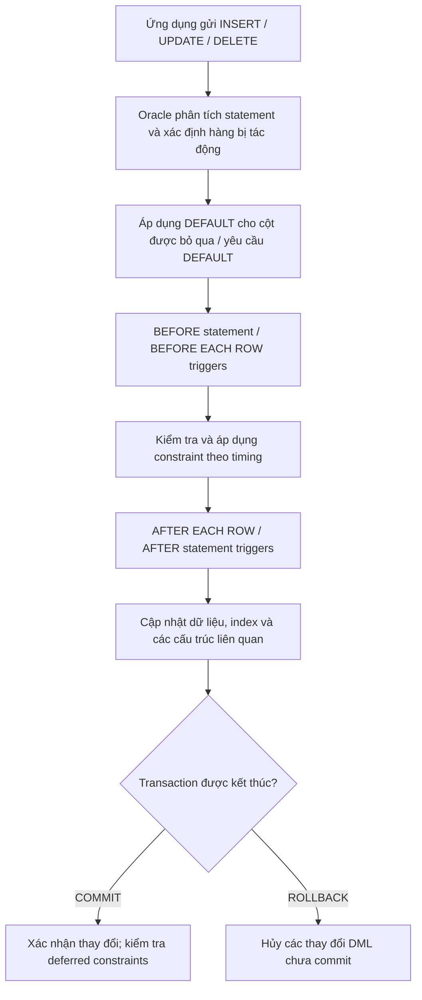

# DEFAULT, trigger và ràng buộc trong vòng đời thay đổi dữ liệu Oracle

Một câu lệnh INSERT hoặc UPDATE có thể làm thay đổi nhiều thứ hơn giá trị được gửi từ ứng dụng. Oracle có thể điền giá trị mặc định, chạy trigger để chuẩn hóa hoặc ghi nhận thay đổi, kiểm tra constraint, cập nhật index và thực hiện các thao tác liên quan đến khóa ngoại. Những cơ chế này cùng tham gia vào **vòng đời thay đổi dữ liệu (data change lifecycle)**.

Ba thành phần có vai trò khác nhau:

- **DEFAULT** cung cấp giá trị khi INSERT bỏ qua cột hoặc yêu cầu dùng default.
- **Trigger** chạy tự động khi một sự kiện DML/DDL phù hợp xảy ra; trigger có thể kiểm tra, biến đổi dữ liệu, ghi audit hoặc thực hiện logic liên quan.
- **Constraint** bảo vệ quy tắc toàn vẹn của dữ liệu ở cấp database, chẳng hạn NOT NULL, PRIMARY KEY, UNIQUE, FOREIGN KEY và CHECK.

Hiểu đúng ranh giới giữa chúng giúp tránh các lỗi như default không chạy khi truyền NULL, trigger che giấu dữ liệu đầu vào, constraint chỉ được kiểm tra lúc COMMIT, trigger đọc chính bảng đang thay đổi, hoặc audit ghi nhận một giao dịch đã rollback.

Bài học tập trung vào Oracle Database SQL/PLSQL, cách các cơ chế phối hợp khi INSERT/UPDATE/DELETE, cách triển khai và tra cứu, cùng các ví dụ có thể thực hành trong schema lab.

## 1. Bức tranh tổng thể của một thay đổi dữ liệu

Khi ứng dụng gửi một câu INSERT, Oracle nhận câu lệnh, xác định cột và biểu thức nguồn, áp dụng giá trị mặc định cho những cột phù hợp, chạy trigger theo sự kiện, kiểm tra các constraint ở thời điểm được cấu hình, cập nhật dữ liệu và các cấu trúc liên quan. Thay đổi DML vẫn nằm trong transaction cho đến khi COMMIT hoặc ROLLBACK.

Một mô hình tư duy hữu ích:



Đây là mô hình khái niệm để hiểu trách nhiệm của từng cơ chế. Thứ tự timing cụ thể của trigger được trình bày ở mục 5; constraint có thể được kiểm tra ngay hoặc trì hoãn đến cuối transaction nếu schema khai báo DEFERRABLE và transaction đặt trạng thái DEFERRED.

**Điểm quan trọng:** DEFAULT, trigger và constraint không thay thế lẫn nhau. Default giúp tạo giá trị hợp lệ ban đầu; trigger thực hiện logic tự động gắn với sự kiện; constraint là hàng rào toàn vẹn được database thực thi.

## 2. Chuẩn bị bảng ví dụ

Ta dùng bảng tài khoản khách hàng để quan sát default, trigger và constraint:

```sql
CREATE TABLE customer_account (
    customer_id NUMBER GENERATED BY DEFAULT AS IDENTITY
        CONSTRAINT pk_customer_account PRIMARY KEY,
    customer_name VARCHAR2(100 CHAR) NOT NULL,
    email_address VARCHAR2(200 CHAR),
    status VARCHAR2(20 CHAR) DEFAULT 'NEW' NOT NULL,
    credit_limit NUMBER(12, 2) DEFAULT 0 NOT NULL,
    created_at TIMESTAMP(6) DEFAULT SYSTIMESTAMP NOT NULL,
    updated_at TIMESTAMP(6),
    CONSTRAINT uq_customer_account_email UNIQUE (email_address),
    CONSTRAINT ck_customer_account_credit
        CHECK (credit_limit >= 0),
    CONSTRAINT ck_customer_account_status
        CHECK (status IN ('NEW', 'ACTIVE', 'SUSPENDED'))
);
```

Ý nghĩa:

- `CUSTOMER_ID` tự sinh bằng identity và là khóa chính.
- `CUSTOMER_NAME` bắt buộc có dữ liệu.
- `EMAIL_ADDRESS` có UNIQUE constraint; vì cột nullable, nhiều hàng có thể để email NULL.
- `STATUS` mặc định là NEW và không được NULL.
- `CREDIT_LIMIT` mặc định 0, không được âm.
- `CREATED_AT` tự nhận thời điểm tạo nếu INSERT bỏ qua cột.
- `UPDATED_AT` được dành cho trigger ghi nhận lần cập nhật gần nhất.

Kiểm tra cấu trúc:

```sql
DESC customer_account;

SELECT column_name,
       data_type,
       nullable,
       data_default,
       identity_column
FROM user_tab_columns
WHERE table_name = 'CUSTOMER_ACCOUNT'
ORDER BY column_id;
```

Tên object trong các view từ điển thường được lưu ở dạng chữ hoa nếu không tạo quoted identifier. Khi tra cứu, dùng đúng owner và tên object.

## 3. DEFAULT — giá trị mặc định cho cột

### 3.1. DEFAULT làm gì?

Default là biểu thức Oracle dùng để cung cấp giá trị cho cột khi INSERT không cung cấp giá trị cho cột đó, hoặc khi câu lệnh dùng từ khóa `DEFAULT` ở vị trí tương ứng.

Cú pháp trong DDL:

```sql
column_name datatype DEFAULT default_expression
```

Ví dụ:

```sql
CREATE TABLE task_demo (
    task_id NUMBER PRIMARY KEY,
    task_name VARCHAR2(100 CHAR) NOT NULL,
    task_status VARCHAR2(20 CHAR) DEFAULT 'OPEN' NOT NULL,
    priority NUMBER DEFAULT 3 NOT NULL,
    created_at DATE DEFAULT SYSDATE NOT NULL
);
```

Khi thêm một hàng mà bỏ qua task_status, priority và created_at:

```sql
INSERT INTO task_demo (
    task_id,
    task_name
)
VALUES (
    1,
    'Prepare monthly report'
);
```

Oracle gán `OPEN`, `3` và thời điểm theo `SYSDATE`. Không cần lặp các giá trị này ở mọi câu INSERT.

### 3.2. Bỏ cột khỏi INSERT và truyền NULL tường minh

Đây là khác biệt rất quan trọng.

**Bỏ cột:**

```sql
INSERT INTO customer_account (
    customer_name,
    email_address
)
VALUES (
    'Nguyen An',
    'an@example.test'
);
```

`STATUS` nhận NEW, `CREDIT_LIMIT` nhận 0, `CREATED_AT` nhận SYSTIMESTAMP.

**Truyền NULL tường minh:**

```sql
INSERT INTO customer_account (
    customer_name,
    status
)
VALUES (
    'Tran Binh',
    NULL
);
```

Câu lệnh này vi phạm NOT NULL của STATUS. Default thông thường không được dùng để thay một giá trị NULL mà câu lệnh đã truyền tường minh.

Nếu cột nullable và không có DEFAULT ON NULL, truyền NULL tường minh sẽ lưu NULL:

```sql
INSERT INTO customer_account (
    customer_name,
    email_address
)
VALUES (
    'Le Chi',
    NULL
);
```

EMAIL_ADDRESS nhận NULL; UNIQUE constraint vẫn được thỏa.

### 3.3. Dùng từ khóa DEFAULT trong VALUES

Có thể yêu cầu Oracle sử dụng default ngay tại vị trí giá trị:

```sql
INSERT INTO customer_account (
    customer_name,
    status,
    credit_limit
)
VALUES (
    'Do Dung',
    DEFAULT,
    DEFAULT
);
```

`DEFAULT` hữu ích khi danh sách cột đã được cố định nhưng một số giá trị cần lấy từ DDL. Kiểm tra hỗ trợ cú pháp trên release Oracle mục tiêu nếu phải duy trì hệ thống cũ.

### 3.4. DEFAULT ON NULL

Oracle hỗ trợ `DEFAULT ON NULL` để áp dụng default ngay cả khi câu lệnh truyền NULL tường minh:

```sql
CREATE TABLE notification_demo (
    notification_id NUMBER GENERATED BY DEFAULT AS IDENTITY,
    channel_code VARCHAR2(20 CHAR)
        DEFAULT ON NULL 'WEB',
    created_at TIMESTAMP(6)
        DEFAULT ON NULL SYSTIMESTAMP
);
```

Ví dụ:

```sql
INSERT INTO notification_demo (
    channel_code,
    created_at
)
VALUES (
    NULL,
    NULL
);
```

Các cột được gán default theo khai báo. `DEFAULT ON NULL` có ngữ nghĩa và giới hạn theo phiên bản Oracle; nó cũng làm cột mang tính NOT NULL theo quy tắc của tính năng. Kiểm tra DDL và metadata sau khi tạo, nhất là khi kết hợp với identity, datatype hoặc hệ thống đang chạy release cũ.

Chỉ dùng DEFAULT ON NULL nếu nghiệp vụ thật sự xem “không cung cấp” và “truyền NULL” là cùng một trường hợp. Nếu NULL có nghĩa “chưa xác định”, không nên tự biến nó thành một giá trị giả định.

### 3.5. DEFAULT có tác dụng khi UPDATE không?

Default không tự chạy mỗi khi UPDATE bỏ qua cột. Nó chỉ áp dụng khi câu lệnh yêu cầu rõ:

```sql
UPDATE customer_account
SET status = DEFAULT
WHERE customer_id = 1;
```

Các hàng không được UPDATE status không bị thay đổi status vì default. Câu lệnh trên chủ động yêu cầu giá trị mặc định của cột.

### 3.6. Default expression thường dùng

Các ví dụ thường gặp:

| Biểu thức | Ý nghĩa |
|---|---|
| `0` | Giá trị số cố định |
| `'NEW'` | Chuỗi cố định |
| `SYSDATE` | DATE theo thời gian hệ thống database |
| `SYSTIMESTAMP` | Timestamp hệ thống có fractional seconds và timezone |
| `CURRENT_DATE` | DATE theo session time zone |
| `CURRENT_TIMESTAMP` | Timestamp theo session time zone |
| `USER` | User database hiện tại |

Chọn hàm thời gian theo ý nghĩa:

- `SYSDATE`/`SYSTIMESTAMP` phản ánh thời gian hệ thống database.
- `CURRENT_DATE`/`CURRENT_TIMESTAMP` phản ánh thời gian theo session time zone.
- Các kiểu DATE/TIMESTAMP không tự lưu timezone giống TSTZ.

Không dùng default theo giờ hệ thống nếu nghiệp vụ yêu cầu thời điểm do một hệ thống bên ngoài xác nhận. Khi có nhiều timezone, cần thống nhất nơi chuẩn hóa và kiểu lưu.

### 3.7. Default không phải nơi đặt toàn bộ logic nghiệp vụ

Default phù hợp cho giá trị khởi tạo đơn giản và ổn định. Nó không thay thế:

- Kiểm tra tính hợp lệ của dữ liệu.
- Quan hệ giữa nhiều cột.
- Phân quyền theo người dùng.
- Quy trình phê duyệt.
- Logic cần gọi nhiều hệ thống hoặc nhiều bảng.

Nếu một giá trị phải phụ thuộc vào nhiều cột hoặc quy tắc phức tạp, cân nhắc logic ở ứng dụng, procedure hoặc trigger có phạm vi rõ ràng. Ràng buộc dữ liệu bất biến vẫn nên được bảo vệ bằng constraint.

## 4. Constraints — ràng buộc toàn vẹn

Constraint là quy tắc mà Oracle thực thi để ngăn dữ liệu vi phạm mô hình quan hệ. Nó có hiệu lực với mọi đường ghi dữ liệu đi qua database: ứng dụng, SQL script, PL/SQL, import hoặc job.

### 4.1. NOT NULL

Đảm bảo cột phải có giá trị:

```sql
customer_name VARCHAR2(100 CHAR) NOT NULL
```

Nếu INSERT truyền NULL hoặc không cung cấp cột không có default, Oracle từ chối hàng. Lỗi thường gặp là `ORA-01400`.

NOT NULL là ràng buộc ở cấp cột. Không thể dùng một CHECK đơn giản thay thế hoàn toàn nếu muốn thể hiện metadata nullability rõ ràng.

### 4.2. PRIMARY KEY

Primary key xác định duy nhất mỗi hàng và kết hợp hai yêu cầu:

- Giá trị khóa không trùng.
- Mọi cột thành phần khóa đều NOT NULL.

Ví dụ:

```sql
CONSTRAINT pk_customer_account
    PRIMARY KEY (customer_id)
```

Một bảng chỉ có một primary key, nhưng khóa có thể gồm nhiều cột. Khi INSERT trùng khóa, Oracle báo lỗi unique constraint, thường là `ORA-00001`.

### 4.3. UNIQUE

UNIQUE đảm bảo giá trị hoặc tổ hợp giá trị không bị trùng theo quy tắc Oracle:

```sql
CONSTRAINT uq_customer_account_email
    UNIQUE (email_address)
```

Với một cột nullable, nhiều hàng có thể có NULL vì Oracle không xem các NULL là cùng một giá trị không-null để vi phạm unique constraint. Khi có nhiều cột trong một unique key, cách xử lý tổ hợp NULL có chi tiết riêng; không suy rộng quy tắc một cột cho mọi composite key.

Nếu email bắt buộc phải có, kết hợp UNIQUE với NOT NULL. Nếu chỉ những email đã nhập mới phải duy nhất, có thể giữ nullable và UNIQUE như ví dụ.

### 4.4. FOREIGN KEY

Foreign key đảm bảo giá trị khóa con tham chiếu tới một khóa được phép ở bảng cha:

```sql
CREATE TABLE department_demo (
    department_id NUMBER
        CONSTRAINT pk_department_demo PRIMARY KEY,
    department_name VARCHAR2(80 CHAR) NOT NULL
);

CREATE TABLE employee_demo (
    employee_id NUMBER
        CONSTRAINT pk_employee_demo PRIMARY KEY,
    employee_name VARCHAR2(100 CHAR) NOT NULL,
    department_id NUMBER,
    CONSTRAINT fk_employee_department
        FOREIGN KEY (department_id)
        REFERENCES department_demo(department_id)
);
```

Chèn nhân viên tham chiếu department không tồn tại sẽ thất bại, thường với `ORA-02291`:

```sql
INSERT INTO employee_demo (
    employee_id,
    employee_name,
    department_id
)
VALUES (
    1001,
    'Pham Minh',
    999
);
```

Foreign key nullable có thể nhận NULL; nếu mọi nhân viên bắt buộc thuộc một phòng ban, thêm NOT NULL cho department_id.

Khi xóa hàng cha, có thể khai báo hành vi:

```sql
FOREIGN KEY (department_id)
REFERENCES department_demo(department_id)
ON DELETE CASCADE
```

hoặc `ON DELETE SET NULL` nếu cột con cho phép NULL. Không khai báo ON DELETE thì Oracle mặc định ngăn xóa hàng cha đang được tham chiếu. Oracle không cung cấp ON UPDATE CASCADE giống một số hệ quản trị khác; thay đổi khóa cha cần được thiết kế theo constraint và transaction.

### 4.5. CHECK

CHECK đảm bảo biểu thức cho mỗi hàng không trả FALSE:

```sql
CONSTRAINT ck_customer_account_credit
    CHECK (credit_limit >= 0)
```

Giá trị âm bị từ chối, thường với `ORA-02290`.

Một chi tiết quan trọng: CHECK chấp nhận biểu thức TRUE hoặc UNKNOWN. Nếu credit_limit là NULL, biểu thức `NULL >= 0` là UNKNOWN; CHECK không tự từ chối NULL. Nếu cột bắt buộc có số, phải kết hợp:

```sql
credit_limit NUMBER(12, 2) NOT NULL,
CONSTRAINT ck_credit_nonnegative CHECK (credit_limit >= 0)
```

CHECK nên thể hiện quy tắc trên chính hàng đó. Quy tắc phụ thuộc hàng khác hoặc tổng nhiều bảng cần cơ chế phù hợp hơn như FK, unique constraint, materialized logic hoặc transaction/procedure có kiểm soát.

### 4.6. Constraint và lỗi thường gặp

| Constraint | Quy tắc | Lỗi thường gặp |
|---|---|---|
| NOT NULL | Không nhận NULL | `ORA-01400` |
| PRIMARY KEY | Duy nhất và không NULL | `ORA-00001` hoặc lỗi null tương ứng |
| UNIQUE | Không trùng khóa | `ORA-00001` |
| FOREIGN KEY | Khóa con tham chiếu khóa cha hợp lệ | `ORA-02291` khi thiếu parent |
| FOREIGN KEY khi xóa parent | Không xóa parent còn được tham chiếu nếu không có hành vi cascade | `ORA-02292` |
| CHECK | Biểu thức không được FALSE | `ORA-02290` |

Không bắt lỗi ở ứng dụng rồi bỏ qua constraint. Validation phía ứng dụng giúp người dùng nhận phản hồi sớm; constraint là cơ chế cuối cùng giữ dữ liệu nhất quán khi có nhiều client hoặc transaction đồng thời.

## 5. Trigger — logic tự động theo sự kiện

Trigger là PL/SQL unit được Oracle tự gọi khi một sự kiện được chỉ định xảy ra. DML trigger có thể chạy khi INSERT, UPDATE hoặc DELETE; trigger khác có thể chạy theo sự kiện DDL hoặc database/system event.

### 5.1. Row-level và statement-level trigger

**Statement-level trigger** chạy một lần cho statement, bất kể statement tác động 1 hay 10.000 hàng.

**Row-level trigger** khai báo `FOR EACH ROW` và chạy cho từng hàng bị tác động.

Ví dụ khung:

```sql
CREATE OR REPLACE TRIGGER trg_customer_account_bi_stmt
BEFORE INSERT ON customer_account
BEGIN
    -- Chạy một lần trước statement INSERT.
    NULL;
END;
/

CREATE OR REPLACE TRIGGER trg_customer_account_bi_row
BEFORE INSERT ON customer_account
FOR EACH ROW
BEGIN
    -- Chạy một lần cho mỗi hàng được chèn.
    NULL;
END;
/
```

Nếu một câu INSERT SELECT thêm 500 hàng, statement-level trigger chạy một lần; row-level trigger chạy cho từng hàng được xử lý. Vì thế không đặt công việc tổng hợp toàn statement vào row trigger nếu có thể thực hiện một lần ở statement timing.

### 5.2. BEFORE và AFTER

- **BEFORE trigger** chạy trước sự kiện DML/row tương ứng. BEFORE EACH ROW có thể gán lại giá trị `:NEW`.
- **AFTER trigger** chạy sau sự kiện DML/row tương ứng. Thường dùng để ghi nhận hoặc thực hiện logic phụ thuộc thay đổi đã xảy ra.

Ví dụ BEFORE INSERT:

```sql
CREATE OR REPLACE TRIGGER trg_employee_normalize_bi
BEFORE INSERT ON employee_demo
FOR EACH ROW
BEGIN
    :NEW.employee_name := TRIM(:NEW.employee_name);
END;
/
```

Tên được chuẩn hóa trước khi lưu. Nếu giá trị chỉ gồm khoảng trắng, `TRIM` có thể trả NULL; NOT NULL constraint sau đó từ chối hàng.

Không thể gán `:NEW` trong AFTER row trigger. Nếu cần thay đổi giá trị sẽ lưu, dùng BEFORE EACH ROW hoặc thực hiện UPDATE riêng trong logic thích hợp.

### 5.3. :OLD và :NEW

Trong row trigger:

| Sự kiện | :OLD | :NEW |
|---|---|---|
| INSERT | Không có giá trị hàng cũ | Giá trị hàng sắp được chèn |
| UPDATE | Giá trị trước thay đổi | Giá trị sau thay đổi |
| DELETE | Giá trị hàng trước khi xóa | Không có giá trị hàng mới |

Ví dụ audit thay đổi trạng thái:

```sql
CREATE TABLE customer_status_audit (
    audit_id NUMBER GENERATED ALWAYS AS IDENTITY PRIMARY KEY,
    customer_id NUMBER NOT NULL,
    old_status VARCHAR2(20 CHAR),
    new_status VARCHAR2(20 CHAR),
    changed_at TIMESTAMP(6) DEFAULT SYSTIMESTAMP NOT NULL,
    changed_by VARCHAR2(128 CHAR) DEFAULT USER NOT NULL
);

CREATE OR REPLACE TRIGGER trg_customer_status_audit
AFTER UPDATE OF status ON customer_account
FOR EACH ROW
BEGIN
    IF :OLD.status <> :NEW.status
       OR (:OLD.status IS NULL AND :NEW.status IS NOT NULL)
       OR (:OLD.status IS NOT NULL AND :NEW.status IS NULL)
    THEN
        INSERT INTO customer_status_audit (
            customer_id,
            old_status,
            new_status
        )
        VALUES (
            :OLD.customer_id,
            :OLD.status,
            :NEW.status
        );
    END IF;
END;
/
```

Trong bảng ví dụ STATUS là NOT NULL, hai nhánh kiểm tra NULL chỉ nhằm minh họa cách so sánh null-safe nếu trigger được dùng với một cột nullable. Có thể đơn giản điều kiện khi schema bảo đảm hai giá trị không NULL.

Trigger audit chạy trong cùng transaction với UPDATE. Nếu transaction rollback, hàng audit cũng rollback. Đây thường là semantics mong muốn cho audit nghiệp vụ gắn với thay đổi đã commit.

### 5.4. INSERTING, UPDATING và DELETING

Trong trigger có thể xác định loại sự kiện:

```sql
CREATE OR REPLACE TRIGGER trg_employee_dml_audit
AFTER INSERT OR UPDATE OR DELETE ON employee_demo
FOR EACH ROW
BEGIN
    IF INSERTING THEN
        -- :NEW có dữ liệu, :OLD không có hàng cũ.
        NULL;
    ELSIF UPDATING THEN
        -- Có cả :OLD và :NEW.
        NULL;
    ELSIF DELETING THEN
        -- :OLD có dữ liệu, :NEW không có hàng mới.
        NULL;
    END IF;
END;
/
```

`UPDATING('COLUMN_NAME')` có thể kiểm tra cột có được nêu trong mệnh đề SET của UPDATE hay không. Nó không khẳng định giá trị thực sự thay đổi:

```sql
UPDATE customer_account
SET status = status
WHERE customer_id = 1;
```

Trigger UPDATE OF STATUS vẫn có thể chạy dù giá trị cũ và mới bằng nhau. Nếu chỉ muốn xử lý khi giá trị khác, so sánh `:OLD` và `:NEW` rõ ràng.

### 5.5. Trigger theo cột

Có thể giới hạn sự kiện:

```sql
CREATE OR REPLACE TRIGGER trg_customer_credit_change
BEFORE UPDATE OF credit_limit ON customer_account
FOR EACH ROW
BEGIN
    IF :NEW.credit_limit < :OLD.credit_limit THEN
        NULL; -- Ví dụ: áp dụng logic nghiệp vụ đã được duyệt.
    END IF;
END;
/
```

Trigger này chỉ được kích hoạt với UPDATE có nhắc đến CREDIT_LIMIT trong SET clause. Nếu muốn phát hiện mọi UPDATE và so sánh giá trị, khai báo BEFORE UPDATE rồi kiểm tra bên trong.

## 6. Vòng đời một INSERT/UPDATE/DELETE và timing trigger

Oracle có các timing point cho DML trigger. Với một statement thông thường:

1. BEFORE STATEMENT trigger chạy một lần trước khi xử lý các hàng.
2. Với từng hàng: BEFORE EACH ROW trigger chạy; sau đó hàng được xử lý và các constraint được thực thi theo timing của chúng; AFTER EACH ROW trigger chạy.
3. Sau khi statement xử lý xong các hàng: AFTER STATEMENT trigger chạy một lần.
4. Nếu có constraint DEFERRABLE đang ở trạng thái DEFERRED, việc kiểm tra cuối cùng diễn ra khi COMMIT.

Thứ tự trên giúp phân biệt công việc cần làm trước từng hàng, sau từng hàng và sau cả statement. Không thiết kế phụ thuộc vào thứ tự không được quy định giữa nhiều trigger cùng timing point; hãy gom logic liên quan hoặc dùng cơ chế sắp thứ tự trigger được Oracle hỗ trợ đúng phiên bản khi thực sự cần.

Ví dụ một câu:

```sql
UPDATE customer_account
SET credit_limit = credit_limit + 100
WHERE status = 'ACTIVE';
```

- BEFORE STATEMENT: có thể ghi nhận bắt đầu một thao tác cập nhật.
- BEFORE EACH ROW: có thể kiểm tra hoặc điều chỉnh `:NEW.credit_limit`.
- Constraint CHECK: bảo đảm credit_limit không âm theo timing đã cấu hình.
- AFTER EACH ROW: có thể ghi audit từng thay đổi.
- AFTER STATEMENT: có thể cập nhật số liệu tổng hợp một lần.
- COMMIT: xác nhận toàn bộ transaction và kiểm tra constraint deferred.

### 6.1. DEFAULT và BEFORE INSERT trigger

Giá trị default được áp dụng khi Oracle tạo hàng từ danh sách cột/giá trị INSERT. BEFORE EACH ROW trigger có thể đọc và điều chỉnh `:NEW` trước khi hàng được lưu. Vì vậy trigger có thể thấy giá trị default đã được cung cấp và có thể thay đổi nó.

Ví dụ:

```sql
CREATE OR REPLACE TRIGGER trg_customer_account_biu
BEFORE INSERT OR UPDATE ON customer_account
FOR EACH ROW
BEGIN
    :NEW.customer_name := TRIM(:NEW.customer_name);

    IF UPDATING THEN
        :NEW.updated_at := SYSTIMESTAMP;
    END IF;
END;
/
```

Khi INSERT bỏ qua STATUS, default NEW được áp dụng. Trigger chuẩn hóa CUSTOMER_NAME; nó không thay đổi STATUS. Constraint kiểm tra các giá trị cuối cùng được đưa vào hàng. Khi UPDATE, trigger ghi UPDATED_AT.

### 6.2. AFTER trigger không phải nơi để sửa :NEW

AFTER EACH ROW phù hợp cho audit hoặc thao tác phụ, không phải nơi gán giá trị của hàng đang được INSERT/UPDATE. Nếu cần chuẩn hóa dữ liệu trước constraint, dùng BEFORE EACH ROW hoặc biểu thức/logic ở ứng dụng.

## 7. Compound trigger — phối hợp row-level và statement-level

Một vấn đề thường gặp là row trigger cần tổng hợp dữ liệu từ chính bảng đang bị thay đổi. Nếu row trigger truy vấn bảng đó, Oracle có thể báo mutating-table error (`ORA-04091`), vì bảng đang ở trạng thái thay đổi và truy vấn có thể thấy dữ liệu không nhất quán.

Compound trigger cho phép chia sẻ trạng thái giữa các timing section của một DML statement, thường dùng để thu thập khóa ở EACH ROW rồi xử lý sau statement.

### 7.1. Ví dụ lỗi mutating table

Không nên viết row trigger trên ORDER_LINE rồi truy vấn lại ORDER_LINE ngay trong trigger:

```sql
-- Mẫu dễ gây ORA-04091:
CREATE OR REPLACE TRIGGER trg_order_line_bad
AFTER INSERT ON order_line
FOR EACH ROW
DECLARE
    l_total NUMBER;
BEGIN
    SELECT SUM(line_amount)
    INTO l_total
    FROM order_line
    WHERE order_id = :NEW.order_id;
END;
/
```

Trong khi INSERT/UPDATE/DELETE đang thay đổi ORDER_LINE, row trigger đọc lại cùng bảng có thể gặp mutating-table restriction.

### 7.2. Dùng compound trigger để trì hoãn truy vấn đến AFTER STATEMENT

Ví dụ giả định có bảng:

```sql
CREATE TABLE order_header_demo (
    order_id NUMBER PRIMARY KEY,
    total_amount NUMBER(14, 2) DEFAULT 0 NOT NULL
);

CREATE TABLE order_line_demo (
    line_id NUMBER PRIMARY KEY,
    order_id NUMBER NOT NULL
        REFERENCES order_header_demo(order_id),
    line_amount NUMBER(12, 2) NOT NULL
);
```

Compound trigger:

```sql
CREATE OR REPLACE TRIGGER trg_order_line_total
FOR INSERT OR UPDATE OR DELETE ON order_line_demo
COMPOUND TRIGGER
    TYPE t_order_id_list IS TABLE OF order_line_demo.order_id%TYPE
        INDEX BY PLS_INTEGER;

    g_order_ids t_order_id_list;
    g_count PLS_INTEGER := 0;

    PROCEDURE remember_order(p_order_id IN order_line_demo.order_id%TYPE) IS
    BEGIN
        IF p_order_id IS NOT NULL THEN
            g_count := g_count + 1;
            g_order_ids(g_count) := p_order_id;
        END IF;
    END remember_order;

    AFTER EACH ROW IS
    BEGIN
        IF INSERTING THEN
            remember_order(:NEW.order_id);
        ELSIF DELETING THEN
            remember_order(:OLD.order_id);
        ELSE
            remember_order(:OLD.order_id);
            remember_order(:NEW.order_id);
        END IF;
    END AFTER EACH ROW;

    AFTER STATEMENT IS
    BEGIN
        FOR i IN 1 .. g_count LOOP
            UPDATE order_header_demo h
            SET total_amount = (
                SELECT NVL(SUM(l.line_amount), 0)
                FROM order_line_demo l
                WHERE l.order_id = g_order_ids(i)
            )
            WHERE h.order_id = g_order_ids(i);
        END LOOP;
    END AFTER STATEMENT;
END;
/
```

Row trigger chỉ thu thập order_id; sau khi statement kết thúc, AFTER STATEMENT truy vấn ORDER_LINE_DEMO để tính tổng và cập nhật ORDER_HEADER_DEMO. Nếu UPDATE chuyển một dòng từ order cũ sang order mới, trigger ghi nhớ cả hai order_id.

Ví dụ này có thể cập nhật cùng một order nhiều lần nếu statement tác động nhiều dòng của cùng order. Trong workload lớn, nên khử trùng các khóa đã thu thập hoặc dùng cấu trúc tập hợp phù hợp để giảm số lần tính tổng. Mục tiêu của ví dụ là minh họa timing, không phải một framework tổng hợp tối ưu cho mọi bảng.

Compound trigger không loại bỏ mọi lỗi mutating table trong mọi tình huống; nó cung cấp các timing section để đặt thao tác đọc bảng sau khi row processing hoàn tất.

## 8. INSTEAD OF trigger trên view

Một số view không thể được INSERT/UPDATE/DELETE trực tiếp vì có join, aggregate hoặc cấu trúc phức tạp. `INSTEAD OF trigger` cho phép định nghĩa thao tác thay thế trên view:

```sql
CREATE OR REPLACE VIEW employee_department_v AS
SELECT e.employee_id,
       e.employee_name,
       d.department_name
FROM employee_demo e
JOIN department_demo d
  ON d.department_id = e.department_id;
```

Một INSTEAD OF INSERT trigger có thể phân tích giá trị view và chèn vào bảng nền:

```sql
CREATE OR REPLACE TRIGGER trg_employee_department_v_ioi
INSTEAD OF INSERT ON employee_department_v
FOR EACH ROW
DECLARE
    l_department_id department_demo.department_id%TYPE;
BEGIN
    SELECT department_id
    INTO l_department_id
    FROM department_demo
    WHERE department_name = :NEW.department_name;

    INSERT INTO employee_demo (
        employee_id,
        employee_name,
        department_id
    )
    VALUES (
        :NEW.employee_id,
        :NEW.employee_name,
        l_department_id
    );
END;
/
```

Nếu department_name không duy nhất, SELECT INTO có thể phát sinh TOO_MANY_ROWS. Trong thiết kế thực tế, nên dùng khóa định danh hoặc constraint UNIQUE thay vì dựa vào tên hiển thị. INSTEAD OF trigger là cách biến view thành interface ghi dữ liệu; nó không làm các bảng nền mất constraint.

## 9. Trigger và transaction

### 9.1. Trigger thông thường cùng transaction với statement gọi nó

DML do trigger thực hiện trong trigger thông thường là một phần của transaction gọi. Ví dụ:

1. UPDATE CUSTOMER_ACCOUNT đổi status.
2. AFTER UPDATE trigger INSERT vào CUSTOMER_STATUS_AUDIT.
3. Ứng dụng ROLLBACK.

Cả thay đổi status và hàng audit đều bị rollback. Điều này bảo đảm audit nghiệp vụ phản ánh thay đổi được commit.

Nếu trigger phát sinh lỗi không được xử lý, statement gây trigger có thể thất bại và các thay đổi do statement/trigger thực hiện bị rollback theo statement atomicity. Các statement trước đó trong cùng transaction vẫn do transaction owner quản lý.

### 9.2. Không COMMIT hoặc ROLLBACK trong trigger thường

Trigger thường không được tự commit/rollback transaction của caller. Không thiết kế trigger như một nơi tự quyết định hoàn tất transaction; ứng dụng hoặc procedure điều phối phải quản lý transaction.

Autonomous transaction là một cơ chế riêng có thể được khai báo trong routine được gọi từ trigger. Nhưng nếu dùng để ghi audit rồi commit độc lập, audit có thể tồn tại dù DML nghiệp vụ rollback. Chỉ dùng khi yêu cầu thật sự là ghi nhận sự kiện độc lập (ví dụ một số dạng log chẩn đoán), và phải chấp nhận rõ tính nhất quán đó.

### 9.3. Trigger có thể gây side effect dây chuyền

Một UPDATE có thể kích hoạt trigger ghi bảng audit; bảng audit lại có trigger khác; logic đó có thể tiếp tục tác động bảng khác. Hệ thống dễ gặp:

- Gọi lặp hoặc recursion ngoài ý muốn.
- Tăng số câu SQL và redo.
- Khóa chéo giữa nhiều bảng.
- Lỗi mutating table.
- Khó truy vết vì logic không hiện diện trong câu DML ban đầu.

Giữ trigger ngắn, có phạm vi rõ và không lặp lại cùng quy tắc ở nhiều tầng. Logic nghiệp vụ nhiều bước thường dễ kiểm soát hơn trong procedure/application service được gọi tường minh.

## 10. Constraint timing: IMMEDIATE và DEFERRED

Mặc định, constraint thường được kiểm tra theo chế độ immediate. Với constraint được khai báo DEFERRABLE, transaction có thể trì hoãn kiểm tra đến cuối transaction.

### 10.1. Ví dụ khóa ngoại DEFERRABLE

```sql
CREATE TABLE invoice_header_demo (
    invoice_id NUMBER
        CONSTRAINT pk_invoice_header_demo PRIMARY KEY
);

CREATE TABLE invoice_line_demo (
    line_id NUMBER
        CONSTRAINT pk_invoice_line_demo PRIMARY KEY,
    invoice_id NUMBER,
    CONSTRAINT fk_invoice_line_header
        FOREIGN KEY (invoice_id)
        REFERENCES invoice_header_demo(invoice_id)
        DEFERRABLE INITIALLY IMMEDIATE
);
```

Constraint được khai báo DEFERRABLE nhưng mặc định ban đầu là IMMEDIATE. Có thể chuyển trạng thái trong transaction:

```sql
SET CONSTRAINTS fk_invoice_line_header DEFERRED;

INSERT INTO invoice_line_demo (line_id, invoice_id)
VALUES (1, 100);

INSERT INTO invoice_header_demo (invoice_id)
VALUES (100);

COMMIT;
```

Ở giữa transaction, hàng con được thêm trước hàng cha. Khi COMMIT, Oracle kiểm tra lại và transaction chỉ commit nếu mọi constraint deferred đều thỏa.

Nếu không thể tạo hàng cha trước khi commit, COMMIT thất bại. Ứng dụng phải xử lý lỗi và sửa/rollback transaction.

### 10.2. INITIALLY IMMEDIATE và INITIALLY DEFERRED

- `DEFERRABLE INITIALLY IMMEDIATE`: có thể trì hoãn trong transaction, nhưng mặc định kiểm tra ngay.
- `DEFERRABLE INITIALLY DEFERRED`: mặc định trì hoãn đến cuối transaction.
- `NOT DEFERRABLE`: không thể đổi sang deferred bằng SET CONSTRAINTS.

Trong Oracle, các ràng buộc khóa chính, unique và khóa ngoại là những trường hợp thường gặp khi cần DEFERRABLE. NOT NULL không thể trì hoãn. Kiểm tra loại constraint và cú pháp được hỗ trợ trên release cụ thể trước khi thiết kế quy trình dựa vào deferred checking.

### 10.3. Dùng SET CONSTRAINTS có chủ đích

```sql
SET CONSTRAINTS ALL DEFERRED;
SET CONSTRAINTS ALL IMMEDIATE;
```

Lệnh tác động tới các constraint DEFERRABLE trong transaction hiện tại. Chuyển sang IMMEDIATE khiến Oracle kiểm tra các constraint deferred ở thời điểm đó; nếu dữ liệu đang vi phạm, lệnh có thể thất bại.

Deferred constraint hữu ích cho việc nạp một nhóm hàng có quan hệ vòng hoặc cần thứ tự insert tạm thời. Nó không phải cách tắt constraint và không nên dùng để che giấu dữ liệu sai.

## 11. Trạng thái ENABLE, DISABLE, VALIDATE và NOVALIDATE

Constraint có trạng thái kiểm soát việc thực thi và kiểm tra dữ liệu hiện hữu:

| Trạng thái | Ý nghĩa khái quát |
|---|---|
| ENABLE VALIDATE | Constraint được bật; dữ liệu hiện có đã được xác nhận và DML mới phải tuân thủ |
| ENABLE NOVALIDATE | DML mới được kiểm tra; dữ liệu cũ chưa được xác nhận toàn bộ |
| DISABLE NOVALIDATE | Constraint không được dùng để kiểm tra dữ liệu hiện tại theo cách ENABLE |

Ví dụ:

```sql
ALTER TABLE customer_account
ENABLE VALIDATE CONSTRAINT ck_customer_account_credit;

ALTER TABLE customer_account
DISABLE CONSTRAINT ck_customer_account_credit;
```

ENABLE NOVALIDATE có thể hữu ích trong lộ trình làm sạch dữ liệu cũ mà vẫn bảo vệ DML mới, tùy constraint và chính sách Oracle. Tuy nhiên, nó có nghĩa dữ liệu lịch sử có thể vẫn vi phạm rule; không báo cáo trạng thái constraint như thể toàn bộ bảng đã hợp lệ.

Kiểm tra metadata:

```sql
SELECT constraint_name,
       constraint_type,
       status,
       validated,
       deferrable,
       deferred
FROM user_constraints
WHERE table_name = 'CUSTOMER_ACCOUNT'
ORDER BY constraint_name;
```

Các cột `STATUS`, `VALIDATED`, `DEFERRABLE` và `DEFERRED` giúp DBA hiểu constraint đang được áp dụng theo cách nào.

## 12. Trigger và constraint phối hợp ra sao?

### 12.1. BEFORE trigger không thay constraint

Có thể viết trigger từ chối credit_limit âm:

```sql
IF :NEW.credit_limit < 0 THEN
    RAISE_APPLICATION_ERROR(-20010, 'Credit limit cannot be negative');
END IF;
```

Nhưng nếu rule bất biến đơn giản là credit_limit không âm, CHECK constraint vẫn nên tồn tại:

```sql
CONSTRAINT ck_customer_account_credit
    CHECK (credit_limit >= 0)
```

Lý do:

- Constraint hiển thị rõ trong schema và data dictionary.
- Database áp dụng rule cho mọi đường DML.
- Optimizer và công cụ quản trị có thể nhận biết constraint.
- Trigger có thể bị disable hoặc bị viết sai; constraint là cơ chế chuyên dụng cho integrity.

Trigger nên xử lý việc constraint không biểu đạt được một cách phù hợp, ví dụ chuẩn hóa giá trị, ghi audit hoặc cập nhật logic phụ.

### 12.2. Trigger có thể làm giá trị vi phạm constraint trở nên hợp lệ

Ví dụ BEFORE INSERT trigger trim tên:

```sql
:NEW.customer_name := TRIM(:NEW.customer_name);
```

Nếu người dùng gửi `'  Nguyen An  '`, giá trị lưu là `'Nguyen An'`. Nếu gửi toàn khoảng trắng, TRIM có thể tạo NULL và NOT NULL constraint từ chối. Constraint kiểm tra giá trị sau khi BEFORE row logic đã điều chỉnh.

Điều này cho thấy trigger và constraint phối hợp: trigger chuẩn hóa, constraint xác nhận kết quả cuối cùng.

### 12.3. Không dùng trigger để âm thầm sửa dữ liệu sai

Nếu input không hợp lệ, tự động thay bằng một giá trị mặc định có thể làm mất dấu lỗi nguồn. Ví dụ credit_limit âm bị ép thành 0 sẽ che giấu lỗi tính toán. Chỉ tự sửa khi quy tắc đó được định nghĩa rõ và người gọi hiểu kết quả.

Với dữ liệu quan trọng, trả lỗi cụ thể thường an toàn hơn biến đổi âm thầm.

## 13. Trigger, khóa ngoại và hành động xóa

Khi xóa một hàng cha:

- Nếu có FK con và không khai báo hành động xóa, Oracle thường từ chối.
- `ON DELETE CASCADE` xóa hàng con liên quan.
- `ON DELETE SET NULL` đặt FK con thành NULL, nên cột con phải cho phép NULL.

Ví dụ:

```sql
CREATE TABLE project_demo (
    project_id NUMBER PRIMARY KEY,
    project_name VARCHAR2(100 CHAR) NOT NULL
);

CREATE TABLE task_project_demo (
    task_id NUMBER PRIMARY KEY,
    project_id NUMBER,
    task_name VARCHAR2(100 CHAR) NOT NULL,
    CONSTRAINT fk_task_project
        FOREIGN KEY (project_id)
        REFERENCES project_demo(project_id)
        ON DELETE SET NULL
);
```

Nếu bảng con có trigger DELETE hoặc UPDATE phù hợp, cần kiểm thử hành vi trong quy trình cascade theo phiên bản và loại thao tác. Không xây audit phụ thuộc vào giả định trigger nào đó sẽ ghi nhận toàn bộ tác động dây chuyền nếu chưa kiểm chứng.

DELETE là DML nên có thể kích hoạt DML trigger. `TRUNCATE` là DDL, không phải DELETE; nó không kích hoạt DELETE row trigger và có transaction semantics khác. Không dùng TRUNCATE khi cần logic/audit được thiết kế cho DELETE.

## 14. Trigger DDL và trigger hệ thống

Ngoài DML trigger, Oracle còn hỗ trợ trigger cho sự kiện DDL hoặc database event, ví dụ:

- CREATE, ALTER, DROP object.
- LOGON, LOGOFF.
- STARTUP, SHUTDOWN trong các phạm vi/quyền phù hợp.

Ví dụ khung DDL trigger:

```sql
CREATE OR REPLACE TRIGGER trg_schema_ddl_audit
AFTER DDL ON SCHEMA
BEGIN
    INSERT INTO schema_ddl_audit (
        event_name,
        object_name,
        event_time,
        database_user
    )
    VALUES (
        ORA_SYSEVENT,
        ORA_DICT_OBJ_NAME,
        SYSTIMESTAMP,
        ORA_LOGIN_USER
    );
END;
/
```

Đây là ví dụ minh họa; bảng audit phải tồn tại và trigger cần quyền phù hợp. DDL trigger chạy trong ngữ cảnh DDL, có hạn chế riêng về thao tác được phép và transaction. Không dùng DDL trigger để thực hiện công việc nặng, gọi hệ thống ngoài hoặc tạo vòng lặp DDL.

Trigger LOGON/DDL có thể ảnh hưởng kết nối hoặc triển khai toàn schema. Cần review và thử nghiệm trong môi trường riêng trước khi bật ở production.

## 15. Quản lý trigger trong data dictionary

### 15.1. Xem trigger của schema

```sql
SELECT trigger_name,
       table_name,
       triggering_event,
       trigger_type,
       status
FROM user_triggers
ORDER BY table_name, trigger_name;
```

### 15.2. Xem source trigger

```sql
SELECT line, text
FROM user_source
WHERE name = 'TRG_CUSTOMER_ACCOUNT_BIU'
  AND type = 'TRIGGER'
ORDER BY line;
```

### 15.3. Enable/disable trigger

```sql
ALTER TRIGGER trg_customer_account_biu DISABLE;
ALTER TRIGGER trg_customer_account_biu ENABLE;
```

Hoặc cho toàn bảng:

```sql
ALTER TABLE customer_account
DISABLE ALL TRIGGERS;

ALTER TABLE customer_account
ENABLE ALL TRIGGERS;
```

Tắt trigger có thể làm mất chuẩn hóa, audit hoặc cập nhật phụ thuộc. Khi bật lại, các hàng đã ghi trong thời gian trigger disabled không tự chạy trigger hồi tố. Nếu cần tắt trong bulk load, phải có kế hoạch kiểm tra/đồng bộ dữ liệu sau đó.

### 15.4. Xem constraint và các cột thuộc constraint

```sql
SELECT c.constraint_name,
       c.constraint_type,
       c.status,
       c.validated,
       cc.column_name,
       cc.position
FROM user_constraints c
JOIN user_cons_columns cc
  ON cc.constraint_name = c.constraint_name
 AND cc.table_name = c.table_name
WHERE c.table_name = 'CUSTOMER_ACCOUNT'
ORDER BY c.constraint_name, cc.position;
```

`USER_CONSTRAINTS` cung cấp loại và trạng thái; `USER_CONS_COLUMNS` cho biết cột và thứ tự trong constraint nhiều cột.

## 16. Lỗi trigger và constraint thường gặp

| Lỗi / dấu hiệu | Nguyên nhân | Cách xử lý |
|---|---|---|
| `ORA-01400` | NULL đi vào cột NOT NULL | Kiểm tra input, default và trigger |
| `ORA-00001` | Trùng PK/UNIQUE | Xác định khóa, retry và uniqueness |
| `ORA-02290` | CHECK expression trả FALSE | Kiểm tra rule và giá trị sau BEFORE trigger |
| `ORA-02291` | FK không tìm thấy hàng cha | Nạp parent trước hoặc kiểm tra key |
| `ORA-02292` | Xóa parent đang được tham chiếu | Chọn cascade/set null hoặc xử lý hàng con |
| `ORA-04091` | Row trigger truy vấn bảng đang mutating | Compound trigger/statement timing hoặc thiết kế lại |
| `ORA-04098` | Trigger invalid hoặc revalidation thất bại | Xem USER_ERRORS và compile lại |
| `ORA-04088` | Lỗi trong quá trình thực thi trigger | Đọc lỗi gốc và source trigger |
| Constraint lỗi tại COMMIT | Constraint DEFERRABLE đang DEFERRED | Kiểm tra toàn transaction trước commit |
| Audit không có hàng sau rollback | Trigger audit cùng transaction đã rollback | Đây là semantics transactional; xác định có cần log độc lập không |
| updated_at thay đổi dù giá trị nghiệp vụ không đổi | Trigger chạy theo cột trong SET clause | So sánh :OLD/:NEW nếu cần phát hiện thay đổi thật |
| INSERT nhiều hàng chậm bất thường | Row trigger chạy nhiều SQL cho mỗi hàng | Đo workload, chuyển việc tổng hợp sang statement/compound trigger |
| Dữ liệu cũ vi phạm constraint | ENABLE NOVALIDATE hoặc constraint từng disabled | Kiểm tra VALIDATED và làm sạch dữ liệu |

Để xem lỗi compile:

```sql
SELECT line, position, text
FROM user_errors
WHERE name = 'TRG_CUSTOMER_ACCOUNT_BIU'
  AND type = 'TRIGGER'
ORDER BY sequence;
```

Đừng chỉ xem lỗi ORA-04088 ở ngoài cùng; lỗi gốc thường nằm trong thông báo theo sau hoặc trong trigger source.

## 17. Thiết kế thực tế: nên đặt rule ở đâu?

| Loại quy tắc | Cơ chế thường phù hợp | Ví dụ |
|---|---|---|
| Giá trị khởi tạo đơn giản | DEFAULT | status NEW, created_at |
| NULL đầu vào phải dùng default | DEFAULT ON NULL nếu đúng nghiệp vụ | channel WEB |
| Giá trị khóa tự sinh | IDENTITY hoặc SEQUENCE | customer_id |
| Bắt buộc có dữ liệu | NOT NULL | customer_name |
| Không trùng | PRIMARY KEY / UNIQUE | customer_id, email |
| Tham chiếu hợp lệ | FOREIGN KEY | employee.department_id |
| Miền giá trị trên một hàng | CHECK | credit_limit >= 0 |
| Chuẩn hóa giá trị trước khi lưu | BEFORE EACH ROW trigger hoặc ứng dụng | TRIM tên |
| Ghi nhận thay đổi gắn với transaction | AFTER trigger hoặc audit facility | old_status/new_status |
| Tổng hợp sau một statement nhiều hàng | AFTER STATEMENT / compound trigger hoặc quy trình riêng | cập nhật tổng order |
| Thay đổi cách ghi qua view | INSTEAD OF trigger | view join nhiều bảng |
| Quy trình nghiệp vụ nhiều bước | Procedure/application service | phê duyệt, phát hành, tích hợp |

Một số nguyên tắc:

1. Dùng constraint cho tính toàn vẹn dữ liệu có thể diễn đạt trực tiếp.
2. Dùng default cho giá trị khởi tạo, không dùng trigger chỉ để gán một hằng số đơn giản.
3. Dùng trigger khi logic thực sự cần tự động gắn với sự kiện ở database.
4. Giữ trigger nhỏ và dễ truy vết; tránh đặt cả workflow vào trigger.
5. Tránh lặp cùng một rule ở ứng dụng, default, trigger và constraint mà không có nguồn sự thật rõ ràng.
6. Ghi rõ trigger có side effect nào và có cùng transaction hay không.
7. Dùng audit phù hợp yêu cầu pháp lý/kiểm soát; trigger tự viết không tự động đáp ứng mọi yêu cầu audit.

## 18. Bài thực hành tổng hợp

Thực hiện trong schema lab. Nếu các bảng đã tồn tại, dùng tên khác hoặc schema riêng; không chạy lệnh DROP trên môi trường dùng chung.

### Bước 1 — Tạo bảng với DEFAULT và constraint

```sql
CREATE TABLE account_lab (
    account_id NUMBER GENERATED BY DEFAULT AS IDENTITY
        CONSTRAINT pk_account_lab PRIMARY KEY,
    account_name VARCHAR2(100 CHAR) NOT NULL,
    account_status VARCHAR2(20 CHAR) DEFAULT 'NEW' NOT NULL,
    balance NUMBER(12, 2) DEFAULT 0 NOT NULL,
    created_at TIMESTAMP(6) DEFAULT SYSTIMESTAMP NOT NULL,
    updated_at TIMESTAMP(6),
    CONSTRAINT ck_account_lab_balance CHECK (balance >= 0),
    CONSTRAINT ck_account_lab_status
        CHECK (account_status IN ('NEW', 'ACTIVE', 'CLOSED'))
);
```

### Bước 2 — Chèn và quan sát default

```sql
INSERT INTO account_lab (account_name)
VALUES ('Account One');

INSERT INTO account_lab (
    account_name,
    account_status,
    balance
)
VALUES (
    'Account Two',
    DEFAULT,
    DEFAULT
);

SELECT *
FROM account_lab
ORDER BY account_id;
```

Ghi nhận identity, status, balance và created_at.

### Bước 3 — So sánh bỏ cột với truyền NULL

Thử:

```sql
INSERT INTO account_lab (account_name, account_status)
VALUES ('Invalid Account', NULL);
```

Quan sát lỗi NOT NULL. Sau đó tạo một bảng lab khác với DEFAULT ON NULL và so sánh kết quả.

### Bước 4 — Tạo BEFORE trigger

```sql
CREATE OR REPLACE TRIGGER trg_account_lab_biu
BEFORE INSERT OR UPDATE ON account_lab
FOR EACH ROW
BEGIN
    :NEW.account_name := TRIM(:NEW.account_name);

    IF UPDATING THEN
        :NEW.updated_at := SYSTIMESTAMP;
    END IF;
END;
/
```

Thử INSERT tên có blank đầu/cuối và UPDATE balance. Quan sát updated_at.

### Bước 5 — Thử CHECK constraint

```sql
INSERT INTO account_lab (account_name, balance)
VALUES ('Negative Balance', -10);
```

Giải thích vì sao BEFORE trigger không thay thế CHECK constraint và ghi lại lỗi.

### Bước 6 — Ghi audit old/new

Tạo bảng audit và AFTER UPDATE trigger cho account_status. Thử đổi NEW thành ACTIVE, sau đó ROLLBACK. Kiểm tra cả bảng account_lab và bảng audit để xác nhận hai thay đổi cùng rollback.

### Bước 7 — Thử FK và hành vi xóa

Tạo bảng department/employee có FK. Chèn hàng cha và con, thử xóa cha khi chưa có ON DELETE action. Sau đó thử ON DELETE CASCADE hoặc SET NULL trong một bảng lab khác.

### Bước 8 — Thử deferred constraint

Tạo FK DEFERRABLE INITIALLY IMMEDIATE. Đổi sang DEFERRED, chèn hàng con trước hàng cha, sau đó COMMIT. Thử bỏ qua hàng cha và quan sát lỗi tại COMMIT.

### Bước 9 — Quan sát mutating table

Trong schema lab riêng, thử row trigger đọc lại bảng đang bị INSERT/UPDATE. Quan sát ORA-04091. Sau đó dùng compound trigger: thu thập khóa ở AFTER EACH ROW và truy vấn bảng ở AFTER STATEMENT.

### Bước 10 — Tra cứu metadata

Chạy các truy vấn USER_CONSTRAINTS, USER_CONS_COLUMNS, USER_TRIGGERS, USER_SOURCE và USER_ERRORS. Ghi lại constraint/trigger nào đang ENABLE, VALIDATED và VALID.

### Bước 11 — Kiểm tra tác động khi disable trigger

Trong lab, disable trigger chuẩn hóa rồi INSERT dữ liệu có blank. Enable lại và quan sát hàng cũ có tự được chuẩn hóa không. Giải thích vì sao cần quy trình backfill/validation khi trigger bị tắt trong lúc bulk load.

## 19. Câu hỏi tự kiểm tra

1. DEFAULT được áp dụng trong những trường hợp nào? Bỏ cột khác truyền NULL thế nào?
2. DEFAULT ON NULL khác DEFAULT thông thường ở đâu?
3. Default có tự chạy khi UPDATE không nêu cột đó không?
4. Vì sao identity/sequence không bảo đảm số liên tục không có gap?
5. PRIMARY KEY kết hợp những quy tắc nào?
6. UNIQUE trên một cột nullable xử lý nhiều NULL ra sao?
7. Vì sao CHECK (amount >= 0) không tự loại NULL?
8. FOREIGN KEY nullable có bắt buộc phải tìm hàng cha cho NULL không?
9. ON DELETE CASCADE và ON DELETE SET NULL khác nhau thế nào?
10. Row-level trigger khác statement-level trigger ở tần suất chạy ra sao?
11. :OLD và :NEW có ý nghĩa thế nào với INSERT, UPDATE, DELETE?
12. UPDATING('column') có chứng minh giá trị đã thay đổi không?
13. BEFORE EACH ROW trigger có thể làm gì với :NEW? AFTER EACH ROW có thể gán :NEW không?
14. Constraint immediate và deferred khác nhau thế nào?
15. Vì sao row trigger truy vấn chính bảng đang thay đổi có thể gây ORA-04091?
16. Compound trigger giúp giải quyết trường hợp nào?
17. Trigger thông thường và audit row của nó có cùng transaction không?
18. Vì sao autonomous transaction audit có thể tạo log cho thay đổi đã rollback?
19. TRUNCATE có kích hoạt DELETE row trigger không?
20. ENABLE NOVALIDATE khác ENABLE VALIDATE thế nào?
21. Khi nào nên dùng constraint, default, trigger hoặc procedure?
22. Cần kiểm tra view từ điển nào để xem trạng thái constraint và trigger?

DEFAULT, trigger và constraint cùng tham gia bảo vệ vòng đời dữ liệu nhưng mỗi cơ chế có một nhiệm vụ. **DEFAULT khởi tạo giá trị; trigger thực hiện logic tự động theo sự kiện; constraint giữ tính toàn vẹn.** Khi thiết kế, hãy đặt mỗi quy tắc vào đúng nơi, hiểu thời điểm nó chạy và cách nó tham gia transaction. Cách tổ chức này giúp dữ liệu nhất quán dù thay đổi đến từ ứng dụng, batch job, PL/SQL hay công cụ nạp dữ liệu.
