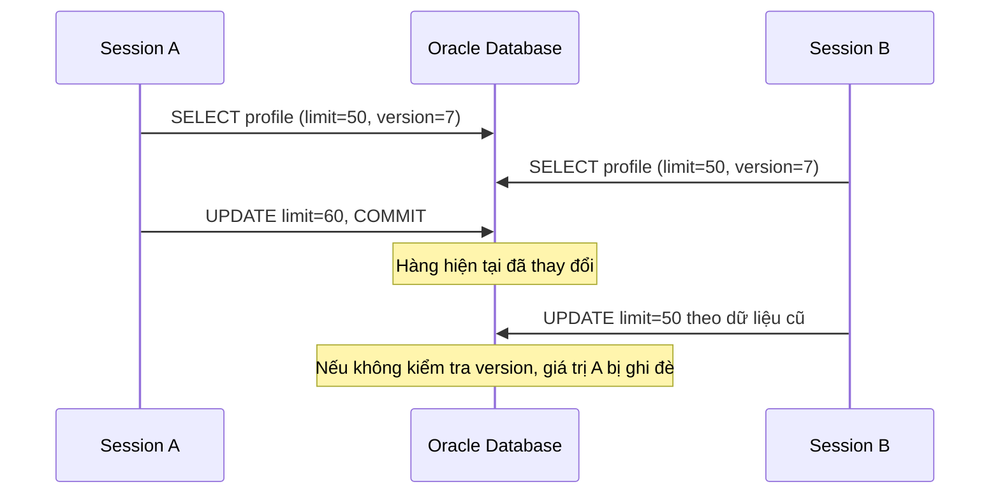
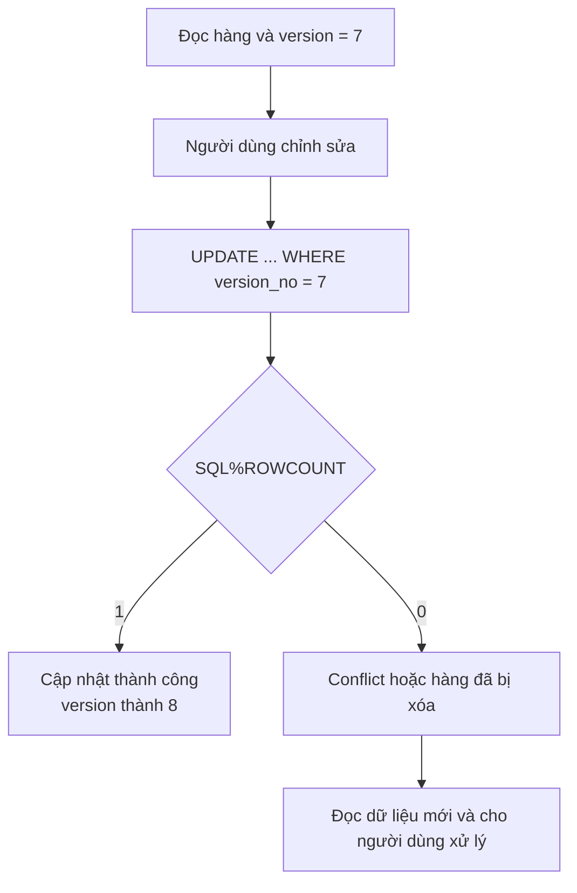

# Lost update và khóa lạc quan bằng cột phiên bản trong Oracle Database

Trong ứng dụng nhiều người dùng, hai session có thể cùng đọc một hàng, mỗi người sửa dữ liệu theo những gì họ nhìn thấy, rồi lần lượt ghi lại. Nếu lần ghi sau không kiểm tra xem dữ liệu có thay đổi kể từ lúc đọc hay chưa, nó có thể ghi đè thay đổi của người trước. Hiện tượng này gọi là **lost update** (cập nhật bị mất).

Oracle cung cấp khóa hàng và nhiều mức cô lập transaction, nhưng một câu SELECT thông thường không tự khóa hàng để bảo vệ toàn bộ khoảng thời gian người dùng đọc, suy nghĩ và gửi biểu mẫu. Với các màn hình chỉnh sửa dữ liệu, một giải pháp phổ biến là **optimistic locking** (khóa lạc quan): lưu một **cột phiên bản** trong mỗi hàng, gửi phiên bản mà người dùng đã đọc về database, và chỉ cho phép UPDATE nếu phiên bản hiện tại vẫn bằng phiên bản cũ đó.

Mẫu cốt lõi:

```sql
UPDATE customer_profile
SET    display_name = :new_name,
       version_no   = version_no + 1
WHERE  customer_id  = :customer_id
AND    version_no   = :expected_version;
```

Nếu `SQL%ROWCOUNT` bằng 1, cập nhật thành công. Nếu bằng 0, hàng đã bị xóa hoặc một session khác đã thay đổi phiên bản trước đó; ứng dụng phải thông báo xung đột và để người dùng quyết định cách tiếp tục.

Bài học tập trung vào cách lost update xảy ra trong Oracle, khác biệt giữa khóa lạc quan và khóa bi quan, thiết kế version column, xử lý conflict trong PL/SQL/JDBC, các tình huống nhiều hàng và những lỗi triển khai thường gặp.

## 1. Lost update là gì?

### 1.1. Hai người dùng cùng sửa một hàng

Giả sử hồ sơ khách hàng có:

| CUSTOMER_ID | DISPLAY_NAME | CREDIT_LIMIT |
|---:|---|---:|
| 1001 | An Nguyen | 50.000.000 |

Hai người dùng A và B mở cùng hồ sơ. Cả hai đọc giá trị `CREDIT_LIMIT = 50.000.000`.

- A đổi hạn mức thành 60.000.000 và lưu.
- B vẫn đang xem dữ liệu cũ, đổi tên hiển thị rồi gửi toàn bộ biểu mẫu với hạn mức 50.000.000.
- Nếu câu UPDATE của B ghi lại cả hai cột mà không kiểm tra phiên bản, hạn mức 60.000.000 của A bị thay lại thành 50.000.000.

Thay đổi của A đã commit nhưng không còn trong trạng thái cuối cùng của hàng. Đó là lost update.

### 1.2. Diễn tiến hai session



Hai SELECT thông thường có thể đọc cùng một phiên bản đã commit. Việc đọc thành công không có nghĩa session đó giữ quyền sở hữu hàng cho tới lúc UPDATE.

### 1.3. Lost update không phải dirty read

Các hiện tượng cần phân biệt:

| Hiện tượng | Ý nghĩa |
|---|---|
| Dirty read | Đọc dữ liệu chưa commit của transaction khác |
| Lost update | Ghi sau làm mất thay đổi đã được ghi trước đó do dùng dữ liệu cũ |
| Non-repeatable read | Hai lần đọc cùng hàng trong một transaction nhận giá trị khác dưới isolation phù hợp |
| Write-write conflict | Hai transaction cùng muốn sửa một hàng và phải phối hợp qua khóa hoặc phát hiện xung đột |

Oracle không cho phép dirty read trong các isolation level thông thường. Tuy nhiên, một ứng dụng vẫn có thể tạo lost update ở tầng nghiệp vụ nếu đọc dữ liệu, để người dùng chỉnh sửa lâu, rồi ghi lại mà không kiểm tra phiên bản.

## 2. Vì sao SELECT thông thường không ngăn lost update?

### 2.1. READ COMMITTED và consistent read

Oracle mặc định dùng isolation level `READ COMMITTED`. Một câu SELECT nhìn thấy dữ liệu đã commit tại snapshot của statement đó. Khi session khác đang sửa một hàng nhưng chưa commit, reader có thể dùng undo để dựng lại phiên bản đã commit trước đó.

SELECT thông thường không lấy row lock chỉ để đọc. Vì vậy:

- A có thể SELECT hàng.
- B có thể SELECT cùng hàng.
- A có thể UPDATE và COMMIT.
- B vẫn giữ dữ liệu cũ trong bộ nhớ ứng dụng.
- B có thể gửi UPDATE sau đó.

Điểm cuối cần được bảo vệ bằng một cơ chế kiểm soát xung đột.

### 2.2. Oracle vẫn khóa khi DML

Khi A chạy UPDATE, Oracle lấy khóa hàng cần thiết. Nếu B chạy UPDATE cùng hàng trong lúc A chưa commit, B thường phải chờ A kết thúc. Sau khi A commit, B có thể tiếp tục theo điều kiện và giá trị mà câu UPDATE của B đã gửi.

Khóa hàng giải quyết việc hai writer sửa đồng thời ở tầng database. Nó không tự biết rằng giá trị B gửi lên được tính từ một bản dữ liệu cũ mà người dùng đã đọc vài phút trước.

### 2.3. Ví dụ cập nhật mù (blind overwrite)

Tạo bảng lab:

```sql
CREATE TABLE account_edit_lab (
    account_id   NUMBER(10) CONSTRAINT pk_account_edit_lab PRIMARY KEY,
    owner_name   VARCHAR2(100 CHAR) NOT NULL,
    balance      NUMBER(14, 2) NOT NULL,
    version_no   NUMBER(10) DEFAULT 0 NOT NULL,
    CONSTRAINT ck_account_edit_balance CHECK (balance >= 0)
);

INSERT INTO account_edit_lab (
    account_id, owner_name, balance, version_no
)
VALUES (101, 'Nguyen An', 5000, 0);

COMMIT;
```

Ở hai session riêng:

**Session A — đọc:**

```sql
SELECT account_id, owner_name, balance
FROM account_edit_lab
WHERE account_id = 101;
```

**Session B — đọc cùng hàng:**

```sql
SELECT account_id, owner_name, balance
FROM account_edit_lab
WHERE account_id = 101;
```

**Session A — thay đổi số dư và commit:**

```sql
UPDATE account_edit_lab
SET balance = 6000
WHERE account_id = 101;

COMMIT;
```

**Session B — ghi lại số dư cũ mà nó đã đọc:**

```sql
UPDATE account_edit_lab
SET owner_name = 'An Nguyen',
    balance = 5000
WHERE account_id = 101;

COMMIT;
```

Giá trị balance cuối cùng lại là 5000. Câu UPDATE của B không sai cú pháp và cũng không vi phạm constraint; nó sai ở ngữ nghĩa cạnh tranh dữ liệu.

### 2.4. Chỉ cập nhật cột người dùng thực sự thay đổi có thể giảm rủi ro

Nếu B chỉ sửa tên, câu lệnh:

```sql
UPDATE account_edit_lab
SET owner_name = 'An Nguyen'
WHERE account_id = 101;
```

sẽ không ghi lại balance cũ, nên không ghi đè thay đổi của A trên cột balance. Đây là một cải thiện hữu ích khi ứng dụng có thể gửi đúng các cột đã thay đổi.

Tuy vậy, cách này không bảo vệ các quy tắc nghiệp vụ liên quan nhiều cột. Nếu người dùng đã đọc một trạng thái cũ rồi quyết định cập nhật một cột dựa trên trạng thái đó, ứng dụng vẫn cần phát hiện phiên bản thay đổi. Version column cung cấp một kiểm tra rõ ràng ở cấp hàng.

## 3. Optimistic locking là gì?

### 3.1. Ý tưởng

Optimistic locking giả định xung đột không xảy ra thường xuyên. Ứng dụng không giữ khóa hàng trong toàn bộ thời gian người dùng mở biểu mẫu. Thay vào đó:

1. Khi đọc hàng, lấy cả giá trị và version hiện tại.
2. Giữ version đó cùng dữ liệu trong ứng dụng.
3. Khi lưu, UPDATE chỉ thành công nếu version ở database vẫn bằng version đã đọc.
4. Nếu UPDATE thành công, tăng version.
5. Nếu không có hàng nào được cập nhật, báo conflict.



### 3.2. Version column

Version column là cột được tăng sau mỗi lần cập nhật thành công. Thường dùng NUMBER nguyên:

```sql
version_no NUMBER(10) DEFAULT 0 NOT NULL
```

Giá trị ban đầu có thể là 0. Mỗi thay đổi được chấp nhận tăng lên 1:

```sql
UPDATE account_edit_lab
SET balance    = :new_balance,
    version_no = version_no + 1
WHERE account_id = :account_id
  AND version_no = :expected_version;
```

Giả sử ứng dụng đọc `version_no = 0`. Nếu chưa có ai sửa, điều kiện match và hàng được cập nhật thành version 1. Nếu session khác đã cập nhật trước, version hiện tại là 1 nên điều kiện `version_no = 0` không còn match; câu UPDATE tác động 0 hàng.

### 3.3. Vì sao phải tăng version trong cùng UPDATE?

Không tách thành hai câu:

```sql
UPDATE account_edit_lab
SET balance = :new_balance
WHERE account_id = :account_id
  AND version_no = :expected_version;

UPDATE account_edit_lab
SET version_no = version_no + 1
WHERE account_id = :account_id;
```

Giữa hai statement có thể xảy ra lỗi hoặc một transaction khác can thiệp; version và dữ liệu có thể không còn đồng bộ. Cập nhật dữ liệu cùng version trong **một statement nguyên tử**:

```sql
UPDATE account_edit_lab
SET balance = :new_balance,
    version_no = version_no + 1
WHERE account_id = :account_id
  AND version_no = :expected_version;
```

Điều kiện kiểm tra và việc tăng version cùng nằm trong một thao tác DML được Oracle khóa và thực thi theo quy tắc transaction.

## 4. Cài đặt optimistic locking bằng SQL

### 4.1. Đọc dữ liệu và version

Ứng dụng cần lấy version cùng các cột được hiển thị:

```sql
SELECT account_id,
       owner_name,
       balance,
       version_no
FROM account_edit_lab
WHERE account_id = :account_id;
```

Ví dụ trả về:

| ACCOUNT_ID | OWNER_NAME | BALANCE | VERSION_NO |
|---:|---|---:|---:|
| 101 | Nguyen An | 5.000 | 0 |

Ứng dụng giữ `VERSION_NO = 0` như expected version. Không lấy version mới ngay trước khi UPDATE rồi dùng nó để ghi một bộ dữ liệu cũ; như vậy sẽ vô hiệu hóa việc phát hiện conflict.

### 4.2. UPDATE có kiểm tra version

```sql
UPDATE account_edit_lab
SET owner_name = :new_owner_name,
    balance    = :new_balance,
    version_no = version_no + 1
WHERE account_id = :account_id
  AND version_no = :expected_version;
```

Sau câu lệnh, kiểm tra số hàng bị ảnh hưởng:

```sql
DECLARE
    l_rows PLS_INTEGER;
BEGIN
    UPDATE account_edit_lab
    SET balance = 6500,
        version_no = version_no + 1
    WHERE account_id = 101
      AND version_no = 0;

    l_rows := SQL%ROWCOUNT;

    IF l_rows = 1 THEN
        DBMS_OUTPUT.PUT_LINE('Update accepted');
    ELSE
        DBMS_OUTPUT.PUT_LINE('Conflict: row changed or deleted');
    END IF;
END;
/
```

Trong ứng dụng, `SQL%ROWCOUNT = 0` là kết quả nghiệp vụ cần xử lý, không nhất thiết là lỗi Oracle. Không nên chỉ kiểm tra `SQLCODE` để phát hiện optimistic lock conflict; câu UPDATE hợp lệ có thể chạy thành công nhưng không match hàng nào.

### 4.3. Dùng RETURNING để nhận version mới

Có thể nhận version sau cập nhật bằng `RETURNING INTO`:

```sql
DECLARE
    l_new_version account_edit_lab.version_no%TYPE;
BEGIN
    UPDATE account_edit_lab
    SET balance = 6500,
        version_no = version_no + 1
    WHERE account_id = 101
      AND version_no = 0
    RETURNING version_no INTO l_new_version;

    IF SQL%ROWCOUNT = 1 THEN
        DBMS_OUTPUT.PUT_LINE('New version=' || l_new_version);
    END IF;
END;
/
```

`RETURNING INTO` ở ví dụ scalar phù hợp khi câu lệnh cập nhật tối đa một hàng. Nếu câu UPDATE có thể tác động nhiều hàng, phải dùng cách nhận nhiều giá trị phù hợp (chẳng hạn collection/bulk returning) hoặc chỉ lấy version qua SELECT sau khi đã kiểm soát transaction.

### 4.4. INSERT hàng mới

Khi INSERT, khởi tạo version:

```sql
INSERT INTO account_edit_lab (
    account_id,
    owner_name,
    balance,
    version_no
)
VALUES (
    :account_id,
    :owner_name,
    :balance,
    0
);
```

Có thể để DEFAULT 0 ở DDL và bỏ `version_no` khỏi danh sách cột. Dù chọn cách nào, version phải NOT NULL và có giá trị xác định từ đầu.

### 4.5. DELETE cũng phải kiểm tra version

Nếu người dùng xóa một hàng từ màn hình đã mở từ trước, cần bảo đảm họ đang xóa đúng phiên bản đã đọc:

```sql
DELETE FROM account_edit_lab
WHERE account_id = :account_id
  AND version_no = :expected_version;
```

Nếu `SQL%ROWCOUNT` bằng 0, hàng có thể đã bị sửa hoặc xóa bởi người khác. Không bỏ điều kiện version ở DELETE nếu mục tiêu là ngăn người dùng xóa một phiên bản mới mà họ chưa từng xem.

## 5. Thực hành hai session với version column

### 5.1. Khởi tạo lại hàng thử nghiệm

Chạy một lần:

```sql
DELETE FROM account_edit_lab
WHERE account_id = 101;

INSERT INTO account_edit_lab (
    account_id, owner_name, balance, version_no
)
VALUES (101, 'Nguyen An', 5000, 0);

COMMIT;
```

### 5.2. Cả A và B đọc version 0

Session A:

```sql
SELECT balance, version_no
FROM account_edit_lab
WHERE account_id = 101;
```

Session B chạy cùng câu SELECT. Cả hai nhận balance 5000, version 0.

### 5.3. A cập nhật trước

Session A:

```sql
UPDATE account_edit_lab
SET balance = 6000,
    version_no = version_no + 1
WHERE account_id = 101
  AND version_no = 0;

COMMIT;
```

A cập nhật được một hàng. Hàng hiện có balance 6000, version 1.

### 5.4. B cố cập nhật bằng version cũ

Session B:

```sql
UPDATE account_edit_lab
SET balance = 4500,
    version_no = version_no + 1
WHERE account_id = 101
  AND version_no = 0;
```

Sau câu lệnh, kiểm tra update count ở client hoặc trong PL/SQL bằng `SQL%ROWCOUNT`. Không thể truy vấn `SQL%ROWCOUNT` trực tiếp như một cột SQL trong SELECT. Session B cập nhật 0 hàng vì version hiện tại là 1.

### 5.5. Đọc lại và giải quyết

Session B đọc lại:

```sql
SELECT balance, version_no
FROM account_edit_lab
WHERE account_id = 101;
```

Kết quả là balance 6000, version 1. Ứng dụng có thể:

- Báo người dùng dữ liệu đã được cập nhật bởi người khác.
- Hiển thị giá trị mới và phần người dùng đang định lưu.
- Cho phép người dùng so sánh rồi áp dụng lại thay đổi có chủ ý.
- Hủy thao tác nếu không thể tự hợp nhất an toàn.

Không tự động lấy version mới rồi gửi lại nguyên bộ dữ liệu cũ; việc đó biến conflict thành một lần ghi đè khác.

## 6. Phân biệt optimistic locking và pessimistic locking

### 6.1. Pessimistic locking bằng SELECT FOR UPDATE

Khóa bi quan giả định có khả năng xung đột đáng kể và lấy khóa sớm:

```sql
SELECT account_id, balance
FROM account_edit_lab
WHERE account_id = 101
FOR UPDATE;
```

Session giữ row lock cho tới COMMIT hoặc ROLLBACK. Session khác muốn UPDATE cùng hàng phải chờ hoặc nhận hành vi theo WAIT/NOWAIT/SKIP LOCKED.

### 6.2. Optimistic locking bằng version

Optimistic locking không giữ row lock trong suốt thời gian người dùng xem biểu mẫu. Nó chỉ khóa hàng trong lúc UPDATE thực sự chạy và xác thực version trong cùng statement.

| Tiêu chí | Optimistic locking | Pessimistic locking |
|---|---|---|
| Thời điểm kiểm tra | Khi ghi | Khi bắt đầu thao tác cần khóa |
| Giữ row lock trong lúc người dùng suy nghĩ | Không | Có thể có nếu giữ transaction mở |
| Khi xung đột | UPDATE 0 hàng, ứng dụng xử lý conflict | Writer khác chờ hoặc không lấy được khóa |
| Phù hợp | Form chỉnh sửa, API, xung đột hiếm | Quy trình ngắn, cạnh tranh cao, cần bảo vệ trước khi đọc/ghi |
| Chi phí chính | Phát hiện và giải quyết conflict | Lock wait, giữ transaction và tài nguyên |

### 6.3. Khi nào chọn cách nào?

Chọn optimistic locking khi:

- Người dùng có thể mở màn hình trong thời gian dài.
- Nhiều người cùng xem nhưng ít người sửa cùng một hàng.
- Không muốn giữ database connection/transaction trong suốt thời gian người dùng thao tác.
- Có thể báo conflict và yêu cầu người dùng xử lý.

Chọn pessimistic locking khi:

- Nghiệp vụ cần khóa trước khi đọc hoặc phân bổ tài nguyên.
- Thao tác ngắn và được thực hiện trong một transaction ngắn.
- Xung đột thường xuyên và retry/conflict resolution tốn kém.
- Có yêu cầu tuần tự hóa rõ ràng đối với một hàng/tài nguyên.

Không giữ `SELECT FOR UPDATE` trong khi chờ người dùng nhập liệu trên web. Transaction dài làm giữ connection và row lock, tăng nguy cơ blocking, deadlock và cạn connection pool.

### 6.4. WAIT, NOWAIT và SKIP LOCKED

Ví dụ khóa với thời gian chờ:

```sql
SELECT account_id, balance
FROM account_edit_lab
WHERE account_id = 101
FOR UPDATE WAIT 5;
```

Nếu không thể lấy khóa trong khoảng chờ, Oracle báo lỗi phù hợp. Có thể dùng:

- `NOWAIT`: không chờ, trả lỗi ngay nếu hàng bị khóa.
- `WAIT n`: chờ tối đa n giây.
- `SKIP LOCKED`: bỏ qua hàng đang bị khóa, thường hữu ích với queue worker.

`SKIP LOCKED` không phải cách xử lý chung cho form chỉnh sửa; bỏ qua hàng có thể khiến ứng dụng tưởng hàng không tồn tại.

## 7. Chọn kiểu dữ liệu version

### 7.1. NUMBER tăng dần

Khuyến nghị thông dụng:

```sql
version_no NUMBER(10) DEFAULT 0 NOT NULL
```

Ưu điểm:

- So sánh chính xác.
- Tăng bằng `version_no + 1`.
- Không phụ thuộc đồng hồ hệ thống.
- Không bị trùng do hai session ghi cùng timestamp.
- Dễ serialize qua JSON/REST nếu giá trị nằm trong phạm vi số nguyên an toàn của client.

Nếu hệ thống có lượng cập nhật cực lớn trong vòng đời hàng, có thể chọn precision lớn hơn. Đừng để version nullable; phép so sánh `version_no = :expected_version` với NULL sẽ không match.

### 7.2. Timestamp làm version

Một số hệ thống dùng `last_updated_at`:

```sql
UPDATE customer_profile
SET display_name = :new_name,
    last_updated_at = SYSTIMESTAMP
WHERE customer_id = :customer_id
  AND last_updated_at = :expected_timestamp;
```

Cách này có rủi ro:

- Precision/rounding khi đi qua driver hoặc JSON có thể khác.
- Timestamp có thể không duy nhất nếu độ chính xác/clock resolution không đủ cho workload.
- Đồng hồ có thể thay đổi hoặc có khác biệt giữa các hệ thống.
- Cần thống nhất timezone và cách serialize.

Nếu dùng timestamp, phải lưu và trả về đúng giá trị chính xác mà database đã phát ra, không format mất fractional seconds. Một integer version thường đơn giản và tin cậy hơn.

### 7.3. Hash dữ liệu

Một số thiết kế so sánh hash của các cột thay vì version:

```sql
UPDATE customer_profile
SET display_name = :new_name
WHERE customer_id = :customer_id
  AND STANDARD_HASH(display_name, 'SHA256') = :old_name_hash;
```

Hash có thể hữu ích trong một số hệ thống không thể thêm cột version, nhưng phải định nghĩa rõ các cột tham gia, NULL, kiểu dữ liệu, chuẩn hóa và nguy cơ collision. Hash của một cột không bảo vệ những cột khác; tính toán hash có thể làm predicate nặng hơn. Không thay thế version column nếu có thể quản lý schema.

## 8. Bảo đảm mọi đường ghi đều tăng version

### 8.1. Quy tắc bắt buộc

Optimistic locking chỉ đúng nếu **mọi đường ghi có thể làm thay đổi hàng đều cập nhật version**:

- Màn hình web/mobile.
- REST API.
- Batch job.
- Stored procedure.
- Công cụ quản trị.
- Trigger hoặc integration.
- Script hỗ trợ vận hành.

Nếu một batch UPDATE sửa dữ liệu nhưng không tăng version, người dùng đang giữ version cũ có thể ghi đè mà không phát hiện.

### 8.2. Cập nhật version ở application layer

Mỗi câu UPDATE đều phải có:

```sql
SET version_no = version_no + 1
WHERE ... AND version_no = :expected_version
```

Ưu điểm là SQL thể hiện đầy đủ điều kiện optimistic lock và dễ hiểu. Nhược điểm là mọi caller phải tuân thủ quy ước; một câu UPDATE bỏ quên version có thể phá cơ chế.

### 8.3. Dùng trigger tăng version

Có thể dùng BEFORE UPDATE trigger để tự tăng version cho mọi UPDATE:

```sql
CREATE OR REPLACE TRIGGER trg_account_edit_version
BEFORE UPDATE ON account_edit_lab
FOR EACH ROW
BEGIN
    :NEW.version_no := :OLD.version_no + 1;
END;
/
```

Khi dùng thiết kế này, UPDATE của ứng dụng vẫn phải kiểm tra expected version:

```sql
UPDATE account_edit_lab
SET balance = :new_balance
WHERE account_id = :account_id
  AND version_no = :expected_version;
```

Trigger tăng version sau khi hàng đã match. Không đồng thời tự tăng version trong câu UPDATE và trigger nếu không có quy ước rõ, nếu không version có thể tăng hai lần. Trigger giúp các đường ghi không quên tăng version, nhưng làm behavior của DML ít hiển thị hơn và cần xem xét tương tác với bulk load, replication, trigger khác và quy trình migration.

### 8.4. Không cho phép UPDATE version tùy ý

Nếu ứng dụng được quyền cập nhật cột version trực tiếp, một client lỗi có thể đặt version về giá trị cũ hoặc nhảy số tùy ý. Có thể:

- Đóng gói DML trong package/procedure.
- Cấp quyền UPDATE theo cột phù hợp.
- Dùng trigger kiểm soát giá trị version.
- Đặt API chỉ nhận expected version, không nhận new version do client tự chọn.

Ứng dụng chỉ cần gửi version đã đọc; database tự tăng version khi chấp nhận thay đổi.

## 9. Xử lý conflict đúng cách

### 9.1. UPDATE không tác động hàng nào có nhiều nguyên nhân

Với câu:

```sql
UPDATE customer_profile
SET display_name = :new_name,
    version_no = version_no + 1
WHERE customer_id = :id
  AND version_no = :expected_version;
```

`SQL%ROWCOUNT = 0` có thể nghĩa là:

1. ID không tồn tại.
2. Hàng đã bị xóa.
3. Version đã thay đổi.
4. Có thêm điều kiện WHERE khác không còn thỏa.

Nếu API cần phân biệt “not found” và “conflict”, có thể đọc lại hàng trong transaction phù hợp sau khi UPDATE trả 0:

```sql
SELECT version_no, display_name
FROM customer_profile
WHERE customer_id = :id;
```

Nếu không còn hàng, trả not found. Nếu hàng còn nhưng version khác expected version, trả conflict. Việc đọc lại chỉ phục vụ thông báo; không dùng kết quả này để tự động ghi đè dữ liệu mới.

### 9.2. Mã lỗi nghiệp vụ

Một procedure có thể chuyển conflict thành mã ứng dụng:

```sql
CREATE OR REPLACE PROCEDURE update_account_balance (
    p_account_id       IN account_edit_lab.account_id%TYPE,
    p_expected_version IN account_edit_lab.version_no%TYPE,
    p_new_balance      IN account_edit_lab.balance%TYPE
)
AS
    l_rows PLS_INTEGER;
BEGIN
    UPDATE account_edit_lab
    SET balance = p_new_balance,
        version_no = version_no + 1
    WHERE account_id = p_account_id
      AND version_no = p_expected_version;

    l_rows := SQL%ROWCOUNT;

    IF l_rows = 0 THEN
        RAISE_APPLICATION_ERROR(
            -20051,
            'Optimistic locking conflict or account not found'
        );
    END IF;
END;
/
```

Ví dụ không COMMIT bên trong procedure. Transaction boundary thường thuộc về caller để caller có thể kết hợp nhiều thao tác nghiệp vụ rồi commit hoặc rollback cùng nhau. Nếu API cần phân biệt not found/conflict, bổ sung logic kiểm tra phù hợp.

### 9.3. Có nên tự retry?

Không phải conflict nào cũng có thể retry an toàn:

- Nếu phép toán là cộng/trừ delta và có thể diễn đạt nguyên tử, có thể viết lại UPDATE trên giá trị hiện tại.
- Nếu người dùng thay toàn bộ một biểu mẫu, tự gửi lại dữ liệu cũ với version mới có thể ghi đè thay đổi người khác.
- Nếu thao tác phát sinh side effect (gửi email, tạo giao dịch ngoài database), retry phải có idempotency key hoặc cơ chế chống lặp.

Khi phát hiện conflict, lựa chọn an toàn thường là đọc dữ liệu mới, hiển thị khác biệt và để nghiệp vụ quyết định merge.

### 9.4. Phản hồi REST/API

Một API có thể biểu diễn version bằng trường JSON:

```json
{
  "accountId": 101,
  "balance": 6000,
  "version": 8
}
```

Client gửi lại version đã đọc khi lưu. Nếu version không khớp, API có thể trả HTTP 409 Conflict. Một thiết kế REST có thể dùng ETag/If-Match:

- GET trả ETag biểu diễn phiên bản.
- Client gửi `If-Match` khi PUT/PATCH.
- Server chỉ cập nhật nếu ETag vẫn khớp.
- Nếu không khớp, trả 412 Precondition Failed hoặc 409 theo contract API.

ETag phải đại diện ổn định cho phiên bản tài nguyên; không để client tự tạo version mới.

## 10. Optimistic locking với JDBC

### 10.1. Đọc cả dữ liệu và version

```java
String selectSql = """
    SELECT account_id, balance, version_no
    FROM account_edit_lab
    WHERE account_id = ?
    """;

try (PreparedStatement ps = connection.prepareStatement(selectSql)) {
    ps.setLong(1, accountId);

    try (ResultSet rs = ps.executeQuery()) {
        if (!rs.next()) {
            throw new IllegalArgumentException("Account not found");
        }

        BigDecimal oldBalance = rs.getBigDecimal("balance");
        long expectedVersion = rs.getLong("version_no");
        // Trả oldBalance và expectedVersion cho tầng nghiệp vụ.
    }
}
```

Ở ứng dụng web, connection và transaction không nên bị giữ mở trong toàn bộ thời gian người dùng đọc/suy nghĩ. Hãy lưu version như một phần dữ liệu màn hình/API rồi mở transaction ngắn khi lưu.

### 10.2. UPDATE có version và kiểm tra update count

```java
String updateSql = """
    UPDATE account_edit_lab
    SET balance = ?,
        version_no = version_no + 1
    WHERE account_id = ?
      AND version_no = ?
    """;

try (PreparedStatement ps = connection.prepareStatement(updateSql)) {
    ps.setBigDecimal(1, newBalance);
    ps.setLong(2, accountId);
    ps.setLong(3, expectedVersion);

    int updated = ps.executeUpdate();

    if (updated == 1) {
        connection.commit();
    } else if (updated == 0) {
        connection.rollback();
        throw new OptimisticLockException(
            "The account was changed or deleted by another request"
        );
    } else {
        connection.rollback();
        throw new IllegalStateException(
            "Unexpected number of rows updated: " + updated
        );
    }
}
```

Đây là ví dụ minh họa. Trong ứng dụng thật, đặt transaction management trong một service boundary và bảo đảm rollback cả khi PreparedStatement phát sinh SQLException. Với connection pool, phải khôi phục auto-commit/isolation state theo framework.

### 10.3. Tạo exception riêng

```java
public final class OptimisticLockException extends RuntimeException {
    public OptimisticLockException(String message) {
        super(message);
    }
}
```

Tầng controller có thể ánh xạ exception này thành response conflict và yêu cầu client tải lại dữ liệu. Không trả stack trace hoặc SQL nhạy cảm cho client.

### 10.4. Transaction ngắn và commit boundary

Một mẫu service:

1. Nhận ID, dữ liệu mới và expected version.
2. Mở transaction.
3. UPDATE có điều kiện version.
4. Kiểm tra update count.
5. Commit nếu đúng một hàng.
6. Rollback nếu conflict hoặc lỗi.

Không mở transaction khi người dùng bắt đầu mở trang và giữ đến lúc họ bấm Save vài phút sau. Optimistic locking được thiết kế để phát hiện thay đổi giữa hai thời điểm mà không cần giữ lock trong khoảng đó.

## 11. Optimistic locking trong JPA/Hibernate

JPA hỗ trợ versioned entity bằng annotation `@Version`:

```java
@Entity
@Table(name = "ACCOUNT_EDIT_LAB")
public class AccountEdit {
    @Id
    @Column(name = "ACCOUNT_ID")
    private Long accountId;

    @Column(name = "BALANCE", nullable = false)
    private BigDecimal balance;

    @Version
    @Column(name = "VERSION_NO", nullable = false)
    private Long versionNo;
}
```

Provider sẽ dùng version để phát hiện cập nhật cạnh tranh theo cơ chế optimistic locking của JPA. Nếu version không khớp, ứng dụng có thể nhận `OptimisticLockException` hoặc một exception được bọc bởi framework/transaction layer.

Lưu ý:

- Không tự sửa version trong entity nếu provider quản lý `@Version`.
- Mọi đường ghi ngoài JPA vẫn phải tuân thủ version column.
- Native SQL/bulk update có thể bỏ qua lifecycle/version handling của entity; phải tự tăng version và đồng bộ persistence context.
- Khi transaction rollback do optimistic lock failure, entity/transaction có thể ở trạng thái cần bỏ và tải lại; không tiếp tục dùng object cũ như chưa có lỗi.

## 12. Nhiều hàng, batch và version

### 12.1. Cập nhật nhiều hàng có cùng expected version

Một câu UPDATE có thể áp dụng predicate version cho tập hàng:

```sql
UPDATE inventory_item
SET quantity = :new_quantity,
    version_no = version_no + 1
WHERE warehouse_id = :warehouse_id
  AND version_no = :expected_version;
```

Đây là logic phù hợp nếu nghiệp vụ yêu cầu tất cả hàng được chọn cùng version. Nhưng với nhiều hàng có version khác nhau, cần truyền expected version theo từng hàng; không thể dùng một giá trị chung nếu version từng hàng khác nhau.

### 12.2. Cập nhật từng hàng với FORALL

PL/SQL có thể dùng collection ID và expected version:

```sql
DECLARE
    TYPE t_id_list IS TABLE OF inventory_item.item_id%TYPE;
    TYPE t_version_list IS TABLE OF inventory_item.version_no%TYPE;
    TYPE t_qty_list IS TABLE OF inventory_item.quantity%TYPE;

    l_ids        t_id_list := t_id_list(10, 11, 12);
    l_versions   t_version_list := t_version_list(3, 7, 2);
    l_quantities t_qty_list := t_qty_list(50, 60, 70);
BEGIN
    FORALL i IN 1 .. l_ids.COUNT
        UPDATE inventory_item
        SET quantity = l_quantities(i),
            version_no = version_no + 1
        WHERE item_id = l_ids(i)
          AND version_no = l_versions(i);

    FOR i IN 1 .. l_ids.COUNT LOOP
        DBMS_OUTPUT.PUT_LINE(
            'Item=' || l_ids(i)
            || ', affected=' || SQL%BULK_ROWCOUNT(i)
        );
    END LOOP;
END;
/
```

`SQL%BULK_ROWCOUNT(i)` cho biết số hàng bị tác động bởi iteration tương ứng. Giá trị 0 là conflict hoặc không tồn tại. Ứng dụng cần ánh xạ về ID nguồn và quyết định có rollback toàn batch hay chấp nhận một phần. Đoạn kiểm tra phải nằm ngay sau FORALL trong cùng block để đọc đúng kết quả bulk DML.

### 12.3. Xử lý partial success

Với batch, phải định nghĩa rõ:

- **All-or-nothing:** nếu một hàng conflict, rollback cả batch.
- **Partial success:** cập nhật hàng không conflict, trả danh sách hàng conflict.
- **Retry từng hàng:** tải version mới và chạy lại theo quy tắc nghiệp vụ cho phép.

Không để kết quả một phần xảy ra tình cờ do cách bắt exception. Transaction boundary và phản hồi API phải phản ánh chính sách đã chọn.

## 13. Các thao tác số học có thể cập nhật nguyên tử

Không phải mọi trường hợp đều cần đọc giá trị rồi ghi giá trị mới. Nếu nghiệp vụ là cộng/trừ delta, có thể biểu diễn phép toán ngay trong UPDATE:

```sql
UPDATE account_edit_lab
SET balance = balance - :amount,
    version_no = version_no + 1
WHERE account_id = :account_id
  AND balance >= :amount;
```

Đây là thao tác nguyên tử trên giá trị hiện tại của hàng. Hai session cùng trừ tiền sẽ được Oracle tuần tự hóa ở mức row lock; câu lệnh sau khi chờ sẽ đánh giá điều kiện phù hợp với trạng thái hiện tại theo semantics DML. Nếu không có đủ số dư, `SQL%ROWCOUNT` bằng 0.

Mẫu này phù hợp khi quy tắc là “trừ amount nếu số dư hiện tại đủ”. Nó không thay thế optimistic locking cho biểu mẫu chỉnh sửa nhiều trường, nơi người dùng gửi một snapshot cũ của toàn bộ đối tượng.

### 13.1. Phân biệt version check và business condition

Có thể kết hợp cả hai:

```sql
UPDATE account_edit_lab
SET balance = balance - :amount,
    version_no = version_no + 1
WHERE account_id = :account_id
  AND version_no = :expected_version
  AND balance >= :amount;
```

Nếu update count bằng 0, có thể do version conflict, số dư không đủ hoặc account không tồn tại. Nếu cần phân biệt, đọc trạng thái hiện tại và trả lỗi nghiệp vụ tương ứng. Không bỏ điều kiện balance chỉ vì đã có version check.

### 13.2. Khi phép toán không giao hoán

Một thao tác như “đặt balance bằng 5.000” phụ thuộc vào giá trị người dùng đã xem; nó có thể ghi đè thao tác trước. Một thao tác như “cộng thêm 500” có thể được áp dụng trên giá trị hiện tại nếu nghiệp vụ cho phép. Xác định đây là **set** hay **delta operation** trước khi chọn optimistic lock hoặc atomic update.

## 14. ORA_ROWSCN có thay được version column không?

Oracle cung cấp pseudocolumn `ORA_ROWSCN` để lấy SCN liên quan đến thay đổi hàng/block. Nó hữu ích cho một số truy vấn giám sát hoặc phát hiện thay đổi ở mức phù hợp, nhưng không nên mặc định dùng nó thay version column trong ứng dụng.

Các điểm cần hiểu:

- Mặc định, `ORA_ROWSCN` có thể phản ánh SCN ở mức block thay vì chính xác từng hàng.
- Bảng tạo với `ROWDEPENDENCIES` có thông tin phụ thuộc hàng chi tiết hơn, nhưng vẫn cần hiểu semantics và độ chính xác của giá trị.
- Giá trị SCN không phải token version ứng dụng được thiết kế để tăng chính xác mỗi lần update.
- Delayed block cleanout và các đặc điểm nội bộ có thể khiến cách diễn giải thời điểm thay đổi phức tạp.
- `ORA_ROWSCN` không thay thế authorization, constraint hoặc điều kiện nghiệp vụ.

Ví dụ quan sát:

```sql
SELECT account_id,
       balance,
       ORA_ROWSCN
FROM account_edit_lab
WHERE account_id = 101;
```

Có thể so sánh SCN trước/sau thao tác trong lab, nhưng nếu cần optimistic locking ổn định ở cấp ứng dụng, dùng cột `VERSION_NO` do schema quản lý.

## 15. Những lỗi thiết kế thường gặp

| Sai sót | Hậu quả | Cách xử lý |
|---|---|---|
| Chỉ SELECT rồi UPDATE theo ID | Ghi đè thay đổi của session khác | Thêm expected version vào WHERE |
| Tăng version bằng statement riêng | Có khoảng hở giữa dữ liệu và version | Tăng version trong cùng UPDATE |
| Không tăng version ở batch job | Client cũ không phát hiện thay đổi | Chuẩn hóa mọi đường ghi |
| Version cho phép NULL | So sánh version với NULL không match | NOT NULL và default ban đầu |
| Client tự gửi new version tùy ý | Có thể bỏ qua hoặc phá cơ chế | Database tự tăng version |
| Dùng timestamp thiếu precision | Có thể không nhận ra hai lần sửa gần nhau | Dùng NUMBER version hoặc bảo toàn precision |
| Tự động retry với version mới và payload cũ | Ghi đè thay đổi vừa phát hiện | Tải dữ liệu mới và merge có chủ ý |
| Chỉ kiểm tra version ở UPDATE nhưng không DELETE | Xóa hàng mới hơn mà người dùng chưa xem | DELETE có expected version |
| Dùng ORA_ROWSCN như token tuyệt đối | Sai giả định về block/row SCN | Version column riêng |
| Giữ SELECT FOR UPDATE khi user đang nhập | Lock lâu, blocking, giữ connection | Optimistic lock cho màn hình dài |
| Không xử lý update count 0 | UI báo thành công dù không có hàng nào đổi | Phân biệt conflict/not found |
| Bulk update không kiểm tra từng rowcount | Bỏ sót conflict ở một số hàng | SQL%BULK_ROWCOUNT và chính sách batch |
| Trigger và app cùng tăng version | Version tăng hai lần hoặc khó hiểu | Chọn một nơi quản lý việc tăng |
| Native SQL/JPA bulk update không tăng version | Persistence context và version lệch | Tự tăng version và đồng bộ/clear context |

## 16. Bài thực hành tổng hợp

Thực hiện trong schema lab riêng. Dữ liệu dưới đây dùng tên bảng `account_edit_lab` đã tạo ở mục 2.3.

### Bước 1 — Quan sát lost update

1. Reset balance về 5000.
2. Mở session A và B, cả hai SELECT cùng hàng.
3. A UPDATE balance thành 6000 và COMMIT.
4. B UPDATE balance thành 4500 không có version check rồi COMMIT.
5. Quan sát giá trị cuối và giải thích vì sao thay đổi A bị mất.

### Bước 2 — Thêm version check

Đảm bảo hàng có version 0:

```sql
UPDATE account_edit_lab
SET balance = 5000,
    version_no = 0
WHERE account_id = 101;
COMMIT;
```

Sau đó cả A và B đọc version 0. A update với `WHERE version_no = 0`, tăng version lên 1 và commit. B dùng expected version 0; xác nhận update count bằng 0.

### Bước 3 — Thử xóa cạnh tranh

1. A đọc hàng và version.
2. B cập nhật hàng, tăng version và commit.
3. A DELETE với ID và expected version cũ.
4. Xác nhận DELETE không xóa hàng.

### Bước 4 — Phân biệt conflict và not found

Viết procedure nhận ID/expected version, UPDATE có điều kiện và trả một trong ba kết quả:

- `UPDATED`: đúng một hàng.
- `NOT_FOUND`: ID không còn tồn tại.
- `CONFLICT`: hàng còn nhưng version khác.

Không dùng SELECT kiểm tra trước như cơ chế đảm bảo; UPDATE có version mới là thao tác quyết định.

### Bước 5 — Thử pessimistic locking

1. Session A chạy SELECT FOR UPDATE.
2. Session B UPDATE cùng hàng.
3. Quan sát B chờ.
4. A COMMIT hoặc ROLLBACK.
5. So sánh với optimistic locking khi A không giữ lock trong thời gian người dùng chỉnh sửa.

### Bước 6 — Thử trigger version

Trong bảng thử nghiệm riêng, tạo BEFORE UPDATE trigger tăng version. Thử UPDATE có và không có `SET version_no = version_no + 1`. Quan sát version tăng và xác định chính sách chỉ có một nơi chịu trách nhiệm.

### Bước 7 — Thử bulk optimistic update

Dùng FORALL với ba ID và expected version khác nhau. Một ID cố ý dùng version cũ. Đọc `SQL%BULK_ROWCOUNT(i)` và báo các hàng conflict.

### Bước 8 — Thử API/JDBC

Viết endpoint hoặc method service:

1. Đọc ID, dữ liệu và version.
2. Trả version cho client.
3. Nhận lại version trong lệnh save.
4. UPDATE có điều kiện.
5. Trả conflict nếu update count bằng 0.

Thử hai client cùng mở một hồ sơ và lần lượt lưu để quan sát phản hồi.

## 17. Checklist triển khai

Trước khi đưa optimistic locking vào hệ thống, xác nhận:

- [ ] Mỗi hàng có version column NOT NULL và giá trị khởi tạo xác định.
- [ ] Ứng dụng đọc version cùng dữ liệu.
- [ ] UPDATE có điều kiện ID + expected version.
- [ ] Version được tăng trong cùng statement cập nhật dữ liệu.
- [ ] DELETE cũng kiểm tra expected version khi cần bảo vệ thao tác xóa.
- [ ] Tất cả batch, procedure, job và API khác đều tuân thủ quy tắc version.
- [ ] Chỉ database hoặc một tầng thống nhất quản lý việc tăng version.
- [ ] Update count 0 được xử lý thành conflict/not found phù hợp.
- [ ] Không tự retry payload cũ với version mới nếu chưa merge.
- [ ] Transaction ngắn và commit boundary rõ.
- [ ] Có chiến lược cho bulk partial success hoặc all-or-nothing.
- [ ] Test hai session thật, không chỉ unit test một connection.
- [ ] API/ORM truyền version rõ ràng; native/bulk DML không bỏ qua version.
- [ ] Không dùng ORA_ROWSCN như token version nếu chưa hiểu giới hạn.

## 18. Câu hỏi tự kiểm tra

1. Lost update xảy ra khi nào? Nó khác dirty read như thế nào?
2. Vì sao SELECT thông thường trong Oracle không giữ row lock cho tới lúc người dùng bấm Save?
3. READ COMMITTED cung cấp snapshot ở cấp statement ra sao?
4. Optimistic locking giả định điều gì về tần suất xung đột?
5. Version column phải được đọc và gửi lại ở thời điểm nào?
6. Vì sao điều kiện `version_no = :expected_version` phải nằm trong WHERE của UPDATE?
7. Tại sao tăng version trong cùng UPDATE quan trọng?
8. `SQL%ROWCOUNT = 0` có thể biểu thị những tình huống nào?
9. Khi nào cần kiểm tra version trong DELETE?
10. Optimistic locking khác SELECT FOR UPDATE ở thời điểm lấy lock như thế nào?
11. Vì sao không nên giữ transaction và row lock trong lúc người dùng nhập biểu mẫu?
12. NUMBER version khác timestamp version ở độ tin cậy ra sao?
13. Vì sao mọi đường ghi dữ liệu phải tăng version?
14. Trigger có thể quản lý version thế nào và rủi ro khi app cũng tự tăng?
15. ORA_ROWSCN có những giới hạn nào khi dùng làm token optimistic lock?
16. Khi nào một UPDATE số học nguyên tử có thể thay cho read-modify-write?
17. FORALL báo kết quả từng iteration qua thuộc tính nào?
18. Vì sao retry tự động với version mới và payload cũ có thể tái tạo lost update?
19. JPA `@Version` giúp gì và bulk native SQL cần lưu ý gì?
20. API có thể biểu diễn version bằng ETag/If-Match như thế nào?

**Nguyên tắc cần nhớ:** khóa hàng của Oracle bảo vệ thao tác ghi đang chạy; nó không bảo vệ dữ liệu mà người dùng đã đọc từ lâu. Với màn hình chỉnh sửa và API có thời gian xử lý dài, hãy đọc version cùng dữ liệu và chỉ UPDATE/DELETE khi version vẫn khớp. Cập nhật dữ liệu và tăng version trong cùng statement, kiểm tra số hàng bị tác động, rồi xử lý conflict theo nghiệp vụ. Cách này phát hiện thay đổi cạnh tranh mà không cần giữ khóa trong toàn bộ thời gian người dùng thao tác.
