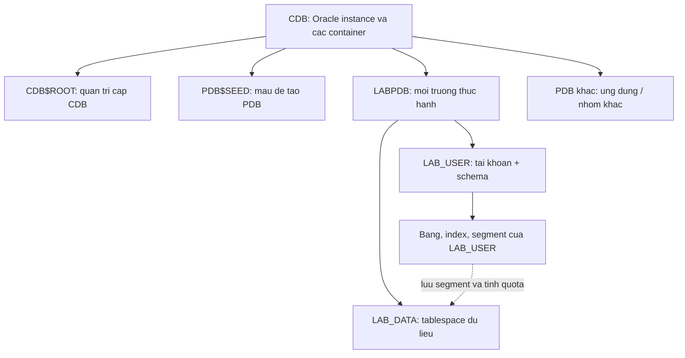

# Tạo PDB, tài khoản thực hành, tablespace và hạn mức lưu trữ trong Oracle

Một môi trường thực hành Oracle tốt cần **cô lập dữ liệu của người học**, xác định rõ tài khoản nào có quyền quản trị và tài khoản nào chỉ được làm bài, đồng thời giới hạn tài nguyên lưu trữ để một bài thực hành không làm đầy không gian của những người khác. Với kiến trúc **multitenant** của Oracle, có thể tổ chức môi trường này theo chuỗi: **CDB → PDB → tablespace → user/schema → quota**.

Bài học xây dựng một ví dụ xuyên suốt:

- Cơ sở dữ liệu dạng container (CDB) đang chạy; người quản trị có quyền tạo một pluggable database.
- PDB thực hành có tên `LABPDB`.
- Tablespace dữ liệu riêng trong PDB là `LAB_DATA`.
- Tài khoản học viên là `LAB_USER`, được phép tạo bảng trong schema của mình và có **quota 256 MB** trên `LAB_DATA`.
- Một bảng mẫu được tạo bằng chính tài khoản học viên để xác nhận cách sử dụng môi trường.

Các lệnh minh họa phù hợp với cách quản trị Oracle Database hỗ trợ multitenant (chẳng hạn Oracle Database 19c trở lên), nhưng **đường dẫn datafile, tên dịch vụ, quyền truy cập và số PDB được phép tạo phụ thuộc bản cài đặt**. Thay các giá trị đặt trong dấu `<...>` bằng giá trị thật của môi trường; không dùng mật khẩu ví dụ trong hệ thống chung.

## 1. Hiểu đúng các lớp cô lập

Trong Oracle multitenant, một **CDB** (*container database*) chứa container gốc `CDB$ROOT`, container mẫu `PDB$SEED` và các **PDB** (*pluggable database*). PDB hoạt động như một cơ sở dữ liệu riêng về đối tượng, schema và nhiều cấu hình ở cấp PDB, trong khi vẫn chia sẻ hạ tầng instance và các cơ chế quản trị của CDB.



| Thành phần | Chức năng | Ranh giới cần nhớ |
| --- | --- | --- |
| `CDB$ROOT` | Quản trị CDB và các PDB, chứa metadata cấp CDB | Không tạo bảng bài tập hay user thường tại đây. |
| `PDB$SEED` | Mẫu Oracle dùng khi tạo PDB mới | Không phải nơi người học tạo đối tượng. |
| `LABPDB` | Container dành cho bài thực hành | Đăng nhập bằng dịch vụ của PDB để thao tác đúng nơi. |
| Tablespace `LAB_DATA` | Không gian lưu trữ logic cho segment, được hỗ trợ bởi datafile | Là tài nguyên lưu trữ, không phải tài khoản hay schema. |
| User `LAB_USER` | Danh tính đăng nhập và chủ sở hữu schema cùng tên | Chỉ tạo được đối tượng khi có quyền phù hợp và quota nếu đối tượng cần cấp phát không gian. |
| Quota | Giới hạn không gian segment của **một user trên một permanent tablespace** | Không phải giới hạn tổng kích thước PDB hoặc tổng số dòng. |

Điểm dễ nhầm: **schema** là tập đối tượng thuộc sở hữu của user; **tablespace** là nơi lưu các segment vật lý tương ứng. Một schema có thể có đối tượng ở nhiều tablespace, và nhiều schema có thể dùng chung một tablespace. Khai báo `DEFAULT TABLESPACE LAB_DATA` chỉ định nơi mặc định cấp phát segment khi không ghi rõ tablespace; nó **không tự cấp quyền lưu trữ**. Quota là một cấu hình riêng.

Ngoài ra, user thường được tạo **bên trong PDB** là *local user*, ví dụ `LAB_USER`. *Common user* được tạo để tồn tại ở các container liên quan và thường phải theo tiền tố `C##` mặc định. Bài thực hành này sử dụng local user để tránh lan quyền ra toàn CDB.

## 2. Chuẩn bị phiên quản trị và kiểm tra môi trường

Người quản trị cần có quyền phù hợp để tạo/mở PDB và tạo tablespace, user, cấp quyền trong PDB. Trên máy Oracle Linux có cấu hình OS authentication, một cách thường gặp là mở SQL*Plus với đặc quyền DBA:

```bash
sqlplus / as sysdba
```

Lệnh này chỉ hoạt động khi tài khoản hệ điều hành và Oracle instance được cấu hình cho cách xác thực đó. Trong SQL Developer hoặc môi trường container, hãy sử dụng kết nối quản trị do hệ thống cấp, với đúng chế độ vai trò và địa chỉ dịch vụ. Không nên cấp `SYSDBA` cho tài khoản học viên chỉ để đơn giản hóa bài thực hành.

Trong SQL*Plus hoặc SQLcl, kiểm tra container hiện tại và các PDB đang có:

```sql
SHOW CON_NAME;
SHOW PDBS;

SELECT con_id, name, open_mode
FROM v$pdbs
ORDER BY con_id;
```

`SHOW CON_NAME` và `SHOW PDBS` là **lệnh của công cụ dòng lệnh**, không phải câu SQL chuẩn; nếu giao diện không hỗ trợ, dùng truy vấn:

```sql
SELECT SYS_CONTEXT('USERENV', 'CON_NAME') AS current_container
FROM dual;
```

Để **tạo** PDB, phiên quản trị phải đang ở `CDB$ROOT`. Nếu có quyền chuyển container:

```sql
ALTER SESSION SET CONTAINER = CDB$ROOT;
```

Nếu chỉ được cấp một PDB có sẵn (rất thường gặp trên môi trường học trực tuyến, Oracle Free hoặc XE), **không cần tạo thêm PDB**: xác định tên dịch vụ PDB được cấp rồi chuyển thẳng đến phần tạo tablespace và tài khoản. Việc tạo thêm PDB phụ thuộc quyền, phiên bản và giới hạn của bản triển khai; không nên thử thay đổi cấu hình sản phẩm hoặc xóa PDB đang có để vượt giới hạn.

### Oracle-Managed Files hay chỉ định đường dẫn thủ công?

Oracle có hai cách phổ biến để xác định file dữ liệu của PDB và tablespace:

1. **Oracle-Managed Files (OMF):** Oracle quản lý tên/path file khi tham số `DB_CREATE_FILE_DEST` đã được cấu hình phù hợp. Đây là cách thuận tiện cho ví dụ bên dưới.
2. **Đường dẫn do DBA quản lý:** câu DDL chỉ định mapping giữa datafile của `PDB$SEED` và PDB mới bằng `FILE_NAME_CONVERT`, cũng như đường dẫn `DATAFILE` khi tạo tablespace. Đường dẫn phải thật sự tồn tại/phù hợp với hệ điều hành, cấu trúc storage và quyền ghi của Oracle.

Kiểm tra ở phiên quản trị:

```sql
SHOW PARAMETER db_create_file_dest;
```

Nếu giá trị rỗng, đừng áp dụng nguyên xi ví dụ dựa trên OMF: cần DBA cấu hình nơi tạo file hoặc sử dụng mapping đường dẫn hợp lệ. Với ASM, file system, container image hay cloud-managed Oracle, cơ chế bố trí file có thể khác nhau.

## 3. Tạo PDB thực hành `LABPDB`

Các thao tác trong mục này thực hiện bằng phiên quản trị ở **`CDB$ROOT`**. Khi OMF đã được thiết lập và môi trường cho phép tạo PDB mới, dùng:

```sql
CREATE PLUGGABLE DATABASE LABPDB
    ADMIN USER LAB_ADMIN IDENTIFIED BY "<MAT_KHAU_ADMIN_PDB>"
    ROLES = (DBA);
```

Oracle tạo PDB mới dựa trên `PDB$SEED`. Tài khoản `LAB_ADMIN` là **local administrative user** của `LABPDB` được khai báo khi tạo; tài khoản này khác với `LAB_USER` dành cho học viên. Cụm `ROLES = (DBA)` minh họa đặc quyền quản trị được gán cho user quản trị PDB, **không** phải mẫu quyền dành cho người làm bài.

Nếu không dùng OMF và DBA quản lý datafile theo đường dẫn thông thường, phần file mapping có thể có dạng sau; đây là **phương án thay thế**, không chạy đồng thời hai câu `CREATE PLUGGABLE DATABASE`:

```sql
-- Chỉ minh họa cú pháp: thay bằng path PDB$SEED thực tế và đích hợp lệ.
CREATE PLUGGABLE DATABASE LABPDB
    ADMIN USER LAB_ADMIN IDENTIFIED BY "<MAT_KHAU_ADMIN_PDB>"
    ROLES = (DBA)
    FILE_NAME_CONVERT = (
        '/path/to/oradata/pdbseed/',
        '/path/to/oradata/labpdb/'
    );
```

Mapping `FILE_NAME_CONVERT` phải khớp tên/đường dẫn các datafile nguồn mà Oracle đang sử dụng; không tự suy đoán path từ tên PDB. DBA có thể xem metadata datafile thuộc `PDB$SEED` bằng các view quản trị từ root để xác định mapping phù hợp. Trong các hệ thống sử dụng OMF, phương án cấu hình OMF thường thích hợp hơn việc tự dựng tên file.

### Mở PDB và lưu trạng thái mở

PDB vừa tạo cần được mở để phục vụ kết nối người dùng:

```sql
ALTER PLUGGABLE DATABASE LABPDB OPEN READ WRITE;

SELECT name, open_mode
FROM v$pdbs
WHERE name = 'LABPDB';
```

Kết quả mong đợi là `LABPDB` có `OPEN_MODE = READ WRITE`. Khi muốn Oracle ghi nhớ trạng thái mở của PDB cho lần khởi động CDB kế tiếp, có thể dùng:

```sql
ALTER PLUGGABLE DATABASE LABPDB SAVE STATE;
```

`SAVE STATE` giúp duy trì chế độ mở đã lưu qua các lần khởi động phù hợp, nhưng **không thay thế** việc DBA kiểm tra listener, dịch vụ hoặc quá trình khởi động thực tế của instance. Tên dịch vụ kết nối mặc định của PDB thường liên quan tên PDB, song môi trường có thể đăng ký service khác; cần xác nhận service đang được listener công bố.

Nếu muốn thao tác quản trị tiếp bên trong PDB bằng cùng phiên có đủ quyền:

```sql
ALTER SESSION SET CONTAINER = LABPDB;

SELECT SYS_CONTEXT('USERENV', 'CON_NAME') AS current_container
FROM dual;
```

**Chỉ tiếp tục khi kết quả là `LABPDB`**. Đây là điểm bảo vệ quan trọng: một câu `CREATE USER` chạy nhầm ở root dễ dẫn đến lỗi tên common user hoặc tạo ra cấu hình không đúng phạm vi.

## 4. Tạo tablespace dữ liệu trong PDB

Tablespace là lớp lưu trữ logic, chứa các segment như bảng và index, được hỗ trợ bởi một hoặc nhiều **datafile**. Tablespace `LAB_DATA` giúp tách dữ liệu bài tập khỏi các tablespace hệ thống như `SYSTEM` hoặc `SYSAUX`. Mọi câu trong mục này chạy bằng tài khoản quản trị ở `LABPDB`.

Khi OMF đang có hiệu lực trong PDB, ví dụ tạo một smallfile permanent tablespace:

```sql
CREATE TABLESPACE LAB_DATA
    DATAFILE SIZE 128M
    AUTOEXTEND ON NEXT 32M MAXSIZE 1G
    EXTENT MANAGEMENT LOCAL
    SEGMENT SPACE MANAGEMENT AUTO;
```

Ý nghĩa các lựa chọn:

| Khai báo | Vai trò |
| --- | --- |
| `DATAFILE SIZE 128M` | Cấp file ban đầu khoảng 128 MB; không phải quota của user. |
| `AUTOEXTEND ON` | Cho phép file tăng khi cần không gian và storage còn đáp ứng. |
| `NEXT 32M` | Mỗi lần tự mở rộng tăng theo bước được cấu hình. |
| `MAXSIZE 1G` | Trần mở rộng của **datafile này**, không phải mức giới hạn của mọi file trong toàn PDB. |
| `EXTENT MANAGEMENT LOCAL` | Sử dụng quản lý extent cục bộ của tablespace. |
| `SEGMENT SPACE MANAGEMENT AUTO` | Để Oracle tự quản lý không gian trống trong segment theo ASSM. |

Trên môi trường không sử dụng OMF, DBA phải chỉ định tên datafile thực tế, chẳng hạn:

```sql
-- Phương án thay thế; thay path phù hợp và chỉ chạy một cách tạo LAB_DATA.
CREATE TABLESPACE LAB_DATA
    DATAFILE '/path/to/oradata/labpdb/lab_data01.dbf'
    SIZE 128M
    AUTOEXTEND ON NEXT 32M MAXSIZE 1G;
```

Đừng đặt file vào nơi tùy tiện hoặc chọn path mà Oracle không có quyền ghi. File dữ liệu là tài nguyên database được Oracle quản lý; việc xóa/sửa thủ công khi database đang sử dụng có thể gây hỏng môi trường.

Sau khi tạo, từ tài khoản quản trị có quyền đọc dictionary:

```sql
SELECT tablespace_name, contents, status, extent_management,
       segment_space_management
FROM dba_tablespaces
WHERE tablespace_name = 'LAB_DATA';

SELECT tablespace_name, file_name,
       ROUND(bytes / 1024 / 1024, 1) AS size_mb,
       autoextensible,
       ROUND(maxbytes / 1024 / 1024, 1) AS max_size_mb
FROM dba_data_files
WHERE tablespace_name = 'LAB_DATA';
```

`DBA_DATA_FILES` cho thấy các giới hạn và mức cấp phát file. Muốn đánh giá dung lượng có thể dùng, DBA còn phải xét không gian trống trong tablespace, các datafile khác, giới hạn PDB/storage và quyền mở rộng thực tế. Một file có `MAXSIZE 1G` không bảo đảm máy chủ luôn còn 1 GB trống để cấp phát.

### Tablespace tạm và undo không phải `LAB_DATA`

Oracle còn có **temporary tablespace** cho các thao tác tạm như sort/hash khi cần ghi ra disk và **undo** phục vụ rollback/đọc nhất quán. `LAB_DATA` trong ví dụ chỉ chứa segment dữ liệu thường trực của học viên. Không đặt bảng bài tập vào `SYSTEM` hoặc sử dụng temporary tablespace làm default permanent tablespace.

Nếu PDB không có temporary tablespace tên `TEMP`, kiểm tra tên hiện có trước khi tạo user:

```sql
SELECT tablespace_name, contents
FROM dba_tablespaces
WHERE contents = 'TEMPORARY';
```

Phần tiếp theo giả định một temporary tablespace hợp lệ tên `TEMP` đã tồn tại.

## 5. Tạo tài khoản thực hành có quyền tối thiểu và quota riêng

Từ phiên quản trị đang ở **`LABPDB`**, tạo local user:

```sql
CREATE USER LAB_USER
    IDENTIFIED BY "<MAT_KHAU_HOC_VIEN>"
    DEFAULT TABLESPACE LAB_DATA
    TEMPORARY TABLESPACE TEMP
    QUOTA 256M ON LAB_DATA
    ACCOUNT UNLOCK;

GRANT CREATE SESSION, CREATE TABLE, CREATE VIEW, CREATE SEQUENCE
TO LAB_USER;
```

Các thành phần không thể thay cho nhau:

- `CREATE SESSION` cho phép user kết nối; chỉ có tài khoản và mật khẩu chưa đủ.
- `CREATE TABLE` cho phép tạo bảng trong schema của mình; `CREATE VIEW` và `CREATE SEQUENCE` chỉ phục vụ các bài thực hành cần đến chúng. Có thể bỏ hai quyền cuối nếu bài học chỉ yêu cầu bảng và DML.
- `DEFAULT TABLESPACE LAB_DATA` chọn vị trí lưu mặc định của các segment do user sở hữu.
- `QUOTA 256M ON LAB_DATA` đặt giới hạn không gian segment được cấp phát cho **user này trong tablespace này**. Giới hạn tính theo dung lượng extent/segment, không phải độ dài văn bản trong các hàng và không phải số lượng bản ghi.
- `TEMPORARY TABLESPACE TEMP` chọn tablespace tạm; quota trên permanent tablespace không điều khiển trực tiếp mức dùng TEMP.
- `ACCOUNT UNLOCK` bảo đảm trạng thái tài khoản cho phép đăng nhập, với điều kiện các chính sách xác thực khác cũng được thỏa mãn.

Không cần cấp `DBA`, `CREATE ANY TABLE`, `SELECT ANY TABLE` hay `UNLIMITED TABLESPACE` cho người học làm bài với schema của mình. Các quyền quá rộng gây khó kiểm soát tác động giữa các học viên. Đặc biệt, user có đặc quyền `UNLIMITED TABLESPACE` có thể vượt giới hạn quota định cấu hình; tránh cấp đặc quyền này hoặc các role có quyền không mong muốn.

### Xem lại tài khoản và hạn mức

Quản trị viên trong PDB có thể kiểm tra:

```sql
SELECT username, account_status,
       default_tablespace, temporary_tablespace
FROM dba_users
WHERE username = 'LAB_USER';

SELECT username, tablespace_name,
       ROUND(bytes / 1024 / 1024, 2) AS used_mb,
       CASE
           WHEN max_bytes = -1 THEN 'UNLIMITED'
           ELSE TO_CHAR(ROUND(max_bytes / 1024 / 1024, 2))
       END AS quota_mb
FROM dba_ts_quotas
WHERE username = 'LAB_USER';

SELECT grantee, privilege
FROM dba_sys_privs
WHERE grantee = 'LAB_USER'
ORDER BY privilege;
```

`DBA_TS_QUOTAS.MAX_BYTES = -1` biểu diễn quota không giới hạn trong view này, không có nghĩa dung lượng database vô hạn. Lệnh hiển thị trên chỉ chạy khi user truy vấn có đủ quyền đọc các view `DBA_*`; học viên thông thường dùng các view `USER_*` cho dữ liệu thuộc chính mình.

### Thay đổi hạn mức sau này

Ví dụ khi cần tăng quota phục vụ một bài thử nghiệm lớn hơn:

```sql
ALTER USER LAB_USER QUOTA 512M ON LAB_DATA;
```

Khi muốn không cho user tiếp tục cấp phát segment mới trong tablespace, có thể đặt quota bằng 0:

```sql
ALTER USER LAB_USER QUOTA 0 ON LAB_DATA;
```

**Quota 0 không tự xóa dữ liệu đã lưu**; nó giới hạn khả năng cấp phát thêm. Nếu đối tượng đã sử dụng không gian, việc thu hồi không gian cần chính sách và thao tác riêng. Để tiếp tục bài thực hành phía dưới, giữ quota `256M` ban đầu hoặc đặt lại:

```sql
ALTER USER LAB_USER QUOTA 256M ON LAB_DATA;
```

## 6. Kết nối bằng tài khoản học viên và tạo dữ liệu thử

Từ máy có SQL*Plus và đường mạng tới listener, ví dụ kiểu kết nối **Easy Connect** là:

```bash
sqlplus LAB_USER@//<DB_HOST>:1521/<PDB_SERVICE>
```

Công cụ sẽ yêu cầu mật khẩu. Thay `<DB_HOST>` và `<PDB_SERVICE>` bằng hostname và service thực tế của `LABPDB`; cổng `1521` là ví dụ phổ biến, không phải quy tắc bắt buộc. Dùng **PDB service**, không kết nối nhầm service tới root. SQL Developer và JDBC cũng cần cấu hình đúng service name của PDB.

Trong phiên **`LAB_USER`**, xác nhận user/container trước khi tạo dữ liệu:

```sql
SELECT SYS_CONTEXT('USERENV', 'SESSION_USER') AS session_user,
       SYS_CONTEXT('USERENV', 'CON_NAME') AS container_name
FROM dual;
```

Giá trị mong đợi tương ứng là `LAB_USER` và `LABPDB`.

Sau đó tạo bảng trong schema của mình. Khai báo `TABLESPACE LAB_DATA` giúp vị trí lưu được thể hiện tường minh:

```sql
CREATE TABLE lab_students (
    student_id  NUMBER GENERATED BY DEFAULT AS IDENTITY,
    full_name   VARCHAR2(120 CHAR) NOT NULL,
    joined_at   TIMESTAMP DEFAULT SYSTIMESTAMP NOT NULL,
    CONSTRAINT pk_lab_students PRIMARY KEY (student_id)
) TABLESPACE LAB_DATA;

INSERT INTO lab_students (full_name) VALUES ('Nguyen An');
INSERT INTO lab_students (full_name) VALUES ('Tran Binh');
COMMIT;

SELECT student_id, full_name, joined_at
FROM lab_students
ORDER BY student_id;
```

Oracle phải cấp phát một số extent cho bảng và index khóa chính; mức sử dụng sẽ không nhất thiết bằng tổng số byte của hai dòng. Trong cùng phiên `LAB_USER`, có thể xem đối tượng và quota của chính mình:

```sql
SELECT segment_name, segment_type, tablespace_name,
       ROUND(bytes / 1024 / 1024, 3) AS allocated_mb
FROM user_segments
WHERE tablespace_name = 'LAB_DATA'
ORDER BY segment_name;

SELECT tablespace_name,
       ROUND(bytes / 1024 / 1024, 3) AS used_mb,
       ROUND(max_bytes / 1024 / 1024, 3) AS quota_mb
FROM user_ts_quotas
WHERE tablespace_name = 'LAB_DATA';
```

`USER_SEGMENTS` hiển thị không gian segment đã cấp phát, còn `USER_TS_QUOTAS` cho biết mức sử dụng/quota theo tablespace. Khi `CREATE TABLE` sử dụng `TABLESPACE LAB_DATA` nhưng user chưa có quota trên tablespace đó, Oracle có thể báo `ORA-01950`; nếu quota đã hết trong lúc cấp phát thêm, có thể gặp `ORA-01536`.

## 7. Phân biệt quota, kích thước datafile và dung lượng đĩa

Ba mức kiểm soát không gian trong ví dụ vận hành độc lập về ý nghĩa:

```text
Disk/ASM/cloud storage: dung luong vat ly thuc su san co
    |
    +-- Datafile cua LAB_DATA: 128 MB ban dau, autoextend toi 1 GB
            |
            +-- LAB_USER: quota 256 MB tren LAB_DATA
            +-- User khac: quota rieng neu cung su dung LAB_DATA
```

Nếu một user có quota 256 MB nhưng file ban đầu mới 128 MB, Oracle **có thể** tự mở rộng file nhờ `AUTOEXTEND`, miễn là tablespace/storage còn điều kiện cho phép. Ngược lại, quota 256 MB không đảm bảo đã đặt sẵn 256 MB tài nguyên vật lý dành riêng cho user. Nếu datafile đạt `MAXSIZE`, storage không còn chỗ hoặc tablespace có lỗi, thao tác cấp phát có thể thất bại **trước khi quota user hết**.

| Hiện tượng | Nguyên nhân thường gặp | Hướng kiểm tra |
| --- | --- | --- |
| User không thể tạo bảng dù có `CREATE TABLE` | Chưa có quota hoặc quota 0 trên tablespace đích | `DBA_TS_QUOTAS`, default tablespace, quyền `CREATE TABLE` |
| Đang chèn dữ liệu thì gặp `ORA-01536` | User vượt quota trên tablespace | Mức `BYTES`, `MAX_BYTES` trong `DBA_TS_QUOTAS` |
| Gặp `ORA-01653` khi mở rộng bảng | Tablespace không cấp phát được extent mới | Free space, datafile, `AUTOEXTEND`, `MAXBYTES`, dung lượng storage |
| `CREATE USER LAB_USER` báo `ORA-65096` | Đang cố tạo tên user local tại `CDB$ROOT` | `SHOW CON_NAME` hoặc `SYS_CONTEXT('USERENV','CON_NAME')` |
| Tạo PDB không thành công | Quyền, giới hạn phiên bản/số PDB hoặc cấu hình datafile không phù hợp | Quyền của phiên, OMF/path, lỗi Oracle trả về, tình trạng CDB |
| Đăng nhập gặp `ORA-01017`, `ORA-01045` hoặc `ORA-12514` | Sai thông tin đăng nhập, thiếu `CREATE SESSION`, hoặc listener chưa biết service | User/password, quyền, service name, listener; từng mã lỗi có nguyên nhân khác nhau |

Khi xử lý lỗi, xem **mã và nội dung lỗi thực tế** trước khi thay đổi cấu hình. Chẳng hạn `ORA-01653` không nhất thiết do user thiếu quota; tăng quota mà tablespace đã hết khả năng cấp phát thì vẫn không giải quyết được vấn đề. Không dùng `GRANT DBA` hoặc `GRANT UNLIMITED TABLESPACE` như giải pháp chung cho mọi lỗi lưu trữ.

## 8. Quy ước quản trị an toàn cho môi trường học

Một môi trường có nhiều người thực hành nên giữ các quy tắc sau:

1. **Mỗi nhóm/bài học có PDB riêng khi thật sự cần cô lập ở cấp database** và khi bản triển khai cho phép; nếu không, có thể dùng các local user/schema riêng trong PDB học tập chung.
2. **Tách tài khoản quản trị và tài khoản làm bài**: DBA tạo PDB, tablespace và user; học viên chỉ thao tác với schema và các quyền được cấp.
3. **Hạn chế quyền và quota**: cấp quyền tương ứng với bài học, quota đủ dùng; theo dõi cả file/storage chứ không chỉ quota.
4. **Dùng service name đúng PDB** và luôn kiểm tra container khi chạy DDL. Lệnh thao tác nhầm container có thể gây lỗi hoặc tác động đến phạm vi lớn hơn dự kiến.
5. **Không đưa mật khẩu thật vào repository hoặc ảnh chụp bài học**; sử dụng phương thức quản lý bí mật của môi trường và đổi mật khẩu khi cấp lại tài khoản.
6. **Không xóa datafile trực tiếp trên hệ điều hành**. Các thao tác xóa user, tablespace hoặc PDB có thể làm mất dữ liệu và phải được quản trị viên xác định phạm vi, sao lưu và thực hiện có chủ đích.

Nếu cần tạm ngừng tài khoản mà vẫn giữ bài làm, quản trị viên có thể khóa tài khoản trong đúng PDB:

```sql
ALTER USER LAB_USER ACCOUNT LOCK;
```

Lệnh này ngăn đăng nhập mới bằng tài khoản bị khóa; không thay cho việc thu hồi quyền hoặc ngắt phiên đang kết nối khi cần. Để tiếp tục cho học viên đăng nhập sau khi được phép, có thể dùng `ALTER USER LAB_USER ACCOUNT UNLOCK` cùng các bước kiểm tra xác thực thích hợp.

## 9. Bài tập thực hành và câu hỏi tự kiểm tra

**Bài tập A — Xác định đúng nơi thao tác:** Đăng nhập bằng tài khoản quản trị và xác định `CDB$ROOT`, `PDB$SEED`, PDB hiện có. Nếu được phép tạo PDB, tạo `LABPDB`, mở `READ WRITE`, lưu trạng thái mở và chuyển phiên đến `LABPDB`. Giải thích vì sao không tạo bảng học viên tại `CDB$ROOT`.

**Bài tập B — Tách quyền và tài nguyên:** Tạo tablespace `LAB_DATA`, local user `LAB_USER` với `CREATE SESSION`, `CREATE TABLE` và quota 256 MB. Kiểm tra `DBA_USERS`, `DBA_TS_QUOTAS` và `DBA_DATA_FILES`. Hãy chỉ ra giới hạn nào áp dụng cho user, giới hạn nào áp dụng cho datafile.

**Bài tập C — Làm việc bằng tài khoản ít quyền:** Kết nối tới service của PDB bằng `LAB_USER`, tạo `LAB_STUDENTS`, chèn dữ liệu, truy vấn `USER_SEGMENTS` và `USER_TS_QUOTAS`. Giải thích vì sao dung lượng segment được cấp phát thường lớn hơn kích thước dữ liệu hàng vừa chèn.

**Bài tập D — Tư duy về lỗi:** Nếu user đã có quota 256 MB nhưng gặp lỗi cấp phát không gian, hãy nêu ít nhất hai nguyên nhân độc lập có thể xảy ra và query/view phù hợp để phân biệt chúng, trước khi thay đổi bất kỳ hạn mức nào.

**Câu hỏi trọng tâm:**

- `LABPDB` và `LAB_DATA` có phải cùng một loại đối tượng không? **Không.** PDB là một container database logic; tablespace là đơn vị tổ chức lưu trữ bên trong PDB.
- Tạo user với `DEFAULT TABLESPACE LAB_DATA` có đủ để tạo bảng không? **Không.** Còn cần quyền tạo bảng, quyền kết nối và quota phù hợp cho cấp phát segment.
- `QUOTA 256M ON LAB_DATA` có hạn chế dung lượng toàn PDB ở 256 MB không? **Không.** Nó giới hạn không gian segment mà user tương ứng được cấp trong tablespace đó.
- `AUTOEXTEND ON` có bảo đảm không bao giờ hết dung lượng không? **Không.** Vẫn có `MAXSIZE`, sức chứa storage, giới hạn PDB và các điều kiện vận hành khác.
- Có cần `SYSDBA` để học viên chèn dữ liệu vào bảng của chính mình không? **Không.** Tài khoản local user với các quyền và quota tối thiểu phù hợp là đủ.

Khi hoàn thành, người học sẽ có một **PDB thực hành (hoặc PDB được cấp sẵn), tablespace dành cho dữ liệu bài tập, tài khoản cục bộ có quyền giới hạn và quota đo lường được**. Đây là nền tảng an toàn để tiếp tục học DDL, DML, ràng buộc, index và giao dịch Oracle mà không phải sử dụng tài khoản quản trị cho từng câu SQL.
