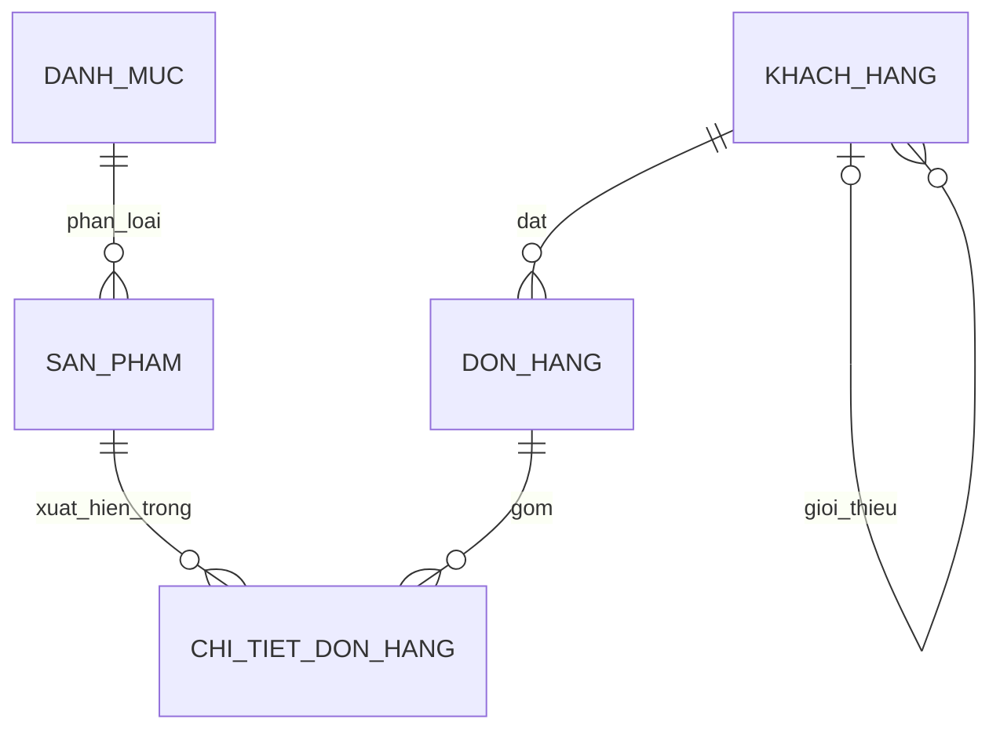

# Thiết kế bộ dữ liệu mẫu có quan hệ, dữ liệu NULL và dữ liệu biên

Một môi trường thực hành Oracle Database hữu ích cần nhiều hơn vài hàng dữ liệu ngẫu nhiên. Bộ dữ liệu phải có **quan hệ giữa các bảng**, các trường hợp **có và không có dữ liệu**, và những giá trị **ở ranh giới hợp lệ hoặc không hợp lệ**. Nhờ đó, cùng một bộ dữ liệu có thể dùng để luyện `JOIN`, `GROUP BY`, `NULL`, khóa ngoại, ràng buộc, giao dịch và cách nhận diện lỗi do thiết kế truy vấn.

Bài này xây dựng một bộ dữ liệu nhỏ cho hệ thống bán hàng, có thể chạy trong **một schema Oracle dùng riêng cho thực hành**. Mọi mã định danh được chỉ định tường minh để khi chạy lại trên schema mới, các bài tập vẫn tham chiếu đúng hàng dữ liệu.

## 1. Xác định mục tiêu trước khi tạo dữ liệu

Một bộ dữ liệu mẫu tốt nên trả lời được các câu hỏi sau:

- **Quan hệ:** Bảng nào là cha, bảng nào là con? Khóa chính và khóa ngoại có thực sự kiểm soát mối quan hệ không?
- **Tính tùy chọn:** Cột nào được phép `NULL`? Có hàng cha chưa có hàng con không? Có khóa ngoại tùy chọn bị bỏ trống không?
- **Dữ liệu biên:** Giá trị `0`, số thập phân rất nhỏ, số gần giới hạn kiểu dữ liệu, ngày nhuận, số lượng tối đa, chuỗi có dấu hoặc dấu nháy có được xử lý đúng không?
- **Tính toàn vẹn:** Hệ thống chấp nhận trường hợp hợp lệ và từ chối trường hợp vi phạm `PRIMARY KEY`, `FOREIGN KEY`, `UNIQUE`, `NOT NULL`, `CHECK` như thế nào?
- **Khả năng dự đoán:** Người học có thể biết kết quả mong đợi của một truy vấn để tự quan sát sự khác nhau giữa `INNER JOIN` và `LEFT JOIN` không?

Không cần hàng triệu bản ghi để kiểm tra các hành vi trên. Đối với giai đoạn tìm hiểu mô hình quan hệ, **một tập nhỏ có chủ đích** thường dễ lý giải hơn một tập lớn được sinh ngẫu nhiên.

## 2. Chọn miền nghiệp vụ và thiết kế quan hệ

Ví dụ sử dụng năm bảng:

| Bảng | Vai trò | Khóa chính | Quan hệ |
| --- | --- | --- | --- |
| `danh_muc` | Nhóm phân loại sản phẩm | `ma_danh_muc` | Một danh mục có thể có nhiều sản phẩm |
| `san_pham` | Thông tin sản phẩm và giá hiện tại | `ma_san_pham` | Mỗi sản phẩm thuộc một danh mục |
| `khach_hang` | Người mua, dữ liệu liên hệ | `ma_khach_hang` | Một khách có thể có nhiều đơn hàng; có thể được khách khác giới thiệu |
| `don_hang` | Đơn mua, ngày đặt và trạng thái | `ma_don_hang` | Mỗi đơn thuộc một khách; một đơn có thể có nhiều dòng chi tiết |
| `chi_tiet_don_hang` | Sản phẩm và số lượng trong từng đơn | (`ma_don_hang`, `ma_san_pham`) | Bảng trung gian nối đơn hàng và sản phẩm |



Trong bộ dữ liệu này, mọi sản phẩm đều **phải** thuộc một danh mục và mọi đơn hàng đều **phải** có khách hàng. Ngược lại, khách hàng có thể chưa đặt đơn nào, danh mục có thể chưa có sản phẩm và đơn hàng đang ở trạng thái nháp có thể chưa có dòng chi tiết. Trường `nguoi_gioi_thieu_id` là một **khóa ngoại tự tham chiếu, cho phép `NULL`**: khách hàng không cần có người giới thiệu.

### Quy ước thiết kế dữ liệu

1. Dùng khóa số nguyên cố định trong dữ liệu thực hành, không phụ thuộc thứ tự cấp phát `IDENTITY` hoặc sequence.
2. Đặt khóa chính, khóa ngoại, miền giá trị và tính bắt buộc ngay trong cấu trúc bảng để Oracle bảo vệ dữ liệu từ mọi nguồn ghi.
3. Lưu `don_gia_luc_dat` trong chi tiết đơn hàng: giá đã ghi nhận khi đặt đơn không bị thay đổi theo `don_gia` hiện tại của sản phẩm.
4. Phân biệt rõ **không có đơn**, **đơn không có chi tiết**, **đơn hủy**, **số tiền bằng 0** và **giá trị chưa biết (`NULL`)**. Đây là các tình huống khác nhau về nghiệp vụ.
5. Chỉ dùng thông tin liên hệ hư cấu, chẳng hạn địa chỉ email thuộc miền `.test`, để tránh đưa dữ liệu cá nhân thật vào môi trường học.

## 3. Tạo schema dữ liệu mẫu trong Oracle

Các lệnh dưới đây dành cho một **schema thực hành còn trống**, với tài khoản có quyền tạo bảng. Chạy theo đúng thứ tự vì bảng con có khóa ngoại tham chiếu bảng cha. Không chạy trong schema chứa dữ liệu cần bảo tồn. Dùng công cụ như SQL Developer, SQLcl hoặc SQL*Plus để gửi các câu SQL tới Oracle Database.

```sql
-- 1. Danh mục: có thể tồn tại ngay cả khi chưa có sản phẩm.
CREATE TABLE danh_muc (
    ma_danh_muc  NUMBER(4) CONSTRAINT pk_danh_muc PRIMARY KEY,
    ten_danh_muc VARCHAR2(80 CHAR) NOT NULL,
    CONSTRAINT uq_danh_muc_ten UNIQUE (ten_danh_muc)
);

-- 2. Khách hàng: email, điện thoại, ngày sinh và người giới thiệu
-- đều là những thông tin có thể chưa được cung cấp.
CREATE TABLE khach_hang (
    ma_khach_hang      NUMBER(6) CONSTRAINT pk_khach_hang PRIMARY KEY,
    ho_ten             VARCHAR2(120 CHAR) NOT NULL,
    email              VARCHAR2(150 CHAR),
    so_dien_thoai      VARCHAR2(20 CHAR),
    ngay_sinh          DATE,
    ngay_dang_ky       DATE NOT NULL,
    nguoi_gioi_thieu_id NUMBER(6),
    CONSTRAINT uq_khach_hang_email UNIQUE (email),
    CONSTRAINT fk_khach_hang_gioi_thieu
        FOREIGN KEY (nguoi_gioi_thieu_id)
        REFERENCES khach_hang (ma_khach_hang),
    CONSTRAINT ck_khach_hang_khong_tu_gt
        CHECK (nguoi_gioi_thieu_id IS NULL
               OR nguoi_gioi_thieu_id <> ma_khach_hang)
);

-- 3. Sản phẩm: luôn thuộc một danh mục.
CREATE TABLE san_pham (
    ma_san_pham   NUMBER(6) CONSTRAINT pk_san_pham PRIMARY KEY,
    ma_danh_muc   NUMBER(4) NOT NULL,
    ten_san_pham  VARCHAR2(120 CHAR) NOT NULL,
    don_gia       NUMBER(12, 2) NOT NULL,
    so_luong_ton  NUMBER(5) NOT NULL,
    mo_ta         VARCHAR2(300 CHAR),
    CONSTRAINT fk_san_pham_danh_muc
        FOREIGN KEY (ma_danh_muc) REFERENCES danh_muc (ma_danh_muc),
    CONSTRAINT ck_san_pham_gia CHECK (don_gia >= 0),
    CONSTRAINT ck_san_pham_ton CHECK (so_luong_ton BETWEEN 0 AND 99999)
);

-- 4. Đơn hàng: ngày giao và địa chỉ giao có thể chưa có.
CREATE TABLE don_hang (
    ma_don_hang   NUMBER(9) CONSTRAINT pk_don_hang PRIMARY KEY,
    ma_khach_hang NUMBER(6) NOT NULL,
    ngay_dat      DATE NOT NULL,
    ngay_giao     DATE,
    dia_chi_giao  VARCHAR2(200 CHAR),
    ghi_chu       VARCHAR2(200 CHAR),
    trang_thai    VARCHAR2(12 CHAR) DEFAULT 'DRAFT' NOT NULL,
    CONSTRAINT fk_don_hang_khach_hang
        FOREIGN KEY (ma_khach_hang) REFERENCES khach_hang (ma_khach_hang),
    CONSTRAINT ck_don_hang_trang_thai
        CHECK (trang_thai IN ('DRAFT', 'PAID', 'SHIPPED', 'CANCELLED')),
    CONSTRAINT ck_don_hang_ngay_giao
        CHECK (ngay_giao IS NULL OR ngay_giao >= ngay_dat),
    CONSTRAINT ck_don_hang_da_giao
        CHECK (trang_thai <> 'SHIPPED' OR ngay_giao IS NOT NULL)
);

-- 5. Mỗi cặp (đơn hàng, sản phẩm) chỉ có một dòng chi tiết.
CREATE TABLE chi_tiet_don_hang (
    ma_don_hang    NUMBER(9) NOT NULL,
    ma_san_pham    NUMBER(6) NOT NULL,
    so_luong       NUMBER(5) NOT NULL,
    don_gia_luc_dat NUMBER(12, 2) NOT NULL,
    chiet_khau_pct NUMBER(5, 2) DEFAULT 0 NOT NULL,
    CONSTRAINT pk_chi_tiet_don_hang
        PRIMARY KEY (ma_don_hang, ma_san_pham),
    CONSTRAINT fk_chi_tiet_don_hang
        FOREIGN KEY (ma_don_hang) REFERENCES don_hang (ma_don_hang),
    CONSTRAINT fk_chi_tiet_san_pham
        FOREIGN KEY (ma_san_pham) REFERENCES san_pham (ma_san_pham),
    CONSTRAINT ck_chi_tiet_so_luong
        CHECK (so_luong BETWEEN 1 AND 99999),
    CONSTRAINT ck_chi_tiet_gia CHECK (don_gia_luc_dat >= 0),
    CONSTRAINT ck_chi_tiet_chiet_khau
        CHECK (chiet_khau_pct BETWEEN 0 AND 100)
);
```

Chú ý một vài lựa chọn trong DDL:

- `NUMBER(12, 2)` lưu số với hai chữ số thập phân và tối đa 10 chữ số phần nguyên. Nó phù hợp để minh họa giá trị `0`, `0.01` và `9999999999.99`.
- `VARCHAR2(120 CHAR)` đặt giới hạn theo số ký tự thay vì mặc định phụ thuộc cấu hình ngữ nghĩa byte/ký tự. Nội dung tiếng Việt vẫn yêu cầu bộ ký tự cơ sở dữ liệu và đường kết nối hỗ trợ Unicode thích hợp.
- `NULL` trong một cột có khóa ngoại không vi phạm quan hệ; **giá trị khác `NULL`** phải trỏ tới bản ghi cha tồn tại.
- `UNIQUE (email)` cho phép nhiều khách hàng có `email IS NULL` trong Oracle đối với khóa duy nhất một cột. Hai email **khác `NULL` nhưng giống nhau** sẽ bị từ chối.
- `CHECK` là điều kiện hợp lệ của hàng. Nó không tự thay thế mọi quy tắc nghiệp vụ, chẳng hạn việc chỉ cho phép chuyển từ trạng thái `PAID` sang `SHIPPED` hoặc tính tổng tiền đơn hàng.

## 4. Nạp dữ liệu có chủ đích

Chạy đoạn `INSERT` sau **sau khi tạo đủ năm bảng**. Giữ nguyên các mã số và ngày tháng để những truy vấn thực hành ở phần sau có kết quả dễ đối chiếu.

```sql
-- Danh mục 30 cố ý không có sản phẩm.
INSERT INTO danh_muc VALUES (10, 'Sách');
INSERT INTO danh_muc VALUES (20, 'Phụ kiện');
INSERT INTO danh_muc VALUES (30, 'Khóa học');

-- Khách 104 và 105 cố ý chưa có đơn hàng.
-- Khách 102, 104 có email NULL; chuỗi '' của khách 105 cũng
-- được Oracle xử lý là NULL đối với VARCHAR2.
INSERT INTO khach_hang
    (ma_khach_hang, ho_ten, email, so_dien_thoai,
     ngay_sinh, ngay_dang_ky, nguoi_gioi_thieu_id)
VALUES
    (101, 'Nguyễn An', 'an@example.test', NULL,
     DATE '1995-01-01', DATE '2024-01-05', NULL);

INSERT INTO khach_hang
    (ma_khach_hang, ho_ten, email, so_dien_thoai,
     ngay_sinh, ngay_dang_ky, nguoi_gioi_thieu_id)
VALUES
    (102, 'Trần Bình', NULL, '0900000002',
     DATE '2000-02-29', DATE '2024-01-06', 101);

INSERT INTO khach_hang
    (ma_khach_hang, ho_ten, email, so_dien_thoai,
     ngay_sinh, ngay_dang_ky, nguoi_gioi_thieu_id)
VALUES
    (103, 'Lê Chi', 'chi@example.test', '0900000003',
     NULL, DATE '2024-01-07', 102);

INSERT INTO khach_hang
    (ma_khach_hang, ho_ten, email, so_dien_thoai,
     ngay_sinh, ngay_dang_ky, nguoi_gioi_thieu_id)
VALUES
    (104, 'Đặng Dũng', NULL, NULL,
     DATE '1980-12-31', DATE '2024-01-08', NULL);

INSERT INTO khach_hang
    (ma_khach_hang, ho_ten, email, so_dien_thoai,
     ngay_sinh, ngay_dang_ky, nguoi_gioi_thieu_id)
VALUES
    (105, 'O''Brien', '', '0900000005',
     NULL, DATE '2024-01-09', 101);

-- Sản phẩm 1005 cố ý chưa xuất hiện trong chi tiết đơn hàng.
-- Giá 0, giá 0.01, giá rất lớn và tồn kho 0 là các ca biên có chủ đích.
INSERT INTO san_pham VALUES
    (1001, 10, 'Sách SQL cơ bản', 120000, 12, 'Nhập môn SQL');
INSERT INTO san_pham VALUES
    (1002, 20, 'Bút bi', 0, 0, NULL);
INSERT INTO san_pham VALUES
    (1003, 20, 'Nhãn dán', 0.01, 99999, '');
INSERT INTO san_pham VALUES
    (1004, 10, 'Gói tài liệu giới hạn', 9999999999.99, 1, 'Kiểm tra biên NUMBER');
INSERT INTO san_pham VALUES
    (1005, 10, 'Sách Oracle chuyên sâu', 350000.25, 20, NULL);

-- Đơn 5004 ở trạng thái DRAFT và cố ý không có dòng chi tiết.
-- Ngày 2024-02-29 là ngày nhuận; ngày giao 2024-03-01.
INSERT INTO don_hang VALUES
    (5001, 101, DATE '2024-02-28', NULL,
     '1 Đường A, Hà Nội', NULL, 'PAID');
INSERT INTO don_hang VALUES
    (5002, 102, DATE '2024-02-29', DATE '2024-03-01',
     '2 Đường B, Hà Nội', 'Giao sau 17h', 'SHIPPED');
INSERT INTO don_hang VALUES
    (5003, 101, DATE '2024-03-01', NULL,
     NULL, NULL, 'CANCELLED');
INSERT INTO don_hang VALUES
    (5004, 103, DATE '2024-03-02', NULL,
     NULL, NULL, 'DRAFT');

-- Giá trong đơn là giá lúc đặt, không phải phép JOIN lấy giá hiện tại.
-- Có chiết khấu 0%, 12.5% và 100%, số lượng 1, 3 và 99999.
INSERT INTO chi_tiet_don_hang VALUES (5001, 1001, 1, 120000, 12.50);
INSERT INTO chi_tiet_don_hang VALUES (5001, 1003, 3, 0.01, 0);
INSERT INTO chi_tiet_don_hang VALUES (5002, 1002, 1, 0, 0);
INSERT INTO chi_tiet_don_hang VALUES (5002, 1004, 1, 9999999999.99, 0);
INSERT INTO chi_tiet_don_hang VALUES (5003, 1003, 99999, 0.01, 100);

COMMIT;
```

Đây là dữ liệu **cố ý chứa những tình huống ít gặp**, không phải số liệu kinh doanh thực tế. Ví dụ, một đơn hủy vẫn giữ dòng chi tiết để truy vết lựa chọn khi đặt hàng; một sản phẩm có giá cực lớn dùng để kiểm tra độ chính xác của phép tính. Việc bán một mặt hàng có tồn kho hiện tại bằng 0 cũng có thể xảy ra do tồn kho được cập nhật sau lúc bán. Các quy tắc như giữ hàng, thanh toán, hủy đơn hay tính doanh thu sẽ cần được định nghĩa riêng khi phát triển hệ thống thật.

### Bản đồ các trường hợp đã cài vào dữ liệu

| Mã dữ liệu | Trường hợp kiểm thử | Điểm quan sát |
| --- | --- | --- |
| Danh mục `30` | Danh mục chưa có sản phẩm | `LEFT JOIN` và giá trị phía bảng con bằng `NULL` |
| Sản phẩm `1005` | Có sản phẩm nhưng chưa bán trong đơn nào | `NOT EXISTS`, `LEFT JOIN ... IS NULL` |
| Khách `104`, `105` | Không có đơn hàng | Sự khác nhau giữa `INNER JOIN` và `LEFT JOIN` |
| Khách `102`, `104`, `105` | Email `NULL`; khách `105` được nhập bằng `''` | `IS NULL`, `COUNT(email)`, quy tắc chuỗi rỗng trong Oracle |
| Khách `102`, `103`, `105` | Có người giới thiệu; các khách còn lại không có | Khóa ngoại tự tham chiếu tùy chọn |
| Khách `102` | Ngày sinh `2000-02-29` | Ngày nhuận hợp lệ |
| Khách `105` | Tên `O'Brien` | Dấu nháy đơn trong SQL literal: `O''Brien` |
| Sản phẩm `1002`, `1003`, `1004` | Giá `0`, `0.01`, `9999999999.99` | Ranh giới `NUMBER(12,2)` |
| Sản phẩm `1002`, `1003` | Tồn kho `0` và `99999` | Hai đầu miền hợp lệ của số lượng tồn |
| Đơn `5002` | Đặt `2024-02-29`, giao `2024-03-01` | Biên ngày nhuận và kiểm tra thứ tự ngày |
| Đơn `5003` | Trạng thái `CANCELLED`, ngày giao `NULL` | Không đồng nhất `NULL` với lỗi dữ liệu |
| Đơn `5004` | Đơn nháp chưa có chi tiết | `SUM` trên tập hàng rỗng, `NVL` |
| Chi tiết `(5003, 1003)` | Số lượng `99999`, chiết khấu `100%` | Biên lớn nhất của số lượng và phần trăm |

## 5. Truy vấn để quan sát quan hệ, NULL và dữ liệu biên

Những truy vấn sau là **bài thực hành đọc dữ liệu**, không sửa dữ liệu gốc. Kết quả dự kiến dựa trên bộ `INSERT` ở trên và giả định chưa có hàng nào bị thay đổi thêm.

### 5.1. Đếm số hàng và xem cột NULL

```sql
SELECT COUNT(*) AS tong_khach,
       COUNT(email) AS khach_co_email,
       SUM(CASE WHEN email IS NULL THEN 1 ELSE 0 END) AS khach_thieu_email
FROM khach_hang;
```

Kết quả tương ứng là **5 khách hàng, 2 khách có email, 3 khách thiếu email**. `COUNT(*)` đếm mọi hàng, còn `COUNT(email)` chỉ đếm những hàng có `email` khác `NULL`. Khách `105` được nhập email `''`, nhưng Oracle xem chuỗi rỗng là `NULL` đối với kiểu chuỗi `VARCHAR2` hiện hành.

```sql
-- Đúng: tìm giá trị chưa biết/chưa cung cấp.
SELECT ma_khach_hang, ho_ten
FROM khach_hang
WHERE email IS NULL
ORDER BY ma_khach_hang;

-- Sai về ý nghĩa: phép so sánh với NULL trả UNKNOWN,
-- nên không có hàng nào thỏa điều kiện WHERE.
SELECT ma_khach_hang
FROM khach_hang
WHERE email = NULL;
```

Truy vấn đầu trả `102`, `104`, `105`; truy vấn thứ hai không trả hàng nào. Trong logic ba giá trị của SQL, `NULL` không phải chuỗi trống, số `0` hoặc một giá trị có thể so sánh bằng toán tử `=` thông thường. Muốn tìm giá trị khác `NULL`, dùng `IS NOT NULL`.

### 5.2. `INNER JOIN` khác `LEFT JOIN` như thế nào?

```sql
-- Mỗi khách, kể cả khách chưa từng đặt đơn, vẫn xuất hiện.
SELECT k.ma_khach_hang,
       k.ho_ten,
       COUNT(d.ma_don_hang) AS so_don
FROM khach_hang k
LEFT JOIN don_hang d
    ON d.ma_khach_hang = k.ma_khach_hang
GROUP BY k.ma_khach_hang, k.ho_ten
ORDER BY k.ma_khach_hang;
```

| Khách hàng | Số đơn |
| --- | ---: |
| `101` | 2 |
| `102` | 1 |
| `103` | 1 |
| `104` | 0 |
| `105` | 0 |

`COUNT(d.ma_don_hang)` không đếm hàng nối giả có giá trị khóa đơn bằng `NULL`, nhờ đó trả `0` cho khách chưa đặt đơn. Nếu viết `COUNT(*)` trong truy vấn `LEFT JOIN` trên, hai khách cuối có thể bị đếm thành `1` vì mỗi khách vẫn tạo một hàng kết quả của phép nối ngoài.

Để chỉ chọn khách chưa đặt hàng:

```sql
SELECT k.ma_khach_hang, k.ho_ten
FROM khach_hang k
LEFT JOIN don_hang d
    ON d.ma_khach_hang = k.ma_khach_hang
WHERE d.ma_don_hang IS NULL
ORDER BY k.ma_khach_hang;
```

Kết quả là khách `104` và `105`. Một cách tương đương về mục đích là dùng `NOT EXISTS` với truy vấn con tương quan. Khi muốn tìm khách không có **đơn ở một trạng thái nhất định**, phải đặt điều kiện trạng thái đúng vị trí; đặt tùy tiện `d.trang_thai = 'PAID'` trong `WHERE` có thể khiến `LEFT JOIN` hoạt động giống `INNER JOIN` đối với các hàng không khớp.

### 5.3. Tổng tiền của cả đơn hàng chưa có chi tiết

```sql
SELECT d.ma_don_hang,
       d.trang_thai,
       COUNT(ct.ma_san_pham) AS so_dong_chi_tiet,
       NVL(SUM(
           ct.so_luong * ct.don_gia_luc_dat
           * (1 - ct.chiet_khau_pct / 100)
       ), 0) AS tong_tien_minh_hoa
FROM don_hang d
LEFT JOIN chi_tiet_don_hang ct
    ON ct.ma_don_hang = d.ma_don_hang
GROUP BY d.ma_don_hang, d.trang_thai
ORDER BY d.ma_don_hang;
```

| Đơn | Trạng thái | Số dòng | Tổng tiền minh họa |
| --- | --- | ---: | ---: |
| `5001` | `PAID` | 2 | `105000.03` |
| `5002` | `SHIPPED` | 2 | `9999999999.99` |
| `5003` | `CANCELLED` | 1 | `0` |
| `5004` | `DRAFT` | 0 | `0` |

Với đơn `5001`, sách giá `120000` chiết khấu `12.5%` còn `105000`; cộng ba nhãn dán giá `0.01` thành `105000.03`. Đơn `5003` có chiết khấu `100%`, nhưng **không vì thế mà được tính vào doanh thu**; doanh thu cần lọc trạng thái đơn đủ điều kiện theo quy tắc nghiệp vụ. Đơn `5004` không có dòng chi tiết nên `SUM(...)` trả `NULL` trước khi `NVL(..., 0)` chuyển thành `0` phục vụ hiển thị. Không nên tự động hiểu `NULL` là `0` trong mọi bài toán; chỉ chuyển khi ngữ nghĩa yêu cầu.

Trong bài tập tài chính thực tế còn phải định nghĩa cách làm tròn ở cấp dòng, thuế, tiền tệ và khoản hoàn tiền. Công thức trên là **công thức minh họa** để kiểm tra `JOIN`, tổng hợp và số thập phân, chưa phải chuẩn tính tiền của một hệ thống thanh toán.

### 5.4. Tìm sản phẩm và danh mục không có bản ghi con

```sql
-- Sản phẩm chưa từng nằm trong bất kỳ dòng chi tiết nào.
SELECT sp.ma_san_pham, sp.ten_san_pham
FROM san_pham sp
WHERE NOT EXISTS (
    SELECT 1
    FROM chi_tiet_don_hang ct
    WHERE ct.ma_san_pham = sp.ma_san_pham
);

-- Danh mục chưa có sản phẩm.
SELECT dm.ma_danh_muc, dm.ten_danh_muc
FROM danh_muc dm
LEFT JOIN san_pham sp
    ON sp.ma_danh_muc = dm.ma_danh_muc
WHERE sp.ma_san_pham IS NULL;
```

Kết quả lần lượt là sản phẩm `1005` và danh mục `30`. Đây là các ca quan trọng vì một bộ dữ liệu chỉ chứa bản ghi cha luôn có con sẽ không giúp thấy được các hàng bị mất bởi `INNER JOIN`.

### 5.5. Tự nối bảng để xem người giới thiệu

```sql
SELECT k.ma_khach_hang,
       k.ho_ten,
       gt.ho_ten AS nguoi_gioi_thieu
FROM khach_hang k
LEFT JOIN khach_hang gt
    ON gt.ma_khach_hang = k.nguoi_gioi_thieu_id
ORDER BY k.ma_khach_hang;
```

Khách `102` được `101` giới thiệu; `103` được `102` giới thiệu; `105` được `101` giới thiệu. Cột tên người giới thiệu của `101` và `104` là `NULL`. Một khóa ngoại tham chiếu đến chính bảng hiện tại vẫn tuân theo quy tắc khóa ngoại như các quan hệ giữa hai bảng khác nhau.

### 5.6. Truy vấn ngày ở ranh giới

```sql
-- Lấy các đơn từ 29/02/2024 đến hết ngày 01/03/2024.
SELECT ma_don_hang, ngay_dat
FROM don_hang
WHERE ngay_dat >= DATE '2024-02-29'
  AND ngay_dat <  DATE '2024-03-02'
ORDER BY ngay_dat;
```

Kết quả gồm đơn `5002` và `5003`. Dùng khoảng **đóng ở đầu, mở ở cuối** (`>=` và `<`) giúp bao trọn cả những giá trị `DATE` có giờ, phút, giây trong ngày 01/03. Trong Oracle, kiểu `DATE` có cả thành phần thời gian; không nên chỉ dựa vào `BETWEEN DATE '2024-02-29' AND DATE '2024-03-01'` nếu muốn bao trọn ngày 01/03 đến 23:59:59.

## 6. Bổ sung các ca không hợp lệ để thấy tác dụng của ràng buộc

Dữ liệu hợp lệ chỉ chứng minh rằng cơ sở dữ liệu **chấp nhận** các trường hợp đã chuẩn bị. Để quan sát tính toàn vẹn, hãy chạy riêng từng câu lệnh sau sau khi nạp dữ liệu mẫu. **Đây là ví dụ cố ý gây lỗi, không thuộc script seed ở phần 4**. Không cần sửa các bảng hay tắt ràng buộc để cho chúng chạy thành công.

| Thao tác cố ý sai | Ràng buộc cần chặn | Lỗi Oracle thường gặp |
| --- | --- | --- |
| Thêm khách hàng có email `an@example.test` đã tồn tại | `UNIQUE (email)` | `ORA-00001` |
| Thêm chi tiết cho đơn `9999` không tồn tại | `FOREIGN KEY` tới `don_hang` | `ORA-02291` |
| Thêm sản phẩm có đơn giá âm | `CHECK (don_gia >= 0)` | `ORA-02290` |
| Thêm đơn với `ma_khach_hang = NULL` | `NOT NULL` | `ORA-01400` |
| Thêm chi tiết có `so_luong = 0` hoặc chiết khấu `101%` | `CHECK` của bảng chi tiết | `ORA-02290` |

```sql
-- Ví dụ 1: trùng email với khách 101.
INSERT INTO khach_hang
    (ma_khach_hang, ho_ten, email, ngay_dang_ky)
VALUES
    (106, 'Khách thử', 'an@example.test', DATE '2024-03-10');

-- Ví dụ 2: đơn 9999 chưa tồn tại.
INSERT INTO chi_tiet_don_hang
    (ma_don_hang, ma_san_pham, so_luong,
     don_gia_luc_dat, chiet_khau_pct)
VALUES
    (9999, 1001, 1, 120000, 0);

-- Ví dụ 3: giá âm vi phạm CHECK.
INSERT INTO san_pham
    (ma_san_pham, ma_danh_muc, ten_san_pham,
     don_gia, so_luong_ton)
VALUES
    (1006, 10, 'Sản phẩm lỗi', -0.01, 0);

-- Ví dụ 4: khóa ngoại bắt buộc bị để NULL.
INSERT INTO don_hang
    (ma_don_hang, ma_khach_hang, ngay_dat)
VALUES
    (5005, NULL, DATE '2024-03-10');

-- Ví dụ 5: số lượng thấp hơn 1.
INSERT INTO chi_tiet_don_hang
    (ma_don_hang, ma_san_pham, so_luong,
     don_gia_luc_dat, chiet_khau_pct)
VALUES
    (5001, 1005, 0, 350000.25, 0);
```

Nếu công cụ SQL dừng ở lỗi đầu tiên, hãy chạy **từng `INSERT` một** để quan sát đúng ràng buộc. Các câu bị từ chối không thêm hàng; nếu tự thực hiện các thay đổi thành công khác trong lúc thử nghiệm, có thể `ROLLBACK` các thay đổi chưa `COMMIT` hoặc tạo lại schema thực hành để quay về dữ liệu ban đầu.

Ngoài ra, có thể thử những trường hợp như `don_gia = 10000000000` đối với `NUMBER(12,2)` (vượt giới hạn số chữ số phần nguyên), chuỗi tên dài hơn giới hạn `VARCHAR2`, ngày `DATE '2023-02-29'` (không phải ngày hợp lệ), ngày giao trước ngày đặt, hoặc người giới thiệu không tồn tại. Mỗi trường hợp kiểm tra một giả định khác nhau của mô hình dữ liệu.

## 7. Những bẫy đặc trưng khi thiết kế dữ liệu thực hành cho Oracle

### 7.1. `NULL`, chuỗi rỗng, chuỗi chứa khoảng trắng và số 0

Ở Oracle Database, chuỗi ký tự độ dài bằng `0` trong `VARCHAR2` hiện được xử lý như `NULL`, ví dụ email `''` của khách `105`. Tuy vậy, giá trị `' '` chứa **một dấu cách** là dữ liệu có ký tự; nó không nên bị hiểu là email hợp lệ. Ứng dụng có thể cần `TRIM`, kiểm tra dữ liệu đầu vào hoặc ràng buộc bổ sung tùy yêu cầu. Số `0` của sản phẩm `1002` là **giá trị số xác định**, không phải `NULL`.

Ba tình huống sau có ý nghĩa khác nhau:

```sql
-- Không biết email: khách 102, 104, 105.
SELECT ma_khach_hang FROM khach_hang WHERE email IS NULL;

-- Biết giá bán và giá là 0: sản phẩm 1002.
SELECT ma_san_pham FROM san_pham WHERE don_gia = 0;

-- Chưa có ngày giao: các đơn 5001, 5003, 5004.
SELECT ma_don_hang FROM don_hang WHERE ngay_giao IS NULL;
```

`NVL(email, 'Chưa cung cấp')` có thể dùng khi **hiển thị**, nhưng thay `NULL` bằng chuỗi giả rồi lưu ngược vào cột sẽ làm sai ý nghĩa dữ liệu. Cũng không nên lạm dụng ngày `1900-01-01` hay số `-1` để đại diện thông tin chưa biết khi lược đồ đã cho phép `NULL`.

### 7.2. `CHECK` và logic ba giá trị

Trong SQL, một điều kiện có thể cho `TRUE`, `FALSE` hoặc `UNKNOWN` khi có `NULL`. Ràng buộc `CHECK` từ chối điều kiện `FALSE`, nhưng không tự động từ chối `UNKNOWN`. Vì thế các cột bắt buộc như `don_gia`, `so_luong` và `chiet_khau_pct` được khai báo **`NOT NULL` riêng**; chỉ viết `CHECK (so_luong > 0)` không đủ để khẳng định cột không thể nhận `NULL`.

### 7.3. Giới hạn số, độ chính xác và làm tròn

Các giá trị `0.01`, `350000.25` và `9999999999.99` giúp quan sát cách Oracle xử lý `NUMBER(12,2)`. Không nên đổi những cột giá tiền sang kiểu số thực nhị phân rồi mong mọi phép tính thập phân đều chính xác tuyệt đối. Trong Java, dữ liệu tiền thường được ánh xạ sang `BigDecimal`; phía Oracle nên sử dụng `NUMBER(p,s)` phù hợp với quy tắc độ lớn và số chữ số thập phân đã chọn.

Giới hạn của cột được đặt theo **đúng nghiệp vụ**, không phải luôn chọn `NUMBER` không có độ chính xác hoặc một giá trị tối đa thật lớn. Bộ dữ liệu này chủ động có giá cực lớn để buộc truy vấn tổng hợp và ứng dụng xử lý đúng miền giá trị đã khai báo.

### 7.4. Ngày tháng và định dạng hiển thị

`DATE '2024-02-29'` là date literal theo cú pháp Oracle, không dựa vào định dạng ngày của phiên kết nối. Khi truy vấn ra màn hình, cách hiển thị `DATE` có thể phụ thuộc cấu hình NLS của công cụ; khác biệt ở chuỗi hiển thị không nhất thiết là khác biệt về giá trị lưu trữ. Nếu cần hiển thị cố định:

```sql
SELECT ma_don_hang,
       TO_CHAR(ngay_dat, 'YYYY-MM-DD HH24:MI:SS') AS ngay_dat_hien_thi
FROM don_hang
ORDER BY ma_don_hang;
```

Nếu bài tập sau này cần múi giờ, hãy xác định rõ cách dùng `TIMESTAMP WITH TIME ZONE`/`TIMESTAMP WITH LOCAL TIME ZONE`; trường `DATE` ở bộ mẫu hiện tại không mang thông tin múi giờ.

### 7.5. DDL, COMMIT và khả năng chạy lại

Các lệnh `CREATE TABLE` của Oracle có quy tắc **implicit commit**. Không nên nghĩ rằng có thể `ROLLBACK` một script DDL đã tạo bảng như hoàn tác một chuỗi `INSERT`. Script của bài này tách rõ **tạo cấu trúc** và **nạp dữ liệu**, với một `COMMIT` sau phần nạp. Để khởi động lại một cách sạch và lặp lại được, nên dùng **schema thực hành riêng mới** hoặc xóa các bảng trong schema sandbox theo thứ tự phụ thuộc phù hợp, rồi tạo lại từ đầu.

Khi chuẩn bị bài tập tự động, nên lưu DDL và seed SQL thành các tệp có thứ tự, dùng các mã cố định và chạy trong môi trường cô lập. Không tạo dữ liệu bằng ngày hiện tại (`SYSDATE`) hoặc số ngẫu nhiên nếu bài tập cần so sánh kết quả chính xác giữa các lần chạy.

## 8. Mở rộng bộ dữ liệu theo từng mục tiêu học

Sau khi hiểu năm bảng cơ bản, có thể mở rộng **theo ca kiểm thử cần quan sát** thay vì thêm hàng tùy hứng:

| Muốn thực hành | Có thể thêm dữ liệu hoặc quy tắc nào? | Điều cần chú ý |
| --- | --- | --- |
| `GROUP BY`, `HAVING` | Nhiều đơn ở các trạng thái và nhiều mức giá | Phân biệt tổng giá trị đơn và doanh thu đủ điều kiện |
| Phân trang, sắp xếp | Hai khách trùng tên nhưng khác mã, đơn có cùng ngày đặt | Dùng thứ tự phụ ổn định, ví dụ `ORDER BY ngay_dat, ma_don_hang` |
| Giao dịch và khóa | Hai phiên cập nhật cùng một hàng tồn kho | Tách ca đồng thời khỏi seed chuẩn, quan sát commit/rollback |
| Khóa ngoại tùy chọn | Thêm người giới thiệu, địa chỉ thay thế hay người phụ trách có thể `NULL` | Chỉ để `NULL` nếu quan hệ thật sự không bắt buộc |
| Chuỗi và Unicode | Tên tiếng Việt có dấu, tên có nháy đơn, tên gần độ dài tối đa | Kiểm soát encoding, escaping và `CHAR`/`BYTE` semantics |
| Xử lý giá tiền | Chiết khấu tạo số lẻ hơn hai chữ số, nhiều mức thuế | Định nghĩa quy tắc làm tròn trước khi xây dựng kết quả mong đợi |
| Dữ liệu xấu từ nguồn ngoài | Trùng mã, thiếu mã cha, vi phạm miền giá trị | Nạp riêng vào bảng staging hoặc chạy lệnh lỗi có kiểm soát, không vô hiệu hóa constraint của bộ mẫu |

### Bài tập tự luyện

1. Viết câu SQL liệt kê mọi danh mục cùng số sản phẩm, bao gồm danh mục có số sản phẩm bằng `0`.
2. Liệt kê khách hàng không có người giới thiệu, sau đó liệt kê người giới thiệu và số khách họ đã giới thiệu.
3. Tìm đơn hàng không có dòng chi tiết, không được nhầm với đơn có tổng tiền bằng `0`.
4. Lấy tổng tiền theo từng đơn nhưng chỉ tính các đơn ở trạng thái `PAID` hoặc `SHIPPED` khi minh họa doanh thu; giải thích tại sao đơn `CANCELLED` phải được xử lý riêng.
5. Tìm các sản phẩm chưa xuất hiện trong chi tiết đơn hàng, rồi sửa truy vấn để chỉ tính các chi tiết thuộc đơn đủ điều kiện bán hàng.
6. Thử chèn sản phẩm với tồn kho `-1`, tồn kho `0`, và tồn kho `99999`: trường hợp nào được chấp nhận? Giải thích bằng `NOT NULL` và `CHECK`.

Các bài tập này dùng cùng một tập dữ liệu nhưng khám phá các phần khác nhau của mô hình. Người học nên dự đoán hàng kết quả trước khi chạy truy vấn, rồi quan sát bằng công cụ SQL để hiểu **cấu trúc quan hệ và quy tắc `NULL`** đã ảnh hưởng đến kết quả như thế nào.

## 9. Nguyên tắc vận hành bộ dữ liệu mẫu

Một bộ dữ liệu thực hành có thể được dùng chung cho SQL, PL/SQL và ứng dụng Java/JDBC, nhưng cần giữ các nguyên tắc sau:

- **Tách biệt môi trường:** Tạo schema hoặc cơ sở dữ liệu sandbox với quyền phù hợp; không trộn dữ liệu mẫu vào hệ thống đang phục vụ người dùng thật.
- **Đầu vào cố định:** Quản lý một phiên bản DDL và một phiên bản seed để ai cũng bắt đầu từ cùng trạng thái.
- **Dữ liệu có mục đích:** Mỗi hàng đặc biệt nên gắn với một trường hợp học rõ ràng. Các mã `104`, `105`, `5004`, `1005`, danh mục `30` là ví dụ về các trường hợp dễ bị bỏ sót khi chỉ tạo dữ liệu “đẹp”.
- **Không sửa seed để làm vừa một truy vấn sai:** Khi `LEFT JOIN` cho kết quả khác mong đợi, hãy xem lại vị trí điều kiện lọc, phép tổng hợp và ngữ nghĩa `NULL` trước khi thay dữ liệu.
- **Giữ dữ liệu kiểm tra lỗi riêng biệt:** Các lệnh cố ý vi phạm constraint được chạy độc lập; bộ dữ liệu chuẩn phải tiếp tục ở trạng thái hợp lệ.
- **Chỉ dùng dữ liệu tổng hợp/hư cấu:** Trong bài học và kiểm thử, không cần dữ liệu cá nhân hoặc giao dịch thật để chứng minh khóa ngoại, `NULL` hay trường hợp biên.

Khi thiết kế có chủ đích như vậy, bộ dữ liệu mẫu trở thành **một công cụ để kiểm chứng cách Oracle quản lý quan hệ và tính toàn vẹn**, đồng thời là nền tảng ổn định cho những bài thực hành SQL, PL/SQL và Java về sau.
