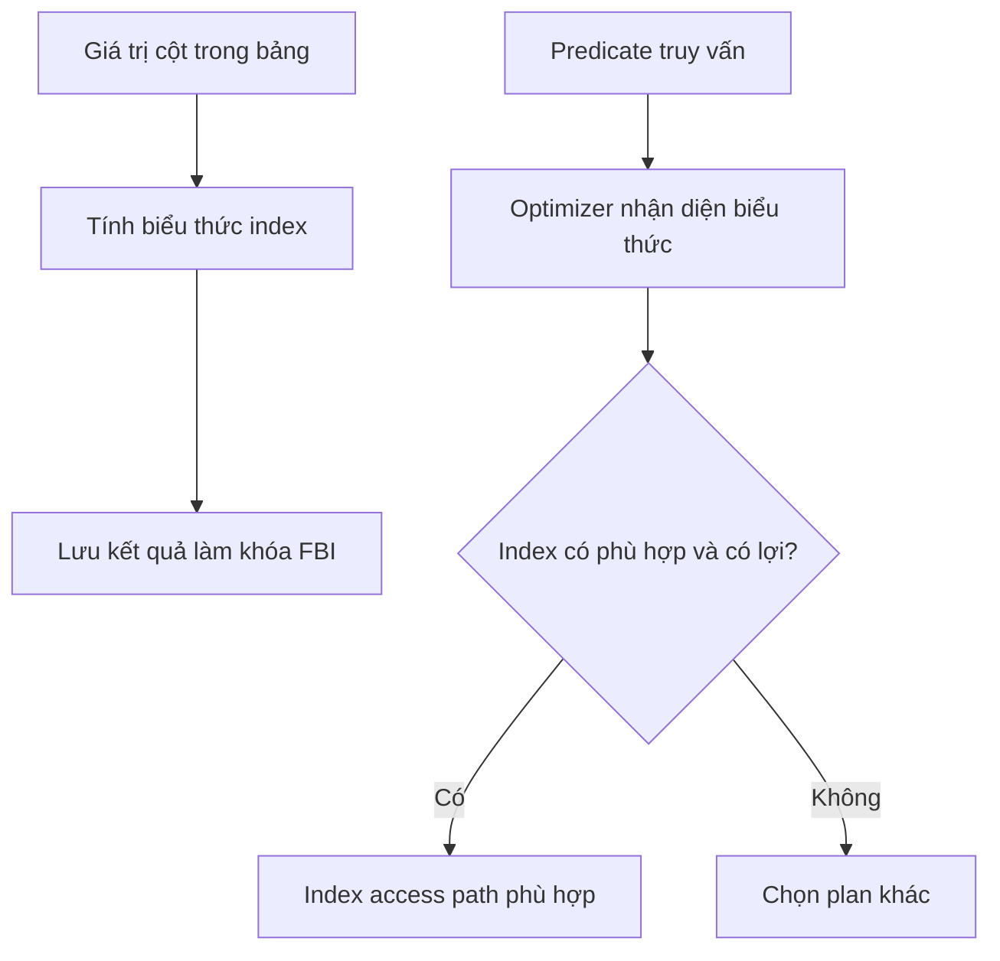

# Function-based index và yêu cầu biểu thức truy vấn tương ứng trong Oracle Database

Một index B-tree thông thường lưu khóa từ giá trị của một hoặc nhiều cột. Nhưng nhiều ứng dụng không lọc trực tiếp trên giá trị gốc. Ví dụ, màn hình tìm kiếm email không phân biệt chữ hoa/chữ thường, báo cáo nhóm đơn hàng theo ngày bằng TRUNC(date_column), hoặc truy vấn chuẩn hóa mã bằng UPPER/TRIM. Nếu chỉ có index trên cột gốc, Oracle có thể phải tính hàm cho từng hàng và không dùng được index đó theo cách mong muốn.

**Function-based index (FBI)** giải quyết tình huống này bằng cách lập index trên kết quả của một biểu thức. Ví dụ:

```sql
CREATE INDEX ix_customer_email_upper
ON customers (UPPER(email_address));
```

Để tận dụng index, predicate truy vấn cần sử dụng biểu thức tương ứng:

```sql
SELECT customer_id, email_address
FROM customers
WHERE UPPER(email_address) = UPPER(:email);
```

Oracle có thể nhận diện biểu thức trong truy vấn tương ứng với biểu thức đã lập index và dùng FBI nếu optimizer đánh giá có lợi. Một biểu thức chỉ trông gần giống hoặc cho kết quả tương tự về mặt nghiệp vụ chưa chắc được nhận diện như cùng một index expression. Cách an toàn là định nghĩa biểu thức một lần, dùng nhất quán trong DDL và SQL, rồi kiểm tra execution plan.

Bài học trình bày cách tạo và dùng function-based index, yêu cầu tương ứng của biểu thức truy vấn, xử lý NULL và NLS, hàm tự định nghĩa, index duy nhất, virtual column, thống kê optimizer, giới hạn và cách chẩn đoán khi Oracle không dùng index.

## 1. Vì sao cần function-based index?

### 1.1. Index thông thường và hàm trên cột

Giả sử có index:

```sql
CREATE INDEX ix_customers_email
ON customers(email_address);
```

Truy vấn sau tìm theo giá trị gốc:

```sql
SELECT customer_id
FROM customers
WHERE email_address = :email;
```

Đây là dạng predicate phù hợp với index trên EMAIL_ADDRESS. Nhưng nếu yêu cầu là tìm không phân biệt hoa/thường:

```sql
SELECT customer_id
FROM customers
WHERE UPPER(email_address) = UPPER(:email);
```

Oracle cần so sánh kết quả của UPPER(email_address). Index thường lưu giá trị gốc, không trực tiếp lưu UPPER(email_address), nên index thường không nhất thiết hỗ trợ predicate này. Optimizer có thể chọn full table scan hoặc một phương án khác.

### 1.2. FBI lưu kết quả biểu thức

Tạo index:

```sql
CREATE INDEX ix_customers_email_upper
ON customers(UPPER(email_address));
```

Truy vấn dùng biểu thức tương ứng:

```sql
SELECT customer_id
FROM customers
WHERE UPPER(email_address) = UPPER(:email);
```

Index lưu khóa được tính từ biểu thức UPPER(email_address) cho từng hàng đủ điều kiện được đưa vào index. Khi truy vấn sử dụng cùng biểu thức, Oracle có thể tìm kiếm theo khóa đã tính sẵn trong FBI thay vì phải áp dụng hàm cho mọi hàng của bảng. Việc dùng index vẫn do cost-based optimizer quyết định; FBI tồn tại không đồng nghĩa mọi truy vấn tương ứng luôn dùng nó.

### 1.3. Sơ đồ hoạt động



## 2. Tạo và sử dụng FBI cơ bản

### 2.1. Chuẩn bị dữ liệu thực hành

Tạo bảng lab:

```sql
CREATE TABLE customer_fbi_lab (
    customer_id   NUMBER(10)
        CONSTRAINT pk_customer_fbi_lab PRIMARY KEY,
    full_name     VARCHAR2(100 CHAR) NOT NULL,
    email_address VARCHAR2(200 CHAR),
    phone_number  VARCHAR2(30 CHAR),
    created_at    DATE DEFAULT SYSDATE NOT NULL,
    status_code   VARCHAR2(20 CHAR) DEFAULT 'NEW' NOT NULL
);

INSERT INTO customer_fbi_lab (
    customer_id, full_name, email_address, phone_number, created_at, status_code
)
VALUES (
    1, 'Nguyen An', 'An@example.test', '0901000001',
    DATE '2026-01-10', 'ACTIVE'
);

INSERT INTO customer_fbi_lab (
    customer_id, full_name, email_address, phone_number, created_at, status_code
)
VALUES (
    2, 'Tran Binh', 'binh@Example.test', '0902000002',
    DATE '2026-01-11', 'ACTIVE'
);

INSERT INTO customer_fbi_lab (
    customer_id, full_name, email_address, phone_number, created_at, status_code
)
VALUES (
    3, 'Le Chi', 'chi@example.test', NULL,
    DATE '2026-02-01', 'INACTIVE'
);

INSERT INTO customer_fbi_lab (
    customer_id, full_name, email_address, phone_number, created_at, status_code
)
VALUES (
    4, 'Pham Dung', NULL, '0904000004',
    DATE '2026-02-15', 'ACTIVE'
);

COMMIT;
```

### 2.2. Truy vấn trước khi có FBI

```sql
SELECT customer_id, email_address
FROM customer_fbi_lab
WHERE UPPER(email_address) = UPPER('AN@EXAMPLE.TEST');
```

Truy vấn tìm được hàng có email tương ứng dù dữ liệu lưu chữ hoa/chữ thường khác nhau. Nếu chỉ có index thường trên EMAIL_ADDRESS, optimizer không có khóa UPPER(email_address) được lưu sẵn.

### 2.3. Tạo FBI

```sql
CREATE INDEX ix_customer_fbi_email_upper
ON customer_fbi_lab (UPPER(email_address));
```

Truy vấn dùng biểu thức tương ứng:

```sql
SELECT customer_id, email_address
FROM customer_fbi_lab
WHERE UPPER(email_address) = UPPER(:email);
```

Bind variable ở vế phải được chuẩn hóa bằng UPPER. Có thể chuẩn hóa giá trị bind ở tầng ứng dụng và viết:

```sql
WHERE UPPER(email_address) = :normalized_email
```

Miễn là giá trị bind đã được chuẩn hóa đúng quy tắc. FBI được tạo trên cột ở phía trái; không cần áp dụng hàm lên bind nếu ứng dụng đã chuẩn hóa.

### 2.4. Index có được dùng hay không?

Xem plan:

```sql
EXPLAIN PLAN FOR
SELECT customer_id
FROM customer_fbi_lab
WHERE UPPER(email_address) = 'AN@EXAMPLE.TEST';

SELECT *
FROM TABLE(DBMS_XPLAN.DISPLAY);
```

Trong bảng lab rất nhỏ, optimizer có thể chọn full table scan vì đọc toàn bảng rẻ hơn index access. Điều đó không chứng minh FBI sai. Hãy gather statistics, tăng dữ liệu đại diện và xem plan thực tế trên workload có đủ chọn lọc.

## 3. Yêu cầu biểu thức truy vấn tương ứng

### 3.1. Quy tắc cốt lõi

Nếu index được tạo trên:

```sql
CREATE INDEX ix_customer_upper_name
ON customer_fbi_lab (UPPER(full_name));
```

Predicate nên dùng:

```sql
WHERE UPPER(full_name) = :name_upper
```

Không nên giả định optimizer sẽ tự suy luận mọi biểu thức nghiệp vụ tương đương. Ví dụ, index trên UPPER(full_name) không phải index trên TRIM(UPPER(full_name)):

```sql
WHERE TRIM(UPPER(full_name)) = :name_upper
```

Predicate mới có thêm TRIM. Nếu cần bỏ khoảng trắng đầu/cuối, hãy tạo index trên đúng biểu thức TRIM(UPPER(full_name)) hoặc thay đổi thiết kế chuẩn hóa dữ liệu.

### 3.2. Tương ứng về biểu thức, không chỉ cùng cột

| FBI definition | Predicate phù hợp | Nhận xét |
|---|---|---|
| `UPPER(email_address)` | `UPPER(email_address) = :v` | Biểu thức cùng dạng |
| `TRIM(phone_number)` | `TRIM(phone_number) = :v` | Có xử lý khoảng trắng |
| `TRUNC(created_at)` | `TRUNC(created_at) = :day` | Lọc theo ngày đã bỏ phần giờ |
| `amount * tax_rate` | `amount * tax_rate > :v` | Biểu thức số cần kiểu và scale tương thích |
| `NVL(status_code, 'NEW')` | `NVL(status_code, 'NEW') = :v` | Giá trị NULL được ánh xạ về NEW |

Oracle có thể chuẩn hóa một số cách viết và biểu thức tương đương trong quá trình parse/optimization, nhưng không nên dựa vào việc optimizer luôn nhận diện mọi dạng đại số. Để triển khai ổn định, dùng đúng biểu thức đã định nghĩa và kiểm tra plan.

### 3.3. Alias không thay đổi biểu thức index

Ví dụ:

```sql
SELECT UPPER(full_name) AS normalized_name
FROM customer_fbi_lab
WHERE UPPER(full_name) = :name_upper;
```

Alias chỉ là tên cột kết quả trong projection. Predicate vẫn phải chứa biểu thức tương ứng; không thể dùng alias SELECT ở WHERE cùng query block theo cách thông thường:

```sql
-- Không dùng alias SELECT trực tiếp ở WHERE cùng query block:
SELECT UPPER(full_name) AS normalized_name
FROM customer_fbi_lab
WHERE normalized_name = :name_upper;
```

Nếu muốn tái sử dụng biểu thức, có thể dùng inline view hoặc virtual column, nhưng vẫn cần xác nhận optimizer nhận diện index.

### 3.4. Khác biệt thứ tự hàm

Các biểu thức sau không nên được xem là tương đương:

```sql
UPPER(TRIM(full_name))
TRIM(UPPER(full_name))
```

Trong một số bộ ký tự và dữ liệu, kết quả có thể trùng; nhưng không nên giả định chúng luôn tương đương về ngữ nghĩa hoặc optimizer expression matching. Định nghĩa chính xác quy tắc chuẩn hóa, rồi dùng cùng thứ tự hàm trong index và predicate.

### 3.5. Toán tử so sánh cũng cần phù hợp

FBI trên UPPER(email_address) hỗ trợ các predicate equality/range phù hợp với khóa đã lập index:

```sql
WHERE UPPER(email_address) = :email
```

Nhưng một truy vấn:

```sql
WHERE SUBSTR(UPPER(email_address), 1, 5) = :prefix
```

đang lọc theo biểu thức khác. Index trên UPPER(email_address) không phải lúc nào cũng giúp hiệu quả như index trên SUBSTR(UPPER(email_address), 1, 5). Hãy xác định pattern truy vấn chính xác trước khi tạo FBI.

## 4. Các mẫu function-based index phổ biến

### 4.1. Không phân biệt chữ hoa/chữ thường

```sql
CREATE INDEX ix_customer_name_ci
ON customer_fbi_lab (UPPER(full_name));

SELECT customer_id, full_name
FROM customer_fbi_lab
WHERE UPPER(full_name) = UPPER(:name);
```

Đây là pattern phổ biến cho tìm kiếm case-insensitive. Với ngôn ngữ có quy tắc so sánh phức tạp, UPPER đơn giản có thể chưa đủ; cần cân nhắc linguistic collation/NLS.

### 4.2. Chuẩn hóa khoảng trắng

```sql
CREATE INDEX ix_customer_phone_trim
ON customer_fbi_lab (TRIM(phone_number));

SELECT customer_id
FROM customer_fbi_lab
WHERE TRIM(phone_number) = :phone;
```

TRIM mặc định loại bỏ khoảng trắng ở hai đầu theo semantics của Oracle. Nếu cần loại nhiều loại ký tự trắng hoặc chuẩn hóa định dạng số điện thoại, hãy định nghĩa quy tắc rõ. Không để mỗi client chuẩn hóa theo cách khác nhau.

### 4.3. Lọc theo ngày, bỏ phần giờ

Nếu ứng dụng thường truy vấn:

```sql
SELECT customer_id
FROM customer_fbi_lab
WHERE TRUNC(created_at) = DATE '2026-02-15';
```

có thể tạo:

```sql
CREATE INDEX ix_customer_created_day
ON customer_fbi_lab (TRUNC(created_at));
```

Predicate phải dùng TRUNC(created_at) tương ứng. Tuy nhiên, nếu có index thường trên CREATED_AT, truy vấn range thường là lựa chọn linh hoạt hơn:

```sql
WHERE created_at >= DATE '2026-02-15'
  AND created_at <  DATE '2026-02-16'
```

Range predicate không áp dụng hàm lên cột và có thể dùng index B-tree thông thường. So sánh hai cách theo workload, đặc biệt khi truy vấn cần nhiều ngày hoặc khoảng thời gian dài.

### 4.4. Truy vấn theo tháng

FBI:

```sql
CREATE INDEX ix_orders_month
ON orders (TRUNC(order_date, 'MM'));
```

Predicate tương ứng:

```sql
WHERE TRUNC(order_date, 'MM') = DATE '2026-11-01'
```

Hoặc dùng range trên cột gốc:

```sql
WHERE order_date >= DATE '2026-11-01'
  AND order_date <  DATE '2026-12-01'
```

Range thường tận dụng index thường trên ORDER_DATE và tránh phải lưu thêm expression index. FBI phù hợp khi biểu thức tháng được dùng lặp lại, chọn lọc và mang lại lợi ích đo được.

### 4.5. Chuẩn hóa mã bằng REPLACE hoặc SUBSTR

Ví dụ lưu mã sản phẩm có dấu gạch nhưng tìm kiếm theo dạng bỏ dấu:

```sql
CREATE INDEX ix_product_code_compact
ON products (REPLACE(product_code, '-', ''));

SELECT product_id
FROM products
WHERE REPLACE(product_code, '-', '') = :compact_code;
```

Nếu yêu cầu là tìm prefix:

```sql
CREATE INDEX ix_product_code_prefix
ON products (SUBSTR(product_code, 1, 3));

SELECT product_id
FROM products
WHERE SUBSTR(product_code, 1, 3) = :prefix;
```

Index expression phải phản ánh chính xác quy tắc nghiệp vụ. Nếu sau này mã sản phẩm có dấu cách, dấu chấm hoặc ký tự Unicode cần chuẩn hóa, biểu thức hiện tại không tự xử lý các trường hợp đó.

### 4.6. Biểu thức số học

FBI có thể lập trên biểu thức số:

```sql
CREATE INDEX ix_order_net_amount
ON order_lines (quantity * unit_price);

SELECT line_id
FROM order_lines
WHERE quantity * unit_price > :minimum_amount;
```

Kiểu dữ liệu, precision và scale của hai toán hạng ảnh hưởng kết quả. Tránh implicit conversion giữa VARCHAR2 và NUMBER. Nếu biểu thức có thể tràn hoặc gây lỗi chuyển kiểu ở một số hàng, việc tạo index hoặc DML duy trì index có thể thất bại.

## 5. NULL và function-based index

### 5.1. B-tree index không lưu key toàn NULL

Oracle B-tree index thông thường không tạo entry cho hàng mà tất cả các cột key đều NULL. Với FBI một biểu thức:

```sql
CREATE INDEX ix_email_upper
ON customer_fbi_lab (UPPER(email_address));
```

Nếu EMAIL_ADDRESS là NULL, UPPER(email_address) cũng là NULL; hàng đó không có key entry trong B-tree index một cột này.

Điều này có nghĩa predicate:

```sql
WHERE UPPER(email_address) IS NULL
```

không thể được đáp ứng bằng một range scan thông thường trên FBI một cột theo cách kỳ vọng vì các hàng NULL không có entry trong index. Optimizer có thể chọn table scan.

### 5.2. Ánh xạ NULL bằng NVL

Một cách tạo key cho cả NULL:

```sql
CREATE INDEX ix_email_upper_nvl
ON customer_fbi_lab (NVL(UPPER(email_address), '#NO_EMAIL#'));
```

Predicate phải dùng cùng biểu thức:

```sql
WHERE NVL(UPPER(email_address), '#NO_EMAIL#') = :email_key
```

Nhưng sentinel phải được bảo đảm không thể là giá trị email hợp lệ. Nếu sentinel có thể xuất hiện trong dữ liệu thật, hai nhóm dữ liệu sẽ bị nhập làm một. Cần constraint/validation bảo đảm sentinel ngoài domain, và xử lý giá trị NULL theo nghiệp vụ.

### 5.3. Index thêm cột NOT NULL

Một B-tree composite index có ít nhất một key column khác NULL có thể có entry cho hàng mà expression key đầu tiên NULL:

```sql
CREATE INDEX ix_email_upper_with_id
ON customer_fbi_lab (UPPER(email_address), customer_id);
```

Vì CUSTOMER_ID là primary key NOT NULL, hàng có email NULL vẫn có thể có index entry nhờ thành phần thứ hai. Tuy nhiên, predicate chỉ trên UPPER(email_address) IS NULL có thể không đủ chọn lọc và hiệu quả access path phụ thuộc optimizer. Không thêm cột vào index nếu không có workload cần thiết; index lớn hơn và tốn chi phí DML.

### 5.4. NULL semantics trong NVL và COALESCE

Hai biểu thức có thể khác về kiểu dữ liệu và conversion:

```sql
NVL(status_code, 'NEW')
COALESCE(status_code, 'NEW')
```

Không giả định mọi biểu thức thay thế NULL đều được optimizer coi là cùng một expression. Dùng đúng hàm và kiểu dữ liệu đã khai báo trong FBI. Đặc biệt, NVL có quy tắc chuyển kiểu dựa trên đối số; COALESCE theo quy tắc datatype của biểu thức CASE. Hãy kiểm tra kết quả và execution plan.

## 6. FBI duy nhất và ràng buộc không phân biệt hoa/thường

### 6.1. Unique function-based index

Nếu email phải duy nhất không phân biệt chữ hoa/chữ thường:

```sql
CREATE UNIQUE INDEX uq_customer_email_ci
ON customer_fbi_lab (LOWER(email_address));
```

Index duy nhất áp đặt tính duy nhất trên kết quả LOWER(email_address), do đó An@example.test và an@example.test xung đột theo biểu thức này.

### 6.2. Kiểm tra dữ liệu trùng trước khi tạo

Nếu dữ liệu cũ đã có giá trị trùng sau chuẩn hóa, CREATE UNIQUE INDEX sẽ thất bại. Tìm trước:

```sql
SELECT LOWER(email_address) AS normalized_email,
       COUNT(*) AS duplicate_count
FROM customer_fbi_lab
WHERE email_address IS NOT NULL
GROUP BY LOWER(email_address)
HAVING COUNT(*) > 1;
```

Hãy xử lý duplicate theo quy tắc nghiệp vụ trước khi tạo unique index. Không xóa dữ liệu tự động chỉ để DDL thành công.

### 6.3. NULL trong unique FBI

Oracle unique B-tree index cho phép nhiều hàng có key NULL theo semantics của unique index; FBI có kết quả NULL cũng cần được hiểu theo quy tắc đó. Nếu email là bắt buộc, khai báo NOT NULL trên cột gốc. Nếu email nullable nhưng chỉ một hàng được phép không có email, cần một constraint/thiết kế bổ sung phản ánh đúng yêu cầu.

### 6.4. Conditional unique index

FBI có thể hỗ trợ uniqueness có điều kiện bằng CASE:

```sql
CREATE TABLE user_alias_lab (
    alias_id NUMBER(10) PRIMARY KEY,
    tenant_id NUMBER(10) NOT NULL,
    alias_name VARCHAR2(100 CHAR) NOT NULL,
    active_flag CHAR(1) NOT NULL
);

CREATE UNIQUE INDEX uq_active_alias_per_tenant
ON user_alias_lab (
    CASE
        WHEN active_flag = 'Y' THEN tenant_id
    END,
    CASE
        WHEN active_flag = 'Y' THEN UPPER(alias_name)
    END
);
```

Các hàng active có key (tenant_id, UPPER(alias_name)) và phải duy nhất. Với hàng inactive, cả hai expression trả NULL nên composite B-tree không lưu entry nếu tất cả key đều NULL; nhiều hàng inactive được phép trùng alias. Đây là pattern conditional uniqueness, nhưng cần kiểm thử kỹ semantics NULL và đảm bảo trạng thái active chỉ dùng giá trị hợp lệ qua CHECK constraint.

### 6.5. Thêm CHECK cho domain trạng thái

```sql
ALTER TABLE user_alias_lab
ADD CONSTRAINT ck_user_alias_active
CHECK (active_flag IN ('Y', 'N'));
```

Constraint giúp dữ liệu không xuất hiện trạng thái ngoài Y/N. FBI và unique index chỉ bảo đảm tính duy nhất theo biểu thức; chúng không thay thế kiểm tra domain của cột.

## 7. NLS, collation và biểu thức chuỗi

### 7.1. UPPER không phải mọi quy tắc linguistic

UPPER hữu ích cho so sánh không phân biệt hoa/thường theo quy tắc chuyển chữ của Oracle và character set. Nhưng một số ngôn ngữ có quy tắc accent, sort hoặc collation phức tạp hơn.

Nếu cần linguistic comparison, có thể cân nhắc NLSSORT:

```sql
CREATE INDEX ix_customer_name_linguistic
ON customer_fbi_lab (
    NLSSORT(full_name, 'NLS_SORT = BINARY_CI')
);
```

Predicate cần dùng biểu thức tương ứng:

```sql
WHERE NLSSORT(full_name, 'NLS_SORT = BINARY_CI')
    = NLSSORT(:name, 'NLS_SORT = BINARY_CI')
```

Đây là ví dụ case-insensitive linguistic sort. Cần chọn NLS_SORT phù hợp với ngôn ngữ và quy tắc accent của ứng dụng; BINARY_CI không tự động có nghĩa là mọi ngôn ngữ được so sánh theo đúng yêu cầu nghiệp vụ.

### 7.2. NLS parameters và tính ổn định

Một expression index phụ thuộc NLS/session settings cần được thiết kế cẩn thận. Nếu biểu thức chuyển DATE/NUMBER sang text bằng format ngầm định, kết quả có thể khác theo session:

```sql
TO_CHAR(order_date)
TO_CHAR(amount)
```

Không nên tạo FBI dựa trên conversion không chỉ rõ format/NLS rồi mong kết quả ổn định. Nếu thực sự cần index chuỗi biểu diễn ngày/số, chỉ rõ format model và NLS parameter:

```sql
TO_CHAR(order_date, 'YYYYMMDD')
TO_CHAR(amount, 'FM9999999990D00', 'NLS_NUMERIC_CHARACTERS = ''.,''')
```

Nhưng với lọc ngày hoặc số, thường nên giữ kiểu dữ liệu gốc và dùng predicate DATE/NUMBER thay vì chuyển sang text.

### 7.3. Thay đổi NLS có thể làm expression khác ý nghĩa

Session có thể có NLS_SORT, NLS_COMP, NLS_DATE_FORMAT hoặc NLS_NUMERIC_CHARACTERS khác nhau. Nếu query và FBI dựa vào session state, cùng một chuỗi SQL có thể có ý nghĩa khác nhau giữa session. Ưu tiên biểu thức deterministic với tham số định dạng tường minh và bind đúng kiểu.

## 8. Hàm tự định nghĩa trong FBI

### 8.1. Hàm phải deterministic

Oracle yêu cầu function được dùng trong function-based index phải phù hợp với yêu cầu deterministic. Hàm deterministic cam kết cùng input luôn tạo cùng output.

Ví dụ hàm chuẩn hóa mã:

```sql
CREATE OR REPLACE FUNCTION normalize_product_code (
    p_code IN VARCHAR2
)
RETURN VARCHAR2
DETERMINISTIC
IS
BEGIN
    RETURN UPPER(REPLACE(TRIM(p_code), '-', ''));
END;
/
```

Tạo FBI:

```sql
CREATE INDEX ix_product_code_normalized
ON products (normalize_product_code(product_code));
```

Truy vấn:

```sql
SELECT product_id
FROM products
WHERE normalize_product_code(product_code) =
      normalize_product_code(:input_code);
```

Oracle không kiểm chứng logic hàm có thực sự deterministic hay không. Từ khóa DETERMINISTIC là cam kết của người viết. Không dùng SYSDATE, SYSTIMESTAMP, DBMS_RANDOM, sequence, package state, session context, dữ liệu bảng khác hoặc thông tin bên ngoài trong một hàm được khai báo deterministic cho FBI.

### 8.2. Thay đổi implementation của hàm

FBI lưu kết quả đã tính tại thời điểm index được tạo/duy trì. Nếu thay đổi logic của hàm, các key cũ có thể không còn tương ứng với implementation mới. Sau khi thay đổi function:

- Kiểm tra trạng thái index.
- Rebuild hoặc tạo lại FBI theo quy trình.
- Gather statistics nếu cần.
- Kiểm tra kết quả query và plan.

Không triển khai thay đổi hàm chuẩn hóa mà bỏ qua index phụ thuộc vào nó.

### 8.3. Quyền EXECUTE và dependency

Khi hàm nằm trong schema khác, chủ sở hữu index cần quyền EXECUTE phù hợp được cấp trực tiếp theo yêu cầu Oracle; không dựa vào quyền chỉ có qua role cho dependency trong stored object. Kiểm tra dependency và quyền trước khi triển khai.

### 8.4. Hàm không được dùng như nơi giấu logic phụ thuộc dữ liệu

Một hàm đọc bảng cấu hình khác có thể trả kết quả khác dù cột của bảng index không thay đổi. Nếu index không được cập nhật theo thay đổi bảng cấu hình, key lưu trong FBI có thể không còn đúng. Hãy đưa logic cần index vào dữ liệu cùng bảng, virtual column hoặc expression deterministic thực sự; không khai báo DETERMINISTIC chỉ để vượt qua giới hạn.

## 9. Virtual column như một cách đặt tên expression

### 9.1. Virtual column

Oracle cho phép khai báo cột ảo được tính từ biểu thức:

```sql
ALTER TABLE customer_fbi_lab
ADD normalized_email
    GENERATED ALWAYS AS (UPPER(email_address)) VIRTUAL;
```

Sau đó tạo index:

```sql
CREATE INDEX ix_customer_normalized_email
ON customer_fbi_lab(normalized_email);
```

Truy vấn có thể dùng virtual column:

```sql
SELECT customer_id
FROM customer_fbi_lab
WHERE normalized_email = :email_upper;
```

Virtual column giúp đặt tên biểu thức và tái sử dụng trong nhiều truy vấn. Nó không lưu giá trị như một cột vật lý thông thường, nhưng index trên virtual column lưu key expression.

### 9.2. Virtual column và FBI trực tiếp

| Tiêu chí | FBI trực tiếp | Virtual column + index |
|---|---|---|
| Khai báo expression | Trong CREATE INDEX | Trong ALTER/CREATE TABLE |
| Tên logic có thể dùng trong SQL | Không có cột riêng | Có tên virtual column |
| Tái sử dụng biểu thức | Query phải viết expression phù hợp | Query có thể dùng tên virtual column |
| Metadata và tài liệu schema | Expression nằm trong index metadata | Expression nằm ở table metadata |
| Phù hợp | Một expression phục vụ một vài truy vấn | Expression là thuộc tính logic được dùng rộng |

Virtual column thường giúp chuẩn hóa biểu thức trong codebase lớn. FBI trực tiếp ngắn gọn khi expression chỉ phục vụ một access pattern cụ thể.

### 9.3. Virtual column có thể có constraint

Có thể dùng virtual column cùng constraint hoặc index để biểu diễn quy tắc:

```sql
ALTER TABLE customer_fbi_lab
ADD email_key
    GENERATED ALWAYS AS (LOWER(email_address)) VIRTUAL;

CREATE UNIQUE INDEX uq_customer_email_key
ON customer_fbi_lab(email_key);
```

Đây là cách đặt tên chuẩn hóa email. Nếu email NULL, email_key cũng NULL và semantics unique index vẫn phải được xem xét. NOT NULL trên email gốc nếu nghiệp vụ bắt buộc.

## 10. FBI nhiều cột và thứ tự key

### 10.1. Composite function-based index

FBI có thể kết hợp expression và cột thường:

```sql
CREATE INDEX ix_order_status_upper_date
ON orders (
    UPPER(status),
    order_date
);
```

Truy vấn:

```sql
SELECT order_id
FROM orders
WHERE UPPER(status) = :status_upper
  AND order_date >= :from_date;
```

Thứ tự key ảnh hưởng access path. Index (UPPER(status), order_date) phù hợp khi predicate bắt đầu bằng status equality rồi range theo date. Nếu workload thường lọc theo date trước và status ít chọn lọc, thứ tự khác có thể phù hợp hơn.

### 10.2. Leading column và skip scan

Với composite index, predicate trên leading column thường quan trọng. Nếu chỉ lọc cột thứ hai, Oracle có thể không dùng index hiệu quả; một số trường hợp có thể cân nhắc index skip scan nhưng không nên dựa vào nó như thay thế thiết kế key đúng.

### 10.3. Expression ở một phần key

```sql
CREATE INDEX ix_customer_status_name
ON customer_fbi_lab (
    status_code,
    UPPER(full_name)
);
```

Predicate có thể dùng:

```sql
WHERE status_code = :status
  AND UPPER(full_name) = :name_upper
```

Index có thể hỗ trợ cả điều kiện status và expression name. Chỉ có predicate trên UPPER(full_name) mà không có status vẫn có thể có lựa chọn access path tùy phân bố và index skip scan; hãy kiểm tra plan.

## 11. FBI và các phép so sánh LIKE

### 11.1. Prefix search

Với truy vấn:

```sql
WHERE UPPER(full_name) LIKE 'NGUYEN%'
```

FBI trên UPPER(full_name) có thể hỗ trợ prefix range scan trong điều kiện phù hợp. Pattern phải có prefix xác định; wildcard ở đầu như %NGUYEN thường không tạo range scan B-tree hiệu quả.

### 11.2. Bind pattern

Ứng dụng có thể gửi pattern:

```sql
WHERE UPPER(full_name) LIKE :pattern
```

với bind đã chuẩn hóa thành NGUYEN%. Tính chọn lọc và bind peeking có thể ảnh hưởng plan. Nếu pattern bắt đầu bằng wildcard, index B-tree thường không giúp nhiều.

### 11.3. Escape wildcard

Nếu người dùng tìm literal % hoặc _, phải escape theo semantics LIKE:

```sql
WHERE UPPER(full_name) LIKE :pattern ESCAPE '\'
```

Bind variable bảo vệ cú pháp SQL nhưng không làm % và _ mất ý nghĩa wildcard. Đây là vấn đề semantics tìm kiếm, không phải lỗi function-based index.

## 12. Vì sao optimizer không dùng FBI?

Có index nhưng plan vẫn full scan là tình huống bình thường trong một số workload. Kiểm tra:

1. Predicate có dùng đúng expression không?
2. Datatype của bind và cột có tương thích không?
3. Có implicit conversion làm thay đổi expression không?
4. FBI có VALID và USABLE không?
5. Statistics của bảng/index có mới không?
6. Predicate có đủ chọn lọc để index rẻ hơn full scan không?
7. Truy vấn cần quá nhiều cột khiến table access by rowid đắt hơn full scan không?
8. Có hàm hoặc NLS setting phụ thuộc session không?
9. Query có hint/parameter ảnh hưởng access path không?
10. FBI có chứa NULL key bị bỏ khỏi B-tree không?

### 12.1. Kiểm tra trạng thái index

```sql
SELECT index_name,
       index_type,
       status,
       visibility,
       uniqueness
FROM user_indexes
WHERE table_name = 'CUSTOMER_FBI_LAB'
ORDER BY index_name;
```

### 12.2. Xem expression đã index

```sql
SELECT index_name,
       column_position,
       column_expression
FROM user_ind_expressions
WHERE table_name = 'CUSTOMER_FBI_LAB'
ORDER BY index_name, column_position;
```

View USER_IND_EXPRESSIONS cho biết expression thực tế mà index lưu. Đây là nguồn đối chiếu quan trọng khi nghi ngờ DDL và predicate không khớp.

### 12.3. Xem cột/index metadata

```sql
SELECT index_name,
       column_name,
       column_position,
       descend
FROM user_ind_columns
WHERE table_name = 'CUSTOMER_FBI_LAB'
ORDER BY index_name, column_position;
```

Với expression key, dictionary có thể biểu diễn cột hệ thống/định danh expression; dùng USER_IND_EXPRESSIONS để xem expression chi tiết.

### 12.4. Xem DDL index

```sql
SELECT DBMS_METADATA.GET_DDL(
           'INDEX',
           'IX_CUSTOMER_FBI_EMAIL_UPPER'
       )
FROM dual;
```

GET_DDL giúp kiểm tra chính xác expression, tablespace, uniqueness và storage attributes. Cần quyền metadata phù hợp.

## 13. Statistics cho function-based index

### 13.1. Gather statistics

Sau khi tạo FBI, gather statistics cho bảng và index:

```sql
BEGIN
    DBMS_STATS.GATHER_TABLE_STATS(
        ownname          => USER,
        tabname          => 'CUSTOMER_FBI_LAB',
        estimate_percent => DBMS_STATS.AUTO_SAMPLE_SIZE,
        method_opt       => 'FOR ALL COLUMNS SIZE AUTO',
        cascade          => TRUE
    );
END;
/
```

Statistics giúp optimizer ước lượng selectivity của expression index. Nếu expression tạo ra rất ít giá trị phân biệt hoặc phân bố lệch mạnh, histogram/column stats có thể quan trọng.

### 13.2. Kiểm tra statistics của index

```sql
SELECT index_name,
       num_rows,
       distinct_keys,
       leaf_blocks,
       clustering_factor,
       last_analyzed
FROM user_indexes
WHERE table_name = 'CUSTOMER_FBI_LAB';
```

DISTINCT_KEYS, LEAF_BLOCKS và CLUSTERING_FACTOR giúp hiểu cấu trúc và chi phí ước lượng. Clustering factor cao có thể khiến table access by rowid tốn nhiều block reads.

### 13.3. Statistics của expression

Oracle quản lý expression statistics cho function-based index và có thể hiển thị thông tin trong dictionary views liên quan. Khi cần đánh giá, xem USER_TAB_COL_STATISTICS/USER_IND_STATISTICS cùng USER_IND_EXPRESSIONS; tên cột ẩn nội bộ không nên được hard-code trong ứng dụng.

### 13.4. Gather sau khi dữ liệu thay đổi lớn

INSERT/UPDATE/DELETE có thể làm phân bố expression thay đổi. Automatic statistics gathering có thể xử lý theo task window và stale threshold, nhưng hệ thống tải dữ liệu lớn hoặc có skew mạnh có thể cần lịch DBMS_STATS rõ ràng. Không gather sau từng DML nhỏ; đo và theo dõi stale stats.

## 14. Chi phí duy trì và vận hành FBI

### 14.1. DML phải tính lại expression

Khi cột tham gia expression thay đổi, Oracle cần tính lại khóa index:

- INSERT: tính expression và thêm entry.
- UPDATE cột liên quan: xóa/thêm hoặc cập nhật entry phù hợp.
- DELETE: xóa entry.

Vì vậy FBI làm tăng chi phí ghi, redo/undo, storage và bảo trì index. Chỉ tạo FBI cho access pattern có giá trị thực tế.

### 14.2. Storage và kích thước key

Expression có thể dài hơn giá trị gốc hoặc tạo key có kích thước lớn. Hãy kiểm tra giới hạn key length, character set và kích thước block. Nếu biểu thức trả chuỗi dài, cân nhắc SUBSTR có chủ đích hoặc thiết kế virtual column với giới hạn phù hợp; không cắt chuỗi nếu có thể gây collision.

### 14.3. Rebuild và invalidation

Nếu index UNUSABLE hoặc function dependency thay đổi, có thể cần rebuild:

```sql
ALTER INDEX ix_product_code_normalized REBUILD;
```

Rebuild cần tài nguyên và có tác động I/O/locking tùy phương án online/edition/release. Lập kế hoạch trong cửa sổ phù hợp. Không rebuild định kỳ chỉ vì index là FBI; trước hết kiểm tra trạng thái, thống kê và vấn đề thực tế.

### 14.4. Invisible index để thử nghiệm

Trong release hỗ trợ invisible index, có thể tạo index invisible hoặc thay visibility để thử tác động mà không cho optimizer toàn hệ thống tự động chọn nó:

```sql
ALTER INDEX ix_customer_fbi_email_upper INVISIBLE;
ALTER SESSION SET optimizer_use_invisible_indexes = TRUE;
```

Session thử nghiệm có thể xem xét invisible index khi tham số được bật. Khôi phục visibility/session parameter sau thử nghiệm. Cần kiểm tra chính sách và release trước khi dùng trong production.

## 15. FBI so với cách viết lại predicate

Không phải cứ thấy hàm trên cột là phải tạo FBI. Đôi khi có thể viết lại điều kiện để dùng index thường.

| Truy vấn ban đầu | Cách khác có thể phù hợp | Khi nào cân nhắc FBI |
|---|---|---|
| `TRUNC(order_date) = :day` | Range trên ORDER_DATE từ đầu ngày đến trước ngày kế tiếp | Nhiều truy vấn thực sự cần biểu thức TRUNC |
| `UPPER(email) = :email` | Chuẩn hóa dữ liệu/giá trị và lưu cột canonical | Cần so sánh case-insensitive trên dữ liệu legacy |
| `amount * tax_rate > :x` | Tính ngưỡng tương đương nếu có thể biến đổi an toàn | Expression lặp lại và có tính chọn lọc |
| `NVL(status, 'NEW') = :s` | Tách nhánh NULL/non-NULL nếu hợp lý | Quy tắc NULL mặc định là access pattern phổ biến |
| `SUBSTR(code,1,3) = :p` | Prefix range nếu quy tắc collation/encoding phù hợp | Prefix expression là yêu cầu chính |

Viết lại predicate cần bảo toàn semantics, đặc biệt với NULL, kiểu số, ngày và timezone. Không biến đổi đại số theo trực giác nếu có thể thay đổi overflow, rounding hoặc conversion.

## 16. Implicit conversion và datatype matching

### 16.1. Chuyển kiểu ngầm có thể làm mất index access

Giả sử cột là VARCHAR2:

```sql
CREATE INDEX ix_customer_code
ON customers(customer_code);
```

Nếu ứng dụng bind NUMBER:

```sql
WHERE customer_code = :numeric_code
```

Oracle có thể chuyển đổi một phía theo quy tắc datatype precedence. Nếu biểu thức thực tế trở thành TO_NUMBER(customer_code), index thường trên CUSTOMER_CODE không còn khớp predicate trực tiếp và dữ liệu không phải số có thể gây ORA-01722.

Bind đúng kiểu VARCHAR2 khi cột là mã chuỗi:

```sql
WHERE customer_code = :code_text
```

### 16.2. FBI trên conversion không phải giải pháp mặc định

Có thể nghĩ tới:

```sql
CREATE INDEX ix_customer_code_number
ON customers (TO_NUMBER(customer_code));
```

Nhưng nếu bất kỳ hàng nào chứa chuỗi không chuyển được thành NUMBER, việc tạo/duy trì index có thể thất bại với lỗi conversion. Chỉ dùng khi dữ liệu đã được kiểm soát và domain thực sự là số. Tốt hơn là sửa datatype cột nếu dữ liệu mang bản chất số.

### 16.3. Date conversion

Không tạo query dựa vào implicit DATE-to-character hoặc character-to-DATE:

```sql
WHERE TO_CHAR(created_at) = :date_text
```

Nếu cần expression index, chỉ rõ format:

```sql
CREATE INDEX ix_event_date_text
ON events (TO_CHAR(created_at, 'YYYYMMDD'));
```

Predicate phải dùng cùng format:

```sql
WHERE TO_CHAR(created_at, 'YYYYMMDD') = :date_key
```

Tuy vậy, range predicate trên CREATED_AT thường là lựa chọn tốt hơn và tránh phụ thuộc text representation.

## 17. Giới hạn và lưu ý thiết kế

### 17.1. Hàm phải phù hợp cho index expression

Expression không được phụ thuộc dữ liệu biến đổi ngoài phạm vi hàng theo cách làm key không ổn định. User-defined function cần cam kết deterministic. Một số datatype/biểu thức phức tạp không phù hợp với index key; kiểm tra tài liệu Oracle của release khi làm việc với LOB, object type, nested structure hoặc expression dài.

### 17.2. Không dùng hàm phụ thuộc thời gian

Ví dụ không phù hợp:

```sql
CREATE INDEX ix_event_recent
ON events (
    CASE
        WHEN created_at >= SYSDATE - 7 THEN 1
        ELSE 0
    END
);
```

Kết quả biểu thức thay đổi theo thời gian dù hàng không đổi. Index không thể tự tính lại key chỉ vì ngày hiện tại trôi qua. Nếu cần lọc theo khoảng thời gian gần đây, dùng predicate range trên CREATED_AT hoặc một quy trình partition/maintenance thích hợp.

### 17.3. Biểu thức không được thay đổi ngữ nghĩa theo session

Không dựa vào NLS session, timezone session hoặc package state mà không đưa quy tắc vào expression một cách ổn định. Một FBI phải có key nhất quán với predicate của mọi session.

### 17.4. Không thay constraint bằng FBI thường

Một FBI không unique chỉ tăng tốc truy vấn; nó không bảo đảm uniqueness. Nếu cần ràng buộc dữ liệu, dùng UNIQUE function-based index hoặc constraint phù hợp. Với logic phức tạp, cần kiểm tra tính duy nhất theo biểu thức và NULL semantics.

### 17.5. Function-based index và partitioning

FBI có thể được dùng trong bảng partitioned theo các quy tắc local/global index và partition key. Thiết kế local/global index, partition pruning, maintenance và expression key cần được xem xét cùng nhau. Không giả định một FBI global phù hợp cho mọi quy trình partition exchange/load.

## 18. Quy trình thiết kế FBI

Một quy trình thực tế:

1. **Thu thập SQL thực tế:** xác định predicate, join, sort và tần suất truy vấn.
2. **Xác định biểu thức chính xác:** ghi lại hàm, thứ tự hàm, kiểu dữ liệu, NLS và NULL behavior.
3. **Xem index hiện có:** tránh tạo index trùng chức năng hoặc không cần thiết.
4. **Đánh giá cách viết lại:** xem có thể dùng range predicate, chuẩn hóa dữ liệu hoặc cột canonical không.
5. **Tạo FBI trong môi trường thử:** dùng đúng expression của truy vấn.
6. **Gather statistics:** cho bảng và index.
7. **Kiểm tra plan:** xem access predicate, index name, estimated/actual rows.
8. **Đo workload:** so sánh CPU, logical reads, elapsed time và chi phí DML.
9. **Kiểm tra dữ liệu biên:** NULL, chuỗi rỗng, Unicode, NLS, giá trị lỗi conversion.
10. **Triển khai và theo dõi:** ghi nhận DDL, dependency, rebuild procedure và ảnh hưởng DML.

## 19. Bài thực hành tổng hợp

Thực hiện trong schema lab với bảng CUSTOMER_FBI_LAB ở mục 2. Không chạy DDL thử nghiệm trên schema production.

### Bước 1 — So sánh index thường và FBI

Tạo index thường trên EMAIL_ADDRESS:

```sql
CREATE INDEX ix_customer_email_plain
ON customer_fbi_lab(email_address);
```

Chạy:

```sql
SELECT customer_id
FROM customer_fbi_lab
WHERE email_address = 'An@example.test';

SELECT customer_id
FROM customer_fbi_lab
WHERE UPPER(email_address) = 'AN@EXAMPLE.TEST';
```

So sánh plan trước/sau khi tạo FBI ở mục 2.3.

### Bước 2 — Kiểm tra biểu thức không khớp

Tạo FBI trên UPPER(FULL_NAME), sau đó thử predicate UPPER(FULL_NAME) và TRIM(UPPER(FULL_NAME)). Ghi lại plan và giải thích vì sao không nên giả định hai expression dùng chung index.

### Bước 3 — Thử TRUNC(date)

Tạo index trên TRUNC(CREATED_AT). So sánh:

```sql
WHERE TRUNC(created_at) = DATE '2026-02-15'
```

với:

```sql
WHERE created_at >= DATE '2026-02-15'
  AND created_at < DATE '2026-02-16'
```

Thử với index thường trên CREATED_AT và FBI. Đo plan trên dữ liệu đủ lớn.

### Bước 4 — Kiểm tra NULL

Chạy:

```sql
SELECT customer_id
FROM customer_fbi_lab
WHERE UPPER(email_address) IS NULL;
```

Quan sát index một cột không lưu entry có key NULL. Thử thiết kế expression NVL với sentinel và chứng minh sentinel không va chạm dữ liệu hợp lệ.

### Bước 5 — Unique FBI

Tạo dữ liệu có hai email khác chữ hoa/thường nhưng cùng dạng chuẩn hóa. Thử tạo unique FBI và ghi nhận lỗi. Xử lý duplicate trong lab rồi tạo lại.

### Bước 6 — Virtual column

Thêm virtual column NORMALIZED_EMAIL = UPPER(EMAIL_ADDRESS), tạo index trên virtual column và viết truy vấn dùng tên cột đó. So sánh DDL/metadata với FBI trực tiếp.

### Bước 7 — Xem metadata

```sql
SELECT index_name, column_expression
FROM user_ind_expressions
WHERE table_name = 'CUSTOMER_FBI_LAB';

SELECT index_name, status, num_rows, distinct_keys
FROM user_indexes
WHERE table_name = 'CUSTOMER_FBI_LAB';
```

Đối chiếu expression và trạng thái index.

### Bước 8 — Gather statistics và xem plan thực tế

```sql
BEGIN
    DBMS_STATS.GATHER_TABLE_STATS(
        ownname => USER,
        tabname => 'CUSTOMER_FBI_LAB',
        cascade => TRUE
    );
END;
/
```

Chạy query có GATHER_PLAN_STATISTICS và dùng DBMS_XPLAN.DISPLAY_CURSOR với ALLSTATS LAST. Ghi lại actual rows, buffers và access predicate.

### Bước 9 — Đo chi phí DML

So sánh thời gian insert/update cùng tập dữ liệu vào bảng có và không có FBI trong lab riêng. Ghi nhận rằng FBI giúp một số truy vấn nhưng làm tăng chi phí duy trì khi dữ liệu thay đổi.

### Bước 10 — Xây checklist biểu thức

Với một truy vấn thực tế của ứng dụng, ghi:

- Expression trong index.
- Expression ở WHERE/JOIN/ORDER BY.
- Datatype của bind.
- NULL behavior.
- NLS/timezone assumptions.
- Function deterministic/dependencies.
- Plan và số liệu đo.

## 20. Câu hỏi tự kiểm tra

1. Function-based index lưu giá trị nào?
2. Vì sao index thường trên EMAIL_ADDRESS không nhất thiết hỗ trợ UPPER(EMAIL_ADDRESS)?
3. Predicate cần tương ứng với FBI ở điểm nào?
4. Vì sao TRIM(UPPER(col)) không nên được giả định là dùng FBI trên UPPER(col)?
5. Alias SELECT có thể được dùng trực tiếp trong WHERE cùng query block không?
6. Khi nào TRUNC(date_column) FBI có ích và khi nào range predicate tốt hơn?
7. B-tree index xử lý hàng có toàn bộ key NULL thế nào?
8. Vì sao dùng NVL sentinel có thể nguy hiểm?
9. Unique FBI có thể áp đặt uniqueness không phân biệt hoa/thường ra sao?
10. Vì sao phải kiểm tra duplicate trước khi tạo unique FBI?
11. NLS_SORT/NLSSORT liên quan so sánh chuỗi linguistic thế nào?
12. Hàm tự định nghĩa cần cam kết gì để dùng trong FBI?
13. Vì sao khai báo DETERMINISTIC không phải bằng chứng Oracle tự xác minh?
14. Điều gì cần làm khi thay đổi implementation của function?
15. Virtual column khác FBI trực tiếp ở khả năng đặt tên/tái sử dụng expression thế nào?
16. Thứ tự key trong composite FBI ảnh hưởng access path ra sao?
17. Vì sao wildcard đầu LIKE thường không dùng B-tree range scan hiệu quả?
18. Implicit conversion có thể làm thay đổi expression và gây ORA-01722 như thế nào?
19. Những metadata view nào giúp xem expression và trạng thái index?
20. Vì sao FBI tăng chi phí INSERT/UPDATE/DELETE?
21. Optimizer có luôn dùng FBI khi biểu thức khớp không? Vì sao?
22. Cần đo những chỉ số nào trước khi triển khai FBI?

**Nguyên tắc cần nhớ:** function-based index lưu khóa từ kết quả biểu thức, vì vậy truy vấn phải dùng biểu thức tương ứng để optimizer có thể nhận diện và cân nhắc index. Hãy thống nhất chính xác hàm, thứ tự hàm, datatype, NULL và NLS giữa DDL và SQL. Sau đó gather statistics và xác nhận bằng execution plan thực tế. Chỉ tạo FBI khi access pattern có giá trị đủ lớn để bù chi phí lưu trữ và duy trì index trong mọi thao tác DML.
