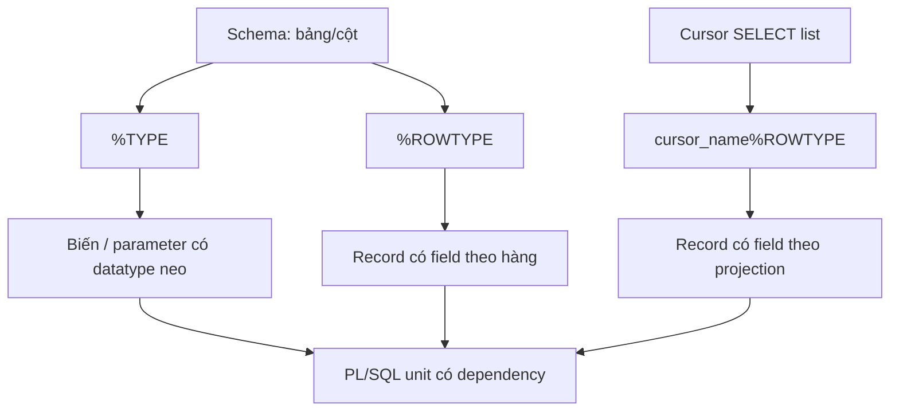

# %TYPE, %ROWTYPE và liên kết khai báo với schema trong PL/SQL

Trong PL/SQL, biến và record thường cần có kiểu dữ liệu tương ứng với cột hoặc cấu trúc hàng trong database. Nếu tự khai báo datatype, độ dài, precision và scale bằng cách lặp lại thông tin trong schema, mã nguồn có thể lệch khỏi bảng khi cấu trúc thay đổi. Oracle cung cấp hai attribute khai báo rất hữu ích:

- `%TYPE`: lấy datatype của một cột, biến hoặc thành phần được tham chiếu để khai báo biến hay parameter.
- `%ROWTYPE`: khai báo một record có các field tương ứng với cột của bảng, view hoặc danh sách cột của cursor.

Hai attribute này tạo ra **anchored declarations** (khai báo neo kiểu). Thay vì chép lại kiểu dữ liệu, chương trình tham chiếu trực tiếp đến đối tượng đã có trong schema hoặc một khai báo PL/SQL khác.

Ví dụ:

```sql
DECLARE
    l_customer_id customers.customer_id%TYPE;
    l_email       customers.email_address%TYPE;
    l_customer    customers%ROWTYPE;
BEGIN
    SELECT customer_id, email_address
    INTO l_customer_id, l_email
    FROM customers
    WHERE customer_id = 1001;

    SELECT *
    INTO l_customer
    FROM customers
    WHERE customer_id = 1001;
END;
/
```

Khai báo neo kiểu giúp giảm lặp lại datatype và làm rõ mối quan hệ giữa PL/SQL với schema. Tuy nhiên, nó cũng tạo dependency: đối tượng PL/SQL cần được biên dịch với bảng, cột hoặc cursor được tham chiếu. Khi schema thay đổi, unit có thể cần invalidation/recompilation và logic ứng dụng vẫn phải được kiểm tra.

## 1. Vì sao nên neo kiểu vào schema?

### 1.1. Vấn đề khi hard-code datatype

Giả sử cột CUSTOMER_ID được khai báo:

```sql
CREATE TABLE customers (
    customer_id NUMBER(12),
    customer_name VARCHAR2(120 CHAR),
    email_address VARCHAR2(240 CHAR)
);
```

Một procedure khai báo:

```sql
CREATE OR REPLACE PROCEDURE find_customer (
    p_customer_id IN NUMBER
)
AS
    l_customer_name VARCHAR2(120);
BEGIN
    SELECT customer_name
    INTO l_customer_name
    FROM customers
    WHERE customer_id = p_customer_id;
END;
/
```

Datatype và độ dài đã được viết lặp lại. Nếu CUSTOMER_NAME tăng từ 120 lên 300 ký tự, biến l_customer_name vẫn chỉ có độ dài 120. Nếu CUSTOMER_ID đổi precision hoặc datatype, parameter vẫn giữ khai báo NUMBER độc lập.

Điều này tạo hai nguồn sự thật: schema định nghĩa datatype thực tế, còn PL/SQL tự định nghĩa datatype dựa trên giả định trước đó. Hai nguồn có thể lệch nhau.

### 1.2. Neo kiểu bằng %TYPE

Thay bằng:

```sql
CREATE OR REPLACE PROCEDURE find_customer (
    p_customer_id IN customers.customer_id%TYPE
)
AS
    l_customer_name customers.customer_name%TYPE;
BEGIN
    SELECT customer_name
    INTO l_customer_name
    FROM customers
    WHERE customer_id = p_customer_id;
END;
/
```

Khi CUSTOMER_ID hoặc CUSTOMER_NAME thay đổi kiểu/độ dài trong schema, unit PL/SQL phụ thuộc có thể được invalidated và khi biên dịch lại sẽ lấy metadata mới. Không cần sửa lại datatype hard-code ở từng khai báo.

### 1.3. Neo cấu trúc hàng bằng %ROWTYPE

Nếu cần giữ nhiều cột của một hàng:

```sql
DECLARE
    l_customer customers%ROWTYPE;
BEGIN
    SELECT *
    INTO l_customer
    FROM customers
    WHERE customer_id = 1001;

    DBMS_OUTPUT.PUT_LINE(l_customer.customer_name);
    DBMS_OUTPUT.PUT_LINE(l_customer.email_address);
END;
/
```

`l_customer` có field tương ứng với các cột trong cấu trúc hàng của CUSTOMERS. Không cần khai báo thủ công từng field.

### 1.4. Sơ đồ quan hệ



## 2. %TYPE: neo datatype của một cột hoặc biến

### 2.1. Cú pháp

```sql
variable_name table_name.column_name%TYPE;
```

Hoặc neo vào biến đã khai báo:

```sql
variable_name another_variable%TYPE;
```

Trong đó table_name.column_name chỉ đến cột trong bảng hoặc view; another_variable là biến/parameter đã được khai báo trước trong phạm vi có thể tham chiếu.

### 2.2. Neo vào cột bảng

```sql
DECLARE
    l_customer_id customers.customer_id%TYPE;
    l_name        customers.customer_name%TYPE;
    l_email       customers.email_address%TYPE;
BEGIN
    SELECT customer_id, customer_name, email_address
    INTO l_customer_id, l_name, l_email
    FROM customers
    WHERE customer_id = 1001;
END;
/
```

Datatype, precision/scale và độ dài ký tự được lấy từ metadata cột tương ứng. Đây là cách nên dùng cho biến nhận dữ liệu từ cột đó.

### 2.3. Neo vào biến hoặc parameter

```sql
DECLARE
    l_customer_id customers.customer_id%TYPE;
    l_parent_id   l_customer_id%TYPE;
    l_child_id    l_customer_id%TYPE;
BEGIN
    l_parent_id := 1001;
    l_child_id := l_parent_id;
END;
/
```

Neo vào biến giúp nhiều biến trong cùng module dùng một kiểu thống nhất. Khi biến gốc đổi khai báo, các biến neo vào nó sẽ theo kiểu mới sau khi unit được biên dịch lại.

### 2.4. Dùng %TYPE cho parameter

```sql
CREATE OR REPLACE PROCEDURE update_customer_email (
    p_customer_id IN customers.customer_id%TYPE,
    p_email       IN customers.email_address%TYPE
)
AS
BEGIN
    UPDATE customers
    SET email_address = p_email
    WHERE customer_id = p_customer_id;
END;
/
```

Parameter có datatype khớp với cột mà procedure sử dụng. Caller vẫn phải truyền giá trị hợp lệ về mặt nghiệp vụ; %TYPE không tự kiểm tra email, uniqueness hoặc quyền truy cập.

### 2.5. Dùng %TYPE cho kiểu trả về

```sql
CREATE OR REPLACE FUNCTION get_customer_name (
    p_customer_id IN customers.customer_id%TYPE
)
RETURN customers.customer_name%TYPE
AS
    l_name customers.customer_name%TYPE;
BEGIN
    SELECT customer_name
    INTO l_name
    FROM customers
    WHERE customer_id = p_customer_id;

    RETURN l_name;
END;
/
```

Kiểu trả về được neo vào cột. Nếu function cần xử lý trường hợp không có hàng, phải định nghĩa rõ behavior; ví dụ trên sẽ phát sinh NO_DATA_FOUND nếu không tìm thấy customer.

## 3. %TYPE kế thừa điều gì và không kế thừa điều gì?

### 3.1. Datatype và kích thước

Khai báo:

```sql
l_email customers.email_address%TYPE;
```

lấy datatype và đặc tính kích thước liên quan của cột. Với NUMBER, precision/scale của cột là một phần metadata kiểu; với VARCHAR2, độ dài và semantics CHAR/BYTE có ý nghĩa.

### 3.2. NOT NULL không được kế thừa

Một điểm rất quan trọng: khai báo biến bằng %TYPE từ cột NOT NULL **không tự làm biến PL/SQL thành NOT NULL**.

Ví dụ:

```sql
CREATE TABLE customer_anchor_demo (
    customer_id NUMBER(10) NOT NULL,
    customer_name VARCHAR2(100 CHAR) NOT NULL
);
```

Trong PL/SQL:

```sql
DECLARE
    l_customer_name customer_anchor_demo.customer_name%TYPE;
BEGIN
    l_customer_name := NULL;
    DBMS_OUTPUT.PUT_LINE('Variable can hold NULL');
END;
/
```

Biến có thể nhận NULL. Constraint NOT NULL được thực thi khi ghi vào cột bảng, không tự biến thành constraint của biến PL/SQL.

Nếu biến nội bộ phải luôn có giá trị, khai báo constraint riêng:

```sql
DECLARE
    l_customer_name customer_anchor_demo.customer_name%TYPE NOT NULL
        := 'Unknown';
BEGIN
    NULL;
END;
/
```

Biến có constraint NOT NULL phải được khởi tạo khi khai báo và không được gán NULL về sau.

### 3.3. DEFAULT của cột không được kế thừa

Giả sử:

```sql
CREATE TABLE job_anchor_demo (
    job_id NUMBER(10) PRIMARY KEY,
    status_code VARCHAR2(20 CHAR) DEFAULT 'NEW' NOT NULL
);
```

Khai báo:

```sql
DECLARE
    l_status job_anchor_demo.status_code%TYPE;
BEGIN
    DBMS_OUTPUT.PUT_LINE(
        CASE
            WHEN l_status IS NULL THEN 'NULL'
            ELSE l_status
        END
    );
END;
/
```

`l_status` không tự nhận default NEW. Default thuộc về thao tác INSERT vào cột, không phải giá trị mặc định của mọi biến PL/SQL neo kiểu đó.

### 3.4. Các constraint khác cũng không được kế thừa

%TYPE không mang theo:

- PRIMARY KEY hoặc UNIQUE.
- FOREIGN KEY.
- CHECK constraint.
- Column default.
- Trigger behavior.
- Quy tắc nghiệp vụ ở tầng ứng dụng.

Datatype được neo, còn tính hợp lệ của giá trị cần được kiểm tra ở nơi thích hợp.

### 3.5. Bảng so sánh

| Thuộc tính của cột | Biến %TYPE |
|---|---|
| Datatype | Có |
| Precision/scale hoặc length | Theo datatype được neo |
| Character length semantics | Theo kiểu cột |
| NOT NULL constraint | Không tự kế thừa |
| DEFAULT expression | Không tự kế thừa |
| PRIMARY/FOREIGN/UNIQUE constraint | Không |
| CHECK constraint | Không |

## 4. %ROWTYPE: khai báo record theo cấu trúc hàng

### 4.1. Cú pháp

```sql
record_name table_name%ROWTYPE;
```

Record có field cho các cột của bảng/view. Tên field tương ứng với tên cột và datatype tương ứng với datatype của cột.

### 4.2. Đọc cả hàng bằng SELECT INTO

```sql
DECLARE
    l_customer customers%ROWTYPE;
BEGIN
    SELECT *
    INTO l_customer
    FROM customers
    WHERE customer_id = 1001;

    DBMS_OUTPUT.PUT_LINE(
        'ID=' || l_customer.customer_id
    );
    DBMS_OUTPUT.PUT_LINE(
        'Name=' || l_customer.customer_name
    );
    DBMS_OUTPUT.PUT_LINE(
        'Email=' || NVL(l_customer.email_address, '(none)')
    );
END;
/
```

SELECT INTO phải trả đúng một hàng. Nếu không có hàng, PL/SQL phát sinh NO_DATA_FOUND; nếu có nhiều hơn một hàng, phát sinh TOO_MANY_ROWS.

### 4.3. Truy cập field

Sử dụng dấu chấm:

```sql
l_customer.customer_id
l_customer.customer_name
l_customer.email_address
```

Record không phải một scalar value. Muốn truyền từng giá trị cho procedure hoặc dùng trong biểu thức SQL, truy cập field tương ứng.

### 4.4. Record của view

Có thể neo vào view:

```sql
CREATE OR REPLACE VIEW active_customer_v AS
SELECT customer_id,
       customer_name,
       email_address
FROM customers
WHERE status_code = 'ACTIVE';
```

Khai báo:

```sql
DECLARE
    l_active_customer active_customer_v%ROWTYPE;
BEGIN
    SELECT *
    INTO l_active_customer
    FROM active_customer_v
    WHERE customer_id = 1001;
END;
/
```

Record phản ánh projection của view, không nhất thiết toàn bộ cột của bảng nguồn. Nếu định nghĩa view thay đổi, PL/SQL phụ thuộc có thể cần biên dịch lại.

## 5. %ROWTYPE của explicit cursor

### 5.1. Vì sao cần cursor %ROWTYPE?

table%ROWTYPE đại diện toàn bộ cấu trúc hàng của bảng/view. Nhưng truy vấn thực tế thường chỉ lấy một số cột hoặc tạo biểu thức/aggregate. Khi đó, dùng cursor %ROWTYPE để record khớp với SELECT list.

### 5.2. Khai báo cursor và record

```sql
DECLARE
    CURSOR c_customer IS
        SELECT customer_id,
               customer_name,
               email_address
        FROM customers
        WHERE status_code = 'ACTIVE';

    l_customer c_customer%ROWTYPE;
BEGIN
    OPEN c_customer;

    LOOP
        FETCH c_customer INTO l_customer;
        EXIT WHEN c_customer%NOTFOUND;

        DBMS_OUTPUT.PUT_LINE(
            l_customer.customer_name || ': ' ||
            NVL(l_customer.email_address, '(none)')
        );
    END LOOP;

    CLOSE c_customer;
END;
/
```

l_customer có ba field theo projection của cursor. Không cần khai báo thêm record thủ công với ba datatype.

### 5.3. Cursor SELECT biểu thức phải có alias

Nếu cursor chọn expression:

```sql
DECLARE
    CURSOR c_sales IS
        SELECT customer_id,
               COUNT(*) AS order_count,
               SUM(total_amount) AS total_amount
        FROM orders
        GROUP BY customer_id;

    l_sales c_sales%ROWTYPE;
BEGIN
    OPEN c_sales;
    FETCH c_sales INTO l_sales;
    CLOSE c_sales;

    DBMS_OUTPUT.PUT_LINE(l_sales.order_count);
END;
/
```

Đặt alias rõ ràng cho expression để field có tên dễ dùng. Các alias ORDER_COUNT và TOTAL_AMOUNT trở thành tên field của cursor record.

### 5.4. Cursor FOR LOOP

Cursor FOR LOOP tự khai báo record vòng lặp:

```sql
DECLARE
    CURSOR c_customer IS
        SELECT customer_id, customer_name
        FROM customers
        WHERE status_code = 'ACTIVE';
BEGIN
    FOR r_customer IN c_customer LOOP
        DBMS_OUTPUT.PUT_LINE(
            r_customer.customer_id || ' ' ||
            r_customer.customer_name
        );
    END LOOP;
END;
/
```

Trong cursor FOR LOOP, Oracle tự mở cursor, fetch từng hàng và đóng cursor khi kết thúc hoặc khi có exception. Biến record vòng lặp chỉ tồn tại trong phạm vi loop; không cần khai báo cursor%ROWTYPE riêng nếu chỉ xử lý từng hàng trong loop.

### 5.5. Cursor parameter

Cursor có thể nhận tham số:

```sql
DECLARE
    CURSOR c_orders (
        p_customer_id orders.customer_id%TYPE
    ) IS
        SELECT order_id, order_date, total_amount
        FROM orders
        WHERE customer_id = p_customer_id;

    l_order c_orders%ROWTYPE;
BEGIN
    OPEN c_orders(1001);
    FETCH c_orders INTO l_order;
    CLOSE c_orders;
END;
/
```

Parameter cũng được neo bằng %TYPE; record của cursor khớp với SELECT list. Đây là cách kết hợp hai attribute trong một module.

## 6. %ROWTYPE và SELECT list phải khớp

### 6.1. Table %ROWTYPE dùng cho toàn hàng

```sql
DECLARE
    l_customer customers%ROWTYPE;
BEGIN
    SELECT *
    INTO l_customer
    FROM customers
    WHERE customer_id = 1001;
END;
/
```

Vì record được định nghĩa theo toàn bộ cấu trúc bảng, SELECT list phải tương thích với toàn bộ số lượng và thứ tự field. Không dùng table %ROWTYPE để nhận tùy tiện một projection nhỏ.

### 6.2. Projection nhỏ: dùng cursor %ROWTYPE

```sql
DECLARE
    CURSOR c_customer_summary IS
        SELECT customer_id,
               customer_name
        FROM customers;

    l_summary c_customer_summary%ROWTYPE;
BEGIN
    OPEN c_customer_summary;
    FETCH c_customer_summary INTO l_summary;
    CLOSE c_customer_summary;
END;
/
```

Record có đúng hai field theo projection. Đây là lựa chọn rõ ràng hơn khi query không lấy toàn bộ hàng.

### 6.3. SELECT INTO với record tự định nghĩa

Khi cần projection cụ thể nhưng không muốn explicit cursor, có thể khai báo RECORD:

```sql
DECLARE
    TYPE t_customer_summary IS RECORD (
        customer_id   customers.customer_id%TYPE,
        customer_name customers.customer_name%TYPE,
        order_count   PLS_INTEGER
    );

    l_summary t_customer_summary;
BEGIN
    SELECT customer_id,
           customer_name,
           0
    INTO l_summary
    FROM customers
    WHERE customer_id = 1001;
END;
/
```

Record tự định nghĩa phù hợp khi cần ghép field neo từ nhiều nguồn hoặc field tính toán. Nó cho phép thiết kế shape riêng thay vì gắn toàn bộ vào một bảng.

### 6.4. Tên field của cursor

Cursor có thể định nghĩa alias cho expression:

```sql
CURSOR c_report IS
    SELECT department_id,
           COUNT(*) AS employee_count,
           AVG(salary) AS average_salary
    FROM employees
    GROUP BY department_id;
```

Tên EMPLOYEE_COUNT và AVERAGE_SALARY trở thành field của cursor record.

## 7. %TYPE và %ROWTYPE trong collection, BULK COLLECT

### 7.1. Collection các scalar neo kiểu

```sql
DECLARE
    TYPE t_customer_ids IS TABLE OF customers.customer_id%TYPE
        INDEX BY PLS_INTEGER;

    l_customer_ids t_customer_ids;
BEGIN
    l_customer_ids(1) := 1001;
    l_customer_ids(2) := 1002;
END;
/
```

Các phần tử có datatype giống CUSTOMER_ID. Nếu cột đổi datatype và unit được biên dịch lại, phần tử collection cũng theo kiểu neo.

### 7.2. Collection các record theo hàng

```sql
DECLARE
    TYPE t_customer_rows IS TABLE OF customers%ROWTYPE
        INDEX BY PLS_INTEGER;

    l_customers t_customer_rows;
BEGIN
    SELECT *
    BULK COLLECT INTO l_customers
    FROM customers
    WHERE status_code = 'ACTIVE';

    DBMS_OUTPUT.PUT_LINE('Rows=' || l_customers.COUNT);
END;
/
```

Collection chứa nhiều record cùng cấu trúc hàng CUSTOMERS. BULK COLLECT nạp tập kết quả vào collection trong một lần hoặc theo batch.

### 7.3. BULK COLLECT với cursor record

```sql
DECLARE
    CURSOR c_customer IS
        SELECT customer_id, customer_name
        FROM customers
        WHERE status_code = 'ACTIVE';

    TYPE t_customer_rows IS TABLE OF c_customer%ROWTYPE;
    l_customers t_customer_rows;
BEGIN
    OPEN c_customer;
    FETCH c_customer BULK COLLECT INTO l_customers LIMIT 500;
    CLOSE c_customer;

    FOR i IN 1 .. l_customers.COUNT LOOP
        DBMS_OUTPUT.PUT_LINE(l_customers(i).customer_name);
    END LOOP;
END;
/
```

Ví dụ trên chỉ fetch tối đa 500 hàng một lần. Với tập dữ liệu lớn, cần đặt FETCH trong vòng lặp để lấy các batch tiếp theo; nếu chỉ fetch một lần rồi đóng cursor, các hàng còn lại không được xử lý.

### 7.4. BULK COLLECT theo batch

```sql
DECLARE
    CURSOR c_customer IS
        SELECT customer_id, customer_name
        FROM customers
        WHERE status_code = 'ACTIVE'
        ORDER BY customer_id;

    TYPE t_customer_rows IS TABLE OF c_customer%ROWTYPE;
    l_batch t_customer_rows;
BEGIN
    OPEN c_customer;

    LOOP
        FETCH c_customer BULK COLLECT INTO l_batch LIMIT 500;
        EXIT WHEN l_batch.COUNT = 0;

        FOR i IN 1 .. l_batch.COUNT LOOP
            DBMS_OUTPUT.PUT_LINE(l_batch(i).customer_name);
        END LOOP;
    END LOOP;

    CLOSE c_customer;
END;
/
```

LIMIT giúp giới hạn bộ nhớ khi tập dữ liệu lớn. Kích thước batch cần đo theo độ rộng record, PGA và chi phí xử lý.

### 7.5. FORALL với collection neo kiểu

```sql
DECLARE
    TYPE t_customer_ids IS TABLE OF customers.customer_id%TYPE
        INDEX BY PLS_INTEGER;
    l_ids t_customer_ids;
BEGIN
    l_ids(1) := 1001;
    l_ids(2) := 1002;
    l_ids(3) := 1003;

    FORALL i IN INDICES OF l_ids
        UPDATE customers
        SET status_code = 'REVIEW'
        WHERE customer_id = l_ids(i);
END;
/
```

%TYPE giữ kiểu phần tử đồng bộ với cột. FORALL giảm context switch khi thực thi DML cho nhiều phần tử; nó không làm thay đổi quy tắc transaction và constraint.

## 8. Record tự định nghĩa kết hợp %TYPE

### 8.1. Khi record có nhiều nguồn dữ liệu

```sql
DECLARE
    TYPE t_customer_order_summary IS RECORD (
        customer_id   customers.customer_id%TYPE,
        customer_name customers.customer_name%TYPE,
        order_count   PLS_INTEGER,
        total_amount  orders.total_amount%TYPE
    );

    l_summary t_customer_order_summary;
BEGIN
    SELECT c.customer_id,
           c.customer_name,
           COUNT(o.order_id),
           NVL(SUM(o.total_amount), 0)
    INTO l_summary
    FROM customers c
    LEFT JOIN orders o
      ON o.customer_id = c.customer_id
    WHERE c.customer_id = 1001
    GROUP BY c.customer_id, c.customer_name;
END;
/
```

Record tự định nghĩa cho phép field lấy kiểu từ hai bảng khác nhau và thêm field tính toán. Điều này thường phù hợp hơn dùng customers%ROWTYPE vì dữ liệu trả về không phải toàn bộ hàng của một bảng.

### 8.2. Dùng SUBTYPE để đặt tên kiểu nghiệp vụ

```sql
DECLARE
    SUBTYPE t_customer_id IS customers.customer_id%TYPE;
    SUBTYPE t_customer_email IS customers.email_address%TYPE;

    l_customer_id t_customer_id;
    l_email       t_customer_email;
BEGIN
    l_customer_id := 1001;
END;
/
```

SUBTYPE tạo tên kiểu có ý nghĩa nghiệp vụ dựa trên kiểu neo. Nó không tạo datatype độc lập hoàn toàn và không tự áp đặt constraint của cột nguồn.

### 8.3. Package type cho API dùng chung

Có thể công bố subtype trong package specification:

```sql
CREATE OR REPLACE PACKAGE customer_api_types AS
    SUBTYPE t_customer_id IS customers.customer_id%TYPE;
    SUBTYPE t_customer_email IS customers.email_address%TYPE;
END customer_api_types;
/
```

Các package/procedure khác có thể dùng customer_api_types.t_customer_id. Điều này giúp chuẩn hóa kiểu API, nhưng package spec tạo thêm dependency vào schema và thay đổi spec có thể invalidate các unit phụ thuộc.

## 9. Schema dependency và recompilation

### 9.1. Anchored declaration tạo dependency

Khi stored PL/SQL tham chiếu:

```sql
customers.customer_id%TYPE
customers%ROWTYPE
```

Oracle cần metadata của đối tượng được neo để biên dịch unit. Dependency được theo dõi trong data dictionary. Nếu bảng/cột thay đổi theo cách ảnh hưởng unit, trạng thái unit có thể chuyển INVALID và cần biên dịch lại.

### 9.2. Kiểm tra trạng thái object

```sql
SELECT object_name,
       object_type,
       status,
       last_ddl_time
FROM user_objects
WHERE object_type IN ('PROCEDURE', 'FUNCTION', 'PACKAGE', 'PACKAGE BODY')
ORDER BY object_type, object_name;
```

Đối tượng INVALID có thể được Oracle tự biên dịch lại khi được gọi, hoặc được biên dịch tường minh:

```sql
ALTER PROCEDURE update_customer_email COMPILE;
ALTER PACKAGE customer_api_types COMPILE SPECIFICATION;
ALTER PACKAGE customer_api_types COMPILE BODY;
```

Chỉ chạy compile trên object phù hợp. Nếu lỗi, xem USER_ERRORS:

```sql
SELECT name,
       type,
       line,
       position,
       text
FROM user_errors
ORDER BY name, sequence;
```

### 9.3. Xem dependency

```sql
SELECT name,
       type,
       referenced_owner,
       referenced_name,
       referenced_type
FROM user_dependencies
WHERE name = 'UPDATE_CUSTOMER_EMAIL'
ORDER BY referenced_owner, referenced_name;
```

USER_DEPENDENCIES cho dependency trong schema hiện tại. DBA có thể dùng ALL_DEPENDENCIES hoặc DBA_DEPENDENCIES tùy quyền để xem phạm vi rộng hơn.

### 9.4. Fine-grained dependency

Oracle hỗ trợ dependency chi tiết ở mức cột cho một số loại tham chiếu. Điều này giúp giảm invalidation không cần thiết khi thay đổi bảng không ảnh hưởng đến thành phần mà unit sử dụng. Tuy nhiên, không nên giả định mọi DDL đều không invalidates unit: thay đổi cấu trúc, kiểu dữ liệu, tên cột, view definition hoặc package specification vẫn có thể tác động dependency.

### 9.5. Thay đổi datatype cột

Nếu cột được neo đổi datatype, unit có thể cần biên dịch lại và biến/parameter neo sẽ theo metadata mới. Điều đó không đảm bảo logic ứng dụng vẫn đúng:

- Biến có thể nhận giá trị lớn hơn trước.
- So sánh hoặc phép toán có thể đổi precision/scale.
- Interface package/procedure có thể thay đổi signature.
- Client gọi procedure có thể cần biên dịch hoặc triển khai lại.
- Dữ liệu cũ có thể không chuyển được sang datatype mới.

Anchoring giảm lỗi lệch kiểu, nhưng không thay thế quy trình schema migration và kiểm thử contract.

## 10. %ROWTYPE và thay đổi cấu trúc bảng

### 10.1. Thêm cột

Giả sử unit dùng:

```sql
DECLARE
    l_customer customers%ROWTYPE;
BEGIN
    SELECT *
    INTO l_customer
    FROM customers
    WHERE customer_id = 1001;
END;
/
```

Nếu bảng thêm cột, record rowtype khi biên dịch lại sẽ phản ánh cấu trúc mới. Unit phụ thuộc có thể bị invalidated/recompiled tùy dependency và release. Các nơi dùng field theo tên vẫn cần xem lại nếu logic cần xử lý cột mới.

### 10.2. SELECT * tạo coupling theo cấu trúc hàng

SELECT * INTO table%ROWTYPE tiện khi thật sự cần toàn bộ hàng. Nhưng nó phụ thuộc toàn bộ projection và thứ tự cột. Nếu chỉ cần ba field, hãy dùng cursor %ROWTYPE hoặc record tự định nghĩa để khai báo projection rõ ràng.

### 10.3. Thêm cột có default

Khi bảng thêm cột có default, table %ROWTYPE mới có field tương ứng sau compile. Biến record không tự áp dụng default của cột khi được khởi tạo; field record vẫn là giá trị PL/SQL cần gán/nhận từ SELECT.

### 10.4. Đổi hoặc xóa cột

Nếu unit tham chiếu cột bị rename/drop, compile có thể thất bại với lỗi identifier không hợp lệ. Các field của record cũng thay đổi theo cấu trúc mới. Phải cập nhật code theo migration thay vì trông chờ %ROWTYPE tự sửa tên field trong source.

### 10.5. Migration theo thứ tự

Một quy trình an toàn:

1. Xác định PL/SQL unit phụ thuộc vào cột/bảng.
2. Chuẩn bị DDL và source tương thích với schema mới.
3. Thực hiện migration trong môi trường thử.
4. Recompile unit bị invalid và xem USER_ERRORS.
5. Chạy integration tests cho API và DML.
6. Triển khai theo thứ tự có thể rollback hoặc tương thích ngược.
7. Theo dõi INVALID objects sau deploy.

## 11. %TYPE và %ROWTYPE trong package, procedure và function

### 11.1. Package specification

Datatype neo có thể xuất hiện trong public interface:

```sql
CREATE OR REPLACE PACKAGE customer_service AS
    PROCEDURE set_email (
        p_customer_id IN customers.customer_id%TYPE,
        p_email       IN customers.email_address%TYPE
    );
END customer_service;
/
```

Điều này giúp interface bám theo schema. Nhưng thay đổi datatype cột có thể làm package specification thay đổi sau compile và kéo theo dependency của caller.

### 11.2. Package body

```sql
CREATE OR REPLACE PACKAGE BODY customer_service AS
    PROCEDURE set_email (
        p_customer_id IN customers.customer_id%TYPE,
        p_email       IN customers.email_address%TYPE
    )
    IS
    BEGIN
        UPDATE customers
        SET email_address = p_email
        WHERE customer_id = p_customer_id;
    END set_email;
END customer_service;
/
```

Specification và body phải có signature tương ứng. Khi thay đổi schema, biên dịch lại package và các caller cần thiết.

### 11.3. %ROWTYPE làm parameter

Có thể dùng record rowtype trong PL/SQL API nội bộ:

```sql
CREATE OR REPLACE PROCEDURE print_customer (
    p_customer IN customers%ROWTYPE
)
AS
BEGIN
    DBMS_OUTPUT.PUT_LINE(p_customer.customer_name);
END;
/
```

Kiểu record này gắn với cấu trúc bảng và phù hợp trong PL/SQL-to-PL/SQL call. Tuy nhiên, record %ROWTYPE không phải kiểu truyền trực tiếp qua mọi giao diện SQL/driver như một scalar. Với API công khai cho ứng dụng ngoài database, thường nên dùng parameter scalar có %TYPE, object type được định nghĩa rõ hoặc JSON/REST contract riêng.

### 11.4. Tránh lộ toàn bộ rowtype trong public contract

Nếu procedure nhận customers%ROWTYPE, thêm cột vào CUSTOMERS có thể làm record interface thay đổi và tăng coupling. Nếu caller chỉ cần ID và email, khai báo hai parameter %TYPE sẽ tạo contract hẹp, rõ và ít phụ thuộc hơn.

## 12. So sánh %TYPE, %ROWTYPE và RECORD tự định nghĩa

| Cơ chế | Shape | Khi nên dùng |
|---|---|---|
| %TYPE | Một datatype | Biến/parameter tương ứng với một cột hoặc biến khác |
| Table/view %ROWTYPE | Toàn bộ cột của một hàng | Đọc hoặc xử lý hàng đầy đủ |
| Cursor %ROWTYPE | Các cột trong SELECT list của cursor | Xử lý projection cụ thể |
| TYPE ... IS RECORD | Các field do lập trình viên chọn | Ghép nhiều nguồn, thêm field tính toán, định nghĩa shape riêng |
| SUBTYPE | Tên miền kiểu dựa trên datatype khác | Đặt tên kiểu dùng chung và tăng tính rõ nghĩa |

Không có cơ chế nào tốt nhất cho mọi trường hợp. Chọn record có shape nhỏ nhất đủ cho nghiệp vụ, tránh kéo toàn bộ row vào code khi chỉ cần vài cột.

## 13. Lỗi thường gặp và cách xử lý

| Lỗi/dấu hiệu | Nguyên nhân | Hướng xử lý |
|---|---|---|
| PLS-00201 identifier must be declared | Không thấy bảng/cột/biến được neo hoặc thiếu quyền | Kiểm tra schema, tên object, synonym và quyền trực tiếp |
| PLS-00302 component must be declared | Field không tồn tại trong record/cursor projection | Kiểm tra tên cột, alias và cấu trúc rowtype |
| PLS-00306 wrong number or types of arguments | Signature parameter neo thay đổi hoặc caller truyền sai | So sánh signature và datatype caller |
| ORA-06502 numeric/value error | Giá trị không phù hợp buffer/precision hoặc conversion | Kiểm tra datatype neo, giá trị thực và phép chuyển đổi |
| ORA-01422 TOO_MANY_ROWS | SELECT INTO record trả nhiều hàng | Thêm predicate duy nhất hoặc dùng cursor |
| ORA-01403 NO_DATA_FOUND | SELECT INTO không trả hàng | Xử lý exception hoặc kiểm tra tồn tại theo nghiệp vụ |
| Object INVALID sau DDL | Dependency bị ảnh hưởng | Xem USER_ERRORS/DEPENDENCIES và compile lại |
| Biến %TYPE nhận NULL | NOT NULL của cột không được kế thừa | Khai báo NOT NULL riêng nếu cần |
| Biến %TYPE không nhận default | DEFAULT cột không áp dụng cho biến | Khởi tạo biến tường minh |
| SELECT list không khớp %ROWTYPE | Dùng table rowtype cho projection một phần hoặc sai thứ tự | Dùng SELECT * đúng cấu trúc hoặc cursor/record riêng |
| Caller bị ảnh hưởng sau đổi package spec | Public signature phụ thuộc schema | Quản lý version API và migration đồng bộ |

## 14. Quy tắc thiết kế thực tế

### 14.1. Dùng %TYPE cho scalar gắn với cột

Nếu biến chứa customer_id, email hoặc amount của một cột cụ thể, ưu tiên:

```sql
l_customer_id customers.customer_id%TYPE;
l_email       customers.email_address%TYPE;
l_amount      orders.total_amount%TYPE;
```

Điều này giúp datatype và size bám theo schema.

### 14.2. Dùng %ROWTYPE khi thật sự cần toàn hàng

```sql
l_customer customers%ROWTYPE;
```

Phù hợp cho logic cần nhiều cột của hàng. Nếu chỉ dùng một vài cột, cân nhắc cursor %ROWTYPE hoặc record tự định nghĩa để giảm coupling.

### 14.3. Dùng cursor %ROWTYPE cho projection ổn định

```sql
CURSOR c_summary IS
    SELECT customer_id,
           COUNT(*) AS order_count
    FROM orders
    GROUP BY customer_id;

l_summary c_summary%ROWTYPE;
```

Projection được định nghĩa trong cursor; record khớp đúng shape đó.

### 14.4. Không dựa vào SELECT * ở API lâu dài

SELECT * tiện trong thao tác row-oriented nội bộ, nhưng ở query phức tạp hoặc interface ổn định, danh sách cột tường minh giúp kiểm soát projection, tránh vô tình kéo cột mới và giảm rủi ro khi schema thay đổi.

### 14.5. Tách datatype schema và datatype nghiệp vụ khi cần

Không phải mọi biến đều phải neo trực tiếp vào cột. Một giá trị tính toán có quy tắc nghiệp vụ riêng có thể cần subtype/record riêng. Ví dụ, số lần thử tối đa có thể là PLS_INTEGER, dù một cột lưu số đó là NUMBER(5). Hãy chọn kiểu theo miền giá trị và phép toán, không neo máy móc.

### 14.6. Kiểm soát dependency trong package specification

Đưa %TYPE vào package spec khi kiểu đó thực sự là một phần của contract. Nếu chỉ cần dùng nội bộ, đặt khai báo trong package body để giảm dependency của caller vào schema.

## 15. Ví dụ tổng hợp: package thao tác khách hàng

### 15.1. Package specification

```sql
CREATE OR REPLACE PACKAGE customer_repo AS
    SUBTYPE t_customer_id IS customers.customer_id%TYPE;
    SUBTYPE t_email IS customers.email_address%TYPE;

    PROCEDURE change_email (
        p_customer_id IN t_customer_id,
        p_email       IN t_email
    );

    PROCEDURE show_customer (
        p_customer_id IN t_customer_id
    );
END customer_repo;
/
```

### 15.2. Package body

```sql
CREATE OR REPLACE PACKAGE BODY customer_repo AS
    PROCEDURE change_email (
        p_customer_id IN t_customer_id,
        p_email       IN t_email
    )
    IS
    BEGIN
        UPDATE customers
        SET email_address = p_email
        WHERE customer_id = p_customer_id;

        IF SQL%ROWCOUNT = 0 THEN
            RAISE_APPLICATION_ERROR(-20061, 'Customer not found');
        END IF;
    END change_email;

    PROCEDURE show_customer (
        p_customer_id IN t_customer_id
    )
    IS
        l_customer customers%ROWTYPE;
    BEGIN
        SELECT *
        INTO l_customer
        FROM customers
        WHERE customer_id = p_customer_id;

        DBMS_OUTPUT.PUT_LINE(
            l_customer.customer_id || ': ' ||
            l_customer.customer_name
        );
    END show_customer;
END customer_repo;
/
```

Package body dùng %ROWTYPE cho thao tác cần toàn hàng và subtype neo kiểu cho API. Procedure không COMMIT; transaction thuộc caller.

### 15.3. Gọi package

```sql
BEGIN
    customer_repo.change_email(
        p_customer_id => 1001,
        p_email => 'an@example.test'
    );

    customer_repo.show_customer(
        p_customer_id => 1001
    );

    COMMIT;
END;
/
```

Trong hệ thống thật, cần bổ sung kiểm tra uniqueness, validation và xử lý lỗi theo contract. Ví dụ chỉ minh họa anchored declarations và dependency.

## 16. Bài thực hành

Thực hiện trong schema lab riêng. Tạo bảng và object có hậu tố LAB để không ghi đè đối tượng đang dùng.

### Bước 1 — Tạo bảng

```sql
CREATE TABLE customer_anchor_lab (
    customer_id NUMBER(12) NOT NULL,
    customer_name VARCHAR2(120 CHAR) NOT NULL,
    email_address VARCHAR2(240 CHAR),
    status_code VARCHAR2(20 CHAR) DEFAULT 'NEW' NOT NULL,
    CONSTRAINT pk_customer_anchor_lab PRIMARY KEY (customer_id)
);

INSERT INTO customer_anchor_lab (
    customer_id, customer_name, email_address
)
VALUES (1, 'Nguyen An', 'an@example.test');

COMMIT;
```

### Bước 2 — Khai báo scalar bằng %TYPE

```sql
DECLARE
    l_id customer_anchor_lab.customer_id%TYPE;
    l_name customer_anchor_lab.customer_name%TYPE;
BEGIN
    SELECT customer_id, customer_name
    INTO l_id, l_name
    FROM customer_anchor_lab
    WHERE customer_id = 1;

    DBMS_OUTPUT.PUT_LINE(l_id || ': ' || l_name);
END;
/
```

### Bước 3 — Thử NOT NULL và DEFAULT

Khai báo biến bằng %TYPE từ CUSTOMER_NAME và STATUS_CODE. Gán NULL vào biến và quan sát rằng biến có thể giữ NULL. Tạo biến có constraint NOT NULL riêng và quan sát yêu cầu khởi tạo. Kiểm tra biến không tự nhận default NEW.

### Bước 4 — Dùng table %ROWTYPE

```sql
DECLARE
    l_customer customer_anchor_lab%ROWTYPE;
BEGIN
    SELECT *
    INTO l_customer
    FROM customer_anchor_lab
    WHERE customer_id = 1;

    DBMS_OUTPUT.PUT_LINE(l_customer.customer_name);
END;
/
```

### Bước 5 — Dùng cursor %ROWTYPE

Tạo cursor chọn CUSTOMER_ID và UPPER(CUSTOMER_NAME) AS NORMALIZED_NAME. Khai báo record bằng cursor%ROWTYPE, fetch và đọc hai field. So sánh shape với CUSTOMER_ANCHOR_LAB%ROWTYPE.

### Bước 6 — Dùng collection và BULK COLLECT

Khai báo collection TABLE OF customer_anchor_lab%ROWTYPE, bulk collect dữ liệu và duyệt từng record. Sau đó thêm LIMIT và vòng lặp fetch để xử lý tập lớn theo batch.

### Bước 7 — Quan sát dependency

Tạo procedure tham chiếu customer_anchor_lab.customer_name%TYPE và customer_anchor_lab%ROWTYPE. Xem USER_DEPENDENCIES và USER_OBJECTS.

### Bước 8 — Thay đổi schema trong lab

Thêm một cột mới vào bảng. Kiểm tra trạng thái procedure, biên dịch lại và quan sát rowtype mới. Thử đổi datatype trong bảng thử riêng nếu dữ liệu cho phép; kiểm tra lỗi compile và ảnh hưởng signature.

### Bước 9 — Thử projection không khớp

Dùng table %ROWTYPE để nhận SELECT chỉ có hai cột và quan sát lỗi. Sửa bằng cursor %ROWTYPE hoặc RECORD tự định nghĩa.

### Bước 10 — Thiết kế package API

Tạo package spec dùng subtype neo CUSTOMER_ID và EMAIL_ADDRESS. Đặt record nội bộ trong body. Giải thích vì sao kiểu công khai và kiểu nội bộ có mức dependency khác nhau.

## 17. Câu hỏi tự kiểm tra

1. Anchored declaration là gì?
2. %TYPE lấy datatype từ đâu?
3. %ROWTYPE tạo ra cấu trúc record như thế nào?
4. Vì sao nên neo parameter vào cột thay vì lặp lại NUMBER/VARCHAR2?
5. %TYPE có kế thừa NOT NULL và DEFAULT của cột không?
6. Precision/scale và length semantics có ý nghĩa gì khi neo kiểu?
7. Khi nào dùng table %ROWTYPE, khi nào dùng cursor %ROWTYPE?
8. Vì sao SELECT list phải khớp cấu trúc record?
9. Cursor expression cần alias để làm gì?
10. Cursor FOR LOOP quản lý record và cursor thế nào?
11. Có thể dùng %TYPE cho phần tử collection không?
12. BULK COLLECT LIMIT giúp kiểm soát điều gì?
13. Khi nào record tự định nghĩa tốt hơn %ROWTYPE?
14. SUBTYPE giúp ích gì cho API?
15. Anchored declaration tạo dependency schema như thế nào?
16. DDL thay đổi cột có thể làm stored PL/SQL INVALID ra sao?
17. Làm thế nào xem USER_DEPENDENCIES và USER_ERRORS?
18. Vì sao %ROWTYPE không tự cập nhật source code khi cột bị rename/drop?
19. Tại sao không nên đưa table %ROWTYPE vào mọi public API?
20. Vì sao %TYPE giảm datatype drift nhưng không thay thế schema migration và integration test?

**Nguyên tắc cần nhớ:** dùng %TYPE khi một biến hoặc parameter đại diện cho datatype đã có trong schema; dùng %ROWTYPE khi cần record theo toàn bộ hàng hoặc projection của cursor. Các attribute này neo datatype và cấu trúc, không mang theo NOT NULL, DEFAULT hay toàn bộ constraint của cột. Chúng cũng tạo dependency với schema, vì vậy thay đổi bảng/view/cursor có thể ảnh hưởng trạng thái biên dịch và contract của PL/SQL. Chọn shape dữ liệu vừa đủ, kiểm tra dependency khi migration và biên dịch/test lại các unit liên quan.
