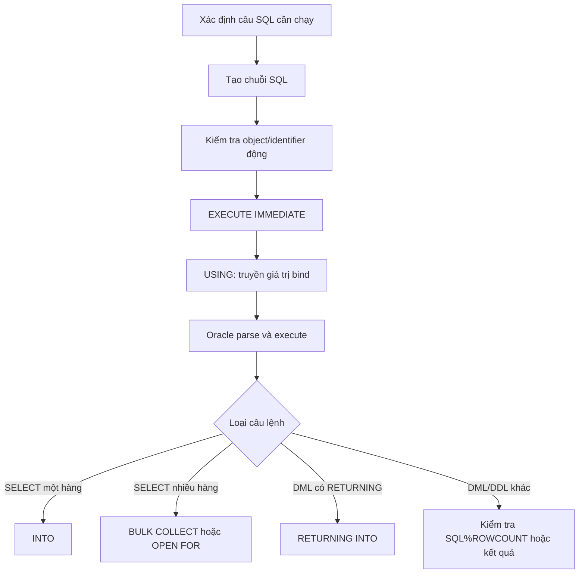

# EXECUTE IMMEDIATE, USING và RETURNING INTO trong PL/SQL

PL/SQL thường dùng SQL tĩnh: câu lệnh SQL được viết trực tiếp trong source, Oracle có thể kiểm tra cú pháp và phân giải object khi biên dịch unit. Nhưng có những tình huống câu SQL chỉ được xác định khi chương trình chạy, chẳng hạn tên bảng do cấu hình quyết định, điều kiện lọc được ghép theo lựa chọn của người dùng, hoặc một tiện ích quản trị cần thao tác trên nhiều đối tượng. Khi đó, PL/SQL có thể dùng **dynamic SQL**.

Native Dynamic SQL (NDS) là cách viết dynamic SQL trực tiếp trong PL/SQL. Câu lệnh trung tâm là `EXECUTE IMMEDIATE`. Giá trị dữ liệu được truyền qua `USING`, còn kết quả DML có thể lấy về qua `RETURNING INTO`.

Ví dụ cập nhật có bind:

```sql
EXECUTE IMMEDIATE
    'UPDATE employees
     SET salary = salary + :increment
     WHERE employee_id = :employee_id'
USING p_increment, p_employee_id;
```

Ví dụ nhận giá trị được cập nhật:

```sql
EXECUTE IMMEDIATE
    'UPDATE employees
     SET salary = salary + :increment
     WHERE employee_id = :employee_id
     RETURNING salary INTO :new_salary'
USING p_increment, p_employee_id
RETURNING INTO l_new_salary;
```

Dynamic SQL rất linh hoạt nhưng cũng tạo thêm trách nhiệm: kiểm soát SQL injection, bind đúng datatype, phân biệt giá trị dữ liệu với tên object, xử lý số hàng tác động, quản lý exception và transaction, đồng thời hiểu giới hạn giữa `EXECUTE IMMEDIATE` và `DBMS_SQL`.

## 1. Dynamic SQL là gì?

### 1.1. SQL tĩnh

Với SQL tĩnh, câu lệnh được viết trực tiếp:

```sql
DECLARE
    l_name employees.last_name%TYPE;
BEGIN
    SELECT last_name
    INTO l_name
    FROM employees
    WHERE employee_id = 100;

    DBMS_OUTPUT.PUT_LINE(l_name);
END;
/
```

Oracle có thể phân tích và kiểm tra cấu trúc câu SQL khi biên dịch PL/SQL. Các object, cột và kiểu dữ liệu được tham chiếu rõ ràng trong source. Đây là lựa chọn nên ưu tiên khi câu SQL đã biết trước.

### 1.2. Dynamic SQL

Với dynamic SQL, câu lệnh là một chuỗi được tạo hoặc chọn khi runtime:

```sql
DECLARE
    l_sql  VARCHAR2(1000);
    l_name employees.last_name%TYPE;
BEGIN
    l_sql := 'SELECT last_name
              FROM employees
              WHERE employee_id = :id';

    EXECUTE IMMEDIATE l_sql
        INTO l_name
        USING 100;

    DBMS_OUTPUT.PUT_LINE(l_name);
END;
/
```

Oracle parse và thực thi câu SQL được truyền vào lúc chạy. Câu lệnh có thể thay đổi theo object name, điều kiện hoặc cấu trúc truy vấn. Giá trị dữ liệu nên được truyền bằng bind variable.

### 1.3. Khi nào cần dynamic SQL?

Một số trường hợp phù hợp:

- Tên bảng hoặc view được chọn từ cấu hình.
- Một tiện ích quản trị cần thao tác trên nhiều bảng có cùng quy ước.
- Danh sách cột hoặc điều kiện lọc được chọn từ một tập cho phép.
- Một báo cáo có projection hoặc sort key thay đổi theo yêu cầu.
- DDL cần tạo, thay đổi hoặc xóa object theo tham số triển khai.
- Một API generic phải xử lý câu SQL có số lượng cột/bind chỉ biết khi chạy.

Không nên dùng dynamic SQL chỉ vì có parameter. Nếu tên bảng và cấu trúc SQL cố định, SQL tĩnh với bind thường dễ đọc, an toàn và dễ kiểm tra hơn.

### 1.4. Luồng thực thi



## 2. Cú pháp EXECUTE IMMEDIATE

### 2.1. Dạng tổng quát

Mẫu thường dùng:

```sql
EXECUTE IMMEDIATE dynamic_string
    [ INTO {define_variable | record} [, ...] ]
    [ USING [ IN | OUT | IN OUT ] bind_argument [, ...] ]
    [ RETURNING INTO bind_argument [, ...] ];
```

Các phần:

- `dynamic_string`: chuỗi chứa một SQL statement, PL/SQL block hoặc CALL statement.
- `INTO`: nhận kết quả của SELECT trả về một hàng.
- `USING`: truyền bind argument vào placeholder trong dynamic string.
- `RETURNING INTO`: nhận giá trị được DML trả về.

Không phải mọi mệnh đề đều dùng cùng lúc. Cách dùng phụ thuộc loại statement.

### 2.2. Thực thi DML

```sql
BEGIN
    EXECUTE IMMEDIATE
        'UPDATE employees
         SET salary = salary * 1.05
         WHERE department_id = :dept_id'
    USING 50;
END;
/
```

DML chạy trong transaction hiện tại. `EXECUTE IMMEDIATE` không tự COMMIT. Caller quyết định COMMIT hoặc ROLLBACK theo ranh giới nghiệp vụ.

### 2.3. Thực thi SELECT trả một hàng

```sql
DECLARE
    l_name employees.last_name%TYPE;
    l_salary employees.salary%TYPE;
BEGIN
    EXECUTE IMMEDIATE
        'SELECT last_name, salary
         FROM employees
         WHERE employee_id = :id'
    INTO l_name, l_salary
    USING 100;
END;
/
```

Số biến trong INTO phải khớp số expression trong SELECT list, theo thứ tự và kiểu tương thích. Nếu SELECT không trả hàng, phát sinh `NO_DATA_FOUND`; nếu trả nhiều hơn một hàng, phát sinh `TOO_MANY_ROWS`.

### 2.4. Thực thi PL/SQL block động

```sql
DECLARE
    l_result NUMBER;
BEGIN
    EXECUTE IMMEDIATE
        'BEGIN :out_value := :input_value * 2; END;'
    USING OUT l_result, IN 25;

    DBMS_OUTPUT.PUT_LINE(l_result);
END;
/
```

Khi dynamic string là anonymous PL/SQL block hoặc CALL statement, `USING` có thể truyền tham số IN, OUT và IN OUT. Trong ví dụ, placeholder đầu là OUT và placeholder sau là IN.

### 2.5. DDL động

```sql
BEGIN
    EXECUTE IMMEDIATE
        'CREATE TABLE runtime_log (
            log_id NUMBER,
            message VARCHAR2(200)
         )';
END;
/
```

DDL thường không dùng bind variable cho tên object hoặc cấu trúc DDL. Câu DDL được ghép thành chuỗi sau khi identifier được xác thực. DDL có implicit commit theo quy tắc Oracle; không coi nó như một DML có thể rollback cùng transaction nghiệp vụ.

## 3. USING và bind variables

### 3.1. Bind value thay cho giá trị literal

Ví dụ không nên ghép giá trị trực tiếp:

```sql
l_sql := 'SELECT last_name FROM employees WHERE employee_id = '
         || p_employee_id;
EXECUTE IMMEDIATE l_sql INTO l_name;
```

Nên dùng bind:

```sql
l_sql := 'SELECT last_name
          FROM employees
          WHERE employee_id = :id';

EXECUTE IMMEDIATE l_sql
    INTO l_name
    USING p_employee_id;
```

Bind variable truyền giá trị như dữ liệu, không biến giá trị thành một phần cú pháp SQL. Cách này giảm nguy cơ SQL injection, tránh lỗi quote/format và hỗ trợ tái sử dụng cursor khi SQL text ổn định.

### 3.2. Bind theo vị trí

Trong dynamic SQL statement, bind arguments được liên kết theo vị trí placeholder xuất hiện trong chuỗi SQL, không dựa vào tên placeholder.

Ví dụ:

```sql
EXECUTE IMMEDIATE
    'UPDATE employees
     SET salary = :new_salary
     WHERE employee_id = :employee_id'
USING p_new_salary, p_employee_id;
```

Thứ tự USING phải là new_salary trước, employee_id sau, tương ứng thứ tự placeholder trong statement.

### 3.3. Placeholder lặp lại trong SQL statement

Với dynamic SQL statement, mỗi lần xuất hiện của placeholder là một vị trí bind. Nếu cùng tên placeholder xuất hiện hai lần, cần truyền hai bind arguments theo thứ tự:

```sql
EXECUTE IMMEDIATE
    'SELECT employee_id
     FROM employees
     WHERE department_id = :value
        OR manager_id = :value'
INTO l_employee_id
USING p_value, p_value;
```

Tên placeholder giống nhau không làm hai vị trí trong SQL statement tự động dùng chung một bind argument. Cách dễ nhớ là đếm các lần xuất hiện theo thứ tự từ trái sang phải.

### 3.4. Placeholder trong dynamic PL/SQL block

Với dynamic anonymous PL/SQL block hoặc CALL statement, các placeholder được liên kết theo tên duy nhất. Nếu cùng placeholder name được lặp lại, chỉ cần một bind argument cho tên đó.

Ví dụ:

```sql
DECLARE
    l_result NUMBER;
BEGIN
    EXECUTE IMMEDIATE
        'BEGIN :x := :x + 10; END;'
    USING IN OUT l_result;
END;
/
```

Đây là quy tắc khác với dynamic SQL statement. Khi sửa một chuỗi từ SELECT/UPDATE thành PL/SQL block hoặc ngược lại, phải xem lại cách liên kết placeholder và thứ tự USING.

### 3.5. Không bind được tên bảng, tên cột hoặc keyword

Bind variable đại diện cho **giá trị**, không đại diện cho identifier hay cú pháp SQL.

Không thể viết:

```sql
EXECUTE IMMEDIATE
    'SELECT * FROM :table_name'
USING p_table_name;
```

Oracle cần biết object name trong giai đoạn parse; placeholder không thể thay thế tên bảng. Tương tự, không thể bind tên cột, từ khóa ORDER BY, ASC/DESC hoặc một đoạn predicate.

Nếu tên object phải thay đổi, cần ghép identifier đã được xác thực vào SQL string; các giá trị lọc vẫn bind bằng USING.

### 3.6. Datatype của bind

Bind argument phải tương thích với datatype mà SQL cần. Ví dụ, cột DATE nên nhận DATE; cột NUMBER nên nhận NUMBER; mã dạng chuỗi nên nhận VARCHAR2:

```sql
EXECUTE IMMEDIATE
    'SELECT customer_name
     FROM customers
     WHERE customer_id = :id'
INTO l_name
USING p_customer_id;
```

Tránh chuyển giá trị ngày/số thành text rồi dựa vào NLS session để Oracle chuyển ngược. Bind đúng kiểu giúp semantics ổn định và tránh implicit conversion ngoài ý muốn.

### 3.7. Bind NULL

Có thể truyền biến PL/SQL đang mang NULL qua USING:

```sql
EXECUTE IMMEDIATE
    'UPDATE customers
     SET email_address = :email
     WHERE customer_id = :id'
USING l_email, p_customer_id;
```

Nếu l_email là NULL, cột được gán NULL (nếu constraint cho phép). Predicate so sánh với NULL vẫn tuân theo three-valued logic; `column = :value` không trả TRUE khi bind NULL. Muốn kiểm tra NULL, cần SQL predicate thích hợp như `IS NULL` hoặc biểu thức logic được thiết kế rõ.

### 3.8. Bind không thay thế được phần cấu trúc tùy chọn

Nếu người dùng chọn một trong các trường sort, hãy ánh xạ lựa chọn vào danh sách identifier cho phép:

```sql
CASE p_sort_option
    WHEN 'DATE' THEN l_order_by := 'order_date';
    WHEN 'AMOUNT' THEN l_order_by := 'total_amount';
    WHEN 'ID' THEN l_order_by := 'order_id';
    ELSE
        RAISE_APPLICATION_ERROR(-20070, 'Unsupported sort option');
END CASE;

l_sql := 'SELECT order_id, order_date, total_amount
          FROM orders
          WHERE customer_id = :id
          ORDER BY ' || l_order_by;

OPEN l_cursor FOR l_sql USING p_customer_id;
```

Không nối nguyên văn lựa chọn của client vào SQL. Whitelist làm rõ tập identifier hợp lệ; bind vẫn dùng cho customer_id.

## 4. INTO và kết quả SELECT

### 4.1. INTO cho một hàng

```sql
DECLARE
    l_customer customers%ROWTYPE;
BEGIN
    EXECUTE IMMEDIATE
        'SELECT *
         FROM customers
         WHERE customer_id = :id'
    INTO l_customer
    USING 1001;
END;
/
```

Record phải tương thích với SELECT list. Với table%ROWTYPE, SELECT * từ đúng bảng là cách đơn giản; với projection một phần, dùng cursor%ROWTYPE hoặc record tự định nghĩa.

### 4.2. INTO không dùng để nhận nhiều hàng

Nếu truy vấn có thể trả nhiều hàng, `EXECUTE IMMEDIATE ... INTO` sẽ phát sinh TOO_MANY_ROWS. Có hai cách thường dùng:

- `BULK COLLECT INTO` để lấy nhiều hàng vào collection.
- `OPEN ... FOR` để mở cursor động và fetch từng batch/hàng.

### 4.3. BULK COLLECT INTO

```sql
DECLARE
    TYPE t_id_list IS TABLE OF employees.employee_id%TYPE;
    TYPE t_name_list IS TABLE OF employees.last_name%TYPE;

    l_ids   t_id_list;
    l_names t_name_list;
BEGIN
    EXECUTE IMMEDIATE
        'SELECT employee_id, last_name
         FROM employees
         WHERE department_id = :dept_id'
    BULK COLLECT INTO l_ids, l_names
    USING 50;

    DBMS_OUTPUT.PUT_LINE('Rows=' || l_ids.COUNT);
END;
/
```

Các collection trong BULK COLLECT phải tương ứng số cột và datatype của SELECT list. Với tập kết quả rất lớn, BULK COLLECT toàn bộ có thể tiêu thụ nhiều PGA; cursor với LIMIT có thể phù hợp hơn.

### 4.4. Dynamic ref cursor bằng OPEN FOR

Khi cần fetch nhiều batch:

```sql
DECLARE
    TYPE t_ref_cursor IS REF CURSOR;
    l_cursor t_ref_cursor;
    l_id     employees.employee_id%TYPE;
    l_name   employees.last_name%TYPE;
BEGIN
    OPEN l_cursor FOR
        'SELECT employee_id, last_name
         FROM employees
         WHERE department_id = :dept_id
         ORDER BY employee_id'
    USING 50;

    LOOP
        FETCH l_cursor INTO l_id, l_name;
        EXIT WHEN l_cursor%NOTFOUND;

        DBMS_OUTPUT.PUT_LINE(l_id || ': ' || l_name);
    END LOOP;

    CLOSE l_cursor;
END;
/
```

`OPEN FOR` là lựa chọn phù hợp cho query động trả nhiều hàng. Cursor phải được đóng trong cả luồng thành công và exception để tránh giữ tài nguyên.

### 4.5. SYS_REFCURSOR

Có thể dùng weak ref cursor dựng sẵn:

```sql
DECLARE
    l_cursor SYS_REFCURSOR;
    l_id     employees.employee_id%TYPE;
    l_name   employees.last_name%TYPE;
BEGIN
    OPEN l_cursor FOR
        'SELECT employee_id, last_name
         FROM employees
         WHERE department_id = :dept_id'
    USING 50;

    LOOP
        FETCH l_cursor INTO l_id, l_name;
        EXIT WHEN l_cursor%NOTFOUND;
        DBMS_OUTPUT.PUT_LINE(l_name);
    END LOOP;

    CLOSE l_cursor;
END;
/
```

SYS_REFCURSOR là weak cursor type: cấu trúc SELECT không được kiểm tra đầy đủ ở compile time. Caller phải biết projection và fetch đúng số lượng/thứ tự/datatype.

## 5. RETURNING INTO với dynamic DML

### 5.1. RETURNING trong SQL tĩnh

Oracle hỗ trợ DML RETURNING để lấy giá trị của hàng vừa INSERT/UPDATE/DELETE mà không cần SELECT lại:

```sql
DECLARE
    l_new_salary employees.salary%TYPE;
BEGIN
    UPDATE employees
    SET salary = salary + 500
    WHERE employee_id = 100
    RETURNING salary INTO l_new_salary;
END;
/
```

RETURNING giảm round trip logic giữa DML và SELECT, đồng thời lấy đúng giá trị được DML tác động trong statement đó.

### 5.2. RETURNING INTO trong EXECUTE IMMEDIATE

Với dynamic DML:

```sql
DECLARE
    l_new_salary employees.salary%TYPE;
BEGIN
    EXECUTE IMMEDIATE
        'UPDATE employees
         SET salary = salary + :increment
         WHERE employee_id = :id
         RETURNING salary INTO :new_salary'
    USING 500, 100
    RETURNING INTO l_new_salary;

    DBMS_OUTPUT.PUT_LINE(l_new_salary);
END;
/
```

Trong mẫu này:

- `:increment` được truyền qua USING.
- `:id` được truyền qua USING.
- Placeholder output trong mệnh đề RETURNING được kết nối với biến trong `RETURNING INTO`.

Giá trị output không được đưa vào danh sách USING như một input thông thường. `RETURNING INTO` là phần riêng để nhận kết quả.

### 5.3. RETURNING nhiều cột

Có thể trả nhiều cột vào nhiều biến:

```sql
DECLARE
    l_new_name employees.last_name%TYPE;
    l_new_salary employees.salary%TYPE;
BEGIN
    EXECUTE IMMEDIATE
        'UPDATE employees
         SET salary = salary + :increment
         WHERE employee_id = :id
         RETURNING last_name, salary INTO :name_out, :salary_out'
    USING 500, 100
    RETURNING INTO l_new_name, l_new_salary;
END;
/
```

Số biến và thứ tự trong RETURNING INTO phải khớp các expression của RETURNING. Datatype cần tương thích với giá trị được trả về.

### 5.4. INSERT RETURNING

Ví dụ lấy ID vừa tạo:

```sql
DECLARE
    l_new_id orders.order_id%TYPE;
BEGIN
    EXECUTE IMMEDIATE
        'INSERT INTO orders (
             order_id, customer_id, order_date, total_amount
         )
         VALUES (
             order_seq.NEXTVAL, :customer_id, :order_date, :amount
         )
         RETURNING order_id INTO :new_id'
    USING 1001, SYSDATE, 2500
    RETURNING INTO l_new_id;

    DBMS_OUTPUT.PUT_LINE('New order=' || l_new_id);
END;
/
```

Ví dụ giả định bảng ORDERS và sequence ORDER_SEQ tồn tại, đồng thời các giá trị đáp ứng constraint. Sequence NEXTVAL là expression trong SQL string; các dữ liệu client gửi vẫn là bind.

### 5.5. DELETE RETURNING

RETURNING cũng có thể lấy giá trị trước khi hàng bị xóa:

```sql
DECLARE
    l_deleted_amount orders.total_amount%TYPE;
BEGIN
    EXECUTE IMMEDIATE
        'DELETE FROM orders
         WHERE order_id = :id
         RETURNING total_amount INTO :amount_out'
    USING 9001
    RETURNING INTO l_deleted_amount;
END;
/
```

Giá trị được trả về là giá trị của hàng bị DML tác động. Nếu cần lưu audit, hãy ghi nhận kết quả theo transaction phù hợp; RETURNING không tự tạo audit record.

### 5.6. RETURNING BULK COLLECT INTO

Nếu DML tác động nhiều hàng và cần lấy nhiều giá trị, có thể dùng dạng bulk returning trong các trường hợp Oracle hỗ trợ:

```sql
DECLARE
    TYPE t_id_list IS TABLE OF orders.order_id%TYPE;
    l_deleted_ids t_id_list;
BEGIN
    EXECUTE IMMEDIATE
        'DELETE FROM orders
         WHERE order_date < :cutoff
         RETURNING order_id INTO :id_out'
    USING DATE '2020-01-01'
    RETURNING BULK COLLECT INTO l_deleted_ids;

    DBMS_OUTPUT.PUT_LINE(
        'Deleted rows=' || l_deleted_ids.COUNT
    );
END;
/
```

Bulk returning cần được kiểm tra với release và loại DML cụ thể. Với số lượng hàng lớn, collection kết quả có thể tiêu thụ PGA đáng kể. Nếu không cần danh sách ID, chỉ dùng `SQL%ROWCOUNT` để lấy số hàng bị tác động.

### 5.7. Khi DML không tác động hàng nào

Nếu WHERE không match hàng, `SQL%ROWCOUNT` bằng 0. Không nên giả định scalar output variable từ RETURNING có giá trị hữu ích khi không có hàng được trả về. Kiểm tra rowcount ngay sau EXECUTE IMMEDIATE; nếu cần phân biệt not found/conflict, xử lý theo contract ứng dụng.

## 6. SQL%ROWCOUNT và implicit cursor attributes

### 6.1. Kiểm tra số hàng DML

```sql
DECLARE
    l_rows PLS_INTEGER;
BEGIN
    EXECUTE IMMEDIATE
        'UPDATE employees
         SET salary = salary * 1.05
         WHERE department_id = :dept_id'
    USING 50;

    l_rows := SQL%ROWCOUNT;
    DBMS_OUTPUT.PUT_LINE('Updated=' || l_rows);
END;
/
```

`SQL%ROWCOUNT` cho biết số hàng bị tác động bởi SQL statement gần nhất thực thi qua implicit SQL cursor trong session PL/SQL hiện tại. Đọc nó ngay sau câu lệnh cần kiểm tra, trước khi chạy một SQL statement khác có thể thay đổi implicit cursor attributes.

### 6.2. SQL%FOUND và SQL%NOTFOUND

Sau DML, có thể kiểm tra:

```sql
IF SQL%FOUND THEN
    DBMS_OUTPUT.PUT_LINE('At least one row affected');
ELSE
    DBMS_OUTPUT.PUT_LINE('No row affected');
END IF;
```

Với DML, `SQL%FOUND` true khi có ít nhất một hàng được tác động. Với SELECT INTO, không có hàng sẽ phát sinh NO_DATA_FOUND trước khi đoạn kiểm tra tiếp tục.

### 6.3. SQL%ISOPEN

Implicit cursor được Oracle quản lý; `SQL%ISOPEN` luôn false sau khi statement hoàn tất. Với explicit/ref cursor, dùng thuộc tính của cursor đó để quản lý vòng đời.

### 6.4. Rowcount và RETURNING

RETURNING INTO cung cấp giá trị cột, còn SQL%ROWCOUNT cung cấp số hàng. Hai thông tin bổ sung cho nhau:

```sql
EXECUTE IMMEDIATE
    'UPDATE employees
     SET salary = :salary
     WHERE employee_id = :id
     RETURNING salary INTO :salary_out'
USING p_salary, p_employee_id
RETURNING INTO l_saved_salary;

l_rows := SQL%ROWCOUNT;
```

Nếu chỉ cập nhật một employee, rowcount kỳ vọng là 1. Nếu business key không duy nhất hoặc SQL không có predicate đủ chặt, rowcount có thể lớn hơn 1; hãy xác định trước điều đó có được phép không.

## 7. Dynamic DDL và identifier an toàn

### 7.1. Vì sao DDL cần ghép identifier?

Tên bảng, tên cột, tên index hoặc partition là một phần cú pháp. Bind variable không thay thế được identifier:

```sql
-- Không hợp lệ:
EXECUTE IMMEDIATE 'TRUNCATE TABLE :table_name'
USING p_table_name;
```

Cần xây SQL string sau khi xác thực tên object.

### 7.2. Whitelist là cách kiểm soát rõ nhất

Ví dụ chỉ cho phép hai bảng:

```sql
DECLARE
    l_table_name VARCHAR2(30);
    l_sql        VARCHAR2(1000);
BEGIN
    CASE UPPER(p_table_choice)
        WHEN 'CURRENT' THEN
            l_table_name := 'ORDERS_CURRENT';
        WHEN 'ARCHIVE' THEN
            l_table_name := 'ORDERS_ARCHIVE';
        ELSE
            RAISE_APPLICATION_ERROR(-20071, 'Invalid table choice');
    END CASE;

    l_sql := 'DELETE FROM ' || l_table_name ||
             ' WHERE customer_id = :id';

    EXECUTE IMMEDIATE l_sql USING p_customer_id;
END;
/
```

Whitelist ánh xạ lựa chọn bên ngoài thành identifier cố định do chương trình kiểm soát. Đây là cách nên ưu tiên nếu số object hợp lệ nhỏ và đã biết.

### 7.3. DBMS_ASSERT

Oracle cung cấp package `DBMS_ASSERT` để kiểm tra một số dạng identifier/literal:

- `SIMPLE_SQL_NAME` kiểm tra tên SQL đơn giản.
- `QUALIFIED_SQL_NAME` kiểm tra tên đủ điều kiện theo cú pháp được hỗ trợ.
- `SQL_OBJECT_NAME` kiểm tra tên object SQL tồn tại.
- `ENQUOTE_NAME` và `ENQUOTE_LITERAL` hỗ trợ quote identifier/literal theo quy tắc tương ứng.

Ví dụ:

```sql
DECLARE
    l_object_name VARCHAR2(261);
    l_sql         VARCHAR2(1000);
BEGIN
    l_object_name := DBMS_ASSERT.SQL_OBJECT_NAME(p_object_name);

    l_sql := 'SELECT COUNT(*) FROM ' || l_object_name ||
             ' WHERE status_code = :status';

    EXECUTE IMMEDIATE l_sql INTO l_count USING p_status;
END;
/
```

DBMS_ASSERT là lớp kiểm tra cú pháp/đối tượng, không thay thế authorization hoặc whitelist nghiệp vụ. Một object tồn tại vẫn có thể là object mà caller không được phép thao tác. Cần kiểm tra owner, loại object và danh sách được phép theo yêu cầu ứng dụng.

### 7.4. Schema qualification

Nếu ứng dụng phải dùng schema cụ thể, hãy xác thực schema và object riêng rồi tạo tên đầy đủ theo chính sách. Không nhận nguyên chuỗi owner.table từ người dùng mà nối thẳng vào SQL.

### 7.5. ORDER BY động

Không thể bind keyword ASC/DESC hay column name:

```sql
CASE UPPER(p_sort_column)
    WHEN 'ORDER_DATE' THEN l_sort_column := 'order_date';
    WHEN 'TOTAL_AMOUNT' THEN l_sort_column := 'total_amount';
    ELSE
        RAISE_APPLICATION_ERROR(-20072, 'Invalid sort column');
END CASE;

IF UPPER(p_sort_direction) = 'DESC' THEN
    l_direction := 'DESC';
ELSIF UPPER(p_sort_direction) = 'ASC' THEN
    l_direction := 'ASC';
ELSE
    RAISE_APPLICATION_ERROR(-20073, 'Invalid sort direction');
END IF;

l_sql := 'SELECT order_id, order_date, total_amount
          FROM orders
          ORDER BY ' || l_sort_column || ' ' || l_direction;
```

Mỗi phần cấu trúc phải đến từ whitelist riêng. Các giá trị lọc trong WHERE vẫn nên là bind variable.

## 8. SQL injection trong dynamic SQL

### 8.1. Ghép giá trị là rủi ro

Ví dụ nguy hiểm:

```sql
l_sql := 'SELECT *
          FROM users
          WHERE username = ''' || p_username || '''';

EXECUTE IMMEDIATE l_sql;
```

Nếu input chứa quote và SQL fragment, nó có thể làm thay đổi cú pháp câu lệnh. Ví dụ một input được tạo có chủ đích có thể đóng chuỗi, thêm điều kiện OR hoặc nối thêm statement tùy cấu trúc ứng dụng.

### 8.2. Bind value

Sửa thành:

```sql
l_sql := 'SELECT user_id, username
          FROM users
          WHERE username = :username';

EXECUTE IMMEDIATE l_sql
    INTO l_user_id, l_saved_username
    USING p_username;
```

Bind khiến input được xử lý như một giá trị dữ liệu. Quote, dấu chấm phẩy hoặc chuỗi giống SQL không được diễn giải thành cú pháp.

### 8.3. Không dùng quote thủ công thay bind

Tự thay quote bằng hai dấu quote hoặc gọi ENQUOTE_LITERAL có thể hữu ích trong một số trường hợp phải tạo literal, nhưng không phải cách thay thế bind cho dữ liệu. Bind tốt hơn về an toàn, datatype và khả năng tái sử dụng cursor.

### 8.4. Identifier phải xác thực riêng

Bind không áp dụng cho table/column name. Với identifier:

1. Ưu tiên whitelist.
2. Nếu identifier đến từ cấu hình, kiểm tra owner và object type.
3. Dùng DBMS_ASSERT phù hợp để xác nhận cú pháp/tồn tại.
4. Quote identifier đúng cách nếu tên có ký tự đặc biệt và ứng dụng thực sự cho phép.
5. Không cho client truyền một mệnh đề SQL hoàn chỉnh.

### 8.5. Không ghép predicate tùy ý từ người dùng

Thay vì nhận chuỗi WHERE do client cung cấp, định nghĩa các filter có cấu trúc:

- status: chỉ nhận một trong các giá trị cho phép.
- from_date/to_date: bind kiểu DATE/TIMESTAMP.
- customer_id: bind NUMBER.
- sort_column: whitelist.
- sort_direction: whitelist ASC/DESC.

Chương trình tự xây SQL từ những phần đã được kiểm soát. Điều này vừa an toàn vừa giúp API có contract rõ.

### 8.6. Dynamic SQL và quyền truy cập

Stored PL/SQL có thể chạy theo definer rights hoặc invoker rights. Với definer-rights unit, quyền object cần thiết cho static/dynamic SQL thường phải được cấp trực tiếp cho owner theo quy tắc Oracle; role của owner bị tắt trong ngữ cảnh definer rights. Với invoker-rights unit, quyền của current user ảnh hưởng việc thực thi. Hãy kiểm tra AUTHID, grants và security model khi dynamic SQL truy cập object do người gọi lựa chọn.

## 9. DDL động và transaction

### 9.1. DDL có implicit commit

Các lệnh như CREATE, ALTER, DROP, TRUNCATE có quy tắc implicit commit của Oracle. Dùng EXECUTE IMMEDIATE không thay đổi semantics này:

```sql
BEGIN
    EXECUTE IMMEDIATE 'CREATE TABLE runtime_stage (id NUMBER)';
END;
/
```

Không giả định có thể ROLLBACK để hoàn tác DDL như DML. DDL thường commit transaction đang mở trước khi thực hiện và commit sau khi thành công theo quy tắc Oracle.

### 9.2. Không trộn DDL với transaction nghiệp vụ

Nếu procedure vừa cập nhật đơn hàng vừa chạy ALTER TABLE động, DDL có thể commit thay đổi DML trước đó. Đây là rủi ro lớn với transaction boundary.

Tách công việc:

- DDL/schema migration chạy trong bước triển khai/quản trị riêng.
- DML nghiệp vụ chạy trong transaction do service/caller quản lý.
- Nếu cần nhiều bước DML có thể rollback, không đặt DDL giữa các bước đó.

### 9.3. Dynamic DML không tự commit

Ví dụ:

```sql
EXECUTE IMMEDIATE
    'UPDATE orders SET status_code = :status WHERE order_id = :id'
USING 'CLOSED', 9001;
```

Transaction vẫn mở. Caller có thể COMMIT hoặc ROLLBACK. Không tự COMMIT bên trong helper procedure trừ khi contract của procedure quy định rõ và việc đó được chấp thuận trong thiết kế.

### 9.4. DDL và object dependency

Dynamic DDL có thể tạo, xóa hoặc thay đổi object mà các PL/SQL unit khác phụ thuộc. Theo dõi INVALID objects, compile errors và thứ tự deploy. DDL thành công không bảo đảm các procedure/view downstream vẫn hợp lệ.

## 10. Xử lý exception trong dynamic SQL

### 10.1. Các lỗi thường gặp

| Lỗi | Nguyên nhân thường gặp |
|---|---|
| ORA-00942 | Table/view không tồn tại hoặc không có quyền |
| ORA-00904 | Identifier/column name không hợp lệ |
| ORA-01008 | Không bind đủ placeholder |
| ORA-01006 | Bind placeholder không tồn tại hoặc cách bind không phù hợp |
| ORA-01722 | Chuyển đổi chuỗi sang NUMBER thất bại |
| ORA-01403 | SELECT INTO không trả hàng |
| ORA-01422 | SELECT INTO trả nhiều hàng |
| ORA-06502 | Giá trị/biến nhận không phù hợp kích thước hoặc kiểu |
| ORA-20000 đến ORA-20999 | Lỗi ứng dụng do RAISE_APPLICATION_ERROR |

Thông điệp cụ thể phụ thuộc câu SQL, datatype, quyền và phiên bản. Không bắt lỗi rồi giả định mọi trường hợp đều là “table không tồn tại”.

### 10.2. Bắt và ném lại exception

```sql
BEGIN
    EXECUTE IMMEDIATE l_sql USING p_id;
EXCEPTION
    WHEN OTHERS THEN
        -- Ghi log có kiểm soát nếu cần.
        RAISE;
END;
```

Nếu chỉ cần ghi log, ném lại exception để caller biết thao tác thất bại. Không nuốt lỗi rồi tiếp tục như thể DML thành công.

### 10.3. Ghi log câu SQL và bind

Log có thể giúp chẩn đoán, nhưng SQL text/bind có thể chứa dữ liệu nhạy cảm. Không ghi mật khẩu, token, thông tin cá nhân hoặc dữ liệu tài chính vào log không được bảo vệ. Có thể ghi SQL identifier, SQL_ID, module/action, error code và bind metadata đã được che/mã hóa theo chính sách.

### 10.4. FORMAT_ERROR_BACKTRACE

Trong PL/SQL, có thể lấy backtrace:

```sql
EXCEPTION
    WHEN OTHERS THEN
        DBMS_OUTPUT.PUT_LINE(SQLERRM);
        DBMS_OUTPUT.PUT_LINE(DBMS_UTILITY.FORMAT_ERROR_BACKTRACE);
        RAISE;
```

DBMS_OUTPUT chỉ phù hợp minh họa/lab. Ứng dụng thật nên ghi log qua logger có kiểm soát và vẫn giữ stack/error semantics.

### 10.5. Phân biệt lỗi parse và lỗi execute

Dynamic SQL được parse ở runtime nên lỗi tên cột, object hoặc cú pháp chỉ xuất hiện khi nhánh code được chạy. Điều này làm một procedure có thể biên dịch thành công nhưng một SQL string hiếm khi dùng lại lỗi lúc production. Hãy kiểm thử mọi nhánh SQL động, không chỉ compile PL/SQL unit.

## 11. SQL động nhiều hàng và cursor lifecycle

### 11.1. OPEN FOR, FETCH, CLOSE

Với query shape biết trước:

```sql
DECLARE
    l_cursor SYS_REFCURSOR;
    l_id employees.employee_id%TYPE;
    l_name employees.last_name%TYPE;
BEGIN
    OPEN l_cursor FOR
        'SELECT employee_id, last_name
         FROM employees
         WHERE department_id = :dept_id'
    USING 50;

    LOOP
        FETCH l_cursor INTO l_id, l_name;
        EXIT WHEN l_cursor%NOTFOUND;
        DBMS_OUTPUT.PUT_LINE(l_name);
    END LOOP;

    CLOSE l_cursor;
EXCEPTION
    WHEN OTHERS THEN
        IF l_cursor%ISOPEN THEN
            CLOSE l_cursor;
        END IF;
        RAISE;
END;
/
```

Exception handler đóng cursor nếu còn mở rồi ném lại lỗi. Trong code lớn, nên bảo đảm cleanup tương tự cho mọi resource.

### 11.2. Weak và strong REF CURSOR

`SYS_REFCURSOR` là weak ref cursor. Nó có thể mở cho nhiều projection khác nhau nhưng compiler không đảm bảo cấu trúc fetch phù hợp.

Strong REF CURSOR định nghĩa return type cụ thể:

```sql
DECLARE
    TYPE t_employee_cursor IS REF CURSOR
        RETURN employees%ROWTYPE;
    l_cursor t_employee_cursor;
    l_employee employees%ROWTYPE;
BEGIN
    OPEN l_cursor FOR
        SELECT *
        FROM employees
        WHERE department_id = 50;

    FETCH l_cursor INTO l_employee;
    CLOSE l_cursor;
END;
/
```

Strong cursor phù hợp khi projection cố định và cần kiểm tra kiểu chặt hơn. Dynamic query thay đổi SELECT list thường cần weak ref cursor hoặc DBMS_SQL.

### 11.3. Ref cursor trả qua procedure

Một procedure có thể trả cursor cho caller:

```sql
CREATE OR REPLACE PROCEDURE open_employees_by_dept (
    p_department_id IN employees.department_id%TYPE,
    p_result OUT SYS_REFCURSOR
)
AS
BEGIN
    OPEN p_result FOR
        'SELECT employee_id, last_name, salary
         FROM employees
         WHERE department_id = :dept_id'
    USING p_department_id;
END;
/
```

Caller chịu trách nhiệm fetch và đóng cursor theo giao diện sử dụng. Ref cursor có thể giữ tài nguyên session/database cho tới khi đóng.

## 12. NDS so với DBMS_SQL

### 12.1. Native Dynamic SQL

`EXECUTE IMMEDIATE` và `OPEN FOR` thuộc Native Dynamic SQL. Dùng NDS khi số lượng và kiểu bind/define có thể biết tại compile time.

Ưu điểm:

- Cú pháp gọn và dễ đọc.
- Dễ tích hợp với biến/record/collection PL/SQL.
- Hỗ trợ bind và RETURNING INTO.
- Thường là lựa chọn đầu tiên cho dynamic SQL có cấu trúc tương đối biết trước.

### 12.2. DBMS_SQL

`DBMS_SQL` là API dynamic SQL mức thấp hơn. Nó hữu ích khi chương trình không biết trước số cột, datatype hoặc số lượng bind variable cho tới runtime.

Quy trình khái quát:

1. OPEN_CURSOR.
2. PARSE SQL string.
3. BIND_VARIABLE cho từng placeholder.
4. DEFINE_COLUMN cho từng cột nếu query.
5. EXECUTE.
6. FETCH_ROWS và COLUMN_VALUE.
7. CLOSE_CURSOR trong mọi đường chạy.

Ví dụ minh họa DML:

```sql
DECLARE
    l_cursor_id INTEGER;
    l_rows      INTEGER;
BEGIN
    l_cursor_id := DBMS_SQL.OPEN_CURSOR;

    DBMS_SQL.PARSE(
        l_cursor_id,
        'UPDATE employees
         SET salary = salary + :increment
         WHERE department_id = :dept_id',
        DBMS_SQL.NATIVE
    );

    DBMS_SQL.BIND_VARIABLE(l_cursor_id, ':increment', 500);
    DBMS_SQL.BIND_VARIABLE(l_cursor_id, ':dept_id', 50);

    l_rows := DBMS_SQL.EXECUTE(l_cursor_id);
    DBMS_OUTPUT.PUT_LINE('Rows=' || l_rows);

    DBMS_SQL.CLOSE_CURSOR(l_cursor_id);
EXCEPTION
    WHEN OTHERS THEN
        IF DBMS_SQL.IS_OPEN(l_cursor_id) THEN
            DBMS_SQL.CLOSE_CURSOR(l_cursor_id);
        END IF;
        RAISE;
END;
/
```

### 12.3. So sánh

| Tiêu chí | Native Dynamic SQL | DBMS_SQL |
|---|---|---|
| Cú pháp | EXECUTE IMMEDIATE, OPEN FOR | API nhiều bước |
| Bind/define biết lúc compile | Rất phù hợp | Có thể dùng |
| Số cột chỉ biết lúc runtime | Hạn chế hơn | Phù hợp |
| Kiểu cột query chỉ biết lúc runtime | Không thuận tiện | Có thể mô tả/đọc bằng API |
| Độ phức tạp | Thấp hơn | Cao hơn |
| RETURNING INTO | Có cú pháp trực tiếp | Cần API/luồng phù hợp |

### 12.4. Chuyển đổi cursor giữa DBMS_SQL và REF CURSOR

Oracle có API chuyển cursor trong một số hướng:

- `DBMS_SQL.TO_REFCURSOR` chuyển cursor DBMS_SQL đã parse/execute phù hợp thành REF CURSOR.
- `DBMS_SQL.TO_CURSOR_NUMBER` chuyển REF CURSOR thành cursor number để dùng DBMS_SQL.

Các API này hữu ích khi một tầng generic phân tích query động rồi giao cursor cho tầng khác. Cần tuân thủ ownership: sau khi chuyển, không tiếp tục đóng hoặc sử dụng cursor theo cả hai interface như hai cursor độc lập. Kiểm tra trạng thái và quy tắc API theo release.

## 13. FORALL và dynamic DML

### 13.1. Khi nào dùng?

Nếu cần thực thi cùng một câu DML cho nhiều phần tử collection, FORALL có thể giảm context switch giữa PL/SQL và SQL engine. Dynamic DML có thể dùng trong FORALL khi statement string cố định trong block và bind values lấy từ collection.

### 13.2. Ví dụ

```sql
DECLARE
    TYPE t_id_list IS TABLE OF employees.employee_id%TYPE
        INDEX BY PLS_INTEGER;
    TYPE t_salary_list IS TABLE OF employees.salary%TYPE
        INDEX BY PLS_INTEGER;

    l_ids      t_id_list;
    l_salaries t_salary_list;
BEGIN
    l_ids(1) := 100;
    l_ids(2) := 101;
    l_ids(3) := 102;

    l_salaries(1) := 5000;
    l_salaries(2) := 5500;
    l_salaries(3) := 6000;

    FORALL i IN INDICES OF l_ids
        EXECUTE IMMEDIATE
            'UPDATE employees
             SET salary = :salary
             WHERE employee_id = :id'
        USING l_salaries(i), l_ids(i);
END;
/
```

### 13.3. Xem số hàng theo iteration

Sau FORALL, có thể dùng `SQL%BULK_ROWCOUNT(i)` để biết số hàng bị tác động bởi từng iteration:

```sql
FOR i IN INDICES OF l_ids LOOP
    DBMS_OUTPUT.PUT_LINE(
        'ID=' || l_ids(i) ||
        ', rows=' || SQL%BULK_ROWCOUNT(i)
    );
END LOOP;
```

Nếu một ID không tồn tại, rowcount iteration tương ứng có thể bằng 0. Nếu cần tiếp tục các iteration khác khi một lỗi xảy ra, xem SAVE EXCEPTIONS và SQL%BULK_EXCEPTIONS; thiết kế partial success phải rõ ràng.

### 13.4. Dynamic SQL string nên ổn định

Không tạo một SQL string khác nhau cho từng phần tử nếu không cần thiết. Dùng một câu SQL với bind thay đổi giúp giảm parse overhead và dễ kiểm soát. Nếu table/column name thay đổi theo iteration, hãy xem lại thiết kế; nhiều câu lệnh động khác nhau trong FORALL có thể không phù hợp.

## 14. Quyền và bảo mật trong stored PL/SQL

### 14.1. AUTHID DEFINER

Stored procedure mặc định thường chạy theo definer rights nếu không khai báo invoker rights. Trong ngữ cảnh definer-rights, role của owner bị tắt; quyền cần thiết trên object khác schema thường phải được grant trực tiếp cho owner. Dynamic SQL được phân giải và kiểm tra quyền khi runtime, nên lỗi có thể chỉ xuất hiện khi nhánh được thực thi.

### 14.2. AUTHID CURRENT_USER

Với invoker-rights unit:

```sql
CREATE OR REPLACE PROCEDURE run_dynamic_report
AUTHID CURRENT_USER
AS
BEGIN
    NULL;
END;
/
```

Quyền của current user ảnh hưởng truy cập object. Điều này hữu ích cho utility được thiết kế chạy theo quyền caller, nhưng phải xác định rõ object owner, synonym resolution, grants và giới hạn quyền.

### 14.3. Không mở rộng quyền qua identifier do caller cung cấp

Một procedure nhận table name rồi chạy DELETE có thể trở thành công cụ xóa dữ liệu trên bất kỳ bảng nào mà quyền thực thi của procedure cho phép. Hãy whitelist object, operation và predicate. Không chỉ kiểm tra identifier hợp lệ về cú pháp.

### 14.4. Least privilege

Chỉ cấp quyền cần thiết cho owner/caller. Nếu utility chỉ cần SELECT trên hai bảng, không cấp quyền DELETE/DDL rộng. Tách package quản trị khỏi package nghiệp vụ và audit những thao tác có tác động lớn.

## 15. Hiệu năng và khả năng tái sử dụng cursor

### 15.1. SQL text ổn định

Hai chuỗi SQL khác nhau chỉ vì literal khác nhau có thể tạo nhiều cursor:

```sql
'SELECT * FROM orders WHERE customer_id = 1001'
'SELECT * FROM orders WHERE customer_id = 1002'
```

Dùng một SQL text với bind:

```sql
'SELECT * FROM orders WHERE customer_id = :id'
```

giúp Oracle có cơ hội tái sử dụng cursor và giảm hard parse. Bind peeking/adaptive cursor sharing vẫn có thể tạo child cursor khác nhau tùy workload và plan needs.

### 15.2. Không ghép bind value vào SQL text

Ngoài SQL injection, nối literal làm tăng số lượng SQL text khác nhau, ảnh hưởng shared pool và parse CPU. Hãy giữ phần cấu trúc ổn định, chỉ bind giá trị.

### 15.3. Dynamic SQL có overhead parse

Dynamic SQL phải parse khi runtime. Cursor caching và shared pool có thể giúp tái sử dụng, nhưng không loại bỏ mọi parse overhead. Không xây chuỗi SQL mới không cần thiết cho mỗi lần gọi.

### 15.4. Không dùng EXECUTE IMMEDIATE cho SQL tĩnh

Nếu câu SQL đã cố định, viết SQL tĩnh:

```sql
UPDATE employees
SET salary = salary + p_increment
WHERE employee_id = p_employee_id;
```

Cách này cho compiler kiểm tra object/column và dependency rõ hơn. Dynamic SQL chỉ nên dùng khi cấu trúc thực sự cần thay đổi ở runtime.

## 16. Những giới hạn và lưu ý datatype

### 16.1. SQL datatype và PL/SQL datatype

Bind variable phải có datatype mà SQL engine có thể xử lý. Một số kiểu PL/SQL thuần không phải SQL datatype và không thể bind vào SQL statement thông thường như scalar SQL type. Hỗ trợ cho BOOLEAN, record, associative array hoặc package type phụ thuộc release và ngữ cảnh (SQL statement hay dynamic PL/SQL block).

Khi cần truyền cấu trúc phức tạp, cân nhắc SQL object type/collection type được định nghĩa ở schema hoặc một package interface phù hợp. Không giả định mọi PL/SQL record đều bind được trong mọi dynamic SQL.

### 16.2. CHAR semantics và length

Khi truyền VARCHAR2, CHAR hoặc NCHAR, datatype/length semantics cần tương thích. Biến nhận quá ngắn có thể phát sinh ORA-06502. Dùng %TYPE khi giá trị tương ứng với cột và kiểm tra dữ liệu có thể lớn hơn dự kiến.

### 16.3. Date và timestamp

Bind DATE/TIMESTAMP trực tiếp:

```sql
EXECUTE IMMEDIATE
    'SELECT COUNT(*)
     FROM orders
     WHERE order_date >= :from_date
       AND order_date < :to_date'
INTO l_count
USING p_from_date, p_to_date;
```

Không dùng TO_CHAR để tạo literal ngày rồi ghép vào SQL nếu có thể bind đúng kiểu. Với TIMESTAMP WITH TIME ZONE, cần giữ timezone semantics rõ ràng.

### 16.4. NULL và OUT bind

OUT/IN OUT bind phải có biến nhận hợp lệ. Biến OUT có thể được gán trong dynamic block; giá trị IN OUT vừa được truyền vào vừa nhận kết quả. Không dùng hằng literal cho OUT hoặc IN OUT.

## 17. Quy trình viết dynamic SQL an toàn

Một quy trình có thể áp dụng:

1. **Xác định nhu cầu:** chứng minh câu SQL thật sự cần dynamic; ưu tiên static SQL nếu cấu trúc cố định.
2. **Tách cấu trúc và dữ liệu:** identifier/keyword là cấu trúc; giá trị lọc là bind.
3. **Xác thực identifier:** whitelist trước, DBMS_ASSERT hỗ trợ kiểm tra cú pháp/tồn tại.
4. **Tạo SQL text ổn định:** tránh nối literal data values.
5. **Bind đúng thứ tự/mode:** đếm placeholder; phân biệt SQL statement với PL/SQL block.
6. **Chọn cách nhận kết quả:** INTO cho một hàng, BULK COLLECT hoặc OPEN FOR cho nhiều hàng, RETURNING INTO cho DML.
7. **Kiểm tra rowcount:** xử lý zero/multiple rows theo business contract.
8. **Quản lý resource:** đóng ref cursor và DBMS_SQL cursor cả khi có exception.
9. **Xử lý lỗi:** ghi log có kiểm soát và ném lại exception khi cần.
10. **Xác định transaction:** dynamic DML không tự commit; DDL có implicit commit.
11. **Kiểm tra quyền:** AUTHID, direct grants, object owner và least privilege.
12. **Kiểm thử mọi nhánh:** parse/runtime errors, NULL, datatype, injection payload, quyền và hiệu năng.

## 18. Bài thực hành tổng hợp

Thực hiện trong schema lab riêng. Các bảng EMPLOYEES/ORDERS dưới đây là ví dụ; thay bằng bảng thử có cấu trúc tương ứng nếu schema không có chúng.

### Bước 1 — SELECT động một hàng

Viết block dùng EXECUTE IMMEDIATE để lấy LAST_NAME theo EMPLOYEE_ID. Truyền ID bằng USING và nhận kết quả bằng INTO.

### Bước 2 — UPDATE động với USING

Viết procedure nhận employee_id và increment. Tạo một SQL text cố định, bind hai giá trị theo đúng thứ tự, sau đó đọc SQL%ROWCOUNT.

### Bước 3 — Placeholder lặp lại

Tạo câu SELECT có cùng placeholder name hai lần trong SQL statement. Thử chỉ truyền một bind rồi hai bind và quan sát lỗi/behavior. Sau đó chuyển thành dynamic PL/SQL block để thấy quy tắc bind theo tên duy nhất.

### Bước 4 — RETURNING INTO

UPDATE một hàng, nhận salary mới qua RETURNING INTO. Thử ID không tồn tại và xử lý rowcount bằng 0. Mở rộng để trả hai cột.

### Bước 5 — INSERT RETURNING

INSERT một bản ghi lab, lấy ID được tạo bởi sequence qua RETURNING INTO. Commit hoặc rollback theo kịch bản.

### Bước 6 — SELECT nhiều hàng

Dùng OPEN SYS_REFCURSOR FOR, fetch từng hàng, đóng cursor. Thêm exception handler bảo đảm cursor được đóng.

### Bước 7 — BULK COLLECT

Dùng EXECUTE IMMEDIATE ... BULK COLLECT INTO cho tập nhỏ. Sau đó dùng OPEN FOR và FETCH BULK COLLECT LIMIT để xử lý tập lớn theo batch.

### Bước 8 — DDL động

Tạo một bảng lab bằng EXECUTE IMMEDIATE. Thử rollback sau DDL và quan sát implicit commit. Không làm trên transaction nghiệp vụ hoặc schema production.

### Bước 9 — Chống SQL injection

Tạo ví dụ ghép username trực tiếp để thấy input có quote làm thay đổi SQL. Sửa bằng bind. Với tên bảng, dùng whitelist và DBMS_ASSERT phù hợp.

### Bước 10 — FORALL dynamic DML

Nạp nhiều employee ID và salary vào collection, dùng FORALL với EXECUTE IMMEDIATE. Đọc SQL%BULK_ROWCOUNT để nhận biết iteration không tác động hàng.

### Bước 11 — So sánh NDS và DBMS_SQL

Viết cùng một DML bằng EXECUTE IMMEDIATE và DBMS_SQL. Ghi số bước code, bind, execute, cursor cleanup. Thử query có projection thay đổi để nhận diện tình huống DBMS_SQL phù hợp hơn.

### Bước 12 — Kiểm tra quyền

Đặt procedure trong schema owner, truy cập object ở schema khác. Thử AUTHID DEFINER với grant qua role và grant trực tiếp; sau đó thử AUTHID CURRENT_USER. Ghi nhận quyền cần thiết theo security model.

## 19. Câu hỏi tự kiểm tra

1. Dynamic SQL là gì và khi nào thực sự cần dùng?
2. EXECUTE IMMEDIATE thực thi loại statement nào?
3. INTO khác USING như thế nào?
4. USING truyền bind theo vị trí hay tên trong dynamic SQL statement?
5. Placeholder lặp lại trong SQL statement cần bind ra sao?
6. Placeholder lặp lại trong dynamic PL/SQL block có quy tắc khác thế nào?
7. Vì sao không thể bind tên bảng, tên cột hoặc keyword?
8. Làm thế nào xác thực identifier động?
9. Vì sao whitelist thường tốt hơn nhận nguyên identifier từ client?
10. Bind variable ngăn SQL injection bằng cách nào?
11. Vì sao không nên tự quote literal thay cho bind?
12. INTO xử lý SELECT trả nhiều hàng ra sao?
13. Khi nào dùng BULK COLLECT INTO và khi nào dùng OPEN FOR?
14. RETURNING INTO dùng với những loại DML nào?
15. Vì sao biến RETURNING được truyền riêng khỏi USING?
16. SQL%ROWCOUNT cho biết điều gì và nên đọc lúc nào?
17. DML động có tự COMMIT không?
18. DDL động ảnh hưởng transaction thế nào?
19. Khi nào nên dùng DBMS_SQL thay vì Native Dynamic SQL?
20. SYS_REFCURSOR khác strong REF CURSOR thế nào?
21. Vì sao dynamic SQL lỗi parse có thể chỉ xuất hiện khi một nhánh được chạy?
22. AUTHID DEFINER và CURRENT_USER ảnh hưởng quyền dynamic SQL ra sao?
23. FORALL kết hợp EXECUTE IMMEDIATE giúp gì?
24. Cần đóng cursor và xử lý exception thế nào?
25. Vì sao giữ SQL text ổn định và bind giá trị giúp tái sử dụng cursor?

**Nguyên tắc cần nhớ:** dùng EXECUTE IMMEDIATE khi cấu trúc câu SQL thực sự chỉ biết lúc runtime. Truyền giá trị bằng USING và nhận giá trị DML bằng RETURNING INTO; dùng INTO cho SELECT một hàng, BULK COLLECT hoặc OPEN FOR cho nhiều hàng. Placeholder được liên kết theo vị trí trong SQL statement, còn dynamic PL/SQL block/CALL có quy tắc theo tên duy nhất. Identifier không thể bind nên phải được whitelist/xác thực trước khi ghép. Dynamic DML vẫn thuộc transaction của caller, trong khi DDL có implicit commit; luôn kiểm soát exception, quyền và vòng đời cursor.
