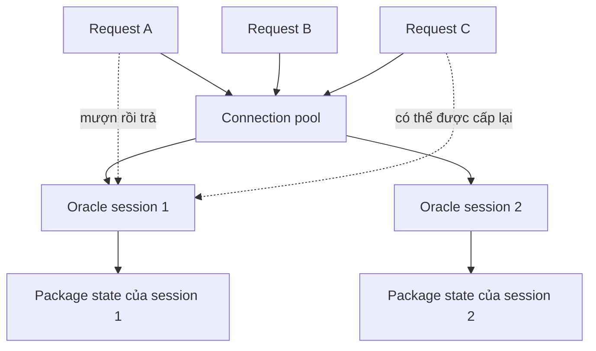

# Trạng thái package qua phiên và ảnh hưởng của connection pool

Trong Oracle Database, package PL/SQL có thể giữ trạng thái trong bộ nhớ của một database session. Trạng thái đó gồm package variable, cursor và dữ liệu package-level khác được khởi tạo khi package được instantiate trong session. Nó thường tồn tại qua nhiều lần gọi procedure/function, kể cả sau COMMIT hoặc ROLLBACK, và chỉ mất khi package được reset, bị invalidation theo cơ chế Oracle, hoặc session kết thúc.

Đặc điểm này dễ gây lỗi khi ứng dụng sử dụng **connection pool**. Ứng dụng thường mượn một logical connection để xử lý request rồi gọi close để trả connection về pool. Pool có thể giữ physical connection/database session mở và cấp lại session đó cho request khác. Nếu package đã lưu user ID, tenant ID, ngôn ngữ, quyền, bộ lọc hoặc dữ liệu tạm trong package global, request sau có thể nhìn thấy giá trị của request trước.

Điểm cần nhớ là **package state thuộc về database session, không thuộc về request, thread hay đối tượng Connection của ứng dụng**. Một package stateful không tự được khởi tạo lại mỗi lần gọi procedure, mỗi lần COMMIT hoặc mỗi lần ứng dụng trả logical connection về pool.

Bài học giải thích vòng đời package state, cách Oracle khởi tạo package, khác biệt stateful/stateless và SERIALLY_REUSABLE, lỗi khi package bị invalidation, cách pool tái sử dụng session, các rủi ro về dữ liệu người dùng và tenant, cùng các phương án reset/cleanup và thiết kế package an toàn.

## 1. Package state là gì?

### 1.1. Package có specification và body

Package PL/SQL thường gồm:

- **Package specification:** khai báo thành phần public như procedure, function, constant, type, cursor và variable.
- **Package body:** triển khai subprogram và có thể khai báo thành phần private; cuối body có thể có initialization section.

Ví dụ:

```sql
CREATE OR REPLACE PACKAGE request_context AS
    g_request_count PLS_INTEGER := 0;
    g_current_user  VARCHAR2(128);

    PROCEDURE begin_request(p_user IN VARCHAR2);
    PROCEDURE end_request;
END request_context;
/

CREATE OR REPLACE PACKAGE BODY request_context AS
    PROCEDURE begin_request(p_user IN VARCHAR2) IS
    BEGIN
        g_request_count := g_request_count + 1;
        g_current_user := p_user;
    END;

    PROCEDURE end_request IS
    BEGIN
        g_current_user := NULL;
    END;
BEGIN
    g_request_count := 0;
    g_current_user := NULL;
END request_context;
/
```

Các biến g_request_count và g_current_user là package state. Chúng nằm trong instance của package trong một database session. Phần initialization ở cuối package body chạy khi package được instantiate lần đầu trong session.

### 1.2. State được giữ ở đâu?

Package state gắn với session của Oracle. Nó không phải dữ liệu được lưu trong bảng và không tự chia sẻ giữa các session.

```sql
BEGIN
    request_context.begin_request('APP_USER_A');
END;
/

SELECT request_context.g_current_user
FROM dual;
```

Trong cùng session, lần gọi tiếp theo có thể nhìn thấy giá trị đã gán trước đó. Một session khác có instance package riêng và không tự nhìn thấy giá trị này.

### 1.3. Package state khác dữ liệu bảng

| Đặc điểm | Package variable | Dữ liệu trong bảng |
|---|---|---|
| Phạm vi | Một database session | Dùng chung theo quyền và transaction |
| Lưu trữ | Bộ nhớ session | Database storage |
| COMMIT/ROLLBACK | Không hoàn tác giá trị package | Có tác động theo transaction |
| Kết thúc session | State bị mất | Dữ liệu đã commit vẫn còn |
| Chia sẻ giữa session | Không tự chia sẻ | Có thể được session khác đọc |
| Dùng cho request state | Có thể nhưng phải quản lý vòng đời | Phù hợp hơn nếu cần lưu bền/chia sẻ |

Package variable thích hợp cho cache hoặc trạng thái nội bộ theo session có vòng đời rõ. Nó không phải cơ chế lưu dữ liệu bền vững, counter toàn hệ thống hay nơi lưu thông tin người dùng dùng chung giữa nhiều request.

## 2. Vòng đời package trong một session

### 2.1. Package được instantiate khi nào?

Một package thường được instantiate trong session khi một thành phần của package được tham chiếu lần đầu. Oracle cấp trạng thái package cho session và thực hiện phần khởi tạo cần thiết. Từ thời điểm đó, trạng thái được giữ cho những lần gọi tiếp theo trong session.

```sql
CREATE OR REPLACE PACKAGE demo_state AS
    g_value NUMBER := 10;
    PROCEDURE increase_value;
END demo_state;
/

CREATE OR REPLACE PACKAGE BODY demo_state AS
    PROCEDURE increase_value IS
    BEGIN
        g_value := g_value + 1;
    END;
END demo_state;
/
```

Trong một session:

```sql
BEGIN
    demo_state.increase_value;
    DBMS_OUTPUT.PUT_LINE(demo_state.g_value);

    demo_state.increase_value;
    DBMS_OUTPUT.PUT_LINE(demo_state.g_value);
END;
/
```

Giá trị được tăng qua từng lần gọi. Nếu session mới chạy đoạn code tương tự, instance package mới bắt đầu với giá trị ban đầu.

### 2.2. Initialization section

Package body có thể chứa phần executable ở cuối, sau các khai báo và subprogram:

```sql
CREATE OR REPLACE PACKAGE BODY session_settings AS
    g_initialized_at TIMESTAMP;
    g_mode VARCHAR2(20);

    PROCEDURE set_mode(p_mode IN VARCHAR2) IS
    BEGIN
        g_mode := p_mode;
    END;
BEGIN
    g_initialized_at := SYSTIMESTAMP;
    g_mode := 'DEFAULT';
END session_settings;
/
```

Initialization section chạy khi package được instantiate trong session. Nó không chạy lại mỗi lần gọi procedure trong package. Nếu initialization thực hiện truy vấn, đọc cấu hình hoặc cấp phát dữ liệu lớn, chi phí đó có thể xuất hiện ở lần gọi đầu tiên của package trong session.

### 2.3. State tồn tại qua nhiều lời gọi

```sql
BEGIN
    session_settings.set_mode('REPORT');
END;
/

BEGIN
    DBMS_OUTPUT.PUT_LINE(session_settings.g_mode);
END;
/
```

Hai block chạy trong cùng session sẽ quan sát cùng package state. Nếu block thứ hai chạy trên physical session khác, giá trị có thể vẫn là DEFAULT.

### 2.4. COMMIT và ROLLBACK không reset package state

Package variable không thuộc transaction:

```sql
BEGIN
    demo_state.g_value := 99;
    ROLLBACK;
    DBMS_OUTPUT.PUT_LINE(demo_state.g_value);
END;
/
```

ROLLBACK không khôi phục g_value về 10. Tương tự, COMMIT không xóa package state. Nếu code dùng package variable để lưu giá trị tạm trong một transaction, phải tự khôi phục state khi transaction thất bại hoặc kết thúc.

### 2.5. Session kết thúc

Khi database session thực sự bị kết thúc, instance package và state của session đó được giải phóng. Tuy nhiên, trong ứng dụng dùng pool, gọi close trên logical connection thường chỉ trả physical session về pool. Vì vậy không thể suy luận rằng package state đã mất chỉ từ việc code ứng dụng gọi close.

## 3. Stateful và stateless package

### 3.1. Stateful package

Package được xem là stateful khi nó giữ trạng thái có thể thay đổi giữa các lần gọi, ví dụ:

```sql
CREATE OR REPLACE PACKAGE shopping_context AS
    g_customer_id NUMBER;
    g_discount_rate NUMBER := 0;

    PROCEDURE set_customer(p_customer_id NUMBER);
    PROCEDURE set_discount(p_rate NUMBER);
END shopping_context;
/
```

Package này có state theo session. Sau khi một request đặt customer 1001 và discount 0.1, request khác dùng lại session có thể nhìn thấy các giá trị đó nếu không reset.

### 3.2. Stateless package

Package có thể tránh mutable package global và truyền dữ liệu qua parameter/local variable:

```sql
CREATE OR REPLACE PACKAGE order_calculation AS
    FUNCTION calculate_total(
        p_amount IN NUMBER,
        p_tax_rate IN NUMBER
    ) RETURN NUMBER;
END order_calculation;
/

CREATE OR REPLACE PACKAGE BODY order_calculation AS
    FUNCTION calculate_total(
        p_amount IN NUMBER,
        p_tax_rate IN NUMBER
    ) RETURN NUMBER
    IS
        l_total NUMBER;
    BEGIN
        l_total := p_amount * (1 + p_tax_rate);
        RETURN l_total;
    END;
END order_calculation;
/
```

Hàm dùng parameter và local variable, không lưu dữ liệu request trong package global. Cách thiết kế này giảm nguy cơ rò state khi physical session được tái sử dụng.

### 3.3. Constant và package state

Package constant không thể bị thay đổi sau khởi tạo, nhưng nó vẫn là thành phần package được khởi tạo trong session. Cần phân biệt immutable constant dùng như cấu hình với mutable variable chứa dữ liệu request.

Nếu constant được tính từ dữ liệu runtime trong initialization section, mỗi session có thể có giá trị được tính tại thời điểm instantiate khác nhau. Đừng coi package constant như một cấu hình toàn hệ thống luôn được đồng bộ tức thời.

### 3.4. Cursor và resource trong package

Package có thể khai báo cursor variable hoặc explicit cursor ở phạm vi package. Cursor đang mở có thể tồn tại qua các lời gọi trong session cho tới khi đóng hoặc session được reset/kết thúc. Giữ cursor mở trong package global có thể làm cạn open cursor limit hoặc giữ tài nguyên lâu hơn dự kiến.

Ưu tiên mở, fetch và đóng cursor trong một operation có vòng đời rõ; không để request sau phụ thuộc vào cursor mà request trước mở.

## 4. Connection pool và database session

### 4.1. Logical connection và physical session

Ứng dụng thường không tạo database session mới cho mỗi HTTP request. Connection pool giữ một tập physical connection đã mở đến Oracle. Khi request cần database:

1. Ứng dụng mượn một logical connection từ pool.
2. Logical connection được ánh xạ tới một physical connection/database session.
3. Request thực thi SQL/PLSQL trên session đó.
4. Ứng dụng close logical connection để trả connection về pool.
5. Pool có thể cấp lại cùng physical session cho request khác.



Request A và request C có thể dùng cùng session 1 ở hai thời điểm khác nhau. Package state session 1 còn lại sau request A nếu không được reset.

### 4.2. Connection.close không nhất thiết kết thúc database session

Trong pool, Connection.close thường đóng logical handle và trả connection về pool. Pool vẫn giữ physical connection mở để tái sử dụng. Vì thế:

- Package global có thể còn nguyên.
- ALTER SESSION settings có thể còn.
- Application context hoặc client identifier có thể còn nếu không xóa.
- Global temporary table với ON COMMIT PRESERVE ROWS có thể còn dữ liệu theo session.
- Temporary LOB, cursor hoặc resource session có thể cần cleanup theo API và cấu hình.

Hành vi cụ thể phụ thuộc driver/pool. Hãy đọc tài liệu pool và cấu hình reset/initialization callback, không giả định close tương đương logoff.

### 4.3. Pool có thể cấp session khác cho request tiếp theo

Nếu pool có nhiều physical connections, request tiếp theo có thể nhận một session khác. Vì vậy bug liên quan package state có thể không xuất hiện ổn định:

- Request A đặt g_tenant_id = 10 trên session 1.
- Request B được cấp session 2 nên thấy giá trị mặc định.
- Request C lại được cấp session 1 nên thấy tenant 10 còn sót.

Lỗi phụ thuộc connection được cấp và lịch sử sử dụng session, khiến nó khó tái hiện nếu chỉ test một connection hoặc một request.

### 4.4. Một physical session không phải một request

Không nên thiết kế package global với giả định một session chỉ xử lý một user hoặc một request trong suốt đời nó. Pool có thể tái sử dụng session cho nhiều request, user hoặc tenant. Đó là lý do session state phải được quản lý như resource có vòng đời riêng.

### 4.5. Application pool và Database Resident Connection Pooling

Có thể có pool ở nhiều tầng:

- Pool trong ứng dụng/JDBC/UCP hoặc application server quản lý các physical connection mà ứng dụng giữ.
- Database Resident Connection Pooling (DRCP) quản lý pooled server ở phía database và có thể được dùng cùng client pool phù hợp.

Các lớp pool có cơ chế attach/detach và quản lý session khác nhau. Dù dùng tầng nào, ứng dụng vẫn cần hiểu session state nào được giữ, state nào được reset và điều kiện để một request được gắn với session trước đó. Không suy ra package state sẽ được reset chỉ vì đã bật một cơ chế pooling.

## 5. Rủi ro khi package global giữ dữ liệu request

### 5.1. Rò dữ liệu giữa người dùng

Ví dụ package giữ user hiện tại:

```sql
CREATE OR REPLACE PACKAGE app_user_state AS
    g_user_id NUMBER;

    PROCEDURE set_user(p_user_id NUMBER);
    FUNCTION current_user RETURN NUMBER;
END app_user_state;
/

CREATE OR REPLACE PACKAGE BODY app_user_state AS
    PROCEDURE set_user(p_user_id NUMBER) IS
    BEGIN
        g_user_id := p_user_id;
    END;

    FUNCTION current_user RETURN NUMBER IS
    BEGIN
        RETURN g_user_id;
    END;
END app_user_state;
/
```

Nếu request A đặt user 1001 rồi trả connection về pool, request B có thể được cấp cùng session và nhìn thấy user 1001. Nếu ứng dụng dùng giá trị này để lọc dữ liệu hoặc quyết định quyền, đây có thể trở thành lỗi phân quyền nghiêm trọng.

### 5.2. Rò tenant context

Package global như g_tenant_id có thể bị bỏ quên khi request kết thúc. Request tenant 20 có thể vô tình chạy trên session còn tenant 10. Nếu SQL policy hoặc package khác dựa vào biến này, dữ liệu tenant có thể bị đọc/ghi sai.

Không dùng package global như ranh giới bảo mật. Mọi tenant/user context phải được thiết lập và xác minh theo mỗi lần mượn session, đồng thời được xóa khi trả session.

### 5.3. Rò locale, timezone và format

Package có thể lưu language, timezone hoặc format preference. Request sau nhận session cũ có thể dùng nhầm giá trị, dẫn đến ngày/giờ hoặc chuỗi được diễn giải sai.

NLS settings thường là session state riêng. Nếu ứng dụng thay đổi NLS bằng ALTER SESSION, cần reset hoặc thiết lập đầy đủ mỗi lần checkout.

### 5.4. Cache lỗi thời

Package có thể cache dữ liệu cấu hình, danh sách quyền hoặc thông tin lookup. Nếu dữ liệu trong bảng thay đổi, mỗi session có thể giữ bản cache riêng và stale trong khoảng thời gian dài. Pool càng nhiều session thì có thể có nhiều bản cache khác nhau.

Cache package cần có chính sách:

- Thời hạn sống.
- Điều kiện invalidate.
- Cập nhật khi dữ liệu thay đổi.
- Giới hạn memory.
- Cách xử lý khi session được trả về pool.

Nếu cần cache chia sẻ giữa session, cân nhắc cơ chế cache cấp database hoặc ứng dụng phù hợp, không dựa vào package global per-session.

### 5.5. Counter không phải counter toàn hệ thống

g_request_count trong package là counter theo session. Với 20 session trong pool, có thể có 20 giá trị khác nhau. Nó không đảm bảo số request tổng, không bền qua restart/session close và không đồng bộ giữa session.

Nếu cần số liệu tổng hợp hoặc sequence duy nhất, dùng bảng, sequence hoặc cơ chế thống kê phù hợp.

## 6. Package state không được transaction rollback

### 6.1. Package variable và DML có vòng đời khác nhau

```sql
BEGIN
    app_user_state.set_user(1001);

    UPDATE audit_demo
    SET note = 'started'
    WHERE audit_id = 1;

    ROLLBACK;
END;
/
```

DML được rollback nhưng app_user_state.g_user_id vẫn là 1001. Hai loại state có cơ chế quản lý khác nhau.

### 6.2. Savepoint cũng không khôi phục package state

SAVEPOINT và ROLLBACK TO chỉ điều khiển thay đổi transaction. Chúng không khôi phục giá trị package global về trạng thái trước savepoint.

Nếu procedure có cả DML và package state, cần thiết kế rõ thứ tự cập nhật và cleanup khi exception.

### 6.3. Exception không tự reset package

Khi exception thoát khỏi procedure, package state vẫn có thể còn nguyên trong session. Nếu package đã cập nhật global trước khi lỗi, request sau có thể thấy state dở dang.

Ví dụ:

```sql
BEGIN
    app_user_state.set_user(2002);
    RAISE_APPLICATION_ERROR(-20080, 'Simulated failure');
END;
/
```

Exception không làm package tự quay về giá trị cũ. Cleanup phải được viết tường minh hoặc được thực hiện bởi tầng quản lý session.

## 7. Reset package state

### 7.1. DBMS_SESSION.RESET_PACKAGE

Oracle cung cấp:

```sql
BEGIN
    DBMS_SESSION.RESET_PACKAGE;
END;
/
```

RESET_PACKAGE yêu cầu giải phóng trạng thái các package đã instantiate trong session. Việc reset có hiệu lực sau khi PL/SQL call hiện tại kết thúc theo quy tắc package/session của Oracle; không nên gọi giữa một operation rồi tiếp tục dựa vào package state vừa reset.

RESET_PACKAGE ảnh hưởng tất cả package state trong session, không chỉ một package do ứng dụng chọn. Vì vậy cần đánh giá dependency và chi phí khởi tạo lại package ở lần sử dụng tiếp theo.

### 7.2. DBMS_SESSION.MODIFY_PACKAGE_STATE

Oracle còn cung cấp:

```sql
BEGIN
    DBMS_SESSION.MODIFY_PACKAGE_STATE(
        DBMS_SESSION.REINITIALIZE
    );
END;
/
```

Hai lựa chọn thường được nhắc đến:

- DBMS_SESSION.REINITIALIZE: yêu cầu package state được khởi tạo lại khi package được tham chiếu tiếp theo; có thể giữ lại một phần memory đã cấp phát để tái sử dụng.
- DBMS_SESSION.FREE_ALL_RESOURCES: giải phóng package state và memory liên quan theo cơ chế tương ứng; lần dùng sau phải instantiate lại.

Chi tiết memory/performance và hành vi theo release cần đối chiếu tài liệu Oracle của phiên bản triển khai.

### 7.3. Reset package không phải reset toàn bộ session

RESET_PACKAGE không tự động làm sạch mọi loại session state. Nó không thay thế việc:

- ROLLBACK transaction chưa commit.
- Đóng cursor do ứng dụng mở.
- Xóa application context.
- Reset CLIENT_IDENTIFIER, MODULE/ACTION.
- Khôi phục ALTER SESSION settings.
- Xử lý dữ liệu trong global temporary table.
- Dọn resource khác do driver hoặc ứng dụng quản lý.

Pool cần một quy trình reset session tổng thể, không chỉ gọi RESET_PACKAGE rồi xem session là sạch.

### 7.4. Chi phí reset

Reset toàn bộ package state ở mỗi checkout có thể gây:

- Chạy lại initialization section.
- Tải lại cache package.
- Tăng CPU và thời gian request đầu tiên.
- Tạo thêm truy vấn cấu hình.
- Tăng parse/initialization workload.

Vì vậy, trước tiên nên thiết kế package stateless cho dữ liệu request. Chỉ reset package khi thật sự cần và có đo tác động.

### 7.5. Khi nào gọi reset?

Có thể cân nhắc ở ranh giới request nếu ứng dụng bắt buộc sử dụng package state legacy. Reset phải nằm ngoài luồng PL/SQL đang cần dùng package state, được gọi sau khi request hoàn tất và trước khi session trở lại pool. Cần phối hợp với pool callback và transaction cleanup.

Không gọi RESET_PACKAGE tùy tiện trong một procedure nghiệp vụ đang sử dụng nhiều package khác, vì lần gọi tiếp theo có thể phải khởi tạo lại chúng và thay đổi giả định của code.

## 8. Dọn session state ngoài package

### 8.1. CLIENT_IDENTIFIER

Ứng dụng có thể gắn định danh client vào session:

```sql
BEGIN
    DBMS_SESSION.SET_IDENTIFIER('user-1001');
END;
/
```

Khi trả connection về pool, xóa:

```sql
BEGIN
    DBMS_SESSION.CLEAR_IDENTIFIER;
END;
/
```

CLIENT_IDENTIFIER hữu ích cho audit, tracing và một số chính sách dựa trên context. Nó không tự là cơ chế xác thực hay phân quyền; phải được thiết lập từ nguồn đáng tin cậy và kết hợp với chính sách bảo mật thích hợp.

### 8.2. Application context

Application context là session context có namespace, attribute và giá trị. Namespace thường được bảo vệ bởi trusted package được khai báo khi tạo context.

Ví dụ khái quát:

```sql
CREATE OR REPLACE PACKAGE app_context_api AS
    PROCEDURE set_tenant(p_tenant_id IN VARCHAR2);
    PROCEDURE clear_tenant;
END app_context_api;
/

CREATE OR REPLACE PACKAGE BODY app_context_api AS
    PROCEDURE set_tenant(p_tenant_id IN VARCHAR2) IS
    BEGIN
        DBMS_SESSION.SET_CONTEXT(
            namespace => 'APP_CTX',
            attribute => 'TENANT_ID',
            value     => p_tenant_id
        );
    END;

    PROCEDURE clear_tenant IS
    BEGIN
        DBMS_SESSION.CLEAR_CONTEXT(
            namespace => 'APP_CTX',
            attribute => 'TENANT_ID'
        );
    END;
END app_context_api;
/

CREATE CONTEXT app_ctx USING app_context_api;
```

Đây là ví dụ cấu trúc. CREATE CONTEXT cần được thực hiện bởi user có quyền phù hợp; package trusted phải đáp ứng quy tắc Oracle và namespace phải được bảo vệ. Không cho caller bất kỳ quyền nào cũng có thể đặt tenant ID tùy ý.

### 8.3. CLEAR_CONTEXT

DBMS_SESSION.CLEAR_CONTEXT xóa context theo namespace/client identifier/attribute tùy cách ứng dụng dùng context. Cần dùng đúng tham số và phạm vi. Nếu context được đặt với client identifier, cleanup phải chỉ rõ đúng client identifier theo mô hình đã triển khai.

Không nhầm CLEAR_CONTEXT với RESET_PACKAGE: context và package state là hai cơ chế riêng.

### 8.4. MODULE và ACTION

Gắn thông tin request cho tracing:

```sql
BEGIN
    DBMS_APPLICATION_INFO.SET_MODULE(
        module_name => 'ORDER_API',
        action_name => 'CREATE_ORDER'
    );
END;
/
```

Khi kết thúc:

```sql
BEGIN
    DBMS_APPLICATION_INFO.SET_MODULE(NULL, NULL);
END;
/
```

MODULE/ACTION giúp quan sát workload qua V$SESSION và công cụ quản trị. Chúng cũng là session state và cần được reset để request sau không bị gắn nhầm nhãn.

### 8.5. ALTER SESSION

Các lệnh như:

```sql
ALTER SESSION SET NLS_DATE_FORMAT = 'YYYY-MM-DD';
ALTER SESSION SET CURRENT_SCHEMA = APP_OWNER;
```

thay đổi môi trường của session. Nếu pool tái sử dụng session, thay đổi có thể tồn tại sang request sau. Nên tránh thay đổi session parameter theo request nếu có thể bind đúng datatype/định danh rõ; nếu cần, lưu giá trị ban đầu và reset theo callback đã kiểm thử.

### 8.6. Global temporary table

Global temporary table có metadata dùng chung nhưng dữ liệu tạm thuộc session hoặc transaction tùy khai báo:

- ON COMMIT DELETE ROWS: dữ liệu được xóa khi transaction commit.
- ON COMMIT PRESERVE ROWS: dữ liệu được giữ đến khi session kết thúc hoặc được xóa theo thao tác phù hợp.

Với pooled session, PRESERVE ROWS có thể để lại dữ liệu cho request sau nếu không cleanup. Không giả định close logical connection sẽ kết thúc session hoặc xóa dữ liệu session-specific.

## 9. Thiết kế package an toàn cho connection pool

### 9.1. Ưu tiên parameter thay vì package global

Không nên để một procedure phụ thuộc ngầm vào global user/tenant được đặt bởi lời gọi trước:

```sql
app_user_state.set_user(p_user_id);
orders_api.list_orders;
```

Nên truyền dữ liệu request qua interface:

```sql
orders_api.list_orders(
    p_user_id   => p_user_id,
    p_from_date => p_from_date,
    p_to_date   => p_to_date,
    p_result    => l_result
);
```

Truyền dữ liệu request qua parameter giúp mối quan hệ đầu vào/đầu ra rõ ràng và không phụ thuộc lịch sử sử dụng session.

### 9.2. Local variable trong subprogram

Local variable được tạo trong phạm vi lời gọi và không tự tồn tại như package global qua các lần gọi:

```sql
CREATE OR REPLACE PACKAGE order_service AS
    PROCEDURE create_order(
        p_customer_id IN NUMBER,
        p_amount IN NUMBER
    );
END order_service;
/

CREATE OR REPLACE PACKAGE BODY order_service AS
    PROCEDURE create_order(
        p_customer_id IN NUMBER,
        p_amount IN NUMBER
    ) IS
        l_tax_rate NUMBER;
        l_total NUMBER;
    BEGIN
        l_tax_rate := 0.08;
        l_total := p_amount * (1 + l_tax_rate);

        INSERT INTO orders(customer_id, total_amount)
        VALUES (p_customer_id, l_total);
    END;
END order_service;
/
```

Local state có vòng đời gắn với call stack. Nếu cần state chia sẻ giữa nhiều subprogram trong cùng một request, truyền record/context tường minh hoặc dùng một abstraction có cleanup rõ.

### 9.3. Không dùng package global cho authorization

Không đặt g_is_admin, g_user_id hoặc g_tenant_id làm nguồn quyết định quyền mà không xác thực mỗi lần gọi. Request có thể được cấp session còn state từ request trước. Bảo mật phải dựa trên identity/context được xác thực và chính sách server-side, không dựa vào giá trị mutable mà caller có thể để sót.

### 9.4. Nếu phải giữ state, có API begin/end rõ

Một package legacy stateful có thể cung cấp:

```sql
PROCEDURE begin_request(...);
PROCEDURE end_request;
PROCEDURE reset_state;
```

begin_request phải gán tất cả field cần thiết, không chỉ gán field caller truyền. end_request phải xóa mọi dữ liệu nhạy cảm, cursor và flag. Có thể cung cấp reset_state để đặt giá trị mặc định. Tầng pool cần gọi cleanup trong cả luồng thành công và exception.

### 9.5. Idempotent cleanup

Cleanup nên có thể gọi nhiều lần mà không gây lỗi hoặc để lại state. Ví dụ, đóng cursor chỉ khi đang mở; xóa context kể cả khi chưa được set; gán NULL/default cho mọi global; reset module/action. Nếu cleanup lỗi, connection không nên được trả về pool như session sạch.

## 10. SERIALLY_REUSABLE package

### 10.1. Ý nghĩa

Package có pragma SERIALLY_REUSABLE được thiết kế để tái sử dụng bộ nhớ package theo từng server call thay vì giữ package state suốt vòng đời session. State của package được khởi tạo khi call bắt đầu và giải phóng/tái sử dụng sau khi call kết thúc theo cơ chế Oracle.

Ví dụ:

```sql
CREATE OR REPLACE PACKAGE batch_helper AS
    PRAGMA SERIALLY_REUSABLE;
    g_processed_count PLS_INTEGER := 0;
    PROCEDURE add_one;
END batch_helper;
/

CREATE OR REPLACE PACKAGE BODY batch_helper AS
    PRAGMA SERIALLY_REUSABLE;

    PROCEDURE add_one IS
    BEGIN
        g_processed_count := g_processed_count + 1;
    END;
END batch_helper;
/
```

Pragma cần được khai báo ở specification và body theo quy tắc Oracle. Kiểm tra tài liệu phiên bản đang dùng trước khi triển khai.

### 10.2. Không dùng để chia sẻ state giữa các request

Vì state chỉ tồn tại trong phạm vi server call, giá trị không phải nơi lưu dữ liệu cần truy cập ở một lần gọi sau. Điều này có thể hữu ích khi package cần working state tạm trong một call dài, nhưng không thay thế parameter hoặc bảng cho dữ liệu qua request.

### 10.3. Trade-off

SERIALLY_REUSABLE có thể giảm memory giữ lại trong session khi nhiều session sử dụng package có working state lớn. Đổi lại, package không thể dựa vào state còn lại giữa các call. Có các giới hạn về cách package được gọi và tương tác với những thành phần PL/SQL khác; cần kiểm tra compatibility trước khi thêm pragma vào package đang dùng.

### 10.4. So sánh

| Kiểu package | Vòng đời state | Phù hợp |
|---|---|---|
| Stateful thông thường | Từ lần instantiate đến reset/session end | Cache hoặc state thật sự theo session |
| Stateless theo thiết kế | Không giữ mutable request state ở package global | API dùng với connection pool |
| SERIALLY_REUSABLE | Theo server call | Working state tạm, cần giảm memory giữ theo session |

## 11. Package invalidation và lỗi ORA-04068

### 11.1. Vì sao package bị invalidated?

Package có dependency vào object khác. Khi package hoặc dependency thay đổi, Oracle có thể đánh dấu unit là INVALID hoặc làm state hiện tại không còn phù hợp. Ví dụ:

- Recompile package specification/body.
- Thay đổi bảng/view/type mà package phụ thuộc.
- Thay đổi package spec làm các dependent unit phải compile lại.
- Deploy DDL trong lúc ứng dụng vẫn có session đang giữ package state.

### 11.2. Các lỗi liên quan

| Error | Ý nghĩa khái quát |
|---|---|
| ORA-04061 | Existing state của package body đã bị invalidated |
| ORA-04065 | Unit không được thực thi vì đã bị alter/drop hoặc trạng thái không còn hợp lệ |
| ORA-04068 | Existing state của package đã bị discarded |
| ORA-06508 | PL/SQL không tìm thấy program unit cần thực thi hoặc unit không hợp lệ |

Lỗi cụ thể phụ thuộc trình tự DDL, trạng thái dependency và phiên bản Oracle.

### 11.3. State bị discard

Khi Oracle discard package state, các package variable không còn giữ giá trị cũ; package có thể được khởi tạo lại khi được gọi sau đó. Ứng dụng không nên tiếp tục giả định các global vẫn chứa giá trị request trước.

### 11.4. Retry có điều kiện

Không tự động retry mọi ORA-04068 mà không xem transaction. Nếu call trước đó đã thực hiện DML hoặc gọi dịch vụ ngoài, retry mù có thể tạo tác động trùng lặp. Cần:

1. Xác định lỗi xuất hiện ở bước nào.
2. Xác định transaction đã commit hay chưa.
3. Rollback phần chưa commit nếu contract cho phép.
4. Đảm bảo operation idempotent hoặc có idempotency key.
5. Mở lại/validate connection nếu pool yêu cầu.
6. Retry ở ranh giới request phù hợp, với giới hạn số lần.

### 11.5. Session exit behavior

Một số phiên bản Oracle có tham số SESSION_EXIT_ON_PACKAGE_STATE_ERROR để điều khiển hành vi session khi gặp package state error. Giá trị và hành vi cần xác nhận theo release/RU. Nếu session bị kết thúc, pool phải loại physical connection đó và tạo/nhận session khác; không trả một connection đã chết về pool.

### 11.6. Deploy package khi pool đang hoạt động

Khi triển khai package mới:

- Xác định package và dependency sẽ bị invalid.
- Chọn cửa sổ triển khai hoặc chiến lược rolling phù hợp.
- Biên dịch và kiểm tra lỗi trước khi mở traffic.
- Theo dõi ORA-04068/04061/06508 sau deploy.
- Có chính sách retry an toàn ở ứng dụng.
- Cân nhắc drain/evict session cũ nếu release và pool hỗ trợ.

Không giả định deploy package body không ảnh hưởng session đang giữ package state. Hành vi phụ thuộc loại thay đổi, dependency và phiên bản.

## 12. Connection pool: checkout, reset và return

### 12.1. Ranh giới request

Một vòng đời request nên có các bước:

1. Mượn connection.
2. Bắt đầu transaction hoặc xác định transaction policy.
3. Thiết lập session context cần thiết cho request.
4. Gắn client identifier/module/action nếu cần.
5. Thực hiện SQL/PLSQL.
6. Commit hoặc rollback rõ ràng.
7. Đóng cursor/resource.
8. Xóa context và session attributes.
9. Reset package state nếu kiến trúc bắt buộc.
10. Trả connection về pool.

Thứ tự chính xác phụ thuộc ứng dụng, nhưng cleanup phải chạy trong finally/equivalent ngay cả khi có exception.

### 12.2. Pseudocode ở tầng ứng dụng

```java
Connection connection = dataSource.getConnection();
try {
    connection.setAutoCommit(false);

    callBeginRequestContext(connection, authenticatedUser, tenantId);
    executeBusinessOperation(connection);

    connection.commit();
} catch (Exception e) {
    rollbackQuietly(connection);
    throw e;
} finally {
    try {
        clearRequestContext(connection);
        resetSessionAttributes(connection);
    } catch (Exception cleanupError) {
        // Đánh dấu/evict physical connection theo API của pool.
    } finally {
        connection.close(); // thường trả logical connection về pool
    }
}
```

Đây là pseudocode, không phải API cụ thể của một pool. clearRequestContext phải xóa package global, application context, client identifier và những session settings mà ứng dụng đã thay đổi. Nếu cleanup thất bại, không được mặc nhiên coi session an toàn để tái sử dụng.

### 12.3. Callback của pool

Các pool/driver có thể cung cấp callback hoặc cơ chế labeling/initialization để:

- Khởi tạo session khi physical connection được tạo.
- Thiết lập session state khi checkout.
- Reset session state khi return.
- Phân loại connection theo label như NLS, schema hoặc role.
- Validate connection trước khi cấp lại.

Tên callback và thời điểm chạy khác nhau giữa JDBC/UCP, application server và framework. Cần đọc đúng tài liệu của pool đang sử dụng. Initialization callback chỉ chạy lúc tạo physical connection không đủ để xử lý state thay đổi theo từng request; phần reset/checkout phải được thiết kế riêng.

### 12.4. Connection labeling

Một số pool hỗ trợ label để tìm connection đã có session state phù hợp, ví dụ NLS language hoặc current schema. Labeling giúp giảm chi phí đổi state nhưng có thể làm số nhóm session tăng và không tự giải quyết dữ liệu nhạy cảm bị rò. Không đưa user-specific secret hoặc tenant identity vào label như một cơ chế authorization.

### 12.5. Validate connection không đồng nghĩa reset state

Validation thường kiểm tra connection còn sống hoặc có thể thực thi câu kiểm tra. Nó không nhất thiết xóa package global, application context hoặc ALTER SESSION settings. Phải phân biệt health check với session cleanup.

## 13. Xử lý package state trong ứng dụng Java/JDBC

### 13.1. Logical close

```java
try (Connection connection = dataSource.getConnection()) {
    // Dùng connection trong request.
}
```

try-with-resources gọi close trên logical connection. Pool thường thu hồi connection để tái sử dụng; không nên coi đoạn code này là logoff database.

### 13.2. Gọi cleanup procedure

Ứng dụng có thể gọi procedure cleanup qua JDBC:

```java
try (CallableStatement call =
         connection.prepareCall("{ call app_session_cleanup.reset_request_state }")) {
    call.execute();
}
```

Procedure cleanup phải được thiết kế và kiểm thử để:

- Xóa mọi package global request-specific.
- Xóa application context đúng namespace.
- Clear client identifier.
- Reset module/action.
- Đóng cursor hoặc resource thuộc request.
- Không COMMIT/ROLLBACK ngoài contract đã thống nhất.

### 13.3. Không để cleanup phụ thuộc vào happy path

Nếu cleanup chỉ nằm sau dòng xử lý thành công, exception sẽ bỏ qua. Dùng finally, transaction synchronization hoặc callback của framework/pool để cleanup mọi đường thoát.

### 13.4. Evict connection khi cleanup thất bại

Nếu không thể xác nhận session đã được làm sạch, ứng dụng nên đánh dấu connection không thể tái sử dụng và yêu cầu pool loại physical connection theo API được hỗ trợ. Gọi close thông thường có thể chỉ trả session bẩn về pool.

### 13.5. Transaction manager

Trong ứng dụng dùng JTA hoặc transaction manager, connection có thể được enlist vào transaction và việc đóng logical handle không đồng nghĩa transaction đã hoàn tất. Session reset phải chạy sau khi transaction hoàn tất và theo thứ tự tương thích với pool/transaction manager.

## 14. DRCP và session state

### 14.1. Tại sao cần phân biệt?

DRCP chia sẻ pooled server process giữa các client connection/session theo cơ chế database. Nó khác với connection pool chỉ nằm trong JVM. Các session có thể được attach/detach khỏi pooled server; cách giữ session state phụ thuộc cấu hình, client và purity.

### 14.2. Session purity

Một số client/pool tích hợp DRCP có khái niệm purity, thường gặp các lựa chọn:

- NEW: yêu cầu session mới theo semantics DRCP.
- SELF: yêu cầu session đã được gắn với connection đó trước đây nếu còn phù hợp.
- DEFAULT: hành vi mặc định theo client/configuration.

Tên và API cụ thể phụ thuộc driver/DRCP release. Purity điều khiển việc gắn session, không phải lời hứa chung rằng mọi loại state đều tự cleanup theo cách ứng dụng mong muốn.

### 14.3. Kiểm chứng với DRCP

Nếu triển khai DRCP:

- Xác định client driver có hỗ trợ DRCP và purity không.
- Xem cấu hình pool và connection class.
- Kiểm tra package state qua nhiều lần checkout.
- Kiểm tra application context, NLS, GTT và cursor.
- Đo tác động của yêu cầu session mới lên pool utilization.
- Xác nhận behavior sau reconnect, failover và package invalidation.

Không trộn kết quả từ application pool thường với DRCP mà không ghi rõ cấu hình.

## 15. Kiểm thử lỗi state leakage

### 15.1. Hai session thủ công

Tạo package:

```sql
CREATE OR REPLACE PACKAGE pool_state_lab AS
    g_marker VARCHAR2(100);
    PROCEDURE set_marker(p_value VARCHAR2);
END pool_state_lab;
/

CREATE OR REPLACE PACKAGE BODY pool_state_lab AS
    PROCEDURE set_marker(p_value VARCHAR2) IS
    BEGIN
        g_marker := p_value;
    END;
END pool_state_lab;
/
```

Trong Session A:

```sql
BEGIN
    pool_state_lab.set_marker('REQUEST_A');
END;
/

SELECT pool_state_lab.g_marker FROM dual;
```

Trong cùng Session A, giá trị vẫn là REQUEST_A. Trong Session B, giá trị độc lập và ban đầu NULL. Đây là state theo session.

### 15.2. Mô phỏng tái sử dụng cùng session

Trong Session A, giả lập request kết thúc bằng cách chỉ COMMIT và chạy block khác:

```sql
COMMIT;

BEGIN
    DBMS_OUTPUT.PUT_LINE(pool_state_lab.g_marker);
END;
/
```

Giá trị REQUEST_A vẫn còn. COMMIT không reset package.

### 15.3. Mô phỏng cleanup

```sql
BEGIN
    pool_state_lab.g_marker := NULL;
END;
/
```

Hoặc trong lab riêng, thử:

```sql
BEGIN
    DBMS_SESSION.RESET_PACKAGE;
END;
/
```

Gọi package lại và quan sát initialization/default behavior. Ghi rõ thời điểm reset có hiệu lực theo quy tắc PL/SQL call.

### 15.4. Mô phỏng pool

Viết test integration dùng pool nhỏ có một physical connection. Request A đặt marker và close logical connection. Request B lấy connection từ pool và đọc marker. Nếu không có reset callback, request B có thể thấy marker của A.

Sau đó thêm cleanup ở return/checkout và lặp lại test. Chạy thêm pool có nhiều physical sessions để xác nhận bug phụ thuộc session được cấp.

### 15.5. Kiểm thử exception

Cho request A đặt user/tenant context rồi phát sinh exception trước khi cleanup. Xác nhận finally/callback vẫn chạy. Request B không được đọc giá trị của A.

### 15.6. Kiểm thử invalidation

Trong môi trường lab:

1. Mở hai session.
2. Session A instantiate package và gán state.
3. Session B recompile package hoặc dependency.
4. Session A gọi package lần tiếp theo.
5. Ghi nhận lỗi package state nếu có, state sau đó và behavior retry.

Không chạy thử recompile package đang được ứng dụng production sử dụng chỉ để tái hiện lỗi.

## 16. Quan sát session và package state

### 16.1. Nhận diện session

DBA có thể xem session:

```sql
SELECT sid,
       serial#,
       username,
       status,
       machine,
       program,
       module,
       action,
       client_identifier
FROM v$session
WHERE username = USER;
```

V$SESSION cần quyền phù hợp. SID/SERIAL# giúp xác định database session; module/action/client_identifier hỗ trợ liên kết session với request. Không dùng SID như định danh bền vững qua reconnect.

### 16.2. Package và dependency metadata

```sql
SELECT object_name,
       object_type,
       status,
       last_ddl_time
FROM user_objects
WHERE object_type IN ('PACKAGE', 'PACKAGE BODY')
ORDER BY object_name, object_type;
```

Xem dependency:

```sql
SELECT name,
       type,
       referenced_owner,
       referenced_name,
       referenced_type
FROM user_dependencies
WHERE type IN ('PACKAGE', 'PACKAGE BODY')
ORDER BY name, referenced_name;
```

Dictionary view cho biết object status/dependency, không phải toàn bộ giá trị package global trong mọi session. Không đọc hoặc sửa trực tiếp bộ nhớ package state của session khác.

### 16.3. V$OPEN_CURSOR

DBA có thể kiểm tra cursor theo session:

```sql
SELECT sid,
       user_name,
       sql_id,
       cursor_type,
       sql_text
FROM v$open_cursor
WHERE sid = :sid;
```

Open cursor trong session có thể đến từ SQL cache hoặc cursor đang mở tùy cursor type; không phải mọi dòng đều chứng minh ứng dụng quên đóng explicit cursor. Dùng thông tin này cùng session stats và code path để điều tra.

### 16.4. Session memory

Package state chiếm memory theo session. Khi có nhiều physical sessions và package cache lớn, tổng memory có thể đáng kể. DBA có thể quan sát session memory qua các view phù hợp như V$SESSTAT/V$STATNAME hoặc V$PROCESS tùy server mode và quyền. Không giả định một metric duy nhất phản ánh riêng package state; cần dùng tracing/diagnostics theo phiên bản.

## 17. Các anti-pattern thường gặp

### 17.1. Lưu user ID trong global rồi không clear

Lỗi: request sau có thể thừa hưởng user trước.

Thiết kế tốt hơn: truyền user ID qua parameter hoặc thiết lập context đã được xác thực mỗi lần checkout và clear khi return.

### 17.2. Package global làm cache quyền

Lỗi: quyền thay đổi trong database nhưng cache session không được invalidated; user khác có thể nhận cache sai.

Thiết kế tốt hơn: xác định cache scope/TTL/invalidation, phân vùng theo identity, không dùng cache làm cơ chế authorization cuối cùng.

### 17.3. Dùng package counter làm số liệu toàn hệ thống

Lỗi: counter chỉ theo session, mất khi session kết thúc và không đồng bộ.

Thiết kế tốt hơn: sequence, bảng thống kê, metric backend hoặc cơ chế atomic phù hợp.

### 17.4. Dựa vào COMMIT để reset

Lỗi: package state không thuộc transaction.

Thiết kế tốt hơn: cleanup tường minh và transaction cleanup riêng.

### 17.5. Chỉ reset khi request thành công

Lỗi: exception làm bỏ qua cleanup.

Thiết kế tốt hơn: finally/callback, kiểm tra lỗi cleanup và evict connection khi không thể bảo đảm session sạch.

### 17.6. Chỉ reset package mà bỏ qua session context

Lỗi: application context, client identifier, NLS hoặc GTT vẫn còn.

Thiết kế tốt hơn: session reset checklist bao quát mọi state ứng dụng có thể thay đổi.

### 17.7. Reset toàn bộ package ở mọi lần gọi mà không đo

Lỗi: initialization lặp lại, cache bị mất và latency tăng.

Thiết kế tốt hơn: package stateless; reset có chủ đích ở ranh giới request và đo chi phí.

### 17.8. Giả định pool luôn cấp cùng session

Lỗi: bug xuất hiện ngẫu nhiên vì request được phân phối tới session khác nhau.

Thiết kế tốt hơn: test với pool nhiều session, kiểm tra cả reuse và session mới.

## 18. Quy trình thiết kế và vận hành

### 18.1. Khi thiết kế package mới

1. Xác định có thật sự cần package global hay không.
2. Ưu tiên parameter và local variable cho request data.
3. Phân biệt immutable configuration với mutable session state.
4. Nếu có state, ghi rõ owner, scope, initialization và reset semantics.
5. Không dùng global cho authorization/tenant isolation nếu không có cơ chế xác thực và cleanup đáng tin cậy.
6. Đóng cursor/resource trong cùng operation.
7. Xem xét SERIALLY_REUSABLE chỉ khi phù hợp vòng đời và giới hạn của nó.

### 18.2. Khi tích hợp connection pool

1. Xác định pool giữ physical session bao lâu.
2. Xác định API checkout/return callback hoặc labeling.
3. Liệt kê toàn bộ session state ứng dụng có thể thay đổi.
4. Thiết kế initialization và reset tương ứng.
5. Gọi cleanup trong finally.
6. Rollback transaction chưa commit.
7. Xóa package/context/client/module/NLS/GTT state theo policy.
8. Evict connection nếu cleanup hoặc validation thất bại.
9. Kiểm thử nhiều request và nhiều physical sessions.

### 18.3. Khi triển khai package mới

1. Lập dependency và package inventory.
2. Xác định unit/session state có thể bị invalidated.
3. Biên dịch trong môi trường staging.
4. Kiểm tra USER_ERRORS và INVALID objects.
5. Đánh giá session đang giữ state cũ.
6. Chuẩn bị retry/idempotency và pool eviction/drain nếu cần.
7. Theo dõi package state errors sau release.

### 18.4. Khi điều tra sự cố

Thu thập:

- Request ID, user/tenant đã xác thực.
- Pool name, checkout/return time và connection label.
- Database SID/SERIAL#, client identifier, module/action.
- Package/object version và thời điểm DDL/recompile.
- Error stack, transaction status và retry history.
- Kết quả test khi dùng cùng physical session và session mới.

Không ghi giá trị nhạy cảm của package global vào log. Chỉ log tên field hoặc trạng thái đã được che phù hợp.

## 19. Checklist cho package và connection pool

- [ ] Package có mutable global state hay không?
- [ ] State có thực sự cần tồn tại qua nhiều lần gọi không?
- [ ] Có thể chuyển dữ liệu request sang parameter/local variable không?
- [ ] Package initialization có chạy truy vấn hoặc tải cache tốn kém không?
- [ ] Có cursor hoặc resource được giữ ở package scope không?
- [ ] COMMIT/ROLLBACK có bị hiểu nhầm là reset package không?
- [ ] Pool có tái sử dụng physical session giữa user/request không?
- [ ] Connection.close có chỉ trả logical handle về pool không?
- [ ] Có cleanup chạy cả success và exception không?
- [ ] Package global, application context và CLIENT_IDENTIFIER đều được reset?
- [ ] MODULE/ACTION, NLS, CURRENT_SCHEMA và GTT được xử lý?
- [ ] Cleanup thất bại có khiến connection bị evict không?
- [ ] Có test với một physical connection và với nhiều session không?
- [ ] Có test package invalidation/ORA-04068 sau deploy không?
- [ ] Retry có idempotent và transaction-safe không?
- [ ] Có theo dõi memory, open cursor và package initialization cost không?

## 20. Câu hỏi tự kiểm tra

1. Package state thuộc về request, connection object hay database session?
2. Package được instantiate khi nào trong một session?
3. Initialization section chạy bao nhiêu lần trong vòng đời package instance?
4. Vì sao package variable vẫn giữ giá trị sau COMMIT và ROLLBACK?
5. Stateful package khác stateless package ở điểm nào?
6. Vì sao package global không phù hợp để lưu user/tenant identity của request?
7. Logical connection khác physical database session như thế nào?
8. Vì sao Connection.close trong pool không nhất thiết kết thúc Oracle session?
9. Một request khác có thể nhận lại package state của request trước trong trường hợp nào?
10. Vì sao bug state leakage có thể xuất hiện không ổn định khi pool có nhiều connection?
11. Package state có được chia sẻ giữa hai Oracle session không?
12. DBMS_SESSION.RESET_PACKAGE có tác dụng gì và khi nào có hiệu lực?
13. RESET_PACKAGE có xóa application context, GTT rows và ALTER SESSION state không?
14. REINITIALIZE khác FREE_ALL_RESOURCES ở mục đích nào?
15. SERIALLY_REUSABLE thay đổi vòng đời package state ra sao?
16. ORA-04068 và ORA-04061 liên quan package invalidation thế nào?
17. Vì sao không nên retry mù sau package state error?
18. CLIENT_IDENTIFIER và application context phục vụ mục đích gì?
19. Vì sao validation connection không đồng nghĩa reset session state?
20. Connection labeling giúp gì và không thay thế cơ chế bảo mật nào?
21. DRCP khác application connection pool ở đâu?
22. Vì sao package global không nên dùng làm counter toàn hệ thống?
23. Cleanup nên được gọi ở đâu trong vòng đời request?
24. Khi cleanup thất bại, pool nên xử lý connection ra sao?
25. Cần kiểm thử những tình huống nào để phát hiện state leakage?

**Nguyên tắc cần nhớ:** package state sống theo database session. Connection pool tái sử dụng physical session, nên package global và các session attributes có thể tồn tại qua nhiều request. Hãy thiết kế package stateless cho dữ liệu request, truyền context tường minh, và nếu phải giữ state thì định nghĩa initialization/cleanup rõ ràng. Cleanup phải chạy cả khi exception, bao gồm package state lẫn application context và session settings. Sau package invalidation, xử lý ORA-04068 theo transaction và idempotency; không retry mù hoặc trả một session chưa được làm sạch về pool.
