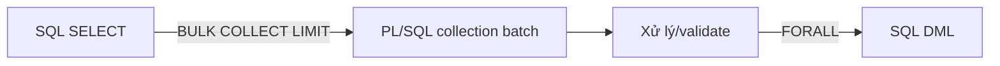

# BULK COLLECT, LIMIT và giới hạn bộ nhớ PGA trong PL/SQL

PL/SQL thường xử lý dữ liệu theo từng hàng: fetch một hàng từ SQL engine, chạy logic PL/SQL, rồi tiếp tục fetch hàng kế tiếp. Với tập dữ liệu lớn, cách xử lý từng hàng có thể tạo nhiều lần chuyển điều khiển giữa SQL engine và PL/SQL engine. Cơ chế **bulk SQL** giảm số lần chuyển đổi đó bằng cách chuyển nhiều hàng trong một lần.

Hai thành phần quan trọng là:

- **BULK COLLECT:** lấy nhiều hàng từ SQL engine vào collection PL/SQL trong một lần fetch.
- **LIMIT:** giới hạn số hàng được lấy trong mỗi lần bulk fetch trên explicit cursor hoặc ref cursor.

Ví dụ fetch theo batch:

```sql
DECLARE
    CURSOR c_orders IS
        SELECT order_id, customer_id, total_amount
        FROM orders
        WHERE order_date >= DATE '2026-01-01';

    TYPE t_order_rows IS TABLE OF c_orders%ROWTYPE;
    l_batch t_order_rows;
BEGIN
    OPEN c_orders;
    LOOP
        FETCH c_orders BULK COLLECT INTO l_batch LIMIT 500;
        EXIT WHEN l_batch.COUNT = 0;
        FOR i IN 1 .. l_batch.COUNT LOOP
            DBMS_OUTPUT.PUT_LINE(l_batch(i).order_id);
        END LOOP;
    END LOOP;
    CLOSE c_orders;
END;
/
```

LIMIT trong ví dụ giới hạn tối đa 500 hàng mỗi lần fetch. Nó không đặt một giới hạn byte tuyệt đối cho bộ nhớ. Nếu mỗi hàng chứa nhiều cột hoặc chuỗi dài, batch 500 hàng có thể tiêu thụ PGA lớn hơn nhiều so với 500 hàng hẹp. Vì vậy, cần chọn batch size dựa trên kích thước hàng, số session đồng thời, ngân sách PGA và phép đo thực tế.

## 1. Vì sao cần BULK COLLECT?

### 1.1. Xử lý từng hàng có chi phí chuyển đổi

Trong mô hình PL/SQL thông thường, mỗi lần FETCH chuyển một hàng từ SQL engine sang PL/SQL engine. Nếu xử lý hàng triệu hàng, số lần chuyển đổi có thể rất lớn:

```sql
DECLARE
    CURSOR c_orders IS
        SELECT order_id, total_amount
        FROM orders;
    l_order_id orders.order_id%TYPE;
    l_amount   orders.total_amount%TYPE;
BEGIN
    OPEN c_orders;
    LOOP
        FETCH c_orders INTO l_order_id, l_amount;
        EXIT WHEN c_orders%NOTFOUND;
        NULL; -- Xử lý từng hàng.
    END LOOP;
    CLOSE c_orders;
END;
/
```

Mẫu này rõ ràng và phù hợp với logic cần xử lý từng hàng. Nhưng nếu phần xử lý chủ yếu là di chuyển dữ liệu qua lại giữa SQL và PL/SQL, số lần chuyển đổi có thể tạo overhead.

### 1.2. Bulk fetch chuyển nhiều hàng mỗi lần

```sql
DECLARE
    TYPE t_order_ids IS TABLE OF orders.order_id%TYPE;
    l_order_ids t_order_ids;
BEGIN
    SELECT order_id
    BULK COLLECT INTO l_order_ids
    FROM orders
    WHERE status_code = 'READY';
    DBMS_OUTPUT.PUT_LINE('Rows=' || l_order_ids.COUNT);
END;
/
```

Thay vì gọi FETCH một lần cho từng hàng, SQL engine chuyển một tập kết quả sang collection. Điều này có thể giảm context switch và tăng throughput cho tác vụ đọc/xử lý theo lô.

### 1.3. Bulk SQL không phải lúc nào cũng nhanh hơn

BULK COLLECT có chi phí cấp phát và giữ collection trong bộ nhớ, sao chép dữ liệu giữa SQL engine và PL/SQL engine, duyệt collection trong PL/SQL và có thể giữ nhiều dữ liệu hơn mức cần thiết.

Nếu SQL có thể làm toàn bộ công việc bằng một câu UPDATE, INSERT SELECT, MERGE hoặc DELETE, hãy ưu tiên xử lý set-based trong SQL:

```sql
UPDATE orders
SET status_code = 'ARCHIVED'
WHERE order_date < DATE '2025-01-01';
```

Cách này thường đơn giản và hiệu quả hơn fetch tất cả hàng về PL/SQL rồi update từng hàng. BULK COLLECT phù hợp khi cần logic PL/SQL cho từng phần tử hoặc phải chuyển dữ liệu sang một xử lý khác theo batch.

## 2. Collection nhận dữ liệu BULK COLLECT

### 2.1. Collection là gì?

Collection là cấu trúc PL/SQL chứa nhiều phần tử cùng một kiểu hoặc cùng một record type. Các kiểu phổ biến gồm associative array, nested table và VARRAY. BULK COLLECT có thể nạp dữ liệu vào các collection phù hợp; kiểu phần tử phải tương thích với SELECT list.

### 2.2. Collection một cột

```sql
DECLARE
    TYPE t_employee_ids IS TABLE OF employees.employee_id%TYPE;
    l_employee_ids t_employee_ids;
BEGIN
    SELECT employee_id
    BULK COLLECT INTO l_employee_ids
    FROM employees
    WHERE department_id = 50;

    FOR i IN 1 .. l_employee_ids.COUNT LOOP
        DBMS_OUTPUT.PUT_LINE(l_employee_ids(i));
    END LOOP;
END;
/
```

Nested table được khai báo bằng TYPE ... IS TABLE OF. Sau SELECT, collection có thể được duyệt bằng COUNT và chỉ số phần tử.

### 2.3. Associative array

```sql
DECLARE
    TYPE t_employee_ids IS TABLE OF employees.employee_id%TYPE
        INDEX BY PLS_INTEGER;
    l_employee_ids t_employee_ids;
BEGIN
    SELECT employee_id
    BULK COLLECT INTO l_employee_ids
    FROM employees
    WHERE department_id = 50;
    DBMS_OUTPUT.PUT_LINE('Count=' || l_employee_ids.COUNT);
END;
/
```

Associative array dùng chỉ số PL/SQL và không cần khởi tạo constructor như nested table/varray. Với bulk fetch thông thường, các phần tử được nạp theo chỉ số liên tiếp từ 1.

### 2.4. Collection nhiều cột bằng record

```sql
DECLARE
    CURSOR c_employee IS
        SELECT employee_id, last_name, salary
        FROM employees
        WHERE department_id = 50;
    TYPE t_employee_rows IS TABLE OF c_employee%ROWTYPE;
    l_employees t_employee_rows;
BEGIN
    SELECT employee_id, last_name, salary
    BULK COLLECT INTO l_employees
    FROM employees
    WHERE department_id = 50;
END;
/
```

Collection type được neo vào cursor projection. SELECT list phải tương thích với record đó. Nếu cursor có expression, hãy đặt alias rõ ràng.

### 2.5. Nhiều collection song song

```sql
DECLARE
    TYPE t_id_list IS TABLE OF employees.employee_id%TYPE;
    TYPE t_name_list IS TABLE OF employees.last_name%TYPE;
    TYPE t_salary_list IS TABLE OF employees.salary%TYPE;
    l_ids      t_id_list;
    l_names    t_name_list;
    l_salaries t_salary_list;
BEGIN
    SELECT employee_id, last_name, salary
    BULK COLLECT INTO l_ids, l_names, l_salaries
    FROM employees
    WHERE department_id = 50;

    FOR i IN 1 .. l_ids.COUNT LOOP
        DBMS_OUTPUT.PUT_LINE(
            l_ids(i) || ': ' || l_names(i) || ' / ' || l_salaries(i)
        );
    END LOOP;
END;
/
```

Các collection phải có số phần tử tương ứng theo cùng thứ tự hàng. Nếu cần giữ nhiều cột liên quan, collection record thường dễ đọc và ít nguy cơ lệch chỉ số hơn parallel collections.

## 3. BULK COLLECT trong SELECT INTO

### 3.1. Lấy toàn bộ kết quả

Cú pháp:

```sql
SELECT select_list
BULK COLLECT INTO collection [, collection ...]
FROM ...
WHERE ...;
```

Ví dụ:

```sql
DECLARE
    TYPE t_names IS TABLE OF employees.last_name%TYPE;
    l_names t_names;
BEGIN
    SELECT last_name
    BULK COLLECT INTO l_names
    FROM employees
    WHERE department_id = 50;
    DBMS_OUTPUT.PUT_LINE(l_names.COUNT);
END;
/
```

SELECT BULK COLLECT INTO lấy toàn bộ tập kết quả của câu SELECT vào collection. Đây là cách đơn giản cho tập kết quả có kích thước nhỏ hoặc đã được giới hạn rõ.

### 3.2. Không có hàng không phát sinh NO_DATA_FOUND

Khác với SELECT ... INTO scalar/record, SELECT ... BULK COLLECT INTO không phát sinh NO_DATA_FOUND chỉ vì truy vấn không trả hàng. Collection kết quả rỗng và COUNT bằng 0:

```sql
DECLARE
    TYPE t_ids IS TABLE OF employees.employee_id%TYPE;
    l_ids t_ids;
BEGIN
    SELECT employee_id
    BULK COLLECT INTO l_ids
    FROM employees
    WHERE department_id = -999;

    IF l_ids.COUNT = 0 THEN
        DBMS_OUTPUT.PUT_LINE('No rows');
    END IF;
END;
/
```

Không viết exception NO_DATA_FOUND như cơ chế kiểm tra kết quả rỗng cho SELECT BULK COLLECT.

### 3.3. SELECT BULK COLLECT không có LIMIT

Cú pháp SELECT ... BULK COLLECT INTO không có mệnh đề LIMIT. Nếu truy vấn trả về rất nhiều hàng, collection sẽ nhận toàn bộ tập kết quả và có thể dùng nhiều PGA.

Để giới hạn số hàng mỗi lần lấy, dùng explicit cursor hoặc ref cursor với:

```sql
FETCH cursor_name BULK COLLECT INTO collection LIMIT n;
```

Đây là khác biệt cốt lõi giữa bulk collect toàn bộ và bulk fetch theo batch.

### 3.4. ROWNUM/FETCH FIRST không thay thế batching tổng thể

Có thể giới hạn tổng số hàng của một query bằng điều kiện SQL hoặc row limiting clause, nhưng điều đó thay đổi tập kết quả chứ không tự tạo vòng lặp xử lý tất cả dữ liệu theo nhiều batch. Nếu cần xử lý toàn bộ hàng với giới hạn bộ nhớ, hãy fetch cursor theo LIMIT.

### 3.5. Dynamic SELECT BULK COLLECT

```sql
DECLARE
    TYPE t_ids IS TABLE OF employees.employee_id%TYPE;
    l_ids t_ids;
BEGIN
    EXECUTE IMMEDIATE
        'SELECT employee_id
         FROM employees
         WHERE department_id = :dept_id'
    BULK COLLECT INTO l_ids
    USING 50;
END;
/
```

Đây vẫn là bulk collect toàn bộ kết quả của dynamic SELECT. EXECUTE IMMEDIATE không thêm LIMIT vào cú pháp này. Nếu cần fetch nhiều batch từ dynamic query, mở REF CURSOR rồi FETCH BULK COLLECT LIMIT.

## 4. FETCH BULK COLLECT với LIMIT

### 4.1. Cú pháp

```sql
FETCH cursor_name
BULK COLLECT INTO collection [, collection ...]
LIMIT number_of_rows;
```

LIMIT là số hàng tối đa được chuyển vào collection trong một lần fetch. Nếu số hàng còn lại ít hơn LIMIT, lần fetch cuối chỉ trả số hàng còn lại.

### 4.2. Mẫu vòng lặp chuẩn

```sql
DECLARE
    CURSOR c_orders IS
        SELECT order_id, customer_id, total_amount
        FROM orders
        WHERE status_code = 'READY'
        ORDER BY order_id;
    TYPE t_order_rows IS TABLE OF c_orders%ROWTYPE;
    l_batch t_order_rows;
BEGIN
    OPEN c_orders;
    LOOP
        FETCH c_orders BULK COLLECT INTO l_batch LIMIT 500;
        EXIT WHEN l_batch.COUNT = 0;
        FOR i IN 1 .. l_batch.COUNT LOOP
            DBMS_OUTPUT.PUT_LINE(l_batch(i).order_id);
        END LOOP;
    END LOOP;
    CLOSE c_orders;
END;
/
```

Mỗi lần FETCH nạp tối đa 500 hàng vào l_batch. Sau khi xử lý xong batch, vòng lặp fetch batch tiếp theo.

### 4.3. Vì sao kiểm tra collection.COUNT = 0?

Mẫu an toàn là:

```sql
FETCH c_orders BULK COLLECT INTO l_batch LIMIT 500;
EXIT WHEN l_batch.COUNT = 0;
```

Không nên dựa máy móc vào:

```sql
EXIT WHEN c_orders%NOTFOUND;
```

Với bulk fetch, một lần fetch có thể trả được một batch hàng rồi đồng thời cursor đã chạm cuối nguồn dữ liệu. Nếu thoát chỉ dựa vào %NOTFOUND ngay sau fetch, có thể bỏ qua batch vừa nhận ở lần fetch cuối. Kiểm tra collection count đảm bảo batch có hàng được xử lý trước khi vòng lặp kết thúc.

### 4.4. Collection được thay bằng batch mới

Trong mỗi lần FETCH BULK COLLECT, collection đích được nạp lại với kết quả của lần fetch đó; không nên coi nó là nơi tự động tích lũy mọi batch. Hãy xử lý các phần tử trước lần fetch tiếp theo.

Nếu muốn tích lũy toàn bộ hàng vào một collection khác, cần chủ động nối dữ liệu, nhưng việc đó làm tổng memory tăng theo toàn bộ tập kết quả và có thể triệt tiêu lợi ích giới hạn bộ nhớ.

### 4.5. Đóng cursor trong exception

```sql
DECLARE
    CURSOR c_orders IS
        SELECT order_id, total_amount FROM orders;
    TYPE t_order_rows IS TABLE OF c_orders%ROWTYPE;
    l_batch t_order_rows;
BEGIN
    OPEN c_orders;
    LOOP
        FETCH c_orders BULK COLLECT INTO l_batch LIMIT 500;
        EXIT WHEN l_batch.COUNT = 0;
        FOR i IN 1 .. l_batch.COUNT LOOP
            NULL; -- Xử lý hàng.
        END LOOP;
    END LOOP;
    CLOSE c_orders;
EXCEPTION
    WHEN OTHERS THEN
        IF c_orders%ISOPEN THEN
            CLOSE c_orders;
        END IF;
        RAISE;
END;
/
```

Trong code thực tế, phần xử lý exception phải giữ nguyên lỗi gốc và có thể ghi log an toàn. Không bỏ qua lỗi chỉ để cursor đóng thành công.

### 4.6. Kết quả theo thứ tự

Nếu thứ tự xử lý có ý nghĩa, thêm ORDER BY với khóa đủ ổn định, thường là khóa duy nhất hoặc khóa phụ để phân định hàng trùng giá trị. Nếu không có ORDER BY, Oracle không bảo đảm thứ tự hàng giữa các lần fetch hoặc giữa các execution plan.

## 5. LIMIT giới hạn hàng, không giới hạn byte

### 5.1. Cùng LIMIT nhưng memory khác nhau

Hai batch đều có 500 hàng nhưng mức dùng bộ nhớ có thể khác:

| Đặc điểm hàng | Ví dụ | Tác động |
|---|---|---|
| Hẹp | NUMBER ID, DATE | Mỗi phần tử tương đối nhỏ |
| Trung bình | ID, nhiều VARCHAR2 ngắn, NUMBER | Tăng theo số cột và dữ liệu thực |
| Rộng | Nhiều VARCHAR2 dài, RAW hoặc record phức tạp | Batch có thể tiêu thụ memory lớn |
| Có nested/LOB locator | Cấu trúc dữ liệu phức tạp | Có thêm overhead và resource lifetime cần xem xét |

LIMIT 500 không có nghĩa tối đa 500 KB hoặc 5 MB. Nó chỉ giới hạn số hàng.

### 5.2. Ước lượng sơ bộ

```text
Batch memory ≈ số hàng trong batch × kích thước trung bình dữ liệu mỗi hàng
              + overhead collection
              + overhead metadata/allocator
              + bộ nhớ xử lý trung gian
```

Đây chỉ là ước lượng để định hướng. Kích thước thực tế phụ thuộc datatype, character set, độ dài dữ liệu, cách lưu collection, alignment, runtime và các bản sao dữ liệu trong logic xử lý.

Ví dụ minh họa:

| Kích thước trung bình giả định | LIMIT | Dữ liệu thô ước tính |
|---:|---:|---:|
| 100 bytes | 500 | 50 KB |
| 1 KB | 500 | 500 KB |
| 4 KB | 500 | 2 MB |
| 4 KB | 5.000 | 20 MB |

Các con số này chưa tính overhead, temporary values, collection metadata, các collection song song và memory của những session khác. Không dùng chúng như cam kết PGA.

### 5.3. Row width quan trọng như row count

Nếu query SELECT * từ bảng có 80 cột, batch 1.000 hàng có thể nặng hơn nhiều so với query chỉ lấy 3 cột cần thiết. Chỉ chọn cột thực sự sử dụng:

```sql
SELECT order_id, customer_id, total_amount
FROM orders
WHERE status_code = 'READY';
```

Giảm projection giúp giảm dữ liệu phải truyền, collection memory và CPU xử lý.

### 5.4. Nhiều collection làm tăng memory

Nếu fetch cùng lúc vào 5 collection song song, mỗi collection có thể giữ một mảng phần tử. Record collection thường giúp liên kết dữ liệu dễ hơn, nhưng memory vẫn phụ thuộc tổng field. Không nên tạo bản sao collection hoặc biến tạm lớn nếu không cần.

### 5.5. Bản sao và chuỗi trung gian

Code xử lý có thể tạo thêm collection thứ hai để transform, chuỗi ghép từ nhiều cột, JSON/XML CLOB trung gian, array/buffer trong package khác hoặc biến tạm giữ cùng dữ liệu. PGA peak không chỉ bằng kích thước l_batch. Hãy tính memory của cả pipeline và các session chạy song song.

## 6. PGA trong Oracle Database

### 6.1. PGA là gì?

Program Global Area (PGA) là vùng memory riêng cho server process hoặc background process. Trong dedicated server, PGA thường chứa session memory riêng, stack, sort/hash work areas và các vùng làm việc của process. Collection PL/SQL và các biến xử lý có thể đóng góp vào memory của session/process.

PGA khác SGA:

| PGA | SGA |
|---|---|
| Memory riêng cho process/session tùy server mode | Memory dùng chung của instance |
| Chứa stack, session memory và work areas | Chứa buffer cache, shared pool, redo buffer và các thành phần chung |
| Không được session khác đọc trực tiếp như vùng chia sẻ | Nhiều session/process cùng sử dụng |
| Thường tăng theo số process/session hoạt động | Được quản lý ở cấp instance |

Trong shared server, UGA/session memory có thể nằm trong SGA thay vì PGA. Vì vậy, vị trí chính xác của session memory phụ thuộc kiến trúc kết nối; các tham số PGA vẫn quan trọng cho work area/process memory.

### 6.2. PGA_AGGREGATE_TARGET

`PGA_AGGREGATE_TARGET` là mục tiêu quản lý PGA ở cấp instance. Oracle dùng giá trị này để điều chỉnh các work area tự động như sort và hash join. Đây là target, không phải giới hạn cứng cho mọi loại memory của một session.

Nếu tổng nhu cầu memory tăng, Oracle có thể điều chỉnh work area để giảm tiêu thụ, chẳng hạn sort/hash có thể chuyển sang one-pass hoặc multi-pass. Tuy nhiên, không nên giả định cơ chế này tự thu nhỏ mọi PL/SQL collection.

### 6.3. PGA_AGGREGATE_LIMIT

`PGA_AGGREGATE_LIMIT` là ngưỡng giới hạn tổng PGA của instance theo cơ chế Oracle. Khi vượt ngưỡng, Oracle có thể chọn terminate các session/process tiêu thụ memory không thể điều chỉnh, và có thể phát sinh lỗi như ORA-04036.

PGA_AGGREGATE_LIMIT không phải quota riêng cho từng BULK COLLECT. Một session bulk collect lớn có thể góp phần làm tổng PGA vượt giới hạn, đặc biệt khi nhiều session cùng chạy.

### 6.4. PGA của một session và tổng PGA của instance

Giả sử mỗi session giữ 20 MB collection và có 40 session cùng chạy:

```text
20 MB/session × 40 sessions = 800 MB dữ liệu batch ước tính
```

Con số thực tế còn overhead và memory khác. Điều quan trọng là một batch có thể an toàn trong thử nghiệm một session nhưng gây áp lực khi concurrency tăng.

### 6.5. Không nhầm work area với collection

Sort, hash join và bitmap merge có work area được Oracle quản lý theo cơ chế PGA memory management. PL/SQL collection là dữ liệu ứng dụng giữ trong session. Tăng hoặc giảm PGA_AGGREGATE_TARGET có thể tác động tổng thể, nhưng không thay thế việc chọn LIMIT hợp lý và giới hạn số collection/số session đồng thời.

## 7. Chọn LIMIT như thế nào?

### 7.1. Không có một con số tối ưu cho mọi workload

LIMIT 100, 500, 1.000 hoặc 10.000 đều có thể phù hợp trong một bối cảnh cụ thể. Giá trị tốt phụ thuộc độ rộng row, số cột được fetch, datatype và độ dài chuỗi, số collection và dữ liệu tạm, số session chạy đồng thời, PGA hiện có, thời gian xử lý mỗi batch, chi phí context switch và tính chất transaction.

Không sao chép LIMIT từ một hệ thống khác mà không đo.

### 7.2. Điểm bắt đầu thử nghiệm

Có thể thử một dải giá trị nhỏ đến lớn, ví dụ 100, 250, 500, 1.000 và 2.000 hàng. Đây là điểm bắt đầu benchmark, không phải khuyến nghị cố định.

Với row rất rộng hoặc nhiều session đồng thời, bắt đầu thấp hơn. Với row hẹp và batch processing đơn giản, có thể thử cao hơn nếu memory còn dư.

### 7.3. Đo nhiều lần

Với mỗi LIMIT, ghi elapsed time, rows per second, số lần fetch/batch, PGA memory hiện tại và mức cao nhất quan sát được, CPU time, buffer gets/physical reads, p95 latency nếu chạy nhiều request và số session đồng thời.

Tăng LIMIT có thể giảm số lần fetch nhưng làm batch lớn hơn. Khi thời gian không cải thiện đáng kể mà PGA tăng mạnh, giá trị lớn hơn không còn lợi ích rõ.

### 7.4. Tối ưu theo cả throughput và memory

Không chọn LIMIT chỉ theo thời gian thấp nhất. Hãy đặt giới hạn memory cho mỗi job/session và cho instance. Ví dụ một batch nhanh hơn 5% nhưng dùng memory gấp 4 lần có thể làm hệ thống kém ổn định khi concurrency tăng.

### 7.5. Batch size thích nghi

Một số ứng dụng có thể cấu hình LIMIT theo loại job hoặc độ rộng dữ liệu. Nếu có cơ chế điều chỉnh động, phải có ngưỡng tối đa/tối thiểu và dựa trên metric tin cậy. Tránh thay LIMIT liên tục theo một số đo tức thời nhiễu.

## 8. BULK COLLECT kết hợp FORALL

### 8.1. Hai chiều bulk

BULK COLLECT chuyển nhiều hàng từ SQL sang PL/SQL. FORALL chuyển nhiều giá trị từ collection PL/SQL sang một DML statement được thực thi lặp theo tập bind.



Kết hợp hai cơ chế thường hữu ích cho ETL, batch update hoặc xử lý dữ liệu cần PL/SQL logic.

### 8.2. Ví dụ update theo batch

```sql
DECLARE
    CURSOR c_orders IS
        SELECT order_id, total_amount
        FROM orders
        WHERE status_code = 'READY'
        ORDER BY order_id;
    TYPE t_order_rows IS TABLE OF c_orders%ROWTYPE;
    l_batch t_order_rows;
    TYPE t_order_ids IS TABLE OF orders.order_id%TYPE
        INDEX BY PLS_INTEGER;
    TYPE t_new_statuses IS TABLE OF orders.status_code%TYPE
        INDEX BY PLS_INTEGER;
    l_ids t_order_ids;
    l_statuses t_new_statuses;
BEGIN
    OPEN c_orders;
    LOOP
        FETCH c_orders BULK COLLECT INTO l_batch LIMIT 500;
        EXIT WHEN l_batch.COUNT = 0;
        l_ids.DELETE;
        l_statuses.DELETE;
        FOR i IN 1 .. l_batch.COUNT LOOP
            l_ids(i) := l_batch(i).order_id;
            l_statuses(i) := 'PROCESSED';
        END LOOP;
        FORALL i IN 1 .. l_ids.COUNT
            UPDATE orders
            SET status_code = l_statuses(i)
            WHERE order_id = l_ids(i);
    END LOOP;
    CLOSE c_orders;
EXCEPTION
    WHEN OTHERS THEN
        IF c_orders%ISOPEN THEN
            CLOSE c_orders;
        END IF;
        RAISE;
END;
/
```

Ví dụ minh họa luồng; trong thực tế cần xác định cursor consistency, row locking, transaction boundary và việc query cursor có đọc lại những hàng vừa update hay không. Có thể dùng staging/claim pattern hoặc điều kiện trạng thái phù hợp để tránh xử lý trùng.

### 8.3. FORALL với INDICES OF

Nếu collection sparse hoặc chỉ số không liên tục, dùng cú pháp phù hợp:

```sql
FORALL i IN INDICES OF l_ids
    UPDATE orders
    SET status_code = l_statuses(i)
    WHERE order_id = l_ids(i);
```

Các collection được tham chiếu trong DML phải có phần tử tại các index được FORALL duyệt. Nếu hai collection song song, bảo đảm index tương ứng tồn tại ở cả hai.

### 8.4. SQL%BULK_ROWCOUNT

Sau FORALL, SQL%BULK_ROWCOUNT(i) cho biết số hàng DML tác động ở iteration i:

```sql
FOR i IN 1 .. l_ids.COUNT LOOP
    DBMS_OUTPUT.PUT_LINE(
        'Order=' || l_ids(i) ||
        ', affected=' || SQL%BULK_ROWCOUNT(i)
    );
END LOOP;
```

Đọc thông tin này trước khi thực thi một DML khác làm thay đổi implicit cursor attributes.

### 8.5. SAVE EXCEPTIONS

Nếu một iteration của FORALL lỗi, mặc định có thể dừng tại lỗi đầu tiên và các iteration chưa chạy không được thực hiện. Dùng SAVE EXCEPTIONS khi muốn Oracle tiếp tục các iteration còn lại và báo lỗi tập hợp qua SQL%BULK_EXCEPTIONS:

```sql
DECLARE
    e_bulk_errors EXCEPTION;
    PRAGMA EXCEPTION_INIT(e_bulk_errors, -24381);
BEGIN
    FORALL i IN 1 .. l_ids.COUNT SAVE EXCEPTIONS
        UPDATE orders
        SET status_code = l_statuses(i)
        WHERE order_id = l_ids(i);
EXCEPTION
    WHEN e_bulk_errors THEN
        FOR j IN 1 .. SQL%BULK_EXCEPTIONS.COUNT LOOP
            DBMS_OUTPUT.PUT_LINE(
                'Index=' || SQL%BULK_EXCEPTIONS(j).ERROR_INDEX ||
                ', Code=' || SQL%BULK_EXCEPTIONS(j).ERROR_CODE
            );
        END LOOP;
        RAISE;
END;
/
```

Sau lỗi, duyệt SQL%BULK_EXCEPTIONS để lấy ERROR_INDEX và ERROR_CODE. Không bỏ qua các lỗi này; phải ghi nhận hàng lỗi và quyết định retry/quarantine theo business rule.

### 8.6. Bulk collect không tự tạo transaction batch

FETCH LIMIT 500 không tự COMMIT sau mỗi 500 hàng. Nếu FORALL update 500 hàng, các thay đổi vẫn thuộc transaction hiện tại cho tới COMMIT/ROLLBACK. Batch fetch là giới hạn memory và luồng dữ liệu, không phải ranh giới transaction.

## 9. Transaction, undo và commit theo batch

### 9.1. Không commit chỉ vì đã fetch xong một batch

Nếu nghiệp vụ cần toàn bộ job thành công hoặc thất bại cùng nhau, giữ transaction theo thiết kế và chỉ commit khi hoàn tất. Commit sau mỗi batch tạo partial completion nếu batch sau lỗi.

### 9.2. Khi nào commit theo batch?

Commit theo batch có thể phù hợp khi dữ liệu lớn và nghiệp vụ cho phép xử lý độc lập theo lô, có checkpoint/restart logic, idempotency hoặc cơ chế chống xử lý trùng, bảng audit trạng thái từng batch và chính sách xử lý hàng lỗi.

Không commit theo batch chỉ để giải quyết PGA; LIMIT đã kiểm soát số hàng mỗi fetch. Transaction size và collection memory là hai vấn đề khác nhau.

### 9.3. FOR UPDATE và fetch qua commit

Nếu cursor dùng FOR UPDATE, commit trong khi cursor vẫn đang được fetch có thể dẫn tới ORA-01002 fetch out of sequence hoặc làm mất row lock theo semantics transaction. Không tùy tiện commit giữa vòng lặp fetch cursor FOR UPDATE.

Nếu cần chia transaction, thiết kế claim/update theo batch, khóa một batch rồi đóng/hoàn tất cursor trước commit, hoặc dùng cơ chế restartable phù hợp.

### 9.4. Undo/redo và thời gian giữ lock

FORALL giảm context switch nhưng DML vẫn tạo undo/redo và lock như DML tương ứng. Một batch lớn có thể giữ nhiều lock và tăng undo pressure; batch nhỏ hơn có thể giảm thời gian giữ lock nhưng tăng số lần fetch/điều khiển. Hãy đo riêng.

### 9.5. Restartability

Job nhiều batch nên có checkpoint rõ: Job ID và batch ID, khoảng khóa hoặc watermark đã xử lý, số hàng thành công/thất bại, thời điểm commit và trạng thái retry.

Không dùng collection index hoặc vị trí fetch làm checkpoint bền vững vì collection chỉ tồn tại trong memory/session.

## 10. Quản lý lỗi và dữ liệu không hợp lệ

### 10.1. Lỗi khi fetch

Lỗi parse/execute của SELECT xảy ra khi mở/thực thi cursor; lỗi chuyển đổi hoặc xử lý có thể xảy ra trong fetch. Cursor cần được đóng nếu có lỗi. Không bắt OTHERS rồi tiếp tục fetch từ cursor không còn trạng thái xác định.

### 10.2. Lỗi trong xử lý từng phần tử

Nếu logic PL/SQL xử lý một phần tử có thể lỗi, quyết định dừng cả batch và rollback transaction, ghi lỗi phần tử rồi tiếp tục, chuyển hàng lỗi sang bảng quarantine, hoặc retry riêng những hàng có thể phục hồi.

Việc bắt lỗi trong vòng FOR chỉ xử lý exception PL/SQL của logic phần tử; nó khác với SAVE EXCEPTIONS trong FORALL.

### 10.3. SAVE EXCEPTIONS và ánh xạ lỗi

SQL%BULK_EXCEPTIONS chứa index iteration và mã lỗi. ERROR_INDEX là chỉ số iteration liên quan tới collection/FORALL bounds đã dùng; cần ánh xạ ngược về business key trước khi log.

### 10.4. DML error logging

Với một số DML set-based, Oracle DML error logging (LOG ERRORS) có thể ghi lỗi từng hàng vào error table mà không cần xử lý từng row trong PL/SQL. Cơ chế này là lựa chọn khác cho bulk DML, nhưng có giới hạn loại lỗi và statement; cần kiểm tra release và yêu cầu transaction.

### 10.5. Không nuốt lỗi

Nếu một batch bị lỗi mà code vẫn ghi nhận toàn bộ job thành công, dữ liệu sẽ không nhất quán. Luôn có status thành công/thất bại/partial và báo cáo số hàng đọc, xử lý, ghi, bỏ qua, lỗi.

## 11. Giám sát PGA và memory của session

### 11.1. V$PGASTAT

DBA có thể xem thống kê PGA cấp instance:

```sql
SELECT name, value, unit
FROM v$pgastat
ORDER BY name;
```

Một số metric thường được quan tâm: aggregate PGA target parameter, aggregate PGA auto target, total PGA allocated, total PGA inuse, maximum PGA allocated, over allocation count và global memory bound. Tên metric và giá trị hiển thị phụ thuộc version/cấu hình. V$PGASTAT là số liệu cấp instance, không chỉ riêng job đang chạy.

### 11.2. PGA của session hiện tại

```sql
SELECT n.name,
       s.value
FROM v$sesstat s
JOIN v$statname n
  ON n.statistic# = s.statistic#
WHERE s.sid = TO_NUMBER(SYS_CONTEXT('USERENV', 'SID'))
  AND n.name IN (
      'session pga memory',
      'session pga memory max'
  )
ORDER BY n.name;
```

Các statistic này giúp quan sát memory session hiện tại và mức cao nhất kể từ khi session được tạo/reset theo semantics Oracle. Lấy snapshot trước/sau workload để xem mức tăng.

### 11.3. V$PROCESS_MEMORY

```sql
SELECT pid,
       serial#,
       category,
       allocated,
       used,
       max_allocated
FROM v$process_memory
ORDER BY pid, category;
```

Đối chiếu process với session qua V$PROCESS/V$SESSION khi có quyền. Category có thể gồm các nhóm memory như SQL, PL/SQL, Freeable và Other tùy release.

### 11.4. V$PROCESS và V$SESSION

```sql
SELECT s.sid,
       s.serial#,
       s.username,
       s.module,
       s.action,
       p.spid,
       p.pga_used_mem,
       p.pga_alloc_mem,
       p.pga_max_mem
FROM v$session s
JOIN v$process p
  ON p.addr = s.paddr
WHERE s.username = USER;
```

Tên cột và quyền truy cập phụ thuộc Oracle release. Trong shared server, quan hệ session/process và vị trí UGA khác dedicated server; diễn giải metric theo kiến trúc.

### 11.5. Gắn MODULE/ACTION cho batch job

```sql
BEGIN
    DBMS_APPLICATION_INFO.SET_MODULE(
        module_name => 'BULK_JOB',
        action_name => 'FETCH_ORDERS'
    );
END;
/
```

Gắn module/action giúp DBA nhận diện session đang chạy batch trong V$SESSION và công cụ giám sát. Xóa hoặc thay action khi job kết thúc để session pool không giữ nhãn cũ.

### 11.6. Không chỉ nhìn memory snapshot

Snapshot trước/sau có thể bỏ lỡ peak memory trong batch. Dùng sampling trong lúc job chạy, session PGA max và metric instance. Với workload production, quan sát nhiều session cùng lúc và so sánh với workload nền.

## 12. PGA limit và các lỗi thường gặp

### 12.1. ORA-04030

ORA-04030 thường biểu thị process không thể cấp phát thêm memory trong PGA/private process memory. Nguyên nhân có thể do process memory quá lớn, giới hạn hệ điều hành hoặc áp lực memory. Collection quá lớn có thể góp phần gây lỗi.

### 12.2. ORA-04036

ORA-04036 biểu thị PGA memory dùng bởi instance vượt PGA_AGGREGATE_LIMIT. Oracle có thể chấm dứt session/process tiêu thụ memory theo cơ chế quản lý để bảo vệ instance.

### 12.3. Cách xử lý khi batch gây memory pressure

1. Giảm LIMIT để giảm số hàng giữ cùng lúc.
2. Chỉ SELECT cột cần thiết.
3. Xử lý batch xong rồi fetch batch tiếp theo.
4. Tránh giữ bản sao collection hoặc append tất cả batch vào collection tổng.
5. Giảm số job/session chạy đồng thời hoặc giới hạn concurrency.
6. Kiểm tra row width, LOB và dữ liệu chuỗi dài.
7. Theo dõi PGA session/process và instance.
8. Xem lại khả năng chuyển logic thành SQL set-based.
9. Kiểm tra leak do package global hoặc collection được giữ lâu.
10. Điều chỉnh cấu hình PGA ở cấp DBA chỉ sau khi đánh giá toàn workload.

### 12.4. Không tăng PGA limit để che lỗi thiết kế

Tăng PGA_AGGREGATE_LIMIT có thể làm triệu chứng biến mất tạm thời nhưng không giải quyết collection tăng không giới hạn hoặc concurrency quá cao. Trước tiên hãy xác định memory đến từ batch, sort/hash, parallel query hay workload khác.

### 12.5. Giải phóng collection

Có thể xóa phần tử hoặc giải phóng biến khi không cần:

```sql
l_batch.DELETE;
```

Với nested table/varray, DELETE/collection scope có semantics riêng. Khi collection ra khỏi scope, memory có thể được thu hồi/tái sử dụng theo PL/SQL memory manager; không đảm bảo mọi byte lập tức được trả về hệ điều hành. Có thể cân nhắc DBMS_SESSION.FREE_UNUSED_USER_MEMORY trong tình huống phù hợp, nhưng không gọi thường xuyên như giải pháp thay thế cho thiết kế memory tốt.

## 13. Các yếu tố làm LIMIT khó dự đoán

### 13.1. Độ dài VARCHAR2 biến thiên

Một cột VARCHAR2 khai báo 4.000 byte không có nghĩa mọi hàng chiếm 4.000 byte, nhưng một batch có thể chứa nhiều giá trị dài. Đo trên dữ liệu đại diện, bao gồm tail values chứ không chỉ average.

### 13.2. Character set và semantics

VARCHAR2(100 CHAR) có thể chiếm số byte khác nhau tùy character set và nội dung. Độ dài ký tự không đồng nghĩa số byte cố định. Các chuỗi đa byte làm ước lượng memory theo ký tự đơn giản thiếu chính xác.

### 13.3. LOB

Nếu SELECT trả LOB locator, memory locator và vòng đời LOB khác với việc materialize toàn bộ nội dung LOB vào VARCHAR2. Nếu code đọc toàn bộ CLOB/BLOB thành buffer, memory thực tế có thể lớn hơn nhiều so với batch row count. Xử lý LOB theo chunk và giải phóng resource đúng cách.

### 13.4. Object và nested collection

Kiểu object, nested collection hoặc dữ liệu có cấu trúc có thể tạo overhead và copy. Benchmark bằng chính datatype thật của ứng dụng thay vì chỉ test NUMBER.

### 13.5. Nhiều session cùng batch

PGA là tài nguyên tổng hợp. Mỗi session chạy LIMIT 1.000 có thể ổn khi chạy đơn lẻ nhưng không ổn khi 100 session cùng lúc. Hãy kiểm tra concurrency tối đa và pool size, không chỉ LIMIT mỗi session.

## 14. Dynamic SQL và BULK COLLECT theo batch

### 14.1. Mở REF CURSOR động

```sql
DECLARE
    l_cursor SYS_REFCURSOR;
    TYPE t_order_rows IS TABLE OF orders%ROWTYPE;
    l_batch t_order_rows;
BEGIN
    OPEN l_cursor FOR
        'SELECT *
         FROM orders
         WHERE customer_id = :customer_id
         ORDER BY order_id'
    USING 1001;

    LOOP
        FETCH l_cursor BULK COLLECT INTO l_batch LIMIT 250;
        EXIT WHEN l_batch.COUNT = 0;
        FOR i IN 1 .. l_batch.COUNT LOOP
            NULL; -- Xử lý hàng.
        END LOOP;
    END LOOP;
    CLOSE l_cursor;
EXCEPTION
    WHEN OTHERS THEN
        IF l_cursor%ISOPEN THEN
            CLOSE l_cursor;
        END IF;
        RAISE;
END;
/
```

REF CURSOR động cho phép dùng LIMIT ở bước FETCH. Query SELECT list phải tương thích với collection record.

### 14.2. Dynamic EXECUTE IMMEDIATE BULK COLLECT

```sql
EXECUTE IMMEDIATE
    'SELECT order_id FROM orders WHERE customer_id = :id'
BULK COLLECT INTO l_ids
USING p_customer_id;
```

Đây không phải cơ chế fetch nhiều batch. Nếu kết quả có thể lớn, dùng OPEN FOR và FETCH BULK COLLECT LIMIT.

## 15. Tác động tới hiệu năng và optimizer

### 15.1. BULK COLLECT không làm query plan tự tốt hơn

BULK COLLECT thay đổi cách dữ liệu được chuyển từ SQL engine sang PL/SQL engine. Nó không tự tạo index, không tự giảm số block mà SELECT phải đọc và không tự sửa cardinality estimate. Query plan vẫn phụ thuộc SQL, statistics, bind values và optimizer.

### 15.2. Tối ưu SELECT trước

Trước khi tăng LIMIT, kiểm tra predicate, partition pruning/index access, projection, sort/hash spill ra TEMP, join order/cardinality estimate và khả năng chuyển xử lý sang SQL set-based. Nếu SELECT đang full scan toàn bảng không cần thiết, bulk fetch không loại bỏ chi phí đọc đó.

### 15.3. Đo context switch và tổng thời gian

BULK COLLECT có thể giảm overhead fetch nhưng phần logic PL/SQL vẫn chạy cho từng phần tử. Nếu phần xử lý CPU-heavy hoặc gọi nhiều subprogram, bottleneck có thể nằm ở logic chứ không phải fetch.

### 15.4. Parallel query và PGA

Parallel query có thể tạo nhiều PX server process, mỗi process có memory riêng cho work area. Kết hợp nhiều session bulk collect và parallel query có thể tăng tổng memory đáng kể. Đo DOP, số PX server, PGA và concurrency cùng lúc.

### 15.5. Fetch LIMIT không giới hạn tổng thời gian/khối lượng

LIMIT chỉ giới hạn batch memory, không giới hạn tổng số hàng xử lý hoặc thời gian job. Một cursor có thể fetch hàng triệu batch nhỏ; vẫn cần timeout, cancellation, checkpoint và monitoring.

## 16. Những anti-pattern thường gặp

### 16.1. BULK COLLECT toàn bảng rất lớn

```sql
SELECT *
BULK COLLECT INTO l_all_rows
FROM orders;
```

Nếu bảng lớn, collection có thể chiếm memory rất cao. Dùng cursor FETCH LIMIT hoặc set-based SQL.

### 16.2. Fetch LIMIT nhưng tích lũy mọi batch

Mỗi batch riêng có giới hạn, nhưng collection tổng vẫn tăng theo toàn bộ kết quả. Xử lý và ghi kết quả ra đích theo batch thay vì giữ toàn bộ trong PGA.

### 16.3. Dùng LIMIT quá lớn theo thói quen

Lấy 50.000 hàng vì thấy ít lần fetch hơn mà không tính row width và số session là thiết kế rủi ro. Benchmark nhiều LIMIT, đo PGA và concurrency, chọn điểm cân bằng.

### 16.4. Dùng LIMIT quá nhỏ

Batch quá nhỏ làm tăng số lần fetch, vòng lặp và overhead điều khiển. Nếu memory còn dư và workload cần throughput, có thể tăng LIMIT sau khi đo.

### 16.5. Dùng SELECT * không cần thiết

Lấy toàn bộ hàng làm batch nặng và tăng memory. Chỉ chọn field được dùng.

### 16.6. Thoát bằng cursor%NOTFOUND không đúng vị trí

Với bulk fetch, kiểm tra collection.COUNT = 0 sau FETCH để không bỏ qua batch cuối.

### 16.7. COMMIT mỗi batch mà không có checkpoint

Job có thể dừng giữa chừng và không biết batch nào đã xử lý; chạy lại gây trùng hoặc bỏ sót. Thiết kế idempotency, checkpoint và partial completion trước khi commit theo batch.

### 16.8. Không đóng cursor khi exception

Session có thể giữ cursor/resource, đặc biệt nguy hiểm với pool. Dùng exception cleanup kiểm tra cursor%ISOPEN và đóng cursor.

### 16.9. Nhầm LIMIT với giới hạn PGA

LIMIT không phải byte budget. Nó không bảo đảm session chỉ dùng một lượng memory cố định.

## 17. Quy trình chọn batch size và benchmark

### Bước 1 — Xác định công việc

Ghi rõ query, số hàng dự kiến, datatype, row width, logic xử lý và DML phát sinh.

### Bước 2 — Kiểm tra phương án set-based

Thử UPDATE/INSERT SELECT/MERGE/DELETE thuần SQL trước. Nếu cần PL/SQL logic cho từng hàng, ghi rõ lý do.

### Bước 3 — Chọn batch khởi điểm

Chọn LIMIT vừa phải dựa trên row width và memory budget. Không bắt đầu bằng một giá trị rất lớn.

### Bước 4 — Đo một session

Chạy với nhiều LIMIT, ghi elapsed time, rows/second, fetch count, PGA current/max và CPU.

### Bước 5 — Đo concurrency

Chạy nhiều session theo pool size và tải dự kiến. Quan sát tổng PGA, p95 latency, throughput và wait events.

### Bước 6 — Kiểm tra dữ liệu biên

Test hàng có chuỗi dài, NULL, LOB, record rộng và tập kết quả lớn nhất.

### Bước 7 — Kiểm tra lỗi

Test exception giữa batch, DML constraint violation, SAVE EXCEPTIONS, rollback và restart.

### Bước 8 — Chọn giới hạn vận hành

Chọn LIMIT có headroom memory, không chỉ giá trị cho throughput cao nhất. Đặt concurrency cap nếu tổng memory theo session có thể vượt ngân sách.

### Bước 9 — Giám sát sau triển khai

Theo dõi PGA, ORA-04030/04036, job duration, batch count và memory max. Điều chỉnh khi row width hoặc concurrency thay đổi.

## 18. Bài lab: so sánh fetch từng hàng và BULK COLLECT LIMIT

Thực hiện trong schema lab. Tạo dữ liệu đủ lớn để quan sát khác biệt; không chạy tải lớn trên production.

### 18.1. Tạo bảng

```sql
CREATE TABLE bulk_orders_lab (
    order_id NUMBER(12) NOT NULL,
    customer_id NUMBER(10) NOT NULL,
    order_date DATE NOT NULL,
    amount NUMBER(14, 2) NOT NULL,
    note VARCHAR2(500 CHAR)
);
```

Nạp dữ liệu lab bằng INSERT SELECT hoặc script tạo dữ liệu có kiểm soát. Đảm bảo có phân bố độ dài NOTE ngắn và dài để benchmark memory thực tế.

### 18.2. Đếm baseline

```sql
SELECT COUNT(*), SUM(amount)
FROM bulk_orders_lab;
```

Ghi số hàng và tổng tiền để đối chiếu kết quả giữa các cách xử lý.

### 18.3. Cursor fetch từng hàng

```sql
DECLARE
    CURSOR c_orders IS
        SELECT order_id, amount
        FROM bulk_orders_lab
        ORDER BY order_id;
    l_id NUMBER;
    l_amount NUMBER;
    l_total NUMBER := 0;
BEGIN
    OPEN c_orders;
    LOOP
        FETCH c_orders INTO l_id, l_amount;
        EXIT WHEN c_orders%NOTFOUND;
        l_total := l_total + l_amount;
    END LOOP;
    CLOSE c_orders;
    DBMS_OUTPUT.PUT_LINE(l_total);
END;
/
```

### 18.4. BULK COLLECT toàn bộ

```sql
DECLARE
    TYPE t_amounts IS TABLE OF bulk_orders_lab.amount%TYPE;
    l_amounts t_amounts;
    l_total NUMBER := 0;
BEGIN
    SELECT amount
    BULK COLLECT INTO l_amounts
    FROM bulk_orders_lab;

    FOR i IN 1 .. l_amounts.COUNT LOOP
        l_total := l_total + l_amounts(i);
    END LOOP;
    DBMS_OUTPUT.PUT_LINE(l_total);
END;
/
```

So sánh thời gian và PGA với cursor từng hàng. Thử tăng số hàng để thấy rủi ro giữ toàn bộ collection.

### 18.5. BULK COLLECT theo LIMIT

```sql
DECLARE
    CURSOR c_orders IS
        SELECT order_id, amount
        FROM bulk_orders_lab
        ORDER BY order_id;
    TYPE t_order_rows IS TABLE OF c_orders%ROWTYPE;
    l_batch t_order_rows;
    l_total NUMBER := 0;
BEGIN
    OPEN c_orders;
    LOOP
        FETCH c_orders BULK COLLECT INTO l_batch LIMIT 500;
        EXIT WHEN l_batch.COUNT = 0;
        FOR i IN 1 .. l_batch.COUNT LOOP
            l_total := l_total + l_batch(i).amount;
        END LOOP;
    END LOOP;
    CLOSE c_orders;
    DBMS_OUTPUT.PUT_LINE(l_total);
END;
/
```

### 18.6. Thử nhiều LIMIT

Chạy cùng một logic với LIMIT 100, 250, 500, 1.000 và 2.000. Ghi:

| LIMIT | Elapsed | Rows/sec | Fetch count | Session PGA max | Ghi chú |
|---:|---:|---:|---:|---:|---|
| 100 |  |  |  |  |  |
| 250 |  |  |  |  |  |
| 500 |  |  |  |  |  |
| 1.000 |  |  |  |  |  |
| 2.000 |  |  |  |  |  |

Điền số đo thật; không suy ra hiệu năng chỉ từ lý thuyết.

### 18.7. Thử row width

Chạy lại với query chỉ lấy ID/AMOUNT và query lấy thêm NOTE. So sánh cùng LIMIT để thấy row width ảnh hưởng memory.

### 18.8. Thử concurrency

Chạy cùng batch job trên 1, 5 và 10 session trong môi trường có giới hạn. Đo PGA instance/session và throughput tổng. Không chỉ nhìn PGA của một session.

### 18.9. Thử exception và restart

Tạo một lỗi xử lý ở giữa batch, kiểm tra cursor được đóng, transaction được rollback theo policy và checkpoint phản ánh đúng batch đã commit.

### 18.10. Tổng kết

Chọn LIMIT dựa trên throughput, PGA headroom, concurrency và yêu cầu transaction. Ghi lại row width và môi trường để kết quả có thể lặp lại.

## 19. Checklist vận hành BULK COLLECT

- [ ] Đã xác định có cần PL/SQL xử lý từng hàng hay có thể dùng SQL set-based.
- [ ] Query chỉ chọn các cột thực sự cần.
- [ ] Chọn collection type phù hợp với record/column projection.
- [ ] Dùng SELECT BULK COLLECT chỉ khi tổng kết quả có giới hạn hợp lý.
- [ ] Dùng FETCH BULK COLLECT LIMIT cho tập lớn cần xử lý theo batch.
- [ ] Vòng lặp kiểm tra collection.COUNT = 0 sau fetch.
- [ ] Xử lý batch trước khi fetch batch tiếp theo.
- [ ] Không tích lũy toàn bộ batch vào collection lớn nếu mục tiêu là giới hạn memory.
- [ ] Đóng cursor trong success và exception path.
- [ ] Đã benchmark LIMIT theo row width và concurrency.
- [ ] Đã đo session PGA current/max và instance PGA.
- [ ] Đã tính memory của các collection và bản sao trung gian.
- [ ] Đã xem xét LOB, chuỗi dài và datatype phức tạp.
- [ ] Transaction/commit policy được thiết kế riêng với batch fetch.
- [ ] FORALL/SAVE EXCEPTIONS có xử lý lỗi và rowcount rõ.
- [ ] Có checkpoint/idempotency nếu commit theo batch.
- [ ] Đã kiểm tra ORA-04030, ORA-04036 và headroom memory.
- [ ] Đã giới hạn concurrency của batch job theo ngân sách PGA.

## 20. Câu hỏi tự kiểm tra

1. BULK COLLECT giảm loại overhead nào giữa SQL engine và PL/SQL engine?
2. Vì sao set-based SQL thường tốt hơn fetch rồi xử lý từng hàng?
3. Những collection type nào thường được dùng với BULK COLLECT?
4. SELECT BULK COLLECT INTO xử lý truy vấn không có hàng thế nào?
5. Vì sao SELECT BULK COLLECT INTO không phù hợp với kết quả không giới hạn?
6. LIMIT được dùng ở cú pháp FETCH nào?
7. LIMIT là giới hạn số hàng hay số byte?
8. Vì sao nên kiểm tra collection.COUNT = 0 thay cho cursor%NOTFOUND ngay sau bulk fetch?
9. Collection đích thay đổi thế nào qua các lần FETCH BULK COLLECT?
10. Vì sao tích lũy mọi batch vào một collection tổng làm mất lợi ích memory?
11. Row width ảnh hưởng batch memory như thế nào?
12. PGA khác SGA ở phạm vi và mục đích nào?
13. PGA_AGGREGATE_TARGET khác PGA_AGGREGATE_LIMIT thế nào?
14. Vì sao một batch an toàn với một session có thể gây sự cố khi nhiều session chạy?
15. Làm thế nào chọn LIMIT bằng benchmark?
16. BULK COLLECT kết hợp FORALL giảm context switch theo hai chiều nào?
17. SQL%BULK_ROWCOUNT và SQL%BULK_EXCEPTIONS cung cấp thông tin gì?
18. SAVE EXCEPTIONS thay đổi cách FORALL xử lý lỗi ra sao?
19. Vì sao LIMIT không tự tạo transaction boundary?
20. Khi nào commit theo batch có thể phù hợp?
21. Vì sao không nên commit giữa fetch cursor FOR UPDATE?
22. V$PGASTAT, V$SESSTAT và V$PROCESS_MEMORY giúp quan sát điều gì?
23. ORA-04030 và ORA-04036 khác nhau ở ý nghĩa nào?
24. Khi gặp PGA pressure, cần kiểm tra gì trước khi tăng PGA limit?
25. Khi nào dùng dynamic REF CURSOR với FETCH LIMIT thay cho EXECUTE IMMEDIATE BULK COLLECT?

**Nguyên tắc cần nhớ:** BULK COLLECT giảm số lần chuyển dữ liệu giữa SQL engine và PL/SQL engine; LIMIT giới hạn số hàng mỗi lần fetch, không phải giới hạn byte PGA. SELECT BULK COLLECT INTO lấy toàn bộ kết quả, còn FETCH BULK COLLECT LIMIT cho phép xử lý tập lớn theo batch. Chọn LIMIT theo row width, số collection, memory budget và concurrency; đo PGA của session lẫn instance. Xử lý xong batch rồi mới fetch tiếp, đóng cursor khi có lỗi, và thiết kế transaction/checkpoint riêng. Khi SQL set-based có thể làm công việc, ưu tiên để database xử lý toàn bộ tập dữ liệu trong SQL.
