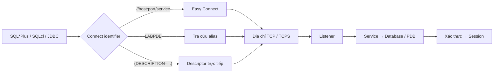
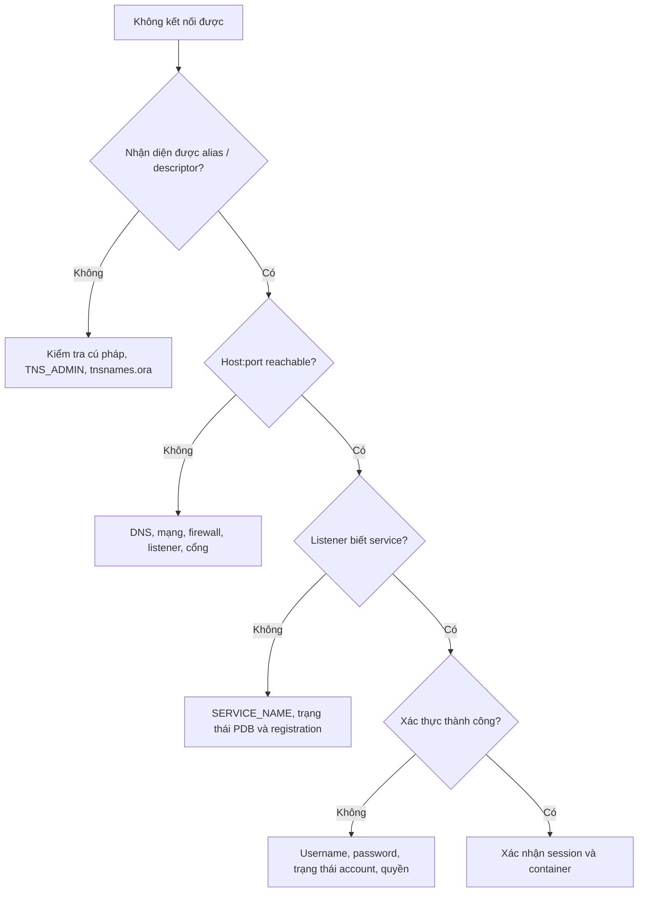

# Cú pháp Easy Connect và connect descriptor trong Oracle Database

Khi một công cụ như SQL*Plus, SQLcl, SQL Developer hoặc một ứng dụng Java kết nối tới Oracle Database, ứng dụng phải chỉ ra **đích kết nối**: máy chủ nào, cổng nào, giao thức nào và dịch vụ database nào. Oracle Net cho phép biểu diễn đích đó bằng một chuỗi ngắn gọn gọi là **Easy Connect** hoặc bằng một cấu trúc đầy đủ gọi là **connect descriptor**. Ngoài ra, một **net service name** (alias) có thể trỏ tới connect descriptor lưu trong file `tnsnames.ora`.

Nắm vững ba cách biểu diễn này giúp người học tự viết connection string, chuyển đổi giữa cấu hình của SQL client và JDBC, nhận diện lỗi định tuyến kết nối và chọn cách cấu hình thích hợp cho môi trường thực tế.

## 1. Kết nối Oracle diễn ra qua những thành phần nào?

Một phiên kết nối mạng tới Oracle thường đi qua các bước:

1. **Client** nhận connect identifier từ người dùng hoặc cấu hình ứng dụng.
2. **Oracle Net** diễn giải identifier thành địa chỉ kết nối và thông tin dịch vụ. Đường diễn giải có thể là Easy Connect, một alias qua `tnsnames.ora` hoặc một connect descriptor viết trực tiếp.
3. **Địa chỉ mạng** cho biết giao thức (`TCP` hoặc `TCPS`), host và port của listener.
4. **Listener** tiếp nhận yêu cầu, sử dụng thông tin dịch vụ để định tuyến phiên tới database/instance phù hợp.
5. **Database** xác thực tài khoản và thiết lập session; với kiến trúc multitenant, service thường đưa người dùng tới một PDB cụ thể.



Các thành phần dễ nhầm:

| Thành phần | Ý nghĩa | Ví dụ |
|---|---|---|
| **Hostname / IP** | Địa chỉ máy chạy listener, hoặc đầu mối kết nối được cấu hình | `db.example.test`, `127.0.0.1` |
| **Port** | Cổng listener đang lắng nghe; thường là 1521 với TCP, nhưng hoàn toàn có thể khác | `1521` |
| **Protocol** | Giao thức Oracle Net dùng để thiết lập kết nối | `TCP`, `TCPS` |
| **Service name** | Tên dịch vụ logic mà listener/database cung cấp; có thể trỏ đến PDB, nhóm instance hoặc dịch vụ ứng dụng | `FREEPDB1`, `sales.example.test` |
| **SID / instance** | Định danh instance Oracle; không phải tên service | `ORCL` là SID trong ví dụ cũ |
| **Schema / username** | Tài khoản dùng xác thực và sở hữu đối tượng; **không** quyết định host/port/service | `LAB_APP` |
| **Connect identifier** | Toàn bộ biểu thức mà client nhận để tìm đích kết nối | `//db:1521/appsvc` hoặc `LABPDB` |

**Điểm mấu chốt:** cú pháp sau dấu `/` trong Easy Connect thông dụng là **service name**. Với Oracle CDB/PDB, hãy ưu tiên kết nối qua service của PDB; đừng thay service bằng SID của instance khi chưa có yêu cầu đặc biệt.

## 2. Easy Connect: viết nhanh host, port và service

### 2.1. Cú pháp cơ bản

Dạng thực hành thường dùng:

```text
//host[:port]/service_name
```

Trong đó:

- `host`: hostname hoặc địa chỉ IP mà client có thể truy cập;
- `port`: port listener, thường mặc định 1521 trong cấu hình TCP phổ biến; **nên ghi rõ** để tránh nhầm môi trường;
- `service_name`: dịch vụ Oracle đã được cấu hình và đăng ký với listener;
- `//`: tiền tố thể hiện dạng Easy Connect được sử dụng rộng rãi trong Oracle Net/JDBC.

Một số client hỗ trợ dạng rút gọn `host/service_name` hoặc `host:port/service_name`; khi học và khi bàn giao cấu hình, nên dùng dạng đầy đủ có `//` và port để dễ đọc, dễ kiểm tra.

Ví dụ:

```text
//127.0.0.1:1521/FREEPDB1
//db-dev.example.test:1521/SALES_DEV
//db-test.example.test:1522/SALES_TEST
```

Các giá trị `SALES_DEV`, `SALES_TEST` và hostname là ví dụ giả định, không phải service có sẵn trên mọi máy. Trong môi trường Oracle Database Free phổ biến, PDB thường có service `FREEPDB1`, nhưng luôn xác nhận service thực tế từ người cung cấp database.

### 2.2. Dùng trong SQL*Plus và SQLcl

Để tránh gõ mật khẩu trong command line hoặc lưu vào lịch sử shell, mở SQL*Plus trước rồi đăng nhập:

```console
sqlplus /nolog

SQL> CONNECT lab_app@//127.0.0.1:1521/FREEPDB1
Enter password:
Connected.
```

Trong SQLcl có thể mở bằng lệnh `sql /nolog` rồi chạy `CONNECT` với cùng connect identifier. Nếu dùng SQL Developer, chọn Connection Type phù hợp, khai báo host, port và **Service name** ở các trường riêng; các trường đó tương ứng với biểu thức trên.

Ở đây `lab_app` là tên đăng nhập; chuỗi `//127.0.0.1:1521/FREEPDB1` chỉ mô tả **đích kết nối**. Không trộn mật khẩu hoặc tên schema vào tên service.

Sau khi kết nối, kiểm tra thực tế:

```sql
SELECT
    SYS_CONTEXT('USERENV', 'SESSION_USER') AS session_user,
    SYS_CONTEXT('USERENV', 'SERVICE_NAME') AS service_name,
    SYS_CONTEXT('USERENV', 'CON_NAME') AS container_name
FROM dual;
```

`SESSION_USER` giúp biết đang xác thực bằng user nào, `SERVICE_NAME` cho biết service của session và `CON_NAME` hữu ích để kiểm tra PDB. Kết quả thực tế do server trả về mới là căn cứ; đừng chỉ dựa vào tên được đặt cho connection trong giao diện.

### 2.3. Dùng trong Oracle JDBC Thin

JDBC Thin có tiền tố URL riêng:

```text
jdbc:oracle:thin:@//host:port/service_name
```

Ví dụ:

```java
String url = "jdbc:oracle:thin:@//127.0.0.1:1521/FREEPDB1";
String username = System.getenv("DB_USERNAME");
String password = System.getenv("DB_PASSWORD");

try (java.sql.Connection connection =
         java.sql.DriverManager.getConnection(url, username, password)) {
    System.out.println("Connected: " + !connection.isClosed());
}
```

Đoạn code cần Oracle JDBC driver có trong classpath và các biến môi trường chứa thông tin đăng nhập hợp lệ. Các driver thuộc dòng `ojdbc` nên được chọn tương thích với phiên bản Java, Oracle Database và ứng dụng.

Ví dụ cấu hình Spring Boot:

```yaml
spring:
  datasource:
    url: jdbc:oracle:thin:@//db-dev.example.test:1521/SALES_DEV
    username: ${DB_USERNAME}
    password: ${DB_PASSWORD}
```

Spring Boot dùng các biến môi trường để lấy thông tin nhạy cảm. Nếu ứng dụng chạy trong container, `localhost` trong URL là container **của ứng dụng**, không mặc định là container Oracle. Cần dùng hostname hoặc tên service mạng mà ứng dụng thực sự truy cập được.

**Phân biệt ba đoạn khác nhau:**

```text
//db-dev.example.test:1521/SALES_DEV
    ↑ Oracle Net Easy Connect identifier

jdbc:oracle:thin:@//db-dev.example.test:1521/SALES_DEV
    ↑ URL hoàn chỉnh của Oracle JDBC Thin

lab_app@//db-dev.example.test:1521/SALES_DEV
    ↑ Username + identifier trong lệnh đăng nhập SQL*Plus
```

Không đưa toàn bộ `jdbc:oracle:thin:@...` vào trường “Hostname” của một GUI client và không thêm `jdbc:oracle:thin:@` vào identifier của SQL*Plus.

## 3. Easy Connect Plus: nhiều host và tham số kết nối

**Easy Connect Plus** là dạng mở rộng, được hỗ trợ ở các phiên bản Oracle client/driver thích hợp (đặc biệt từ các dòng client hiện đại). Nó cho phép thêm giao thức, nhiều địa chỉ và tham số kết nối mà không cần viết đầy đủ descriptor.

Dạng khái quát dùng để đọc cú pháp:

```text
[protocol:]//host1[:port1][,host2[:port2],...]/service_name[?name=value[&name=value...]]
```

Đây là dạng minh họa phổ biến, không liệt kê mọi thành phần tùy chọn của đặc tả theo từng phiên bản. Những biến thể nâng cao như server mode, instance hoặc một số tham số chỉ có hiệu lực khi client tương ứng hỗ trợ.

### 3.1. Hai địa chỉ listener

```text
//db-a.example.test:1521,db-b.example.test:1521/SALES_APP
```

Client có nhiều địa chỉ để thử khi kết nối. Tuy nhiên, **khai báo hai host không tự tạo ra high availability**. Dịch vụ `SALES_APP` phải được cấu hình/đăng ký phù hợp trên hạ tầng thật; DB cluster, Oracle RAC hoặc Data Guard đều có cơ chế riêng để quản lý dịch vụ và chuyển đổi vai trò.

### 3.2. Tham số timeout và retry

```text
//db-a.example.test:1521,db-b.example.test:1521/SALES_APP?connect_timeout=5&retry_count=2&retry_delay=1
```

Các tên minh họa có ý nghĩa:

| Tham số | Mục đích |
|---|---|
| `connect_timeout` | Đặt giới hạn chờ trong quá trình thiết lập kết nối theo cách client/driver hỗ trợ |
| `retry_count` | Yêu cầu thử lại khi kết nối thất bại trong phạm vi cơ chế Oracle Net |
| `retry_delay` | Khoảng chờ giữa các lần thử theo cấu hình |

Quy tắc cụ thể về phạm vi timeout, số lượt thử, đơn vị và tham số được chấp nhận phụ thuộc phiên bản Oracle Net/JDBC. Cần đối chiếu tài liệu của **client đang chạy**, đồng thời phân biệt connect timeout với **SQL statement/query timeout**. Retry chỉ xảy ra ở giai đoạn hỗ trợ bởi cơ chế kết nối; không nên suy diễn rằng ứng dụng sẽ tự chạy lại một giao dịch nghiệp vụ đã thực hiện dở.

Ký tự `&` trong chuỗi tham số có ý nghĩa đặc biệt với một số shell, URL, XML hoặc file cấu hình. Khi gọi trực tiếp từ shell, dùng quy tắc quote đúng của shell đó; trong XML cần escape thành `&amp;`; trong code Java đặt chuỗi bên trong string literal.

### 3.3. Chọn giao thức TCPS

Ví dụ ý tưởng dùng kết nối TLS:

```text
tcps://db-secure.example.test:2484/SALES_APP
```

`TCPS` là Oracle Net qua TLS. Port `2484` thường xuất hiện trong ví dụ TCPS nhưng không phải mặc định bắt buộc; phải lấy port listener thực tế. Đổi `tcp` thành `tcps` **không đủ** nếu server chưa cấu hình listener TCPS hoặc client chưa có cấu hình tin cậy chứng chỉ/wallet phù hợp. Trên hạ tầng yêu cầu TLS, cấu hình xác minh danh tính server, trust store/wallet và chính sách chứng chỉ theo hướng dẫn quản trị; tránh vô hiệu hóa kiểm tra chứng chỉ chỉ để làm cho kết nối “thành công”.

## 4. Connect descriptor: mô tả đầy đủ bằng cặp khóa–giá trị

Khi cần biểu diễn địa chỉ, nhiều listener, kiểu server, service, timeout hoặc hành vi kết nối rõ ràng, Oracle dùng **connect descriptor**. Đây là cấu trúc dạng ngoặc đơn với các cặp `(KEY=VALUE)` lồng nhau:

```text
(DESCRIPTION=
  (ADDRESS=
    (PROTOCOL=TCP)
    (HOST=db-dev.example.test)
    (PORT=1521)
  )
  (CONNECT_DATA=
    (SERVICE_NAME=SALES_DEV)
  )
)
```

Đọc từ ngoài vào trong:

- `DESCRIPTION` chứa mô tả đích kết nối.
- `ADDRESS` chứa một điểm đến mạng của listener.
- `PROTOCOL` là `TCP` hoặc giao thức đã được hỗ trợ và cấu hình.
- `HOST` là hostname/IP; `PORT` là cổng listener.
- `CONNECT_DATA` chứa cách chọn dịch vụ/instance/server.
- `SERVICE_NAME` yêu cầu listener định tuyến tới dịch vụ cụ thể.

**Kết nối tương đương về đích trong ví dụ đơn giản:**

```text
Easy Connect:
//db-dev.example.test:1521/SALES_DEV

Descriptor:
(DESCRIPTION=(ADDRESS=(PROTOCOL=TCP)(HOST=db-dev.example.test)(PORT=1521))(CONNECT_DATA=(SERVICE_NAME=SALES_DEV)))
```

Các dấu xuống dòng và thụt đầu dòng giúp đọc descriptor; chúng không phải các cấp đối tượng database. Khi copy vào một URL hay file cấu hình, giữ nguyên cặp ngoặc và cấu trúc trường lồng nhau.

### 4.1. Các trường quan trọng trong descriptor

| Trường | Vị trí thường gặp | Vai trò |
|---|---|---|
| `DESCRIPTION` | Gốc một phương án kết nối | Gom địa chỉ, dữ liệu kết nối và tùy chọn |
| `ADDRESS` | Trong `DESCRIPTION` hoặc `ADDRESS_LIST` | Một địa chỉ listener |
| `ADDRESS_LIST` | Trong `DESCRIPTION` | Gom nhiều `ADDRESS`; có thể chỉ định quy tắc chọn/thử địa chỉ |
| `DESCRIPTION_LIST` | Ngoài nhiều `DESCRIPTION` | Tập nhiều mô tả kết nối, dùng cho trường hợp phức tạp |
| `CONNECT_DATA` | Trong `DESCRIPTION` | Chọn đích logic bên trong Oracle |
| `SERVICE_NAME` | Trong `CONNECT_DATA` | Tên dịch vụ mà client yêu cầu |
| `SERVER` | Trong `CONNECT_DATA` | Có thể yêu cầu kiểu server như `DEDICATED` nếu môi trường hỗ trợ |
| `SID` | Trong `CONNECT_DATA` của cấu hình legacy | Chỉ instance theo SID; không tương đương service name |
| `CONNECT_TIMEOUT` | Trong `DESCRIPTION` | Giới hạn thời gian thiết lập kết nối theo Oracle Net |
| `RETRY_COUNT` / `RETRY_DELAY` | Trong `DESCRIPTION` | Điều chỉnh cơ chế thử lại kết nối |

Ví dụ yêu cầu dedicated server cho một service:

```text
(DESCRIPTION=
  (ADDRESS=(PROTOCOL=TCP)(HOST=db-dev.example.test)(PORT=1521))
  (CONNECT_DATA=
    (SERVER=DEDICATED)
    (SERVICE_NAME=SALES_DEV)
  )
)
```

Không nên thêm `SERVER=DEDICATED` vào mọi cấu hình theo thói quen. Nó có ý nghĩa phụ thuộc kiến trúc database và chế độ server được cung cấp.

### 4.2. Nhiều listener trong một descriptor

```text
(DESCRIPTION=
  (CONNECT_TIMEOUT=5)
  (RETRY_COUNT=2)
  (RETRY_DELAY=1)
  (ADDRESS_LIST=
    (LOAD_BALANCE=ON)
    (FAILOVER=ON)
    (ADDRESS=(PROTOCOL=TCP)(HOST=db-a.example.test)(PORT=1521))
    (ADDRESS=(PROTOCOL=TCP)(HOST=db-b.example.test)(PORT=1521))
  )
  (CONNECT_DATA=
    (SERVICE_NAME=SALES_APP)
  )
)
```

Giải thích:

- `ADDRESS_LIST` xác định các listener có thể thử.
- `LOAD_BALANCE=ON` liên quan đến việc chọn/phân bố địa chỉ trong lúc kết nối; không bảo đảm tự cân bằng tải toàn bộ giao dịch SQL.
- `FAILOVER=ON` cho phép thử địa chỉ thay thế trong phạm vi **connect-time failover**. Điều đó khác với tự động khôi phục một session đã mất hay tự tiếp tục transaction đang chạy.
- `RETRY_COUNT` và `RETRY_DELAY` kiểm soát các lượt kết nối lại theo khả năng Oracle Net.
- `SERVICE_NAME=SALES_APP` phải là service được triển khai thực sự ở hệ thống đích.

Không thể chứng minh failover chỉ bằng cách viết descriptor. Cần có listener/service hoạt động đúng tại nhiều điểm cuối, cách đánh giá lỗi và kịch bản thử nghiệm có kiểm soát. Với yêu cầu liên tục dịch vụ sau khi session đã kết nối, có thể cần các khả năng khác như Application Continuity, TAC hoặc cơ chế retry của ứng dụng, tùy nền tảng và hợp đồng nghiệp vụ.

### 4.3. Định danh SID kiểu cũ

Một số hệ thống cũ dùng:

```text
(DESCRIPTION=
  (ADDRESS=(PROTOCOL=TCP)(HOST=legacy-db.example.test)(PORT=1521))
  (CONNECT_DATA=(SID=ORCL))
)
```

Tương ứng với JDBC Thin legacy URL:

```text
jdbc:oracle:thin:@legacy-db.example.test:1521:ORCL
```

Dấu `:ORCL` cuối chuỗi trên biểu thị **SID**, còn `/SALES_DEV` trong dạng service URL biểu thị **service name**. Đây là hai cách chỉ đích **khác nhau**, không phải hai dấu phân cách có thể thay thế tùy ý. Ưu tiên dùng service name cho ứng dụng hiện đại, đặc biệt là môi trường PDB, RAC hoặc dịch vụ được quản lý.

## 5. `tnsnames.ora`: đặt tên cho connect descriptor

Descriptor có thể dài và dễ bị sao chép sai giữa nhiều ứng dụng. File `tnsnames.ora` ánh xạ một **alias** tới descriptor, để client chỉ cần dùng tên ngắn.

Ví dụ nội dung `tnsnames.ora`:

```text
LABPDB =
  (DESCRIPTION =
    (ADDRESS = (PROTOCOL = TCP)(HOST = 127.0.0.1)(PORT = 1521))
    (CONNECT_DATA =
      (SERVER = DEDICATED)
      (SERVICE_NAME = FREEPDB1)
    )
  )

SALES_APP =
  (DESCRIPTION =
    (ADDRESS = (PROTOCOL = TCP)(HOST = db-dev.example.test)(PORT = 1521))
    (CONNECT_DATA = (SERVICE_NAME = SALES_DEV))
  )
```

Sau khi client được cấu hình tìm đúng file này, có thể sử dụng:

```text
SQL*Plus / SQLcl:
CONNECT lab_app@LABPDB

JDBC Thin:
jdbc:oracle:thin:@LABPDB
```

`LABPDB` chỉ là **tên được người quản trị đặt ở phía client**, không nhất thiết trùng `SERVICE_NAME=FREEPDB1`. Một alias có thể trỏ tới một hoặc nhiều địa chỉ listener, và có thể đổi nội dung mà không đổi tên alias trong cấu hình ứng dụng.

### 5.1. Client tìm `tnsnames.ora` ở đâu?

Vị trí tùy Oracle client, môi trường và cách cài đặt. Khi cần kiểm soát rõ, đặt file trong thư mục cấu hình mạng và thiết lập `TNS_ADMIN` trỏ tới **thư mục chứa** file:

```bash
# Ví dụ trên Linux/macOS:
export TNS_ADMIN=/opt/oracle/network/admin
sqlplus /nolog
```

```powershell
# Ví dụ trên PowerShell:
$env:TNS_ADMIN = 'C:\oracle\network\admin'
sqlplus /nolog
```

Trong cùng thư mục thường có thể có file `sqlnet.ora`. Tùy cấu hình, thứ tự cách tra cứu tên kết nối được thể hiện bằng:

```text
NAMES.DIRECTORY_PATH = (TNSNAMES, EZCONNECT)
```

Ý nghĩa: client có thể tra cứu alias theo local naming (`TNSNAMES`) và nhận diện chuỗi Easy Connect (`EZCONNECT`). Thứ tự, các naming method đang bật và khả năng đọc file phụ thuộc môi trường client.

Đối với JDBC Thin, cấu hình đường dẫn `TNS_ADMIN` hoặc thuộc tính tương ứng của Oracle JDBC driver phải được nạp vào tiến trình Java trước khi dùng alias; không giả định Java tự đọc đúng file của một bản cài SQL*Plus khác trên cùng máy.

### 5.2. Phân biệt ba thứ thường bị gọi chung là “TNS”

| Thuật ngữ | Ví dụ | Bản chất |
|---|---|---|
| **Net service name/alias** | `LABPDB` | Tên ngắn tra cứu cấu hình |
| **Connect descriptor** | `(DESCRIPTION=...)` | Cấu trúc mô tả điểm kết nối |
| **`tnsnames.ora`** | File chứa `LABPDB = (...)` | Nguồn ánh xạ alias tới descriptor |

Không phải mọi kết nối Oracle đều cần `tnsnames.ora`. Easy Connect và descriptor trực tiếp có thể hoạt động mà không cần file alias.

## 6. Dùng descriptor trực tiếp trong JDBC và công cụ

Một descriptor có thể xuất hiện ngay sau `@` trong Oracle JDBC Thin URL:

```properties
spring.datasource.url=jdbc:oracle:thin:@(DESCRIPTION=(ADDRESS=(PROTOCOL=TCP)(HOST=db-dev.example.test)(PORT=1521))(CONNECT_DATA=(SERVICE_NAME=SALES_DEV)))
```

Đây là một URL đầy đủ, không cần alias `SALES_APP`. Việc sử dụng descriptor trực tiếp phù hợp khi cấu hình được quản lý tập trung cùng ứng dụng và yêu cầu kết nối không tiện biểu diễn bằng Easy Connect. Khi đặt trong YAML, có thể dùng một chuỗi được quote nếu cấu hình chứa ký tự dễ bị bộ phân tích YAML hiểu đặc biệt:

```yaml
spring:
  datasource:
    url: "jdbc:oracle:thin:@(DESCRIPTION=(ADDRESS=(PROTOCOL=TCP)(HOST=db-dev.example.test)(PORT=1521))(CONNECT_DATA=(SERVICE_NAME=SALES_DEV)))"
    username: ${DB_USERNAME}
    password: ${DB_PASSWORD}
```

Trong Java:

```java
String descriptor =
    "(DESCRIPTION=" +
      "(ADDRESS=(PROTOCOL=TCP)(HOST=db-dev.example.test)(PORT=1521))" +
      "(CONNECT_DATA=(SERVICE_NAME=SALES_DEV))" +
    ")";
String jdbcUrl = "jdbc:oracle:thin:@" + descriptor;
```

Ở các client khác, cách nhập descriptor trực tiếp tùy công cụ: có nơi có trường “Custom JDBC URL”, có nơi hỗ trợ “TNS”, có nơi cho nhập phần connection descriptor. Không phải ô nhập `Service name` nào cũng nhận nguyên biểu thức `(DESCRIPTION=...)`.

## 7. Chọn Easy Connect, alias hay descriptor?

| Tình huống | Cách phù hợp | Lý do |
|---|---|---|
| Thực hành trên máy cá nhân, chỉ có một PDB | Easy Connect `//host:port/service` | Ngắn, nhìn rõ thành phần |
| Kết nối SQL client tới vài hệ thống thử nghiệm | Easy Connect hoặc alias có tên môi trường | Dễ thao tác, giảm nhầm dev/test |
| Ứng dụng Java chỉ dùng một service đơn giản | JDBC Thin URL dùng Easy Connect | Dễ cấu hình qua biến môi trường |
| Nhiều ứng dụng chung cấu hình Oracle Net của tổ chức | Alias trong `tnsnames.ora` | Quản lý đích kết nối ngoài mã ứng dụng |
| Nhiều listener, timeout, route có yêu cầu đặc biệt | Connect descriptor | Mô tả rõ cấu trúc và tùy chọn |
| Có chính sách TLS, wallet, xác thực server | Cấu hình TCPS theo client và hạ tầng | Cần cả địa chỉ, chứng chỉ, trust và chính sách bảo mật |

Cú pháp nào được chọn cũng phải có cùng thông tin cốt lõi: **địa chỉ listener hợp lệ + service đúng + phương thức xác thực được cấp quyền**.

## 8. Quy trình chẩn đoán lỗi kết nối theo từng lớp

Thay vì thử nhiều connection string ngẫu nhiên, kiểm tra theo lớp:



### 8.1. Lỗi thường gặp

| Mã lỗi/dấu hiệu | Ý nghĩa thường gặp | Nơi kiểm tra đầu tiên |
|---|---|---|
| `ORA-12154` | Không phân giải được connect identifier | Alias, `TNS_ADMIN`, file `tnsnames.ora`, naming method và lỗi cú pháp |
| `ORA-12541` | Không có listener phản hồi tại đích yêu cầu | Host, port, listener và khả năng truy cập mạng |
| `ORA-12514` | Listener chưa biết service name được yêu cầu | Service name, trạng thái PDB và đăng ký dịch vụ với listener |
| `ORA-12505` | Listener không biết SID được yêu cầu | Nhầm SID/service hoặc cấu hình listener legacy |
| `ORA-12545` | Không kết nối được tới host/địa chỉ đích | Tên host, DNS, IP, đường mạng |
| `ORA-01017` | Username/password không hợp lệ hoặc không được chấp nhận | Thông tin đăng nhập, đúng database/PDB và cách xác thực |
| `ORA-28000` | Tài khoản bị khóa | Trạng thái account, phối hợp DBA |
| Lỗi xác minh TLS/certificate | Không thiết lập được lòng tin hoặc danh tính server | TCPS endpoint, trust store/wallet và chứng chỉ |
| JDBC báo lỗi I/O/timeout | Lỗi vận chuyển hoặc kết nối, có nhiều nguyên nhân | Thông điệp lồng nhau, mạng, TLS, listener và timeout |

Mã lỗi chỉ là một dấu hiệu, không phải kết luận cuối cùng. Cùng một lỗi có thể đến từ cấu hình, quyền, mạng hoặc trạng thái dịch vụ.

### 8.2. Công cụ kiểm tra

1. **Kiểm tra tên và địa chỉ:** xem chính xác chuỗi kết nối, hostname, port, service, chỗ đặt `TNS_ADMIN` và bản client đang chạy.
2. **Kiểm tra mạng:** thử DNS và TCP từ **đúng máy/container chạy ứng dụng**; thành công từ laptop không chứng minh container trên server cũng truy cập được.
3. **`tnsping LABPDB`:** có thể giúp xác nhận alias được phân giải và kiểm tra phản hồi Oracle Net của đích; kết quả thành công **không chứng minh** tài khoản đăng nhập được hoặc SQL chạy thành công.
4. **Đăng nhập thực sự bằng SQL*Plus/SQLcl:** đây là phép thử xác thực và tạo session; sau đó dùng `SYS_CONTEXT` để xác nhận đúng service/PDB.
5. **Kiểm tra phía server khi có quyền:** người quản trị có thể xem `lsnrctl status`/`lsnrctl services`, trạng thái PDB và dịch vụ được đăng ký. Người dùng ứng dụng không cần quyền quản trị listener chỉ để debug.

Ví dụ không dùng GUI để xác nhận alias:

```console
tnsping LABPDB
sqlplus /nolog

SQL> CONNECT lab_app@LABPDB
Enter password:
Connected.

SQL> SELECT SYS_CONTEXT('USERENV', 'CON_NAME') FROM dual;
```

Khi `tnsping` thành công nhưng `CONNECT` thất bại, thu hẹp phạm vi sang service/authentication/server session theo mã lỗi cụ thể. Khi Easy Connect chạy nhưng alias thất bại, ưu tiên kiểm tra phân giải alias thay vì sửa quyền database.

### 8.3. Những nhầm lẫn nguy hiểm khi copy chuỗi kết nối

**Nhầm SID với service:**

```text
Đúng dạng service:   jdbc:oracle:thin:@//db:1521/SALES_DEV
Dạng SID legacy:     jdbc:oracle:thin:@db:1521:ORCL
```

Không đơn giản thay `/SALES_DEV` bằng `:SALES_DEV`.

**Nhầm hostname với địa chỉ từ bên trong container:**

```text
Ứng dụng chạy trên host:       localhost:1521 có thể hợp lệ nếu listener được publish tới host.
Ứng dụng chạy trong container: localhost:1521 trỏ về chính container ứng dụng.
```

**Nhầm alias với service:** alias `LABPDB` trong `tnsnames.ora` có thể chứa `SERVICE_NAME=FREEPDB1`. Nếu nhập `LABPDB` vào trường Service name của công cụ đang sử dụng kết nối trực tiếp theo host/port, client có thể gửi sai tên dịch vụ.

**Đặt password trong URL:** tránh `username/password@...` ở dòng lệnh hoặc commit URL chứa password. Dùng môi trường, secret manager hoặc cơ chế cấp credential phù hợp, và giữ thông tin kết nối riêng cho dev/test/prod.

## 9. Thực hành có hướng dẫn: chuyển đổi ba cách kết nối

Giả sử người quản trị cấp thông tin lab:

```text
Host:         192.0.2.10
Port:         1521
Service name: TRAINING_PDB
Username:     STUDENT_APP
Alias mong muốn: TRAINING
```

`192.0.2.10` thuộc dải địa chỉ dành cho tài liệu minh họa, không phải server có thể kết nối được. Khi thực hành, thay bằng địa chỉ database thật được cấp.

### Bài 1 — Viết Easy Connect

Kết quả:

```text
//192.0.2.10:1521/TRAINING_PDB
```

Với SQL*Plus:

```text
CONNECT student_app@//192.0.2.10:1521/TRAINING_PDB
```

Với JDBC Thin:

```text
jdbc:oracle:thin:@//192.0.2.10:1521/TRAINING_PDB
```

### Bài 2 — Viết descriptor tương đương

```text
(DESCRIPTION=
  (ADDRESS=
    (PROTOCOL=TCP)
    (HOST=192.0.2.10)
    (PORT=1521)
  )
  (CONNECT_DATA=
    (SERVICE_NAME=TRAINING_PDB)
  )
)
```

Đối chiếu lại: cả hai mô tả cùng host, port, giao thức TCP và service `TRAINING_PDB`. Descriptor không chứa username/password vì đây là hai phần thông tin khác với định tuyến mạng.

### Bài 3 — Tạo alias

Trong thư mục `TNS_ADMIN`, khai báo:

```text
TRAINING =
  (DESCRIPTION=
    (ADDRESS=(PROTOCOL=TCP)(HOST=192.0.2.10)(PORT=1521))
    (CONNECT_DATA=(SERVICE_NAME=TRAINING_PDB))
  )
```

Sau đó kết nối bằng `CONNECT student_app@TRAINING`. Để so sánh, thử kết nối trực tiếp bằng Easy Connect tới cùng service rồi dùng truy vấn `SYS_CONTEXT` để kiểm tra session.

### Bài 4 — Thêm địa chỉ dự phòng

Giả sử có thêm listener tại `192.0.2.11:1521` và **cả hai thực sự cung cấp service `TRAINING_PDB`**, viết lại descriptor với `ADDRESS_LIST` và kiểm thử kết nối khi một địa chỉ không phản hồi. Ghi nhận:

- client đang dùng phiên bản nào và cấu hình retry/timeout ra sao;
- trạng thái thực tế của từng listener/service;
- thời gian thiết lập kết nối và lỗi nếu không thành công;
- liệu ứng dụng **đang tạo session mới** hay đang xử lý một session đã mất.

Không kết luận “đã có failover giao dịch” chỉ từ việc kết nối được qua địa chỉ thứ hai.

### Bài 5 — Truy vết lỗi có kiểm soát

Trên môi trường lab riêng, lần lượt thử:

1. Sai service name nhưng host/port đúng: quan sát nhóm lỗi listener/service.
2. Sai tên alias hoặc client không tìm thấy `tnsnames.ora`: quan sát lỗi naming/resolution.
3. Sai mật khẩu khi service đúng: quan sát lỗi xác thực.
4. Sai port: quan sát khác biệt giữa lỗi mạng/listener và lỗi database.

Không thực hiện thử mật khẩu lặp lại trên tài khoản dùng chung vì chính sách khóa account có thể kích hoạt. Với môi trường do DBA quản lý, chỉ kiểm tra trong quyền và phạm vi được cấp.

## 10. Ghi nhớ cú pháp qua một bảng quy đổi

| Kiểu cấu hình | Ví dụ chính xác về cấu trúc |
|---|---|
| Easy Connect | `//db-host:1521/APP_PDB` |
| Easy Connect Plus hai host | `//db-a:1521,db-b:1521/APP_PDB` |
| SQL*Plus connect | `CONNECT app_user@//db-host:1521/APP_PDB` |
| JDBC Thin theo service | `jdbc:oracle:thin:@//db-host:1521/APP_PDB` |
| Descriptor trực tiếp | `(DESCRIPTION=(ADDRESS=(PROTOCOL=TCP)(HOST=db-host)(PORT=1521))(CONNECT_DATA=(SERVICE_NAME=APP_PDB)))` |
| Alias trong `tnsnames.ora` | `APPDB = (DESCRIPTION=...)` |
| SQL*Plus qua alias | `CONNECT app_user@APPDB` |
| JDBC Thin qua alias | `jdbc:oracle:thin:@APPDB` (khi client tìm được cấu hình alias) |
| JDBC Thin theo SID cũ | `jdbc:oracle:thin:@db-host:1521:ORCL` |

Điều cần thuộc không phải một chuỗi duy nhất, mà là **phương pháp đọc và chuyển đổi**: xác định địa chỉ listener, xác định service, xác định cách Oracle Net phân giải connect identifier, sau đó tách biệt việc định tuyến với việc xác thực user. Khi làm chủ các lớp này, người học có thể đọc cả cấu hình đơn giản trong lab lẫn descriptor dài trong hệ thống doanh nghiệp và biết bắt đầu chẩn đoán lỗi từ đâu.
