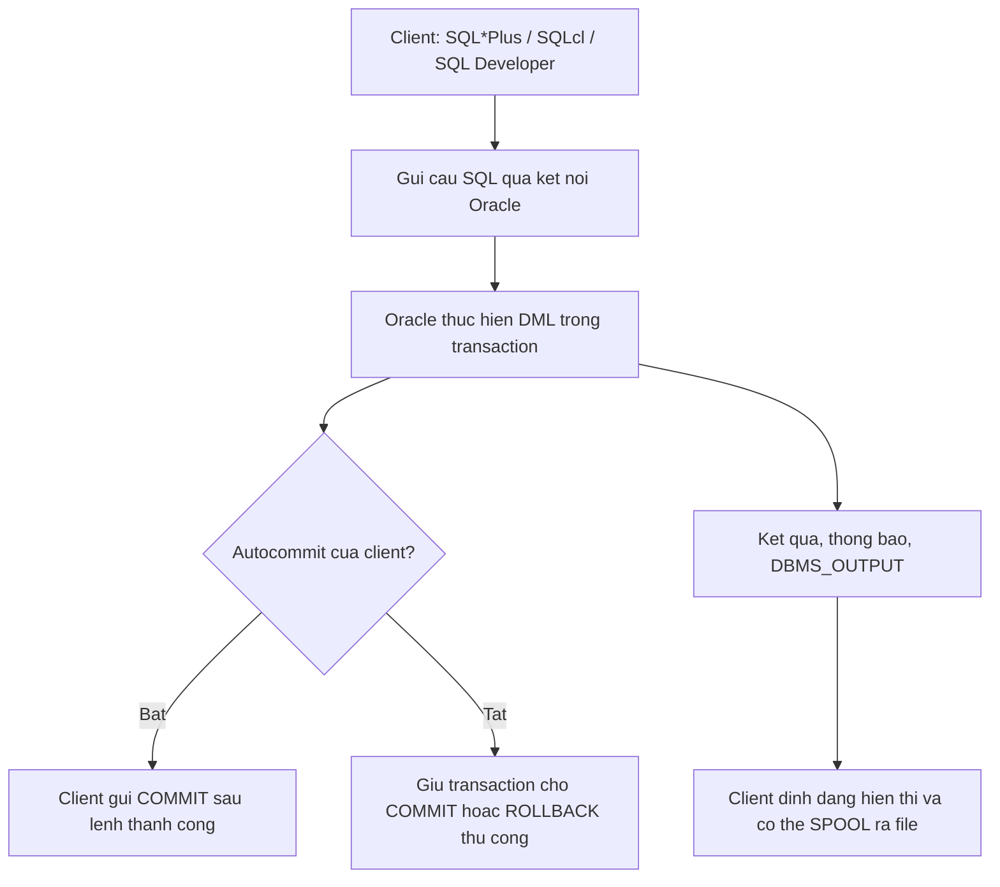

# Điều khiển autocommit, hiển thị kết quả và ghi nhật ký bằng SPOOL trong Oracle

Khi thực hành Oracle SQL, hai phiên kết nối cùng chạy `UPDATE` có thể cho kết quả rất khác nhau: một phiên thay đổi dữ liệu nhưng vẫn có thể `ROLLBACK`, phiên còn lại ghi nhận thay đổi ngay sau lệnh. Ngoài ra, cùng một `SELECT` có thể hiển thị gọn trên màn hình hoặc bị xuống dòng, cắt mất giá trị dài; và kết quả vừa xem có thể biến mất khi đóng terminal. Ba việc này tương ứng với ba nhóm cấu hình của **công cụ kết nối Oracle**:

1. **Autocommit**: xác định công cụ có tự `COMMIT` sau các câu lệnh thành công hay để người dùng chủ động kết thúc giao dịch.
2. **Hiển thị kết quả**: điều chỉnh số dòng mỗi trang, chiều rộng cột, thông báo số hàng, dữ liệu `NULL`, đầu ra PL/SQL và định dạng xuất.
3. **`SPOOL`**: ghi nội dung đầu ra của phiên làm việc vào một file trên máy đang chạy client để xem lại hoặc nộp kết quả thực hành.

Bài học tập trung vào **SQL\*Plus** và **Oracle SQLcl**, hai công cụ dòng lệnh hỗ trợ nhiều lệnh thiết lập tương tự nhau. **Oracle SQL Developer** có thêm giao diện worksheet và lệnh *Run Script*; phần cuối chỉ ra những khác biệt cần lưu ý. Đặc biệt, các lệnh `SET`, `SHOW` và `SPOOL` trong bài là **lệnh phía client**, không phải các câu SQL chuẩn chạy trực tiếp trên database qua JDBC.

## 1. Phân biệt phiên kết nối, transaction và công cụ hiển thị

Giả sử có bảng `LAB_BALANCES` ghi số dư thử nghiệm. Khi ứng dụng gửi:

```sql
UPDATE lab_balances
   SET balance = balance + 100
 WHERE account_id = 1;
```

Oracle thực hiện DML trong **transaction của phiên kết nối**. Nếu chưa commit, phiên đó có thể thấy giá trị vừa sửa, còn phiên khác thường đọc phiên bản đã commit phù hợp với cơ chế đọc nhất quán của Oracle. `COMMIT` làm các thay đổi thành đã xác nhận; `ROLLBACK` hoàn tác thay đổi chưa commit.



Ba lớp cần tách bạch:

| Lớp | Đối tượng điều khiển | Ví dụ |
| --- | --- | --- |
| **Oracle Database** | Giao dịch, khóa, tính nhất quán, lưu trữ và dữ liệu đã commit | `UPDATE`, `COMMIT`, `ROLLBACK` |
| **Client SQL** | Khi nào tự commit và cách trình bày kết quả trong phiên công cụ | `SET AUTOCOMMIT OFF`, `SET LINESIZE 120` |
| **File ghi đầu ra** | Bản sao văn bản/định dạng đầu ra do client tạo trên máy chạy client | `SPOOL report.log REPLACE` |

Đổi cấu hình hiển thị hoặc bật `SPOOL` **không sửa dữ liệu Oracle**. Ngược lại, ghi kết quả vào file **không có nghĩa** dữ liệu trong giao dịch đã được commit. Một file log vẫn có thể chứa kết quả `SELECT` đọc từ transaction sau đó bị rollback.

## 2. Điều khiển autocommit trong SQL\*Plus và SQLcl

Mở phiên SQL\*Plus hoặc SQLcl với tài khoản thực hành và **service của PDB** đã được cấp:

```bash
# SQL*Plus: nhập mật khẩu khi công cụ yêu cầu.
sqlplus lab_user@//db-host.example:1521/LABPDB

# SQLcl: cách kết nối tương tự nếu đã cài đặt SQLcl.
sql lab_user@//db-host.example:1521/LABPDB
```

Các tên `lab_user`, `db-host.example`, `LABPDB` và cổng `1521` chỉ minh họa; dùng thông tin kết nối thực tế. Cấu hình `AUTOCOMMIT` có thể được công cụ/profile thiết lập khác nhau nên nên **kiểm tra ngay trong phiên**:

```sql
SHOW AUTOCOMMIT
```

Các thiết lập quan trọng trong SQL\*Plus:

```sql
SET AUTOCOMMIT OFF
-- Tự chủ động COMMIT hoặc ROLLBACK các DML.

SET AUTOCOMMIT ON
-- Tự commit sau mỗi câu SQL DML hoặc PL/SQL block hoàn thành thành công.

SET AUTOCOMMIT OFF
SHOW AUTOCOMMIT
```

SQL\*Plus cũng hỗ trợ `SET AUTOCOMMIT IMMEDIATE` (tương tự bật ngay) và `SET AUTOCOMMIT n` với số nguyên dương `n` để commit sau mỗi `n` câu lệnh/khối thành công được tính theo cơ chế của công cụ. Chế độ đếm lệnh ít phù hợp cho giao dịch nghiệp vụ nhiều bước vì ranh giới commit phụ thuộc số câu đã chạy; hãy ưu tiên `OFF` và dùng `COMMIT` tường minh khi đang học transaction.

**Phạm vi:** `SET AUTOCOMMIT` thay đổi hành vi của **phiên client hiện tại**. Nó không sửa một tham số toàn cục của Oracle Database và không bảo đảm một kết nối ở SQL Developer, JDBC hay một cửa sổ terminal khác sẽ có cùng cấu hình. Nhiều thư viện kết nối (ví dụ JDBC) cũng có tùy chọn autocommit riêng; câu `SET AUTOCOMMIT OFF` của SQL\*Plus không thể gửi nguyên văn như SQL JDBC thông thường.

### Thử nghiệm 1: tắt autocommit và rollback

Chuẩn bị bảng thử riêng bằng tài khoản có `CREATE TABLE`. **Chạy phần tạo bảng một lần, trước khi thử transaction**:

```sql
CREATE TABLE lab_balances (
    account_id NUMBER PRIMARY KEY,
    balance    NUMBER(12, 2) NOT NULL,
    CONSTRAINT ck_lab_balances_nonnegative CHECK (balance >= 0)
);

INSERT INTO lab_balances (account_id, balance) VALUES (1, 1000);
COMMIT;
```

Lệnh DDL như `CREATE TABLE` gây **implicit commit** trong Oracle. Vì thế, phần chuẩn bị cấu trúc được tách khỏi bước thử rollback để tránh hiểu nhầm rằng có thể `ROLLBACK` một bảng đã tạo thành công.

Trong cùng một phiên:

```sql
SET AUTOCOMMIT OFF

SELECT account_id, balance
FROM lab_balances
WHERE account_id = 1;
-- Ban đầu: 1000.

UPDATE lab_balances
   SET balance = balance + 200
 WHERE account_id = 1;

SELECT account_id, balance
FROM lab_balances
WHERE account_id = 1;
-- Ngay trong phiên sửa: 1200 (chưa commit).

ROLLBACK;

SELECT account_id, balance
FROM lab_balances
WHERE account_id = 1;
-- Trở về: 1000.
```

Với transaction chưa commit, **phiên khác** ở mức cô lập mặc định `READ COMMITTED` sẽ không đọc được giá trị 1200 chưa được xác nhận. Nếu muốn kiểm chứng, mở **kết nối thứ hai** đến cùng PDB rồi `SELECT` trước khi phiên thứ nhất rollback. Không dùng hai worksheet chia sẻ chung một database session để giả lập hai người dùng độc lập.

### Thử nghiệm 2: bật autocommit và quan sát hiệu ứng

Sau khi bảng mẫu trở về số dư 1000:

```sql
SET AUTOCOMMIT ON

UPDATE lab_balances
   SET balance = balance + 200
 WHERE account_id = 1;
-- SQL*Plus/SQLcl tự commit lệnh UPDATE thành công.

ROLLBACK;

SELECT account_id, balance
FROM lab_balances
WHERE account_id = 1;
-- Vẫn là 1200: ROLLBACK không thể thu hồi một COMMIT đã xảy ra.

SET AUTOCOMMIT OFF
```

Trong bài tập có nhiều bước như **tạo đơn → ghi chi tiết → trừ tồn kho**, tự commit sau từng `INSERT`/`UPDATE` sẽ làm mất tính nguyên tử của cả nghiệp vụ nếu có lỗi ở bước sau. Nên quản lý một transaction đủ rộng ở đúng tầng sở hữu giao dịch, và chỉ commit khi toàn bộ bước cần thiết thành công.

```sql
SET AUTOCOMMIT OFF

SAVEPOINT before_adjustment;

UPDATE lab_balances
   SET balance = balance + 50
 WHERE account_id = 1;

ROLLBACK TO SAVEPOINT before_adjustment;
-- Hủy cập nhật +50 nhưng giữ các thay đổi trước SAVEPOINT (nếu có).

COMMIT;
```

`ROLLBACK TO SAVEPOINT` hoàn tác một đoạn của transaction hiện tại; `ROLLBACK` hoàn tác toàn bộ thay đổi chưa commit. Đối với kết quả đã commit thì cả hai đều không phải lệnh “undo” lịch sử.

### Các ranh giới commit dễ bị bỏ sót

- **DDL** (`CREATE`, `ALTER`, `DROP`, `TRUNCATE`…) có cơ chế implicit commit của Oracle, kể cả khi `SET AUTOCOMMIT OFF`; một số lệnh quản lý giao dịch có ngữ nghĩa riêng. Không xen DDL vào giữa một chuỗi DML cần rollback toàn bộ.
- **Một câu SQL thất bại** thường làm các thay đổi của chính câu đó bị hủy, nhưng các câu DML thành công trước đó trong transaction không tự động bị rollback toàn bộ. Cần có chiến lược xử lý lỗi rõ ràng.
- **Đóng kết nối** không phải cách chủ động kết thúc nghiệp vụ. Ví dụ SQL\*Plus `EXIT` mặc định có thể commit thay đổi còn chờ; khi viết script, hãy `COMMIT` hoặc `ROLLBACK` tường minh và dùng tùy chọn thoát phù hợp như `EXIT SUCCESS ROLLBACK` nếu chỉ muốn kết thúc phiên đọc dữ liệu.
- **Autocommit ở GUI/driver** có thể khác SQL\*Plus; hai kết nối đến cùng PDB vẫn có hành vi transaction khác nhau nếu mỗi client đặt autocommit khác nhau.

## 3. Điều khiển cách hiển thị `SELECT`

SQL\*Plus và SQLcl hiển thị kết quả theo thiết lập phiên công cụ. Một truy vấn trả dữ liệu đúng vẫn có thể khó đọc khi cột bị wrap, page break lặp lại hoặc số âm/số lớn không đủ độ rộng định dạng.

Các lệnh nền tảng:

```sql
SET HEADING ON
SET FEEDBACK ON
SET LINESIZE 120
SET PAGESIZE 60
SET WRAP ON
SET NULL '<NULL>'
SET TRIMSPOOL ON
```

| Lệnh SQL\*Plus | Tác dụng | Lưu ý |
| --- | --- | --- |
| `SET HEADING ON/OFF` | Hiện/ẩn tiêu đề các cột của kết quả SQL | Thường bật khi xuất báo cáo người đọc. |
| `SET FEEDBACK ON/OFF` | Hiện/ẩn thông báo như số dòng được chọn/cập nhật | Tắt khi cần file dữ liệu ít dòng phụ. |
| `SET LINESIZE 120` | Đặt bề rộng dòng in theo ký tự | Dòng vượt chiều rộng có thể xuống dòng hoặc bị ảnh hưởng bởi `WRAP`. |
| `SET PAGESIZE 60` | Số dòng của một trang báo cáo trước khi lặp heading/page break | `PAGESIZE 0` thường dùng khi cần giảm heading/page break trong file xuất thô. |
| `SET WRAP ON/OFF` | Quyết định cách xử lý dòng vượt độ rộng khi trình bày | `OFF` có thể khiến phần đuôi dài bị cắt khỏi màn hình. |
| `SET NULL '<NULL>'` | In ký hiệu dễ nhận biết cho giá trị SQL `NULL` | Không thay đổi dữ liệu thật trong bảng. |
| `SET TRIMSPOOL ON` | Bỏ khoảng trắng dư ở cuối mỗi dòng ghi ra spool | Giúp file text gọn hơn; khác với trình bày terminal. |
| `SET ECHO ON/OFF` | In/ẩn câu lệnh khi chạy từ script (`@file.sql`) | Hữu ích khi log cần cả thao tác và kết quả. |
| `SET SERVEROUTPUT ON` | Hiện thông điệp do `DBMS_OUTPUT.PUT_LINE` tạo ra | `DBMS_OUTPUT` không tự xuất hiện nếu client chưa bật hiển thị. |

Trong SQL\*Plus, có thể kiểm tra giá trị thiết lập hiện tại bằng lệnh `SHOW`, ví dụ `SHOW LINESIZE`, `SHOW PAGESIZE`, `SHOW FEEDBACK`, `SHOW SERVEROUTPUT`. Các cấu hình này tác động đến **cách client diễn giải kết quả**, không làm `SELECT` trả thêm hàng hay chuyển kiểu cột trong Oracle.

### Định dạng riêng từng cột bằng `COLUMN`

Giả sử bảng mẫu `LAB_BALANCES` đã được tạo ở phần trước:

```sql
COLUMN account_id HEADING 'MA_TAI_KHOAN' FORMAT 999999
COLUMN balance    HEADING 'SO_DU'        FORMAT 999,999,990.00

SELECT account_id, balance
FROM lab_balances
ORDER BY account_id;

-- Hủy thiết lập COLUMN đã đặt khi không cần dùng tiếp.
CLEAR COLUMNS
```

`FORMAT` là quy tắc **in ra của SQL\*Plus**, khác với việc dùng `TO_CHAR` trong câu SQL. Với cột số, độ rộng quá hẹp có thể khiến SQL\*Plus hiển thị dấu `#` thay vì giá trị; cần tăng định dạng hoặc đổi `LINESIZE`. Một chuỗi dài có thể định dạng bằng `COLUMN ten_cot FORMAT A30`, trong đó `A30` là độ rộng phần text. Lệnh `COLUMN` áp dụng cho tên/alias cột được hiển thị trong phiên và nên được đặt lại trước một báo cáo có yêu cầu khác.

Ví dụ hiển thị dữ liệu người dùng bằng tên cột cố định:

```sql
COLUMN table_name HEADING 'TEN_BANG' FORMAT A35

SELECT table_name
FROM user_tables
ORDER BY table_name
FETCH FIRST 10 ROWS ONLY;

CLEAR COLUMNS
```

`USER_TABLES` liệt kê bảng thuộc schema đang kết nối; câu SQL này không đòi quyền truy vấn toàn bộ các schema khác. `FETCH FIRST 10 ROWS ONLY` là cú pháp giới hạn kết quả được Oracle hỗ trợ ở các phiên bản hiện đại.

### Hiển thị dữ liệu dài và đầu ra PL/SQL

Với cột kiểu `CLOB` hoặc `LONG`, SQL\*Plus có thiết lập `SET LONG` và `SET LONGCHUNKSIZE` liên quan lượng nội dung được client lấy/in ra. Chẳng hạn:

```sql
SET LONG 5000
SET LONGCHUNKSIZE 2000
```

Giá trị `SET LONG` giới hạn lượng văn bản hiển thị, không làm thay đổi kích thước dữ liệu lưu trong CLOB. Truy vấn hoặc tài liệu dài có thể cần giá trị cao hơn, nhưng khi làm log phải cân nhắc độ lớn file và dữ liệu nhạy cảm.

Để thấy các thông điệp do PL/SQL chủ động đưa vào `DBMS_OUTPUT`:

```sql
SET SERVEROUTPUT ON SIZE UNLIMITED

BEGIN
    DBMS_OUTPUT.PUT_LINE('Bat dau kiem tra ket noi');
    DBMS_OUTPUT.PUT_LINE('Session user: ' || SYS_CONTEXT('USERENV', 'SESSION_USER'));
END;
/
```

Trong SQL\*Plus/SQLcl, dấu `/` trên dòng riêng yêu cầu client thực thi khối PL/SQL vừa khai báo. `SET SERVEROUTPUT ON` giúp client lấy và in nội dung từ bộ đệm `DBMS_OUTPUT`; nó **không phải** tính năng ghi log tập trung của Oracle. Nếu `SPOOL` đang bật, các dòng được in này cũng có thể được lưu vào file báo cáo của client.

## 4. Ghi nhật ký đầu ra với `SPOOL`

`SPOOL` là lệnh của SQL\*Plus và SQLcl cho phép ghi đầu ra hiển thị của một phiên vào **file trên hệ thống chạy công cụ**. Ví dụ nếu chạy SQL\*Plus trên laptop, file nằm trên laptop; nếu chạy trong VM/container hoặc máy chủ qua SSH, file nằm ở môi trường thực thi client đó. `SPOOL` không tạo file ở đường dẫn datafile của Oracle server trừ khi client và server tình cờ cùng máy và có quyền tương ứng.

Cú pháp thường dùng:

```sql
SPOOL path/to/report.log REPLACE
-- Các lệnh tạo đầu ra muốn lưu.
SPOOL OFF
```

Trong SQL\*Plus, dấu chấm phẩy sau một **lệnh SQL\*Plus** không bắt buộc, vì vậy các ví dụ có thể viết gọn theo dạng truyền thống:

```sql
SPOOL "C:/oracle-lab/logs/session.log" REPLACE
SELECT SYSDATE AS executed_at FROM dual;
SPOOL OFF
```

Đường dẫn ở trên chỉ là ví dụ Windows; thư mục `C:/oracle-lab/logs` phải tồn tại và tài khoản chạy client có quyền ghi. Trên Linux/macOS có thể dùng, chẳng hạn, `SPOOL /home/student/oracle-lab/session.log REPLACE`. Đặt đường dẫn trong dấu ngoặc kép khi có dấu cách; với các tên chứa ký tự đặc biệt, nên thử một đường dẫn đơn giản trước. Nếu không cung cấp phần mở rộng tên file, SQL\*Plus có thể tự thêm `.lst` theo quy tắc của công cụ.

| Lệnh | Hành vi | Khi nào dùng |
| --- | --- | --- |
| `SPOOL report.log` hoặc `SPOOL report.log REPLACE` | Tạo mới hoặc ghi đè nội dung file theo chế độ thay thế | Báo cáo mới cho mỗi lượt chạy. |
| `SPOOL report.log APPEND` | Ghi thêm cuối file có sẵn | Nhật ký nhiều lượt chạy liên tiếp. |
| `SPOOL report.log CREATE` | Tạo file mới, báo lỗi nếu file đã tồn tại | Muốn tránh vô tình ghi đè nhật ký cũ. |
| `SPOOL OFF` | Kết thúc ghi ra file đang spool và đóng file | Bắt buộc trong kịch bản vận hành bình thường để hoàn thiện file. |
| `SPOOL` | Hiển thị trạng thái spool hiện tại trong SQL\*Plus | Xác nhận có đang ghi vào file nào. |

`CREATE`, `REPLACE`, `APPEND` là các lựa chọn của lệnh `SPOOL` ở các phiên bản SQL\*Plus/SQLcl hiện đại. Một số phiên bản cũ hoặc công cụ tương thích không hỗ trợ đầy đủ các biến thể; khi gặp lỗi cần kiểm tra trợ giúp/cú pháp của chính client đang sử dụng.

### Ví dụ ghi phiên thực hành đầy đủ

Tạo sẵn thư mục log trên máy chạy client. Trong phiên `LAB_USER`, chạy:

```sql
SET AUTOCOMMIT OFF
SET ECHO ON
SET FEEDBACK ON
SET HEADING ON
SET PAGESIZE 60
SET LINESIZE 120
SET TRIMSPOOL ON
SET SERVEROUTPUT ON

SPOOL "C:/oracle-lab/logs/lab-session.log" REPLACE

SELECT SYS_CONTEXT('USERENV', 'SESSION_USER') AS session_user,
       SYS_CONTEXT('USERENV', 'CON_NAME') AS pdb_name
FROM dual;

SELECT account_id, balance
FROM lab_balances
ORDER BY account_id;

BEGIN
    DBMS_OUTPUT.PUT_LINE('Da hoan thanh truy van bang LAB_BALANCES');
END;
/

SPOOL OFF
```

File `lab-session.log` lưu kết quả các truy vấn và thông báo PL/SQL được client in khi spool đang hoạt động. `SET ECHO ON` chủ yếu có tác dụng hiển thị **các câu lệnh đọc từ script**; khi gõ tay từng lệnh ở prompt, đừng kỳ vọng nó tự in mọi câu lệnh tương tự. Nếu cần một hồ sơ thực hành có cả SQL đã chạy và kết quả, nên lưu các lệnh trong file `.sql` và gọi bằng `@` như phần dưới.

### Chạy script và tự lưu kết quả

Tạo file script, chẳng hạn `lab_report.sql`, với nội dung sau (đường dẫn spool chỉ là ví dụ; thay trước khi chạy):

```sql
-- lab_report.sql: bao cao chi doc, khong thay doi du lieu.
WHENEVER OSERROR EXIT FAILURE ROLLBACK
WHENEVER SQLERROR EXIT SQL.SQLCODE ROLLBACK

SET AUTOCOMMIT OFF
SET ECHO ON
SET HEADING ON
SET FEEDBACK ON
SET PAGESIZE 100
SET LINESIZE 120
SET TRIMSPOOL ON
SET SERVEROUTPUT ON

SPOOL "C:/oracle-lab/logs/lab-report.log" REPLACE

SELECT SYS_CONTEXT('USERENV', 'SESSION_USER') AS current_user,
       SYS_CONTEXT('USERENV', 'CON_NAME') AS current_pdb,
       SYSTIMESTAMP AS executed_at
FROM dual;

COLUMN table_name FORMAT A40
SELECT table_name
FROM user_tables
ORDER BY table_name
FETCH FIRST 10 ROWS ONLY;

BEGIN
    DBMS_OUTPUT.PUT_LINE('Da xuat danh sach bang trong schema');
END;
/

CLEAR COLUMNS
SPOOL OFF

EXIT SUCCESS ROLLBACK
```

Chạy script từ SQL\*Plus hoặc SQLcl đang kết nối PDB:

```sql
@C:/oracle-lab/scripts/lab_report.sql
```

Đường dẫn `@...` phải trỏ đến **file script có thật**, khác với đường dẫn file log do `SPOOL` tạo ra. `@` yêu cầu client thực thi các dòng trong script theo thứ tự; `SET ECHO ON` khiến phần SQL được chạy từ file dễ truy nguyên hơn trong log.

Trong script:

- `WHENEVER SQLERROR EXIT SQL.SQLCODE ROLLBACK` yêu cầu SQL\*Plus thoát và rollback nếu gặp lỗi SQL/PLSQL; đây là cách tránh báo thành công khi một câu SQL quan trọng thất bại.
- `WHENEVER OSERROR EXIT FAILURE ROLLBACK` dùng để xử lý các lỗi hệ điều hành mà SQL\*Plus nhận ra, chẳng hạn lỗi liên quan tệp hoặc I/O.
- Hai lệnh `WHENEVER` **không bao phủ mọi lỗi lệnh riêng của SQL\*Plus** dạng `SP2-...`; phải đọc file log và mã thoát của client khi tự động hóa.
- `EXIT SUCCESS ROLLBACK` chấm dứt phiên client với trạng thái thành công và rollback mọi thay đổi còn chờ. Ở đây script chỉ đọc dữ liệu nên đó là kết thúc rõ ràng, không ảnh hưởng các giao dịch thành công đã commit trước đó.

Khi script gặp lỗi trước `SPOOL OFF`, việc thoát client thường đóng file spool đang mở; tuy vậy nên xem nội dung và trạng thái file để biết lần chạy có hoàn chỉnh hay dừng sớm. Trong các chương trình tự động hóa, hãy kiểm tra **mã thoát tiến trình** và dấu hiệu hoàn tất, không chỉ sự tồn tại của `lab-report.log`.

## 5. Xuất CSV và phân biệt với nhật ký văn bản

Một file log trình bày đẹp để con người đọc có thể chứa tiêu đề lặp lại, khoảng trắng, thông báo `N rows selected` và các câu lệnh SQL. Những chi tiết đó lại gây khó khăn nếu muốn nạp dữ liệu bằng chương trình. Vì vậy cần phân biệt:

- **Nhật ký phiên (`.log`/`.lst`)**: dành cho tái hiện câu lệnh, thông báo và kết quả; phù hợp `SET ECHO ON`, `FEEDBACK ON`.
- **File dữ liệu (`.csv`)**: dành cho bảng tính/chương trình phân tích; nên có header thống nhất và loại các dòng không thuộc dữ liệu; ưu tiên bộ xuất CSV chính thức của client.

Với SQL\*Plus phiên bản hỗ trợ `SET MARKUP CSV` (SQL\*Plus 12.2 trở lên), có thể làm:

```sql
SET AUTOCOMMIT OFF
SET ECHO OFF
SET FEEDBACK OFF
SET MARKUP CSV ON DELIMITER , QUOTE ON

SPOOL "C:/oracle-lab/logs/balances.csv" REPLACE
SELECT account_id, balance
FROM lab_balances
ORDER BY account_id;
SPOOL OFF

SET MARKUP CSV OFF
```

Với SQLcl, cách xuất CSV phổ biến là:

```sql
SET SQLFORMAT csv
SPOOL "C:/oracle-lab/logs/balances-sqlcl.csv" REPLACE
SELECT account_id, balance
FROM lab_balances
ORDER BY account_id;
SPOOL OFF
SET SQLFORMAT default
```

`SET SQLFORMAT csv` là tính năng định dạng của **SQLcl**; không nên giả định SQL\*Plus có cùng lệnh. Tương tự, `SET MARKUP CSV` thuộc SQL\*Plus có thể không có cùng hành vi ở mọi công cụ tương thích. Nếu cần tính tương thích cao giữa nhiều phiên bản, hãy chọn một client cụ thể và ghi rõ cách chạy. Với dữ liệu số/ngày giờ, định dạng và `NLS` của phiên có thể làm khác cách hiển thị; cần chuẩn hóa quy tắc xuất cho pipeline nhập liệu.

**Lưu ý bảo mật:** `SPOOL` ghi cả những giá trị query đã hiển thị. Nếu dùng `SET ECHO ON`, các lệnh SQL trong script cũng có thể xuất hiện trong file. Tránh đưa mật khẩu, token, dữ liệu cá nhân hoặc chuỗi kết nối chứa bí mật vào câu lệnh/log rồi đẩy lên git hoặc gửi đi không kiểm soát.

## 6. Khác biệt giữa SQL\*Plus, SQLcl và SQL Developer

| Thao tác | SQL\*Plus | SQLcl | SQL Developer (GUI) |
| --- | --- | --- | --- |
| Đặt autocommit | `SET AUTOCOMMIT OFF/ON` | Hỗ trợ lệnh kiểu SQL\*Plus | Tùy chọn Autocommit trong cấu hình/worksheet; phải kiểm tra trạng thái thực tế của connection. |
| Chủ động commit/rollback | `COMMIT`, `ROLLBACK` | `COMMIT`, `ROLLBACK` | Nút Commit/Rollback hoặc lệnh SQL tương ứng. |
| Hiển thị dạng text | `SET LINESIZE`, `PAGESIZE`, `COLUMN` | Có các lệnh tương tự và các SQL format bổ sung | *Run Script* hiển thị **Script Output**; *Run Statement* thường hiển thị **Query Result** dạng lưới. |
| Ghi file text | `SPOOL` khi chạy từ client | `SPOOL` khi chạy từ client | Có thể hỗ trợ `SPOOL` trong ngữ cảnh thực thi script; việc export grid là một thao tác GUI riêng. |
| Xuất CSV | `SET MARKUP CSV ON` ở phiên bản hỗ trợ | `SET SQLFORMAT csv` | Export kết quả từ lưới hoặc chạy script với tính năng được công cụ hỗ trợ. |

Trong **SQL Developer**, phím tắt thường dùng là `Ctrl+Enter` để *Run Statement* và `F5` để *Run Script*. Hai đường chạy có trải nghiệm đầu ra khác nhau: *Query Result* là bảng lưới có thể sort/export, còn *Script Output* giống kết quả lệnh script. Vì `SPOOL` là một lệnh công cụ dạng script, đừng mặc định chạy một dòng `SPOOL` bằng lối *Run Statement* sẽ có cùng hành vi. Các tùy chọn giao diện có thể thay đổi theo phiên bản SQL Developer; xác định đúng transaction setting và panel đang mở trước khi kiểm tra kết quả.

Đối với Java/JDBC, ứng dụng kiểm soát transaction thông qua đối tượng `Connection` hoặc framework quản lý giao dịch, ví dụ `connection.setAutoCommit(false)`, `connection.commit()` và `connection.rollback()`. Đây là API của driver Java, **không phải** lệnh SQL\*Plus `SET AUTOCOMMIT`. Vì thế không thể suy ra trạng thái autocommit của một ứng dụng Java từ cấu hình terminal SQL\*Plus.

## 7. Tình huống lỗi thường gặp và cách xác định nguyên nhân

| Triệu chứng | Nguyên nhân thường gặp | Hướng xử lý |
| --- | --- | --- |
| `ROLLBACK` không trả dữ liệu về như trước | Client đã autocommit hoặc thay đổi đã được commit rõ ràng/qua DDL | `SHOW AUTOCOMMIT`, kiểm tra ranh giới transaction và các lệnh DDL. |
| Phiên A thấy giá trị mới, phiên B chưa thấy | A đang có transaction chưa commit; B đọc snapshot đã commit | Kiểm tra hai phiên độc lập, `COMMIT` ở A nếu thao tác đã hợp lệ. |
| Một `SELECT` in nhiều heading hoặc xuống dòng | `PAGESIZE`, `LINESIZE` hay `COLUMN FORMAT` không phù hợp | Điều chỉnh các `SET` và cột trước khi spool. |
| Không thấy thông điệp `DBMS_OUTPUT.PUT_LINE` | Client chưa bật lấy/hiển thị DBMS_OUTPUT | `SET SERVEROUTPUT ON` với SQL\*Plus/SQLcl; bật panel DBMS Output phù hợp nếu dùng GUI. |
| Lệnh `SPOOL` báo không tạo/mở được file | Thư mục đích chưa tồn tại, sai đường dẫn hoặc không có quyền ghi | Xác định **máy chạy client**, thư mục, quyền ghi và lựa chọn `CREATE/REPLACE`. |
| File log chỉ có kết quả mà không có câu lệnh SQL | `SET ECHO` tắt, hoặc chạy trực tiếp lệnh ở prompt | Cho SQL vào `.sql` rồi chạy với `@script.sql` và `SET ECHO ON`. |
| File CSV có thêm các dòng thông báo | Đang spool đầu ra text hoặc bật `ECHO/FEEDBACK` | Chọn CSV mode của đúng client, tắt thông báo và tách log khỏi dữ liệu. |
| Chạy `SPOOL` qua JDBC báo SQL không hợp lệ | `SPOOL` là lệnh client, không phải Oracle SQL server | Thực thi qua SQL\*Plus/SQLcl hoặc dùng cơ chế ghi file của ứng dụng. |

Để tránh lẫn kết quả giữa các lần chạy, nên đặt tên file có mô tả mục đích/lần chạy và chọn `CREATE` hoặc `REPLACE` có chủ đích. Khi muốn so sánh hai lượt thực hành, `APPEND` tạo được lịch sử nối tiếp nhưng phải tự phân ranh giới từng lượt bằng tiêu đề hoặc timestamp. Một câu `SELECT SYSTIMESTAMP FROM dual` ở đầu báo cáo giúp đối chiếu **thời điểm truy vấn**; `SPOOL` không tự tạo lịch sử kiểm toán đầy đủ của database.

## 8. Kịch bản thực hành tổng hợp

Mục tiêu: tự điều khiển transaction trên bảng `LAB_BALANCES`, đọc được đầu ra với định dạng rõ ràng, và lưu một file log có đủ thông tin để xem lại.

**Phần A — Làm việc với transaction**

1. Chuẩn bị bảng và dòng số dư 1000 như phần 2, trong schema thực hành.
2. Chạy `SHOW AUTOCOMMIT`, sau đó `SET AUTOCOMMIT OFF`.
3. Tăng số dư thêm 200, quan sát 1200 trong phiên hiện tại, rồi `ROLLBACK` và kiểm tra lại 1000.
4. Bật `SET AUTOCOMMIT ON`, thực hiện tăng 200, thử `ROLLBACK`, và giải thích vì sao kết quả vẫn là 1200.
5. Trả chế độ client về `SET AUTOCOMMIT OFF` trước khi làm bài giao dịch nhiều bước.

**Phần B — Trình bày và lưu kết quả**

1. Cấu hình `LINESIZE 120`, `PAGESIZE 60`, `HEADING ON`, `FEEDBACK ON`, định dạng `COLUMN balance` phù hợp.
2. Bật `SET SERVEROUTPUT ON`, chạy một khối `DBMS_OUTPUT.PUT_LINE` và kiểm tra thông điệp.
3. Mở `SPOOL ... REPLACE`, chạy `SELECT` trên bảng mẫu, sau đó `SPOOL OFF`; mở file log bằng trình soạn thảo văn bản để đối chiếu với đầu ra đã thấy.
4. Chuyển các lệnh đọc dữ liệu thành `.sql`, chạy qua `@script.sql` với `SET ECHO ON`, xem sự khác biệt của file log.
5. Nếu client hỗ trợ CSV mode, xuất riêng file `balances.csv`; xác định những dòng nào là dữ liệu thực và những dòng nào là thông tin trình bày.

**Câu hỏi tự kiểm tra**

1. **Tắt autocommit có làm `CREATE TABLE` rollback được không?** Không. Oracle DDL có implicit commit và cần xem là ranh giới giao dịch riêng.
2. **Vì sao một `ROLLBACK` sau `SET AUTOCOMMIT ON` không thu hồi được `UPDATE` thành công?** Vì client đã tự commit thay đổi trước khi `ROLLBACK` được gửi.
3. **`SPOOL report.log` lưu file trên Oracle server hay trên máy client?** Trên hệ thống nơi SQL\*Plus/SQLcl đang chạy, tại đường dẫn và quyền truy cập của tiến trình đó.
4. **Muốn log chứa cả lệnh SQL trong file script, cần gì?** Dùng `SET ECHO ON`, mở `SPOOL`, rồi thực thi file qua `@script.sql`.
5. **Có thể dùng `SPOOL` làm bằng chứng transaction đã commit hoặc log kiểm toán bảo mật không?** Không. SPOOL chỉ ghi đầu ra client và có thể chứa dữ liệu chưa commit; nó không thay thế cơ chế quản trị transaction hay audit của Oracle.

Khi sử dụng Oracle trong học tập và vận hành, hãy kiểm tra **autocommit trước khi sửa dữ liệu**, đặt **định dạng hiển thị trước khi chạy báo cáo**, và dùng **SPOOL theo đúng vị trí thực thi client**. Ba thói quen này giúp kết quả SQL vừa đúng về giao dịch, vừa dễ đọc và có thể truy xuất lại sau buổi thực hành.
