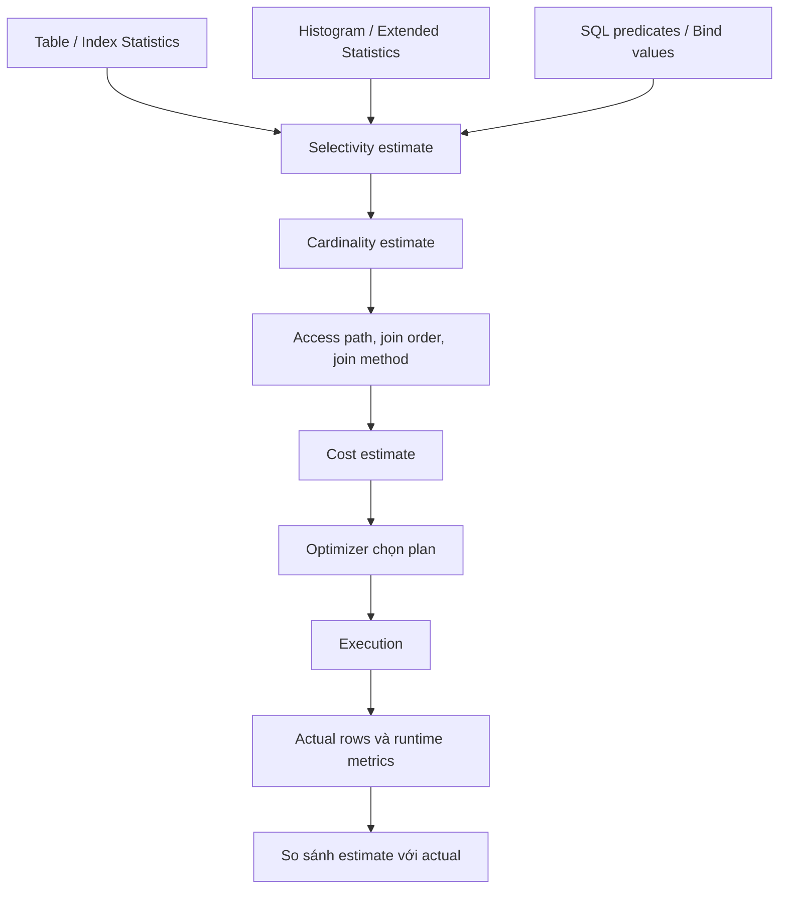

# Cardinality, selectivity, cost và giới hạn của ước lượng trong Oracle Optimizer

Oracle Database sử dụng Cost-Based Optimizer (CBO) để chọn cách thực thi SQL. Optimizer không chỉ nhìn vào câu lệnh SQL; nó dự đoán số hàng ở từng bước, ước lượng chi phí truy cập dữ liệu và so sánh các execution plan khả thi. Ba khái niệm cần hiểu để đọc và chẩn đoán quyết định đó là **cardinality**, **selectivity** và **cost**.

- **Cardinality** là số hàng mà một row source hoặc một bước trong execution plan được ước lượng sẽ trả về.
- **Selectivity** là tỷ lệ hàng thỏa mãn một predicate hoặc một tập điều kiện.
- **Cost** là thước đo nội bộ tương đối mà optimizer dùng để so sánh các plan dựa trên mô hình I/O, CPU và các yếu tố liên quan.

Ba đại lượng có liên hệ chặt chẽ. Một predicate được dự đoán có selectivity thấp thường làm cardinality giảm; cardinality ảnh hưởng lựa chọn access path, join order và join method; những lựa chọn đó lại quyết định cost ước lượng. Nếu cardinality sai đáng kể, optimizer có thể chọn một plan có cost thấp theo mô hình nhưng chạy chậm trên dữ liệu thực tế.

Điều quan trọng là **ước lượng của optimizer là mô hình dựa trên statistics và thông tin SQL, không phải phép đếm chính xác trước khi chạy**. Statistics, histogram, extended statistics, bind peeking, dynamic statistics và feedback có thể cải thiện ước lượng, nhưng không thể mô tả hoàn hảo mọi phân bố và tương quan dữ liệu.

## 1. Cost-Based Optimizer và execution plan

### 1.1. Optimizer làm gì?

Khi nhận một câu SQL, Oracle thực hiện các bước phân tích, kiểm tra ngữ nghĩa, transformation và optimization trước khi thực thi. Optimizer xem xét những phương án như:

- Full table scan hoặc index access.
- Thứ tự join các bảng.
- Nested loops, hash join hoặc sort merge join.
- Filter, aggregation, sort và các phép biến đổi truy vấn.
- Partition pruning và các access path khác nếu có.

Optimizer dựa trên schema metadata, constraints, object statistics, system statistics, SQL text, bind information, optimizer parameters và các transformation có thể áp dụng.

### 1.2. Plan là cây các row source

Execution plan mô tả các thao tác và quan hệ cha/con của chúng. Ví dụ đơn giản:

```text
SELECT *
FROM employees e
JOIN departments d
  ON d.department_id = e.department_id
WHERE d.location_id = 1700;

HASH JOIN
  TABLE ACCESS FULL DEPARTMENTS
  TABLE ACCESS FULL EMPLOYEES
```

Trong plan này, Oracle đọc các hàng DEPARTMENTS thỏa mãn LOCATION_ID, đọc EMPLOYEES và kết hợp hai tập theo DEPARTMENT_ID. Mỗi operation có cardinality ước lượng và cost liên quan.

### 1.3. Optimizer không chỉ chọn access path

Một plan tốt không đơn giản là plan có index. Optimizer phải cân nhắc tổng thể:

- Một index lookup có thể hiệu quả nếu chỉ lấy rất ít hàng.
- Full table scan có thể tốt hơn khi lấy tỷ lệ lớn hàng hoặc bảng nhỏ.
- Nested loops thường phù hợp khi outer row source nhỏ và inner access có chi phí thấp.
- Hash join thường phù hợp với tập dữ liệu lớn hơn và điều kiện equijoin.
- Sort merge join có thể phù hợp với dữ liệu đã có thứ tự hoặc điều kiện join nhất định.

Cardinality estimate là đầu vào quan trọng cho những quyết định này.

### 1.4. Sơ đồ quan hệ



## 2. Cardinality là gì?

### 2.1. Cardinality của bảng và row source

Trong ngữ cảnh optimizer, cardinality thường chỉ số hàng mà một operation được dự đoán trả về. Nó có thể là:

- Số hàng trong một bảng theo statistics.
- Số hàng sau filter.
- Số hàng sau join.
- Số nhóm sau GROUP BY.
- Số hàng sau UNION, DISTINCT hoặc một phép biến đổi khác.

Ví dụ bảng EMPLOYEES có 100.000 hàng. Nếu predicate dự kiến giữ lại 1% dữ liệu, cardinality sau filter xấp xỉ 1.000 hàng.

### 2.2. Cardinality không đồng nghĩa số block

Số hàng và số block là hai thông tin khác nhau. Một bảng có 100.000 hàng có thể chiếm số block khác nhau tùy row length, PCTFREE, mức độ phân mảnh, compression và cách dữ liệu được tổ chức.

Optimizer cần cả thông tin về số hàng lẫn block/leaf block để ước lượng chi phí. Cardinality trả lời câu hỏi “bao nhiêu hàng?”, còn chi phí truy cập còn phụ thuộc “phải đọc bao nhiêu block và thực hiện bao nhiêu thao tác?”.

### 2.3. Cardinality ở các bước khác nhau

Ví dụ:

```sql
SELECT e.employee_id, e.last_name, d.department_name
FROM employees e
JOIN departments d
  ON d.department_id = e.department_id
WHERE e.salary >= 10000
  AND d.location_id = 1700;
```

Optimizer có thể ước lượng:

1. DEPARTMENTS sau LOCATION_ID = 1700 còn 4 hàng.
2. EMPLOYEES sau SALARY >= 10000 còn 300 hàng.
3. Join hai row source còn 25 hàng.

Đây chỉ là ví dụ minh họa. Cardinality thực tế phụ thuộc dữ liệu và statistics của schema đang chạy.

### 2.4. Cardinality trong plan

Khi hiển thị plan bằng DBMS_XPLAN, cột E-Rows thường thể hiện estimated rows. Đây là số hàng optimizer dự đoán cho operation. Cột A-Rows, khi đã thu thập runtime row-source statistics, thể hiện số hàng thực tế quan sát được.

Không phải mọi plan được lưu đều có A-Rows. Muốn so sánh estimate và actual, phải thực thi câu SQL với thống kê runtime phù hợp.

## 3. Selectivity là gì?

### 3.1. Định nghĩa

Selectivity của một predicate là tỷ lệ hàng thỏa mãn predicate đó trên tập hàng đầu vào:

```text
Selectivity = số hàng thỏa điều kiện / tổng số hàng đầu vào
Cardinality ước lượng = input cardinality × selectivity
```

Nếu bảng có 100.000 hàng và predicate có selectivity 0,02, cardinality ước lượng là:

```text
100.000 × 0,02 = 2.000 hàng
```

Selectivity thường nằm trong khoảng 0 đến 1. Predicate càng chọn lọc thì selectivity càng thấp.

### 3.2. Predicate equality

Với một cột có NDV (Number of Distinct Values) là 100 và phân bố đồng đều, điều kiện equality:

```sql
WHERE department_id = 10
```

có thể được ước lượng gần:

```text
Selectivity ≈ 1 / NDV = 1 / 100 = 0,01
```

Nếu bảng có 100.000 hàng, cardinality ước lượng khoảng 1.000 hàng. Công thức này giả định giá trị phân bố đồng đều và giá trị được tìm có tồn tại; dữ liệu skew có thể làm giả định sai.

### 3.3. Predicate range

Với điều kiện:

```sql
WHERE salary BETWEEN 5000 AND 8000
```

Optimizer phải ước lượng tỷ lệ giá trị nằm trong khoảng. Nó có thể sử dụng min/max, histogram, density và các statistics liên quan. Nếu phân bố không đều hoặc có nhiều giá trị tập trung ở một vùng, giả định phân bố đều có thể sai.

### 3.4. IS NULL

Điều kiện:

```sql
WHERE commission_pct IS NULL
```

phụ thuộc số lượng NULL trong cột. Statistics có NUM_NULLS giúp optimizer ước lượng tỷ lệ NULL. Nếu statistics thiếu hoặc lỗi thời, ước lượng có thể lệch.

### 3.5. Predicate LIKE

```sql
WHERE last_name LIKE 'SM%'
```

và:

```sql
WHERE last_name LIKE '%SM'
```

có đặc điểm access và selectivity khác nhau. Prefix pattern có thể tận dụng index trong điều kiện phù hợp; wildcard đầu chuỗi thường không cho phép range scan B-tree thông thường. Ước lượng selectivity phụ thuộc pattern, statistics và histogram.

### 3.6. Nhiều predicate

Với:

```sql
WHERE department_id = 10
  AND status_code = 'ACTIVE'
```

optimizer phải ước lượng tỷ lệ thỏa cả hai điều kiện. Một mô hình đơn giản là giả định độc lập:

```text
Selectivity(A AND B) ≈ Selectivity(A) × Selectivity(B)
```

Giả định này có thể sai nếu hai cột tương quan. Ví dụ mọi hàng thuộc department 10 đều ACTIVE, nhưng ở department khác chỉ 10% ACTIVE. Nhân selectivity độc lập có thể đánh giá thấp hoặc cao cardinality.

## 4. NDV, density và column statistics

### 4.1. NDV

NDV (Number of Distinct Values) là số giá trị khác nhau được thống kê cho cột. Ví dụ cột STATUS_CODE chỉ có NEW, READY, CLOSED thì NDV có thể là 3.

NDV được dùng trong nhiều ước lượng equality, group by và join. Tuy nhiên NDV không nói lên mỗi giá trị xuất hiện bao nhiêu lần. Hai cột có cùng NDV có thể có phân bố rất khác nhau.

### 4.2. NUM_NULLS

NUM_NULLS ghi số hàng có giá trị NULL trong cột. Nó giúp ước lượng predicate IS NULL/IS NOT NULL và một số phép tính khác.

### 4.3. Density

Density là một thống kê được optimizer sử dụng trong ước lượng selectivity, đặc biệt khi không có histogram hoặc khi phải dùng mô hình tổng quát. Không nên đồng nhất density với selectivity của mọi giá trị cụ thể. Với dữ liệu skew, một giá trị hiếm và một giá trị phổ biến có selectivity khác nhau.

### 4.4. Low value và high value

Statistics có thể lưu giá trị thấp nhất/cao nhất của cột. Thông tin này giúp ước lượng range predicate, nhưng min/max không mô tả được khoảng trống hoặc phân bố bên trong toàn miền giá trị.

Ví dụ cột ngày có MIN_DATE là 2020-01-01 và MAX_DATE là 2026-12-31 không có nghĩa hàng được phân bố đều trong toàn khoảng. Có thể phần lớn dữ liệu nằm ở 3 tháng gần nhất.

### 4.5. Column statistics không mô tả mọi tương quan

Statistics riêng cho từng cột thường không đủ để mô tả quan hệ giữa hai cột. Nếu cột REGION và COUNTRY có quan hệ gần như xác định, ước lượng predicate kết hợp có thể sai nếu optimizer coi chúng độc lập. Extended statistics có thể cung cấp thêm thông tin cho một số dạng tương quan.

## 5. Histograms và dữ liệu skew

### 5.1. Skew là gì?

Dữ liệu skew là dữ liệu phân bố không đồng đều. Ví dụ:

| STATUS_CODE | Số hàng | Tỷ lệ |
|---|---:|---:|
| ACTIVE | 900.000 | 90% |
| PENDING | 90.000 | 9% |
| BLOCKED | 10.000 | 1% |

Nếu chỉ biết NDV = 3 và giả định phân bố đều, optimizer có thể ước lượng mỗi giá trị chiếm khoảng 1/3. Điều này sai xa với ACTIVE hoặc BLOCKED.

### 5.2. Histogram giúp gì?

Histogram lưu thông tin về phân bố giá trị trong cột, giúp optimizer ước lượng selectivity khác nhau cho các giá trị phổ biến/hiếm hoặc các khoảng giá trị.

Ví dụ điều kiện:

```sql
WHERE status_code = 'ACTIVE'
```

có thể trả về phần lớn bảng, còn:

```sql
WHERE status_code = 'BLOCKED'
```

chỉ trả về 1%. Một histogram phù hợp giúp optimizer phân biệt hai trường hợp.

### 5.3. Các dạng histogram

Oracle có nhiều dạng histogram tùy phiên bản, số lượng distinct values, cách lấy mẫu và method_opt:

- **Frequency histogram:** lưu tần suất cho từng giá trị khi số distinct values phù hợp giới hạn bucket.
- **Top-frequency histogram:** tập trung vào các giá trị xuất hiện nhiều nhất trong những trường hợp phù hợp.
- **Hybrid histogram:** kết hợp thông tin bucket và tần suất endpoint để cải thiện ước lượng với dữ liệu skew.
- **Height-balanced histogram:** dạng lịch sử, gặp ở các database/version hoặc cấu hình cũ.

Không nên suy luận loại histogram chỉ từ số bucket; hãy xem data dictionary và phiên bản Oracle.

### 5.4. Thu thập histogram

Ví dụ dùng DBMS_STATS:

```sql
BEGIN
    DBMS_STATS.GATHER_TABLE_STATS(
        ownname    => USER,
        tabname    => 'ORDERS',
        method_opt => 'FOR COLUMNS STATUS_CODE SIZE 254',
        cascade    => TRUE,
        estimate_percent => DBMS_STATS.AUTO_SAMPLE_SIZE
    );
END;
/
```

SIZE 254 yêu cầu histogram với số bucket tối đa theo cách Oracle hỗ trợ. Việc tạo histogram thực tế còn phụ thuộc NDV, phân bố và thuật toán của release.

### 5.5. Không tạo histogram cho mọi cột

Histogram có thể giúp với cột skew, nhưng không phải lúc nào cũng tốt:

- Có thể làm plan phụ thuộc giá trị bind và phát sinh nhiều child cursor.
- Statistics thay đổi có thể làm plan thay đổi.
- Histogram trên cột ít quan trọng không mang lại lợi ích.
- Với ứng dụng có nhiều bind values, plan tối ưu cho một giá trị có thể không tốt cho giá trị khác.

Chỉ tạo histogram khi có bằng chứng cardinality estimate sai do phân bố cột và kiểm tra ảnh hưởng đến workload.

## 6. Cardinality của phép join

### 6.1. Equijoin cơ bản

Với hai tập R và S join theo cột X, một mô hình minh họa dưới giả định phân bố đều và không có tương quan phức tạp:

```text
Join cardinality ≈ rows(R) × rows(S)
                   / max(NDV(R.X), NDV(S.X))
```

Ví dụ:

- R có 10.000 hàng và NDV(R.X) = 100.
- S có 20.000 hàng và NDV(S.X) = 200.

Ước lượng minh họa:

```text
10.000 × 20.000 / 200 = 1.000.000 hàng
```

Đây là mô hình đơn giản để hiểu vai trò NDV, không phải công thức đầy đủ của Oracle cho mọi join. Nulls, uniqueness, constraints, histograms, partitioning, skew, join predicates và các transformation có thể thay đổi estimate.

### 6.2. Primary key và foreign key

Nếu DEPARTMENTS.DEPARTMENT_ID là primary key và EMPLOYEES.DEPARTMENT_ID là foreign key, quan hệ uniqueness giúp optimizer hiểu giới hạn số hàng ở phía dimension. Một employee chỉ match tối đa một department theo key duy nhất.

Constraints hợp lệ và được optimizer tin cậy có thể giúp transformation và cardinality estimation. Nếu constraint không tồn tại hoặc trạng thái/validation không cho phép sử dụng, optimizer có thể không tận dụng được thông tin như mong đợi.

### 6.3. Join order

Giả sử query join ba bảng A, B, C. Nếu optimizer ước lượng A sau filter chỉ còn 10 hàng, nó có thể bắt đầu từ A rồi join B, sau đó C. Nếu thực tế A còn 500.000 hàng, lựa chọn join order/method có thể trở nên tệ.

Sai số ở một row source đầu vào có thể lan sang các bước join phía trên. Vì vậy, khi plan chậm, hãy tìm operation đầu tiên có chênh lệch E-Rows/A-Rows lớn, thay vì chỉ nhìn operation cuối.

### 6.4. Join method phụ thuộc cardinality

| Join method | Trường hợp thường phù hợp | Nhạy với sai số nào |
|---|---|---|
| Nested loops | Outer row source nhỏ, inner access hiệu quả | Outer rows lớn hơn dự đoán |
| Hash join | Hai tập dữ liệu lớn, equijoin phù hợp | Input cardinality/row width lớn hơn dự đoán, memory work area thiếu |
| Sort merge join | Dữ liệu có thứ tự hoặc điều kiện join phù hợp | Estimate sort volume và số hàng sai |

Đây là xu hướng, không phải quy tắc tuyệt đối. Optimizer tính cost của từng phương án dựa trên toàn bộ query.

### 6.5. Join fanout

Một hàng ở bảng trái có thể khớp nhiều hàng ở bảng phải. Tỷ lệ nhân hàng đó gọi không chính thức là fanout. Nếu optimizer dự đoán mỗi customer có 2 order nhưng thực tế có 100 order, cardinality sau join sẽ lệch lớn. Skew theo khóa join là một nguyên nhân phổ biến.

## 7. GROUP BY, DISTINCT và cardinality

### 7.1. Số nhóm

Với:

```sql
SELECT department_id, COUNT(*)
FROM employees
GROUP BY department_id;
```

cardinality kết quả gần số giá trị department_id distinct có dữ liệu, không phải tổng số employee. NDV của cột và thống kê liên quan giúp optimizer ước lượng số nhóm.

### 7.2. DISTINCT

```sql
SELECT DISTINCT status_code
FROM orders;
```

Cardinality kết quả gần số distinct values. Nếu statistics NDV lỗi thời, estimate số hàng sau DISTINCT có thể sai.

### 7.3. GROUP BY nhiều cột

```sql
SELECT country_code, city_code, COUNT(*)
FROM customers
GROUP BY country_code, city_code;
```

Số nhóm phụ thuộc tổ hợp giá trị của hai cột. Nhân NDV của từng cột có thể dự đoán quá cao nếu city_code phụ thuộc country_code. Column group extended statistics có thể cải thiện ước lượng trong các trường hợp phù hợp.

## 8. Cost là gì?

### 8.1. Cost là thước đo nội bộ

Cost là số liệu optimizer dùng để so sánh các plan khả thi. Nó phản ánh mô hình tài nguyên dự kiến như I/O và CPU, với các yếu tố khác tùy loại operation và phiên bản.

Cost không phải:

- Thời gian chạy tính bằng giây.
- Số lần đọc block thực tế.
- Một đơn vị tiền tệ hoặc đơn vị vật lý cố định.
- Cam kết rằng plan cost 10 sẽ chạy nhanh gấp đôi plan cost 20.

### 8.2. Cost có tính tương đối

Optimizer so sánh các phương án cho cùng câu SQL và môi trường. Cost của hai câu SQL khác nhau không nhất thiết so sánh trực tiếp được. Cost ước lượng có thể thay đổi sau khi statistics, system stats, optimizer settings hoặc database version thay đổi.

### 8.3. I/O và CPU

Một access path có thể cần đọc nhiều block nhưng ít CPU; một path khác có thể đọc ít block nhưng cần nhiều random lookups hoặc xử lý biểu thức. Cost model cân nhắc những yếu tố này theo system statistics và optimizer model.

### 8.4. System statistics

System statistics giúp optimizer mô hình hóa năng lực I/O/CPU của hệ thống. Các thông tin thường gặp gồm:

- CPU speed.
- I/O seek time.
- I/O transfer rate.
- Multiblock read count.

Các tên statistic cụ thể và cách thu thập phụ thuộc release/platform. System stats ảnh hưởng costing, đặc biệt cân bằng giữa full scan và index access.

### 8.5. Index không luôn có cost thấp hơn

Index range scan có thể đọc leaf blocks rồi truy cập table blocks theo ROWID. Nếu lấy nhiều hàng và clustering factor xấu, số table block visit có thể lớn. Full table scan có thể hiệu quả hơn nhờ multiblock I/O và đọc tuần tự.

Do đó, không thể kết luận “có index thì optimizer phải dùng index”. Cardinality và cost của toàn plan quyết định.

### 8.6. Optimizer goal

OPTIMIZER_MODE có thể định hướng tối ưu cho throughput toàn câu lệnh (ALL_ROWS) hoặc response time cho một số hàng đầu tiên (FIRST_ROWS_n). Mục tiêu khác nhau có thể làm optimizer ưu tiên plan khác nhau, dù query và statistics không đổi.

Không thay OPTIMIZER_MODE chỉ để ép một plan mà chưa hiểu tác động tới toàn workload.

## 9. Statistics mà optimizer sử dụng

### 9.1. Table statistics

Các thống kê bảng thường gồm:

- NUM_ROWS: số hàng theo lần thu thập.
- BLOCKS: số block được ghi nhận theo thống kê.
- AVG_ROW_LEN: độ dài hàng trung bình.
- SAMPLE_SIZE: số hàng được lấy mẫu khi gather.
- LAST_ANALYZED: thời điểm thu thập.

Statistics có thể stale khi dữ liệu thay đổi đáng kể sau lần gather. NUM_ROWS không phải phép đếm realtime tại mọi thời điểm.

### 9.2. Column statistics

Thông tin cột có thể gồm:

- NUM_DISTINCT.
- NUM_NULLS.
- DENSITY.
- LOW_VALUE và HIGH_VALUE.
- HISTOGRAM và số bucket.
- LENGTH và các thuộc tính khác tùy view.

Các thông tin này hỗ trợ ước lượng predicate, group by và join.

### 9.3. Index statistics

Index statistics thường có:

- BLEVL: chiều cao B-tree.
- LEAF_BLOCKS.
- DISTINCT_KEYS.
- CLUSTERING_FACTOR.
- NUM_ROWS.

Clustering factor phản ánh mức độ tương quan giữa thứ tự key trong index và vị trí hàng trong table. Clustering factor cao có thể làm index range scan phải truy cập nhiều table blocks hơn.

### 9.4. System statistics

System statistics giúp mô hình hóa chi phí I/O và CPU. Nếu system stats không đại diện workload hoặc storage hiện tại, cost comparison có thể không phản ánh đúng đặc tính phần cứng.

### 9.5. Statistics của partition

Với partitioned table, partition-level và global statistics có vai trò khác nhau. Query có partition pruning có thể dựa vào stats partition; query nhiều partition cần thông tin global phù hợp. Thiếu hoặc không đồng bộ stats có thể làm estimate lệch.

## 10. Thu thập và quản lý statistics với DBMS_STATS

### 10.1. Gather table statistics

Ví dụ:

```sql
BEGIN
    DBMS_STATS.GATHER_TABLE_STATS(
        ownname          => USER,
        tabname          => 'ORDERS',
        estimate_percent => DBMS_STATS.AUTO_SAMPLE_SIZE,
        method_opt       => 'FOR ALL COLUMNS SIZE AUTO',
        cascade          => TRUE
    );
END;
/
```

AUTO_SAMPLE_SIZE cho phép Oracle chọn phương pháp/kích thước mẫu phù hợp. SIZE AUTO cho phép Oracle quyết định histogram dựa trên thông tin sử dụng cột và các tiêu chí của release.

### 10.2. Gather schema statistics

```sql
BEGIN
    DBMS_STATS.GATHER_SCHEMA_STATS(
        ownname          => USER,
        estimate_percent => DBMS_STATS.AUTO_SAMPLE_SIZE,
        method_opt       => 'FOR ALL COLUMNS SIZE AUTO',
        cascade          => TRUE
    );
END;
/
```

Không chạy gather schema một cách tùy tiện trên production nếu chưa đánh giá thời gian, locking/invalidations liên quan, stats preferences và kế hoạch deploy. Ưu tiên quy trình thống kê có kiểm soát.

### 10.3. Xem statistics

```sql
SELECT table_name,
       num_rows,
       blocks,
       avg_row_len,
       sample_size,
       last_analyzed,
       stale_stats
FROM user_tab_statistics
WHERE table_name = 'ORDERS';
```

Xem cột:

```sql
SELECT column_name,
       num_distinct,
       num_nulls,
       density,
       histogram,
       num_buckets,
       last_analyzed
FROM user_tab_col_statistics
WHERE table_name = 'ORDERS'
ORDER BY column_name;
```

Xem index:

```sql
SELECT index_name,
       blevel,
       leaf_blocks,
       distinct_keys,
       clustering_factor,
       num_rows,
       last_analyzed
FROM user_ind_statistics
WHERE table_name = 'ORDERS';
```

### 10.4. Statistics preferences

DBMS_STATS.SET_TABLE_PREFS và SET_SCHEMA_PREFS cho phép đặt preference cho việc thu thập stats, chẳng hạn method_opt, stale_percent hoặc incremental. Preference giúp chuẩn hóa hành vi gather theo table/schema mà không phải lặp lại mọi tham số.

### 10.5. Stale statistics

Stale stats nghĩa dữ liệu đã thay đổi đủ mức theo tiêu chí Oracle để statistics được xem là cần cập nhật. Nó không có nghĩa chắc chắn plan đang sai. Ngược lại, stats chưa stale vẫn có thể không mô tả tốt phân bố hoặc tương quan cần thiết.

Kiểm tra stale status cùng với execution plan và dữ liệu thực tế, không gather chỉ vì nhìn thấy một timestamp cũ.

### 10.6. Pending statistics

Oracle hỗ trợ pending statistics để kiểm tra tác động trước khi publish thành stats đang dùng, thông qua preferences và DBMS_STATS APIs phù hợp. Cách này có thể giúp thử plan mới trong session kiểm thử trước khi thay đổi statistics toàn hệ thống. Cần quản lý publish/use_pending_stats có chủ đích.

### 10.7. Export/import statistics

DBMS_STATS có thể export/import statistics vào statistics table. Điều này hữu ích để lưu baseline, chuyển stats giữa môi trường có dữ liệu tương đương hoặc rollback stats. Không import stats từ môi trường khác mà không xác nhận data distribution, schema và workload có tương đồng.

## 11. Extended statistics và tương quan dữ liệu

### 11.1. Vấn đề của giả định độc lập

Giả sử bảng ORDERS có:

- COUNTRY_CODE.
- REGION_CODE.

Nếu mỗi region chỉ thuộc một country, hai cột có tương quan. Predicate:

```sql
WHERE country_code = 'VN'
  AND region_code = 'HCM'
```

có selectivity không thể luôn tính chính xác bằng tích hai selectivity độc lập. Column group statistics có thể giúp optimizer hiểu phân bố tổ hợp.

### 11.2. Tạo column group statistics

```sql
SELECT DBMS_STATS.CREATE_EXTENDED_STATS(
    ownname   => USER,
    tabname   => 'ORDERS',
    extension => '(COUNTRY_CODE, REGION_CODE)'
)
FROM dual;
```

Sau đó gather table stats:

```sql
BEGIN
    DBMS_STATS.GATHER_TABLE_STATS(
        ownname    => USER,
        tabname    => 'ORDERS',
        method_opt => 'FOR ALL COLUMNS SIZE AUTO',
        cascade    => TRUE
    );
END;
/
```

Oracle có thể dùng extended stats cho một số predicate nhiều cột. Không phải mọi query shape hoặc mọi biểu thức đều tận dụng được.

### 11.3. Xem extended statistics

```sql
SELECT extension_name,
       extension
FROM user_stat_extensions
WHERE table_name = 'ORDERS';
```

Tên view/cột và quyền truy cập cần kiểm tra theo release. Có thể xem các cột ẩn do extension tạo trong dictionary view phù hợp.

### 11.4. Expression statistics

Nếu query thường lọc theo biểu thức:

```sql
WHERE UPPER(email_address) = 'AN@example.test'
```

statistics trên EMAIL_ADDRESS thông thường không mô tả đầy đủ phân bố của UPPER(EMAIL_ADDRESS). Extended expression statistics hoặc function-based index có thể giúp tùy trường hợp.

Tạo expression statistics:

```sql
SELECT DBMS_STATS.CREATE_EXTENDED_STATS(
    ownname   => USER,
    tabname   => 'CUSTOMERS',
    extension => '(UPPER(EMAIL_ADDRESS))'
)
FROM dual;
```

Sau đó gather stats và kiểm tra plan. Nếu cần access path index cho biểu thức, function-based index là một lựa chọn riêng; expression statistics và index giải quyết hai vấn đề khác nhau.

### 11.5. Extended stats không chữa mọi tương quan

Extended statistics có giới hạn. Tương quan giữa bảng, điều kiện join phức tạp, correlated subquery hoặc dữ liệu biến động mạnh có thể vẫn khó ước lượng. Đừng tạo mọi tổ hợp cột; chỉ thêm khi query thực tế có sai số có thể giải thích.

## 12. Dynamic statistics và dynamic sampling

### 12.1. Khi nào dùng?

Dynamic statistics cho phép optimizer lấy thêm thông tin từ dữ liệu trong lúc parse/optimization khi statistics hiện có không đủ hoặc query phức tạp. Cơ chế này từng được gọi là dynamic sampling trong nhiều tài liệu và phiên bản.

Nó có thể hữu ích khi:

- Bảng chưa có statistics phù hợp.
- Predicate phức tạp.
- Join giữa các row source có thông tin thống kê hạn chế.
- Temporary table hoặc object có đặc điểm dữ liệu khó dự đoán.

### 12.2. Optimizer dynamic sampling level

Tham số OPTIMIZER_DYNAMIC_SAMPLING điều khiển mức sampling theo release và optimizer behavior. Có thể thấy hint:

```sql
SELECT /*+ DYNAMIC_SAMPLING(o 4) */
       COUNT(*)
FROM orders o
WHERE status_code = 'READY';
```

Hint có thể yêu cầu sampling cho query block/table alias trong điều kiện phù hợp. Không dùng level tùy tiện; dynamic sampling làm tăng công việc parse và không đảm bảo estimate hoàn hảo.

### 12.3. Sampling có giới hạn

Sampling đọc một phần dữ liệu rồi suy luận cho toàn bộ tập. Nếu dữ liệu skew mạnh và mẫu không đại diện, estimate vẫn sai. Kết quả cũng có thể khác giữa các lần parse hoặc khi dữ liệu thay đổi.

### 12.4. Dynamic statistics không thay thế statistics quản trị

Với bảng quan trọng, hãy duy trì table/column/index stats đúng cách. Dynamic statistics là công cụ bổ sung trong optimization, không phải lý do để bỏ qua DBMS_STATS.

## 13. Bind variables, bind peeking và adaptive cursor sharing

### 13.1. Bind variable

Bind variable cho phép tái sử dụng SQL text:

```sql
SELECT *
FROM orders
WHERE customer_id = :customer_id;
```

Điều này giảm hard parse và hỗ trợ cursor sharing. Nhưng nếu customer_id có phân bố skew, một bind value có thể trả 1 hàng còn giá trị khác trả hàng nghìn hàng.

### 13.2. Bind peeking

Khi hard parse, optimizer có thể peek giá trị bind đầu tiên để ước lượng selectivity và chọn plan. Nếu giá trị đầu tiên hiếm nhưng các lần sau phổ biến, plan có thể không phù hợp với phần lớn executions, hoặc ngược lại.

Bind peeking là một phần của optimizer behavior; không nên giả định mỗi execution đều re-optimize bằng giá trị bind hiện tại.

### 13.3. Adaptive cursor sharing

Adaptive Cursor Sharing (ACS) có thể cho phép Oracle nhận biết một cursor không phù hợp với mọi bind selectivity và tạo các child cursor/plan phù hợp với các nhóm bind values. Cơ chế này phụ thuộc release, execution history và điều kiện optimizer.

ACS không đảm bảo mỗi giá trị bind luôn có plan tối ưu và không thay thế việc kiểm tra skew/histograms.

### 13.4. Xem thông tin bind/child cursor

Các dynamic performance views như V$SQL, V$SQL_SHARED_CURSOR, V$SQL_CS_SELECTIVITY và V$SQL_CS_STATISTICS có thể giúp điều tra child cursor, bind sensitivity và bind awareness khi có quyền. Các cột và cách diễn giải phụ thuộc release.

### 13.5. Không literalize để chữa mọi bind issue

Chuyển mọi bind thành literal có thể làm tăng hard parse, shared pool usage và số lượng cursor. Nếu query cần nhiều plan theo selectivity, hãy đánh giá ACS, histogram, SQL profiles/baselines và thiết kế query trước khi bỏ bind.

## 14. Cardinality feedback, statistics feedback và adaptive plans

### 14.1. Estimate và actual sau execution

Oracle có thể dùng thông tin từ lần thực thi để nhận ra cardinality estimate lệch và điều chỉnh cách tối ưu trong những lần sau. Tên gọi và chi tiết cơ chế thay đổi theo release; thường gặp các thuật ngữ cardinality feedback hoặc statistics feedback.

### 14.2. Feedback không phải phép sửa vĩnh viễn

Feedback có thể bị ảnh hưởng bởi:

- Child cursor và lần hard parse.
- Thay đổi SQL text hoặc bind behavior.
- Statistics thay đổi.
- Session/environment khác.
- Điều kiện query không tái hiện.

Không giả định lần chạy thứ hai chắc chắn tốt hơn lần đầu.

### 14.3. Adaptive plans

Trong một số phiên bản/cấu hình, optimizer có thể tạo adaptive plan với lựa chọn runtime dựa trên thông tin thu được trong quá trình thực thi, ví dụ chọn nhánh join method. Điều này giúp một số plan ứng phó với sai lệch estimate, nhưng không làm mất nhu cầu statistics tốt.

### 14.4. SQL Plan Management

SQL Plan Baseline có thể kiểm soát tập plan được chấp nhận cho statement, giúp giảm rủi ro plan regression. Nó không tự sửa cardinality statistics và không bảo đảm plan được cố định trong mọi hoàn cảnh. SQL Profile có thể cung cấp auxiliary statistics để cải thiện estimate mà không nhất thiết ép một plan cụ thể.

Phân biệt:

| Cơ chế | Mục đích chính |
|---|---|
| Table/column/index statistics | Mô tả dữ liệu và cấu trúc |
| Histogram/extended statistics | Mô tả skew/tương quan/biểu thức |
| Dynamic statistics | Lấy thêm thông tin khi optimization |
| Cardinality/statistics feedback | Học từ execution trước theo điều kiện |
| SQL Profile | Bổ sung thông tin giúp estimate/costing |
| SQL Plan Baseline | Quản lý plan được chấp nhận |

## 15. Đọc execution plan để tìm sai cardinality

### 15.1. Xem plan cơ bản

```sql
EXPLAIN PLAN FOR
SELECT e.employee_id, e.last_name, d.department_name
FROM employees e
JOIN departments d
  ON d.department_id = e.department_id
WHERE d.location_id = 1700;

SELECT *
FROM TABLE(DBMS_XPLAN.DISPLAY);
```

EXPLAIN PLAN cho biết plan được tạo trong môi trường explain. Nó không cung cấp A-Rows của lần thực thi thật và có thể khác cursor plan thực tế do bind, session settings hoặc environment.

### 15.2. Thu thập runtime row-source statistics

Thực thi câu SQL với hint:

```sql
SELECT /*+ GATHER_PLAN_STATISTICS */
       e.employee_id, e.last_name, d.department_name
FROM employees e
JOIN departments d
  ON d.department_id = e.department_id
WHERE d.location_id = 1700;
```

Sau đó xem cursor gần nhất:

```sql
SELECT *
FROM TABLE(
    DBMS_XPLAN.DISPLAY_CURSOR(
        NULL,
        NULL,
        'ALLSTATS LAST +PREDICATE +PEEKED_BINDS'
    )
);
```

Có thể bật STATISTICS_LEVEL=ALL trong session để thu thập runtime statistics cho các câu lệnh phù hợp, nhưng hint GATHER_PLAN_STATISTICS thường tiện khi chỉ cần đo một statement.

### 15.3. E-Rows và A-Rows

Các cột quan trọng:

| Cột | Ý nghĩa |
|---|---|
| Id / Operation | Row source và thao tác |
| Name | Object liên quan |
| Starts | Số lần operation được khởi chạy |
| E-Rows | Số hàng ước lượng mỗi lần operation theo plan |
| A-Rows | Số hàng thực tế được xử lý/trả về theo runtime statistics |
| A-Time | Thời gian thực tế được ghi nhận |
| Buffers | Logical I/O |
| Reads | Physical reads |
| OMem / 1Mem / Used-Mem | Thông tin memory work area khi có |

Chi tiết cột phụ thuộc format và phiên bản DBMS_XPLAN.

### 15.4. So sánh đúng cách

Nếu operation có STARTS lớn hơn 1, A-Rows có thể là tổng số hàng qua nhiều lần khởi chạy. Khi so với E-Rows, cần xét Starts; một phép so sánh đơn giản giữa hai con số có thể gây hiểu nhầm. Với nested loops, inner row source thường chạy nhiều lần.

Hãy xác định operation đầu tiên có sai lệch lớn theo thứ tự thực thi. Sai số ở operation thấp có thể nhân lên ở các operation cha.

### 15.5. Predicate Information

DBMS_XPLAN có thể hiển thị predicate information để biết điều kiện được dùng làm access predicate hay filter predicate. Nếu predicate bị áp dụng sau khi đọc nhiều hàng, lượng dữ liệu trung gian có thể lớn hơn mong muốn.

### 15.6. Peeked Binds

Format +PEEKED_BINDS có thể hiển thị giá trị bind được peek ở lần parse liên quan, nếu có và được hỗ trợ. Đây không nhất thiết là bind value của mọi execution. Dùng nó để điều tra plan selection, không để kết luận mọi lần chạy đều dùng cùng giá trị.

## 16. Sai lệch estimate so với actual

### 16.1. Sai số nhỏ

Estimate không cần bằng tuyệt đối actual để optimizer chọn plan tốt. Sai số nhỏ có thể không làm thay đổi access path/join method và không ảnh hưởng đáng kể hiệu năng.

### 16.2. Sai số nhiều bậc độ lớn

Nếu E-Rows là 10 nhưng A-Rows là 100.000, optimizer đã đánh giá thấp khoảng 10.000 lần. Sai số lớn có thể dẫn đến:

- Nested loops khi outer row source thực tế lớn.
- Join order không phù hợp.
- Hash area quá nhỏ hoặc spill ra TEMP.
- Sort/aggregation có cardinality sai.
- Memory/workarea và thời gian thực thi khác dự kiến.

### 16.3. Tìm operation đầu tiên sai

Không chỉ xem plan root. Hãy đi từ các row source thấp lên và tìm điểm sai lệch đầu tiên. Nếu filter trên bảng A ước lượng sai, mọi join phía trên có thể sai theo. Sửa root estimate có thể không giải quyết nguyên nhân.

### 16.4. So sánh trên cùng điều kiện

So sánh estimate/actual cần cùng:

- SQL text và child cursor.
- Bind values hoặc selectivity class.
- Schema/data snapshot gần tương đương.
- Session optimizer parameters.
- Statistics và database release.

Nếu các yếu tố khác nhau, chênh lệch có thể đến từ môi trường thay vì mô hình cardinality.

## 17. Những nguyên nhân phổ biến làm estimate sai

### 17.1. Statistics stale hoặc không đại diện

Dữ liệu thay đổi mạnh sau gather, bulk load, purge hoặc partition exchange có thể làm stats không còn phản ánh hiện tại. Kiểm tra last_analyzed, stale_stats, sample_size và partition/global stats.

### 17.2. Skew nhưng thiếu histogram

Optimizer dùng mô hình gần đồng đều trong khi một vài giá trị chiếm phần lớn dữ liệu. Xem NUM_DISTINCT, histogram và frequency của giá trị thực tế.

### 17.3. Tương quan giữa nhiều cột

Predicate trên hai cột liên quan bị ước lượng như độc lập. Cân nhắc column group extended statistics khi có workload chứng minh.

### 17.4. Predicate trên biểu thức

```sql
WHERE TRUNC(order_date) = DATE '2026-05-01'
```

hoặc UPPER(column), SUBSTR(column), arithmetic expression có thể khiến statistics cột gốc không mô tả đúng selectivity. Cân nhắc rewrite predicate theo range, expression stats hoặc function-based index khi phù hợp.

Ví dụ rewrite:

```sql
WHERE order_date >= DATE '2026-05-01'
  AND order_date <  DATE '2026-05-02'
```

Rewrite này có thể giúp dùng index range access và giữ ngữ nghĩa ngày khi ORDER_DATE là DATE. Cần xem timezone/datatype nếu cột là TIMESTAMP.

### 17.5. Implicit conversion

Nếu datatype bind khác datatype cột, Oracle có thể thực hiện conversion trên cột hoặc giá trị tùy biểu thức. Điều đó ảnh hưởng access path và estimate. Bind đúng datatype và kiểm tra Predicate Information/plan.

### 17.6. Bind values có selectivity khác nhau

Một bind value rất hiếm và một bind value rất phổ biến có thể cần plan khác nhau. Kiểm tra bind peeking, child cursors và ACS.

### 17.7. Join correlation và skew theo key

NDV riêng từng bảng không mô tả đầy đủ số hàng khớp theo từng key. Một số customer có hàng triệu order, đa số chỉ có vài order. Join fanout không đều có thể gây sai estimate.

### 17.8. Subquery và OR predicate

OR, NOT, correlated subquery, EXISTS/NOT EXISTS, UNION và complex view có thể làm ước lượng khó hơn. Optimizer có thể transform query; đọc plan sau transformation để xác định row source thực tế.

### 17.9. Temporary table và dữ liệu session-specific

Global temporary table có thể có dữ liệu khác nhau giữa session. Statistics chung không phải lúc nào cũng đại diện cho tập dữ liệu của session hiện tại. Các cơ chế session-specific stats/dynamic sampling tùy release có thể cần được xem xét.

### 17.10. Remote table và external data

Ước lượng cho dữ liệu remote/external có thể phụ thuộc thông tin thống kê có sẵn, database link và cách optimizer đẩy predicate. Kiểm tra remote SQL và plan ở cả hai phía khi cần.

## 18. Quy trình chẩn đoán cardinality misestimate

### Bước 1 — Lấy cursor plan thực tế

Thu thập SQL_ID, child number và plan của lần thực thi chậm. Dùng DISPLAY_CURSOR thay vì chỉ EXPLAIN PLAN nếu cần runtime evidence.

### Bước 2 — Thu thập E-Rows/A-Rows

Bật GATHER_PLAN_STATISTICS cho lần chạy tái hiện hoặc dùng instrumentation phù hợp. Ghi Starts, E-Rows, A-Rows, buffers, reads và A-Time.

### Bước 3 — Tìm điểm sai đầu tiên

Đi từ row source thấp lên. Tìm filter/join operation đầu tiên có chênh lệch estimate/actual lớn, có xét Starts.

### Bước 4 — Kiểm tra predicate

Xem access/filter predicate, bind datatype, implicit conversion, function, expression, NULL semantics và điều kiện kết hợp.

### Bước 5 — Kiểm tra statistics

Xem table/column/index stats, histograms, NDV, NUM_NULLS, stale stats, partition/global stats và system stats.

### Bước 6 — Xác định skew/correlation

Chạy truy vấn thống kê dữ liệu thực tế trên cột liên quan. Kiểm tra tần suất giá trị phổ biến, tương quan giữa cột và join fanout.

### Bước 7 — Thử cải thiện statistics

Cân nhắc gather stats, histogram, extended statistics, expression statistics hoặc dynamic statistics. Thử trong môi trường kiểm thử/pending stats khi thích hợp.

### Bước 8 — So sánh plan và runtime

Chạy cùng SQL, bind values và dữ liệu tương đương. So sánh E-Rows/A-Rows, plan hash, elapsed time, buffers, reads và PGA/workarea.

### Bước 9 — Quản lý plan regression

Nếu plan tốt đã được xác nhận, đánh giá SQL Plan Management hoặc giải pháp quản lý plan phù hợp. Không dùng hint ép plan trước khi hiểu nguyên nhân estimate sai.

### Bước 10 — Ghi nhận thay đổi

Lưu lại statistics, compiler/optimizer parameters, SQL text, bind profile, plan và kết quả benchmark để có thể tái hiện.

## 19. Hints và giới hạn của việc ép optimizer

### 19.1. Cardinality hint

Oracle có hint CARDINALITY trong một số ngữ cảnh nhằm cung cấp cardinality ước lượng cho một row source/query block. Đây là công cụ chuyên biệt, không phải thay thế lâu dài cho statistics tốt. Cú pháp và hiệu lực cần kiểm tra theo version và alias/query block.

### 19.2. Hints về access/join

Các hint như INDEX, FULL, USE_NL, USE_HASH, LEADING có thể ảnh hưởng lựa chọn plan. Nếu cardinality gốc sai, ép join method có thể cải thiện một query cụ thể nhưng gây hại khi dữ liệu hoặc bind values thay đổi.

### 19.3. Hint không phải bảo đảm tuyệt đối

Hint có thể bị bỏ qua do sai alias, conflict, transformation, unsupported context hoặc optimizer không thể áp dụng. Kiểm tra plan và hint report nếu release hỗ trợ.

### 19.4. Thứ tự ưu tiên

Một thứ tự xử lý thường hợp lý:

1. Sửa SQL và datatype/predicate.
2. Sửa statistics và mô tả skew/correlation.
3. Kiểm tra bind behavior và optimizer environment.
4. Thử dynamic/extended statistics hoặc SQL Profile khi có cơ sở.
5. Dùng SQL Plan Baseline hoặc hint có kiểm soát nếu cần bảo vệ plan.

## 20. Bài lab: quan sát skew và cardinality

Thực hiện trong schema lab riêng. Không chạy DDL hoặc gather statistics thử nghiệm trên bảng production.

### 20.1. Tạo dữ liệu skew

```sql
CREATE TABLE ce_lab (
    id NUMBER NOT NULL,
    category VARCHAR2(20),
    region VARCHAR2(20)
);

INSERT INTO ce_lab(id, category, region)
SELECT level,
       CASE
           WHEN MOD(level, 10) = 0 THEN 'RARE'
           ELSE 'COMMON'
       END,
       CASE
           WHEN MOD(level, 10) = 0 THEN 'SPECIAL'
           ELSE 'NORMAL'
       END
FROM dual
CONNECT BY level <= 100000;

COMMIT;
```

Trong dữ liệu này, COMMON chiếm khoảng 90%, RARE khoảng 10%. CATEGORY và REGION có tương quan hoàn toàn trong cách tạo dữ liệu.

### 20.2. Gather stats không yêu cầu histogram

```sql
BEGIN
    DBMS_STATS.GATHER_TABLE_STATS(
        ownname => USER,
        tabname => 'CE_LAB',
        method_opt => 'FOR ALL COLUMNS SIZE 1',
        cascade => TRUE
    );
END;
/
```

SIZE 1 không tạo histogram thông thường cho các cột. Quan sát column stats:

```sql
SELECT column_name,
       num_distinct,
       num_nulls,
       density,
       histogram,
       num_buckets
FROM user_tab_col_statistics
WHERE table_name = 'CE_LAB';
```

### 20.3. So sánh predicate

```sql
SELECT /*+ GATHER_PLAN_STATISTICS */ COUNT(*)
FROM ce_lab
WHERE category = 'COMMON';

SELECT *
FROM TABLE(
    DBMS_XPLAN.DISPLAY_CURSOR(
        NULL, NULL, 'ALLSTATS LAST +PREDICATE'
    )
);
```

Lặp lại với CATEGORY = 'RARE'. So sánh E-Rows/A-Rows và plan. Estimate có thể phụ thuộc release, sampling và cursor; ghi lại kết quả thực tế.

### 20.4. Gather histogram

```sql
BEGIN
    DBMS_STATS.GATHER_TABLE_STATS(
        ownname => USER,
        tabname => 'CE_LAB',
        method_opt => 'FOR COLUMNS CATEGORY SIZE 254',
        cascade => TRUE
    );
END;
/
```

Chạy lại hai query với bind/literal theo cùng điều kiện thử nghiệm. Kiểm tra histogram và estimate thay đổi thế nào.

### 20.5. Thử column group statistics

```sql
SELECT DBMS_STATS.CREATE_EXTENDED_STATS(
    ownname => USER,
    tabname => 'CE_LAB',
    extension => '(CATEGORY, REGION)'
)
FROM dual;

BEGIN
    DBMS_STATS.GATHER_TABLE_STATS(
        ownname => USER,
        tabname => 'CE_LAB',
        method_opt => 'FOR ALL COLUMNS SIZE AUTO',
        cascade => TRUE
    );
END;
/
```

Thử:

```sql
SELECT /*+ GATHER_PLAN_STATISTICS */ COUNT(*)
FROM ce_lab
WHERE category = 'RARE'
  AND region = 'SPECIAL';
```

So sánh estimate trước/sau extended stats. Vì dữ liệu lab tạo tương quan rất mạnh, đây là trường hợp hữu ích để quan sát column group.

### 20.6. Thử join fanout

Tạo bảng con có số hàng không đều theo key, rồi join với CE_LAB. So sánh cardinality estimate với A-Rows. Thử key có nhiều hàng con và key có ít hàng con.

### 20.7. Ghi kết quả

| Thử nghiệm | E-Rows | A-Rows | Plan hash | Buffers | Nhận xét |
|---|---:|---:|---|---:|---|
| COMMON, không histogram |  |  |  |  |  |
| RARE, không histogram |  |  |  |  |  |
| COMMON, có histogram |  |  |  |  |  |
| RARE, có histogram |  |  |  |  |  |
| Predicate hai cột, extended stats |  |  |  |  |  |

Điền kết quả từ database đang chạy. Không lấy số dự kiến trong bài làm kết quả thực nghiệm.

## 21. Checklist khi đọc cardinality và cost

- [ ] Đang xem cursor plan thực tế hay chỉ EXPLAIN PLAN?
- [ ] Có runtime statistics để đọc A-Rows không?
- [ ] Đã xét Starts khi so sánh E-Rows/A-Rows chưa?
- [ ] Đã tìm operation đầu tiên có estimate lệch lớn chưa?
- [ ] Predicate có implicit conversion hoặc function trên cột không?
- [ ] Bind datatype và bind selectivity có phù hợp không?
- [ ] Table/column/index stats có stale hoặc không đại diện không?
- [ ] Cột có skew nhưng thiếu histogram không?
- [ ] Nhiều cột có tương quan và cần extended statistics không?
- [ ] Join key có fanout không đồng đều không?
- [ ] Group by/distinct có số nhóm được ước lượng hợp lý không?
- [ ] Index clustering factor và table blocks có ảnh hưởng cost không?
- [ ] System stats và optimizer settings có nhất quán không?
- [ ] Dynamic statistics/feedback/ACS có đang ảnh hưởng child cursor không?
- [ ] Đã benchmark với bind values và concurrency đại diện chưa?
- [ ] Có dùng hint hoặc baseline mà chưa hiểu nguyên nhân gốc không?

## 22. Câu hỏi tự kiểm tra

1. Cardinality trong execution plan biểu thị điều gì?
2. Selectivity được định nghĩa như thế nào?
3. Công thức cardinality = input rows × selectivity có điều kiện áp dụng nào?
4. NDV và NUM_NULLS giúp optimizer ra sao?
5. Density có phải selectivity của mọi giá trị cụ thể không?
6. Vì sao histogram hữu ích với dữ liệu skew?
7. Frequency, top-frequency, hybrid và height-balanced histogram khác nhau ở mức nào?
8. Vì sao không nên tạo histogram trên mọi cột?
9. Giả định độc lập giữa hai predicate có thể sai khi nào?
10. Extended column group statistics giải quyết vấn đề nào?
11. Cardinality join chịu ảnh hưởng của NDV, uniqueness và fanout ra sao?
12. Vì sao sai estimate ở row source thấp có thể làm plan phía trên sai?
13. Nested loops và hash join nhạy với cardinality theo cách nào?
14. Cost có phải thời gian chạy bằng giây không?
15. Vì sao index access không luôn rẻ hơn full table scan?
16. System statistics tác động đến costing như thế nào?
17. Table, column và index statistics chứa những thông tin quan trọng nào?
18. DBMS_STATS.AUTO_SAMPLE_SIZE và SIZE AUTO có vai trò gì?
19. Stale statistics có đồng nghĩa plan chắc chắn sai không?
20. Dynamic statistics khác persistent object statistics thế nào?
21. Bind peeking ảnh hưởng plan ra sao?
22. Adaptive cursor sharing giúp xử lý bind selectivity khác nhau như thế nào?
23. Statistics feedback và adaptive plan có giới hạn gì?
24. Vì sao phải xem A-Rows, E-Rows và Starts cùng nhau?
25. Quy trình tìm operation đầu tiên có cardinality misestimate là gì?
26. SQL Profile khác SQL Plan Baseline ở mục đích chính nào?
27. Khi nào nên xem xét expression statistics hoặc function-based index?
28. Vì sao EXPLAIN PLAN có thể khác cursor plan thực tế?
29. Những điều kiện nào cần giữ giống nhau khi benchmark hai plan?
30. Vì sao cost thấp hơn không tự chứng minh query sẽ chạy nhanh hơn trong mọi lần thực thi?

**Nguyên tắc cần nhớ:** selectivity ước lượng tỷ lệ hàng thỏa predicate; cardinality chuyển tỷ lệ đó thành số hàng ở mỗi row source; cost giúp optimizer so sánh các plan theo mô hình tài nguyên. Statistics và histogram mô tả phân bố, extended statistics mô tả một số tương quan, còn bind peeking/feedback/dynamic statistics bổ sung thông tin trong những điều kiện nhất định. Khi điều tra query chậm, hãy xem cursor plan có runtime statistics, so sánh E-Rows với A-Rows có xét Starts, tìm sai lệch đầu tiên rồi kiểm tra predicate, bind, skew, correlation và statistics. Cost là ước lượng tương đối, không phải thời gian thực tế hay lời bảo đảm về hiệu năng.
