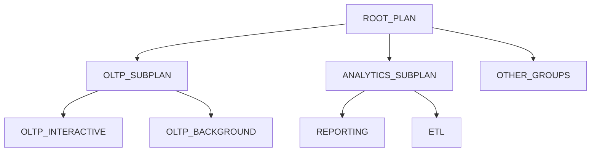

# Resource Manager, consumer group và phân bổ tài nguyên

Oracle Database Resource Manager là cơ chế quản trị workload ở cấp database. Nó giúp DBA quyết định workload nào được ưu tiên khi nhiều session cùng tranh CPU, giới hạn số session hoạt động đồng thời, điều tiết parallel execution, đặt ngưỡng cho một số loại tài nguyên và xử lý các câu SQL chạy quá lâu hoặc dùng quá nhiều tài nguyên.

Resource Manager hoạt động dựa trên ba thành phần chính:

- **Resource plan:** mô tả chính sách phân bổ tài nguyên cho một workload hoặc môi trường.
- **Plan directive:** gắn chính sách cụ thể với consumer group hoặc subplan, ví dụ CPU share, active session pool, parallel degree và các ngưỡng chuyển nhóm.
- **Consumer group:** phân loại session theo workload để Resource Manager áp dụng directive phù hợp.

Ví dụ, ứng dụng có thể chia session thành nhóm OLTP, báo cáo và batch. Khi database bận, nhóm OLTP được ưu tiên CPU và có giới hạn thời gian chờ thấp; nhóm batch có ít CPU share hơn, số session hoạt động bị giới hạn và tác vụ nặng có thể bị chuyển sang group khác.

Resource Manager không tạo thêm CPU, memory hay I/O. Nó điều phối tài nguyên hiện có theo chính sách đã cấu hình. Vì vậy, một plan tốt giúp workload cạnh tranh công bằng và có thể dự đoán hơn, nhưng không thay thế việc tối ưu SQL, sizing hệ thống, quản lý connection pool hoặc xử lý bottleneck ở storage.

## 1. Resource Manager giải quyết vấn đề gì?

### 1.1. Workload cạnh tranh tài nguyên

Một database thường phục vụ nhiều loại workload cùng lúc:

- Giao dịch ngắn, cần độ trễ thấp.
- Báo cáo đọc nhiều dữ liệu.
- ETL hoặc batch cập nhật hàng loạt.
- Job bảo trì, thống kê và quản trị.
- Tác vụ ad hoc do người dùng chạy trực tiếp.

Nếu tất cả session được đối xử giống nhau, một nhóm chạy truy vấn lớn có thể chiếm phần lớn CPU hoặc số phiên hoạt động, làm các giao dịch ngắn phải chờ. Resource Manager cho phép phân chia workload để hạn chế ảnh hưởng lẫn nhau.

### 1.2. Ví dụ về tranh chấp

Giả sử một instance có 16 CPU core khả dụng. Cùng lúc có:

| Workload | Số session | Đặc điểm |
|---|---:|---|
| OLTP | 80 | Nhiều giao dịch ngắn, cần response time ổn định |
| Reporting | 12 | Truy vấn đọc nhiều hàng, join và sort |
| Batch | 20 | Xử lý theo lô, CPU cao |
| Ad hoc | 8 | SQL không dự đoán trước |

Không có Resource Manager, một số câu báo cáo hoặc batch có thể tiêu thụ phần lớn CPU trong thời gian dài. Resource Manager có thể ưu tiên OLTP khi có contention, đồng thời giới hạn số session báo cáo/batch chạy đồng thời.

### 1.3. Những gì Resource Manager có thể kiểm soát

Tùy phiên bản, edition, cấu hình và loại workload, Resource Manager có thể quản lý:

- Phân bổ CPU giữa consumer groups theo mức ưu tiên/share.
- Giới hạn tỷ lệ CPU tối đa cho group trong một số plan.
- Giới hạn số session hoạt động và xếp hàng session vượt ngưỡng.
- Giới hạn parallel degree cho consumer group.
- Chuyển session sang consumer group khác khi vượt ngưỡng CPU/thời gian/I/O.
- Hủy SQL hoặc kết thúc session theo chính sách được hỗ trợ.
- Giới hạn lượng undo mà một consumer group có thể tạo.
- Điều tiết workload giữa các pluggable database trong môi trường multitenant.

Resource Manager không phải công cụ đặt giới hạn trực tiếp cho mọi loại memory của từng câu SQL. PGA workarea, SGA, TEMP, storage IOPS và các tài nguyên khác còn có cơ chế quản trị riêng. Cần xác định đúng loại tài nguyên và tính năng được hỗ trợ trong release đang chạy.

## 2. Các khái niệm nền tảng

### 2.1. Resource plan

Resource plan là tập hợp các directive mô tả cách chia tài nguyên. Một plan có thể chứa:

- Consumer group trực tiếp.
- Subplan, tức một plan lồng bên trong plan cha.
- Group mặc định OTHER_GROUPS để nhận session không được ánh xạ vào group khác.

Plan tạo ra cấu trúc phân cấp. Một subplan có thể chia phần tài nguyên được cấp cho nó xuống các consumer group con.

### 2.2. Plan directive

Directive là quy tắc cho một consumer group hoặc subplan trong plan. Một directive có thể chỉ định:

- CPU share ở các mức quản lý.
- CPU utilization limit.
- Active session pool và thời gian chờ.
- Parallel degree limit.
- Undo pool.
- Chính sách switch group và các ngưỡng runaway query.
- Một số giới hạn khác tùy Oracle release.

Một plan không có directive phù hợp cho workload sẽ không tự động áp dụng chính sách mong muốn. Cần bảo đảm mọi session có đường ánh xạ tới consumer group hợp lệ.

### 2.3. Consumer group

Consumer group là nhãn workload gắn với session. Resource Manager dùng group hiện tại của session để quyết định directive nào áp dụng.

Một số ví dụ:

- OLTP_GROUP: giao dịch trực tuyến.
- REPORTING_GROUP: báo cáo.
- BATCH_GROUP: xử lý theo lô.
- ETL_GROUP: nạp và biến đổi dữ liệu.
- OTHER_GROUPS: nhóm dự phòng cho session không được phân loại cụ thể.

Consumer group không phải schema, database user, role hoặc service. Một user có thể tạo session thuộc nhiều consumer group khác nhau tùy mapping, module/action hoặc việc chuyển group được cấp phép.

### 2.4. Session và consumer group

Consumer group được áp dụng ở cấp session. Khi session được tạo, Oracle xác định group ban đầu qua cấu hình/mapping. Trong vòng đời session, group có thể thay đổi bởi mapping, thao tác switch được cấp quyền hoặc chính sách Resource Manager.

Điều này có ý nghĩa với connection pool: một physical database session có thể được tái sử dụng cho nhiều request. Ứng dụng cần thiết lập module, action, client identifier và consumer group đúng tại ranh giới request nếu dùng các thuộc tính đó để phân loại workload.

### 2.5. Resource plan đang hoạt động

Tạo plan và directive chưa có nghĩa plan đang điều phối workload. Cần kích hoạt plan bằng cấu hình Resource Manager phù hợp, thường thông qua tham số RESOURCE_MANAGER_PLAN ở cấp instance hoặc cơ chế tương ứng trong môi trường multitenant.

## 3. CPU allocation và mức ưu tiên

### 3.1. CPU share

Resource Manager có thể phân chia CPU giữa consumer groups bằng các mức quản lý như MGMT_P1 đến MGMT_P8. Các giá trị này thể hiện tỷ lệ/share tương đối trong cấu trúc plan ở mức tương ứng.

Ví dụ minh họa ở một mức:

| Consumer group | MGMT_P1 | Ý nghĩa chính sách |
|---|---:|---|
| OLTP_GROUP | 70 | Được ưu tiên hơn khi có cạnh tranh |
| REPORTING_GROUP | 20 | Nhận phần thấp hơn OLTP |
| BATCH_GROUP | 10 | Chạy với mức ưu tiên thấp hơn |

Các con số trên là cấu hình minh họa, không phải phần trăm CPU luôn được dành riêng cho từng group trong mọi thời điểm.

### 3.2. Share không phải reservation cố định

Khi CPU còn nhàn rỗi, group có share thấp vẫn có thể sử dụng CPU chưa được group khác dùng. Khi có contention, Resource Manager phân phối theo chính sách share và mức phân cấp.

Do đó, nếu OLTP chỉ sử dụng 10% CPU, batch có thể dùng phần CPU còn trống thay vì bị khóa cứng ở 10%. Khi OLTP tăng tải, batch bị giảm phần CPU theo chính sách.

### 3.3. Hierarchical resource allocation

Plan có thể chia tài nguyên qua nhiều tầng:



Plan cha phân bổ phần tài nguyên cho subplan. Subplan tiếp tục chia phần được cấp cho các consumer group con. Cách này giúp DBA quản lý nhiều ứng dụng hoặc workload theo nhóm thay vì cấu hình một danh sách phẳng rất dài.

### 3.4. CPU utilization limit

Directive có thể đặt UTILIZATION_LIMIT để giới hạn mức CPU tối đa mà group/subplan được sử dụng theo cơ chế và phạm vi hỗ trợ của release. Đây là một kiểu cap, khác với share:

- Share điều tiết tương đối khi các group cạnh tranh.
- Utilization limit đặt mức trần cho group trong phạm vi áp dụng.

Nếu đặt cap quá thấp, group có thể không tận dụng CPU nhàn rỗi và job kéo dài. Chỉ dùng khi có yêu cầu giới hạn cứng hoặc cần bảo vệ workload khác.

### 3.5. MGMT_P1 đến MGMT_P8

Các mức MGMT_P1...MGMT_P8 hỗ trợ phân bổ CPU theo nhiều tầng ưu tiên. Ý nghĩa chính xác của từng level và cách kế thừa phụ thuộc plan structure/version. Khi thiết kế:

1. Xác định plan cha và các group/subplan ngang hàng.
2. Chọn level phân bổ phù hợp.
3. Đặt share theo mức ưu tiên tương đối.
4. Kiểm tra directive của OTHER_GROUPS.
5. Validate plan trước khi submit.
6. Quan sát metric khi workload thực sự cạnh tranh CPU.

Không coi MGMT_P1=70 là cam kết group luôn nhận đúng 70% CPU bất kể tải, số core hay cấu trúc plan.

## 4. Active session pool và queueing

### 4.1. Vì sao cần giới hạn session hoạt động?

Một consumer group có thể có nhiều session kết nối, nhưng không nhất thiết tất cả phải hoạt động đồng thời. Các truy vấn nặng có thể tiêu thụ CPU, PGA, TEMP và I/O. Active session pool giới hạn số session được phép hoạt động trong group theo directive.

Ví dụ:

- REPORTING_GROUP cho tối đa 5 active sessions.
- Khi đã đủ 5 session, session tiếp theo được đưa vào queue.
- Queue có timeout để request không chờ vô hạn.

### 4.2. ACTIVE_SESS_POOL_P1

ACTIVE_SESS_POOL_P1 đặt giới hạn số session hoạt động ở mức directive tương ứng. Khi số session đang hoạt động đạt ngưỡng, session mới có thể phải chờ trong queue theo chính sách.

Đây là giới hạn số session hoạt động, không phải giới hạn tổng connection của connection pool. Một group có thể có hàng trăm session kết nối nhưng chỉ một phần được phép hoạt động đồng thời.

### 4.3. QUEUEING_P1

QUEUEING_P1 đặt thời gian tối đa session có thể chờ trong queue theo đơn vị/semantics của Oracle release. Khi hết thời gian, request được xử lý theo hành vi timeout của Resource Manager và client sẽ nhận kết quả/lỗi tương ứng.

Đặt queue timeout phải cân nhắc SLA:

- Quá dài làm request tồn đọng và tăng latency.
- Quá ngắn khiến workload bị từ chối sớm dù có thể chờ thêm.
- Nếu ứng dụng tự retry liên tục, queue timeout ngắn có thể tạo retry storm.

### 4.4. Active session pool không thay connection pool

Connection pool phía ứng dụng quản lý số physical connections. Resource Manager active session pool quản lý số session được phép hoạt động trong consumer group. Hai cơ chế bổ sung cho nhau:

| Connection pool | Resource Manager active session pool |
|---|---|
| Giới hạn/tái sử dụng kết nối từ ứng dụng | Giới hạn session hoạt động trong group |
| Giảm chi phí connect/disconnect | Kiểm soát concurrency của workload |
| Có thể xếp hàng khi hết connection | Có thể xếp hàng khi group hết active slots |
| Quản lý ở tầng client/application | Quản lý trong Oracle Database |

Nếu cả hai tầng đều queue, tổng thời gian chờ có thể cộng dồn. Cần đo end-to-end latency và chọn giới hạn phù hợp.

### 4.5. Ví dụ chọn active session pool

Giả sử báo cáo thường dùng nhiều PGA và TEMP. DBA có thể bắt đầu với 4 active sessions và queue timeout 60 giây trong môi trường thử nghiệm. Sau đó đo:

- Throughput báo cáo.
- P95/P99 latency.
- Số session bị queue hoặc timeout.
- PGA/TEMP peak.
- CPU và I/O của instance.
- Tác động tới OLTP.

Không lấy 4 và 60 giây làm giá trị mặc định cho mọi hệ thống.

## 5. Parallel execution controls

### 5.1. Vì sao cần giới hạn parallelism?

Một câu SQL chạy parallel có thể dùng nhiều PX server process. Nếu nhiều session cùng chạy DOP cao, tổng số process và lượng CPU/memory/I/O có thể tăng mạnh.

Resource Manager có thể đặt PARALLEL_DEGREE_LIMIT_P1 để giới hạn parallel degree cho consumer group theo plan directive.

### 5.2. DOP không phải số session

Degree of Parallelism (DOP) là mức song song của một statement. Một session chạy DOP 8 có thể yêu cầu nhiều PX server process, trong khi active session pool đếm session hoạt động theo chính sách group. Hai giới hạn giải quyết hai vấn đề khác nhau.

### 5.3. Ví dụ

- OLTP_GROUP: parallel degree limit thấp hoặc bằng 1 để tránh request giao dịch bất ngờ dùng nhiều PX.
- REPORTING_GROUP: cho phép DOP cao hơn nhưng giới hạn active sessions.
- BATCH_GROUP: đặt DOP vừa phải và CPU share thấp hơn trong giờ cao điểm.

Giá trị cụ thể cần dựa trên CPU core, PARALLEL_SERVERS_TARGET, số PX server có thể cấp, workload và yêu cầu latency.

### 5.4. Parallel statement queueing

Oracle có thể xếp hàng các statement parallel khi PX server không đủ theo cấu hình. Cơ chế này tương tác với Resource Manager và các tham số parallel execution. Khi điều tra query chậm, cần phân biệt thời gian chờ PX server với thời gian chạy plan.

### 5.5. Kiểm tra DOP thực tế

Plan có thể yêu cầu DOP khác với DOP thực tế được cấp. Hệ thống có thể downgrade do tài nguyên, policy hoặc queue. Xem execution plan, SQL Monitor, V$PX_SESSION và các view parallel execution phù hợp để xác định DOP runtime.

## 6. Undo pool và giới hạn workload DML

### 6.1. Undo pool

UNDO_POOL đặt ngưỡng lượng undo mà một consumer group được phép tạo theo đơn vị và semantics của phiên bản Oracle. Khi group vượt giới hạn, các DML tiếp theo có thể bị từ chối cho đến khi lượng undo sử dụng giảm xuống dưới ngưỡng.

Đây là biện pháp bảo vệ database khỏi một workload DML quá lớn chiếm dụng undo. Nó không thay thế việc sizing undo tablespace hoặc quản lý transaction.

### 6.2. Khi nào dùng?

Có thể cân nhắc giới hạn undo cho:

- Batch update/delete lớn.
- Tác vụ ad hoc có nguy cơ sửa hàng loạt.
- Nhóm ETL cần bảo vệ workload giao dịch.
- Workload không được phép tạo undo vượt ngân sách.

### 6.3. Trade-off

Giới hạn quá thấp có thể khiến job hợp lệ thất bại giữa chừng. Trước khi áp dụng, đo undo generation của job ở các kích thước dữ liệu đại diện, xác định cách restart và đảm bảo ứng dụng xử lý lỗi phù hợp.

### 6.4. Undo pool không phải quota undo tablespace

Undo pool là chính sách theo consumer group. Undo tablespace là vùng lưu trữ undo của database. Một workload có thể bị chặn bởi undo pool dù tablespace còn chỗ; ngược lại, tablespace thiếu chỗ là vấn đề cấp database và không được giải quyết chỉ bằng cách tăng undo pool.

## 7. Runaway query và chuyển consumer group

### 7.1. Mục tiêu

Một câu SQL có thể vượt xa kỳ vọng về CPU time, elapsed time hoặc I/O. Resource Manager có thể áp dụng ngưỡng để chuyển session sang group khác, hạ mức ưu tiên, hủy SQL hoặc kết thúc session tùy directive và phiên bản.

### 7.2. SWITCH_GROUP

SWITCH_GROUP xác định consumer group đích khi một switch condition được kích hoạt. Group đích có thể là một consumer group khác hoặc một hành động đặc biệt được Oracle hỗ trợ trong release, chẳng hạn hủy SQL.

Ví dụ chính sách:

- Báo cáo vượt ngưỡng CPU được chuyển sang LONG_RUNNING_GROUP.
- Ad hoc query vượt giới hạn được chuyển sang LOW_PRIORITY_GROUP.
- Một workload không được phép chạy quá lâu có thể bị hủy theo chính sách.

### 7.3. SWITCH_TIME

SWITCH_TIME thường dùng để đặt ngưỡng CPU time của session trong consumer group trước khi áp dụng hành động switch. Đây không nhất thiết là elapsed wall-clock time: một query chờ I/O lâu có thể có elapsed time lớn nhưng CPU time thấp.

Phải phân biệt CPU time với elapsed time khi chọn ngưỡng.

### 7.4. SWITCH_ESTIMATE và MAX_EST_EXEC_TIME

Các thuộc tính estimate-based có thể cho phép Resource Manager đánh giá thời gian thực thi ước lượng trước khi chạy và áp dụng policy nếu vượt ngưỡng. MAX_EST_EXEC_TIME là giới hạn thời gian thực thi ước lượng theo cơ chế được hỗ trợ; SWITCH_ESTIMATE điều khiển việc dùng estimate để chuyển group.

Ước lượng optimizer có thể sai. Không nên dùng estimate-based control như bảo đảm tuyệt đối về thời gian chạy.

### 7.5. SWITCH_IO_MEGABYTES và SWITCH_IO_REQS

Một số release hỗ trợ ngưỡng I/O theo megabytes hoặc số yêu cầu I/O. Các thuộc tính này có thể được dùng để chuyển workload khi vượt ngưỡng. Xác định đúng đơn vị, phạm vi tính và phiên bản hỗ trợ trước khi cấu hình.

### 7.6. MAX_IDLE_TIME và MAX_IDLE_BLOCKER_TIME

Resource Manager có thể áp dụng giới hạn cho session idle quá lâu hoặc idle nhưng đang giữ lock/block session khác. Các ngưỡng này cần thận trọng:

- Session idle có thể đang giữ transaction chưa commit.
- Kết thúc session có thể gây rollback và ảnh hưởng ứng dụng.
- Một số connection pool giữ session rỗi có chủ đích.

Chỉ dùng giới hạn idle phù hợp với hành vi ứng dụng và quy trình transaction.

### 7.7. SWITCH_TIME_IN_CALL và chính sách theo call

Một số cấu hình cho phép đánh giá giới hạn theo từng call thay vì toàn bộ thời gian session ở group. Cơ chế này hữu ích khi session thực hiện nhiều request/call khác nhau. Cú pháp và semantics cụ thể phụ thuộc Oracle release; kiểm tra tài liệu package và data dictionary của hệ thống.

### 7.8. Không nhầm Resource Manager switch với ứng dụng tự retry

Khi Resource Manager hủy SQL hoặc chuyển group, ứng dụng có thể nhận lỗi hoặc tiếp tục trong group mới tùy policy. Retry tự động mà không phân biệt lỗi có thể làm tải tăng thêm. Ứng dụng nên nhận diện lỗi, giới hạn retry và ghi lại consumer group khi request bắt đầu/kết thúc.

## 8. Consumer group mapping

### 8.1. Vì sao cần mapping?

Plan chỉ có tác dụng phân loại workload khi session được đưa vào consumer group đúng. Mapping rules xác định consumer group dựa trên thuộc tính session.

Một user ứng dụng có thể dùng cùng schema cho cả giao dịch và báo cáo. Nếu chỉ mapping theo ORACLE_USER, cả hai workload sẽ vào cùng group. Mapping theo service, module/action hoặc client identifier có thể phân biệt chính xác hơn.

### 8.2. Các thuộc tính mapping thường dùng

Oracle hỗ trợ nhiều thuộc tính mapping, tùy release:

- ORACLE_USER: database username.
- SERVICE_NAME: database service mà session kết nối.
- CLIENT_ID: client identifier được ứng dụng thiết lập.
- MODULE_NAME: module do ứng dụng đặt.
- MODULE_NAME_ACTION: kết hợp module và action.
- CLIENT_PROGRAM: tên chương trình client.
- PDB_NAME: pluggable database trong môi trường multitenant.
- Một số thuộc tính khác như client OS user, machine, terminal hoặc Oracle function tùy phiên bản.

Không phải mọi thuộc tính đều có mặt trong mọi release hoặc đều phù hợp cho mọi hệ thống.

### 8.3. Thiết lập MODULE và ACTION

Ứng dụng có thể gắn module/action bằng DBMS_APPLICATION_INFO:

```sql
BEGIN
    DBMS_APPLICATION_INFO.SET_MODULE(
        module_name => 'ORDER_API',
        action_name => 'CREATE_ORDER'
    );
END;
/
```

Khi bắt đầu một loại công việc khác, cập nhật module/action tương ứng. Khi trả connection về pool, reset module/action để request sau không thừa hưởng nhãn cũ.

### 8.4. Thiết lập CLIENT_IDENTIFIER

```sql
BEGIN
    DBMS_SESSION.SET_IDENTIFIER('APP_USER_1001');
END;
/
```

Client identifier thường dùng để nhận diện end user ở tầng ứng dụng, tracing và mapping. Không xem nó là bằng chứng xác thực độc lập: ứng dụng phải kiểm soát ai được phép đặt giá trị và không dùng chuỗi do người dùng tùy ý gửi làm nguồn phân quyền.

### 8.5. Ví dụ mapping theo service

Trong pending area, có thể khai báo mapping:

```sql
BEGIN
    DBMS_RESOURCE_MANAGER.CREATE_PENDING_AREA;

    DBMS_RESOURCE_MANAGER.SET_CONSUMER_GROUP_MAPPING(
        attribute      => DBMS_RESOURCE_MANAGER.SERVICE_NAME,
        value          => 'OLTP_SERVICE',
        consumer_group => 'OLTP_GROUP'
    );

    DBMS_RESOURCE_MANAGER.SET_CONSUMER_GROUP_MAPPING(
        attribute      => DBMS_RESOURCE_MANAGER.SERVICE_NAME,
        value          => 'REPORT_SERVICE',
        consumer_group => 'REPORTING_GROUP'
    );

    DBMS_RESOURCE_MANAGER.VALIDATE_PENDING_AREA;
    DBMS_RESOURCE_MANAGER.SUBMIT_PENDING_AREA;
END;
/
```

Ví dụ minh họa cấu trúc API. Consumer group phải tồn tại trước khi mapping được submit. Cú pháp thuộc tính, quyền và mapping priority cần đối chiếu phiên bản Oracle đang triển khai.

### 8.6. Mapping theo module/action

```sql
BEGIN
    DBMS_RESOURCE_MANAGER.CREATE_PENDING_AREA;

    DBMS_RESOURCE_MANAGER.SET_CONSUMER_GROUP_MAPPING(
        attribute      => DBMS_RESOURCE_MANAGER.MODULE_NAME_ACTION,
        value          => 'ORDER_API.CREATE_ORDER',
        consumer_group => 'OLTP_GROUP'
    );

    DBMS_RESOURCE_MANAGER.SET_CONSUMER_GROUP_MAPPING(
        attribute      => DBMS_RESOURCE_MANAGER.MODULE_NAME_ACTION,
        value          => 'REPORT_API.MONTH_END',
        consumer_group => 'REPORTING_GROUP'
    );

    DBMS_RESOURCE_MANAGER.VALIDATE_PENDING_AREA;
    DBMS_RESOURCE_MANAGER.SUBMIT_PENDING_AREA;
END;
/
```

Module/action cần được ứng dụng đặt đúng trước khi thực thi SQL cần phân loại. Nếu connection pool tái sử dụng session mà không reset module/action, mapping có thể dựa vào giá trị cũ.

### 8.7. Mapping priority

Một session có thể khớp nhiều mapping attribute. DBMS_RESOURCE_MANAGER.SET_CONSUMER_GROUP_MAPPING_PRI cho phép xác định thứ tự ưu tiên mapping. Hãy thiết kế thứ tự rõ ràng:

1. Thuộc tính có tính đặc hiệu cao, như module/action hoặc client identifier nếu phù hợp.
2. Service dành cho một loại workload.
3. Database user như quy tắc mặc định.
4. OTHER_GROUPS làm nơi dự phòng.

Thứ tự thực tế phải được khai báo và kiểm tra trong dictionary; không dựa vào giả định về thứ tự mặc định.

### 8.8. Mapping không thay thế authorization

Consumer group chỉ quyết định chính sách tài nguyên. Nó không cấp quyền đọc bảng, không xác thực người dùng và không thay thế role/privilege/VPD. User không được quyền truy cập dữ liệu chỉ vì được map vào group ưu tiên cao.

## 9. Chuyển consumer group từ session

### 9.1. Switch theo logic ứng dụng

Một số ứng dụng cần chuyển group tạm thời khi bắt đầu batch hoặc report. DBMS_SESSION cung cấp API switch current consumer group theo quyền được cấp:

```sql
DECLARE
    l_old_group VARCHAR2(128);
BEGIN
    DBMS_SESSION.SWITCH_CURRENT_CONSUMER_GROUP(
        new_consumer_group      => 'BATCH_GROUP',
        old_consumer_group      => l_old_group,
        initial_group_on_error  => FALSE
    );

    -- Thực hiện công việc batch.

    DBMS_SESSION.SWITCH_CURRENT_CONSUMER_GROUP(
        new_consumer_group      => l_old_group,
        old_consumer_group      => l_old_group,
        initial_group_on_error  => FALSE
    );
END;
/
```

Đoạn code minh họa ý tưởng lưu group cũ và khôi phục sau công việc. Cần kiểm tra signature, quyền và cách dùng biến OUT theo package specification của Oracle release; triển khai thực tế nên đặt cleanup trong exception-safe structure.

### 9.2. Cấp quyền switch

DBA có thể cấp quyền chuyển vào consumer group bằng DBMS_RESOURCE_MANAGER_PRIVS theo chính sách:

```sql
BEGIN
    DBMS_RESOURCE_MANAGER_PRIVS.GRANT_SWITCH_CONSUMER_GROUP(
        grantee_name   => 'APP_USER',
        consumer_group => 'BATCH_GROUP',
        grant_option   => FALSE
    );
END;
/
```

Chỉ cấp switch privilege cho user/role cần thiết. Không cấp quyền chuyển vào mọi group nếu ứng dụng không cần.

### 9.3. Initial consumer group

DBA có thể đặt consumer group ban đầu cho user bằng API quản trị phù hợp như SET_INITIAL_CONSUMER_GROUP. Initial group và dynamic mapping là hai lớp cấu hình khác nhau. Kiểm tra mapping priority và session state để xác định group cuối cùng khi session đăng nhập.

### 9.4. Switch phải có cleanup

Nếu ứng dụng switch sang BATCH_GROUP rồi gặp exception, session có thể vẫn ở group đó khi được trả về pool. Dùng finally/cleanup để khôi phục group ban đầu hoặc đảm bảo mapping/checkout callback thiết lập lại group mỗi request.

### 9.5. Quản trị session từ DBA

DBA có thể có API để switch consumer group cho session khác dựa trên SID/SERIAL#. Thao tác này cần quyền quản trị và phải xác nhận đúng session. Không sử dụng SID đơn lẻ vì SID có thể được tái sử dụng sau khi session kết thúc.

## 10. Tạo resource plan bằng DBMS_RESOURCE_MANAGER

### 10.1. Pending area

Các thay đổi plan, directive, consumer group và mapping thường được thực hiện trong pending area:

1. CREATE_PENDING_AREA.
2. Tạo/sửa consumer groups, plans và directives.
3. Thiết lập mapping nếu cần.
4. VALIDATE_PENDING_AREA.
5. SUBMIT_PENDING_AREA.

Pending area giúp Oracle kiểm tra tính hợp lệ của tập thay đổi trước khi công bố. Nếu validation thất bại, đọc lỗi và sửa cấu hình; không submit một plan chưa hợp lệ.

### 10.2. Ví dụ tạo group và plan

Ví dụ dưới đây tạo hai consumer groups và một plan đơn giản. Tên và giá trị là minh họa; hãy kiểm tra tham số được hỗ trợ trong database release của mình.

```sql
BEGIN
    DBMS_RESOURCE_MANAGER.CREATE_PENDING_AREA;

    DBMS_RESOURCE_MANAGER.CREATE_CONSUMER_GROUP(
        consumer_group => 'OLTP_GROUP',
        comment        => 'Interactive application transactions'
    );

    DBMS_RESOURCE_MANAGER.CREATE_CONSUMER_GROUP(
        consumer_group => 'BATCH_GROUP',
        comment        => 'Background batch workload'
    );

    DBMS_RESOURCE_MANAGER.CREATE_PLAN(
        plan    => 'APP_WORKLOAD_PLAN',
        comment => 'Workload allocation for application services'
    );

    DBMS_RESOURCE_MANAGER.CREATE_PLAN_DIRECTIVE(
        plan             => 'APP_WORKLOAD_PLAN',
        group_or_subplan => 'OLTP_GROUP',
        comment          => 'Prioritize interactive transactions',
        mgmt_p1          => 70,
        active_sess_pool_p1 => 40,
        queueing_p1      => 30,
        parallel_degree_limit_p1 => 2
    );

    DBMS_RESOURCE_MANAGER.CREATE_PLAN_DIRECTIVE(
        plan             => 'APP_WORKLOAD_PLAN',
        group_or_subplan => 'BATCH_GROUP',
        comment          => 'Constrain batch concurrency',
        mgmt_p1          => 20,
        active_sess_pool_p1 => 4,
        queueing_p1      => 120,
        parallel_degree_limit_p1 => 4
    );

    DBMS_RESOURCE_MANAGER.CREATE_PLAN_DIRECTIVE(
        plan             => 'APP_WORKLOAD_PLAN',
        group_or_subplan => 'OTHER_GROUPS',
        comment          => 'Fallback for unmapped sessions',
        mgmt_p1          => 10
    );

    DBMS_RESOURCE_MANAGER.VALIDATE_PENDING_AREA;
    DBMS_RESOURCE_MANAGER.SUBMIT_PENDING_AREA;
END;
/
```

Ví dụ dùng các tham số phổ biến. Một số tham số, giới hạn, giá trị hợp lệ và quy tắc tổng hợp phụ thuộc release. Trong môi trường thật, hãy xem package specification và DBA_RSRC_PLAN_DIRECTIVES trước khi áp dụng.

### 10.3. Vì sao OTHER_GROUPS quan trọng?

OTHER_GROUPS là group dự phòng cho session không được map vào group cụ thể. Plan Resource Manager thông thường cần directive cho OTHER_GROUPS. Nếu thiếu hoặc cấu hình sai, plan có thể không validate được hoặc workload ngoài dự kiến không có chính sách rõ ràng.

Không đặt OTHER_GROUPS với quyền ưu tiên quá cao nếu muốn bảo vệ workload quan trọng. Đồng thời không để group dự phòng bị bóp nghẹt tới mức các session quản trị hoặc tác vụ nền không thể hoạt động.

### 10.4. Validate trước khi submit

VALIDATE_PENDING_AREA kiểm tra tính hợp lệ của cấu hình pending. Chỉ SUBMIT_PENDING_AREA sau khi validation thành công. Nếu có lỗi, sửa đúng directive/group/mapping rồi validate lại.

### 10.5. Thay đổi directive

Khi thay đổi policy, dùng UPDATE_PLAN_DIRECTIVE trong pending area thay vì xóa và tạo lại cả plan nếu không cần:

```sql
BEGIN
    DBMS_RESOURCE_MANAGER.CREATE_PENDING_AREA;

    DBMS_RESOURCE_MANAGER.UPDATE_PLAN_DIRECTIVE(
        plan             => 'APP_WORKLOAD_PLAN',
        group_or_subplan => 'BATCH_GROUP',
        mgmt_p1          => 15,
        active_sess_pool_p1 => 3,
        queueing_p1      => 180
    );

    DBMS_RESOURCE_MANAGER.VALIDATE_PENDING_AREA;
    DBMS_RESOURCE_MANAGER.SUBMIT_PENDING_AREA;
END;
/
```

Tên tham số và khả năng update một phần directive cần kiểm tra theo release. Lưu lại cấu hình trước khi thay đổi để có thể rollback.

### 10.6. Xóa plan/group

Trước khi xóa consumer group hoặc plan, xác định chúng có đang được dùng trong directive, mapping, session hoặc scheduler job class hay không. Xóa theo dependency order và trong pending area theo API được hỗ trợ. Không xóa group đang được workload production sử dụng mà chưa chuyển mapping.

## 11. Kích hoạt và chuyển resource plan

### 11.1. RESOURCE_MANAGER_PLAN

Sau khi plan đã được tạo và validate, kích hoạt plan bằng tham số RESOURCE_MANAGER_PLAN theo cấu hình database:

```sql
ALTER SYSTEM SET RESOURCE_MANAGER_PLAN =
    'APP_WORKLOAD_PLAN' SCOPE=BOTH;
```

Lệnh cần quyền phù hợp. Phạm vi SCOPE và khả năng sửa động phụ thuộc tham số, cấu hình instance/RAC và release. Xác nhận plan đang active sau khi thay đổi.

### 11.2. Kiểm tra plan hiện tại

```sql
SHOW PARAMETER resource_manager_plan;
```

Hoặc:

```sql
SELECT name, value
FROM v$parameter
WHERE name = 'resource_manager_plan';
```

V$RSRC_PLAN và các view Resource Manager khác có thể cho biết plan đang hoạt động và trạng thái runtime.

### 11.3. Tắt plan

Tắt Resource Manager ở cấp instance bằng cách đặt RESOURCE_MANAGER_PLAN về giá trị rỗng/null theo cú pháp và chính sách của release. Trước khi tắt, đánh giá tác động vì mọi workload sẽ không còn chịu các directive của plan đó.

### 11.4. Chuyển plan có kiểm soát

Có thể chuẩn bị nhiều plan:

- DAY_PLAN cho giờ làm việc.
- NIGHT_BATCH_PLAN cho cửa sổ batch.
- MAINTENANCE_PLAN cho bảo trì.

Lịch chuyển plan có thể được điều khiển bởi DBA hoặc Scheduler job đã được kiểm thử. Không để nhiều automation thay đổi RESOURCE_MANAGER_PLAN xung đột.

### 11.5. RAC

Trong RAC, Resource Manager có thể áp dụng plan theo instance và các cơ chế quản lý workload cluster tùy release. Cần xác định cấu hình instance-level, service placement, plan activation và workload distribution trên toàn cluster. Một plan chỉ được cấu hình trên một instance không đồng nghĩa mọi instance khác đã có chính sách giống nhau.

## 12. Resource Manager trong môi trường multitenant

### 12.1. CDB và PDB

Trong Oracle Multitenant, Resource Manager có thể điều phối tài nguyên ở nhiều tầng:

- CDB-level plan phân bổ tài nguyên giữa các PDB.
- PDB-level plan phân bổ phần tài nguyên được cấp cho các consumer groups bên trong PDB.

Điều này tạo mô hình phân cấp: CDB quyết định PDB nào nhận phần tài nguyên nào; PDB tiếp tục chia cho OLTP, reporting hoặc batch trong phạm vi được cấp.

### 12.2. CDB resource plan

CDB resource plan có các directive cho từng PDB, với các thuộc tính quản lý như shares, utilization limit và parallel server limit theo phiên bản. Mục tiêu là bảo đảm một PDB không chiếm tài nguyên quá mức ảnh hưởng PDB khác.

### 12.3. PDB resource plan

Bên trong PDB, DBA có thể dùng consumer groups và directives để phân loại workload. Ví dụ một PDB của ứng dụng có thể chia OLTP và reporting; PDB khác có chính sách batch riêng.

### 12.4. Giới hạn phân cấp

PDB không thể sử dụng vượt mức giới hạn mà CDB plan áp dụng cho nó, ngay cả khi PDB-level plan cho phép group con dùng nhiều hơn. Tổng thể cần kiểm tra cả hai tầng.

### 12.5. Không nhầm CDB/PDB plan với instance plan đơn giản

Các API, dictionary views, tham số và thuộc tính directive cho PDB có khác biệt so với plan chỉ quản lý consumer groups trong một non-CDB. Dùng đúng tài liệu multitenant của release và thực hiện thao tác ở đúng container.

## 13. Resource Manager và Oracle Scheduler

### 13.1. Job class

Oracle Scheduler có thể gắn job class với consumer group để job được phân loại theo chính sách tài nguyên khi chạy. Cách này giúp DBA điều phối workload batch theo nhóm mà không cần mỗi stored procedure tự switch group.

### 13.2. Tách lịch chạy khỏi tài nguyên

Scheduler quyết định khi nào job được chạy và các thuộc tính job. Resource Manager quyết định tài nguyên được phân bổ cho session/group. Hai cơ chế bổ sung cho nhau:

| Scheduler | Resource Manager |
|---|---|
| Lịch, job, job class, window | Consumer group, plan, directive |
| Quyết định thời điểm chạy | Điều tiết tài nguyên khi workload chạy |
| Có thể giới hạn số job qua scheduler settings | Có thể giới hạn active sessions/CPU/parallelism |

### 13.3. Gắn job class với consumer group

Khi thiết kế job class, chỉ định consumer group phù hợp theo API Scheduler được hỗ trợ trong release. Xác nhận job session thực sự chạy trong group mong muốn bằng V$RSRC_SESSION_INFO và thông tin Scheduler.

### 13.4. Maintenance windows

Một số maintenance windows hoặc automated tasks có thể có resource plan riêng hoặc sử dụng plan đặc biệt. Kiểm tra cấu hình window/plan trước khi tự thay RESOURCE_MANAGER_PLAN, tránh xung đột với chính sách bảo trì tự động.

## 14. Giám sát Resource Manager

### 14.1. View về plan và directive

Các dictionary views thường dùng:

- DBA_RSRC_PLANS: các resource plans.
- DBA_RSRC_PLAN_DIRECTIVES: directives của plan.
- DBA_RSRC_CONSUMER_GROUPS: consumer groups.
- DBA_RSRC_GROUP_MAPPINGS: mapping rules.
- DBA_RSRC_MAPPING_PRIORITY: thứ tự mapping priority.

Tên view và cột có thể khác theo release; USER_/ALL_/DBA_ scope phụ thuộc quyền.

Ví dụ xem plan directives:

```sql
SELECT plan,
       group_or_subplan,
       mgmt_p1,
       active_sess_pool_p1,
       queueing_p1,
       parallel_degree_limit_p1,
       undo_pool,
       switch_group,
       switch_time
FROM dba_rsrc_plan_directives
WHERE plan = 'APP_WORKLOAD_PLAN'
ORDER BY group_or_subplan;
```

### 14.2. Xem consumer group mapping

```sql
SELECT attribute,
       value,
       consumer_group
FROM dba_rsrc_group_mappings
ORDER BY attribute, value;
```

Mapping priority:

```sql
SELECT attribute, priority
FROM dba_rsrc_mapping_priority
ORDER BY priority;
```

Kiểm tra mapping thực tế với service/module/client identifier mà ứng dụng đang đặt. Mapping rule tồn tại không có nghĩa session đã được phân loại đúng nếu session attributes chưa được thiết lập.

### 14.3. V$RSRC_PLAN

V$RSRC_PLAN cung cấp thông tin plan Resource Manager đang hoạt động ở runtime. Đây là điểm bắt đầu để xác nhận instance có plan active.

### 14.4. V$RSRC_SESSION_INFO

V$RSRC_SESSION_INFO cung cấp thông tin Resource Manager theo session, bao gồm consumer group hiện tại và trạng thái liên quan tùy release:

```sql
SELECT sid,
       current_consumer_group,
       state,
       active,
       consumer_group_id
FROM v$rsrc_session_info
ORDER BY sid;
```

Cột cụ thể có thể khác theo release. Join với V$SESSION bằng SID và đối chiếu SERIAL# khi cần xác định đúng session; SID có thể được tái sử dụng.

### 14.5. V$RSRC_CONSUMER_GROUP

View runtime theo consumer group có thể cung cấp metric về CPU consumption, active sessions, queue, waits và số liệu quản lý tài nguyên. Dùng để kiểm tra chính sách có đang hoạt động như dự kiến.

### 14.6. V$RSRCMGRMETRIC và history

Các view metric Resource Manager có thể cung cấp số liệu theo khoảng thời gian như CPU utilization, CPU wait, active sessions, queued sessions và các thông tin khác tùy release. Dùng history để phân tích giờ cao điểm thay vì chỉ chụp một thời điểm.

### 14.7. Kết hợp V$SESSION

```sql
SELECT s.sid,
       s.serial#,
       s.username,
       s.service_name,
       s.module,
       s.action,
       s.client_identifier,
       r.current_consumer_group,
       r.state
FROM v$session s
LEFT JOIN v$rsrc_session_info r
  ON r.sid = s.sid
WHERE s.type = 'USER'
ORDER BY s.username, s.sid;
```

Đây là truy vấn minh họa; tên cột và join key cần xác minh theo release. Khi cần định danh ổn định, dùng SID kết hợp SERIAL# và các thuộc tính session.

### 14.8. Kiểm tra queue

Khi group bị queue, xem số session đang active, queued và thời gian chờ. Đối chiếu với application pool queue để xác định request đang chờ ở tầng nào.

### 14.9. Kiểm tra switch và runaway

Theo dõi số session bị switch group, SQL bị cancel hoặc session bị kết thúc do directive. Ghi lại group trước/sau và ngưỡng kích hoạt để biết policy có đang quá chặt hoặc quá lỏng.

## 15. Quy trình thiết kế resource plan

### Bước 1 — Phân loại workload

Liệt kê service, schema, module/action, client identifier, job class và loại request. Phân biệt workload ngắn cần latency thấp với workload dài ưu tiên throughput.

### Bước 2 — Xác định mục tiêu SLA

Ghi rõ response time, throughput, batch completion window, số session tối đa, giới hạn parallelism và workload nào phải được bảo vệ khi contention.

### Bước 3 — Chọn consumer groups

Tạo group theo loại workload và nhu cầu tài nguyên. Không tạo group cho từng user nếu không có lý do vận hành; group quá nhiều làm mapping và giám sát phức tạp.

### Bước 4 — Chọn CPU shares

Thiết kế phân cấp và mức ưu tiên. Share phải phản ánh ưu tiên khi contention, không phải tỷ lệ cố định của CPU trong mọi điều kiện.

### Bước 5 — Chọn concurrency controls

Đặt active session pool và queue timeout cho workload có khả năng chiếm nhiều tài nguyên. Tính cả queue ở application pool.

### Bước 6 — Giới hạn parallelism

Chọn parallel degree limit theo loại workload, số core, PX server và tải tổng.

### Bước 7 — Xem xét runaway/undo policies

Đặt switch thresholds hoặc undo pool khi có yêu cầu rõ và đã đo workload đại diện. Chuẩn bị cách xử lý khi SQL bị chuyển/hủy.

### Bước 8 — Xây mapping

Ưu tiên service và module/action hoặc client identifier có tính đặc hiệu phù hợp. Đặt mapping priority, initial group và OTHER_GROUPS.

### Bước 9 — Tạo và validate plan

Dùng pending area, tạo groups/plan/directives, validate rồi submit. Lưu script và cấu hình trước/sau.

### Bước 10 — Kích hoạt trong cửa sổ kiểm soát

Bật RESOURCE_MANAGER_PLAN trong môi trường test/staging trước. Production rollout cần theo dõi session classification, queue và CPU wait.

### Bước 11 — Đo và hiệu chỉnh

So sánh latency, throughput, CPU utilization, queue time, active sessions, PX usage, undo và tác động giữa workload.

### Bước 12 — Có rollback

Giữ plan cũ, mapping cũ và câu lệnh khôi phục. Nếu workload quan trọng bị ảnh hưởng, chuyển về plan đã biết tốt theo change process.

## 16. Ví dụ thiết kế chính sách workload

### 16.1. Mục tiêu

Một hệ thống có ba workload:

- OLTP cần response time thấp.
- Reporting có thể chờ một ít nhưng không được chiếm toàn bộ CPU.
- Batch phải hoàn tất trong đêm, có thể dùng tài nguyên nhàn rỗi.

### 16.2. Chính sách minh họa

| Group | CPU share minh họa | Active session pool | Queue timeout | Parallel limit |
|---|---:|---:|---:|---:|
| OLTP_GROUP | 70 | 40 | 30 giây | 2 |
| REPORTING_GROUP | 20 | 5 | 60 giây | 4 |
| BATCH_GROUP | 10 | 3 | 180 giây | 4 |
| OTHER_GROUPS | 10 hoặc mức dự phòng phù hợp | Theo nhu cầu | Theo policy | 1 |

Các số liệu trên chỉ minh họa cách suy nghĩ. Trong một plan cụ thể, CPU shares phải được thiết kế theo cấp phân cấp và validation của Oracle; không cộng/trừ các con số từ bảng này như quota CPU độc lập.

### 16.3. Mapping

- Service OLTP_SERVICE map vào OLTP_GROUP.
- Service REPORT_SERVICE map vào REPORTING_GROUP.
- Job class NIGHT_BATCH map vào BATCH_GROUP.
- Session không khớp mapping dùng OTHER_GROUPS.

Nếu cùng service có cả giao dịch và báo cáo, dùng module/action hoặc client identifier để phân biệt thêm.

### 16.4. Hành vi khi contention

Khi CPU bận:

1. OLTP nhận mức ưu tiên cao hơn theo share.
2. Reporting bị điều tiết và không vượt active session pool.
3. Batch nhận phần CPU còn lại và có thể chạy chậm hơn.
4. Session vượt active pool chờ theo queue timeout.
5. Parallel statements bị giới hạn DOP theo group.

Khi OLTP ít tải, reporting/batch có thể tận dụng CPU nhàn rỗi nếu không bị utilization cap chặn.

### 16.5. Cách đánh giá

Không chỉ đo CPU tổng. Cần đo:

- P95/P99 response time OLTP.
- Throughput transaction.
- Thời gian hoàn tất report.
- Batch completion window.
- Session queue time và timeout.
- PX server utilization.
- PGA/TEMP/undo pressure.
- CPU wait theo consumer group.

## 17. Resource Manager và connection pool

### 17.1. Session được tái sử dụng

Connection pool có thể giữ physical database session mở qua nhiều request. Consumer group, module/action, client identifier và các thuộc tính session có thể còn tồn tại nếu ứng dụng không reset.

### 17.2. Thiết lập context khi checkout

Khi mượn connection, ứng dụng nên:

1. Đặt client identifier theo user đã xác thực.
2. Đặt module/action theo loại request.
3. Đảm bảo consumer group đúng qua mapping hoặc switch được cấp quyền.
4. Thực thi SQL.
5. Xóa/khôi phục các thuộc tính khi trả connection.

### 17.3. Cleanup khi exception

Nếu request switch sang BATCH_GROUP rồi lỗi, session không được trả về pool trong trạng thái group sai. Cleanup cần chạy ở finally và connection nên bị loại khỏi pool nếu không thể xác nhận trạng thái đã sạch.

### 17.4. Mapping và module/action

Nếu mapping theo MODULE_NAME_ACTION, mỗi request phải cập nhật module/action trước câu SQL cần điều phối. Một module/action cũ còn sót có thể đưa request mới vào consumer group không đúng.

### 17.5. Tránh queue ở hai tầng không chủ đích

Application pool có thể queue vì hết connection; Resource Manager có thể queue vì active session pool đầy. Nếu cả hai cùng queue, người dùng thấy latency cao nhưng log ứng dụng có thể chỉ hiển thị chờ lấy connection. Ghi nhận thời gian ở từng tầng.

## 18. Những giới hạn và lưu ý vận hành

### 18.1. Resource Manager không chữa SQL kém

Một query có plan xấu vẫn có thể tiêu thụ tài nguyên lớn trong group được cấp. Resource Manager chỉ điều tiết mức ảnh hưởng; vẫn cần tối ưu SQL, statistics, index, partitioning và data model.

### 18.2. Không phải mọi tài nguyên đều được quota trực tiếp

CPU, active sessions, parallelism và undo có các directive tương ứng. Memory PGA/SGA và I/O storage có cơ chế riêng; không diễn giải CPU share thành memory quota.

### 18.3. CPU share chỉ có ý nghĩa khi cạnh tranh

Nếu CPU không contention, group share thấp có thể vẫn dùng nhiều CPU. Nếu cần giới hạn tối đa, xem utilization limit hoặc các cơ chế phù hợp khác.

### 18.4. Active session pool có thể tăng latency

Queue bảo vệ database nhưng làm request chờ. Chọn active pool quá thấp có thể biến overload database thành backlog ứng dụng. Phải đặt timeout, backpressure và retry policy.

### 18.5. Switch policy có thể ảnh hưởng transaction

Hủy SQL hoặc kết thúc session có thể làm transaction rollback và ứng dụng nhận lỗi. Thiết kế idempotency, retry và cleanup phù hợp.

### 18.6. Mapping priority cần kiểm soát

Một session khớp nhiều rule có thể vào group không như mong đợi nếu priority không rõ. Kiểm tra dictionary và group runtime, không chỉ đọc script cấu hình.

### 18.7. SYS và tác vụ quản trị

Các session quản trị/Oracle background có chính sách đặc biệt và không nên bị đưa vào group workload ứng dụng một cách tùy tiện. Giữ đường truy cập quản trị và recovery theo khuyến nghị của Oracle.

### 18.8. Release và edition

Một số directive, view, multitenant capability hoặc SQL Monitoring feature phụ thuộc release, edition, option và license. Trước khi dùng, xác nhận package specification, data dictionary và Oracle licensing của hệ thống.

## 19. Anti-pattern thường gặp

### 19.1. Tạo plan nhưng không kích hoạt

Plan và directive đã tồn tại nhưng RESOURCE_MANAGER_PLAN chưa trỏ tới plan. Kết quả là DBA nghĩ policy đang hoạt động trong khi session vẫn chạy theo cấu hình khác.

### 19.2. Quên OTHER_GROUPS

Session không được map có thể không có policy dự phòng đúng. Luôn kiểm tra directive OTHER_GROUPS và mapping fallback.

### 19.3. Map mọi workload theo database user

Một user có thể chạy nhiều loại workload. Mapping chỉ theo user có thể gom OLTP, report và batch vào cùng group. Bổ sung service/module/action/client ID khi cần.

### 19.4. CPU share được hiểu như CPU cap

Share là phân bổ tương đối khi contention, không phải giới hạn tối đa cố định. Nếu cần cap, xem UTILIZATION_LIMIT hoặc chính sách khác.

### 19.5. Active session pool quá thấp

Quá ít active slots làm queue kéo dài và có thể làm job timeout. Đo concurrency thực tế và latency ở cả ứng dụng/database.

### 19.6. Parallel degree limit quá cao

Một số ít session có thể yêu cầu quá nhiều PX server, gây contention. Đặt DOP theo workload và tài nguyên instance.

### 19.7. Switch threshold quá thấp

Query hợp lệ có thể bị chuyển/hủy liên tục. Chọn ngưỡng từ runtime distribution và SLA, thử trong staging.

### 19.8. Không reset session attributes trong pool

Module/action/client identifier hoặc consumer group còn từ request trước. Cleanup phải chạy cả success và exception.

### 19.9. Thay plan mà không lưu baseline

Không có plan/mapping cũ sẽ khó rollback khi workload bị ảnh hưởng. Lưu script, version và metric trước/sau.

### 19.10. Chỉ theo dõi CPU tổng

CPU tổng có thể bình thường trong khi một group bị queue hoặc starvation. Theo dõi metric theo consumer group và session.

## 20. Bài thực hành Resource Manager

Thực hiện trong database lab hoặc môi trường staging có quyền phù hợp. Không thay đổi resource plan production để thử nghiệm.

### Bước 1 — Xem cấu hình hiện tại

```sql
SHOW PARAMETER resource_manager_plan;

SELECT * FROM v$rsrc_plan;
```

Ghi lại plan hiện tại và cách kích hoạt.

### Bước 2 — Xem consumer groups

```sql
SELECT consumer_group,
       comments
FROM dba_rsrc_consumer_groups
ORDER BY consumer_group;
```

### Bước 3 — Xem plan directives

```sql
SELECT plan,
       group_or_subplan,
       mgmt_p1,
       active_sess_pool_p1,
       queueing_p1,
       parallel_degree_limit_p1
FROM dba_rsrc_plan_directives
ORDER BY plan, group_or_subplan;
```

### Bước 4 — Tạo hai consumer groups

Tạo OLTP_GROUP và BATCH_GROUP trong pending area, thêm comment giải thích mục đích và validate.

### Bước 5 — Tạo plan thử nghiệm

Tạo APP_TEST_PLAN với directive cho OLTP_GROUP, BATCH_GROUP và OTHER_GROUPS. Đặt CPU share, active session pool, queue timeout và parallel degree limit ở mức nhỏ phù hợp môi trường lab.

### Bước 6 — Validate và submit

Chạy VALIDATE_PENDING_AREA. Nếu có lỗi, đọc thông báo, sửa cấu hình và validate lại. Chỉ submit sau khi validation thành công.

### Bước 7 — Tạo mapping

Map service hoặc module/action của lab vào consumer group tương ứng. Thiết lập mapping priority rõ ràng.

### Bước 8 — Kích hoạt plan

Kích hoạt APP_TEST_PLAN trong instance lab. Xác nhận qua parameter và V$RSRC_PLAN.

### Bước 9 — Chạy workload đồng thời

Chạy một workload OLTP nhẹ và một workload batch có kiểm soát. Quan sát current consumer group, active sessions, queue và CPU metrics.

### Bước 10 — Thử active session pool

Đặt active pool thấp cho BATCH_GROUP. Mở nhiều session batch hơn giới hạn và quan sát session nào active/queued. Ghi thời gian chờ và timeout.

### Bước 11 — Thử parallel degree

Chạy query có parallel hint trong group khác nhau. Quan sát DOP yêu cầu và DOP thực tế.

### Bước 12 — Thử switch policy

Trong môi trường lab, cấu hình switch threshold phù hợp và chạy một query CPU-bound có giới hạn. Quan sát consumer group sau switch hoặc hành động được áp dụng.

### Bước 13 — Khôi phục

Chuyển về plan trước đó hoặc tắt plan thử nghiệm theo quy trình. Khôi phục mapping, session attributes và các setting đã thay đổi.

### Bước 14 — Ghi nhận

Lưu plan directives, mapping priority, consumer group runtime, CPU/queue metrics, DOP và latency trước/sau.

## 21. Checklist thiết kế và vận hành

- [ ] Đã phân loại workload theo service/module/action/client ID.
- [ ] Consumer group phản ánh loại workload và mục tiêu SLA.
- [ ] Resource plan có directive cho các group cần quản lý.
- [ ] OTHER_GROUPS có chính sách dự phòng.
- [ ] CPU shares được hiểu là phân bổ tương đối khi contention.
- [ ] UTILIZATION_LIMIT chỉ được dùng khi cần CPU cap rõ ràng.
- [ ] Active session pool và queue timeout phù hợp với connection pool.
- [ ] Parallel degree limit phù hợp với PX server và CPU.
- [ ] Undo pool được đặt dựa trên đo lường DML.
- [ ] Switch/runaway thresholds có căn cứ từ workload thực.
- [ ] Mapping priority đã được xác định và kiểm tra.
- [ ] Ứng dụng thiết lập/reset module, action và client identifier.
- [ ] Quyền switch consumer group được cấp tối thiểu.
- [ ] Pending area được validate trước khi submit.
- [ ] RESOURCE_MANAGER_PLAN đang trỏ đúng plan mong muốn.
- [ ] CDB/PDB plans được kiểm tra ở cả hai tầng nếu dùng multitenant.
- [ ] Scheduler job class được map đúng consumer group nếu có.
- [ ] V$RSRC_PLAN và các view runtime xác nhận policy đang hoạt động.
- [ ] Đã theo dõi queue, CPU wait, active sessions, DOP và undo.
- [ ] Có baseline, rollback plan và quy trình thay đổi.

## 22. Câu hỏi tự kiểm tra

1. Oracle Resource Manager giải quyết vấn đề workload contention như thế nào?
2. Resource plan, plan directive và consumer group khác nhau ở điểm nào?
3. Consumer group gắn với session hay schema?
4. Vì sao OTHER_GROUPS cần được cấu hình?
5. MGMT_P1 đến MGMT_P8 dùng để điều phối loại tài nguyên nào?
6. CPU share khác CPU utilization limit như thế nào?
7. Vì sao group share thấp vẫn có thể dùng CPU nhàn rỗi?
8. Active session pool giới hạn điều gì?
9. QUEUEING_P1 ảnh hưởng request vượt active session pool ra sao?
10. Connection pool khác Resource Manager active session pool thế nào?
11. Parallel degree limit khác active session pool như thế nào?
12. Vì sao parallel query có thể tạo áp lực tài nguyên lớn?
13. UNDO_POOL quản lý loại tài nguyên nào?
14. Undo pool khác undo tablespace ở điểm nào?
15. SWITCH_GROUP và SWITCH_TIME được dùng để làm gì?
16. CPU time khác elapsed time như thế nào khi đặt runaway threshold?
17. SWITCH_ESTIMATE và MAX_EST_EXEC_TIME có giới hạn gì?
18. Vì sao optimizer estimate sai có thể ảnh hưởng estimate-based policy?
19. Consumer group mapping có thể dựa trên những thuộc tính session nào?
20. MODULE/ACTION và CLIENT_IDENTIFIER được thiết lập bằng package nào?
21. Mapping priority giải quyết tình huống nào?
22. Vì sao consumer group không phải cơ chế authorization?
23. DBMS_SESSION.SWITCH_CURRENT_CONSUMER_GROUP cần điều kiện quyền gì?
24. Pending area, VALIDATE_PENDING_AREA và SUBMIT_PENDING_AREA có vai trò gì?
25. RESOURCE_MANAGER_PLAN dùng để làm gì?
26. CDB resource plan và PDB resource plan phối hợp như thế nào?
27. Scheduler job class có thể kết hợp Resource Manager ra sao?
28. V$RSRC_PLAN, V$RSRC_SESSION_INFO và V$RSRCMGRMETRIC giúp quan sát điều gì?
29. Vì sao cần theo dõi queue ở cả application pool và database?
30. Những metric nào cần so sánh trước/sau khi thay resource plan?

**Nguyên tắc cần nhớ:** Resource Manager phân loại session vào consumer group rồi áp dụng plan directive để điều phối tài nguyên khi workload cạnh tranh. CPU share là ưu tiên tương đối, còn active session pool, queue timeout, parallel degree, undo pool và switch policy giải quyết các giới hạn khác nhau. Mapping phải dựa trên thuộc tính session được thiết lập đúng, OTHER_GROUPS phải có chính sách dự phòng, và plan chỉ có hiệu lực khi được kích hoạt. Hãy validate pending area, thử trong môi trường đại diện, theo dõi metric theo consumer group và giữ phương án rollback trước khi thay đổi production.
