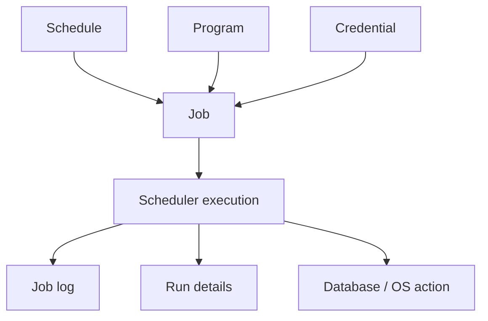

# DBMS_SCHEDULER: job, program, schedule, credential và lịch sử chạy

Oracle Scheduler là cơ chế lập lịch và điều phối công việc được tích hợp trong Oracle Database. Thông qua package DBMS_SCHEDULER, DBA và ứng dụng có thể tạo job, định nghĩa chương trình được chạy, mô tả lịch thực thi, quản lý credential cho tác vụ cần xác thực và theo dõi lịch sử thành công hoặc thất bại.

Các đối tượng chính có vai trò khác nhau:

- **Job:** định nghĩa công việc cần thực thi, gồm hành động, thời điểm/lịch, trạng thái và chính sách chạy.
- **Program:** mô tả chương trình hoặc loại hành động có thể tái sử dụng bởi nhiều job.
- **Schedule:** mô tả thời điểm bắt đầu, kết thúc và quy tắc lặp lại.
- **Credential:** lưu thông tin xác thực mà Scheduler dùng cho external job hoặc remote destination trong các trường hợp được hỗ trợ.
- **Job log và run details:** ghi nhận sự kiện job, thời điểm chạy, thời lượng, trạng thái, mã lỗi và thông tin bổ sung.

Ví dụ, hệ thống có thể định nghĩa một program gọi procedure tổng hợp doanh thu, một schedule chạy mỗi ngày lúc 02:00, rồi tạo job kết hợp hai đối tượng đó. Khi job chạy, Scheduler ghi lại kết quả để DBA kiểm tra, điều tra lỗi hoặc lập báo cáo vận hành.

Scheduler phù hợp với batch processing, tác vụ bảo trì, đồng bộ dữ liệu, báo cáo định kỳ và công việc vận hành. Nó không thay thế cơ chế xử lý giao dịch của ứng dụng; một job vẫn cần thiết kế idempotency, transaction, retry và giám sát phù hợp.

## 1. Kiến trúc và thành phần Oracle Scheduler

### 1.1. Scheduler làm gì?

Scheduler quản lý vòng đời công việc:

1. DBA hoặc ứng dụng tạo job và các object liên quan.
2. Job được enable và chờ đến thời điểm hoặc sự kiện kích hoạt.
3. Scheduler xác định job đến hạn và tài nguyên thực thi.
4. Job coordinator điều phối việc khởi chạy worker phù hợp.
5. Job chạy hành động được định nghĩa.
6. Scheduler ghi log, trạng thái, thời gian và lỗi nếu có.
7. Job có thể được chạy lại theo lịch, retry policy hoặc thao tác thủ công.

### 1.2. Job coordinator và job slave

Trong database instance, Scheduler sử dụng tiến trình nền để điều phối và thực thi job. Job coordinator quản lý các job đến hạn; job slave thực thi công việc theo cơ chế Oracle hỗ trợ.

Không nên giả định mỗi job luôn tạo một OS process mới. Với job chạy PL/SQL trong database, Scheduler có thể sử dụng các worker/background process của database. External job có cơ chế thực thi ở operating system và yêu cầu cấu hình bảo mật riêng.

### 1.3. Quan hệ giữa các object



Một job đơn giản có thể chứa trực tiếp job_type và job_action. Job khác có thể tham chiếu program và schedule đã tạo riêng. Credential chỉ cần khi loại job hoặc destination yêu cầu xác thực tương ứng.

### 1.4. Các loại job phổ biến

Oracle Scheduler hỗ trợ nhiều job type, tùy phiên bản:

- PLSQL_BLOCK: chạy một khối PL/SQL anonymous.
- STORED_PROCEDURE: gọi stored procedure hoặc chương trình PL/SQL phù hợp.
- EXECUTABLE: chạy chương trình bên ngoài database theo cấu hình external job.
- CHAIN: chạy một chuỗi các bước có dependency.
- Một số loại job khác liên quan external hoặc remote destination tùy release và cấu hình.

Với nghiệp vụ database thông thường, ưu tiên stored procedure có kiểm soát thay vì nhúng một khối PL/SQL quá dài trong job_action. Cách này giúp kiểm thử, version control, logging và quản lý quyền rõ ràng.

## 2. Job: định nghĩa công việc cần chạy

### 2.1. Job là gì?

Job là đối tượng Scheduler thực thi. Job chứa hoặc tham chiếu:

- Loại hành động và nội dung hành động.
- Thời điểm bắt đầu và repeat interval, hoặc schedule.
- Program và argument values nếu dùng program.
- Job class và các thuộc tính điều phối.
- Credential/destination nếu cần external hoặc remote execution.
- Trạng thái enabled/disabled.
- Logging, retry, failure và auto-drop policy.

### 2.2. Tạo job chạy PL/SQL block

Ví dụ tạo job chạy một lần:

```sql
BEGIN
    DBMS_SCHEDULER.CREATE_JOB(
        job_name   => 'DAILY_SUMMARY_ONCE',
        job_type   => 'PLSQL_BLOCK',
        job_action => q'[
            BEGIN
                DBMS_OUTPUT.PUT_LINE('Scheduler job started');
                NULL; -- Thay bằng nghiệp vụ thực tế.
            END;
        ]',
        start_date => SYSTIMESTAMP,
        enabled    => FALSE,
        auto_drop  => FALSE,
        comments   => 'One-time summary task for lab'
    );
END;
/
```

Job được tạo ở trạng thái disabled vì enabled=FALSE. Có thể xem metadata, sau đó enable khi sẵn sàng.

### 2.3. Tạo job gọi stored procedure

```sql
CREATE OR REPLACE PROCEDURE refresh_daily_summary AS
BEGIN
    -- Thực hiện logic tổng hợp dữ liệu.
    NULL;
END;
/

BEGIN
    DBMS_SCHEDULER.CREATE_JOB(
        job_name        => 'REFRESH_DAILY_SUMMARY',
        job_type        => 'STORED_PROCEDURE',
        job_action      => 'REFRESH_DAILY_SUMMARY',
        start_date      => SYSTIMESTAMP,
        repeat_interval => 'FREQ=DAILY;BYHOUR=2;BYMINUTE=0;BYSECOND=0',
        enabled         => TRUE,
        auto_drop       => FALSE,
        comments        => 'Refresh daily summary at 02:00'
    );
END;
/
```

Tên procedure trong job_action được Scheduler phân giải theo ngữ cảnh schema/job. Với package procedure, dùng tên đủ điều kiện phù hợp, ví dụ REPORT_PKG.REFRESH_SUMMARY. Kiểm tra quyền EXECUTE và object validity trước khi enable job.

### 2.4. Tạo job bằng schedule object

Khi nhiều job dùng chung lịch, tạo schedule riêng rồi tham chiếu:

```sql
BEGIN
    DBMS_SCHEDULER.CREATE_JOB(
        job_name      => 'REFRESH_SUMMARY_JOB',
        program_name  => 'REFRESH_SUMMARY_PROGRAM',
        schedule_name => 'DAILY_0200_SCHEDULE',
        enabled       => TRUE,
        auto_drop     => FALSE,
        comments      => 'Daily summary job'
    );
END;
/
```

Job có thể kết hợp program và schedule; không cần lặp lại job_type, job_action hoặc repeat_interval nếu các thuộc tính đã được định nghĩa ở object được tham chiếu.

### 2.5. Tạo job disabled rồi enable sau

Tạo job ở trạng thái disabled giúp DBA kiểm tra object trước khi cho phép Scheduler chạy:

```sql
BEGIN
    DBMS_SCHEDULER.CREATE_JOB(
        job_name        => 'NIGHTLY_LOAD_JOB',
        job_type        => 'STORED_PROCEDURE',
        job_action      => 'ETL_PKG.RUN_NIGHTLY_LOAD',
        start_date      => SYSTIMESTAMP,
        repeat_interval => 'FREQ=DAILY;BYHOUR=1;BYMINUTE=30;BYSECOND=0',
        enabled         => FALSE,
        auto_drop       => FALSE
    );

    -- Kiểm tra metadata, quyền và logic trước.
    DBMS_SCHEDULER.ENABLE('NIGHTLY_LOAD_JOB');
END;
/
```

Trong triển khai thật, nên tách bước enable khỏi bước create nếu cần phê duyệt hoặc change window.

### 2.6. Các thuộc tính job quan trọng

| Thuộc tính | Ý nghĩa |
|---|---|
| JOB_NAME | Tên job |
| JOB_TYPE | Loại hành động |
| JOB_ACTION | Nội dung hoặc tên chương trình được gọi |
| PROGRAM_NAME | Program được tham chiếu |
| SCHEDULE_NAME | Schedule được tham chiếu |
| START_DATE | Thời điểm bắt đầu |
| REPEAT_INTERVAL | Quy tắc lặp |
| END_DATE | Thời điểm kết thúc lịch |
| ENABLED | Job có được phép chạy không |
| AUTO_DROP | Có tự xóa job sau khi hoàn tất theo điều kiện hay không |
| JOB_CLASS | Nhóm tài nguyên/ưu tiên của job |
| CREDENTIAL_NAME | Credential dùng cho loại job/destination phù hợp |
| MAX_FAILURES | Ngưỡng lỗi trước khi job bị disable theo policy |
| MAX_RUNS | Số lần chạy tối đa |
| RESTARTABLE | Chính sách restart job sau lỗi theo hỗ trợ |
| LOGGING_LEVEL | Mức ghi log |
| STORE_OUTPUT | Có lưu output theo khả năng release hay không |

Không phải mọi thuộc tính đều có mặt hoặc có cùng semantics trong mọi Oracle release. Kiểm tra DBA_SCHEDULER_JOBS và package specification trước khi dùng thuộc tính nâng cao.

## 3. Program: tách hành động khỏi lịch

### 3.1. Program là gì?

Program mô tả hành động sẽ được thực thi, độc lập với thời điểm chạy. Nhiều job có thể dùng chung một program nhưng chạy theo schedule, job class hoặc argument values khác nhau.

Ví dụ:

- Program tạo báo cáo doanh thu.
- Job A chạy mỗi ngày.
- Job B chạy cuối tháng.
- Job C chạy thủ công khi cần rebuild.

Tất cả có thể gọi cùng một program, giúp giảm lặp định nghĩa và thống nhất cách gọi nghiệp vụ.

### 3.2. Tạo program

```sql
BEGIN
    DBMS_SCHEDULER.CREATE_PROGRAM(
        program_name        => 'REFRESH_SUMMARY_PROGRAM',
        program_type        => 'STORED_PROCEDURE',
        program_action      => 'REPORT_PKG.REFRESH_SUMMARY',
        number_of_arguments => 1,
        enabled             => FALSE,
        comments            => 'Refresh a summary for a business date'
    );
END;
/
```

Program trên khai báo một argument. Vì program chưa enable, hãy định nghĩa argument và kiểm tra signature trước khi bật.

### 3.3. Khai báo program argument

```sql
BEGIN
    DBMS_SCHEDULER.DEFINE_PROGRAM_ARGUMENT(
        program_name      => 'REFRESH_SUMMARY_PROGRAM',
        argument_position => 1,
        argument_name     => 'P_BUSINESS_DATE',
        argument_type     => 'DATE'
    );

    DBMS_SCHEDULER.ENABLE('REFRESH_SUMMARY_PROGRAM');
END;
/
```

Argument position bắt đầu từ 1. Kiểu argument phải tương thích với signature của stored procedure hoặc loại program được dùng.

### 3.4. Gán argument cho job

```sql
BEGIN
    DBMS_SCHEDULER.CREATE_JOB(
        job_name      => 'REFRESH_TODAY_JOB',
        program_name  => 'REFRESH_SUMMARY_PROGRAM',
        start_date    => SYSTIMESTAMP,
        enabled       => FALSE,
        auto_drop     => FALSE
    );

    DBMS_SCHEDULER.SET_JOB_ANYDATA_VALUE(
        job_name          => 'REFRESH_TODAY_JOB',
        argument_position => 1,
        argument_value    => SYS.ANYDATA.ConvertDate(TRUNC(SYSDATE))
    );

    DBMS_SCHEDULER.ENABLE('REFRESH_TODAY_JOB');
END;
/
```

SET_JOB_ANYDATA_VALUE giữ đúng kiểu DATE của argument. Với kiểu đơn giản có overload SET_JOB_ARGUMENT_VALUE nhận chuỗi, nhưng không nên phụ thuộc implicit NLS conversion cho ngày/giờ. Kiểm tra kiểu thực tế trong ALL_SCHEDULER_PROGRAM_ARGS và ALL_SCHEDULER_JOB_ARGS.

### 3.5. Program arguments và defaults

Program argument có thể có default value. Job có thể dùng default hoặc override bằng SET_JOB_ARGUMENT_VALUE/SET_JOB_ANYDATA_VALUE. Nếu thiếu argument bắt buộc, job có thể fail khi chạy hoặc khi enable/validate tùy loại program.

Đặt tên argument rõ nghĩa, mô tả đơn vị và timezone nếu là ngày/giờ. Tránh dùng vị trí số không có tài liệu trong code triển khai.

### 3.6. Program type

| PROGRAM_TYPE | Ý nghĩa |
|---|---|
| PLSQL_BLOCK | Anonymous PL/SQL block |
| STORED_PROCEDURE | Stored procedure phù hợp |
| EXECUTABLE | Chương trình bên ngoài |
| CHAIN | Scheduler chain |

Khả năng cụ thể phụ thuộc Oracle release và cấu hình external jobs.

### 3.7. Thay đổi program

Program có thể được cập nhật qua SET_ATTRIBUTE hoặc API phù hợp. Khi thay đổi program dùng chung, tất cả job tham chiếu có thể chịu ảnh hưởng. Trước khi sửa, xác định danh sách job sử dụng program và kiểm thử tương thích.

## 4. Schedule: định nghĩa thời điểm chạy

### 4.1. Schedule là gì?

Schedule mô tả thời điểm bắt đầu, quy tắc lặp và thời điểm kết thúc. Tách schedule khỏi job giúp tái sử dụng cùng lịch cho nhiều công việc và quản lý lịch độc lập với business logic.

### 4.2. Tạo schedule một lần

```sql
BEGIN
    DBMS_SCHEDULER.CREATE_SCHEDULE(
        schedule_name   => 'RUN_ONCE_AT_NOON',
        start_date      => TO_TIMESTAMP_TZ(
            '2026-11-15 12:00:00 Asia/Ho_Chi_Minh',
            'YYYY-MM-DD HH24:MI:SS TZR'
        ),
        repeat_interval => NULL,
        end_date        => NULL,
        comments        => 'One-time execution schedule'
    );
END;
/
```

Đây là ví dụ minh họa thời điểm. Với hệ thống production, dùng TIMESTAMP WITH TIME ZONE và chỉ rõ vùng thời gian nếu thời điểm phải gắn với timezone nghiệp vụ.

### 4.3. Tạo schedule hàng ngày

```sql
BEGIN
    DBMS_SCHEDULER.CREATE_SCHEDULE(
        schedule_name   => 'DAILY_0200_SCHEDULE',
        start_date      => TO_TIMESTAMP_TZ(
            '2026-11-15 02:00:00 Asia/Ho_Chi_Minh',
            'YYYY-MM-DD HH24:MI:SS TZR'
        ),
        repeat_interval => 'FREQ=DAILY;BYHOUR=2;BYMINUTE=0;BYSECOND=0',
        comments        => 'Every day at 02:00 Ho Chi Minh time'
    );
END;
/
```

Tên timezone region cần được hỗ trợ trong Oracle timezone files của database. Dùng region như Asia/Ho_Chi_Minh giúp thể hiện timezone nghiệp vụ rõ ràng hơn offset cố định.

### 4.4. Tạo schedule theo ngày trong tuần

```sql
BEGIN
    DBMS_SCHEDULER.CREATE_SCHEDULE(
        schedule_name   => 'WEEKDAYS_0730',
        start_date      => SYSTIMESTAMP,
        repeat_interval => 'FREQ=DAILY;BYDAY=MON,TUE,WED,THU,FRI;BYHOUR=7;BYMINUTE=30;BYSECOND=0',
        comments        => 'Weekdays at 07:30'
    );
END;
/
```

### 4.5. Ngày đầu tháng và cuối tháng

Ngày đầu tháng:

```sql
FREQ=MONTHLY;BYMONTHDAY=1;BYHOUR=1;BYMINUTE=0;BYSECOND=0
```

Ngày cuối tháng có thể dùng BYMONTHDAY=-1 trong calendaring syntax của các release hỗ trợ:

```sql
FREQ=MONTHLY;BYMONTHDAY=-1;BYHOUR=23;BYMINUTE=0;BYSECOND=0
```

Hãy kiểm tra behavior trong đúng Oracle release và thử các tháng có 28, 29, 30, 31 ngày.

### 4.6. Ví dụ repeat interval

| Mục đích | Repeat interval |
|---|---|
| Mỗi ngày lúc 02:00 | FREQ=DAILY;BYHOUR=2;BYMINUTE=0;BYSECOND=0 |
| Mỗi 15 phút | FREQ=MINUTELY;INTERVAL=15 |
| Mỗi giờ tại phút 10 | FREQ=HOURLY;BYMINUTE=10;BYSECOND=0 |
| Thứ Hai đến thứ Sáu lúc 07:30 | FREQ=DAILY;BYDAY=MON,TUE,WED,THU,FRI;BYHOUR=7;BYMINUTE=30 |
| Ngày đầu tháng lúc 01:00 | FREQ=MONTHLY;BYMONTHDAY=1;BYHOUR=1 |
| Ngày cuối tháng lúc 23:00 | FREQ=MONTHLY;BYMONTHDAY=-1;BYHOUR=23 |
| Mỗi quý, đầu quý | FREQ=YEARLY;BYMONTH=1,4,7,10;BYMONTHDAY=1;BYHOUR=0 |

Các ví dụ cần được kiểm tra trong môi trường mục tiêu; cách tính kỳ, timezone và start_date có thể ảnh hưởng next run.

## 5. Calendaring syntax và timezone

### 5.1. Các thành phần chính

Oracle Scheduler sử dụng calendaring syntax cho repeat_interval. Các thành phần thường gặp:

- FREQ: YEARLY, MONTHLY, WEEKLY, DAILY, HOURLY, MINUTELY hoặc SECONDLY.
- INTERVAL: bước lặp giữa các chu kỳ.
- BYDAY: các ngày trong tuần.
- BYMONTH: các tháng.
- BYMONTHDAY: ngày trong tháng.
- BYHOUR, BYMINUTE, BYSECOND: thành phần thời gian.
- BYSETPOS: chọn vị trí trong tập ngày/tần suất theo cú pháp hỗ trợ.
- BYYEARDAY, BYWEEKNO: ngày trong năm hoặc số tuần theo calendar.

Không phải mọi tổ hợp đều có ý nghĩa giống nhau. Dùng calendaring syntax theo tài liệu Scheduler, không coi nó là cron syntax nguyên bản.

### 5.2. INTERVAL

INTERVAL đặt bước giữa các kỳ FREQ. Ví dụ FREQ=DAILY;INTERVAL=2 chạy cách ngày theo quy tắc calendar. INTERVAL=15 với FREQ=MINUTELY tạo lịch mỗi 15 phút.

### 5.3. BYDAY và BYMONTHDAY

BYDAY chọn ngày trong tuần, ví dụ MON,WED,FRI. BYMONTHDAY chọn ngày trong tháng. Một số biểu thức nâng cao cho phép chọn thứ Hai đầu tiên hoặc thứ Sáu cuối cùng của tháng bằng kết hợp ordinal và ngày tuần theo calendaring syntax được hỗ trợ. Kiểm thử các biểu thức phức tạp bằng EVALUATE_CALENDAR_STRING.

### 5.4. START_DATE và timezone

START_DATE là TIMESTAMP WITH TIME ZONE. Timezone của start_date có ảnh hưởng cách Scheduler diễn giải lịch. Với lịch nghiệp vụ theo giờ địa phương, nên dùng timezone region như Asia/Ho_Chi_Minh hoặc vùng tương ứng thay vì chỉ lưu UTC offset cố định.

### 5.5. Daylight Saving Time

Ở vùng có DST, thời điểm địa phương có thể bị bỏ qua hoặc lặp lại khi đồng hồ đổi giờ. Scheduler xử lý theo timezone rules và thuộc tính liên quan của schedule/job. Cần xác định chính sách cho giờ không tồn tại hoặc xuất hiện hai lần, và kiểm thử bằng timezone region phù hợp.

Việt Nam không áp dụng DST, nhưng job có thể chạy ở database/server đặt vùng khác hoặc lịch nghiệp vụ theo múi giờ quốc gia khác. Không giả định timezone của OS, database session và start_date luôn giống nhau.

### 5.6. Kiểm tra occurrence bằng EVALUATE_CALENDAR_STRING

DBMS_SCHEDULER.EVALUATE_CALENDAR_STRING giúp kiểm tra các lần chạy kế tiếp của một calendaring expression:

```sql
DECLARE
    l_next_run TIMESTAMP WITH TIME ZONE;
    l_start TIMESTAMP WITH TIME ZONE :=
        TO_TIMESTAMP_TZ(
            '2026-11-14 00:00:00 Asia/Ho_Chi_Minh',
            'YYYY-MM-DD HH24:MI:SS TZR'
        );
BEGIN
    DBMS_SCHEDULER.EVALUATE_CALENDAR_STRING(
        calendar_string   => 'FREQ=DAILY;BYHOUR=2;BYMINUTE=0;BYSECOND=0',
        start_date        => l_start,
        return_date_after => l_start,
        next_run_date     => l_next_run
    );

    DBMS_OUTPUT.PUT_LINE(
        TO_CHAR(l_next_run, 'YYYY-MM-DD HH24:MI:SS TZH:TZM')
    );
END;
/
```

Signature và cách truyền các tham số cần xác nhận theo phiên bản package. Có thể gọi API nhiều lần để lấy các occurrence tiếp theo. Đừng chỉ đọc chuỗi repeat_interval rồi đoán lịch.

## 6. Credential và bảo mật

### 6.1. Credential là gì?

Credential là object lưu thông tin xác thực mà Scheduler dùng khi cần chạy tác vụ bên ngoài database hoặc truy cập destination cần authentication. Ví dụ:

- External executable job chạy dưới OS account.
- Remote external job trên host/destination được cấu hình.
- Một số tác vụ Scheduler yêu cầu credential theo loại job và phiên bản.

Với job PLSQL_BLOCK hoặc STORED_PROCEDURE chạy bên trong database, Scheduler thông thường chạy trong security context của job owner; không cần tạo credential OS chỉ để gọi procedure.

### 6.2. Tạo credential

Ví dụ minh họa tạo credential cho external job:

```sql
BEGIN
    DBMS_SCHEDULER.CREATE_CREDENTIAL(
        credential_name => 'BATCH_OS_CREDENTIAL',
        username        => 'batch_runner',
        password        => '<retrieve-from-approved-secret-process>'
    );
END;
/
```

Không đưa password thật vào source code, script version control, ticket hoặc log. Placeholder trên chỉ thể hiện vị trí tham số; trong vận hành, lấy secret qua quy trình bảo mật được phê duyệt và hạn chế quyền đọc credential.

### 6.3. Dùng credential cho external job

```sql
BEGIN
    DBMS_SCHEDULER.CREATE_JOB(
        job_name        => 'GENERATE_EXPORT_FILE',
        job_type        => 'EXECUTABLE',
        job_action      => '/opt/app/bin/export_orders.sh',
        credential_name => 'BATCH_OS_CREDENTIAL',
        start_date      => SYSTIMESTAMP,
        enabled         => FALSE,
        auto_drop       => FALSE,
        comments        => 'Generate an export file'
    );
END;
/
```

External job cần cấu hình external job agent/credential và chính sách bảo mật phù hợp với platform. Đường dẫn executable phải được kiểm soát, file phải có quyền execute phù hợp và user chạy job chỉ có quyền tối thiểu cần thiết.

### 6.4. Database job và external job

| Nội dung | Database PL/SQL job | External executable job |
|---|---|---|
| Job type | PLSQL_BLOCK/STORED_PROCEDURE | EXECUTABLE |
| Nơi thực thi | Trong Oracle Database | Operating system/external agent |
| Security context | Job owner và quyền database | OS credential/external job configuration |
| Credential OS | Thường không cần | Thường cần theo cấu hình |
| Quan sát lỗi | Scheduler log và database errors | Scheduler log, stdout/stderr và OS logs |
| Rủi ro | DML, lock, undo, resource use | Thêm rủi ro OS command, file, process và secret |

### 6.5. Credential không phải password database của job owner

Credential dùng cho external/remote execution theo cấu hình. Nó không tự thay đổi quyền database của job owner và không biến một stored procedure thành chương trình OS.

### 6.6. External job security

External jobs có thể chạy lệnh hệ điều hành. Áp dụng nguyên tắc:

- Dùng executable path tuyệt đối.
- Không ghép command từ input không tin cậy.
- Giới hạn quyền OS account.
- Không chạy bằng OS user đặc quyền nếu không bắt buộc.
- Bảo vệ file script và thư mục output.
- Kiểm tra external job agent và credential configuration.
- Ghi log stdout/stderr theo policy.
- Quản lý secret ngoài source code.

## 7. Job class và Resource Manager

### 7.1. Job class là gì?

Job class nhóm các job có chính sách tài nguyên và logging tương tự. Job class có thể liên kết consumer group để Scheduler job chạy trong consumer group tương ứng theo cấu hình Resource Manager.

### 7.2. Tạo job class

```sql
BEGIN
    DBMS_SCHEDULER.CREATE_JOB_CLASS(
        job_class_name          => 'NIGHT_BATCH_CLASS',
        resource_consumer_group => 'BATCH_GROUP',
        logging_level           => DBMS_SCHEDULER.LOGGING_RUNS,
        log_history             => 30,
        comments                => 'Nightly batch workload'
    );
END;
/
```

Consumer group BATCH_GROUP phải tồn tại và Resource Manager plan phải được cấu hình để directive áp dụng. Các tham số job class có thể khác theo release.

### 7.3. Gán job vào class

```sql
BEGIN
    DBMS_SCHEDULER.SET_ATTRIBUTE(
        name      => 'NIGHTLY_LOAD_JOB',
        attribute => 'job_class',
        value     => 'NIGHT_BATCH_CLASS'
    );
END;
/
```

Có thể chỉ định job_class ngay trong CREATE_JOB. Job class giúp tập trung quản lý thay vì gán từng policy riêng cho từng job.

### 7.4. Logging level

Job class có thể đặt mức logging mặc định như LOGGING_OFF, LOGGING_FAILED_RUNS, LOGGING_RUNS hoặc LOGGING_FULL. Tên constant và semantics cần xác minh trong package của release đang chạy. Log đầy đủ tăng dung lượng metadata; chọn mức phù hợp với nhu cầu audit và vận hành.

## 8. Enable, disable, run, stop và drop job

### 8.1. Enable job

```sql
BEGIN
    DBMS_SCHEDULER.ENABLE('REFRESH_DAILY_SUMMARY');
END;
/
```

Job cần enabled mới được Scheduler tự động chạy theo lịch. Program/schedule được tham chiếu cũng phải ở trạng thái phù hợp.

### 8.2. Disable job

```sql
BEGIN
    DBMS_SCHEDULER.DISABLE(
        name  => 'REFRESH_DAILY_SUMMARY',
        force => FALSE
    );
END;
/
```

Disable ngăn các lần chạy mới theo lịch. Nếu job đang chạy, hành vi phụ thuộc trạng thái và tham số force; disable không đồng nghĩa chắc chắn dừng execution hiện tại.

### 8.3. Chạy ngay với RUN_JOB

```sql
BEGIN
    DBMS_SCHEDULER.RUN_JOB(
        job_name            => 'REFRESH_DAILY_SUMMARY',
        use_current_session => FALSE
    );
END;
/
```

Với use_current_session=FALSE, Scheduler chạy job theo cơ chế job slave và lời gọi trả về mà không chờ toàn bộ job hoàn tất. Có thể kiểm tra trạng thái/log sau đó.

Nếu dùng TRUE, job chạy trong session hiện tại và lời gọi chờ cho đến khi hoàn thành; hữu ích cho debug nhưng có thể khác môi trường thực thi thông thường.

### 8.4. Stop job

```sql
BEGIN
    DBMS_SCHEDULER.STOP_JOB(
        job_name => 'REFRESH_DAILY_SUMMARY',
        force    => FALSE
    );
END;
/
```

STOP_JOB yêu cầu Scheduler dừng job đang chạy. Nếu force=TRUE, Oracle có thể kết thúc session/process theo cách mạnh hơn; cần cân nhắc transaction rollback, file output dở dang và tác động ứng dụng.

### 8.5. Drop job

```sql
BEGIN
    DBMS_SCHEDULER.DROP_JOB(
        job_name => 'OLD_REPORT_JOB',
        force    => FALSE
    );
END;
/
```

DROP_JOB xóa job metadata. Nếu job đang chạy, force và trạng thái execution ảnh hưởng khả năng drop. Trước khi drop, xác nhận job không còn được automation hoặc hệ thống khác phụ thuộc.

### 8.6. RUN_JOB không thay lịch

RUN_JOB tạo một lần chạy theo yêu cầu. Nó không thay đổi repeat_interval hoặc schedule của job. Lần chạy thủ công có thể xuất hiện trong log với thông tin khác với lần chạy theo lịch.

## 9. Tham số job và thay đổi thuộc tính

### 9.1. SET_ATTRIBUTE

Có thể thay đổi thuộc tính job:

```sql
BEGIN
    DBMS_SCHEDULER.SET_ATTRIBUTE(
        name      => 'REFRESH_DAILY_SUMMARY',
        attribute => 'repeat_interval',
        value     => 'FREQ=DAILY;BYHOUR=3;BYMINUTE=0;BYSECOND=0'
    );
END;
/
```

Tên attribute và kiểu value phải phù hợp với object. Khi sửa lịch đang chạy, kiểm tra next_run_date và trạng thái job sau thay đổi.

### 9.2. SET_ATTRIBUTE_NULL

Nếu cần bỏ một thuộc tính nullable, dùng DBMS_SCHEDULER.SET_ATTRIBUTE_NULL theo API được hỗ trợ. Không truyền chuỗi rỗng và giả định nó tương đương NULL cho mọi attribute.

### 9.3. SET_JOB_ARGUMENT_VALUE và SET_JOB_ANYDATA_VALUE

Với argument chuỗi:

```sql
BEGIN
    DBMS_SCHEDULER.SET_JOB_ARGUMENT_VALUE(
        job_name          => 'EXPORT_JOB',
        argument_position => 1,
        argument_value    => 'REGION_NORTH'
    );
END;
/
```

Với argument typed, dùng SET_JOB_ANYDATA_VALUE và SYS.ANYDATA conversion phù hợp. Tránh implicit NLS conversion cho DATE/TIMESTAMP.

### 9.4. Thay đổi schedule

Có thể sửa schedule object được nhiều job tham chiếu. Thay đổi này có thể ảnh hưởng tất cả job dùng schedule đó. Trước khi update schedule, liệt kê dependent jobs và thông báo change scope.

## 10. Job state, retry và failure policy

### 10.1. Các trạng thái thường gặp

Tùy trạng thái và release, job có thể xuất hiện với các state như:

- DISABLED: không được Scheduler tự động chạy.
- SCHEDULED: đã enable và đang chờ thời điểm chạy.
- RUNNING: đang thực thi.
- COMPLETED: đã hoàn tất theo trạng thái Scheduler ghi nhận.
- FAILED: lần chạy thất bại.
- BROKEN: job bị đánh dấu không thể tiếp tục theo policy.
- STOPPED: đã bị dừng.
- RETRY SCHEDULED: chờ lần retry theo cơ chế hỗ trợ.

Danh sách state và semantics có thể khác giữa loại job, release và trạng thái hiện tại. Đọc DBA_SCHEDULER_JOBS và log thay vì suy luận từ tên.

### 10.2. MAX_FAILURES và MAX_RUNS

MAX_FAILURES đặt ngưỡng số lần job thất bại trước khi Scheduler đánh dấu job broken/disable theo policy. MAX_RUNS giới hạn số lần chạy của job. Giá trị phù hợp phụ thuộc khả năng phục hồi và vòng đời của công việc.

### 10.3. RESTARTABLE

RESTARTABLE cho phép Scheduler thử khởi động lại job sau một số lỗi theo cơ chế hỗ trợ. Không phải mọi loại job hoặc mọi lỗi đều có thể resume an toàn từ giữa chừng.

### 10.4. Retry và idempotency

Scheduler retry không bảo đảm business action trước lỗi chưa tạo side effect. Ví dụ job ghi một phần dữ liệu rồi session lỗi; lần retry có thể ghi trùng. Thiết kế job cần:

- Dùng business key hoặc batch ID để chống xử lý trùng.
- Commit theo ranh giới nghiệp vụ rõ.
- Lưu checkpoint.
- Có thể chạy lại an toàn.
- Phân biệt lỗi transient và lỗi dữ liệu không thể phục hồi.

### 10.5. SCHEDULE_LIMIT và thời lượng

SCHEDULE_LIMIT có thể giới hạn thời gian job được phép trễ so với scheduled start trước khi bỏ lần chạy theo chính sách. Một số release hỗ trợ thuộc tính giới hạn thời gian chạy như MAX_RUN_DURATION hoặc event/notification liên quan. Kiểm tra package và dictionary của phiên bản trước khi sử dụng; đừng nhầm elapsed runtime limit với CPU time hoặc queue time.

## 11. Job logging và lịch sử chạy

### 11.1. Job log và run details

Scheduler duy trì thông tin về sự kiện job và từng lần chạy:

- Job được tạo, enable, disable hoặc drop.
- Job bắt đầu và kết thúc.
- Trạng thái thành công/thất bại.
- Thời điểm bắt đầu/kết thúc và duration.
- Error number/message.
- Output hoặc thông tin bổ sung khi được bật.

Job log mô tả sự kiện vòng đời; run details tập trung vào từng lần thực thi.

### 11.2. USER_SCHEDULER_JOB_LOG

```sql
SELECT log_id,
       log_date,
       owner,
       job_name,
       operation,
       status,
       user_name,
       client_id,
       additional_info
FROM user_scheduler_job_log
ORDER BY log_date DESC;
```

ALL_SCHEDULER_JOB_LOG và DBA_SCHEDULER_JOB_LOG cung cấp phạm vi rộng hơn theo quyền.

### 11.3. USER_SCHEDULER_JOB_RUN_DETAILS

```sql
SELECT log_id,
       log_date,
       owner,
       job_name,
       status,
       actual_start_date,
       run_duration,
       instance_id,
       error#,
       additional_info,
       output
FROM user_scheduler_job_run_details
ORDER BY log_date DESC;
```

Cột OUTPUT và một số thuộc tính chỉ có ở release hỗ trợ store_output. Không phải mọi lần chạy đều có output text.

### 11.4. Lọc job thất bại

```sql
SELECT log_date,
       job_name,
       status,
       actual_start_date,
       run_duration,
       error#,
       additional_info
FROM user_scheduler_job_run_details
WHERE status = 'FAILED'
ORDER BY log_date DESC;
```

Error number/message là điểm bắt đầu. Để điều tra đầy đủ, cần xem alert log, application log, session trace và dữ liệu nghiệp vụ liên quan.

### 11.5. Xem một job cụ thể

```sql
SELECT log_date,
       status,
       actual_start_date,
       run_duration,
       error#,
       additional_info
FROM user_scheduler_job_run_details
WHERE job_name = 'REFRESH_DAILY_SUMMARY'
ORDER BY log_date DESC;
```

### 11.6. Lịch sử có retention

Scheduler không giữ log vô hạn. Thuộc tính log_history và logging level có thể kiểm soát số ngày hoặc chính sách lưu log theo cấu hình. DBA cần cân bằng giữa audit/điều tra và dung lượng metadata.

### 11.7. Đặt log history

DBMS_SCHEDULER.SET_SCHEDULER_ATTRIBUTE có thể đặt thuộc tính Scheduler toàn cục theo quyền và release:

```sql
BEGIN
    DBMS_SCHEDULER.SET_SCHEDULER_ATTRIBUTE(
        attribute => 'log_history',
        value     => '30'
    );
END;
/
```

Tham số cụ thể và giá trị hợp lệ cần kiểm tra trên release. Không giảm retention nếu đang có yêu cầu audit hoặc investigation.

## 12. Xem job đang chạy và lịch tiếp theo

### 12.1. USER_SCHEDULER_JOBS

```sql
SELECT job_name,
       enabled,
       state,
       job_type,
       job_action,
       program_name,
       schedule_name,
       repeat_interval,
       next_run_date,
       last_start_date,
       last_run_duration,
       failure_count,
       run_count
FROM user_scheduler_jobs
ORDER BY job_name;
```

ALL_SCHEDULER_JOBS/DBA_SCHEDULER_JOBS dùng để xem phạm vi rộng hơn.

### 12.2. USER_SCHEDULER_RUNNING_JOBS

```sql
SELECT job_name,
       session_id,
       running_instance,
       elapsed_time,
       cpu_used
FROM user_scheduler_running_jobs
ORDER BY job_name;
```

Cột cụ thể có thể khác theo release. View này giúp xác định job đang chạy và session/instance liên quan.

### 12.3. Next run date

NEXT_RUN_DATE trong Scheduler job views cho biết thời điểm dự kiến tiếp theo theo calendar/timezone của job. Sau khi thay repeat_interval hoặc schedule, kiểm tra NEXT_RUN_DATE để xác nhận kết quả.

### 12.4. Job đang chạy trên RAC

Trong RAC, xem running_instance và các global views phù hợp để xác định instance thực thi. Job có thể chạy trên một instance được Scheduler chọn theo cấu hình service/destination và môi trường.

### 12.5. Job không chạy dù đã enable

Kiểm tra:

- NEXT_RUN_DATE có nằm trong tương lai không?
- END_DATE đã qua chưa?
- Job có BROKEN/FAILED hoặc đã đạt MAX_FAILURES/MAX_RUNS không?
- RESOURCE_MANAGER_PLAN/consumer group có làm session bị queue không?
- JOB_QUEUE_PROCESSES có cho phép job slave hoạt động không?
- Scheduler window hoặc job class có ảnh hưởng không?
- Credential/destination có hợp lệ không?
- Database/PDB có đang mở và Scheduler enabled không?

## 13. JOB_QUEUE_PROCESSES và năng lực thực thi

### 13.1. JOB_QUEUE_PROCESSES

JOB_QUEUE_PROCESSES kiểm soát số job slave process tối đa mà instance có thể dùng cho Scheduler và một số cơ chế job queue liên quan. Nếu đặt quá thấp hoặc bằng 0, job có thể không được thực thi như mong muốn.

### 13.2. Không đồng nghĩa số job đồng thời tuyệt đối

Số job thực tế chạy đồng thời còn phụ thuộc job slave capacity, tài nguyên, Resource Manager, parallelism, service/instance availability và loại job. JOB_QUEUE_PROCESSES là một giới hạn process nền, không phải cấu hình duy nhất quyết định concurrency.

### 13.3. Kiểm tra parameter

```sql
SHOW PARAMETER job_queue_processes;

SELECT name, value, issys_modifiable
FROM v$parameter
WHERE name = 'job_queue_processes';
```

### 13.4. Tạm dừng Scheduler jobs

Đặt JOB_QUEUE_PROCESSES=0 có thể ngăn job slave thực thi theo cơ chế được hỗ trợ. Đây là biện pháp có phạm vi rộng; không dùng để tạm dừng một job riêng lẻ. Dùng DBMS_SCHEDULER.DISABLE cho job cụ thể.

## 14. Job class, windows và maintenance

### 14.1. Job class

Job class gom job theo chính sách tài nguyên, service và logging. Có thể dùng job class để đưa batch vào consumer group thấp ưu tiên trong giờ cao điểm.

### 14.2. Scheduler window

Window mô tả một khoảng thời gian có thuộc tính resource plan hoặc mức ưu tiên riêng. Ví dụ maintenance window có thể mở ban đêm để chạy optimizer statistics gathering hoặc tác vụ bảo trì.

### 14.3. Window group

Window group tập hợp nhiều window để các lịch maintenance hoặc job có thể tham chiếu nhóm thời gian. Việc kích hoạt window group có thể ảnh hưởng các tác vụ bảo trì.

### 14.4. Maintenance windows mặc định

Oracle có thể cài các maintenance windows mặc định tùy release. Trước khi thay đổi hoặc disable, kiểm tra tác động tới auto task như optimizer statistics gathering, segment advisor và các tác vụ bảo trì khác.

### 14.5. Kiểm tra window

Các view như DBA_SCHEDULER_WINDOWS, DBA_SCHEDULER_WINDOW_GROUPS và DBA_SCHEDULER_WINDOW_LOG giúp xem cấu hình và lịch sử window. Cột cụ thể tùy release.

## 15. Scheduler chain

### 15.1. Khi nào dùng chain?

Nếu một quy trình gồm nhiều bước phụ thuộc nhau, chain có thể mô hình hóa các step và rule:

1. Extract dữ liệu.
2. Validate dữ liệu.
3. Transform.
4. Load.
5. Gửi thông báo hoàn tất.

Một step chỉ chạy khi rule trước đó được thỏa mãn. Chain giúp quản lý workflow phức tạp hơn một job PL/SQL block dài.

### 15.2. Tạo chain

DBMS_SCHEDULER cung cấp CREATE_CHAIN, DEFINE_CHAIN_STEP, DEFINE_CHAIN_RULE và ENABLE để xây dựng workflow. Từng step có thể tham chiếu program hoặc job phù hợp. Cần quản lý trạng thái chain, rule condition, exception và restart.

### 15.3. Chain không thay workflow engine mọi loại

Chain phù hợp với workflow database-centric. Nếu quy trình cần phối hợp nhiều dịch vụ ngoài database, distributed compensation hoặc human approval, cân nhắc orchestration platform phù hợp.

## 16. Quyền và ownership

### 16.1. CREATE JOB

User cần quyền CREATE JOB để tạo job trong schema của mình theo policy. Tạo job trong schema khác hoặc quản trị toàn database cần quyền mạnh hơn như CREATE ANY JOB hoặc quyền quản trị Scheduler tương ứng.

### 16.2. MANAGE SCHEDULER

Quyền MANAGE SCHEDULER cho phép quản trị rộng các đối tượng Scheduler theo phạm vi Oracle định nghĩa. Không cấp quyền này cho user ứng dụng chỉ cần chạy một job riêng.

### 16.3. EXECUTE quyền trên stored procedure

Job gọi procedure cần quyền thực thi phù hợp. Với definer-rights procedure, quyền trong stored procedure được kiểm soát theo security model PL/SQL; với invoker-rights procedure, cần hiểu quyền của invoker/job owner. Tránh dựa vào role để cấp quyền mà stored PL/SQL cần trực tiếp.

### 16.4. Credential privilege

Credential có quyền riêng và có thể được chia sẻ theo grant. Cấp quyền sử dụng credential tối thiểu, tránh cho nhiều schema dùng một OS account quyền rộng.

### 16.5. Job owner và execution identity

Job database thường chạy theo owner của job, không phải user đang xem job log. Với external job, OS identity phụ thuộc credential và external job configuration. Ghi nhận rõ cả hai lớp identity khi điều tra.

### 16.6. Cross-schema job

DBA có thể tạo job cho schema khác bằng API và quyền thích hợp. Khi đó cần xác định owner, parsing schema, privilege, credential và nơi lưu log. Không dùng CREATE ANY JOB như giải pháp mặc định cho mọi triển khai.

## 17. Lỗi Scheduler thường gặp

| Dấu hiệu/lỗi | Nguyên nhân có thể | Hướng kiểm tra |
|---|---|---|
| Job không chạy | Disabled, next run chưa đến, job queue process thiếu | USER_SCHEDULER_JOBS, JOB_QUEUE_PROCESSES |
| ORA-27475 | Job/program/schedule không tồn tại hoặc tên không đúng | Kiểm tra owner, tên và quyền |
| ORA-27486 | Thiếu quyền thực hiện thao tác Scheduler | Kiểm tra CREATE JOB/MANAGE SCHEDULER và object grants |
| ORA-27492 | Scheduler không khả dụng hoặc job queue bị vô hiệu hóa trong một số cấu hình | Kiểm tra JOB_QUEUE_PROCESSES, database state |
| ORA-06550/PLS errors | PL/SQL block hoặc stored procedure không compile | Kiểm tra USER_ERRORS và procedure signature |
| Job FAILED | Exception trong job_action hoặc external process trả lỗi | RUN_DETAILS, application log, alert log |
| Credential invalid | Username/password/credential hoặc external agent sai | Credential metadata, OS/agent logs |
| External job không chạy | Executable path, permission, credential hoặc agent | OS logs, external job configuration |
| Job bị BROKEN | Quá nhiều failure hoặc policy | FAILURE_COUNT, MAX_FAILURES, run details |
| Job chạy trễ | Queue, resource contention, job slave capacity | Running jobs, Resource Manager metrics, JOB_QUEUE_PROCESSES |
| Job chạy sai giờ | Timezone/start_date/calendar expression | NEXT_RUN_DATE, schedule definition, timezone region |
| Job chạy trùng | Overlap do duration dài hơn interval hoặc thiết kế concurrency | Running jobs, locking/idempotency |
| Output trống | STORE_OUTPUT/logging chưa bật hoặc job không ghi stdout | Job attributes, run details, application logging |

Không kết luận chỉ từ error code tổng quát. Đọc ADDITIONAL_INFO, ERROR#, log ứng dụng và trạng thái job.

## 18. Thiết kế job an toàn và có thể chạy lại

### 18.1. Idempotency

Job có thể được Scheduler chạy lại sau timeout, lỗi process hoặc thao tác thủ công. Business action nên có thể chạy lặp mà không tạo dữ liệu trùng hoặc side effect sai.

Ví dụ, thay vì chỉ INSERT tất cả dữ liệu mỗi lần, có thể dùng batch key, MERGE theo business key hoặc bảng checkpoint.

### 18.2. Transaction boundary

Quyết định commit theo toàn job hay theo từng batch. Commit theo batch giảm transaction size nhưng tạo partial completion nếu job lỗi giữa chừng. Cần lưu checkpoint và bảo đảm lần chạy lại tiếp tục đúng.

### 18.3. Không giữ lock quá lâu

Job batch dài có thể giữ lock gây ảnh hưởng OLTP. Chia batch theo nghiệp vụ, giới hạn concurrency, đặt lịch phù hợp và dùng Resource Manager để bảo vệ workload khác.

### 18.4. Tránh overlap ngoài ý muốn

Nếu job chạy 90 phút nhưng lịch lặp mỗi giờ, lần chạy mới có thể trùng với lần trước tùy cấu hình và loại job. Thiết kế khóa điều phối, kiểm tra running state hoặc cơ chế singleton để ngăn chạy trùng.

### 18.5. Logging nghiệp vụ

Scheduler log cho biết trạng thái kỹ thuật của lần chạy. Ứng dụng vẫn nên ghi:

- Job execution/business run ID.
- Batch date hoặc watermark.
- Số hàng đọc/ghi/bỏ qua.
- Thời điểm bắt đầu/kết thúc các bước.
- Error code/message và business key liên quan.
- Checkpoint và trạng thái retry.

### 18.6. Xử lý exception

Nếu stored procedure bắt OTHERS rồi không RAISE hoặc không ghi trạng thái thất bại rõ ràng, Scheduler có thể ghi nhận job thành công dù nghiệp vụ không hoàn tất. Chỉ nuốt exception khi contract có chủ đích và kết quả lỗi được biểu diễn rõ ràng.

### 18.7. Thời gian và timezone

Lịch chạy phải được mô tả theo timezone nghiệp vụ. Tránh dùng SYSDATE/SYSTIMESTAMP không suy nghĩ trong logic phụ thuộc ngày địa phương. Lưu timestamp có timezone hoặc quy ước UTC rõ ràng cho checkpoint.

## 19. Ví dụ end-to-end: program, schedule và job

### 19.1. Tạo procedure

```sql
CREATE OR REPLACE PROCEDURE report_pkg_refresh (
    p_run_date IN DATE
) AS
BEGIN
    -- Thay bằng logic tổng hợp thực tế.
    INSERT INTO report_run_log(run_date, started_at, status)
    VALUES (p_run_date, SYSTIMESTAMP, 'STARTED');

    -- Business processing goes here.

    UPDATE report_run_log
    SET status = 'COMPLETED'
    WHERE run_date = p_run_date
      AND status = 'STARTED';

    COMMIT;
EXCEPTION
    WHEN OTHERS THEN
        ROLLBACK;
        RAISE;
END;
/
```

Đây là skeleton minh họa transaction; bảng log, khóa duy nhất và cách xác định một execution cần được thiết kế cho ứng dụng thật.

### 19.2. Tạo program

```sql
BEGIN
    DBMS_SCHEDULER.CREATE_PROGRAM(
        program_name        => 'REPORT_REFRESH_PROGRAM',
        program_type        => 'STORED_PROCEDURE',
        program_action      => 'REPORT_PKG_REFRESH',
        number_of_arguments => 1,
        enabled             => FALSE,
        comments            => 'Refresh report data for a date'
    );

    DBMS_SCHEDULER.DEFINE_PROGRAM_ARGUMENT(
        program_name      => 'REPORT_REFRESH_PROGRAM',
        argument_position => 1,
        argument_name     => 'P_RUN_DATE',
        argument_type     => 'DATE'
    );

    DBMS_SCHEDULER.ENABLE('REPORT_REFRESH_PROGRAM');
END;
/
```

Nếu procedure nằm trong package, dùng tên package.procedure đúng với signature và kiểm tra quyền.

### 19.3. Tạo schedule

```sql
BEGIN
    DBMS_SCHEDULER.CREATE_SCHEDULE(
        schedule_name   => 'REPORT_DAILY_0230',
        start_date      => TO_TIMESTAMP_TZ(
            '2026-11-15 02:30:00 Asia/Ho_Chi_Minh',
            'YYYY-MM-DD HH24:MI:SS TZR'
        ),
        repeat_interval => 'FREQ=DAILY;BYHOUR=2;BYMINUTE=30;BYSECOND=0',
        comments        => 'Daily report schedule'
    );
END;
/
```

### 19.4. Tạo job và gán argument

```sql
BEGIN
    DBMS_SCHEDULER.CREATE_JOB(
        job_name      => 'REPORT_REFRESH_DAILY',
        program_name  => 'REPORT_REFRESH_PROGRAM',
        schedule_name => 'REPORT_DAILY_0230',
        enabled       => FALSE,
        auto_drop     => FALSE,
        comments      => 'Daily report refresh'
    );

    DBMS_SCHEDULER.SET_JOB_ANYDATA_VALUE(
        job_name          => 'REPORT_REFRESH_DAILY',
        argument_position => 1,
        argument_value    => SYS.ANYDATA.ConvertDate(DATE '2026-11-15')
    );
END;
/
```

### 19.5. Enable và kiểm tra next run

```sql
BEGIN
    DBMS_SCHEDULER.ENABLE('REPORT_REFRESH_DAILY');
END;
/

SELECT job_name, enabled, state, next_run_date
FROM user_scheduler_jobs
WHERE job_name = 'REPORT_REFRESH_DAILY';
```

### 19.6. Chạy thử thủ công

```sql
BEGIN
    DBMS_SCHEDULER.RUN_JOB(
        job_name            => 'REPORT_REFRESH_DAILY',
        use_current_session => TRUE
    );
END;
/
```

Chạy trong current session giúp quan sát exception trực tiếp khi debug. Sau đó kiểm tra job run details và application log.

### 19.7. Xem lịch sử

```sql
SELECT log_date,
       status,
       actual_start_date,
       run_duration,
       error#,
       additional_info
FROM user_scheduler_job_run_details
WHERE job_name = 'REPORT_REFRESH_DAILY'
ORDER BY log_date DESC;
```

## 20. Quản lý vòng đời và dọn dẹp

### 20.1. AUTO_DROP

AUTO_DROP=TRUE cho phép Scheduler tự xóa job sau khi hoàn tất theo điều kiện áp dụng, thường phù hợp job one-time không cần giữ lại metadata lâu dài. Với job định kỳ hoặc cần audit lâu dài, thường đặt FALSE.

### 20.2. Program và schedule dùng chung

Nếu nhiều job tham chiếu cùng program/schedule, không drop object đó khi còn dependency. Trước khi xóa, liệt kê job references và thay đổi chúng theo kế hoạch.

### 20.3. Drop program

```sql
BEGIN
    DBMS_SCHEDULER.DROP_PROGRAM(
        program_name => 'OLD_PROGRAM',
        force        => FALSE
    );
END;
/
```

### 20.4. Drop schedule

```sql
BEGIN
    DBMS_SCHEDULER.DROP_SCHEDULE(
        schedule_name => 'OLD_SCHEDULE',
        force         => FALSE
    );
END;
/
```

### 20.5. Drop credential

```sql
BEGIN
    DBMS_SCHEDULER.DROP_CREDENTIAL(
        credential_name => 'OLD_CREDENTIAL'
    );
END;
/
```

Chỉ drop credential khi không còn job/destination cần dùng và đã xác nhận không ảnh hưởng tác vụ khác.

### 20.6. Purge log

Scheduler có thể tự quản lý retention theo logging policy. DBA có thể dùng API purge log được hỗ trợ nếu cần dọn lịch sử có chọn lọc. Trước khi purge, xác định yêu cầu audit và retention. Không xóa log để che lỗi hoặc làm mất bằng chứng sự cố.

## 21. Checklist vận hành DBMS_SCHEDULER

- [ ] Job có tên mô tả và comments rõ ràng.
- [ ] Chọn đúng job_type và job_action.
- [ ] Stored procedure đã valid và có quyền EXECUTE phù hợp.
- [ ] Program argument có tên, kiểu và default được định nghĩa.
- [ ] Schedule dùng calendaring syntax đã được kiểm tra.
- [ ] START_DATE có timezone phù hợp với nghiệp vụ.
- [ ] Đã kiểm tra NEXT_RUN_DATE và END_DATE.
- [ ] AUTO_DROP phù hợp yêu cầu lưu metadata.
- [ ] Job class và consumer group phù hợp workload.
- [ ] Credential chỉ dùng khi job/destination cần xác thực.
- [ ] Không lưu password trong source, log hoặc script không bảo vệ.
- [ ] External executable dùng đường dẫn tuyệt đối và OS privilege tối thiểu.
- [ ] Job được tạo disabled để review nếu quy trình yêu cầu.
- [ ] ENABLE/DISABLE/RUN/STOP được dùng đúng mục đích.
- [ ] Retry có idempotency, checkpoint và transaction boundary.
- [ ] MAX_FAILURES/MAX_RUNS/SCHEDULE_LIMIT phù hợp.
- [ ] Logging level và log retention đáp ứng điều tra/audit.
- [ ] Đã kiểm tra USER_SCHEDULER_JOBS và RUNNING_JOBS.
- [ ] Đã kiểm tra JOB_LOG và JOB_RUN_DETAILS.
- [ ] JOB_QUEUE_PROCESSES và Resource Manager không cản trở job.
- [ ] Có cảnh báo khi job fail, chạy quá lâu hoặc bỏ lỡ lịch.
- [ ] Có quy trình rollback và cleanup dependency.

## 22. Câu hỏi tự kiểm tra

1. Oracle Scheduler giải quyết những loại công việc vận hành nào?
2. Job khác program và schedule như thế nào?
3. Credential được sử dụng trong trường hợp nào?
4. Vì sao job PLSQL_BLOCK thường không cần OS credential?
5. PLSQL_BLOCK và STORED_PROCEDURE khác nhau ở cách định nghĩa action nào?
6. Program giúp tái sử dụng hành động giữa nhiều job như thế nào?
7. Program argument được định nghĩa bằng API nào?
8. Làm thế nào gán argument cho một job?
9. Schedule object có lợi ích gì so với repeat_interval trực tiếp trên job?
10. FREQ và INTERVAL có vai trò gì trong calendaring syntax?
11. BYDAY, BYMONTHDAY và BYHOUR dùng để làm gì?
12. Vì sao timezone region tốt hơn offset cố định cho lịch nghiệp vụ?
13. EVALUATE_CALENDAR_STRING hỗ trợ kiểm tra điều gì?
14. Job class liên kết với Resource Manager như thế nào?
15. LOGGING_LEVEL ảnh hưởng dữ liệu lịch sử ra sao?
16. ENABLE và DISABLE khác RUN_JOB thế nào?
17. RUN_JOB với use_current_session TRUE khác FALSE ở điểm nào?
18. STOP_JOB force có rủi ro gì?
19. AUTO_DROP ảnh hưởng vòng đời job như thế nào?
20. MAX_FAILURES và MAX_RUNS kiểm soát điều gì?
21. Vì sao retry cần idempotency và checkpoint?
22. USER_SCHEDULER_JOB_LOG khác USER_SCHEDULER_JOB_RUN_DETAILS ra sao?
23. Làm thế nào truy vấn các lần chạy thất bại?
24. USER_SCHEDULER_RUNNING_JOBS cho biết điều gì?
25. JOB_QUEUE_PROCESSES ảnh hưởng khả năng thực thi ra sao?
26. Vì sao connection pool có thể làm module/action hoặc consumer group bị sót?
27. External job cần kiểm soát bảo mật nào?
28. Vì sao không lưu password trong job script?
29. Scheduler window và job class khác nhau ở mục đích nào?
30. Quy trình điều tra job không chạy hoặc job FAILED gồm những bước nào?

**Nguyên tắc cần nhớ:** Job mô tả công việc, program mô tả hành động có thể tái sử dụng, schedule mô tả thời điểm, còn credential cung cấp xác thực cho loại execution cần nó. Hãy dùng calendaring syntax và timezone rõ ràng, enable job sau khi kiểm tra, thiết kế retry có idempotency, và theo dõi cả job log lẫn run details. Với external job, bảo vệ OS identity, executable và secret. Khi job không chạy, kiểm tra enabled/state/next_run_date, quyền, job_queue_processes, credential, Resource Manager và lịch sử lỗi thay vì chỉ chạy lại thủ công.
